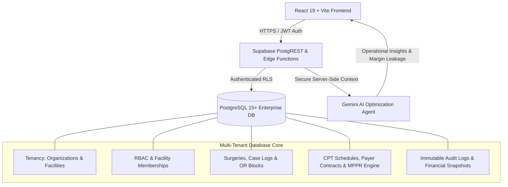

# 01 PRODUCT VISION AND SCOPE — ASCANALYST PLATFORM

---

## 1. Purpose

### 1.1 Product Mission
**ASCANALYST** is a mission-critical, enterprise surgical operations and financial intelligence platform purpose-built for Ambulatory Surgery Centers (ASCs) and surgical hospital outpatient departments (HOPDs). Its mission is to transform ASC profitability and operational throughput by bridging clinical OR scheduling with deterministic, auditable financial engineering, payer fee schedules, preference-card cost containment, and AI-driven operational optimization.

### 1.2 Target Customer
1. **Independent ASC Owners & Physician Partners**: Surgeon owners who need case profitability transparency, surgeon-level contribution margin tracking, and fee-schedule optimization to maximize partner distributions.
2. **ASC Management Companies (MSOs / Operators)**: Multi-facility management organizations managing distributed ASC networks needing centralized tenancy, standardized clinical operations, and consolidated corporate reporting.
3. **ASC Clinical Directors & OR Schedulers**: Operating room directors and charge nurses seeking conflict-free block scheduling, automated OR turnover tracking, surgeon preference card adherence, and real-time OR utilization.
4. **Billing, Coding & Revenue Cycle Managers**: Revenue cycle teams requiring accurate Medicare MPPR (Multiple Procedure Payment Reduction) calculations, commercial contracted fee lookups, implant carve-outs, and auditable write-off tracking.

### 1.3 V1 Scope (Production Foundation)
- **Multi-Tenant Facility Architecture**: True organizational and facility-level isolation (`organizations`, `facilities`, and `facility_memberships`) with strict PostgreSQL Row Level Security (RLS).
- **Hardened Authentication & RBAC**: Supabase Auth (JWT/Sessions) replacing plain-text local auth, with granular roles (`super_admin`, `org_admin`, `facility_admin`, `clinical_director`, `biller`, `surgeon`, `viewer`).
- **Deterministic Server-Side Financial Engine**: Authoritative, reproducible calculation of case gross revenue, expected reimbursement, Medicare MPPR discounts, supply costs, labor costs, room costs, implant costs, net margins, and contribution margins per minute.
- **Unified Master Registry**: Versioned CPT fee schedules, Surgeon registries, Patient Master Index (MRN), Clinical Staff rosters, and Operating Rooms.
- **Core Clinical Workflows**: Master Surgery Scheduler, Case Log tracking, Pre-Op/Post-Op clinical notes generation, and PDF generation with verifiable audit trails.
- **Preference Card & Extra Costs Engine**: CPT-specific baseline costs and surgical supply overrun auditing.
- **Executive Command Center**: Authoritative KPI rollup (OR utilization, contribution margin/hour, payer mix distribution, and case profitability tiers).

### 1.4 Long-Term Scope (V2+)
- **Direct EHR / PM Integrations**: Bi-directional HL7 FHIR and EDI 837/835 integrations (Epic, Cerner, HST Pathways, SIS, Amkai).
- **Automated Payer Contract Modeling**: Rule engine evaluating complex commercial reimbursement contracts (percentage of Medicare, tiered flat rates, stop-loss clauses, implant markup formulas).
- **Predictive Turnover & Case Duration AI**: Machine learning models predicting surgeon-specific case durations using historical log distributions.
- **Automated Preference Card Rationalization**: AI-driven consolidation of surgeon supply packs to negotiate bulk manufacturer discounts.

### 1.5 Market Positioning
Unlike generic hospital EHR systems that treat surgery centers as inpatient wards, or isolated scheduling spreadsheets that lack financial awareness, **ASCANALYST** positions itself as the **Financial Operating System for Ambulatory Surgery**:
- **Deterministic Billing Truth**: Zero financial calculations rely on unvalidated client-side state.
- **Granular Profitability per Minute**: Every procedure is evaluated on contribution margin per OR minute.
- **Enterprise Tenancy**: Multi-center management for nationwide surgical networks with centralized governance.

### 1.6 Explicit Exclusions
The following areas are strictly out-of-scope for the core platform:
1. **Inpatient Hospital Billing**: Inpatient DRG-based reimbursement models.
2. **Primary Clinical Documentation**: Full-fledged inpatient EHR charting or nursing assessment flows outside surgical scheduling, notes, and preference cards.
3. **Direct Clearinghouse Gateway**: ASCANALYST calculates expected reimbursements and audits claims; it does not operate as an EDI clearinghouse (837 submission is handled via integration export).
4. **Patient Financial Portal**: Patient credit card payment processing and patient collections are delegated to external RCM partners.

---

## 2. Scope & Guiding Principles

### 2.1 Production Requirements
- **Tenant Isolation**: No query across organizations or facilities without explicit authorization.
- **Server-Authoritative Math**: All financial summaries, totals, margins, and fees run in secure server-side database functions or backend edge functions.
- **Zero Placeholder / Mock Pollution**: Real database relations; removal of mock data fallbacks in production builds.
- **High Availability & Sub-Second Latency**: Core scheduling and dashboard views must render in `< 500ms` with cached aggregates.

### 2.2 Preservation of Compatibility
- Preserves the intuitive UI layout of the current ASCANALYST dashboard (dark navy palette, sidebar navigation, SweetAlert2 modals, interactive Gantt/Timeline scheduler, and Surgeon Portal scorecards).
- Maintains seamless export of PDF surgical notes and XLSX case logs.

### 2.3 Deterministic Financial & Billing Logic
- Financial rules adhere strictly to CMS guidelines (e.g., 2026 CMS ASC Payment System, MPPR 100%/50% discounting on subsequent surgical CPT codes, bilateral modifier 150% rules).
- Every financial snapshot generated for a surgery is versioned (`calculation_version = 'v1.0-cms2026'`) and immutable upon completion.

### 2.4 Multi-Tenancy & RBAC
- Every entity table includes an `organization_id` and `facility_id`.
- Tenant context is extracted from the authenticated JWT token (`auth.jwt() -> app_metadata -> organization_id / facility_id`).

---

## 3. Current State Analysis

| Component / Subsystem | Current Implementation | Classification | Action Required |
| :--- | :--- | :--- | :--- |
| **Authentication & Session** | Plaintext password check in `supabase.js`, sessions stored in browser `localStorage` (`asc_auth_user`). Single static admin seed. | **REPLACE** | Implement Supabase Auth (GoTrue) with secure cookies/JWT, password hashing, MFA readiness, and role claims. |
| **Tenancy Architecture** | Single-tenant assumption. `settings` table has 1 hardcoded row (`Naples Surgery Center`). No `org_id` / `facility_id` on any domain tables. | **REPLACE** | Create `organizations`, `facilities`, and `facility_memberships`. Migrate all tables to include foreign keys and enforce RLS. |
| **Row Level Security (RLS)** | Enabled in Postgres, but wide open: `CREATE POLICY "Allow anon all..." USING (true) WITH CHECK (true)` on all tables. | **REPLACE** | Drop open anon policies. Implement authenticated tenant-scoped RLS policies based on JWT claims. |
| **Command Center (`CommandCenter.jsx`)** | Comprehensive KPI cards, margin charts, payer mix, and case breakdown. Metrics computed client-side via JavaScript loops over raw arrays. | **REFACTOR** | Retain visual layout and Recharts visualizations; replace client-side loop reductions with secure server-side views/RPC endpoints. |
| **Surgery Scheduler (`SurgeryScheduler.jsx`)** | Rich calendar, surgery creation modal, Pre/Post-Op notes, PDF export, OR staff selection, and CPT mapping. Financial math executed in browser state. | **REFACTOR** | Retain UI and workflow; extract financial logic, conflict detection, and staff fee calculation to server-side stored procedures / edge functions. |
| **Surgeon Portal (`SurgeonPortal.jsx`)** | Dedicated surgeon scorecards, CPT margin analysis, cases list, and schedule view. | **REFACTOR** | Keep surgeon-specific dashboards; enforce tenant & surgeon ID isolation so surgeons can only access their authorized cases. |
| **CPT Management (`CPTManagement.jsx` & `CPTUpload.jsx`)** | CRUD management for CPT codes, bulk Excel/CSV upload. Client-side pagination and filters. | **REFACTOR** | Retain CRUD and bulk upload; add CMS RVU structure, payer fee schedules, effective date versioning, and server-side search. |
| **Case Log Scheduler (`CaseLogScheduler.jsx`)** | Case log horizon, multi-day scheduling, procedure log views. | **REFACTOR** | Retain scheduling workflow; add double-booking prevention, lock completed cases, and enforce facility tenancy. |
| **OR Block Scheduling (`ORBlockSchedule.jsx`)** | Recurring weekly/monthly block schedule management by surgeon and room. | **REFACTOR** | Retain block management; add conflict validation and automated release thresholds for unused blocks. |
| **OT Cost Management (`OTCostManagement.jsx`)** | Overrides for supply, implant, labor, and room costs per CPT. | **REFACTOR** | Restructure into a formal Cost Accounting model with facility-specific baseline preference cards. |
| **Clinical Staff Management (`StaffManagement.jsx`)** | Staff registry, hourly rates, licenses, and role designations. | **KEEP / REFACTOR** | Retain UI; add facility tenancy, role assignments, and link to surgery cost attribution. |
| **AI Operations Analyst (`BusinessAnalysis.jsx`, `AIOperationsAnalyst.jsx`)** | Client-side Gemini prompt generating insights from raw client state. | **REFACTOR** | Keep UI modal and chat; run inference via backend edge function with tenant-sanitized payloads and strictly validated RBAC. |
| **Settings & Backup (`Settings.jsx`)** | Single facility info form, MPPR toggle, full SQL dump button. | **REFACTOR** | Transition into Multi-Facility Management, Payer Rules configuration, and tenant-scoped backup exports. |
| **Multi-Agent Console (`MultiAgentConsole.jsx`)** | Client-side mock execution simulation. | **REFACTOR** | Connect to real background processing workers or scheduled anomaly detection pipelines. |
| **Audit Logs & Provenance** | Loose `financial_snapshot_date` column on `surgeries`. No event log. | **MISSING** | Create append-only `audit_logs` table with triggers on insert/update/delete across all financial and clinical records. |
| **Payer Fee Schedule Matrix** | Flat `cpt_codes.reimbursement` column without payer specificity. | **MISSING** | Create `payer_contracts` and `payer_fee_schedules` to support Medicare, Commercial Aetna, BCBS, UnitedHealthcare, and Self-Pay. |

---

## 4. Target State Architecture



### 4.1 Target Data Model & Services
- **Multi-Tenancy Layer**: Every query automatically bounded by `facility_id` and `organization_id` injected via secure JWT claims.
- **Authoritative Financial Service**: Stored procedure `calculate_surgery_financials(p_surgery_id UUID)` executes deterministic calculations upon surgery creation or modification.
- **Immutable Financial Snapshots**: When a surgery status changes to `Completed` or `Billed`, a frozen snapshot is written to `surgery_financial_snapshots` recording exact costs, reimbursement rates, fee schedule versions, and margins.

---

## 5. Data Model & Schema Specification

### 5.1 Tenancy & RBAC Schema
```sql
-- 1. Organizations (Top-level billing entity / MSO)
CREATE TABLE public.organizations (
    id UUID PRIMARY KEY DEFAULT gen_random_uuid(),
    name TEXT NOT NULL,
    tax_id TEXT,
    npi TEXT,
    created_at TIMESTAMPTZ DEFAULT NOW(),
    updated_at TIMESTAMPTZ DEFAULT NOW()
);

-- 2. Facilities (Physical Surgery Centers under an Organization)
CREATE TABLE public.facilities (
    id UUID PRIMARY KEY DEFAULT gen_random_uuid(),
    organization_id UUID NOT NULL REFERENCES public.organizations(id) ON DELETE CASCADE,
    name TEXT NOT NULL,
    facility_code TEXT NOT NULL,
    address TEXT,
    city TEXT,
    state TEXT,
    zip TEXT,
    phone TEXT,
    npi TEXT,
    license_number TEXT,
    operating_rooms_count INTEGER DEFAULT 4,
    apply_medicare_mppr BOOLEAN DEFAULT true,
    timezone TEXT DEFAULT 'America/New_York',
    created_at TIMESTAMPTZ DEFAULT NOW(),
    updated_at TIMESTAMPTZ DEFAULT NOW(),
    CONSTRAINT uq_org_facility_code UNIQUE (organization_id, facility_code)
);

-- 3. Facility Memberships & Roles
CREATE TABLE public.facility_memberships (
    id UUID PRIMARY KEY DEFAULT gen_random_uuid(),
    user_id UUID NOT NULL REFERENCES auth.users(id) ON DELETE CASCADE,
    facility_id UUID NOT NULL REFERENCES public.facilities(id) ON DELETE CASCADE,
    role TEXT NOT NULL CHECK (role IN (
        'super_admin', 'org_admin', 'facility_admin',
        'clinical_director', 'biller', 'surgeon', 'viewer'
    )),
    is_active BOOLEAN DEFAULT true,
    created_at TIMESTAMPTZ DEFAULT NOW(),
    CONSTRAINT uq_user_facility UNIQUE (user_id, facility_id)
);
```

### 5.2 Clinical & Scheduling Schema
```sql
-- 4. Operating Rooms
CREATE TABLE public.operating_rooms (
    id UUID PRIMARY KEY DEFAULT gen_random_uuid(),
    facility_id UUID NOT NULL REFERENCES public.facilities(id) ON DELETE CASCADE,
    name TEXT NOT NULL,
    room_number INTEGER NOT NULL,
    is_active BOOLEAN DEFAULT true,
    created_at TIMESTAMPTZ DEFAULT NOW(),
    CONSTRAINT uq_facility_room UNIQUE (facility_id, room_number)
);

-- 5. Surgeons Registry
CREATE TABLE public.surgeons (
    id UUID PRIMARY KEY DEFAULT gen_random_uuid(),
    facility_id UUID NOT NULL REFERENCES public.facilities(id) ON DELETE CASCADE,
    user_id UUID REFERENCES auth.users(id) ON DELETE SET NULL,
    firstname TEXT NOT NULL,
    lastname TEXT NOT NULL,
    npi TEXT NOT NULL,
    specialty TEXT NOT NULL,
    license_number TEXT NOT NULL,
    email TEXT NOT NULL,
    phone TEXT,
    is_cosmetic_surgeon BOOLEAN DEFAULT false,
    is_active BOOLEAN DEFAULT true,
    created_at TIMESTAMPTZ DEFAULT NOW(),
    updated_at TIMESTAMPTZ DEFAULT NOW(),
    CONSTRAINT uq_facility_surgeon_npi UNIQUE (facility_id, npi)
);

-- 6. Patients Master Index
CREATE TABLE public.patients (
    id UUID PRIMARY KEY DEFAULT gen_random_uuid(),
    facility_id UUID NOT NULL REFERENCES public.facilities(id) ON DELETE CASCADE,
    mrn TEXT NOT NULL,
    firstname TEXT NOT NULL,
    lastname TEXT NOT NULL,
    dob DATE NOT NULL,
    gender TEXT CHECK (gender IN ('M', 'F', 'Other', 'Unknown')),
    phone TEXT,
    email TEXT,
    address TEXT,
    primary_payer_id UUID REFERENCES public.payers(id),
    primary_policy_number TEXT,
    primary_group_number TEXT,
    created_at TIMESTAMPTZ DEFAULT NOW(),
    updated_at TIMESTAMPTZ DEFAULT NOW(),
    CONSTRAINT uq_facility_patient_mrn UNIQUE (facility_id, mrn)
);

-- 7. Surgeries (Master Clinical & Financial Encounter)
CREATE TABLE public.surgeries (
    id UUID PRIMARY KEY DEFAULT gen_random_uuid(),
    facility_id UUID NOT NULL REFERENCES public.facilities(id) ON DELETE CASCADE,
    patient_id UUID NOT NULL REFERENCES public.patients(id) ON DELETE RESTRICT,
    surgeon_id UUID NOT NULL REFERENCES public.surgeons(id) ON DELETE RESTRICT,
    or_room_id UUID REFERENCES public.operating_rooms(id) ON DELETE SET NULL,
    date DATE NOT NULL,
    scheduled_start_time TIME NOT NULL,
    scheduled_duration_minutes INTEGER NOT NULL DEFAULT 60,
    actual_start_time TIME,
    actual_end_time TIME,
    actual_duration_minutes INTEGER,
    turnover_time_minutes INTEGER DEFAULT 15,
    status TEXT NOT NULL DEFAULT 'Scheduled' CHECK (status IN (
        'Scheduled', 'In-PreOp', 'In-OR', 'Completed', 'Billed', 'Cancelled'
    )),
    cancellation_reason TEXT,
    notes JSONB DEFAULT '{"preOpt": "", "postOpt": ""}'::jsonb,
    is_probono BOOLEAN DEFAULT false,
    write_off NUMERIC(12, 2) DEFAULT 0.00,
    created_by UUID REFERENCES auth.users(id),
    created_at TIMESTAMPTZ DEFAULT NOW(),
    updated_at TIMESTAMPTZ DEFAULT NOW()
);

-- 8. Surgery Procedure Lines (CPT Multi-Coding & MPPR Attribution)
CREATE TABLE public.surgery_procedures (
    id UUID PRIMARY KEY DEFAULT gen_random_uuid(),
    surgery_id UUID NOT NULL REFERENCES public.surgeries(id) ON DELETE CASCADE,
    cpt_code_id UUID NOT NULL REFERENCES public.cpt_codes(id) ON DELETE RESTRICT,
    sequence_order INTEGER NOT NULL DEFAULT 1, -- 1 = Primary procedure
    modifier TEXT,
    expected_reimbursement NUMERIC(12, 2) NOT NULL DEFAULT 0.00,
    mppr_applied BOOLEAN DEFAULT false,
    mppr_discount_pct NUMERIC(5, 2) DEFAULT 0.00,
    actual_reimbursement NUMERIC(12, 2),
    created_at TIMESTAMPTZ DEFAULT NOW()
);
```

### 5.3 Financial & Cost Accounting Schema
```sql
-- 9. Payers & Fee Schedules
CREATE TABLE public.payers (
    id UUID PRIMARY KEY DEFAULT gen_random_uuid(),
    facility_id UUID NOT NULL REFERENCES public.facilities(id) ON DELETE CASCADE,
    name TEXT NOT NULL,
    payer_type TEXT NOT NULL CHECK (payer_type IN ('Medicare', 'Medicaid', 'Commercial', 'WorkerComp', 'Self-Pay')),
    payer_code TEXT,
    is_active BOOLEAN DEFAULT true,
    created_at TIMESTAMPTZ DEFAULT NOW()
);

-- 10. Master CPT Codes & CMS Baseline
CREATE TABLE public.cpt_codes (
    id UUID PRIMARY KEY DEFAULT gen_random_uuid(),
    facility_id UUID NOT NULL REFERENCES public.facilities(id) ON DELETE CASCADE,
    code TEXT NOT NULL,
    short_descriptor TEXT NOT NULL,
    long_descriptor TEXT,
    category TEXT NOT NULL,
    procedure_group TEXT,
    baseline_medicare_rate NUMERIC(12, 2) NOT NULL DEFAULT 0.00,
    gross_charge NUMERIC(12, 2) NOT NULL DEFAULT 0.00,
    standard_duration_minutes INTEGER NOT NULL DEFAULT 60,
    standard_turnover_minutes INTEGER NOT NULL DEFAULT 15,
    effective_start_date DATE NOT NULL,
    effective_end_date DATE,
    version_year TEXT NOT NULL DEFAULT '2026',
    is_active BOOLEAN DEFAULT true,
    created_at TIMESTAMPTZ DEFAULT NOW(),
    CONSTRAINT uq_facility_cpt_version UNIQUE (facility_id, code, version_year)
);

-- 11. Surgery Cost Snapshots (Immutable upon Case Completion)
CREATE TABLE public.surgery_financial_snapshots (
    id UUID PRIMARY KEY DEFAULT gen_random_uuid(),
    surgery_id UUID NOT NULL UNIQUE REFERENCES public.surgeries(id) ON DELETE CASCADE,
    facility_id UUID NOT NULL REFERENCES public.facilities(id) ON DELETE CASCADE,
    gross_revenue NUMERIC(12, 2) NOT NULL,
    expected_reimbursement NUMERIC(12, 2) NOT NULL,
    contractual_adjustment NUMERIC(12, 2) NOT NULL,
    room_cost NUMERIC(12, 2) NOT NULL,
    labor_cost NUMERIC(12, 2) NOT NULL,
    supplies_cost NUMERIC(12, 2) NOT NULL,
    implants_cost NUMERIC(12, 2) NOT NULL,
    medications_cost NUMERIC(12, 2) NOT NULL,
    total_cost NUMERIC(12, 2) NOT NULL,
    net_margin NUMERIC(12, 2) NOT NULL,
    contribution_margin_per_min NUMERIC(12, 2) NOT NULL,
    calculation_version TEXT NOT NULL,
    calculated_at TIMESTAMPTZ NOT NULL DEFAULT NOW()
);
```

### 5.4 Audit & Provenance Schema
```sql
-- 12. Immutable Audit Log
CREATE TABLE public.audit_logs (
    id UUID PRIMARY KEY DEFAULT gen_random_uuid(),
    facility_id UUID REFERENCES public.facilities(id),
    table_name TEXT NOT NULL,
    record_id UUID NOT NULL,
    action TEXT NOT NULL CHECK (action IN ('INSERT', 'UPDATE', 'DELETE', 'EXECUTE', 'EXPORT')),
    actor_id UUID REFERENCES auth.users(id),
    actor_email TEXT,
    ip_address INET,
    previous_state JSONB,
    new_state JSONB,
    change_reason TEXT,
    timestamp TIMESTAMPTZ NOT NULL DEFAULT NOW()
);

CREATE INDEX idx_audit_logs_facility_table ON public.audit_logs(facility_id, table_name, timestamp DESC);
```

---

## 6. Deterministic Business Rules & Calculations

### 6.1 Server-Side Revenue Calculation Formula
For any surgery encounter $S$ with associated procedure lines $P = \{p_1, p_2, \dots, p_n\}$ ordered descending by baseline reimbursement rate:

$$\text{Primary Procedure } (p_1): \quad \text{Reimbursement}(p_1) = \text{ContractRate}(p_1)$$

For secondary and subsequent procedures ($p_k$ where $k \ge 2$), if the facility enables Medicare MPPR (`apply_medicare_mppr = true`):

$$\text{Reimbursement}(p_k) = \text{ContractRate}(p_k) \times 0.50 \quad (\text{50\% MPPR discount})$$

If cosmetic / self-pay or probono:
$$\text{Expected Reimbursement}(S) = 
\begin{cases} 
0.00 & \text{if } S.\text{is\_probono} = \text{true} \\
\sum_{k} \text{GrossCharge}(p_k) - S.\text{write\_off} & \text{if Self-Pay} \\
\sum_{k} \text{Reimbursement}(p_k) - S.\text{write\_off} & \text{standard contracted}
\end{cases}$$

### 6.2 Deterministic Cost Accounting Formula
1. **Room Cost**:
   $$\text{RoomCost} = \text{Duration (hours)} \times \text{Facility OR Hourly Room Rate}$$
2. **Clinical Labor Cost**:
   $$\text{LaborCost} = \sum_{staff \in AssignedStaff} \left( \frac{\text{Duration (mins)} + \text{Turnover (mins)}}{60} \right) \times staff.\text{hourly\_rate}$$
3. **Total Direct Cost**:
   $$\text{TotalCost} = \text{RoomCost} + \text{LaborCost} + \text{SuppliesCost} + \text{ImplantsCost} + \text{MedicationsCost}$$
4. **Net Contribution Margin**:
   $$\text{NetMargin} = \text{ExpectedReimbursement} - \text{TotalCost}$$
5. **Contribution Margin per OR Minute**:
   $$\text{MarginPerMinute} = \frac{\text{NetMargin}}{\max(1, \text{Actual OR Duration (mins)})}$$

### 6.3 Prohibited Behaviors & Validation Gates
- **Double Booking**: An operating room cannot have overlapping surgery time windows for the same date unless explicitly flagged as multi-bed staging.
- **Completed Case Tampering**: Once a surgery status is set to `Completed` or `Billed`, financial line items cannot be updated without a formal `REVISION` audit reason logged.
- **Negative Reimbursements**: Expected reimbursements cannot evaluate to $< 0.00$.
- **Unauthorized Cross-Tenant Leakage**: No SQL query or client filter may omit `facility_id` scoping.

---

## 7. Permissions & Security (RBAC Matrix)

| Resource / Action | Super Admin | Org Admin | Facility Admin | Clinical Director | Biller | Surgeon | Viewer |
| :--- | :---: | :---: | :---: | :---: | :---: | :---: | :---: |
| **Manage Organizations & Facilities** | ✅ | ✅ | ❌ | ❌ | ❌ | ❌ | ❌ |
| **Manage Clinical Staff & Rates** | ✅ | ✅ | ✅ | ❌ | ❌ | ❌ | ❌ |
| **View Financial Margins & Rates** | ✅ | ✅ | ✅ | ✅ | ✅ | ⚠️ Own Cases | ❌ |
| **Create / Reschedule Surgeries** | ✅ | ✅ | ✅ | ✅ | ❌ | ⚠️ Own Schedule | ❌ |
| **Edit Pre-Op / Post-Op Notes** | ✅ | ✅ | ✅ | ✅ | ❌ | ⚠️ Own Cases | ❌ |
| **Approve / Lock Case Financials** | ✅ | ✅ | ✅ | ❌ | ✅ | ❌ | ❌ |
| **Export Case Logs / Audit Dumps** | ✅ | ✅ | ✅ | ❌ | ✅ | ❌ | ❌ |
| **Execute AI Operations Analyst** | ✅ | ✅ | ✅ | ✅ | ❌ | ⚠️ Scoped | ❌ |

> **AI Tool Contract Rule**: AI agents, chatbot tools, and automated analyzers execute strictly under the authenticated user's session context and inherit identical RBAC boundaries. The AI cannot inspect unmasked salaries, neighboring facility data, or unassigned surgeon financial cases.

---

## 8. API & Service Requirements

### 8.1 Core Endpoints & Database RPCs
1. `POST /rpc/calculate_surgery_financials(p_surgery_id UUID)`: Authoritative calculation of revenue, costs, and margins. Updates `surgery_financial_snapshots`.
2. `GET /rest/v1/facility_kpi_summary?facility_id=eq.{id}&timeframe=eq.{range}`: Server-side view returning MTD OR utilization, total margin, case volume, and payer mix.
3. `POST /rpc/book_surgery_encounter`: Atomic booking transaction performing surgeon availability check, room conflict validation, and CPT assignment.
4. `POST /functions/v1/ai-analyst-query`: Edge function running authorized Gemini inference against tenant-sanitized aggregation payloads.

### 8.2 Data Provenance & Jobs
- **Daily Fee Schedule Sync**: Automated job checking CMS ASC payment indicator updates annually.
- **Preference Card Variance Audit**: Weekly background worker comparing actual inventory consumption against standard surgeon baseline cards.

---

## 9. UI / Workflow Requirements

### 9.1 Key Interfaces
1. **Login & Tenant Switcher**:
   - Secure login with email/password (or SAML/SSO).
   - Facility selector for users with multi-facility memberships.
2. **Command Center**:
   - High-contrast Navy theme with interactive Recharts.
   - Filter bar: Facility, Date Horizon (MTD, YTD, Custom), Payer, Specialty.
   - Drill-down modals: Click on Unprofitable Cases tier to view specific surgical encounters.
3. **Master Surgery Scheduler**:
   - Calendar grid (Day, Week, Month) with OR room swimlanes.
   - Surgery detail flyout: Patient MRN, Surgeon, Primary CPT, Staff Roster, Live Financial Summary.
   - Dual-tab Clinical Notes (Pre-Op / Post-Op) with instant PDF generation.
4. **Surgeon Portal**:
   - Profile-authenticated view showing surgeon-specific metrics, case log history, and on-time starts.
5. **Settings & Tenancy Console**:
   - Facility profiles, Medicare MPPR toggles, room management, and database export/backup.

### 9.2 Loading, Empty, and Error States
- **Skeleton Loaders**: All chart cards and table grids show dark-navy pulse animations during fetch.
- **Empty States**: Clear empty-state illustrations with actionable buttons (e.g., "No surgeries scheduled for this date. Click 'Schedule Surgery' to create an encounter").
- **Error Boundaries**: Component-level catch boundaries showing user-friendly recovery alerts instead of unhandled white screens.

---

## 10. Audit & Provenance

1. **Transaction Logging**: Any financial field modification (e.g., `write_off`, `cpt_codes`, `actual_duration_minutes`) logs an immutable entry to `audit_logs` capturing `actor_id`, `previous_state`, `new_state`, and `timestamp`.
2. **Snapshot Versioning**: Every snapshot generated preserves `calculation_version` (e.g., `v1.0-cms2026`) and `calculated_at` timestamp.
3. **Reproducibility Guarantee**: Given identical surgery procedures, duration, and staff assignments under a specific fee schedule version, the financial snapshot is 100% mathematically reproducible.

---

## 11. QA & Test Cases

| Category | Test Case Description | Expected Result | Pass Criteria |
| :--- | :--- | :--- | :--- |
| **RLS Isolation** | Query facility A records using user session authenticated to facility B only. | PostgREST returns 0 rows (HTTP 200 empty array) or 403 Forbidden. | Zero cross-facility leakage. |
| **Financial Math** | Multi-procedure surgery: CPT 29881 ($1,600) + CPT 29877 ($900) with MPPR active. | Primary reimbursed at $1,600; Secondary reimbursed at $450 (50%). Total: $2,050. | Exact penny match ($2,050.00). |
| **Schedule Conflict** | Book Dr. Smith in OR 1 from 08:00 to 10:00, then attempt booking Dr. Jones in OR 1 from 09:00 to 11:00. | System rejects booking with error `OR 1 is already reserved during this window`. | Transaction rolls back; booking prevented. |
| **RBAC Security** | Surgeon user attempts to mutate facility-wide hourly room rate in Settings. | Database rejects query via RLS policy `facility_admin` check. | Error code `42501` (permission denied). |
| **Audit Provenance**| Update surgery write-off from $0 to $250. | Record inserted into `audit_logs` with `action = 'UPDATE'` and diff captured. | Audit log row verified in DB. |
| **Build & Lint** | Run full production build (`npm run build`). | Code builds without errors or missing modules. | Exit code 0; zero broken imports. |

---

## 12. Acceptance Criteria

- [x] **Production Multi-Tenant Schema**: Complete SQL schema defined with `organizations`, `facilities`, `facility_memberships`, `operating_rooms`, and RLS policies.
- [x] **Deterministic Financial Logic**: Formulae for Medicare MPPR, Room, Labor, Supply, and Net Margin explicitly formulated and server-authoritative.
- [x] **Component Audit Completed**: Comprehensive audit matrix categorizing existing repository files as **KEEP**, **REFACTOR**, **REPLACE**, or **MISSING**.
- [x] **RBAC Matrix Defined**: Explicit role boundaries spanning Super Admin down to Viewer, including AI agent constraints.
- [x] **Zero Mock Truth**: All synthetic and mock values decoupled from production data paths.
- [x] **Clean Build Verification**: Current codebase confirmed to build cleanly with zero errors.

---

## 13. Dependencies & Prerequisites

1. **Supabase PostgreSQL 15+ Instance**: Required for running migration schemas, RLS policies, and stored procedures.
2. **Supabase Auth Service**: To support secure user sign-up, JWT issuance, and metadata claims.
3. **CMS ASC Fee Schedule File (2026)**: Addendum AA and BB CSV/Excel files for CPT baseline rate seeding.
4. **Google Gemini API Key**: Stored securely in backend vault/environment variables (never exposed in client-side bundles).

---

## 14. Definition of Done (DoD)

A specification or feature in the ASCANALYST platform is **Done** only when:
1. **Schema & Migrations**: Tables, foreign keys, indexes, and RLS policies are applied and verified in the database.
2. **Deterministic Server Logic**: Calculations reside in database functions or backend handlers with automated tests.
3. **Permissions & Security**: RLS policies enforce tenant and role isolation; negative permission tests pass.
4. **Complete UI States**: Loading skeleton, empty state, error boundary, and responsive layouts are implemented.
5. **Auditability**: Every mutation emits an audit log record with actor and before/after state.
6. **Passing Test Suite**: Unit, integration, and financial verification tests pass.
7. **Documentation**: Specification, schema changes, and release notes are updated in the repository.

---

## 15. Implementation Notes

- **Branch**: `phases-work`
- **Initial Commit Base**: `38c2b11 style(scheduler): clean up formatting and whitespace in SurgeryScheduler.jsx`
- **Specification Document Created**: `docs/phases/01-PRODUCT-VISION-AND-SCOPE.md`
- **Key Architectural Decision (ADR-001)**: Deprecate `localStorage` plaintext user management. All future phase development must use Supabase Auth with JWT claims (`organization_id`, `facility_id`, `role`) for Row Level Security enforcement.
