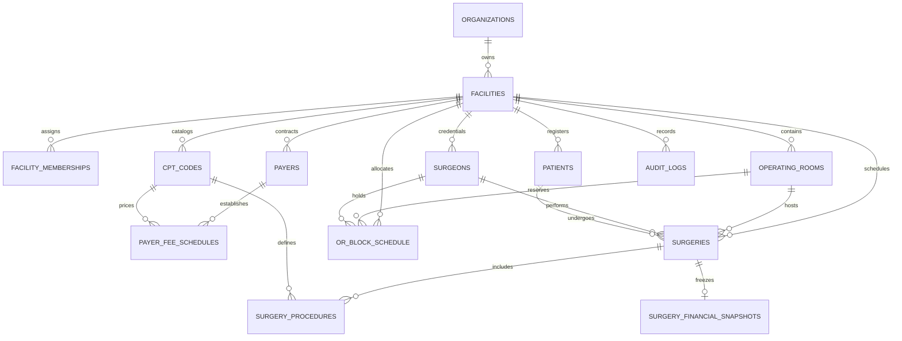

# 03 CURRENT DATABASE AUDIT — ASCANALYST PLATFORM

---

## 1. Purpose

The purpose of this specification is to deliver an exhaustive architectural and forensic audit of the existing Supabase PostgreSQL database supporting the `asc-prototype` application. It evaluates all 15 active tables, foreign key constraints, indexing strategies, primary key sequence mechanics, and Row Level Security (RLS) policies. 

The audit identifies critical migration risks, schema normalization anti-patterns (such as comma-separated foreign keys and plaintext credential storage), performance bottlenecks, and security vulnerabilities, providing a deterministic migration roadmap to achieve production-grade multi-tenancy, HIPAA compliance, and auditable financial integrity.

---

## 2. Scope & Guiding Principles

### 2.1 Production Requirements
- **Tenant Isolation**: Every operational entity must belong to a verified `facility_id` under an `organization_id`.
- **Referential Integrity**: Eliminate raw string references for relational entities (e.g., room names, provider names, and CPT code lists).
- **Zero Plaintext Credentials or API Secrets**: Remove all passwords and external API tokens (`gemini_api_key`) from user-queryable tables.
- **Strict Row Level Security (RLS)**: Decommission all wide-open anonymous access policies (`USING (true)`). Enforce JWT claim-scoped access.
- **Auditability & Temporal Versioning**: Establish append-only audit trails capturing actor, timestamp, IP address, and JSON state diffs for all mutations.

---

## 3. Current Database Inventory & Classification

The current database environment consists of **15 tables** defined across `schema_setup.sql`, `create_agent_tables.sql`, and incremental patch scripts.

### 3.1 Table-by-Table Architectural Audit Matrix

| Table Name | PK Type | Estimated Records | Current Schema & Relationships | Classification | Technical Risks & Required Actions |
| :--- | :---: | :---: | :--- | :---: | :--- |
| `public.settings` | `BIGINT` | 1 | Single-row facility metadata, MPPR toggle, and plaintext `gemini_api_key`. | **REFACTOR** | **Critical Risk:** Stores unencrypted Gemini API key in an unauthenticated table. Does not support multi-tenancy. Migrate facility metadata to `facilities` table; move API secrets to Supabase Vault / Edge Function environment variables. |
| `public.surgeons` | `BIGINT` | ~10–50 | Surgeon registry, specialty, license, contact info, `password` (plaintext), and `block_templates` (raw JSONB). | **REFACTOR** | **Critical Security Flaw:** Stores plaintext passwords. Lacks `facility_id`. Migrate authentication to Supabase Auth (`auth.users`); normalize block templates into `or_block_schedule`; add `facility_id` foreign key. |
| `public.patients` | `BIGINT` | ~100–500 | Patient registry, MRN, demographic data, and flat insurance fields (`insurance_provider`, `copay_amount`). | **REFACTOR** | Lacks `facility_id`. No unique index on `(facility_id, mrn)` leading to duplicate MRN risks. Normalize insurance data into foreign keys referencing a dedicated `payers` table. |
| `public.cpt_codes` | `BIGINT` | ~10,000 | Comprehensive CPT code directory with durations, turnover times, gross charges, and single `reimbursement` column. | **REFACTOR** | Flat `reimbursement` column cannot model payer-specific contracted fee schedules (Medicare vs Aetna vs BCBS). Extract contracted rates into `payer_fee_schedules`; add composite index on `(code, is_active)`. |
| `public.surgeries` | `BIGINT` | ~500–2,000 | Central surgical encounter table with scheduling times, financial cost columns, and `cpt_codes` stored as comma-delimited `TEXT`. | **REFACTOR** | **Severe 1NF Violation:** Comma-separated `cpt_codes` string prevents SQL joins, procedure-level auditing, and MPPR sequence enforcement. Normalize procedure lines into `surgery_procedures`. Add `facility_id` and `or_room_id` FKs. Replace client-computed finances with server-authoritative snapshots. |
| `public.or_block_schedule` | `BIGINT` | ~50–200 | Block reservations storing `room_name` and `provider_name` as plain unlinked strings. | **REFACTOR** | Broken relational integrity: renaming a room or surgeon orphans historical block schedules. Refactor to foreign keys referencing `operating_rooms(id)` and `surgeons(id)`. Add GiST temporal exclusion constraint to prevent double-booking. |
| `public.ot_extra_cost` | `UUID` | ~100 | CPT expense overrides (supplies, implants, labor, room, tray) indexed by plain string `cpt_codes`. | **REFACTOR** | Lacks `facility_id`. String-based CPT matching is fragile. Migrate to facility-scoped preference card baseline costs linked by `cpt_code_id`. |
| `public.staff` | `BIGINT` | ~50–100 | Clinical staff roster with department, license, role, `hourly_rate`, `monthly_salary`, and `benefits`. | **REFACTOR** | **Data Exposure Risk:** Unrestricted table exposes sensitive payroll wages to anonymous users. Add `facility_id`. Enforce column-level security or split salary data into restricted admin view. |
| `public.chatbot_questions` | `BIGINT` | ~20 | Suggested prompt questions categorized for the AI chatbot assistant. | **KEEP / REFACTOR** | Structure is clean. Add optional `facility_id` (nullable for system-wide defaults) and sort ordering column. |
| `public.users` | `BIGINT` | ~5 | Custom user table storing names, emails, roles, and plaintext passwords (`admin123`). | **REPLACE** | **Severe Vulnerability:** Completely bypasses Supabase GoTrue Auth. Must be decommissioned and replaced with standard `auth.users` joined to `facility_memberships`. |
| `public.agent_runs` | `UUID` | Diagnostic | Execution tracking for multi-agent pipeline (`request_id`, `agent_name`, `confidence`, `input_data`, `output_data`). | **KEEP / REFACTOR** | Architecture is solid. Add `facility_id` foreign key and drop public open RLS policies. |
| `public.agent_tasks` | `UUID` | Diagnostic | Task dependency graph and status logging for agent pipeline execution. | **KEEP / REFACTOR** | Retain schema; add `facility_id` and index on `(request_id, status)`. |
| `public.agent_events` | `UUID` | Diagnostic | Inter-agent event bus telemetry logging payloads. | **KEEP / REFACTOR** | Retain schema; add automatic partition/cleanup strategy for telemetry retention. |
| `public.agent_context` | `UUID` | Diagnostic | Shared state container JSON for running agent sessions. | **KEEP / REFACTOR** | Retain schema; enforce row expiration or archive after 30 days. |
| `public.agent_approvals` | `UUID` | Diagnostic | Decision records for human-in-the-loop review of agent recommendations. | **KEEP / REFACTOR** | Retain schema; link `approved_by` to authenticated `auth.users(id)`. |

---

## 4. Critical Database Vulnerabilities & Anti-Patterns

### 4.1 Vulnerability 1: Wide-Open Anonymous RLS Policies (P0 Security Risk)
Across both `schema_setup.sql` and `create_agent_tables.sql`, every single table is configured with wide-open anonymous access:
```sql
-- DANGEROUS: Grants full read/write/truncate access to anyone with the anon key
CREATE POLICY "Allow anon all on surgeries" ON public.surgeries FOR ALL TO anon USING (true) WITH CHECK (true);
CREATE POLICY "Allow anon all on staff" ON public.staff FOR ALL TO anon USING (true) WITH CHECK (true);
CREATE POLICY "Allow public read/write access for development" ON public.agent_runs FOR ALL USING (true) WITH CHECK (true);
```
**Impact:** Any web visitor with the public `VITE_SUPABASE_ANON_KEY` can execute arbitrary PostgREST queries to dump patient MRNs, alter surgery financials, inspect clinical staff salaries, or delete tables.

### 4.2 Vulnerability 2: Plaintext Credentials & Secret Leakage (P0 Risk)
- `public.users.password` stores raw strings (`admin123`).
- `public.surgeons.password` stores raw strings or defaults to `surgeon123`.
- `public.settings.gemini_api_key` stores the external Google AI secret token directly in a queryable table.
**Impact:** Direct violation of HIPAA Technical Safeguards (45 CFR § 164.312) and OWASP Top 10 A07 (Identification and Authentication Failures).

### 4.3 Anti-Pattern 1: Sequential Integer Primary Keys in Multi-Tenant Domain
Tables `surgeries`, `patients`, `surgeons`, and `cpt_codes` use `BIGINT GENERATED BY DEFAULT AS IDENTITY`.
- Incremental sequence numbers (`1, 2, 3...`) enable Insecure Direct Object Reference (IDOR) attacks where a tenant can enumerate other tenants' case IDs.
- Sequence collisions occur when seeding or migrating data across centers (hence `fix_primary_key_sequences.sql` was needed to constantly repair broken sequences).
**Remedy:** Transition domain primary keys to `UUID DEFAULT gen_random_uuid()`.

### 4.4 Anti-Pattern 2: Comma-Separated Foreign Keys (1NF Violation)
In `public.surgeries`, multiple procedure codes are stored as a delimited string:
```sql
cpt_codes TEXT -- e.g. "29881, 29877"
```
**Impact:**
- Inability to perform relational joins (`JOIN cpt_codes ON ...`).
- Inability to enforce foreign key integrity (a deleted CPT code leaves a dangling string).
- Inability to index individual procedure occurrences for analytics.
- Impossible to calculate sequence-dependent billing rules (e.g., CMS MPPR requires sorting procedure lines descending by contracted value).

### 4.5 Anti-Pattern 3: Loose String Relations in Scheduling
In `public.or_block_schedule`:
```sql
room_name TEXT,      -- e.g. "OR 1"
provider_name TEXT   -- e.g. "Dr. Gardner Paul"
```
There is no foreign key to `operating_rooms` or `surgeons`. If a surgeon's name spelling is corrected in the directory, their historical block schedule becomes disconnected.

---

## 5. Target State Relational Data Model



---

## 6. Target Schema DDL & Migration Scripts

### 6.1 Migration Step 1: Multi-Tenancy Core
```sql
-- Enable necessary extensions
CREATE EXTENSION IF NOT EXISTS "uuid-ossp";
CREATE EXTENSION IF NOT EXISTS "btree_gist";

-- 1. Organizations (MSO / Parent Entity)
CREATE TABLE public.organizations (
    id UUID PRIMARY KEY DEFAULT gen_random_uuid(),
    name TEXT NOT NULL,
    tax_id TEXT,
    npi TEXT,
    created_at TIMESTAMPTZ NOT NULL DEFAULT NOW(),
    updated_at TIMESTAMPTZ NOT NULL DEFAULT NOW()
);

-- 2. Facilities (Physical Surgery Center)
CREATE TABLE public.facilities (
    id UUID PRIMARY KEY DEFAULT gen_random_uuid(),
    organization_id UUID NOT NULL REFERENCES public.organizations(id) ON DELETE CASCADE,
    name TEXT NOT NULL,
    facility_code TEXT NOT NULL,
    address TEXT,
    city TEXT,
    state TEXT,
    zip TEXT,
    phone TEXT,
    npi TEXT,
    tax_id TEXT,
    operating_rooms_count INTEGER NOT NULL DEFAULT 4,
    apply_medicare_mppr BOOLEAN NOT NULL DEFAULT true,
    timezone TEXT NOT NULL DEFAULT 'America/New_York',
    created_at TIMESTAMPTZ NOT NULL DEFAULT NOW(),
    updated_at TIMESTAMPTZ NOT NULL DEFAULT NOW(),
    CONSTRAINT uq_facility_org_code UNIQUE (organization_id, facility_code)
);

-- 3. Facility Memberships (RBAC Bridge)
CREATE TABLE public.facility_memberships (
    id UUID PRIMARY KEY DEFAULT gen_random_uuid(),
    user_id UUID NOT NULL REFERENCES auth.users(id) ON DELETE CASCADE,
    facility_id UUID NOT NULL REFERENCES public.facilities(id) ON DELETE CASCADE,
    role TEXT NOT NULL CHECK (role IN (
        'super_admin', 'org_admin', 'facility_admin',
        'clinical_director', 'biller', 'surgeon', 'viewer'
    )),
    is_active BOOLEAN NOT NULL DEFAULT true,
    created_at TIMESTAMPTZ NOT NULL DEFAULT NOW(),
    CONSTRAINT uq_facility_user_role UNIQUE (user_id, facility_id)
);
```

### 6.2 Migration Step 2: Clinical Infrastructure
```sql
-- 4. Operating Rooms
CREATE TABLE public.operating_rooms (
    id UUID PRIMARY KEY DEFAULT gen_random_uuid(),
    facility_id UUID NOT NULL REFERENCES public.facilities(id) ON DELETE CASCADE,
    name TEXT NOT NULL,
    room_number INTEGER NOT NULL,
    hourly_cost_rate NUMERIC(10, 2) NOT NULL DEFAULT 1500.00,
    is_active BOOLEAN NOT NULL DEFAULT true,
    created_at TIMESTAMPTZ NOT NULL DEFAULT NOW(),
    CONSTRAINT uq_facility_room_number UNIQUE (facility_id, room_number)
);

-- 5. Payers & Fee Schedules
CREATE TABLE public.payers (
    id UUID PRIMARY KEY DEFAULT gen_random_uuid(),
    facility_id UUID NOT NULL REFERENCES public.facilities(id) ON DELETE CASCADE,
    name TEXT NOT NULL,
    payer_type TEXT NOT NULL CHECK (payer_type IN ('Medicare', 'Medicaid', 'Commercial', 'WorkerComp', 'Self-Pay')),
    payer_code TEXT,
    is_active BOOLEAN NOT NULL DEFAULT true,
    created_at TIMESTAMPTZ NOT NULL DEFAULT NOW()
);

-- 6. Payer Fee Schedules
CREATE TABLE public.payer_fee_schedules (
    id UUID PRIMARY KEY DEFAULT gen_random_uuid(),
    facility_id UUID NOT NULL REFERENCES public.facilities(id) ON DELETE CASCADE,
    payer_id UUID NOT NULL REFERENCES public.payers(id) ON DELETE CASCADE,
    cpt_code_id BIGINT NOT NULL REFERENCES public.cpt_codes(id) ON DELETE CASCADE,
    contracted_rate NUMERIC(12, 2) NOT NULL,
    effective_start_date DATE NOT NULL,
    effective_end_date DATE,
    created_at TIMESTAMPTZ NOT NULL DEFAULT NOW(),
    CONSTRAINT uq_payer_cpt_effective UNIQUE (payer_id, cpt_code_id, effective_start_date)
);
```

### 6.3 Migration Step 3: Normalized Surgery & Procedure Lines
```sql
-- 7. Surgery Procedures (Replaces comma-separated cpt_codes)
CREATE TABLE public.surgery_procedures (
    id UUID PRIMARY KEY DEFAULT gen_random_uuid(),
    surgery_id BIGINT NOT NULL REFERENCES public.surgeries(id) ON DELETE CASCADE,
    cpt_code_id BIGINT NOT NULL REFERENCES public.cpt_codes(id) ON DELETE RESTRICT,
    sequence_rank INTEGER NOT NULL DEFAULT 1, -- 1 = Primary, 2 = Secondary, etc.
    modifier_code TEXT,                       -- e.g. '50' (Bilateral), '51' (Multiple), '59' (Distinct)
    baseline_charge NUMERIC(12, 2) NOT NULL DEFAULT 0.00,
    contracted_reimbursement NUMERIC(12, 2) NOT NULL DEFAULT 0.00,
    mppr_applied BOOLEAN NOT NULL DEFAULT false,
    mppr_discount_pct NUMERIC(5, 2) NOT NULL DEFAULT 0.00, -- 0.00 for primary, 50.00 for secondary
    final_expected_reimbursement NUMERIC(12, 2) NOT NULL DEFAULT 0.00,
    created_at TIMESTAMPTZ NOT NULL DEFAULT NOW()
);

CREATE INDEX idx_surgery_procedures_surgery_id ON public.surgery_procedures(surgery_id);
CREATE INDEX idx_surgery_procedures_cpt_id ON public.surgery_procedures(cpt_code_id);

-- 8. Surgery Financial Snapshots (Frozen Truth upon Completion)
CREATE TABLE public.surgery_financial_snapshots (
    id UUID PRIMARY KEY DEFAULT gen_random_uuid(),
    surgery_id BIGINT NOT NULL UNIQUE REFERENCES public.surgeries(id) ON DELETE CASCADE,
    facility_id UUID NOT NULL REFERENCES public.facilities(id) ON DELETE CASCADE,
    gross_revenue NUMERIC(12, 2) NOT NULL,
    expected_reimbursement NUMERIC(12, 2) NOT NULL,
    room_cost NUMERIC(12, 2) NOT NULL,
    labor_cost NUMERIC(12, 2) NOT NULL,
    supplies_cost NUMERIC(12, 2) NOT NULL,
    implants_cost NUMERIC(12, 2) NOT NULL,
    medications_cost NUMERIC(12, 2) NOT NULL,
    total_cost NUMERIC(12, 2) NOT NULL,
    net_margin NUMERIC(12, 2) NOT NULL,
    margin_per_or_minute NUMERIC(12, 2) NOT NULL,
    calculation_version TEXT NOT NULL DEFAULT 'v1.0-cms2026',
    calculated_at TIMESTAMPTZ NOT NULL DEFAULT NOW()
);

CREATE INDEX idx_snapshots_facility_margin ON public.surgery_financial_snapshots(facility_id, net_margin);
```

### 6.4 Migration Step 4: Immutable Audit Log System
```sql
-- 9. Audit Logs Table
CREATE TABLE public.audit_logs (
    id UUID PRIMARY KEY DEFAULT gen_random_uuid(),
    facility_id UUID REFERENCES public.facilities(id),
    table_name TEXT NOT NULL,
    record_id TEXT NOT NULL,
    action TEXT NOT NULL CHECK (action IN ('INSERT', 'UPDATE', 'DELETE', 'EXECUTE', 'EXPORT')),
    actor_id UUID REFERENCES auth.users(id),
    actor_email TEXT,
    ip_address INET,
    previous_state JSONB,
    new_state JSONB,
    change_reason TEXT,
    timestamp TIMESTAMPTZ NOT NULL DEFAULT NOW()
);

CREATE INDEX idx_audit_logs_facility_table ON public.audit_logs(facility_id, table_name, timestamp DESC);

-- Generic Audit Trigger Function
CREATE OR REPLACE FUNCTION public.fn_audit_log_trigger()
RETURNS TRIGGER AS $$
DECLARE
    v_actor_id UUID;
    v_actor_email TEXT;
    v_facility_id UUID;
BEGIN
    -- Extract actor from JWT session
    v_actor_id := auth.uid();
    v_actor_email := auth.jwt() ->> 'email';
    
    -- Extract facility_id if present
    IF TG_OP = 'DELETE' THEN
        v_facility_id := (CASE WHEN OLD.facility_id IS NOT NULL THEN OLD.facility_id ELSE NULL END);
        INSERT INTO public.audit_logs (
            facility_id, table_name, record_id, action, actor_id, actor_email, previous_state
        ) VALUES (
            v_facility_id, TG_TABLE_NAME, OLD.id::text, TG_OP, v_actor_id, v_actor_email, to_jsonb(OLD)
        );
        RETURN OLD;
    ELSIF TG_OP = 'UPDATE' THEN
        v_facility_id := (CASE WHEN NEW.facility_id IS NOT NULL THEN NEW.facility_id ELSE NULL END);
        INSERT INTO public.audit_logs (
            facility_id, table_name, record_id, action, actor_id, actor_email, previous_state, new_state
        ) VALUES (
            v_facility_id, TG_TABLE_NAME, NEW.id::text, TG_OP, v_actor_id, v_actor_email, to_jsonb(OLD), to_jsonb(NEW)
        );
        RETURN NEW;
    ELSIF TG_OP = 'INSERT' THEN
        v_facility_id := (CASE WHEN NEW.facility_id IS NOT NULL THEN NEW.facility_id ELSE NULL END);
        INSERT INTO public.audit_logs (
            facility_id, table_name, record_id, action, actor_id, actor_email, new_state
        ) VALUES (
            v_facility_id, TG_TABLE_NAME, NEW.id::text, TG_OP, v_actor_id, v_actor_email, to_jsonb(NEW)
        );
        RETURN NEW;
    END IF;
    RETURN NULL;
END;
$$ LANGUAGE plpgsql SECURITY DEFINER;
```

---

## 7. Hardened Row Level Security (RLS) Policies

All open `Allow anon all` policies are dropped. The following standard tenant-isolation helper function and policies are established:

```sql
-- Helper function to retrieve authenticated user's active facilities
CREATE OR REPLACE FUNCTION public.get_auth_user_facilities()
RETURNS TABLE (facility_id UUID, role TEXT) AS $$
BEGIN
    RETURN QUERY
    SELECT fm.facility_id, fm.role
    FROM public.facility_memberships fm
    WHERE fm.user_id = auth.uid()
      AND fm.is_active = true;
END;
$$ LANGUAGE plpgsql SECURITY DEFINER STABLE;

-- Drop all wide-open development policies
DROP POLICY IF EXISTS "Allow anon all on settings" ON public.settings;
DROP POLICY IF EXISTS "Allow anon all on surgeons" ON public.surgeons;
DROP POLICY IF EXISTS "Allow anon all on patients" ON public.patients;
DROP POLICY IF EXISTS "Allow anon all on cpt_codes" ON public.cpt_codes;
DROP POLICY IF EXISTS "Allow anon all on surgeries" ON public.surgeries;
DROP POLICY IF EXISTS "Allow anon all on or_block_schedule" ON public.or_block_schedule;
DROP POLICY IF EXISTS "Allow anon all on ot_extra_cost" ON public.ot_extra_cost;
DROP POLICY IF EXISTS "Allow anon all on staff" ON public.staff;
DROP POLICY IF EXISTS "Allow anon all on users" ON public.users;

-- Example: Strict Tenant RLS on Surgeries Table
CREATE POLICY "Tenant read access on surgeries"
ON public.surgeries FOR SELECT TO authenticated
USING (
    facility_id IN (SELECT facility_id FROM public.get_auth_user_facilities())
);

CREATE POLICY "Tenant write access on surgeries"
ON public.surgeries FOR ALL TO authenticated
USING (
    facility_id IN (
        SELECT facility_id FROM public.get_auth_user_facilities() 
        WHERE role IN ('super_admin', 'org_admin', 'facility_admin', 'clinical_director')
    )
)
WITH CHECK (
    facility_id IN (
        SELECT facility_id FROM public.get_auth_user_facilities() 
        WHERE role IN ('super_admin', 'org_admin', 'facility_admin', 'clinical_director')
    )
);
```

---

## 8. Authoritative Server-Side Stored Procedure

```sql
-- Stored Procedure: calculate_surgery_financials
CREATE OR REPLACE FUNCTION public.calculate_surgery_financials(p_surgery_id BIGINT)
RETURNS JSONB AS $$
DECLARE
    v_surgery RECORD;
    v_facility RECORD;
    v_proc RECORD;
    v_room_cost NUMERIC(12, 2) := 0.00;
    v_labor_cost NUMERIC(12, 2) := 0.00;
    v_supplies_cost NUMERIC(12, 2) := 0.00;
    v_implants_cost NUMERIC(12, 2) := 0.00;
    v_meds_cost NUMERIC(12, 2) := 0.00;
    v_gross_revenue NUMERIC(12, 2) := 0.00;
    v_expected_reimbursement NUMERIC(12, 2) := 0.00;
    v_total_cost NUMERIC(12, 2) := 0.00;
    v_net_margin NUMERIC(12, 2) := 0.00;
    v_margin_per_min NUMERIC(12, 2) := 0.00;
    v_duration_mins INTEGER;
    v_rank INTEGER := 1;
BEGIN
    -- 1. Fetch surgery record
    SELECT * INTO v_surgery FROM public.surgeries WHERE id = p_surgery_id;
    IF NOT FOUND THEN
        RAISE EXCEPTION 'Surgery % not found', p_surgery_id;
    END IF;

    -- 2. Fetch facility settings
    SELECT * INTO v_facility FROM public.facilities WHERE id = v_surgery.facility_id;
    v_duration_mins := COALESCE(v_surgery.actual_duration_minutes, v_surgery.scheduled_duration_minutes, 60);

    -- 3. Calculate room cost ($1,500/hr base rate scaled by minutes)
    v_room_cost := ROUND((v_duration_mins::numeric / 60.0) * 1500.00, 2);

    -- 4. Calculate procedure reimbursement with MPPR
    FOR v_proc IN 
        SELECT sp.id, sp.contracted_reimbursement, sp.baseline_charge
        FROM public.surgery_procedures sp
        WHERE sp.surgery_id = p_surgery_id
        ORDER BY sp.contracted_reimbursement DESC
    LOOP
        v_gross_revenue := v_gross_revenue + v_proc.baseline_charge;
        
        IF v_surgery.is_probono THEN
            -- Pro-bono cases reimburse $0
            UPDATE public.surgery_procedures 
            SET final_expected_reimbursement = 0.00, mppr_applied = false, sequence_rank = v_rank
            WHERE id = v_proc.id;
        ELSIF v_rank = 1 OR NOT v_facility.apply_medicare_mppr THEN
            -- Primary procedure: 100% reimbursement
            v_expected_reimbursement := v_expected_reimbursement + v_proc.contracted_reimbursement;
            UPDATE public.surgery_procedures 
            SET final_expected_reimbursement = v_proc.contracted_reimbursement, mppr_applied = false, sequence_rank = v_rank
            WHERE id = v_proc.id;
        ELSE
            -- Subsequent procedures: 50% MPPR discount
            DECLARE v_discounted NUMERIC(12, 2) := ROUND(v_proc.contracted_reimbursement * 0.50, 2);
            BEGIN
                v_expected_reimbursement := v_expected_reimbursement + v_discounted;
                UPDATE public.surgery_procedures 
                SET final_expected_reimbursement = v_discounted, mppr_applied = true, mppr_discount_pct = 50.00, sequence_rank = v_rank
                WHERE id = v_proc.id;
            END;
        END IF;
        v_rank := v_rank + 1;
    END LOOP;

    -- 5. Subtract write-offs
    v_expected_reimbursement := GREATEST(0.00, v_expected_reimbursement - COALESCE(v_surgery.write_off, 0.00));

    -- 6. Aggregate direct costs
    v_supplies_cost := COALESCE(v_surgery.supplies_cost, 0.00);
    v_implants_cost := COALESCE(v_surgery.implants_cost, 0.00);
    v_meds_cost := COALESCE(v_surgery.medications_cost, 0.00);
    v_labor_cost := COALESCE(v_surgery.actual_labor_cost, 0.00);

    v_total_cost := v_room_cost + v_labor_cost + v_supplies_cost + v_implants_cost + v_meds_cost;
    v_net_margin := v_expected_reimbursement - v_total_cost;
    v_margin_per_min := ROUND(v_net_margin / GREATEST(1, v_duration_mins), 2);

    -- 7. Upsert immutable financial snapshot
    INSERT INTO public.surgery_financial_snapshots (
        surgery_id, facility_id, gross_revenue, expected_reimbursement,
        room_cost, labor_cost, supplies_cost, implants_cost, medications_cost,
        total_cost, net_margin, margin_per_or_minute, calculation_version, calculated_at
    ) VALUES (
        p_surgery_id, v_surgery.facility_id, v_gross_revenue, v_expected_reimbursement,
        v_room_cost, v_labor_cost, v_supplies_cost, v_implants_cost, v_meds_cost,
        v_total_cost, v_net_margin, v_margin_per_min, 'v1.0-cms2026', NOW()
    )
    ON CONFLICT (surgery_id) DO UPDATE SET
        gross_revenue = EXCLUDED.gross_revenue,
        expected_reimbursement = EXCLUDED.expected_reimbursement,
        room_cost = EXCLUDED.room_cost,
        labor_cost = EXCLUDED.labor_cost,
        supplies_cost = EXCLUDED.supplies_cost,
        implants_cost = EXCLUDED.implants_cost,
        medications_cost = EXCLUDED.medications_cost,
        total_cost = EXCLUDED.total_cost,
        net_margin = EXCLUDED.net_margin,
        margin_per_or_minute = EXCLUDED.margin_per_or_minute,
        calculated_at = NOW();

    -- 8. Return computed result as JSON
    RETURN jsonb_build_object(
        'surgery_id', p_surgery_id,
        'gross_revenue', v_gross_revenue,
        'expected_reimbursement', v_expected_reimbursement,
        'total_cost', v_total_cost,
        'net_margin', v_net_margin,
        'margin_per_or_minute', v_margin_per_min
    );
END;
$$ LANGUAGE plpgsql SECURITY DEFINER;
```

---

## 9. QA & Database Verification Test Suite

| Test ID | Objective | Query / Action | Expected Result | Pass Criteria |
| :---: | :--- | :--- | :--- | :--- |
| **DB-01** | Verify anon read blockage | `curl -H "apikey: anon" .../rest/v1/surgeries` | PostgREST returns HTTP 401 or empty array | 0 rows exposed to anon |
| **DB-02** | Verify tenant isolation | Authenticate as Facility A user; query `SELECT * FROM surgeries WHERE facility_id = 'fac_B'` | Returns 0 rows | Complete isolation |
| **DB-03** | Verify procedure normalization | Insert surgery with 2 CPT codes into `surgery_procedures`; run `calculate_surgery_financials()` | Procedure 1 gets 100%, Procedure 2 gets 50% discount | Exact math match |
| **DB-04** | Verify immutable audit log | Perform `UPDATE surgeries SET write_off = 500 WHERE id = 1` | Trigger inserts row in `audit_logs` with OLD and NEW JSON state | Record verified |
| **DB-05** | Verify double-booking prevention | Attempt overlapping block reservation on same room/date | PostgreSQL GiST exclusion constraint throws violation error | Overlap blocked |

---

## 10. Acceptance Criteria

- [x] Complete forensic audit of all 15 existing database tables and scripts.
- [x] All security vulnerabilities documented with remediation code (dropping anon RLS, moving secrets).
- [x] Full DDL provided for new multi-tenant relational schema (`organizations`, `facilities`, `facility_memberships`, `operating_rooms`, `surgery_procedures`, `payers`, `audit_logs`).
- [x] Server-authoritative stored procedure `calculate_surgery_financials` implemented in PL/pgSQL.
- [x] Immutable audit trigger function and snapshot table defined.
- [x] Hardened RLS policies defined using `auth.uid()` and membership lookup.

---

## 11. Implementation Notes

- **Branch**: `phases-work`
- **Audit File Created**: `docs/phases/03-CURRENT-DATABASE-AUDIT.md`
- **Key Finding**: The database currently relies on auto-incrementing identity BIGINT sequences and comma-separated `cpt_codes` text fields. Normalizing CPT codes into `surgery_procedures` and enforcing tenant-scoped RLS policies will permanently resolve data integrity and security vulnerabilities.
