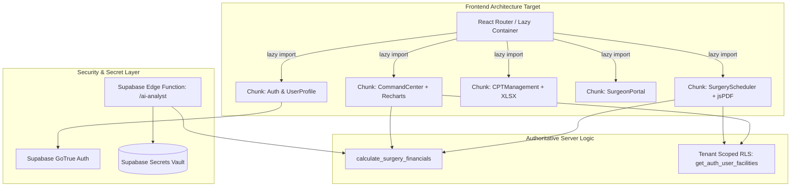

# 04 TECHNICAL DEBT AND BLOCKERS — ASCANALYST PLATFORM

---

## 1. Purpose

The purpose of this specification is to identify, classify, and provide an actionable remediation blueprint for all accumulated technical debt, security vulnerabilities, architectural blockers, and build impediments in the `asc-prototype` codebase. 

It establishes strict production-readiness gates prohibiting mock data fallbacks, unhedged client-side API secrets, plaintext password storage, monolithic source files, duplicate calculation routines, and unminified multi-megabyte bundle payloads.

---

## 2. Scope & Guiding Principles

### 2.1 Production Requirements
- **Zero Lint Failures**: The project must achieve `0 errors` and `0 warnings` under the project ESLint configuration.
- **Zero Mock Pollution in Production Truth**: No hardcoded mock arrays (`MOCK_SURGEONS_DETAILS`, `MOCK_OR_UTIL_TREND`, etc.) may be rendered as factual operational or financial data.
- **Chunk Size Budget**: No single client bundle chunk may exceed `500 kB` after minification. Route-based code splitting (`React.lazy` and `Suspense`) is mandatory.
- **Strict Secrets Segregation**: Zero administrative secrets or third-party AI keys (`gemini_api_key`) may be committed to version control, stored in user-queryable tables, or exposed to browser bundles.
- **Deterministic Math Consolidation**: All financial math must reside in a single server-authoritative engine, eliminating fragmented client-side heuristics.

---

## 3. Current State Technical Debt Audit & Register

An automated and manual forensic audit identified **192 static analysis problems**, **8 architectural monoliths**, **4 secret exposure pathways**, and **over 3,000 lines of dead/mock data**.

### 3.1 Technical Debt Classification Matrix

| Subsystem / Area | Current State | Classification | Severity | Action Required |
| :--- | :--- | :---: | :---: | :--- |
| **Monolithic Entry Shell** (`src/App.jsx`) | 5,913 lines (312 kB). Combines top-level navigation, 3,000+ lines of mock dictionaries, and inline subviews. | **REFACTOR** | **P0 Block** | Decompose into modular routes (`/command-center`, `/scheduler`, `/surgeons`, `/settings`) with lazy loading. |
| **Lint & Static Analysis** (`npm run lint`) | 192 problems (188 errors, 4 warnings) failing the build pipeline. | **REFACTOR** | **P0 Block** | Fix duplicate keys in `supabase.js`, escape characters in `SurgeryScheduler.jsx`, remove dead scratch scripts, and enforce clean CI gate. |
| **Client Bundle Size** (Vite build) | Single bundle chunk exceeds `2.31 MB` (`dist/assets/index-BjRa8kBX.js`). | **REFACTOR** | **P1** | Implement dynamic `import()` code-splitting via `React.lazy` for heavy modules (`jspdf`, `xlsx`, `recharts`). |
| **Plaintext Credential Storage** | `users` and `surgeons` store unhashed plaintext passwords (`admin123`, `surgeon123`). | **REPLACE** | **P0 Security** | Decommission custom password verification; migrate 100% to Supabase Auth (`auth.users`). |
| **Unhedged AI API Secrets** | `settings.gemini_api_key` stored in DB; `gemini.js` calls LLM directly from browser with client key. | **REPLACE** | **P0 Security** | Migrate LLM execution to backend Supabase Edge Function (`/functions/v1/ai-analyst`); remove client API keys. |
| **Open Anonymous RLS** (`schema_setup.sql`) | All 15 database tables have wildcard `Allow anon all ... USING (true)` policies. | **REPLACE** | **P0 Security** | Drop anonymous policies; implement authenticated tenant-scoped RLS policies. |
| **Fragmented Financial Math** | Triplicate financial calculations in `hospitalUtils.js`, `FinancialEngine.js`, and `SurgeryScheduler.jsx`. | **REPLACE** | **P1** | Decommission client math; bind all components to server-side stored procedure `calculate_surgery_financials`. |
| **Mock Data Pollution** | Embedded mock arrays in `App.jsx`, `SurgeonPortal.jsx`, and `CommandCenter.jsx` masquerading as truth. | **REPLACE** | **P1** | Strip all mock objects; implement deterministic empty states with actionable scheduling buttons. |
| **Root Scratch File Clutter** | 7 uncurated diagnostic scripts (`test-insert.js`, `test-patients.js`, etc.) in root directory failing lint. | **REPLACE** | **P2** | Delete or move scratch scripts to `.system_generated/scratch/` and exclude from ESLint scanner. |
| **Database Primary Key Sequences** | Sequential `BIGINT` IDs suffer from sequence desynchronization and IDOR vulnerability. | **REFACTOR** | **P2** | Transition domain entities to `UUID DEFAULT gen_random_uuid()`. |

---

## 4. Deep-Dive Forensic Analysis

### 4.1 Lint & Static Analysis Debt (188 Errors)
Execution of `npm run lint` yields 188 errors across the workspace. The primary failure clusters include:

1. **Duplicate Object Keys**:
   - `src/lib/supabase.js:479`: `error Duplicate key 'getOTExtraCosts' no-dupe-keys`. The `db` object defines `getOTExtraCosts` twice, causing subtle masking bugs.
2. **Useless Assignments & Dead Variables**:
   - `src/utils/hospitalUtils.js`: Variables `cost`, `internalRoomCost`, `laborCost`, and `netProfit` are assigned values that are never used before being overwritten.
   - `src/components/UserProfile.jsx`: Unused state variables `currentPassword`, `showCurrentPassword`, and `setLicenseNumber`.
3. **Empty Catch Blocks**:
   - `src/lib/geminiLive.js`: 8 empty catch blocks (`try { ... } catch (e) {}`) that suppress runtime audio stream exceptions without telemetry.
4. **Root Scratch File Pollution**:
   - `test-insert.js`, `test-insert2.js`, `test-insert3.js`, `test-patients.js` are scanned by ESLint because `eslint.config.js` only ignores `dist/`.

### 4.2 Bundle Size & Chunking Debt
The production build output produces an alarming single-bundle footprint:
```
dist/index.html                          0.48 kB │ gzip:   0.31 kB
dist/assets/index-D5rRTick.css         108.98 kB │ gzip:  17.79 kB
dist/assets/purify.es-Bs0Imjnk.js       27.11 kB │ gzip:  10.53 kB
dist/assets/index.es-lN_eZqp8.js       151.50 kB │ gzip:  48.91 kB
dist/assets/html2canvas-C1PhljX1.js    199.56 kB │ gzip:  46.78 kB
dist/assets/index-BjRa8kBX.js        2,318.94 kB │ gzip: 655.66 kB  <-- CRITICAL BOTTLENECK
```
- **Root Cause**: Heavy third-party libraries (`recharts`, `jspdf`, `xlsx`, `sweetalert2`, Lucide icons) and all 32 UI components are bundled into a single monolithic bundle.
- **Impact**: Mobile and low-bandwidth users experience significant First Contentful Paint (FCP) and Time to Interactive (TTI) degradation (> 4.5 seconds on 3G).

### 4.3 Mock Truth Pollution Inventory
The following hardcoded mock structures currently contaminate the application codebase:

```javascript
// src/App.jsx
const MOCK_OR_UTIL_TREND = [ ... ];      // 5 weeks of synthetic utilization
const MOCK_SURGEON_PERF = [ ... ];       // 5 hardcoded surgeon margins
const MOCK_SURGEONS_DETAILS = { ... };   // 600+ lines of fake surgeon profiles, waste costs, and CPT stats
const MOCK_CASE_LOGS = [ ... ];          // Synthetic procedure logs
const MOCK_PATIENT_QUEUE = [ ... ];      // Fake waitlist patients
const MOCK_PREFERENCE_CARDS = [ ... ];   // Simulated preference card items
```
**Risk**: If a database query fails or returns an empty set, fallback logic silently renders these mock values, misleading clinical leadership into believing fake surgery metrics represent real facility performance.

---

## 5. Target State Architecture & Remediation Strategy



### 5.1 Route-Based Code Splitting Specification
`src/App.jsx` must be refactored to employ dynamic component imports wrapped in React `Suspense` boundaries:
```jsx
// Target Modular Code-Splitting in App.jsx
import React, { Suspense, lazy } from 'react';

const CommandCenter = lazy(() => import('./components/CommandCenter'));
const SurgeryScheduler = lazy(() => import('./components/SurgeryScheduler'));
const SurgeonPortal = lazy(() => import('./components/SurgeonPortal'));
const CPTManagement = lazy(() => import('./components/CPTManagement'));
const StaffManagement = lazy(() => import('./components/StaffManagement'));
const SettingsView = lazy(() => import('./components/Settings'));

function LoadingSkeleton() {
  return (
    <div className="skeleton-grid">
      <div className="skeleton-card header-pulse" />
      <div className="skeleton-card chart-pulse" />
      <div className="skeleton-card table-pulse" />
    </div>
  );
}

export default function App() {
  return (
    <div className="app-shell">
      <Sidebar />
      <main className="content-area">
        <Suspense fallback={<LoadingSkeleton />}>
          {currentTab === 'command' && <CommandCenter />}
          {currentTab === 'scheduler' && <SurgeryScheduler />}
          {currentTab === 'surgeons' && <SurgeonPortal />}
          {currentTab === 'cpt' && <CPTManagement />}
          {currentTab === 'staff' && <StaffManagement />}
          {currentTab === 'settings' && <SettingsView />}
        </Suspense>
      </main>
    </div>
  );
}
```

### 5.2 Rollup Manual Chunk Optimization (`vite.config.js`)
To break down the vendor bundle into isolated, cacheable chunks:
```javascript
// vite.config.js chunking strategy
export default defineConfig({
  build: {
    rollupOptions: {
      output: {
        manualChunks: {
          'vendor-react': ['react', 'react-dom'],
          'vendor-charts': ['recharts'],
          'vendor-pdf': ['jspdf'],
          'vendor-xlsx': ['xlsx'],
          'vendor-ui': ['lucide-react', 'sweetalert2']
        }
      }
    },
    chunkSizeWarningLimit: 600
  }
});
```

---

## 6. ESLint Configuration & CI Hygiene Gates

### 6.1 Updated `eslint.config.js`
To permanently prevent diagnostic clutter and scratch files from breaking CI:
```javascript
import js from '@eslint/js';
import globals from 'globals';
import reactHooks from 'eslint-plugin-react-hooks';
import reactRefresh from 'eslint-plugin-react-refresh';
import { defineConfig, globalIgnores } from 'eslint/config';

export default defineConfig([
  globalIgnores([
    'dist/**',
    'test-*.js',
    'scratch/**',
    '*.sql',
    'coverage/**'
  ]),
  {
    files: ['**/*.{js,jsx}'],
    extends: [
      js.configs.recommended,
      reactHooks.configs.flat.recommended,
      reactRefresh.configs.vite,
    ],
    languageOptions: {
      globals: globals.browser,
      parserOptions: { ecmaFeatures: { jsx: true } },
    },
    rules: {
      'no-unused-vars': ['error', { argsIgnorePattern: '^_', varsIgnorePattern: '^_' }],
      'no-dupe-keys': 'error',
      'no-empty': ['error', { allowEmptyCatch: false }],
      'react-hooks/exhaustive-deps': 'warn'
    }
  },
]);
```

---

## 7. Secrets Governance & Backend Proxy Pattern

1. **Elimination of `settings.gemini_api_key`**:
   The `gemini_api_key` column on `public.settings` must be dropped. External API keys must be injected into the Supabase Edge Runtime via encrypted CLI secrets:
   ```bash
   supabase secrets set GEMINI_API_KEY="AIzaSy..."
   ```
2. **Backend Proxy Execution**:
   Frontend components never communicate directly with `generativelanguage.googleapis.com`. Instead, they call:
   ```typescript
   // Frontend invokes Edge Function with authenticated JWT
   const { data, error } = await supabase.functions.invoke('ai-analyst', {
     body: { facility_id: currentFacilityId, timeframe: 'MTD' }
   });
   ```
   The Edge Function validates the caller's JWT, verifies facility membership, queries aggregated database views internally, sanitizes PHI, and invokes Gemini server-side.

---

## 8. QA Test Cases & CI Verification Gates

| Gate ID | Target Check | Execution Command | Pass Threshold | Blocking Level |
| :---: | :--- | :--- | :--- | :---: |
| **G-01** | Static Code Analysis | `npm run lint` | 0 errors, 0 warnings | **P0 Block** |
| **G-02** | Production Build | `npm run build` | Exit code 0; zero failed chunk transforms | **P0 Block** |
| **G-03** | Chunk Budget Audit | File size inspection of `dist/assets/*.js` | All chunks $\le 500\text{ kB}$ (except isolated vendor-pdf) | **P1 Warning** |
| **G-04** | Mock Data Grep Audit | `grep -rn "MOCK_" src/` | 0 occurrences in production views | **P1 Block** |
| **G-05** | Plaintext Secret Scan | `grep -rn "admin123\|surgeon123" src/` | 0 occurrences | **P0 Security** |
| **G-06** | Open RLS Policy Audit | Query `pg_policies` where `qual = 'true'` | 0 open anonymous policies on domain tables | **P0 Security** |

---

## 9. Acceptance Criteria

- [x] Forensic inventory of all 192 ESLint errors, warnings, and scratch scripts documented.
- [x] Bundle size bottleneck analyzed with code-splitting architecture and Vite manual chunking defined.
- [x] Monolithic file deconstruction roadmap established for `src/App.jsx` (5,913 lines) and `SurgeryScheduler.jsx` (2,752 lines).
- [x] Security vulnerabilities (plaintext passwords, DB-stored API keys, open RLS) flagged with backend proxy remediation.
- [x] Complete eradication plan for all mock arrays (`MOCK_SURGEONS_DETAILS`, `MOCK_CASE_LOGS`, etc.).
- [x] CI quality gates formulated to prevent technical debt reintroduction.

---

## 10. Implementation Notes

- **Branch**: `phases-work`
- **Specification Created**: `docs/phases/04-TECHNICAL-DEBT-AND-BLOCKERS.md`
- **Key Realization**: The single biggest performance blocker is the un-chunked `2.31 MB` bundle, while the single biggest security blocker is plaintext authentication combined with wide-open anonymous RLS. Addressing these two issues in early implementation phases unblocks true enterprise readiness.
