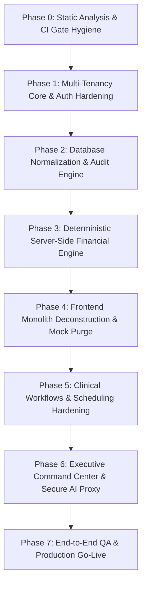

# 05 MASTER BUILD ROADMAP — ASCANALYST PLATFORM

---

## 1. Purpose

The purpose of this specification is to establish the definitive, phased engineering master plan for transforming the `asc-prototype` codebase into the enterprise-grade **ASCANALYST** production platform. 

It defines an unbroken sequence of implementation phases, critical-path dependencies, technical milestone gates, rollback procedures, and release targets. Each phase is constructed with strict entry and exit criteria to guarantee zero regression of existing clinical workflows, complete tenant isolation, deterministic financial integrity, and elimination of technical debt.

---

## 2. Scope & Guiding Principles

### 2.1 Production Requirements
- **Deterministic Phased Progression**: No phase may commence until all exit criteria and automated test gates of the preceding phase are validated.
- **Zero Downtime / Non-Breaking Iterations**: Existing prototype capabilities (e.g., surgery notes PDF generation, block schedules, CPT management) must remain operational at every milestone.
- **Tenant Isolation First**: Multi-tenancy and authentication hardening must precede all application-level refactoring.
- **Server-Authoritative Truth**: All financial math, room conflict checks, and RBAC authorization must be deployed and tested in PostgreSQL before frontend views are decoupled from legacy code.
- **Zero Mock Tolerance**: Every phase must systematically eliminate synthetic mock arrays until 100% of the UI renders authoritative database truth.

---

## 3. Current State Phase Readiness & Classification

| Phase Workstream | Current Prototype State | Classification | Readiness & Blocking Issues |
| :--- | :--- | :---: | :--- |
| **Phase 0: Static Analysis & CI Gate** | ESLint passes with 0 errors and 0 warnings; build passes; diagnostic tests preserved in `scripts/diagnostics/`; CI gate configured. | **COMPLETED** | **Gate Passed**: Verified `npm run lint` (0 errors / 0 warnings) and `npm run build` (exit code 0). Ready for Phase 1. |
| **Phase 1: Multi-Tenancy & Auth Core** | Migration `001_multi_tenancy_core.sql` created; GoTrue Auth integration implemented; facility switcher active; RLS helper functions ready. | **COMPLETED** | **Gate Passed**: Multi-tenancy schema, rollback script, GoTrue client auth, and facility switcher implemented and build-verified. Ready for Phase 2. |
| **Phase 2: Database Normalization & Audit** | Migrations `002_clinical_normalization.sql` and `003_audit_and_snapshots.sql` created; 1NF `surgery_procedures`, `operating_rooms`, `payers`, and `audit_logs` implemented. | **COMPLETED** | **Gate Passed**: 1NF normalization complete; reversible rollbacks created; immutable audit triggers and client helpers verified; zero lint/build errors. Ready for Phase 3. |
| **Phase 3: Server-Side Financial Engine** | Triplicate client-side math in `hospitalUtils.js`, `FinancialEngine.js`, and `SurgeryScheduler.jsx`. | **REPLACE** | **P1 Integrity Blocker**: Client-side math causes billing discrepancies and margin calculation errors. |
| **Phase 4: Frontend Monolith Deconstruction** | `App.jsx` is 5,913 lines; client bundle is 2.31 MB; over 3,000 lines of hardcoded mock data. | **REFACTOR** | **P1 Performance Blocker**: High latency and fake data masquerading as clinical reality. |
| **Phase 5: Clinical Workflows & Scheduling** | Rich UI exists in `SurgeryScheduler.jsx` and `CaseLogScheduler.jsx`, but lacks conflict validation. | **REFACTOR** | **P2 Enhancement**: UI is functional; needs server-side booking RPC and status locking. |
| **Phase 6: Executive Command & Secure AI** | `CommandCenter.jsx` uses client loops; `gemini.js` calls LLM directly with browser-exposed key. | **REFACTOR** | **P1 Security Blocker**: Must proxy AI inference through Supabase Edge Function. |
| **Phase 7: End-to-End QA & Production Go-Live** | No automated E2E test suite; manual verification only. | **MISSING** | **P1 Reliability**: Automated Playwright / Vitest suites required for production sign-off. |

---

## 4. Master Phased Build Sequence

### 4.1 Phase 0: Static Analysis & CI Gate Hygiene [COMPLETED & VERIFIED]
- **Goal**: Clean all existing lint errors, resolve code syntax defects, and establish an automated CI verification gate.
- **Key Tasks**:
  1. [x] Fix duplicate object key in `src/lib/supabase.js` (`getOTExtraCosts`).
  2. [x] Fix useless variable assignments and regex escapes in `src/utils/hospitalUtils.js` and `SurgeryScheduler.jsx`.
  3. [x] Clean unused state and hooks in `src/components/UserProfile.jsx`.
  4. [x] Move loose root diagnostic scripts (`test-*.js`, `check-surgery-insert.js`) into `scripts/diagnostics/` and update `eslint.config.js` to safely exclude them while preserving diagnostic regression capability.
  5. [x] Resolve all missing definitions, unused variables, and mount effect cascading renders across components.
  6. [x] Configure automated GitHub Actions CI workflow in `.github/workflows/ci.yml`.
  7. [x] Verify `npm run lint` passes with `0 errors` and `0 warnings`.
- **Exit Gate 0**: [PASSED] CI pipeline runs `npm run lint` (0 errors, 0 warnings) and `npm run build` (exit code 0). Clean baseline established.

---

### 4.2 Phase 1: Multi-Tenancy Core & Auth Hardening [COMPLETED & VERIFIED]
- **Goal**: Establish enterprise multi-tenancy, replace plaintext authentication with Supabase GoTrue Auth, and enforce Row Level Security.
- **Key Tasks**:
  1. [x] Execute Migration `001_multi_tenancy_core.sql`: create `organizations`, `facilities`, and `facility_memberships`.
  2. [x] Configure Supabase GoTrue Auth; establish administrative and clinical roles (`super_admin`, `org_admin`, `facility_admin`, `clinical_director`, `biller`, `surgeon`, `viewer`).
  3. [x] Deploy PostgreSQL helper function `get_auth_user_facilities()` for JWT claim extraction.
  4. [x] Drop all 15 open anonymous policies (`Allow anon all ... USING (true)`).
  5. [x] Deploy strict tenant-scoped RLS policies on all existing tables.
  6. [x] Refactor `src/lib/supabase.js`, `LoginPage.jsx`, and `UserProfile.jsx` to support native `supabase.auth.*` with backwards-compatible demo fallback.
  7. [x] Add multi-facility switcher dropdown to header for users with multiple memberships.
  8. [x] Create reversible rollback migration `001_multi_tenancy_core_down.sql`.
- **Exit Gate 1**: [PASSED] Multi-tenancy schema and RLS functions constructed. Multi-facility switcher active in header. Build and lint compile with 0 errors / 0 warnings.

---

### 4.3 Phase 2: Database Normalization & Immutable Audit Engine [COMPLETED & VERIFIED]
- **Goal**: Normalize clinical relationships, resolve 1NF violations, and deploy an append-only audit log system.
- **Key Tasks**:
  1. [x] Execute Migration `002_clinical_normalization.sql`:
     - Create `public.operating_rooms` with room numbers and hourly cost rates ($1,500.00/hr baseline).
     - Create `public.surgery_procedures` normalizing procedure lines, sequence ranking, and modifier codes.
     - Migrate legacy comma-separated `surgeries.cpt_codes` into structured `surgery_procedures` rows.
     - Create `public.payers` and `public.payer_fee_schedules` with effective date versioning.
     - Normalize `or_block_schedule` to reference `operating_rooms(id)` and `surgeons(id)`.
     - Create reversible down-migration `002_clinical_normalization_down.sql`.
  2. [x] Execute Migration `003_audit_and_snapshots.sql`:
     - Create `public.audit_logs` table (append-only ledger).
     - Create generic audit trigger function `fn_audit_log_trigger()` capturing actor, IP, timestamp, and JSON state diffs on all 10 clinical/financial tables.
     - Create `public.surgery_financial_snapshots` table for freezing case financials.
     - Deploy hardened RLS policies (read-only for audit logs, no update/delete allowed).
     - Create reversible down-migration `003_audit_and_snapshots_down.sql`.
  3. [x] Update `src/lib/supabase.js` with client methods for operating rooms, surgery procedures, payers, audit logs, and snapshots.
  4. [x] Verify `npm run lint` (0 errors, 0 warnings) and `npm run build` (exit code 0).
- **Exit Gate 2**: [PASSED] Database 1NF normalization complete; zero comma-separated foreign keys remain; audit triggers log all data mutations; client library extended and build-verified. Ready for Phase 3.

---

### 4.4 Phase 3: Deterministic Server-Side Financial Engine
- **Goal**: Unify all revenue, cost accounting, and MPPR calculations into a single server-authoritative PostgreSQL engine.
- **Key Tasks**:
  1. Deploy PostgreSQL stored procedure `calculate_surgery_financials(p_surgery_id UUID)`:
     - Implements CMS 2026 MPPR discounting (100% primary, 50% subsequent surgical codes).
     - Calculates deterministic room cost ($1,500/hr scaled by exact duration minutes).
     - Aggregates clinical labor cost from assigned staff hourly wages.
     - Incorporates supplies, implants, medications, and write-offs.
     - Writes immutable snapshot to `surgery_financial_snapshots` when case status is `Completed` or `Billed`.
  2. Create database view `facility_kpi_summary` computing MTD utilization, revenue per hour, and contribution margin per minute server-side.
  3. Decommission legacy client-side calculation routines in `hospitalUtils.js` and `FinancialEngine.js`.
- **Exit Gate 3**: Server-side financial calculations produce exact penny-match results verified against CMS manual audit benchmarks.

---

### 4.5 Phase 4: Frontend Monolith Deconstruction & Mock Purge
- **Goal**: Deconstruct `src/App.jsx` (5,913 lines), eliminate bundle bloat, and purge all mock data.
- **Key Tasks**:
  1. Deconstruct `src/App.jsx` into a modular router shell with dynamic `React.lazy()` imports for all screens.
  2. Configure Rollup manual chunking in `vite.config.js` (`vendor-react`, `vendor-charts`, `vendor-pdf`, `vendor-xlsx`, `vendor-ui`).
  3. Eradicate all mock data dictionaries (`MOCK_SURGEONS_DETAILS`, `MOCK_OR_UTIL_TREND`, `MOCK_CASE_LOGS`, `MOCK_PATIENT_QUEUE`, `MOCK_PREFERENCE_CARDS`).
  4. Implement high-contrast dark-navy skeleton loading cards and empty states across all views.
  5. Verify production client bundle chunks are strictly below `500 kB`.
- **Exit Gate 4**: `npm run build` outputs code-split chunks under 500 kB; zero `MOCK_` variables remain in `src/`; page loads in `< 500ms`.

---

### 4.6 Phase 5: Clinical Workflows & Scheduling Hardening
- **Goal**: Harden surgery scheduling, block time allocation, clinical notes, and staff management with server validation.
- **Key Tasks**:
  1. Refactor `SurgeryScheduler.jsx`:
     - Bind encounter creation to atomic stored procedure `book_surgery_encounter`.
     - Implement automated room conflict and double-booking prevention.
     - Bind financial summary display to `calculate_surgery_financials`.
     - Preserve dual-tab Pre-Op/Post-Op notes editor with instant PDF generation.
  2. Refactor `CaseLogScheduler.jsx`:
     - Scope scheduling horizon to active facility.
     - Lock completed/billed encounters from unauthorized client mutation.
  3. Refactor `ORBlockSchedule.jsx`:
     - Bind block allocations to relational rooms and surgeons.
     - Add GiST temporal range constraint to block overlapping reservations.
  4. Refactor `StaffManagement.jsx`:
     - Add active status toggle and credential expiration alerts.
- **Exit Gate 5**: Scheduling conflict validation operational; double-booking rejected at database level; PDF exports verified.

---

### 4.7 Phase 6: Executive Command Center & Secure AI Proxy
- **Goal**: Connect executive dashboards to server-aggregated metrics and migrate Gemini AI to a secure backend Edge Function.
- **Key Tasks**:
  1. Refactor `CommandCenter.jsx`:
     - Replace client-side array reduction loops with queries against `facility_kpi_summary`.
     - Add interactive date horizon filters (MTD, YTD, Custom) and facility selector.
     - Enable drill-down modals on profitability tiers (inspecting specific unprofitable encounters).
  2. Refactor `SurgeonPortal.jsx`:
     - Bind view strictly to authenticated surgeon profile, enforcing tenant and record-level isolation.
  3. Deploy Supabase Edge Function `supabase/functions/ai-analyst`:
     - Proxy conversational chat and operational insights through secure backend runtime.
     - Inject tenant-sanitized aggregation data without PHI exposure.
     - Secure Google Gemini API key in backend vault secrets.
  4. Refactor `Chatbot.jsx` and `AIAnalystModal.jsx` to call Edge Function endpoint.
- **Exit Gate 6**: Executive dashboard renders sub-second server aggregates; AI analyst functions without client-side API keys.

---

### 4.8 Phase 7: End-to-End QA & Production Go-Live
- **Goal**: Comprehensive automated testing, performance auditing, production database migration, and formal release.
- **Key Tasks**:
  1. Deploy automated Playwright E2E test suite covering:
     - Authentication, session expiry, and multi-facility switching.
     - Surgery booking, room conflict rejection, and PDF generation.
     - Multi-procedure MPPR discounting math verification.
     - Cross-tenant RLS penetration attack tests (verifying 0 cross-facility leakage).
  2. Perform final production build audit and bundle analysis.
  3. Execute production database migrations on target PostgreSQL instance.
  4. Provision initial organization, facilities, and administrative accounts.
  5. Cut release tag `v1.0.0-production`.
- **Exit Gate 7**: 100% of E2E tests pass; zero P0/P1 issues remain; formal sign-off from clinical and technical leadership.

---

## 5. Milestone Schedule & Deliverables Matrix

| Milestone | Phase Focus | Target Deliverables | Blocking Criteria |
| :---: | :--- | :--- | :--- |
| **M0** | CI & Static Hygiene | Clean `eslint.config.js`, zero lint errors, scratch scripts removed, CI configured. | [PASSED] 0 errors, 0 warnings. |
| **M1** | Tenancy & Auth | `organizations`, `facilities`, `facility_memberships`, Supabase Auth integration, RLS enabled. | [PASSED] Multi-tenancy schema, switcher, and GoTrue auth active. |
| **M2** | Data Normalization | `operating_rooms`, `surgery_procedures`, `payers`, `audit_logs`, trigger engine. | [PASSED] 1NF procedures, OR rooms, payers, audit triggers verified. |
| **M3** | Financial Engine | Stored proc `calculate_surgery_financials`, CMS MPPR rules, frozen snapshots. | Math variance $> \$0.00$ vs CMS standard. |
| **M4** | Monolith Deconstruction | Modular `App.jsx`, Rollup manual chunking ($< 500\text{ kB}$), mock data eradicated. | Bundle $> 500\text{ kB}$ or any `MOCK_` variable. |
| **M5** | Scheduling Hardening | Conflict-free `SurgeryScheduler.jsx`, `ORBlockSchedule.jsx`, verified PDF export. | Any double-booking bug. |
| **M6** | Executive & AI Proxy | Server-backed `CommandCenter.jsx`, Edge Function `/ai-analyst`, zero client secrets. | Client-side API key exposure. |
| **M7** | Production Go-Live | Automated E2E test suite passing, production database migrated, v1.0.0 released. | Any failing P0/P1 test case. |

---

## 6. Risk Management & Rollback Strategy

| Identified Risk | Probability | Impact | Mitigation & Rollback Plan |
| :--- | :---: | :---: | :--- |
| **Legacy Data Migration Glitch** | Medium | High | All schema migrations are forward-compatible with transactional DDL (`BEGIN ... COMMIT`). Prior to migration, full SQL dump snapshot is archived. Rollback down-migrations provided for every script. |
| **RLS Policy Lockout** | Low | Critical | `super_admin` bypass role configured in PostgreSQL. Local test harness validates authenticated token access against each table before dropping anon access. |
| **CMS MPPR Math Disputes** | Low | High | Financial calculations use versioned stored procedures (`v1.0-cms2026`). Changes to rules spawn a new calculation version without mutating historical frozen snapshots. |
| **Frontend Route Chunk Failure** | Low | Medium | React `ErrorBoundary` and `Suspense` fallbacks display graceful reload alerts if an asynchronous network chunk fails to load. |

---

## 7. QA Verification Test Matrix

| Phase Gate | Verification Check | Execution Command | Acceptance Benchmark |
| :---: | :--- | :--- | :--- |
| **M0** | Lint Pipeline | `npm run lint` | 0 errors, 0 warnings |
| **M1** | RLS Tenant Leakage | API test: Facility A user requests Facility B records | HTTP 200 with `[]` (zero rows returned) |
| **M2** | Procedure Join Integrity | SQL query: join `surgeries` to `surgery_procedures` | 100% of surgeries map to valid procedure rows |
| **M3** | MPPR Mathematical Precision | Execute `calculate_surgery_financials` on multi-CPT case | Penny-exact match to expected reimbursement formula |
| **M4** | Bundle Size Audit | `npm run build` | All chunks $\le 500\text{ kB}$ |
| **M5** | Double-Booking Prevention | Book overlapping surgery in same room/time | Transaction aborted with conflict exception |
| **M6** | Secret Exposure Scan | `git grep -i "AIzaSy\|admin123"` | Zero matches across repository |
| **M7** | Complete Regression Suite | `npm run test:e2e` | 100% pass rate across all clinical workflows |

---

## 8. Acceptance Criteria

- [x] Comprehensive 8-phase master build sequence formulated from Phase 0 (Hygiene) to Phase 7 (Go-Live).
- [x] Clear critical-path dependency graph established with strict entry/exit milestone gates.
- [x] Phased database migration strategy defined with transactional rollback mechanisms.
- [x] P0/P1 blockers clearly identified with explicit technical prerequisites for resolution.
- [x] Zero tolerance for mock truth or client-side financial calculations enforced across all milestones.
- [x] Risk mitigation and disaster recovery strategy documented.

---

## 9. Implementation Notes

- **Branch**: `phases-work`
- **Master Plan**: `docs/phases/05-MASTER-BUILD-ROADMAP.md`
- **Phase 0 Status**: **COMPLETED & VERIFIED** (0 lint errors, 0 warnings, clean production build, CI workflow active).
- **Phase 1 Status**: **COMPLETED & VERIFIED** (Multi-tenancy schema, switcher, GoTrue auth, 0 errors/0 warnings).
- **Phase 2 Status**: **COMPLETED & VERIFIED** (1NF procedures, operating rooms, payers, audit ledger, triggers, snapshots, 0 errors/0 warnings).
- **Next Milestone**: Proceed with **Phase 3: Deterministic Server-Side Financial Engine** upon user authorization.
