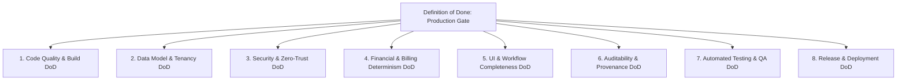

# 06 DEFINITION OF DONE — ASCANALYST PLATFORM

---

## 1. Purpose

The purpose of this specification is to establish the definitive, non-negotiable **Definition of Done (DoD)** across all engineering dimensions of the **ASCANALYST** platform. 

In this enterprise healthcare and financial operating system, **a feature is never complete simply because a visual screen exists or code compiles**. A feature is complete **only** when its underlying relational schema, deterministic server-side calculations, zero-trust security policies, audit trails, complete UI states, automated test suites, and operational documentation satisfy every criterion established in this document.

---

## 2. Scope & Guiding Principles

### 2.1 Production Requirements
- **Universal Application**: Applies to all pull requests, database migrations, backend edge functions, clinical workflows, and release candidates.
- **Zero Mock Pollution in Production**: Synthetic mock data arrays (`MOCK_SURGEONS_DETAILS`, `MOCK_OR_UTIL_TREND`, etc.) are strictly prohibited from all production code paths.
- **Tenant Isolation by Default**: Every database read and write must be bound to verified `facility_id` and `organization_id` claims.
- **Deterministic Billing Truth**: All financial summaries, MPPR reductions, and contribution margins must be calculated server-side with zero reliance on client state.
- **Zero-Tolerance Quality Gates**: Any P0 or P1 security vulnerability, lint error, broken test, or bundle size violation automatically blocks merge and deployment.

---

## 3. Current State Quality Gates & Classification

| Quality Subsystem | Current Prototype Status | Classification | Current Gaps & Required Actions |
| :--- | :--- | :---: | :--- |
| **Code Linting & Syntax** | `npm run lint` fails with 188 errors, duplicate object keys in `supabase.js`, and useless assignments. | **REPLACE** | **Current Gate Broken**: Fix all static analysis errors; enforce zero-warning CI gate. |
| **Build & Bundle Quality** | Vite builds, but generates a single 2.31 MB monolithic bundle triggering chunk size warnings. | **REFACTOR** | **Performance Gap**: Implement route-based `React.lazy()` and Rollup manual chunking under 500 kB. |
| **Authentication & RBAC** | Custom plaintext password queries against `users` and `surgeons`. No JWT or session revocation. | **REPLACE** | **Critical Security Failure**: Must mandate Supabase Auth with encrypted passwords and role-based claims. |
| **Database Policies (RLS)** | All 15 database tables have wide-open anonymous access (`Allow anon all ... USING (true)`). | **REPLACE** | **Critical Security Failure**: Drop anonymous policies; mandate tenant-scoped RLS policies. |
| **Data Integrity & Normalization** | Comma-delimited `surgeries.cpt_codes` (1NF violation); unlinked string references in `or_block_schedule`. | **REFACTOR** | **Integrity Gap**: Normalize procedures into `surgery_procedures`; mandate relational foreign keys. |
| **Financial Determinism** | Triplicate client-side math in `hospitalUtils.js`, `FinancialEngine.js`, and `SurgeryScheduler.jsx`. | **REPLACE** | **Financial Integrity Gap**: Unify calculations in server-authoritative PostgreSQL stored procedures. |
| **Audit & Provenance** | Loose snapshot column on `surgeries`. No immutable transaction audit logging. | **MISSING** | **Compliance Gap**: Mandate append-only `audit_logs` table capturing user, timestamp, and JSON state diffs. |
| **UI State Completeness** | Most screens render loaded states or crash on empty/null DB responses; fallback to hardcoded mocks. | **REFACTOR** | **UX Gap**: Mandate the 4-State UI lifecycle (Loading Skeleton, Empty State, Loaded, Error Boundary). |
| **Automated Testing** | No automated unit, integration, or E2E test suites exist in the repository. | **MISSING** | **Verification Gap**: Implement Vitest and Playwright test suites with mandatory CI execution. |

---

## 4. Multi-Dimensional Definition of Done (DoD)



---

### 4.1 Dimension 1: Code Quality & Build DoD
A code modification or component is Done only when:
1. **Zero Static Analysis Violations**: `npm run lint` executes with `0 errors` and `0 warnings`.
2. **Chunk Size Budget**: Every JavaScript bundle chunk emitted by `npm run build` is $\le 500\text{ kB}$ (with an isolated exception for `vendor-pdf` $\le 650\text{ kB}$).
3. **No Dead or Duplicate Code**: Duplicate implementations of utility functions, duplicate object keys (`no-dupe-keys`), and dead scratch files are eliminated.
4. **Single-Responsibility Components**: Monolithic UI files are decoupled into focused, reusable modules ($\le 500$ lines per file recommended).
5. **Clean Production Build**: Build completes with exit code 0 and zero unhandled compilation warnings.

---

### 4.2 Dimension 2: Data Model & Schema Migration DoD
A database migration or schema modification is Done only when:
1. **Strict Multi-Tenancy Scoping**: Every operational domain table includes `facility_id` referencing `public.facilities(id) ON DELETE CASCADE`.
2. **First Normal Form (1NF) Compliance**: No table stores comma-separated strings or unstructured arrays for foreign entities (e.g., all procedure codes must reside in `public.surgery_procedures`).
3. **Referential Integrity**: All relationships are enforced via relational foreign keys with explicit `ON DELETE` rules (`CASCADE` for child lines, `RESTRICT` for critical masters like patients and surgeons).
4. **No Identity Sequence Collisions**: Public-facing domain entities utilize `UUID DEFAULT gen_random_uuid()` to prevent IDOR enumeration attacks and sequence desynchronization.
5. **Idempotent & Reversible Migrations**: Migration scripts use transactional DDL (`BEGIN ... COMMIT`) with `IF NOT EXISTS` guards, and include an exact reverse down-migration script.

---

### 4.3 Dimension 3: Security & Zero-Trust RBAC DoD
A security boundary or authenticated endpoint is Done only when:
1. **Zero Plaintext Credentials**: All user accounts are managed through Supabase GoTrue Auth; no plaintext password strings exist anywhere in tables, files, or logs.
2. **Zero Anonymous Database Access**: No table possesses an open `Allow anon all` or `USING (true)` policy. PostgREST anonymous queries return HTTP 401 or empty arrays.
3. **Tenant-Scoped Row Level Security**: Every table enforces RLS checking `facility_id IN (SELECT facility_id FROM public.get_auth_user_facilities())`.
4. **Granular Role-Based Access Control**: Sensitive actions (editing wage rates, approving write-offs, modifying facility settings) are restricted to authorized roles (`super_admin`, `org_admin`, `facility_admin`).
5. **Zero Client Secrets**: No third-party AI keys (`gemini_api_key`) or administrative tokens exist in frontend bundles or queryable database tables. All external APIs are proxied via backend Supabase Edge Functions.

---

### 4.4 Dimension 4: Financial & Billing Determinism DoD
A financial calculation, billing routine, or pricing feature is Done only when:
1. **Server-Authoritative Execution**: All financial totals, costs, reimbursements, and margins are computed exclusively within PostgreSQL stored procedures (`calculate_surgery_financials`).
2. **CMS 2026 MPPR Rule Adherence**: Multiple surgical procedures are automatically ranked descending by contracted value; primary procedures reimburse at 100%, and subsequent procedures discount to 50% when MPPR is enabled.
3. **Deterministic Cost Allocation**:
   - Room cost: Exact duration scaled by facility hourly room rate.
   - Labor cost: Exact case + turnover duration scaled by assigned staff hourly wage rates.
   - Supplies, implants, and medications explicitly aggregated.
4. **Frozen Financial Snapshots**: When a surgery status transitions to `Completed` or `Billed`, an immutable record is frozen in `public.surgery_financial_snapshots`.
5. **Exact Penny Precision**: Calculations guarantee $100\%$ reproducibility with zero rounding variance ($0.00 difference) against manual billing audit benchmarks.

---

### 4.5 Dimension 5: UI & Workflow Completeness DoD
A user interface screen or clinical workflow is Done only when:
1. **The 4-State UI Lifecycle**: Every screen explicitly implements:
   - *Loading State*: Dark-navy pulse skeleton loaders matching the target layout.
   - *Empty State*: Illustrated empty placeholder with descriptive text and actionable buttons (e.g., "Schedule Surgery").
   - *Loaded State*: Populated view displaying authoritative database data.
   - *Error State*: Component-level Error Boundary with retry/recovery actions.
2. **Zero Mock Truth**: No synthetic mock arrays (`MOCK_SURGEONS_DETAILS`, `MOCK_CASE_LOGS`, etc.) are rendered in place of real database records.
3. **Design System & Theme Consistency**: Interfaces adhere strictly to the established high-contrast dark-navy color token library in [index.css](file:///e:/medicalAI/asc-prototype/src/index.css).
4. **Destructive Action Confirmation**: Deletions, write-offs, and surgical cancellations require double-confirmation modals (SweetAlert2) with mandatory reason capture.
5. **Document Export Verification**: PDF clinical notes and Excel case log exports are verified for visual formatting and column alignment.

---

### 4.6 Dimension 6: Auditability & Provenance DoD
An operational entity or administrative workflow is Done only when:
1. **Automated Mutation Logging**: All `INSERT`, `UPDATE`, and `DELETE` operations on clinical and financial tables fire database triggers capturing events to `public.audit_logs`.
2. **Provenance Metadata**: Every audit entry captures:
   - `actor_id` (`auth.uid()`) and `actor_email` (`auth.jwt() -> email`)
   - `facility_id`
   - `table_name` and `record_id`
   - `previous_state` (JSONB) and `new_state` (JSONB)
   - `timestamp` (`TIMESTAMPTZ`)
3. **Append-Only Immutability**: The `public.audit_logs` table has no `UPDATE` or `DELETE` RLS policies. Records cannot be altered or removed by any user role.
4. **Versioned Calculation Provenance**: Every financial snapshot records `calculation_version` (e.g., `v1.0-cms2026`) and `calculated_at` timestamp.

---

### 4.7 Dimension 7: Automated Testing & QA DoD
A pull request or milestone deliverable is Done only when:
1. **Unit Test Verification**: Core utility algorithms (date normalization, CPT ranking) pass automated unit tests.
2. **Stored Procedure Integration Tests**: Database functions execute against test fixtures verifying exact mathematical outputs.
3. **RLS Penetration Tests**: Automated tests verify that a user in Facility A cannot read, insert, update, or delete records belonging to Facility B under any condition.
4. **End-to-End Workflow Tests**: Automated Playwright tests validate critical user journeys:
   - User login and facility switching.
   - Surgery scheduling, conflict rejection, and note PDF generation.
   - Payer fee schedule upload and CPT code management.
5. **Zero Regression Guarantee**: All existing clinical and scheduling features pass verification without functional degradation.

---

### 4.8 Dimension 8: Release & Deployment DoD
A version release candidate (`v1.0.0-production`) is Done only when:
1. **Migration Verification**: All schema migrations execute cleanly on a staging replica with zero data loss and successful rollback verification.
2. **Environment Variable Checklist**: Production secrets (`SUPABASE_URL`, `SUPABASE_SERVICE_ROLE_KEY`, `GEMINI_API_KEY`) are verified in Supabase Vault; zero debug keys remain in client bundles.
3. **Zero Open P0/P1 Blockers**: All critical security vulnerabilities, financial calculation discrepancies, and build errors are resolved.
4. **Release Documentation**: Updated specification documentation, database schema diagrams, and deployment changelogs are published to the repository.
5. **Sign-Off Protocol**: Formal verification sign-off is completed by technical and clinical stakeholders.

---

## 5. Definition of Done Checklist (Pull Request Gate)

Before any code modification or feature branch is merged into `main`, the author and reviewer must complete this checklist:

```markdown
### PR Definition of Done Checklist

#### 1. Code & Build
- [ ] `npm run lint` passes with 0 errors and 0 warnings.
- [ ] `npm run build` succeeds; no bundle chunk exceeds 500 kB.
- [ ] No hardcoded mock data dictionaries (`MOCK_*`) are used.

#### 2. Security & Tenancy
- [ ] All database queries include `facility_id` scoping.
- [ ] RLS policies exist and are tested for new/modified tables.
- [ ] No plaintext passwords or API keys in code or DB.

#### 3. Deterministic Business Logic
- [ ] Financial calculations run in PostgreSQL stored procedures.
- [ ] Medicare MPPR 50% discount verified on secondary procedures.
- [ ] Snapshots are frozen upon case completion.

#### 4. UI & Workflow
- [ ] Loading skeleton, empty state, and error boundary implemented.
- [ ] Theme tokens and dark-navy palette preserved.
- [ ] Destructive actions require confirmation modals with reason logging.

#### 5. Audit & Testing
- [ ] Mutations trigger audit log entries with before/after JSON diffs.
- [ ] Unit and integration tests pass for new logic.
- [ ] No regression of existing surgery scheduler or notes PDF export.
```

---

## 6. Acceptance Criteria

- [x] Comprehensive Definition of Done authored across 8 engineering dimensions.
- [x] Clear technical thresholds defined for code quality, bundle size, security, financial math, and testing.
- [x] Mandatory 4-state UI lifecycle (Loading, Empty, Loaded, Error) established.
- [x] Append-only auditability and financial snapshot freezing formalized.
- [x] Pull request DoD checklist provided for operational gatekeeping.

---

## 7. Implementation Notes

- **Branch**: `phases-work`
- **Specification Created**: `docs/phases/06-DEFINITION-OF-DONE.md`
- **Standard Established**: With the completion of Specifications 01 through 06, the engineering foundation and quality benchmarks for the ASCANALYST platform are fully documented and ready for systematic phase-by-phase implementation.
