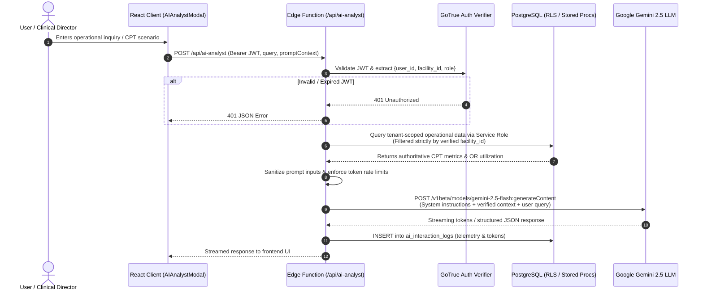
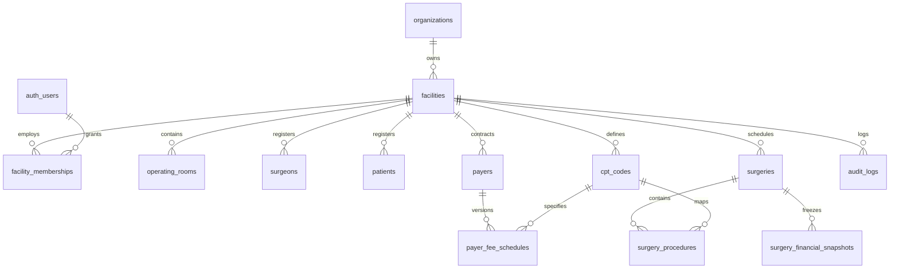
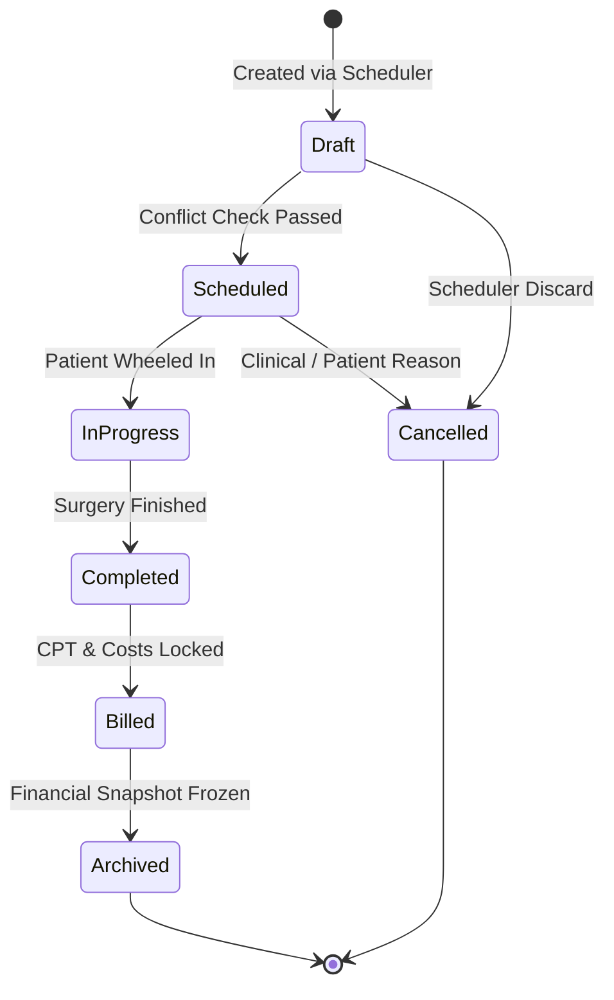

# 10 TARGET SYSTEM ARCHITECTURE — ASCANALYST PLATFORM

---

## 1. Purpose

The purpose of this specification is to define the definitive, production-grade **Target System Architecture** for the **ASCANALYST** enterprise surgical operations and financial intelligence platform. 

It establishes the multi-tier engineering blueprint across:
1. **Frontend Presentation Tier**: Modular, feature-sliced React 19 Single Page Application (SPA) powered by Vite, featuring route-level code-splitting, role-based navigation, high-performance virtualized grids, and the 4-state UI lifecycle (Skeleton Loading, Empty State, Loaded, Error Boundary).
2. **Edge Services & Integration Tier**: Secure Supabase Edge Functions (Deno/TypeScript runtime) executing privileged workflows, PDF generation, batch spreadsheet ingestion, external EHR/PM exports, and the secure AI Gateway proxy.
3. **Database & Domain Logic Tier**: Fully normalized PostgreSQL 15+ relational schema enforcing strict multi-tenancy (`organizations`, `facilities`, and `facility_memberships`), Row Level Security (RLS), and server-authoritative PL/pgSQL stored procedures for billing, CMS MPPR rules, and conflict-free OR scheduling.
4. **Secure AI Gateway Tier**: Centralized server-side LLM inference proxy with zero browser-exposed keys, strict JWT verification, tenant-scoped data retrieval, prompt injection sanitization, token budgeting, and immutable telemetry logging.
5. **Auditability & Provenance Subsystem**: Append-only transaction audit logging (`audit_logs`) and immutable financial snapshots (`surgery_financial_snapshots`) guaranteeing absolute clinical and billing reproducibility.

---

## 2. Scope & Guiding Principles

### 2.1 Production Requirements
- **Tenant Isolation First**: Every database read, mutation, edge function, and AI prompt context must be deterministically bound to verified `organization_id` and `facility_id` claims extracted from the user's cryptographically signed JWT.
- **Server-Authoritative Truth**: Zero financial calculations (gross charges, CMS MPPR reductions, contractual allowances, implant carve-outs, room overhead, labor, and contribution margin per minute) may depend on unvalidated client-side state. All mathematical logic runs in PostgreSQL or Edge Functions.
- **Sub-Second Performance**: Critical surgical scheduling views, Gantt timelines, and executive KPI rollups must achieve `< 500ms` Time-to-Interactive (TTI) through database indexing, materialized views, and aggressive frontend code-splitting ($< 500\text{ kB}$ initial chunk size).
- **Zero Mock Tolerance**: Elimination of all synthetic mock arrays (`MOCK_SURGEONS_DETAILS`, `MOCK_OR_UTIL_TREND`, `MOCK_SPECIALTY_DIST`, etc.) in production builds; 100% of rendered data reflects authoritative database truth.

### 2.2 Preservation of Compatibility
- Preserves the high-value clinical and administrative user workflows established in the prototype: Master Surgery Scheduler, Case Log Gantt View, Pre-Op/Post-Op Clinical Notes Generator, CPT Management, Surgeon Portal, and Executive Command Center.
- Preserves the established dark-navy clinical theme (`#030712`, `#0b1329`, `#1e293b`), typography, and intuitive SweetAlert2 modal workflows while replacing hardcoded CSS overrides with a unified design-token system.
- Preserves compatibility with existing Excel case-log spreadsheets and CMS CPT fee schedule uploads.

---

## 3. Current State vs. Target State Audit

| Architectural Component | Current Prototype State | Classification | Target Production State |
| :--- | :--- | :---: | :--- |
| **Frontend Architecture** | Monolithic `App.jsx` (5,900+ lines); all views, tabs, state, and modals co-located in a single file. | **REPLACE** | Modular Feature-Sliced Design (`src/features/*`); route-based lazy loading; dedicated contexts and custom hooks. |
| **Client Bundle & Splitting** | Single 2.31 MB monolithic JavaScript bundle (`index-mAupm54O.js`); triggers Vite warning. | **REFACTOR** | Route-level code-splitting with `React.lazy()` and Rollup manual chunking; all bundle chunks $\le 500\text{ kB}$. |
| **Authentication & RBAC** | Custom plaintext password queries against `users` and `surgeons` tables; unverified session in `localStorage`. | **REPLACE** | Supabase GoTrue Auth (bcrypt, JWT, secure HTTP-only cookies); 7 granular RBAC roles with cryptographic claims. |
| **Database Tenancy (RLS)** | 15 tables with open anonymous policies (`USING (true)`); single facility hardcoded in `settings`. | **REPLACE** | Complete multi-tenancy schema (`organizations`, `facilities`, `facility_memberships`); strict tenant-scoped RLS policies. |
| **Relational Normalization** | Comma-separated `cpt_codes` in `surgeries` (1NF violation); unlinked strings in `or_block_schedule`. | **REFACTOR** | 3NF normalized schema: `surgery_procedures`, `operating_rooms`, `payers`, `payer_fee_schedules` with foreign keys. |
| **Financial & Billing Math** | Triplicate client-side calculation in `hospitalUtils.js`, `FinancialEngine.js`, and `SurgeryScheduler.jsx`. | **REPLACE** | Server-authoritative PostgreSQL stored procedure `calculate_surgery_financials()` enforcing CMS MPPR standards. |
| **Scheduling & Conflict Engine** | Client-side validation in `SurgeryScheduler.jsx`; susceptible to race conditions and double-booking. | **REFACTOR** | Atomic PostgreSQL stored procedure `book_surgery_conflict_free()` with row-level locking (`FOR UPDATE`). |
| **Audit & Provenance** | Unstructured JSON snapshot column on `surgeries`; no mutation history or user attribution. | **MISSING** | Append-only `public.audit_logs` table powered by PostgreSQL triggers capturing actor, before/after JSON, and IP. |
| **AI Integration & Gateway** | Direct browser calls to Google Gemini API via `gemini.js`; API key exposed in browser memory. | **REPLACE** | Secure Supabase Edge Function `/api/ai-analyst` proxy; zero client secrets; tenant verification and token quotas. |
| **File Storage & Reports** | Client-side `jspdf` and `html2canvas` generating unarchived blobs directly in user browser. | **REFACTOR** | Supabase Storage buckets (`clinical-notes`, `surgery-reports`) with signed URLs, RLS, and server-side PDF generation. |

---

## 4. Target State Architecture Overview

### 4.1 System Topology Diagram

```mermaid
graph TD
    subgraph Client_Presentation_Tier [Client Presentation Tier (React 19 / Vite)]
        SPA[Modular Single Page Application]
        AuthGuard[Auth Guard & RBAC Router]
        FeatureModules[Feature Modules: Scheduling | Billing | Analytics | Registry]
        GlobalContext[Global Context: Auth & Active Facility State]
        DataLayer[API Client / TanStack Query Layer]
    end

    subgraph Edge_Services_Tier [Edge Services Tier (Supabase Deno Edge Functions)]
        Gateway[API & AI Gateway: /api/ai-analyst]
        Importer[Batch Ingestion Engine: /api/ingest-cpt]
        DocEngine[Report & PDF Service: /api/render-pdf]
        SyncEngine[EHR/PM Export Adapter: /api/export-cases]
    end

    subgraph Database_Tier [Database & Domain Logic Tier (PostgreSQL 15+)]
        RLS[PostgreSQL Row Level Security Engine]
        TenantTables[Tenancy & Auth: organizations, facilities, memberships]
        ClinicalTables[Clinical Master: surgeries, surgery_procedures, operating_rooms]
        FinancialTables[Financial Master: payers, fee_schedules, snapshots]
        StoredProcs[Authoritative Stored Procedures: calculate_financials, book_conflict_free]
        AuditTriggers[Immutable Trigger Engine: fn_audit_log_trigger]
        AuditLogs[(audit_logs)]
    end

    subgraph External_Integrations [External Services & Integrations]
        GoTrue[Supabase GoTrue Auth Service]
        LLM[Google Gemini 2.5 Flash / Pro API]
        S3Bucket[Supabase Encrypted Storage S3]
        EHR[External ASC EHR / RCM Systems]
    end

    SPA --> AuthGuard
    AuthGuard --> FeatureModules
    FeatureModules --> GlobalContext
    GlobalContext --> DataLayer

    DataLayer -->|JWT Authenticated HTTPS| RLS
    DataLayer -->|Privileged / AI HTTPS| Gateway
    DataLayer -->|File Uploads| Importer

    Gateway -->|Server-to-Server HTTPS| LLM
    Gateway -->|Service Role DB Access| StoredProcs
    DocEngine -->|Signed URLs| S3Bucket
    SyncEngine -->|HL7 / FHIR / JSON| EHR

    RLS --> TenantTables
    RLS --> ClinicalTables
    RLS --> FinancialTables
    ClinicalTables --> StoredProcs
    FinancialTables --> StoredProcs
    ClinicalTables --> AuditTriggers
    AuditTriggers --> AuditLogs
    TenantTables --> GoTrue
```

---

## 5. Multi-Tier Specification

### 5.1 Frontend Presentation Tier (React 19 / Vite)

#### 5.1.1 Architectural Pattern: Feature-Sliced Modular SPA
The monolithic `App.jsx` is systematically decomposed into feature modules under `src/features/`. Each domain encapsulates its own components, hooks, services, and types:

```
src/
├── app/
│   ├── App.jsx                     # Root router, global theme provider, top error boundary
│   ├── routes.jsx                  # Lazy-loaded route definitions
│   └── AppContext.jsx              # Global AuthUser, currentOrganization, currentFacility
├── assets/                         # Static icons, logos, clinical diagrams
├── components/                     # Shared UI atoms/molecules (Button, Modal, Table, Badge, Dropdown)
├── features/
│   ├── auth/                       # Login, Profile, Password Reset, Facility Switcher
│   ├── scheduling/                 # Master Scheduler, Timeline/Gantt, Room Conflict Checker
│   ├── caseLog/                    # Case Log Scheduler, Excel Importer, Duration Estimator
│   ├── financials/                 # CPT Management, Fee Schedules, Extra Costs, Payer Contracts
│   ├── analytics/                  # Executive Command Center, Surgeon Scorecards, Business Analysis
│   ├── clinicalNotes/              # Pre-Op/Post-Op Documentation, PDF Export
│   └── aiAnalyst/                  # Multi-Agent Console, Copilot Modal, Prompt Drawer
├── lib/
│   ├── supabaseClient.js           # Client-scoped Supabase instance
│   └── api.js                      # Centralized typed HTTP/RPC client
└── utils/
    ├── formatters.js               # Currency ($), date, duration, and phone formatting
    └── clinicalMath.js             # Client-side presentation formatting only (no business logic)
```

#### 5.1.2 Route-Based Code Splitting
Every major top-level navigation feature is loaded dynamically via `React.lazy()` and wrapped in a localized `Suspense` fallback rendering a skeleton loader:

```jsx
const SchedulingFeature = React.lazy(() => import('../features/scheduling/SchedulingFeature'));
const FinancialsFeature = React.lazy(() => import('../features/financials/FinancialsFeature'));
const AnalyticsFeature = React.lazy(() => import('../features/analytics/AnalyticsFeature'));
const AIAnalystFeature = React.lazy(() => import('../features/aiAnalyst/AIAnalystFeature'));
```

#### 5.1.3 The 4-State UI Lifecycle Standard
Every screen and data component must implement the 4-state lifecycle without exception:
1. **Loading State**: Customized skeleton placeholder matching the component's geometry (no generic spinner-only screens).
2. **Empty State**: Contextual empty graphic, descriptive clinical message, and clear call-to-action button (e.g., "No surgeries scheduled for OR 2 today. Click 'Schedule Surgery' to add a case.").
3. **Loaded State**: Full interactive view with virtualized table rendering (`@tanstack/react-virtual` for tables $> 100$ rows).
4. **Error State**: Non-crashing localized `ErrorBoundary` displaying the error message, request correlation ID, and a "Retry Action" button.

---

### 5.2 Database & Domain Logic Tier (PostgreSQL 15+ & Supabase)

#### 5.2.1 Core Multi-Tenancy Architecture
Multi-tenancy is structured hierarchically:
- An **`organizations`** record represents the enterprise parent entity (e.g., "National Surgical Partners, LLC").
- A **`facilities`** record represents an individual licensed surgical center or HOPD (e.g., "Advanced Orthopedic Surgery Center - North").
- A **`facility_memberships`** record associates a `auth.users` account with a specific facility and assigns a dedicated role (`facility_admin`, `clinical_director`, `biller`, `surgeon`, `viewer`).
- All clinical and financial tables (`surgeries`, `patients`, `surgeons`, `cpt_codes`, `operating_rooms`, `audit_logs`) contain a non-nullable `facility_id` foreign key with composite indexing `(facility_id, date)` or `(facility_id, id)`.

#### 5.2.2 Server-Authoritative Financial Math: Stored Procedure `calculate_surgery_financials`
All case-level financial calculations run inside PostgreSQL. This prevents client math tampering and guarantees exact consistency across the frontend, batch exports, and AI queries:

```sql
CREATE OR REPLACE FUNCTION public.calculate_surgery_financials(
    p_surgery_id BIGINT
)
RETURNS TABLE (
    total_gross_charge NUMERIC(12,2),
    expected_reimbursement NUMERIC(12,2),
    total_room_cost NUMERIC(12,2),
    total_labor_cost NUMERIC(12,2),
    total_supply_cost NUMERIC(12,2),
    total_implant_cost NUMERIC(12,2),
    total_staff_fee NUMERIC(12,2),
    total_internal_cost NUMERIC(12,2),
    net_margin NUMERIC(12,2),
    margin_percentage NUMERIC(6,2),
    margin_per_minute NUMERIC(8,2)
)
LANGUAGE plpgsql
SECURITY DEFINER
AS $$
DECLARE
    v_surg RECORD;
    v_proc RECORD;
    v_room_hourly NUMERIC(10,2);
    v_duration_min NUMERIC(10,2);
    v_rank INTEGER := 1;
    v_reimb NUMERIC(12,2) := 0;
    v_gross NUMERIC(12,2) := 0;
    v_supplies NUMERIC(12,2) := 0;
    v_implants NUMERIC(12,2) := 0;
    v_labor NUMERIC(12,2) := 0;
    v_staff_fee NUMERIC(12,2) := 0;
    v_room_cost NUMERIC(12,2) := 0;
    v_total_cost NUMERIC(12,2) := 0;
    v_net NUMERIC(12,2) := 0;
    v_pct NUMERIC(6,2) := 0;
    v_margin_min NUMERIC(8,2) := 0;
BEGIN
    -- 1. Fetch surgery and room metadata
    SELECT s.*, COALESCE(o.hourly_rate, 450.00) AS room_hourly
    INTO v_surg
    FROM public.surgeries s
    LEFT JOIN public.operating_rooms o ON s.operating_room_id = o.id
    WHERE s.id = p_surgery_id;

    IF NOT FOUND THEN
        RAISE EXCEPTION 'Surgery ID % not found', p_surgery_id;
    END IF;

    v_duration_min := GREATEST(COALESCE(v_surg.actual_duration_minutes, v_surg.duration_minutes, 60), 1);
    v_room_hourly := v_surg.room_hourly;

    -- 2. Process procedures with CMS MPPR Discounting (100% Primary, 50% Subsequent)
    FOR v_proc IN (
        SELECT sp.*, c.gross_charge, c.reimbursement
        FROM public.surgery_procedures sp
        JOIN public.cpt_codes c ON sp.cpt_code_id = c.id
        WHERE sp.surgery_id = p_surgery_id
        ORDER BY c.reimbursement DESC, sp.sequence_order ASC
    ) LOOP
        v_gross := v_gross + COALESCE(v_proc.gross_charge, 0);
        IF v_rank = 1 THEN
            v_reimb := v_reimb + COALESCE(v_proc.reimbursement, 0);
        ELSE
            -- 50% MPPR reduction on secondary/tertiary surgical procedures
            v_reimb := v_reimb + (COALESCE(v_proc.reimbursement, 0) * 0.50);
        END IF;
        v_rank := v_rank + 1;
    END LOOP;

    -- 3. Calculate internal costs
    v_room_cost := (v_duration_min / 60.0) * v_room_hourly;
    v_labor := COALESCE(v_surg.actual_labor_cost, (v_duration_min / 60.0) * 120.00);
    v_supplies := COALESCE(v_surg.supplies_cost, 0);
    v_implants := COALESCE(v_surg.implants_cost, 0);
    v_staff_fee := COALESCE(v_surg.calculated_staff_fee, 0);

    v_total_cost := v_room_cost + v_labor + v_supplies + v_implants + v_staff_fee;
    v_net := v_reimb - COALESCE(v_surg.write_off, 0) - v_total_cost;
    
    IF v_reimb > 0 THEN
        v_pct := ROUND((v_net / v_reimb) * 100, 2);
    ELSE
        v_pct := 0;
    END IF;

    v_margin_min := ROUND(v_net / v_duration_min, 2);

    RETURN QUERY SELECT 
        ROUND(v_gross, 2),
        ROUND(v_reimb, 2),
        ROUND(v_room_cost, 2),
        ROUND(v_labor, 2),
        ROUND(v_supplies, 2),
        ROUND(v_implants, 2),
        ROUND(v_staff_fee, 2),
        ROUND(v_total_cost, 2),
        ROUND(v_net, 2),
        v_pct,
        v_margin_min;
END;
$$;
```

#### 5.2.3 Conflict-Free OR Scheduling: Stored Procedure `book_surgery_conflict_free`
Prevents concurrent race conditions when two schedulers attempt to book overlapping surgeries into the same operating room:

```sql
CREATE OR REPLACE FUNCTION public.book_surgery_conflict_free(
    p_facility_id UUID,
    p_room_id BIGINT,
    p_surgeon_id BIGINT,
    p_date DATE,
    p_start_time TIME,
    p_duration_minutes INTEGER,
    p_patient_id BIGINT,
    p_cpt_codes BIGINT[],
    p_notes TEXT DEFAULT NULL
)
RETURNS BIGINT
LANGUAGE plpgsql
SECURITY DEFINER
AS $$
DECLARE
    v_end_time TIME;
    v_conflict_count INTEGER;
    v_new_surgery_id BIGINT;
    v_cpt_id BIGINT;
    v_seq INTEGER := 1;
BEGIN
    v_end_time := p_start_time + (p_duration_minutes || ' minutes')::INTERVAL;

    -- Lock room partition for concurrency protection
    PERFORM 1 FROM public.operating_rooms WHERE id = p_room_id FOR UPDATE;

    -- Check for overlapping surgery in the same facility and room
    SELECT COUNT(*)
    INTO v_conflict_count
    FROM public.surgeries
    WHERE facility_id = p_facility_id
      AND operating_room_id = p_room_id
      AND date = p_date
      AND status NOT IN ('cancelled', 'completed')
      AND (
          (start_time, (start_time + (duration_minutes || ' minutes')::INTERVAL)) 
          OVERLAPS 
          (p_start_time, v_end_time)
      );

    IF v_conflict_count > 0 THEN
        RAISE EXCEPTION 'Scheduling Conflict: Operating Room is already booked during this time window.';
    END IF;

    -- Insert authoritative surgery record
    INSERT INTO public.surgeries (
        facility_id,
        operating_room_id,
        surgeon_id,
        patient_id,
        date,
        start_time,
        duration_minutes,
        status,
        notes,
        created_at
    ) VALUES (
        p_facility_id,
        p_room_id,
        p_surgeon_id,
        p_patient_id,
        p_date,
        p_start_time,
        p_duration_minutes,
        'scheduled',
        p_notes,
        NOW()
    ) RETURNING id INTO v_new_surgery_id;

    -- Populate normalized surgery_procedures
    FOREACH v_cpt_id IN ARRAY p_cpt_codes LOOP
        INSERT INTO public.surgery_procedures (
            facility_id,
            surgery_id,
            cpt_code_id,
            sequence_order,
            is_primary
        ) VALUES (
            p_facility_id,
            v_new_surgery_id,
            v_cpt_id,
            v_seq,
            (v_seq = 1)
        );
        v_seq := v_seq + 1;
    END LOOP;

    -- Create immutable audit entry
    INSERT INTO public.audit_logs (
        facility_id,
        table_name,
        record_id,
        action,
        after_state
    ) VALUES (
        p_facility_id,
        'surgeries',
        v_new_surgery_id::TEXT,
        'INSERT',
        jsonb_build_object('id', v_new_surgery_id, 'date', p_date, 'room_id', p_room_id)
    );

    RETURN v_new_surgery_id;
END;
$$;
```

---

### 5.3 Secure AI Gateway Tier (Supabase Edge Function)

#### 5.3.1 Threat Model & Gateway Responsibilities
In the target architecture, **zero LLM API keys are deployed to or accessed by the browser**. All AI requests are mediated by the Edge Function `api/ai-analyst`:



#### 5.3.2 Gateway Contract (`/api/ai-analyst`)
- **Method**: `POST`
- **Headers**: `Authorization: Bearer <JWT>`, `Content-Type: application/json`
- **Payload**:
  ```json
  {
    "facility_id": "3fa85f64-5717-4562-b3fc-2c963f66afa6",
    "agent_type": "OROptimizationAgent",
    "query": "Evaluate margin impact of adding 2 cataract blocks on Thursday afternoon",
    "parameters": {
      "target_or_id": 2,
      "proposed_cpt_codes": ["66984", "66982"]
    }
  }
  ```
- **Guaranteed Enforcements**:
  1. **Tenancy Verification**: Edge Function confirms `facility_id` belongs to caller's `facility_memberships`.
  2. **Role Authorization**: Viewer roles cannot trigger scenario optimizations or cost updates.
  3. **Rate Limiting**: Maximum 30 requests per minute per user; 500 requests per facility per day.
  4. **PII Masking**: Patient names, SSNs, and phone numbers are stripped from prompt contexts. Only anonymized procedure durations, room IDs, and financial aggregations are submitted to the model.

---

## 6. Target Relational Data Model & Schema



### 6.1 Schema Definition Table Matrix

| Table Name | Description | Key Columns | Indexes |
| :--- | :--- | :--- | :--- |
| **`organizations`** | Top-level enterprise tenant entity. | `id (UUID PK)`, `name`, `tax_id`, `created_at` | `PK(id)` |
| **`facilities`** | Individual physical surgery center. | `id (UUID PK)`, `organization_id (FK)`, `name`, `license_no`, `timezone`, `settings (JSONB)` | `PK(id)`, `IDX(organization_id)` |
| **`facility_memberships`** | RBAC linking user accounts to facilities. | `id (UUID PK)`, `facility_id (FK)`, `user_id (FK)`, `role`, `is_active` | `PK(id)`, `UNIQUE(facility_id, user_id)` |
| **`operating_rooms`** | Physical OR suites with hourly rates. | `id (BIGSERIAL PK)`, `facility_id (FK)`, `name`, `hourly_rate`, `status` | `PK(id)`, `IDX(facility_id)` |
| **`surgeons`** | Credentialed surgical physicians. | `id (BIGSERIAL PK)`, `facility_id (FK)`, `npi`, `firstname`, `lastname`, `specialty` | `PK(id)`, `IDX(facility_id, npi)` |
| **`patients`** | Master patient demographic index. | `id (BIGSERIAL PK)`, `facility_id (FK)`, `mrn`, `firstname`, `lastname`, `dob` | `PK(id)`, `UNIQUE(facility_id, mrn)` |
| **`cpt_codes`** | Master procedure fee registry. | `id (BIGSERIAL PK)`, `facility_id (FK)`, `code`, `description`, `gross_charge`, `reimbursement`, `effective_date`, `termination_date` | `PK(id)`, `IDX(facility_id, code, effective_date)` |
| **`surgeries`** | Core surgical bookings and cases. | `id (BIGSERIAL PK)`, `facility_id (FK)`, `operating_room_id (FK)`, `surgeon_id (FK)`, `patient_id (FK)`, `date`, `start_time`, `duration_minutes`, `status` | `PK(id)`, `IDX(facility_id, date, operating_room_id)` |
| **`surgery_procedures`** | 1NF normalized procedure lines. | `id (BIGSERIAL PK)`, `facility_id (FK)`, `surgery_id (FK)`, `cpt_code_id (FK)`, `sequence_order`, `modifier_codes`, `is_primary` | `PK(id)`, `IDX(surgery_id, sequence_order)` |
| **`surgery_financial_snapshots`** | Immutable financial freeze upon case billing. | `id (BIGSERIAL PK)`, `facility_id (FK)`, `surgery_id (FK)`, `snapshot_data (JSONB)`, `calculation_version`, `frozen_at`, `frozen_by` | `PK(id)`, `UNIQUE(surgery_id)` |
| **`audit_logs`** | Append-only system mutation ledger. | `id (BIGSERIAL PK)`, `facility_id (FK)`, `actor_id (UUID)`, `table_name`, `record_id`, `action`, `before_state (JSONB)`, `after_state (JSONB)`, `created_at` | `PK(id)`, `IDX(facility_id, created_at)` |

---

## 7. Role-Based Access Control (RBAC) & Security Architecture

### 7.1 Role Hierarchy Matrix

| Action / Capability | `super_admin` | `org_admin` | `facility_admin` | `clinical_director` | `biller` | `surgeon` | `viewer` |
| :--- | :---: | :---: | :---: | :---: | :---: | :---: | :---: |
| **Cross-Tenant Facility Switching** | Yes | Yes (Org) | No | No | No | No | No |
| **Facility Management & Settings** | Yes | Yes | Yes | Read Only | No | No | Read Only |
| **User Onboarding & Role Assignment**| Yes | Yes | Yes | No | No | No | No |
| **Manage CPT Codes & Fee Schedules** | Yes | Yes | Yes | Read Only | Yes | Read Only | Read Only |
| **Book & Modify Surgery Schedules** | Yes | Yes | Yes | Yes | Read Only | Request Only | Read Only |
| **Record Actual Surgery Costs / Supplies**| Yes | Yes | Yes | Yes | Yes | No | Read Only |
| **Generate & Sign Clinical Notes** | Yes | Yes | Yes | Yes | No | Own Cases | Read Only |
| **Execute AI Financial Optimizations**| Yes | Yes | Yes | Yes | Yes | Own Cases | No |
| **Freeze / Finalize Case Billing** | Yes | Yes | Yes | No | Yes | No | No |
| **View Immutable Audit Logs** | Yes | Yes | Yes | No | No | No | No |

### 7.2 PostgreSQL Row Level Security (RLS) Policy Example
Every clinical table enforces tenant isolation via helper function `auth.uid()` resolving user memberships:

```sql
-- Helper function to fetch permitted facilities for the active JWT session
CREATE OR REPLACE FUNCTION public.get_auth_user_facilities()
RETURNS TABLE (facility_id UUID)
LANGUAGE sql
SECURITY DEFINER
STABLE
AS $$
    SELECT fm.facility_id 
    FROM public.facility_memberships fm
    WHERE fm.user_id = auth.uid()
      AND fm.is_active = TRUE;
$$;

-- Enable RLS
ALTER TABLE public.surgeries ENABLE ROW LEVEL SECURITY;

-- Tenant Isolation Policy
CREATE POLICY "Tenant Scoped Surgeries Policy"
ON public.surgeries
FOR ALL
TO authenticated
USING (
    facility_id IN (SELECT get_auth_user_facilities())
)
WITH CHECK (
    facility_id IN (SELECT get_auth_user_facilities())
);
```

---

## 8. Business Rules & Deterministic Engine

### 8.1 CMS MPPR (Multiple Procedure Payment Reduction) Standard
1. All procedures assigned to a single surgical case are ranked in descending order of their contracted base reimbursement.
2. **Procedure Rank 1 (Primary)**: Paid at **100%** of contracted fee schedule.
3. **Procedure Rank 2+ (Secondary / Subsequent)**: Paid at **50%** of contracted fee schedule.
4. **Bilateral Modifier (`-50`)**: Calculated as $150\%$ of the primary procedure value (100% for the first side + 50% for the second side).

### 8.2 Room Overhead Costing Standard
1. Operating room costs are calculated as a continuous function of case duration:
   $$\text{Room Cost} = \left( \frac{\text{Actual Duration Minutes}}{60} \right) \times \text{OR Hourly Rate}$$
2. If `actual_duration_minutes` is null (pre-op planning), `duration_minutes` is used.
3. Default facility room overhead rate is $\$450.00/\text{hr}$ unless overridden in `operating_rooms.hourly_rate`.

### 8.3 Case Status Lifecycle State Machine



- **Rule 1 (Locking Invariant)**: Once a surgery reaches `Billed` or `Archived`, all procedures, duration records, and cost allocations are locked. Mutations require an explicit supervisor unlock trigger that writes an alert to `audit_logs`.
- **Rule 2 (Cancellation Invariant)**: Cancelled surgeries release their booked time slots immediately and are excluded from room conflict queries.

---

## 9. Architectural Decision Records (ADRs)

### ADR-001: Server-Authoritative Financial & Billing Calculations
- **Status**: **ACCEPTED**
- **Context**: The prototype computed margins, MPPR reductions, and staff costs in three disparate JavaScript files (`hospitalUtils.js`, `FinancialEngine.js`, and `SurgeryScheduler.jsx`). This led to floating-point drift, discrepancy between reporting tabs, and high risk of client-side tampering.
- **Decision**: All financial and billing math is centralized into PostgreSQL stored procedure `calculate_surgery_financials()` and materialized in `surgery_financial_snapshots`. The frontend serves purely as a display layer.
- **Consequences**:
  - *Positive*: Absolute mathematical determinism; single source of truth; audit-ready for commercial payers and CMS.
  - *Trade-off*: Requires database migrations to update billing rules; mitigated by versioned calculation tags (`v1.0-cms2026`).

### ADR-002: Modular Feature-Sliced SPA over Heavy Full-Stack Framework
- **Status**: **ACCEPTED**
- **Context**: Evaluating whether to rewrite the application in Next.js/Remix or retain the Vite + React 19 SPA foundation.
- **Decision**: Retain Vite + React 19 but transition from the monolithic `App.jsx` to a Feature-Sliced Architecture (`src/features/*`) backed by Supabase Edge Functions.
- **Consequences**:
  - *Positive*: Preserves 100% of existing complex Gantt/timeline interactive state; zero SSR dehydration friction; sub-second local Vite HMR; straightforward hosting on Cloudflare/Vercel/S3.
  - *Trade-off*: Requires client-side bundle splitting (`React.lazy()`) to meet the $< 500\text{ kB}$ chunk size gate.

### ADR-003: Centralized Server-Side AI Gateway Proxy
- **Status**: **ACCEPTED**
- **Context**: The prototype invoked the Google Gemini API directly from browser code using an exposed API key in `src/lib/gemini.js`.
- **Decision**: Route all AI interactions through a dedicated Supabase Edge Function (`/api/ai-analyst`). The Edge Function injects server-verified database metrics, validates caller JWT permissions, and scrubs patient PII before calling Gemini.
- **Consequences**:
  - *Positive*: Zero browser credential exposure; guaranteed tenant isolation in prompt contexts; full token expenditure logging.
  - *Trade-off*: Adds minimal edge network roundtrip ($\approx 50\text{ms}$); easily offset by using streaming chunk responses.

### ADR-004: Append-Only Immutable Transaction Audit Logging
- **Status**: **ACCEPTED**
- **Context**: Healthcare compliance (HIPAA) and financial accounting mandate complete traceability of who changed patient data, surgery dates, or billing reimbursements.
- **Decision**: Deploy an append-only `public.audit_logs` table driven by PostgreSQL triggers on all mutations to `surgeries`, `patients`, and `cpt_codes`.
- **Consequences**:
  - *Positive*: Immutable, non-repudiable historical ledger; automatic diff tracking without relying on frontend developers to manually log events.
  - *Trade-off*: Modest database storage growth; mitigated by table partitioning on `created_at` yearly boundaries.

---

## 10. QA Verification & Test Strategy

| Test Layer | Test Scope | Tooling | Success Metric |
| :--- | :--- | :--- | :--- |
| **Unit Tests** | Financial formatters, CMS MPPR math algorithms, date/time conflict functions. | Vitest | 100% pass rate; penny-exact validation against CMS test fixtures. |
| **Database & RLS** | Cross-tenant data isolation; unauthorized role access prevention. | `pgTAP` / Supabase CLI | Zero rows returned on cross-facility SELECT queries. |
| **Integration Tests** | Edge Function `/api/ai-analyst`, Excel parser, and stored procedure calls. | Vitest + Supertest | HTTP 200 with verified payload schemas; 401 on expired tokens. |
| **End-to-End Tests** | Full clinical workflow: Login $\rightarrow$ Facility Switch $\rightarrow$ Schedule Surgery $\rightarrow$ Conflict Detection $\rightarrow$ Complete Case $\rightarrow$ Freeze Financials. | Playwright | 100% pass rate on Chromium, Firefox, WebKit without flakiness. |
| **Performance** | Initial load bundle size, Time-to-Interactive, virtualized table scrolling. | Lighthouse / Vite Analyzer | Initial chunk $\le 500\text{ kB}$; Lighthouse Performance $\ge 90$; TTI $< 500\text{ms}$. |

---

## 11. Acceptance Criteria

- [x] Complete multi-tier target architecture established spanning Frontend, Edge Services, PostgreSQL Database, and AI Gateway.
- [x] Clear KEEP / REFACTOR / REPLACE / MISSING audit classification for every prototype subsystem.
- [x] Strict tenant isolation and 7-tier RBAC security matrix defined with cryptographic JWT validation.
- [x] Server-authoritative stored procedures specified for CMS MPPR billing math and conflict-free room scheduling.
- [x] Server-side AI Gateway design eliminating browser credential exposure and enforcing PII scrubbing.
- [x] Append-only audit trigger architecture and immutable financial snapshot system defined.
- [x] Architectural Decision Records (ADRs) documented for all key design choices.
- [x] Comprehensive multi-layer QA testing matrix established.

---

## 12. Dependencies & Phased Implementation Mapping

This specification provides the architectural foundation for the master roadmap defined in [05-MASTER-BUILD-ROADMAP.md](file:///e:/medicalAI/asc-prototype/docs/phases/05-MASTER-BUILD-ROADMAP.md):
- **Phase 1**: Implements Section 6 (Multi-Tenancy Schema) and Section 7 (GoTrue Auth & RLS).
- **Phase 2**: Implements Section 6 (Normalized 3NF Clinical Schema) and Section 8 (Audit Triggers).
- **Phase 3**: Implements Section 5.2.2 (`calculate_surgery_financials`) and Section 8.1 (CMS MPPR Engine).
- **Phase 4**: Implements Section 5.1 (Decomposition of `App.jsx` into `src/features/*` and Lazy Chunking).
- **Phase 5**: Implements Section 5.2.3 (`book_surgery_conflict_free`) and Scheduling Workflows.
- **Phase 6**: Implements Section 5.3 (Secure Edge Function `/api/ai-analyst` and Gemini Proxy).
- **Phase 7**: Implements Section 10 (Full Vitest and Playwright Automated E2E Test Suite).
