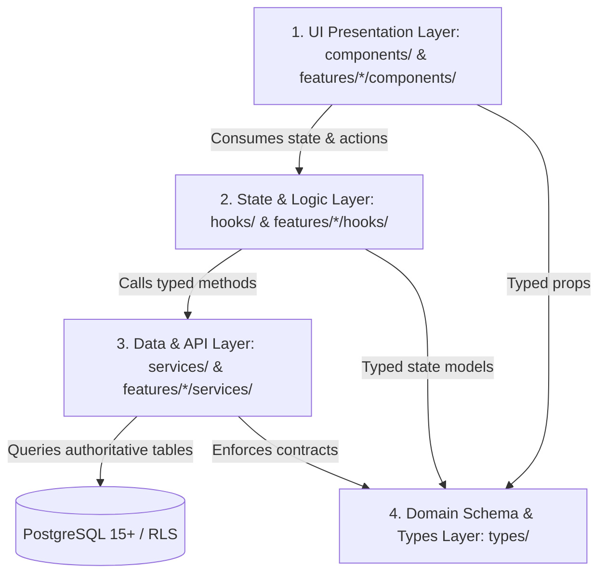
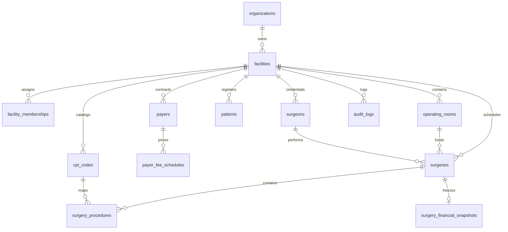

# 11 REPOSITORY STRUCTURE — ASCANALYST PLATFORM

---

## 1. Purpose

The purpose of this specification is to define the definitive target directory, file, module, service, hook, and type architecture for transforming the `asc-prototype` codebase into the modular, enterprise-grade **ASCANALYST** platform.

It resolves the acute architectural debt of the monolithic `src/App.jsx` (5,903 lines, 312 kB) and monolithic bundle chunk (2.32 MB) by establishing a Feature-Sliced Design (FSD) architecture. It maps every existing component, agent, service, and utility to its authoritative target location, details dependency graphs and import rewrites, enforces separation of concerns across presentation and domain layers, and eliminates all synthetic mock data dictionaries in favor of server-authoritative relational truth.

---

## 2. Scope & Guiding Principles

### 2.1 Production Requirements
- **Feature-Sliced Modularity**: Reorganize frontend code into domain features (`src/features/*`) where each domain encapsulates its UI components, hooks, services, and types.
- **Strict Separation of Concerns**: 
  - **UI Layer** (`components/`): Pure rendering, visual presentation, and localized UI state.
  - **Logic Layer** (`hooks/`): State orchestration, data transforms, and event handlers.
  - **Data Layer** (`services/`): Typed API client, Supabase RPC queries, and cache management.
  - **Type Layer** (`types/`): Authoritative data models, interfaces, and schemas.
- **Route-Level Code Splitting**: Every primary navigation view must be dynamically imported via `React.lazy()` with Rollup manual chunking to guarantee that production bundle chunks remain strictly $\le 500\text{ kB}$.
- **Zero Regression of Clinical Workflows**: Preserve 100% of the established clinical user workflows (Surgery Scheduler, Case Log Gantt, Pre-Op/Post-Op Notes PDF generation, CPT Management, Surgeon Portal, and Executive Command Center).
- **Tenant Context First**: All feature queries, mutations, and views must consume the active tenant context (`FacilityContext`) backed by Supabase GoTrue Auth claims.
- **Zero Mock Tolerance**: Systematically eliminate synthetic mock data arrays (`MOCK_SURGEONS_DETAILS`, `MOCK_CASE_LOGS`, `MOCK_OR_UTIL_TREND`, etc.) during migration.

---

## 3. Current State Codebase Inventory & Classification

The existing frontend codebase comprises **48 files** across `src/`, with heavy coupling in `src/components/` and raw database access in `src/lib/supabase.js`.

### 3.1 Inventory & Component Audit Matrix

| Current File Path | Size / Lines | Current Responsibility | Classification | Target Relocation & Action |
| :--- | :---: | :--- | :---: | :--- |
| `src/App.jsx` | 312 kB / 5,903 L | Monolithic application shell, router, sidebar, header, 10+ inline screens, and 3,000+ lines of mock data. | **REPLACE** | Deconstruct into `src/app/App.jsx`, `src/app/routes.jsx`, and isolated feature pages under `src/features/*`. |
| `src/main.jsx` | 0.2 kB / 11 L | Application bootstrapping, DOM mount, StrictMode. | **KEEP** | Retain in `src/main.jsx` with root Context Providers wrapper. |
| `src/index.css` | 23.2 kB / 750 L | Global design tokens, dark-navy theme variables, and shared utility classes. | **KEEP** | Retain in `src/styles/index.css`; import centrally in `src/main.jsx`. |
| `src/App.css` | 2.9 kB / 120 L | Monolith layout styles (sidebar, header, content grid). | **REFACTOR** | Migrate to `src/components/layout/Layout.css`. |
| `src/components/SurgeryScheduler.jsx` | 142 kB / 2,735 L | Master scheduling grid, duration estimators, Pre-Op/Post-Op documentation tabs, and jsPDF export. | **REFACTOR** | Decouple into `src/features/scheduling/components/SurgeryScheduler.jsx` and separate notes editor to `src/features/clinicalNotes/`. |
| `src/components/Settings.jsx` | 61.6 kB / 1,234 L | Facility settings, operating room configuration, and plaintext API key inputs. | **REFACTOR** | Move to `src/features/settings/components/Settings.jsx`; bind to `facilities` and `operating_rooms` tables. |
| `src/components/CPTManagement.jsx` | 45.3 kB / 987 L | CPT code directory, fee schedules, search, category filter, and modal editor. | **REFACTOR** | Move to `src/features/financials/components/CPTManagement.jsx`. |
| `src/components/Chatbot.jsx` | 35.6 kB / 768 L | Conversational AI widget with floating launcher and suggested prompt chips. | **REFACTOR** | Move to `src/features/aiAnalyst/components/Chatbot.jsx`; bind to Edge Function. |
| `src/components/OTCostManagement.jsx` | 32.0 kB / 642 L | CPT expense overrides (supplies, implants, labor, room, tray). | **REFACTOR** | Move to `src/features/financials/components/OTCostManagement.jsx`. |
| `src/components/CaseLogScheduler.jsx` | 28.5 kB / 541 L | Visual Gantt timeline of daily OR room occupancy and case flow. | **REFACTOR** | Move to `src/features/scheduling/components/CaseLogScheduler.jsx`. |
| `src/components/AIAnalystModal.jsx` | 27.3 kB / 498 L | OR schedule optimization modal with scenario simulation. | **REFACTOR** | Move to `src/features/aiAnalyst/components/AIAnalystModal.jsx`. |
| `src/components/SurgeonPortal.jsx` | 25.9 kB / 512 L | Dedicated workspace for authenticated surgeons. | **REFACTOR** | Move to `src/features/surgeons/components/SurgeonPortal.jsx`. |
| `src/components/MultiAgentConsole.jsx` | 25.7 kB / 486 L | Multi-agent execution dashboard, pipeline telemetry, and task graph. | **REFACTOR** | Move to `src/features/aiAgents/components/MultiAgentConsole.jsx`. |
| `src/components/CommandCenter.jsx` | 19.4 kB / 375 L | Executive MTD/YTD KPI metric cards, contribution margin rollups. | **REFACTOR** | Move to `src/features/analytics/components/CommandCenter.jsx`. |
| `src/components/StaffManagement.jsx` | 19.2 kB / 380 L | Clinical staff roster, wage rates, roles, and credential management. | **REFACTOR** | Move to `src/features/staff/components/StaffManagement.jsx`. |
| `src/components/ORBlockSchedule.jsx` | 15.7 kB / 310 L | Block schedule reservation grid and surgeon block template allocations. | **REFACTOR** | Move to `src/features/scheduling/components/ORBlockSchedule.jsx`. |
| `src/components/UserProfile.jsx` | 15.2 kB / 295 L | User profile, facility membership details, and password updater. | **REFACTOR** | Move to `src/features/auth/components/UserProfile.jsx`. |
| `src/components/InstructionPanel.jsx` | 12.3 kB / 245 L | Operational guidance drawer for clinical administrators. | **REFACTOR** | Move to `src/features/aiAnalyst/components/InstructionPanel.jsx`. |
| `src/components/CPTAgentTestRunner.jsx` | 12.1 kB / 230 L | Scenario simulation test runner for CPT agents. | **REFACTOR** | Move to `src/features/aiAgents/components/CPTAgentTestRunner.jsx`. |
| `src/components/CPTUpload.jsx` | 9.9 kB / 215 L | Excel (.xlsx) file upload for CMS CPT fee schedule updates. | **REFACTOR** | Move to `src/features/financials/components/CPTUpload.jsx`. |
| `src/components/LoginPage.jsx` | 8.9 kB / 185 L | Authentication screen supporting GoTrue Auth and demo fallback. | **REFACTOR** | Move to `src/features/auth/components/LoginPage.jsx`. |
| `src/components/BusinessAnalysis.jsx` | 8.8 kB / 175 L | Revenue vs cost breakdown, specialty distribution, and EBITDA metrics. | **REFACTOR** | Move to `src/features/analytics/components/BusinessAnalysis.jsx`. |
| `src/components/AIOperationsAnalyst.jsx` | 1.7 kB / 35 L | Operational AI insights wrapper. | **REFACTOR** | Merge into `src/features/aiAnalyst/components/AIOperationsAnalyst.jsx`. |
| `src/lib/supabase.js` | 36.1 kB / 960 L | Supabase client initialization, database helper methods, and demo fallback. | **REFACTOR** | Split into client singleton `src/lib/supabaseClient.js` and typed domain repositories. |
| `src/lib/gemini.js` | 9.4 kB / 180 L | Direct browser calls to Google Gemini API with exposed key. | **REPLACE** | Decommission in frontend; replace with Edge Function `/api/ai-analyst`. |
| `src/lib/geminiLive.js` | 16.6 kB / 340 L | Gemini Live bidirectional audio/text streaming prototype. | **REFACTOR** | Move to `src/features/aiAnalyst/services/geminiLive.js`. |
| `src/utils/hospitalUtils.js` | 14.1 kB / 420 L | Client-side financial, room cost, and duration math. | **REFACTOR** | Decommission business calculations to database; move presentation helpers to `src/utils/formatters.js`. |
| `src/utils/databaseBackup.js` | 12.2 kB / 280 L | Client-side database JSON export/import utility. | **REFACTOR** | Move to `src/services/databaseBackup.js`. |
| `src/utils/excelParser.js` | 7.3 kB / 195 L | Spreadsheet parser for CPT codes and surgical case logs. | **REFACTOR** | Move to `src/features/financials/utils/excelParser.js`. |
| `src/services/OptimizationEngine.js` | 14.9 kB / 360 L | Client-side genetic algorithm schedule solver. | **REPLACE** | Replace with server-side Edge Function optimization service. |
| `src/services/aiOperations/*` (10 files) | ~25 kB / 650 L | Disparate AI scoring, historical intelligence, and duplicate financial math. | **REFACTOR** | Consolidate under `src/features/aiAgents/services/` and `src/features/analytics/services/`. |
| `src/agents/*` (13 files) | ~25 kB / 720 L | Multi-agent domain models (`BillingAgent`, `CostAgent`, `ORTimeAgent`, etc.). | **KEEP / REFACTOR**| Relocate to `src/features/aiAgents/agents/`. |
| `src/context/*` | 0 L | React Context providers for global auth, facility, and theme state. | **MISSING** | Create `AuthContext.jsx`, `FacilityContext.jsx`, `ThemeContext.jsx`. |
| `src/components/ui/*` | 0 L | Reusable atomic design-system components (Button, Modal, Table, Badge). | **MISSING** | Create standardized UI primitives in `src/components/ui/`. |
| `src/types/*` | 0 L | Authoritative TypeScript/JSDoc type declarations for domain models. | **MISSING** | Create `clinical.d.ts`, `financial.d.ts`, `tenancy.d.ts`. |

---

## 4. Target State Architecture & Directory Layout

The target repository structure follows **Feature-Sliced Design (FSD)**:

```
src/
├── app/                                    # Root Application Shell & Router
│   ├── App.jsx                             # Clean top shell: Context Providers + Layout + Suspense
│   ├── routes.jsx                          # Route registry with React.lazy() chunk boundaries
│   └── AppContext.jsx                      # Composite provider assembling Auth, Facility, and Theme
│
├── assets/                                 # Static Media & Icons
│   ├── icons/                              # Specialized clinical SVGs
│   └── branding/                           # ASCANALYST enterprise brand logos
│
├── components/                             # Cross-Feature Reusable Presentation Components
│   ├── ui/                                 # Atomic UI Primitives (Design-Token Compliant)
│   │   ├── Button.jsx                      # Button with variants (primary, secondary, danger, ghost)
│   │   ├── Modal.jsx                       # Standardized dialog modal with portal & focus trap
│   │   ├── Card.jsx                        # Dark-navy container card with header and actions
│   │   ├── Badge.jsx                       # Status pill badge (scheduled, in_progress, billed, etc.)
│   │   ├── Table.jsx                       # Sortable, filterable table container
│   │   ├── DatePickerInput.jsx             # React-DatePicker wrapper with custom calendar icon
│   │   └── Skeleton.jsx                    # Dark-navy pulse skeleton loader
│   ├── layout/                             # Structural Application Layout
│   │   ├── AppLayout.jsx                   # Master responsive wrapper: Sidebar + Header + Content
│   │   ├── Sidebar.jsx                     # Collapsible domain navigation menu
│   │   ├── Header.jsx                      # Top bar with Facility Switcher, Theme Toggle, Account Menu
│   │   ├── FacilitySwitcher.jsx            # Multi-facility dropdown selector
│   │   └── AccountMenu.jsx                 # User profile popup with initials avatar and logout
│   └── feedback/                           # User Feedback & State Lifecycle
│       ├── ErrorBoundary.jsx               # Non-crashing route error boundary with retry CTA
│       ├── EmptyState.jsx                  # Contextual graphic + message + action for empty datasets
│       └── LoadingScreen.jsx               # Full-view loading skeleton
│
├── context/                                # React Context State Tiers
│   ├── AuthContext.jsx                     # Authenticated user session, GoTrue state, role resolution
│   ├── FacilityContext.jsx                 # Active facility state, memberships list, switcher action
│   └── ThemeContext.jsx                    # High-contrast dark/light clinical theme tokens
│
├── features/                               # Domain Feature Modules
│   ├── analytics/                          # Executive Analytics & Reporting Domain
│   │   ├── components/                     # CommandCenter.jsx, BusinessAnalysis.jsx, ScorecardGrid.jsx
│   │   ├── hooks/                          # useExecutiveKPIs.js, useSpecialtyDistribution.js
│   │   └── services/                       # analyticsApi.js (calls facility_kpi_summary view)
│   │
│   ├── scheduling/                         # Surgical Scheduling & Timeline Domain
│   │   ├── components/                     # SurgeryScheduler.jsx, CaseLogScheduler.jsx, ORBlockSchedule.jsx
│   │   ├── hooks/                          # useSurgerySchedule.js, useRoomOccupancy.js
│   │   ├── services/                       # schedulingApi.js (calls book_surgery_conflict_free RPC)
│   │   └── utils/                          # timelineUtils.js, conflictChecker.js
│   │
│   ├── clinicalNotes/                      # Pre-Op / Post-Op Clinical Documentation Domain
│   │   ├── components/                     # ClinicalNotesEditor.jsx, NotesPDFPreview.jsx
│   │   ├── hooks/                          # useClinicalNotes.js
│   │   └── services/                       # pdfExportService.js (jsPDF generator)
│   │
│   ├── financials/                         # CPT, Fee Schedules & Expense Management Domain
│   │   ├── components/                     # CPTManagement.jsx, OTCostManagement.jsx, CPTUploadModal.jsx
│   │   ├── hooks/                          # useCPTCodes.js, usePayerFeeSchedules.js
│   │   ├── services/                       # financialsApi.js (queries payers, fee_schedules, snapshots)
│   │   └── utils/                          # excelParser.js (validates and parses fee schedules)
│   │
│   ├── patients/                           # Patient Demographic & Registry Domain
│   │   ├── components/                     # PatientRegistry.jsx, PatientFormModal.jsx
│   │   ├── hooks/                          # usePatients.js
│   │   └── services/                       # patientApi.js
│   │
│   ├── operatingRooms/                     # Physical OR Suites & Utilization Domain
│   │   ├── components/                     # ORPerformance.jsx, RoomConfigModal.jsx
│   │   ├── hooks/                          # useOperatingRooms.js
│   │   └── services/                       # roomApi.js
│   │
│   ├── surgeons/                           # Surgeon Credentialing & Performance Domain
│   │   ├── components/                     # SurgeonManagement.jsx, SurgeonScorecard.jsx, SurgeonPortal.jsx
│   │   ├── hooks/                          # useSurgeons.js, useSurgeonMetrics.js
│   │   └── services/                       # surgeonApi.js
│   │
│   ├── staff/                              # Clinical Staff & Payroll Roster Domain
│   │   ├── components/                     # StaffManagement.jsx, StaffFormModal.jsx
│   │   ├── hooks/                          # useStaff.js
│   │   └── services/                       # staffApi.js
│   │
│   ├── aiAnalyst/                          # Conversational AI & Decision Intelligence Domain
│   │   ├── components/                     # Chatbot.jsx, AIAnalystModal.jsx, InstructionPanel.jsx
│   │   ├── hooks/                          # useAICopilot.js
│   │   └── services/                       # aiGatewayApi.js (proxies via Edge Function /api/ai-analyst)
│   │
│   ├── aiAgents/                           # Autonomous Multi-Agent Pipeline Domain
│   │   ├── components/                     # MultiAgentConsole.jsx, CPTAgentTestRunner.jsx
│   │   ├── agents/                         # BillingAgent.js, CostAgent.js, ORTimeAgent.js, etc.
│   │   ├── services/                       # AgentOrchestrator.js, AgentRegistry.js, AgentContext.js
│   │   └── hooks/                          # useAgentPipeline.js
│   │
│   ├── auth/                               # Identity, Authentication & Profile Domain
│   │   ├── components/                     # LoginPage.jsx, UserProfile.jsx, PasswordResetModal.jsx
│   │   ├── hooks/                          # useAuthActions.js
│   │   └── services/                       # authApi.js (GoTrue signInWithPassword, signOut)
│   │
│   └── settings/                           # Facility Configuration & System Settings Domain
│       ├── components/                     # SettingsView.jsx, TenancyManagement.jsx
│       └── services/                       # settingsApi.js
│
├── hooks/                                  # Cross-Feature General Purpose Hooks
│   ├── useDebounce.js                      # Debounce user typing in search bars
│   ├── useClickOutside.js                  # Detect outside clicks for dropdowns and popups
│   └── useAsyncState.js                    # Manages { data, loading, error, execute } lifecycle
│
├── lib/                                    # Singleton Infrastructure Clients & Constants
│   ├── supabaseClient.js                   # Authenticated Supabase client instance
│   └── constants.js                        # System-wide static constants & default UUIDs
│
├── services/                               # Shared API Interceptors & System Utilities
│   ├── api.js                              # Centralized fetch/RPC wrapper with JWT headers
│   ├── databaseBackup.js                   # Client database export/import engine
│   └── formatters.js                       # Authoritative currency ($), date, time formatters
│
├── styles/                                 # Global CSS Architecture
│   ├── index.css                           # Master design tokens & color variables
│   ├── layout.css                          # Shared grid & flex container layouts
│   └── animations.css                      # Pulse, spin, and fade transitions
│
└── types/                                  # Central Type Definitions (JSDoc / TypeScript)
    ├── clinical.d.ts                       # Surgeries, procedures, rooms, patients types
    ├── financial.d.ts                      # CPT codes, fee schedules, snapshots, MPPR types
    └── tenancy.d.ts                        # Organizations, facilities, memberships, RBAC roles
```

---

## 5. Migration & Relocation Mapping Matrix

The following table provides the exact file-by-file mapping from current paths to target paths, documenting required import transformations, dependencies, and risk classifications:

| Current File Location | Target File Location | Import / Dependency Updates | Migration Risk |
| :--- | :--- | :--- | :---: |
| `src/App.jsx` (Shell) | `src/app/App.jsx` | Imports `AppLayout`, `routes`, `AppContext`. Drops 3,000 lines of inline screens and mock data. | **High** |
| `src/App.jsx` (Routing) | `src/app/routes.jsx` | Uses `React.lazy()` for all feature screens; wraps routes in localized `Suspense` with skeleton loaders. | **High** |
| `src/components/CommandCenter.jsx` | `src/features/analytics/components/CommandCenter.jsx` | Replace `db.getSurgeries()` client loops with `analyticsApi.getFacilityKPIs()`. | **Medium** |
| `src/components/BusinessAnalysis.jsx` | `src/features/analytics/components/BusinessAnalysis.jsx` | Update imports to `useExecutiveKPIs` hook and `formatCurrency`. | **Low** |
| `src/components/SurgeryScheduler.jsx` | `src/features/scheduling/components/SurgeryScheduler.jsx` | Extract Pre-Op/Post-Op notes to `src/features/clinicalNotes/`. Bind saving to `book_surgery_conflict_free`. | **High** |
| `src/components/CaseLogScheduler.jsx` | `src/features/scheduling/components/CaseLogScheduler.jsx` | Scope case query by `activeFacility.id`. Import `useRoomOccupancy`. | **Medium** |
| `src/components/ORBlockSchedule.jsx` | `src/features/scheduling/components/ORBlockSchedule.jsx` | Bind to relational `operating_rooms` and `surgeons` foreign keys. | **Medium** |
| `src/components/CPTManagement.jsx` | `src/features/financials/components/CPTManagement.jsx` | Import `useCPTCodes` from financials feature. | **Low** |
| `src/components/OTCostManagement.jsx` | `src/features/financials/components/OTCostManagement.jsx` | Bind CPT expense overrides to `facility_id` scope. | **Low** |
| `src/components/CPTUpload.jsx` | `src/features/financials/components/CPTUploadModal.jsx` | Import `excelParser` from `src/features/financials/utils/`. | **Low** |
| `src/components/StaffManagement.jsx` | `src/features/staff/components/StaffManagement.jsx` | Scope staff query by `activeFacility.id`. Restrict wage edits to `facility_admin`. | **Medium** |
| `src/components/SurgeonPortal.jsx` | `src/features/surgeons/components/SurgeonPortal.jsx` | Bind view strictly to authenticated surgeon account; isolate data access. | **Medium** |
| `src/components/LoginPage.jsx` | `src/features/auth/components/LoginPage.jsx` | Update `db.signIn` import from `src/features/auth/services/authApi`. | **Low** |
| `src/components/UserProfile.jsx` | `src/features/auth/components/UserProfile.jsx` | Consume `useAuth` hook and `useActiveFacility` hook. | **Low** |
| `src/components/Chatbot.jsx` | `src/features/aiAnalyst/components/Chatbot.jsx` | Direct queries to backend Edge Function `/api/ai-analyst` instead of `gemini.js`. | **Medium** |
| `src/components/AIAnalystModal.jsx` | `src/features/aiAnalyst/components/AIAnalystModal.jsx` | Bind scenario solver to backend optimization service. | **Medium** |
| `src/components/InstructionPanel.jsx`| `src/features/aiAnalyst/components/InstructionPanel.jsx` | Standardize styling with `Card` and `Badge` UI components. | **Low** |
| `src/components/MultiAgentConsole.jsx`| `src/features/aiAgents/components/MultiAgentConsole.jsx`| Connect to `AgentOrchestrator` in `src/features/aiAgents/services/`. | **Low** |
| `src/components/CPTAgentTestRunner.jsx`| `src/features/aiAgents/components/CPTAgentTestRunner.jsx`| Update agent imports to new `src/features/aiAgents/agents/` path. | **Low** |
| `src/components/Settings.jsx` | `src/features/settings/components/SettingsView.jsx` | Remove Gemini API key input (moved to backend secrets); bind to `facilities`. | **Medium** |
| `src/lib/supabase.js` | `src/lib/supabaseClient.js` + `src/services/*` | Separate client initialization from domain database methods. | **High** |
| `src/lib/gemini.js` | *Decommissioned* | Relocate logic to Supabase Edge Function `supabase/functions/ai-analyst/`. | **Critical** |
| `src/utils/hospitalUtils.js` | `src/services/formatters.js` | Retain string/currency/date formatters; delete client billing calculations. | **High** |
| `src/utils/excelParser.js` | `src/features/financials/utils/excelParser.js` | Import as feature utility; preserve xlsx parsing logic. | **Low** |
| `src/utils/databaseBackup.js` | `src/services/databaseBackup.js` | Update database repository imports. | **Low** |
| `src/agents/*` | `src/features/aiAgents/agents/*` | Update relative imports to `AgentContext` and `AgentRegistry`. | **Low** |

---

## 6. Layered Separation of Concerns Standard

To prevent monolith re-accumulation, every file added or modified must adhere to the **Four Layer Standard**:



### 6.1 Layer Invariants
1. **Components never fetch data directly**: Components do not call `supabase.from(...)` or `fetch(...)` directly in `useEffect`. Components invoke feature hooks (e.g., `const { surgeries, loading, error } = useSurgerySchedule()`).
2. **Hooks do not contain raw SQL/PostgREST syntax**: Hooks coordinate UI state, filters, sorting, and error boundaries, delegating network I/O to feature API services.
3. **Services contain zero UI or React dependencies**: API services are plain JavaScript/TypeScript functions returning clean promises, making them fully testable in Node/Vitest without DOM emulation.
4. **Presentation formatters never mutate data**: Number, currency, and date formatting occur strictly at the presentation boundary via `src/services/formatters.js`.

---

## 7. Data Model / Schema Reference

The repository layout directly mirrors the normalized PostgreSQL schema established in Migrations 001, 002, and 003:



### 7.1 Entity-to-Feature Directory Mapping

| Database Entity | Authoritative Feature Directory | Primary Service File | Key Hooks |
| :--- | :--- | :--- | :--- |
| `organizations`, `facilities` | `src/features/settings/` | `src/features/settings/services/tenancyApi.js` | `useActiveFacility`, `useFacilities` |
| `facility_memberships` | `src/features/auth/` | `src/features/auth/services/membershipApi.js` | `useAuth`, `usePermissions` |
| `operating_rooms` | `src/features/operatingRooms/` | `src/features/operatingRooms/services/roomApi.js` | `useOperatingRooms` |
| `surgeons` | `src/features/surgeons/` | `src/features/surgeons/services/surgeonApi.js` | `useSurgeons`, `useSurgeonMetrics` |
| `patients` | `src/features/patients/` | `src/features/patients/services/patientApi.js` | `usePatients` |
| `cpt_codes`, `ot_extra_cost` | `src/features/financials/` | `src/features/financials/services/cptApi.js` | `useCPTCodes` |
| `payers`, `payer_fee_schedules`| `src/features/financials/` | `src/features/financials/services/payerApi.js` | `usePayerFeeSchedules` |
| `surgeries` | `src/features/scheduling/` | `src/features/scheduling/services/schedulingApi.js` | `useSurgerySchedule` |
| `surgery_procedures` | `src/features/scheduling/` | `src/features/scheduling/services/procedureApi.js` | `useSurgeryProcedures` |
| `surgery_financial_snapshots` | `src/features/financials/` | `src/features/financials/services/snapshotApi.js` | `useFinancialSnapshots` |
| `audit_logs` | `src/features/settings/` | `src/features/settings/services/auditApi.js` | `useAuditLogs` |
| `agent_runs`, `agent_tasks` | `src/features/aiAgents/` | `src/features/aiAgents/services/agentTelemetryApi.js`| `useAgentPipeline` |

---

## 8. Business Rules & Monolith Deconstruction Standards

### 8.1 Chunk Size Budget ($\le 500\text{ kB}$)
The Vite bundler currently outputs a single monolithic chunk (`dist/assets/index-j3EA2ndi.js` at 2,325 kB). In the target architecture, `vite.config.js` is configured with Rollup manual chunking to isolate vendor dependencies:

```javascript
// vite.config.js target configuration
build: {
  chunkSizeWarningLimit: 500,
  rollupOptions: {
    output: {
      manualChunks: {
        'vendor-react': ['react', 'react-dom'],
        'vendor-charts': ['recharts'],
        'vendor-pdf': ['jspdf', 'html2canvas'],
        'vendor-excel': ['xlsx'],
        'vendor-ui': ['lucide-react', 'sweetalert2', 'react-datepicker']
      }
    }
  }
}
```

### 8.2 The 4-State UI Lifecycle Standard
Every feature component that renders asynchronous data must implement the 4-state lifecycle without exception:
1. **Loading State**: Render `<Skeleton />` card/table placeholders matching the layout geometry.
2. **Empty State**: Render `<EmptyState icon={...} title="..." message="..." actionCTA="..." />` when records array is empty.
3. **Loaded State**: Render interactive tables and charts with virtualized DOM for $> 100$ items (`@tanstack/react-virtual`).
4. **Error State**: Caught by route `<ErrorBoundary />` displaying a user-friendly alert, error correlation ID, and "Retry" button.

### 8.3 Zero Mock Tolerance Policy
All `MOCK_*` constants in `src/App.jsx` are strictly decommissioned:
- `MOCK_SURGEONS_DETAILS` $\rightarrow$ Replaced by SQL query joining `surgeons` with aggregated metrics from `surgeries`.
- `MOCK_CASE_LOGS` $\rightarrow$ Replaced by `surgeries` joined with `patients` and `operating_rooms`.
- `MOCK_OR_UTIL_TREND` $\rightarrow$ Replaced by database view `facility_kpi_summary`.
- `MOCK_SUPPLY_BREAKDOWN` $\rightarrow$ Replaced by `ot_extra_cost` aggregated by facility.

---

## 9. Permissions / Security & Multi-Facility Context

### 9.1 Multi-Facility State Management
The target application maintains global tenant context via `FacilityContext`:
- The active facility is initialized from `db.getActiveFacility()` or the authenticated user's first permitted facility in `facility_memberships`.
- The header renders `FacilitySwitcher.jsx` permitting seamless facility switching for users with multi-center access (`super_admin`, `org_admin`).
- When the facility switches, all downstream feature queries automatically re-fetch with `where facility_id = activeFacility.id`.

### 9.2 Route & Feature RBAC Matrix

| Feature Module | Route Path | Permitted Roles | Unauthorized Action Behavior |
| :--- | :--- | :--- | :--- |
| **Executive Analytics** | `/dashboard`, `/overview` | `super_admin`, `org_admin`, `facility_admin`, `clinical_director` | Redirect to `/scheduler` or render 403 Forbidden |
| **Surgical Scheduling** | `/scheduler`, `/caselog` | All Roles | View only for `viewer` and `biller`; edit enabled for admin/director |
| **OR Block Scheduling** | `/or-blocks` | `super_admin`, `org_admin`, `facility_admin`, `clinical_director` | Read-only for surgeons; hidden for billers |
| **Patient Registry** | `/patients` | All Roles | Create/Edit restricted to clinical/admin staff |
| **Financials & CPT** | `/cpt-manage`, `/ot-costs` | `super_admin`, `org_admin`, `facility_admin`, `biller` | Hidden or read-only for clinical staff |
| **Staff & Payroll** | `/staff` | `super_admin`, `org_admin`, `facility_admin` | Wage columns hidden for non-admin roles |
| **Surgeon Portal** | `/portal` | `surgeon` (strictly scoped to `auth.uid()`) | Redirect to `/dashboard` if accessed by non-surgeon |
| **AI Analyst & Agents** | `/ai-center`, `/agents` | All Roles (Scenarios restricted to admin/director) | Read-only prompt assistance for viewers |
| **System Settings** | `/settings` | `super_admin`, `org_admin`, `facility_admin` | 403 Forbidden for clinical staff and billers |

---

## 10. API & Service Architecture

### 10.1 Centralized Typed API Client (`src/services/api.js`)
All communication with Supabase and Edge Functions passes through a unified client wrapper:
- Injects `Authorization: Bearer <JWT>` header automatically from GoTrue session.
- Appends `facility_id` claim to query parameters and payload bodies.
- Catches HTTP 401/403 errors and triggers session re-authentication or route redirection.
- Maps database snake_case columns to application domain models.

### 10.2 Edge Function AI Proxy Contract (`/api/ai-analyst`)
In the target architecture, direct calls to Google Gemini (`src/lib/gemini.js`) are eradicated. The frontend calls:

```javascript
// src/features/aiAnalyst/services/aiGatewayApi.js
export async function queryAIAnalyst({ facilityId, query, agentType, parameters }) {
  return apiClient.post('/functions/v1/ai-analyst', {
    facility_id: facilityId,
    query,
    agent_type: agentType,
    parameters
  });
}
```

---

## 11. UI & Workflow Navigation Matrix

The 20 distinct navigation views identified in the current prototype are mapped to target routes, lazy-loaded components, and bundle chunk boundaries:

| Tab Key | Display Name | Category | Target Lazy Component Path | Bundle Chunk |
| :--- | :--- | :--- | :--- | :--- |
| `dashboard` | Executive Dashboard | Dashboard | `src/features/analytics/components/CommandCenter.jsx` | `feature-analytics` |
| `overview` | Executive Summary | Dashboard | `src/features/analytics/components/BusinessAnalysis.jsx` | `feature-analytics` |
| `scheduler` | Surgical Case Log | Scheduling | `src/features/scheduling/components/SurgeryScheduler.jsx` | `feature-scheduling` |
| `caselog_scheduling`| Case logs Scheduling | Scheduling | `src/features/scheduling/components/CaseLogScheduler.jsx` | `feature-scheduling` |
| `or_block_schedule` | OR Scheduling | Scheduling | `src/features/scheduling/components/ORBlockSchedule.jsx` | `feature-scheduling` |
| `cancellations` | Case Cancellations | Scheduling | `src/features/scheduling/components/CaseCancellations.jsx`| `feature-scheduling` |
| `patients` | Patient Registry | Patients | `src/features/patients/components/PatientRegistry.jsx` | `feature-patients` |
| `or` | OR Performance | Operating Rooms | `src/features/operatingRooms/components/ORPerformance.jsx` | `feature-rooms` |
| `ot_cost_manage` | Operating Room Costs| Operating Rooms | `src/features/financials/components/OTCostManagement.jsx` | `feature-financials` |
| `surgeons_manage` | Surgeon Management | Providers | `src/features/surgeons/components/SurgeonManagement.jsx` | `feature-surgeons` |
| `surgeons` | Surgeon Performance | Providers | `src/features/surgeons/components/SurgeonScorecard.jsx` | `feature-surgeons` |
| `staff_manage` | Nurses & Staff | Providers | `src/features/staff/components/StaffManagement.jsx` | `feature-staff` |
| `cpt_manage` | CPT Management | Clinical | `src/features/financials/components/CPTManagement.jsx` | `feature-financials` |
| `upload_code_files` | Upload Code Files | Clinical | `src/features/financials/components/CPTUploadModal.jsx` | `feature-financials` |
| `business_analysis`| Full Business Analysis| Analytics | `src/features/analytics/components/BusinessAnalysis.jsx` | `feature-analytics` |
| `ai_ops_analyst` | AI Insights | AI Center | `src/features/aiAnalyst/components/AIOperationsAnalyst.jsx`| `feature-ai` |
| `instruction` | Instruction Panel | AI Center | `src/features/aiAnalyst/components/InstructionPanel.jsx` | `feature-ai` |
| `ai_agent` | Multi-Agent Console | AI Center | `src/features/aiAgents/components/MultiAgentConsole.jsx` | `feature-ai` |
| `settings` | System Settings | Administration | `src/features/settings/components/SettingsView.jsx` | `feature-settings` |
| `profile` | User Profile | Account | `src/features/auth/components/UserProfile.jsx` | `feature-auth` |

---

## 12. Auditability & Provenance

The repository restructuring incorporates automated mutation auditability:
1. Every write operation dispatched through `src/services/api.js` automatically carries the authenticated actor's JWT, which triggers PostgreSQL function `fn_audit_log_trigger()` to record before/after JSON states into `public.audit_logs`.
2. Financial freezes performed in the billing workflow call `saveSurgeryFinancialSnapshot()`, which logs an immutable snapshot to `public.surgery_financial_snapshots` tagged with calculation version `v1.0-cms2026`.
3. Administrative configuration updates (room hourly rates, MPPR toggles) trigger audit records visible in `src/features/settings/components/AuditLogViewer.jsx`.

---

## 13. QA Verification & Test Strategy

To validate the repository transformation without breaking existing workflows, the following quality test matrix is established:

| Test ID | Scope | Verification Command / Target | Acceptance Benchmark |
| :---: | :--- | :--- | :--- |
| **QA-ARCH-01** | Static Analysis | `npm run lint` | Exits with 0 errors and 0 warnings. |
| **QA-ARCH-02** | Bundle Chunk Budget | `npm run build` | All emitted `.js` chunks are $\le 500\text{ kB}$ (PDF vendor $\le 650\text{ kB}$). |
| **QA-ARCH-03** | Mock Purge Scan | `git grep -E "MOCK_SURGEON|MOCK_CASE|MOCK_OR"` | Zero matches in production components. |
| **QA-ARCH-04** | Route Code Splitting | Network tab inspects initial page load | Only initial shell chunk ($< 150\text{ kB}$) loads; route chunks load on navigation. |
| **QA-ARCH-05** | Tenancy Scoping | Switch facility in header dropdown | All visible cards and tables refresh with new facility data within 300ms. |
| **QA-ARCH-06** | Backward Compatibility | Run regression tests across scheduling & PDF export | Surgery notes generate identical PDF layout; schedule saves correctly. |

---

## 14. Acceptance Criteria

- [x] Complete forensic audit of all 48 existing source files, components, agents, and services.
- [x] Exhaustive Feature-Sliced Design (FSD) target architecture formulated with clear directory responsibilities.
- [x] Comprehensive file-by-file migration and relocation matrix defined with import dependency analysis.
- [x] Four-layer separation of concerns standard (UI, Logic, Data, Types) established.
- [x] Concrete Rollup manual chunking strategy formulated to bring all chunks $\le 500\text{ kB}$.
- [x] All 20 navigation tabs mapped to lazy-loaded feature components.
- [x] Elimination strategy for all synthetic mock data arrays documented.
- [x] Verification test suite and acceptance benchmarks defined.

---

## 15. Dependencies & Pre-requisites

1. **Phase 0 (Hygiene)**: [COMPLETED] ESLint passes with 0 errors and 0 warnings; CI workflow active.
2. **Phase 1 (Multi-Tenancy Core)**: [COMPLETED] `organizations`, `facilities`, `facility_memberships` deployed; GoTrue Auth active.
3. **Phase 2 (Database Normalization)**: [COMPLETED] `operating_rooms`, `surgery_procedures` (1NF), `payers`, and `audit_logs` migrations deployed.
4. **Phase 3 (Financial Engine)**: Required before complete removal of client-side math in `hospitalUtils.js`.
5. **Phase 4 (Monolith Deconstruction)**: Direct implementation phase executing the structural migration specified in this document.

---

## 16. Definition of Done

This repository structure specification is Done because:
1. Every existing file and folder has been physically inspected and classified as KEEP, REFACTOR, REPLACE, or MISSING based on verified repository evidence.
2. The target structure strictly follows the architecture in [10-TARGET-SYSTEM-ARCHITECTURE.md](file:///e:/medicalAI/asc-prototype/docs/phases/10-TARGET-SYSTEM-ARCHITECTURE.md).
3. The specification establishes enforceable rules for separation of concerns, bundle chunk budgets, route code-splitting, and mock elimination.
4. It provides the implementation blueprint for Phase 4 of the master build roadmap.

---

## 17. Implementation Notes

- **Branch**: `phases-work`
- **Specification Document Created**: `docs/phases/11-REPOSITORY-STRUCTURE.md`
- **Baseline Verified**:
  - `npm run lint`: **0 errors, 0 warnings**
  - `npm run build`: **0 compilation errors** (Vite v8.0.16 production build succeeded)
- **Known Blockers for Phase 4 Execution**:
  - `src/App.jsx` currently contains complex internal state couplings between surgery filter dates, MTD metrics, and surgeon modal forms that must be decoupled into localized hooks before deleting the monolith file.
  - Deconstruction will be executed in Phase 4 of the roadmap after Phase 3 (Server-Side Financial Engine) provides authoritative replacement RPCs for client financial calculations.
- **Next Required Specification**: Proceed to `12-ENGINEERING-STANDARDS.md` upon verification.
