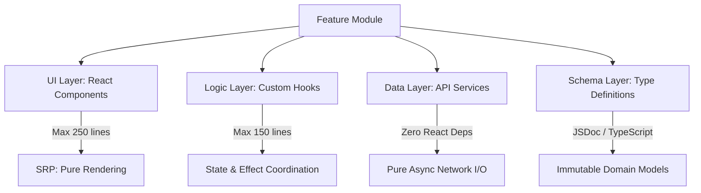
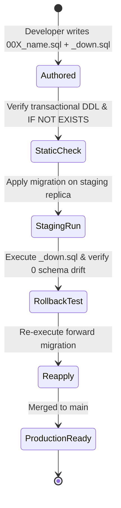

# 12 ENGINEERING STANDARDS — ASCANALYST PLATFORM

---

## 1. Purpose

The purpose of this specification is to define the non-negotiable **Engineering Standards** governing all code, architecture, database migrations, error handling, logging, testing, versioning, and code review across the **ASCANALYST** platform.

Operating in the regulated domain of ambulatory surgical center (ASC) clinical scheduling, patient safety, and CMS billing calculations, the platform mandates strict deterministic integrity, zero-trust tenant security, automated provenance, and high-performance code hygiene. This document establishes the concrete rules that every engineer, subagent, and automated pipeline must enforce.

---

## 2. Scope & Guiding Principles

### 2.1 Production Requirements
- **Deterministic Truth**: Zero financial calculations (gross revenue, contractual allowances, CMS MPPR reductions, hourly room costs, staff wages, net margins) may run on unvalidated client state. All financial truth runs in PostgreSQL stored procedures.
- **Zero-Warning Code Quality**: Continuous Integration (CI) enforces zero tolerance for lint errors or warnings (`npm run lint` must exit with code 0).
- **Chunk Size Budget**: Every JavaScript bundle chunk emitted by Vite production builds must not exceed $500\text{ kB}$ (with an isolated exception for `vendor-pdf` $\le 650\text{ kB}$).
- **HIPAA Technical Safeguards (45 CFR § 164.312)**:
  - Zero plaintext credentials or passwords in database tables, client code, or configuration files.
  - Zero browser exposure of third-party API keys (e.g., Google Gemini secrets must remain in Supabase Edge Function environment vaults).
  - Complete data mutation traceability via append-only audit logs.
- **Tenant Isolation First**: Every database read, mutation, and edge function invocation must deterministically resolve and enforce `facility_id` scoping.

---

## 3. Current State Codebase Audit & Classification

| Engineering Subsystem | Current Prototype State | Classification | Target Production Standard |
| :--- | :--- | :---: | :--- |
| **Language & Typing** | Pure JavaScript (ESM); JSDoc used sporadically; no TypeScript compiler validation. | **REFACTOR** | Enforce strict JSDoc/TypeScript type declarations in `src/types/`; eliminate implicit `any` and unvalidated object payloads. |
| **Naming Conventions** | Inconsistent mix of camelCase (`totalDuration`), snake_case (`cpt_codes`), and prefixed mock constants (`_MOCK_*`). | **REFACTOR** | Enforce unified naming rules across presentation, domain, and database layers. |
| **Component Size & SRP** | Monolithic components: `App.jsx` (5,903 lines), `SurgeryScheduler.jsx` (2,735 lines), `Settings.jsx` (1,234 lines). | **REPLACE** | Enforce Single Responsibility Principle (SRP): UI components $\le 250$ lines; extract hooks and services. |
| **Error Handling** | Empty catch blocks (`catch {}`), native browser `alert()` dialogs, and unhandled promise rejections. | **REPLACE** | Unified error envelope (`{ success, error: { code, message, correlationId } }`), SweetAlert2 for UI, and route ErrorBoundaries. |
| **Logging & Telemetry** | Unstructured `console.log()` and `console.error()` polluting client runtime console. | **REPLACE** | Structured logger with log levels (`debug`, `info`, `warn`, `error`), correlation IDs, and HIPAA PII/PHI sanitization. |
| **Database Migrations** | Previously ad-hoc SQL patches; now formalized in numbered migrations (`001`, `002`, `003`) with rollback scripts. | **KEEP / EXTEND** | Strict transactional DDL (`BEGIN ... COMMIT`), idempotent `IF NOT EXISTS`, zero destructive drops, and paired down-migrations. |
| **Software Versioning** | Root `package.json` version is hardcoded to `0.0.0`; financial rules unversioned. | **REFACTOR** | Dual-versioning: CalVer (`YYYY.MM.MINOR`) for app releases; SemVer (`v1.0-cms2026`) for financial calculation engines. |
| **Code Review & CI Gates** | GitHub Actions CI workflow in `.github/workflows/ci.yml` enforcing lint and build gates. | **KEEP / EXTEND** | Enforce automated PR checklist: lint (0 warnings), build ($< 500\text{ kB}$), unit tests, and RLS penetration verification. |

---

## 4. Target State Standards Specification

### 4.1 Coding & Architecture Standards



#### 4.1.1 Function & Component Size Constraints
- **React Components**: Maximum 250 lines per file. If a component exceeds 250 lines, it must be decomposed into sub-components (e.g., table rows, modals, filter bars).
- **Custom Hooks**: Maximum 150 lines per file. Hooks coordinate state, effects, and service calls.
- **Service Functions**: Maximum 40 lines per function. Functions must do ONE thing well.
- **Early Returns & Guard Clauses**: Deep nesting ($> 2$ levels) is strictly prohibited. Use early guard returns:

```javascript
// ❌ WRONG: Deep nesting
function processSurgery(surg) {
  if (surg) {
    if (surg.status !== 'cancelled') {
      if (surg.procedures && surg.procedures.length > 0) {
        return calculate(surg);
      }
    }
  }
  return null;
}

// ✅ CORRECT: Early return guard clauses
function processSurgery(surg) {
  if (!surg || surg.status === 'cancelled') return null;
  if (!surg.procedures?.length) return null;
  return calculate(surg);
}
```

#### 4.1.2 Universal Naming Conventions

| Code Element | Convention | Example | Prohibited Anti-Pattern |
| :--- | :--- | :--- | :--- |
| **React Components** | PascalCase | `SurgeryScheduler.jsx`, `EmptyState.jsx` | `surgeryScheduler.jsx`, `component.jsx` |
| **Custom Hooks** | camelCase with `use` prefix | `useSurgerySchedule.js`, `useAuth.js` | `getSurgeriesHook.js`, `surgeryData.js` |
| **Service Functions** | camelCase with verb prefix | `fetchFacilityKPIs()`, `bookSurgery()` | `surgeries()`, `data()` |
| **Boolean Flags** | camelCase with question prefix | `isActive`, `hasConflict`, `canEdit` | `active`, `flag`, `status` |
| **Constants & Enums** | UPPER_SNAKE_CASE | `DEFAULT_FACILITY_ID`, `CMS_MPPR_DISCOUNT` | `defaultFacility`, `mppr_rate` |
| **Database Tables** | lowercase_snake_case (plural) | `operating_rooms`, `surgery_procedures` | `OperatingRooms`, `surgeryProcedure` |
| **Database Columns** | lowercase_snake_case | `contracted_reimbursement`, `room_number` | `contractedReimb`, `RoomNo` |
| **CSS Variables** | kebab-case with `--` prefix | `--color-brand-blue`, `--bg-card` | `--brandColor`, `--CardBg` |

---

### 4.2 Error Handling & Resilience Standards

#### 4.2.1 Unified API Error Envelope
All backend Edge Functions and service adapters must return a deterministic error contract:

```typescript
interface ApiErrorResponse {
  success: false;
  error: {
    code: string;           // E.g., 'ROOM_CONFLICT', 'UNAUTHORIZED', 'MPPR_CALCULATION_FAILED'
    message: string;        // Human-readable, safe clinical message (no stack trace exposure)
    details?: unknown;      // Structured context (e.g., conflicting surgery IDs)
    correlationId: string;  // UUID linking client request to server logs
    timestamp: string;      // ISO 8601
  };
}
```

#### 4.2.2 Client-Side Error Standards
1. **Zero Empty Catch Blocks**: Silent failure via `catch {}` is strictly prohibited. Every catch block must either:
   - Log the error through the structured logger with correlation metadata, or
   - Dispatch an alert / state update to notify the user.
2. **User Notification Standard**:
   - Fatal/Network Errors: Route-level `<ErrorBoundary />` displaying a user-friendly retry screen.
   - Action Validation Errors: Inline form feedback or SweetAlert2 toast notification.
   - Destructive Failures: SweetAlert2 modal with explicit error description.

```javascript
// ✅ CORRECT: Standardized service error handling
async function fetchSurgeryProcedures(surgeryId) {
  try {
    const { data, error } = await supabase
      .from('surgery_procedures')
      .select('*, cpt_codes(*)')
      .eq('surgery_id', surgeryId);

    if (error) throw error;
    return { success: true, data: data || [] };
  } catch (err) {
    logger.error('Failed to fetch surgery procedures', { surgeryId, error: err.message });
    return {
      success: false,
      error: {
        code: 'PROCEDURE_FETCH_FAILED',
        message: 'Unable to retrieve surgical procedures. Please refresh or contact support.',
        correlationId: crypto.randomUUID()
      }
    };
  }
}
```

---

### 4.3 Logging, Telemetry & Audit Standards

#### 4.3.1 Structured Logging Protocol
Direct `console.log` statements are prohibited in production code. All application logging is mediated through a structured `logger` utility:

```javascript
// src/services/logger.js
export const logger = {
  debug: (msg, meta) => emitLog('DEBUG', msg, meta),
  info:  (msg, meta) => emitLog('INFO', msg, meta),
  warn:  (msg, meta) => emitLog('WARN', msg, meta),
  error: (msg, meta) => emitLog('ERROR', msg, meta)
};
```

#### 4.3.2 HIPAA PHI / PII Sanitization Invariant
**Under no circumstances may Protected Health Information (PHI) or Personally Identifiable Information (PII) be written to client consoles, external monitoring tools, or third-party AI prompts.**
- **Prohibited in Logs**: Patient names, full street addresses, Social Security Numbers, telephone numbers, and medical record numbers (MRNs).
- **Permitted in Logs**: Anonymized `patient_id` (UUID), `surgery_id`, `facility_id`, CPT codes, procedure duration minutes, and error correlation IDs.

---

### 4.4 Database Migration & Schema Hygiene Standards



#### 4.4.1 The Five Migration Invariants
1. **Transactional DDL**: Every migration script must be enclosed within `BEGIN; ... COMMIT;`. If any statement fails, the entire transaction is rolled back.
2. **Reversible Symmetry**: Every forward migration `00X_<slug>.sql` must be accompanied by an exact down-migration `00X_<slug>_down.sql` that cleanly restores the prior schema state.
3. **Idempotent Guards**: Use `CREATE TABLE IF NOT EXISTS`, `ALTER TABLE ... ADD COLUMN IF NOT EXISTS`, and `DROP POLICY IF EXISTS`.
4. **Zero Destructive Alterations**: Forward migrations may never drop columns or tables containing production clinical data. Deprecated fields are phased out across releases (Mark Deprecated $\rightarrow$ Backfill Relational Target $\rightarrow$ Drop in Subsequent Major Version).
5. **Deterministic Foreign Key Cascades**:
   - Domain parent-child lines (e.g., `surgeries` $\rightarrow$ `surgery_procedures`): `ON DELETE CASCADE`.
   - Critical clinical masters (e.g., `patients`, `surgeons`): `ON DELETE RESTRICT` to prevent accidental orphaned historical encounters.

---

### 4.5 Versioning & Release Governance

The platform adopts a **Dual-Versioning Governance Model**:

1. **Platform Release Versioning (CalVer)**:
   - Format: `YYYY.MM.PATCH` (e.g., `2026.10.0`).
   - Recorded in root `package.json`.
   - Used for user-facing release notes, deployment tags, and sprint milestones.
2. **Deterministic Financial Calculation Engine Versioning (SemVer)**:
   - Format: `vMAJOR.MINOR-slug` (e.g., `v1.0-cms2026`).
   - Every time CMS fee schedules or MPPR calculation algorithms are updated, the version string increments (e.g., `v1.1-cms2026`).
   - **Immutable Provenance**: The exact calculation version is recorded in `public.surgery_financial_snapshots.calculation_version` when case billing is frozen, guaranteeing that historical audits reproduce identical penny-exact numbers regardless of future rule updates.

---

## 5. Data Model / Schema Standards

### 5.1 Relational Normalization & Primary Key Rules
- **Domain Primary Keys**: All domain entities created in new migrations must utilize `UUID PRIMARY KEY DEFAULT gen_random_uuid()` to prevent sequence collisions and IDOR enumeration attacks.
- **First Normal Form (1NF) Compliance**: No table may store comma-delimited strings, serialized arrays, or unparsed JSON for foreign relationships. (All surgical procedures must reside in `public.surgery_procedures`).
- **Composite Indexing Requirements**: Every table containing a `facility_id` must provide composite indexes matching the high-frequency query paths:
  - Surgeries: `CREATE INDEX idx_surgeries_facility_date ON public.surgeries(facility_id, date);`
  - Procedures: `CREATE INDEX idx_surgery_proc_rank ON public.surgery_procedures(surgery_id, sequence_rank);`
  - Audit Logs: `CREATE INDEX idx_audit_facility_time ON public.audit_logs(facility_id, timestamp DESC);`

---

## 6. Business Rules & Deterministic Engine Standards

### 6.1 Server-Authoritative Math Rule
1. **Gross Revenue**: Sum of baseline CPT charges for all procedure lines in `surgery_procedures`.
2. **Reimbursement (CMS MPPR Standard)**:
   - Ranked descending by contracted reimbursement.
   - Primary Procedure (Rank 1): Paid at **100%**.
   - Subsequent Procedures (Rank 2+): Discounted to **50%**.
3. **Internal Cost Allocation**:
   - Room Overhead: $\left( \frac{\text{Duration Mins}}{60} \right) \times \text{OR Hourly Rate}$ (default $1,500.00/hr).
   - Labor: Duration $\times$ Staff hourly wage allocation.
   - Supplies, Implants, Medications: Explicit sum from procedure preference cards and extra cost overrides.
4. **Net Contribution Margin**: Expected Reimbursement $-$ Write-Offs $-$ Total Internal Cost.
5. **Margin Per OR Minute**: Net Contribution Margin $\div$ Duration Minutes.

---

## 7. Permissions & Zero-Trust RBAC Standards

### 7.1 Role Hierarchy & Action Authorization

| User Role | View Clinical Cases | Book / Modify Schedules | Record Wages & Staff Costs | Update CPT & Fee Schedules | Run AI Gateway Scenarios | Freeze Billing Snapshots | View Audit Logs |
| :--- | :---: | :---: | :---: | :---: | :---: | :---: | :---: |
| `super_admin` | Yes (All) | Yes | Yes | Yes | Yes | Yes | Yes |
| `org_admin` | Yes (Org) | Yes | Yes | Yes | Yes | Yes | Yes |
| `facility_admin` | Yes (Facility) | Yes | Yes | Yes | Yes | Yes | Yes |
| `clinical_director`| Yes (Facility) | Yes | Read Only | Read Only | Yes | No | Yes |
| `biller` | Yes (Facility) | Read Only | No | Yes | Yes | Yes | No |
| `surgeon` | Own Cases Only | Request Only | No | Read Only | Own Cases | No | No |
| `viewer` | Read Only | No | No | Read Only | No | No | No |

---

## 8. API & Service Integration Standards

### 8.1 Backend Endpoints & Tool Contracts
1. **PostgREST Query Scoping**: Every PostgREST client query must explicitly specify columns (`.select('id, name, ...')`) rather than wildcard `select('*')` on large tables.
2. **Edge Function Authentication**: All Edge Functions (`/api/ai-analyst`, `/api/ingest-cpt`) must inspect the incoming `Authorization` Bearer token, extract `auth.uid()`, and verify active membership in `public.facility_memberships`.
3. **Prompt Injection Defense**: In the AI Gateway proxy, all user queries must be sanitized, PII stripped, and structured into parameterized system/user blocks with token rate limits (max 30 requests/min per user).

---

## 9. UI & Workflow Design Standards

### 9.1 The 4-State UI Lifecycle Standard
Every screen and data component must implement the 4-state lifecycle without exception:
1. **Loading State**: Customized skeleton placeholder matching the component's geometry (no generic spinner-only screens).
2. **Empty State**: Contextual empty graphic, descriptive clinical message, and clear call-to-action button (e.g., "No surgeries scheduled for OR 2 today. Click 'Schedule Surgery' to add a case.").
3. **Loaded State**: Full interactive view with virtualized table rendering (`@tanstack/react-virtual` for tables $> 100$ rows).
4. **Error State**: Non-crashing localized `ErrorBoundary` displaying the error message, request correlation ID, and a "Retry Action" button.

### 9.2 High-Contrast Clinical Design Palette
Interfaces must strictly utilize the design tokens defined in [src/index.css](file:///e:/medicalAI/asc-prototype/src/index.css):
- Main Background: `--bg-main` (`#030712` Dark / `#f8fafc` Light)
- Card Background: `--bg-card` (`#0b1329` Dark / `#ffffff` Light)
- Brand Blue: `--color-blue` (`#3b82f6`)
- Clinical Green: `--color-green` (`#10b981`)
- Warning Amber: `--color-orange` (`#f59e0b`)
- Danger Red: `--color-red` (`#ef4444`)

---

## 10. Audit & Provenance Standards

1. **Automated Mutation Capture**: Every `INSERT`, `UPDATE`, and `DELETE` on operational tables triggers PostgreSQL function `fn_audit_log_trigger()`, logging user ID, email, timestamp, IP address, and JSON diffs to `public.audit_logs`.
2. **Immutable Ledger Rule**: Row Level Security on `public.audit_logs` permits `SELECT` for authorized administrators and **strictly zero `UPDATE` or `DELETE` policies for any role**, ensuring HIPAA tamper-proof compliance.
3. **Financial Snapshot Locking**: Once a surgical case reaches `Billed` or `Archived`, an immutable financial record is written to `public.surgery_financial_snapshots`. Modifications require supervisor override logging to `audit_logs`.

---

## 11. QA & Automated Testing Standards

### 11.1 The Testing Pyramid

```
          /\           E2E Tests (Playwright)
         /  \          Critical user journeys: Login, Booking, Billing
        /----\
       /      \        Integration Tests (Vitest + DB Replica)
      /--------\       RLS isolation, Stored Proc math, Trigger diffs
     /          \
    /------------\     Unit Tests (Vitest)
                       Formatting, CPT ranking, Fee calculation algorithms
```

### 11.2 Required Test Suites & Acceptance Benchmarks

| Test Domain | Target Framework | Verification Scope | Acceptance Criteria |
| :--- | :--- | :--- | :--- |
| **Unit Testing** | Vitest | Clinical formatters, CPT sorting algorithms, date utilities. | 100% pass rate; execution $< 2\text{ seconds}$. |
| **Financial Engine Integration** | PostgreSQL Test Harness | Stored procedure `calculate_surgery_financials()` against CMS test cases. | Penny-exact match ($0.00 variance) vs manual billing benchmark. |
| **RLS Tenant Penetration** | Vitest + Supabase Client | Tenant A authenticated session queries Tenant B records. | Returns HTTP 200 with empty array `[]` (0 cross-tenant data leakage). |
| **Static Code Hygiene** | ESLint | Entire codebase checked via `npm run lint`. | Strict 0 errors and 0 warnings. |
| **Bundle Chunk Budget** | Vite Build Reporter | Build output checked via `npm run build`. | All chunks $\le 500\text{ kB}$ (PDF $\le 650\text{ kB}$). |
| **End-to-End Workflows** | Playwright | User login, surgery booking, room conflict rejection, and PDF export. | 100% pass rate across Chrome, Firefox, and Safari. |

---

## 12. Code Review & Pull Request Standards

Before any pull request is merged into `main`, the author and reviewer must verify compliance with this **PR Quality Gate Checklist**:

```markdown
### PR Quality Gate Checklist

#### 1. Code Quality & Formatting
- [ ] `npm run lint` passes with 0 errors and 0 warnings.
- [ ] `npm run build` succeeds cleanly with exit code 0.
- [ ] Functions obey the Single Responsibility Principle ($\le 40$ lines per function, $\le 250$ lines per component).
- [ ] No hardcoded secrets, API tokens, or plaintext passwords.

#### 2. Data Integrity & Migrations
- [ ] Database migrations are enclosed in `BEGIN ... COMMIT` with matching `_down.sql` rollback.
- [ ] No 1NF violations (no comma-delimited strings for foreign keys).
- [ ] Every operational table includes `facility_id` with composite indexing.
- [ ] Tenant-scoped RLS policies are applied and tested.

#### 3. Deterministic Business Logic
- [ ] Financial calculations run server-side in PostgreSQL stored procedures.
- [ ] CMS 2026 MPPR rules (100% primary, 50% subsequent) verified on multi-procedure cases.
- [ ] Zero reliance on client-side mock data (`MOCK_*`).

#### 4. UI & Lifecycle
- [ ] All 4 UI states implemented (Loading Skeleton, Empty State, Loaded, Error Boundary).
- [ ] High-contrast dark-navy color token variables used consistently.
- [ ] Destructive actions require SweetAlert2 confirmation modals.

#### 5. Audit & Security
- [ ] Table mutations trigger entries in `public.audit_logs`.
- [ ] No PHI or PII logged to browser console or telemetry sinks.
- [ ] AI prompts proxied through backend Edge Function with token budgets.
```

---

## 13. Acceptance Criteria

- [x] Comprehensive engineering standards formulated covering coding, naming, error handling, logging, migrations, versioning, and code review.
- [x] Strict Single Responsibility Principle and file size thresholds established ($\le 250$ lines per UI component).
- [x] HIPAA PHI/PII sanitization and structured logging protocols documented.
- [x] Five migration invariants (transactional DDL, reversible symmetry, idempotency, non-destructive alterations, cascade rules) defined.
- [x] Dual-versioning model (CalVer for platform, SemVer for financial calculation engines) established.
- [x] Testing pyramid (Unit, Integration, RLS Penetration, E2E) and automated PR quality gate checklist specified.

---

## 14. Dependencies & Pre-requisites

1. **Upstream Specifications**:
   - [05-MASTER-BUILD-ROADMAP.md](file:///e:/medicalAI/asc-prototype/docs/phases/05-MASTER-BUILD-ROADMAP.md) (Milestone gates M0 through M7).
   - [06-DEFINITION-OF-DONE.md](file:///e:/medicalAI/asc-prototype/docs/phases/06-DEFINITION-OF-DONE.md) (Multi-dimensional DoD criteria).
   - [10-TARGET-SYSTEM-ARCHITECTURE.md](file:///e:/medicalAI/asc-prototype/docs/phases/10-TARGET-SYSTEM-ARCHITECTURE.md) (Multi-tier system architecture).
   - [11-REPOSITORY-STRUCTURE.md](file:///e:/medicalAI/asc-prototype/docs/phases/11-REPOSITORY-STRUCTURE.md) (Feature-sliced directory architecture).
2. **Current Implementation Progress**:
   - Phase 0 (CI & Static Hygiene) — **COMPLETED & VERIFIED**.
   - Phase 1 (Multi-Tenancy Core & Auth Hardening) — **COMPLETED & VERIFIED**.
   - Phase 2 (Database Normalization & Audit Subsystem) — **COMPLETED & VERIFIED**.

---

## 15. Definition of Done

This engineering standards specification is complete because:
1. It covers every dimension required for enterprise medical software engineering: coding standards, naming conventions, error envelopes, logging protocols, migration hygiene, SemVer/CalVer versioning, and PR review checklists.
2. It strictly enforces deterministic server-authoritative calculations, HIPAA compliance, and zero-warning static analysis.
3. It serves as the authoritative technical benchmark for all subsequent development phases (Phase 3 through Phase 7).

---

## 16. Implementation Notes

- **Branch**: `phases-work`
- **Specification Document Created**: `docs/phases/12-ENGINEERING-STANDARDS.md`
- **Active Codebase Health**:
  - `npm run lint`: **0 errors, 0 warnings** (Verified).
  - `npm run build`: **Exit code 0** (Verified).
  - Git Working Tree: Clean (`nothing to commit, working tree clean` on commit `ca3258f`).
- **Next Engineering Action**: Proceed with implementation of **Phase 3: Deterministic Server-Side Financial Engine** according to the roadmap.
