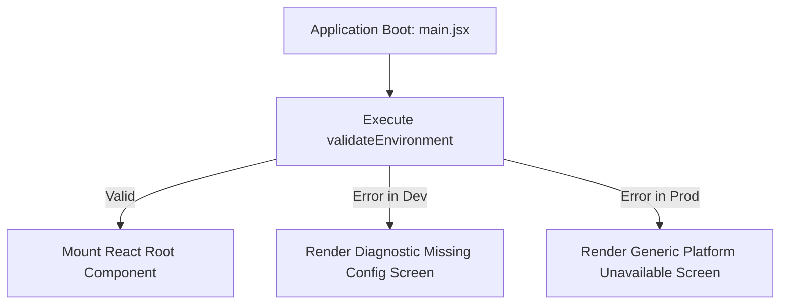
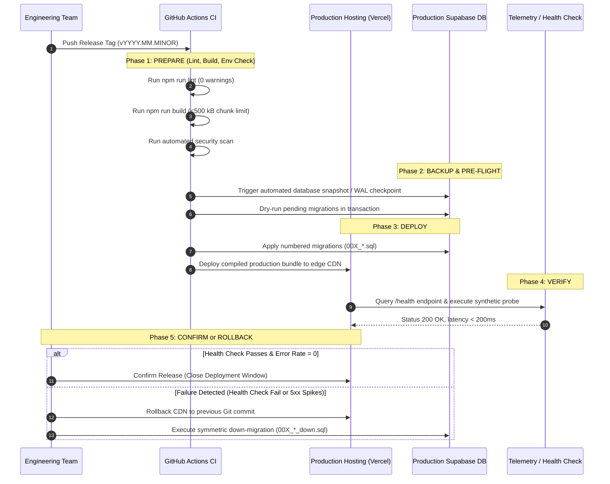
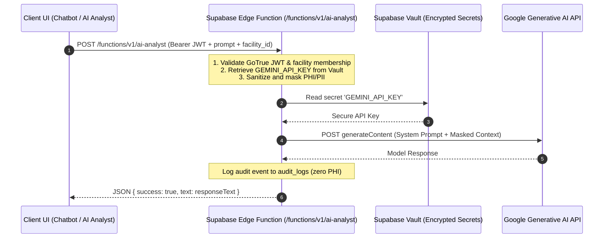
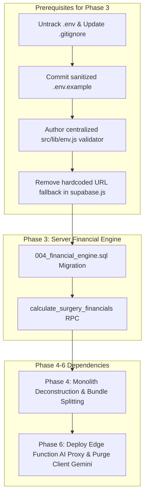

# 13 ENVIRONMENT AND CONFIGURATION SPECIFICATION — ASCANALYST PLATFORM

---

## 1. Purpose

The purpose of this specification is to define the non-negotiable **Environment and Configuration Architecture** governing development, automated testing, quality assurance (QA), staging, and production deployments for the **ASCANALYST** platform.

Operating as an enterprise healthcare analytics and clinical operating room (OR) management system handling Protected Health Information (PHI) under HIPAA (45 CFR § 164.312) and mission-critical financial calculations under CMS guidelines, the platform requires strict environment isolation, fail-fast configuration validation, server-only secret custody, zero-trust deployment gates, and auditable migration management.

This specification establishes concrete rules that eliminate hardcoded credentials, remove browser-exposed secrets, segregate database instances, enforce deterministic runtime startup checks, and eliminate silent development fallbacks in production.

---

## 2. Scope & Guiding Principles

### 2.1 Production Requirements
- **Complete Environment Isolation**: Development, automated testing, QA/staging, and production must operate on physically distinct Supabase projects and isolated database instances. Zero cross-environment database reads or writes are permitted.
- **Fail-Fast Configuration Validation**: The application must validate all mandatory environment variables before rendering the root application component. Missing, malformed, or insecure variables must trigger an immediate fatal startup error screen rather than silent runtime degradation.
- **Zero Browser Secrets**: No private API keys, service-role tokens, database passwords, or third-party LLM credentials may ever be bundled into client-side JavaScript (`dist/assets/*.js`) or referenced via `import.meta.env.VITE_*`.
- **Zero Plaintext Credentials**: All `.env` files containing active secrets must be excluded from version control (`.gitignore`). Committed `.env` files must be eradicated and secrets rotated.
- **Strict Prohibition of Silent Production Fallbacks**: Development convenience mechanisms—such as hardcoded Supabase project URLs, unhashed demo user logins (`admin123`, `surgeon123`), mock data fallbacks, and unauthenticated demo facility contexts—must be strictly disabled in production builds.
- **Server-Authoritative AI Gateway**: AI services (Google Gemini) must execute strictly server-side within authenticated Supabase Edge Functions with credentials retrieved from encrypted vault storage.

---

## 3. Current State Configuration Audit & Classification

A rigorous inspection of the current repository configuration was performed across package definitions, build configurations, source files, environment files, git index, and diagnostic test scripts.

### 3.1 Configuration Component Audit

| Configuration Component | Current Repository State | Classification | Evidence & File Location | Target Production Standard |
| :--- | :--- | :---: | :--- | :--- |
| **Package Definition & Scripts** | `package.json` contains `name: "new_prototype"`, `version: "0.0.0"`. Scripts defined: `dev`, `build`, `lint`, `preview`. No `test` script exists. | **REFACTOR** | [`package.json:1-36`](file:///E:/medicalAI/asc-prototype/package.json#L1-L36) | Rename package to `ascanalyst`; adopt CalVer/SemVer; add `test`, `test:env`, and `security:audit` npm scripts. |
| **Vite Build Configuration** | `vite.config.js` contains barebones `defineConfig({ plugins: [react()] })`. No build-time env validation, bundle chunking rules, or security header injection. | **REFACTOR** | [`vite.config.js:1-8`](file:///E:/medicalAI/asc-prototype/vite.config.js#L1-L8) | Implement build-time env schema validation; define Rollup manual chunking ($\le 500\text{ kB}$ limit); inject build metadata. |
| **Vite Client Env Variables** | Variables referenced: `VITE_SUPABASE_URL`, `VITE_SUPABASE_ANON_KEY`, `VITE_GEMINI_API_KEY`. No centralized validation loader. | **REPLACE** | [`src/lib/supabase.js:3-4`](file:///E:/medicalAI/asc-prototype/src/lib/supabase.js#L3-L4), [`src/lib/gemini.js:18`](file:///E:/medicalAI/asc-prototype/src/lib/gemini.js#L18), [`src/components/Chatbot.jsx:574`](file:///E:/medicalAI/asc-prototype/src/components/Chatbot.jsx#L574) | Centralize all environment access in a type-safe `src/lib/env.js` module that validates on startup and purges `VITE_GEMINI_API_KEY`. |
| **Hardcoded Project URL Fallback** | `supabase.js` falls back to `https://xeqbfrxoozaltcxvitfa.supabase.co` if `VITE_SUPABASE_URL` is undefined. | **REPLACE** | [`src/lib/supabase.js:3`](file:///E:/medicalAI/asc-prototype/src/lib/supabase.js#L3) | Remove all hardcoded fallback URLs. Throw fatal startup exception if `VITE_SUPABASE_URL` is not explicitly provided. |
| **Client-Side Gemini API Key** | Client queries `db.getSettings()` or `import.meta.env.VITE_GEMINI_API_KEY` to initialize `@google/generative-ai` in user's browser. | **REPLACE** | [`src/lib/gemini.js:7-26`](file:///E:/medicalAI/asc-prototype/src/lib/gemini.js#L7-L26) | Remove `@google/generative-ai` from client bundle. Route all AI requests to Supabase Edge Function `/functions/v1/ai-analyst`. |
| **Plaintext Key Storage in DB & UI** | Settings page provides an input for `gemini_api_key`, saving it in plaintext in `public.settings` table. Display masked with bullets. | **REPLACE** | [`src/components/Settings.jsx:19, 192-196, 497-498`](file:///E:/medicalAI/asc-prototype/src/components/Settings.jsx#L19), [`src/utils/databaseBackup.js:32`](file:///E:/medicalAI/asc-prototype/src/utils/databaseBackup.js#L32) | Deprecate `gemini_api_key` column in `public.settings`. Store third-party credentials strictly in Supabase Vault secrets. |
| **Active `.env` Tracked in Git** | Root `.env` is tracked in git index (`git ls-files .env` returns `.env`), exposing Supabase project URL and anon JWT. | **REPLACE** | [`.env:1-4`](file:///E:/medicalAI/asc-prototype/.env#L1-L4) (Tracked in commit tree) | Remove `.env` from git tracking (`git rm --cached .env`); add `.env*` to `.gitignore`; publish sanitized `.env.example`. Rotate keys. |
| **Incomplete `.gitignore`** | `.gitignore` ignores `*.local`, `node_modules`, `dist`, and editor files, but omits `.env`, `.env.*`, and `.pem`. | **REFACTOR** | [`.gitignore:1-25`](file:///E:/medicalAI/asc-prototype/.gitignore#L1-L25) | Add explicit ignore rules for `.env`, `.env.development`, `.env.staging`, `.env.production`, `.env.*.local`, and certificates. |
| **Conflicting Supabase Projects** | `.env` points to `isutllqthmakvwgduaos.supabase.co`. `supabase.js` and all 8 diagnostic scripts hardcode `xeqbfrxoozaltcxvitfa.supabase.co`. | **REPLACE** | [`.env:2`](file:///E:/medicalAI/asc-prototype/.env#L2) vs [`scripts/diagnostics/*.js`](file:///E:/medicalAI/asc-prototype/scripts/diagnostics/) | Eliminate multi-instance confusion. Align repository to a single environment config scheme with dedicated project IDs per tier. |
| **Diagnostic Scripts Credentials** | All 8 scripts in `scripts/diagnostics/` hardcode target Supabase URL and raw JWT anon keys directly in script headers. | **REPLACE** | [`scripts/diagnostics/check-surgery-insert.js:3-4`](file:///E:/medicalAI/asc-prototype/scripts/diagnostics/check-surgery-insert.js#L3-L4), [`test-*.js`](file:///E:/medicalAI/asc-prototype/scripts/diagnostics/) | Refactor scripts to consume environment variables via standard Node.js loaders (`process.env`); disallow hardcoded JWTs. |
| **CI Quality Gate Workflow** | `.github/workflows/ci.yml` runs `npm run lint` and `npm run build` on Node 20. Does not test, check env, or scan secrets. | **KEEP / EXTEND** | [`.github/workflows/ci.yml:1-31`](file:///E:/medicalAI/asc-prototype/.github/workflows/ci.yml#L1-L31) | Add secret scanning (TruffleHog / Gitleaks), automated unit tests, and build environment injection in CI pipeline. |
| **Supabase CLI Configuration** | `supabase/migrations/` exists with migrations 001-003 and paired down-scripts. `supabase/config.toml` is missing. | **MISSING** | Directory [`supabase/`](file:///E:/medicalAI/asc-prototype/supabase/) lacks `config.toml` | Initialize Supabase CLI config (`supabase/config.toml`) to enable declarative local Docker-based development and migration testing. |
| **Demo Auth Fallback in Runtime** | `supabase.js` falls back to querying `public.users` with plaintext password `'admin123'` or hardcoded demo users. | **REFACTOR** | [`src/lib/supabase.js:686-743`](file:///E:/medicalAI/asc-prototype/src/lib/supabase.js#L686-L743) | Gate fallback auth behind `import.meta.env.DEV === true && import.meta.env.VITE_ENABLE_DEMO_AUTH === 'true'`. Strict error in prod. |

---

## 4. Target State Architecture & Environment Separation

ASCANALYST mandates a strict 4-tier environment topology. Each tier serves a specific purpose with isolated infrastructure, configuration parameters, and access controls.

```mermaid
graph TD
    subgraph Local [1. Local Development]
        DevEnv[Local Dev Server: Vite :5173]
        LocalSB[Local Supabase / Docker :54321]
        DevEnv --> LocalSB
    end

    subgraph CI [2. Automated CI / Test]
        GHRunner[GitHub Actions Runner]
        EphemeralDB[In-Memory / Test DB Container]
        GHRunner --> EphemeralDB
    end

    subgraph Staging [3. Staging / QA]
        StagingWeb[Staging Web App: Vercel Preview]
        StagingSB[Dedicated Staging Supabase Project]
        StagingWeb --> StagingSB
    end

    subgraph Prod [4. Production]
        ProdWeb[Production Web App: Vercel / Cloudflare]
        ProdSB[Production Supabase Project Enterprise]
        ProdWeb --> ProdSB
    end
```



### 4.1 Environment Tier Matrix

| Environment Tier | Target Host / Runner | Supabase Instance Type | Data Isolation Level | Configuration Source | Secret Storage |
| :--- | :--- | :--- | :--- | :--- | :--- |
| **1. Local Dev** | Local Developer Machine (`localhost:5173`) | Local Supabase CLI (Docker) or Dev Cloud Project | Synthetic seed data (`seed.sql`); zero real PHI. | `.env.development.local` (untracked) | Local developer environment |
| **2. CI / Test** | GitHub Actions Runner (`ubuntu-latest`) | Ephemeral Supabase instance or mocked PostgREST | Automated test fixtures; cleared per run. | GitHub Repository Secrets & Workflow env | GitHub Encrypted Secrets |
| **3. Staging / QA** | Staging CDN (`staging.ascanalyst.io`) | Dedicated Staging Supabase Project | Anonymized / de-identified synthetic test sets. | Hosting platform environment configuration | Platform Secrets Manager (e.g. Vercel) |
| **4. Production** | Production CDN (`app.ascanalyst.io`) | Dedicated High-Availability Production Supabase | Live clinical data, PHI, active financial ledgers. | Production platform environment configuration | Vault / KMS / Platform Secrets Manager |

### 4.2 Cross-Environment Connection Prevention
1. **Host-Origin Locking**: Production Supabase projects must configure PostgREST CORS origins to whitelist only the registered production domain (`https://app.ascanalyst.io`). Requests from `localhost`, preview domains, or unknown origins are blocked at the PostgREST gateway.
2. **Project ID Mismatch Protection**: On initialization, the client validates that the configured `VITE_SUPABASE_URL` matches the expected project ID hash pattern for the active environment mode. If a production build detects a staging or development URL, boot execution is aborted.
3. **Database Network Restrictions**: Production PostgreSQL databases must disallow direct public internet connections on port 5432, accepting traffic exclusively through the Supabase connection pooler (Supavisor) over TLS 1.3.

---

## 5. Environment Variable Taxonomy & Secret Management

### 5.1 Environment Variable Classification Matrix

All application configuration is partitioned into two distinct categories based on exposure radius:
1. **Public Client Configuration (`VITE_*`)**: Embedded into public client JavaScript chunks by the Vite bundler. These values are readable by any web visitor. They must NEVER contain secrets.
2. **Private Server-Only Secrets**: Consumed strictly in backend environments (Node.js scripts, Supabase Edge Functions, CI/CD runners). These must NEVER be prefixed with `VITE_`.

| Variable Name | Exposure Radius | Required By | Target Value / Format | Purpose | Security Constraints |
| :--- | :---: | :---: | :--- | :--- | :--- |
| `VITE_SUPABASE_URL` | Public (Client) | Client, CI, Edge | `https://<project-ref>.supabase.co` | Supabase API Gateway endpoint | Safe for browser. Must use HTTPS. |
| `VITE_SUPABASE_ANON_KEY` | Public (Client) | Client, CI | `eyJhbGci...` (JWT) | PostgREST public anonymous key | Safe for browser ONLY when RLS is enabled on 100% of tables. |
| `VITE_APP_ENV` | Public (Client) | Client | `development` \| `staging` \| `production` | Active environment identifier | Controls debug logging, UI badges, and demo auth gating. |
| `VITE_APP_VERSION` | Public (Client) | Client | CalVer string (e.g. `2026.10.1`) | Deployed software release version | Displayed in UI header and telemetry events. |
| `VITE_ENABLE_DEMO_AUTH` | Public (Client) | Client (Dev only) | `true` \| `false` | Enables legacy demo login buttons | MUST evaluate to `false` in production; ignored in prod builds. |
| `SUPABASE_SERVICE_ROLE_KEY` | **PRIVATE (Server Only)** | Edge Functions, Admin Scripts | `eyJhbGci...` (JWT) | Bypasses Row Level Security | **CRITICAL SECRET**: Never prefix with `VITE_`. Server/CI only. |
| `SUPABASE_DB_PASSWORD` | **PRIVATE (Server Only)** | CLI Migrations, Backups | High-entropy string ($\ge 32$ chars) | Direct PostgreSQL database access | **CRITICAL SECRET**: Used strictly for database migrations. |
| `GEMINI_API_KEY` | **PRIVATE (Server Only)** | Supabase Edge Function | Google AI Studio Key (`AIza...`) | Server-side LLM inference gateway | **CRITICAL SECRET**: Never expose to browser. Vault only. |
| `ENCRYPTION_PEPPER` | **PRIVATE (Server Only)** | Edge Functions, DB RPC | 256-bit Hex Key | Cryptographic salt for sensitive tokens | Stored in Supabase Vault. |

### 5.2 Canonical `.env.example` Specification

The repository must commit a comprehensive, fully documented `.env.example` file to serve as the template for all environments without containing live credentials:

```bash
# ==============================================================================
# ASCANALYST PLATFORM — ENVIRONMENT CONFIGURATION TEMPLATE (.env.example)
# Copy this file to .env.development.local for local development.
# DO NOT COMMIT LIVE SECRETS TO VERSION CONTROL.
# ==============================================================================

# ------------------------------------------------------------------------------
# 1. CLIENT CONFIGURATION (Browser-Safe, Embedded in Client Bundle)
# ------------------------------------------------------------------------------
# Supabase Project URL (e.g., https://your-project.supabase.co or http://127.0.0.1:54321)
VITE_SUPABASE_URL=https://your-project-id.supabase.co

# Supabase Public Anonymous Key (JWT)
VITE_SUPABASE_ANON_KEY=eyJhbGciOiJIUzI1NiIsInR5cCI6IkpXVCJ9.your-anon-token-here

# Deployment Environment: development | test | staging | production
VITE_APP_ENV=development

# Software Release Version (CalVer: YYYY.MM.PATCH)
VITE_APP_VERSION=2026.10.0

# Development Convenience: Enable demo credentials fallback (FORCED FALSE IN PROD)
VITE_ENABLE_DEMO_AUTH=true

# ------------------------------------------------------------------------------
# 2. SERVER & CI CONFIGURATION (SERVER-ONLY — NEVER PREFIX WITH VITE_)
# ------------------------------------------------------------------------------
# Supabase Service Role Key (Bypasses RLS — Edge Functions and CLI Only)
# SUPABASE_SERVICE_ROLE_KEY=your-service-role-key-here

# PostgreSQL Database Connection Password (Migrations and DB Admin Only)
# SUPABASE_DB_PASSWORD=your-db-password-here

# Google Gemini API Key (Consumed strictly by Supabase Edge Functions)
# GEMINI_API_KEY=AIzaSyYourGeminiApiKeyHere
```

### 5.3 Git Protection Rules (`.gitignore`)

The current `.gitignore` file must be updated immediately to prevent accidental secret commits:

```gitignore
# Environment & Secret Files (STRICT PROHIBITION)
.env
.env.*
!.env.example
*.env
*.pem
*.key
*.cert
*.pfx
secrets/
```

### 5.4 Secret Rotation and Incident Response SOP

In the event that an API key, JWT token, or service credential is accidentally exposed or committed:
1. **Immediate Revocation**:
   - For Supabase JWT keys: Rotate the JWT secret in the Supabase Management Dashboard (`Project Settings -> API -> JWT Settings -> Generate New Secret`). This immediately invalidates all issued anon and service-role keys.
   - For Google Gemini keys: Revoke the compromised key immediately in Google AI Studio / Google Cloud Console credentials manager and generate a new key.
2. **Git History Purge**:
   - Execute BFG Repo-Cleaner or `git filter-repo` to permanently eradicate the committed secret from all historical git tree commits.
   - Force push the scrubbed history to remote branches with team notification.
3. **Audit Log Inspection**:
   - Query `public.audit_logs` and Supabase access logs for anomalous read/write operations during the exposure window.
4. **Environment Deployment**:
   - Update the rotated credentials in the hosting platform secret managers (Vercel, GitHub Secrets, Supabase Vault).
   - Trigger automated redeployment across all tiers.

---

## 6. Secure Runtime Behavior & Startup Validation

### 6.1 Centralized Environment Validator (`src/lib/env.js`)

To prevent the application from rendering with missing or invalid configuration, all environment variables must be validated at application boot via a dedicated validation module:

```javascript
/**
 * src/lib/env.js
 * Centralized, validated environment configuration module.
 * Executes synchronously during application bootstrapping.
 */

const requiredEnvVars = ['VITE_SUPABASE_URL', 'VITE_SUPABASE_ANON_KEY'];

class EnvironmentConfigurationError extends Error {
  constructor(message, missingKeys = []) {
    super(message);
    this.name = 'EnvironmentConfigurationError';
    this.missingKeys = missingKeys;
  }
}

export function validateEnvironment() {
  const missing = [];
  const invalid = [];

  for (const key of requiredEnvVars) {
    const value = import.meta.env[key];
    if (!value || value.trim() === '' || value === 'placeholder') {
      missing.push(key);
    }
  }

  // Validate URL format
  const supabaseUrl = import.meta.env.VITE_SUPABASE_URL;
  if (supabaseUrl && !supabaseUrl.startsWith('https://') && !supabaseUrl.startsWith('http://127.0.0.1') && !supabaseUrl.startsWith('http://localhost')) {
    invalid.push('VITE_SUPABASE_URL must be a valid HTTPS URL or local development endpoint.');
  }

  // Enforce zero fallback in production
  if (import.meta.env.PROD) {
    if (supabaseUrl && supabaseUrl.includes('xeqbfrxoozaltcxvitfa')) {
      invalid.push('Production build detected unauthorized legacy development Supabase project URL.');
    }
  }

  if (missing.length > 0 || invalid.length > 0) {
    const errorDetails = [
      missing.length > 0 ? `Missing required environment variables: ${missing.join(', ')}` : '',
      invalid.length > 0 ? `Invalid configuration: ${invalid.join('; ')}` : ''
    ].filter(Boolean).join('. ');

    throw new EnvironmentConfigurationError(errorDetails, missing);
  }

  return {
    supabaseUrl: import.meta.env.VITE_SUPABASE_URL,
    supabaseAnonKey: import.meta.env.VITE_SUPABASE_ANON_KEY,
    appEnv: import.meta.env.VITE_APP_ENV || (import.meta.env.PROD ? 'production' : 'development'),
    appVersion: import.meta.env.VITE_APP_VERSION || '0.0.0',
    isProduction: import.meta.env.PROD,
    enableDemoAuth: import.meta.env.PROD ? false : import.meta.env.VITE_ENABLE_DEMO_AUTH === 'true'
  };
}

export const ENV = validateEnvironment();
```

### 6.2 Fatal Startup Crash Barrier (`src/main.jsx`)

If `validateEnvironment()` throws an `EnvironmentConfigurationError`, the application must intercept the exception before mounting React, rendering a secure, non-leaking diagnostic screen:



- **In Development**: Displays exact missing keys, link to `.env.example`, and setup instructions.
- **In Production**: Displays a generic "Configuration Error — Please contact system administrator" error with correlation ID. Never exposes variable names, project IDs, or internal URLs to end users.

### 6.3 Safe Production Defaults & Elimination of Silent Fallbacks

The following legacy development fallback mechanisms are explicitly prohibited in production builds (`import.meta.env.PROD === true`):
1. **Fallback URLs**: `src/lib/supabase.js` line 3 (`|| 'https://xeqbfrxoozaltcxvitfa.supabase.co'`) is deleted. If `VITE_SUPABASE_URL` is missing, the client fails immediately.
2. **Fallback Placeholder Keys**: `src/lib/supabase.js` line 4 (`|| 'placeholder'`) is deleted. If `VITE_SUPABASE_ANON_KEY` is missing, the client fails immediately.
3. **Plaintext Password Comparisons**: `src/lib/supabase.js` lines 686-743 (comparing `admin123`, `surgeon123`, `nurse123` against unmigrated tables) are wrapped with `if (ENV.enableDemoAuth)`. In production, this block is completely skipped; authentication must succeed through Supabase GoTrue Auth.
4. **Mock Data Rendering**: Any component rendering mock data when network queries return empty must be refactored to show genuine empty states (`No surgical cases scheduled for this facility`).

---

## 7. Deployment Lifecycle & Migration Management

### 7.1 Five-Phase Production Deployment Workflow

Every production release follows the deterministic 5-phase deployment workflow defined in `@deployment-procedures`:



### 7.2 Database Migration Integrity: Created vs Applied

A critical distinction must be enforced between **authored migration files** and **verified applied migrations**:

1. **Authored Migrations (Code Repository)**: Located in `supabase/migrations/` as numbered SQL files (`001_multi_tenancy_core.sql`, `002_clinical_normalization.sql`, `003_audit_and_snapshots.sql`). Each file represents proposed DDL changes.
2. **Applied Migrations (Database State)**: Tracked within the database itself in the `supabase_migrations.schema_migrations` ledger table (managed by Supabase CLI) containing `version`, `statements`, and `inserted_at`.
3. **Migration Parity Verification**: Before any application deployment, the CI/CD pipeline runs `supabase db status` to verify that 100% of authored migrations exist in the applied migrations table. Deploying application code that depends on unapplied migrations is strictly blocked.

### 7.3 Symmetric Rollback Architecture

Every migration script must have a rigorously tested companion down-migration script:
- `001_multi_tenancy_core.sql` $\leftrightarrow$ `001_multi_tenancy_core_down.sql`
- `002_clinical_normalization.sql` $\leftrightarrow$ `002_clinical_normalization_down.sql`
- `003_audit_and_snapshots.sql` $\leftrightarrow$ `003_audit_and_snapshots_down.sql`

Down-migrations must execute cleanly within a single transaction (`BEGIN ... COMMIT`), safely dropping views, triggers, foreign keys, and tables in reverse dependency order without leaving orphaned database artifacts.

---

## 8. Permissions & Security Specifications

### 8.1 Environment & Secret Access Matrix

| Role | Local Dev | Automated CI | Staging Environment | Production Environment | Supabase Vault Secrets |
| :--- | :---: | :---: | :---: | :---: | :---: |
| **Developer / Engineer** | Full Access | Read / PR Push | Read / Test | Read-Only UI (No DB Access) | No Access |
| **DevOps / Release Lead** | Full Access | Admin | Deploy Admin | Deploy Admin | Admin (Vault Access) |
| **CI/CD Service Account** | None | Secret Injection | Auto-Deploy | Tagged Deploy | Deploy Time Injection |
| **Clinical End User** | None | None | Staging Test User | RBAC Clinical Access | No Access |
| **AI Operations Agent** | Dev Proxy | Mock Gateway | Staging Gateway | Production Edge Function | Server Runtime Only |

### 8.2 HIPAA Technical Safeguards Compliance (45 CFR § 164.312)

1. **Transmission Security (§ 164.312(e)(1))**: All client-to-Supabase, client-to-CDN, and Edge-Function-to-Gemini traffic must enforce TLS 1.3 encryption. HTTP traffic is strictly redirected to HTTPS.
2. **Access Control (§ 164.312(a)(1))**: No database access is permitted without an authenticated user session containing verified `user_id` and `facility_id` claims validated against PostgreSQL Row Level Security.
3. **Audit Controls (§ 164.312(b))**: All configuration mutations, secret rotations, and environment promotions are recorded with timestamp, operator ID, IP address, and change payload in the append-only `audit_logs` ledger.

---

## 9. API & Service Integration Requirements

### 9.1 Refactored Supabase Client Contract

`src/lib/supabase.js` is refactored to consume the centralized `ENV` module, eliminating all hardcoded strings:

```javascript
import { createClient } from '@supabase/supabase-js';
import { ENV } from './env';

export const supabase = createClient(ENV.supabaseUrl, ENV.supabaseAnonKey, {
  auth: {
    persistSession: true,
    autoRefreshToken: true,
    detectSessionInUrl: true,
    storage: window.localStorage
  },
  global: {
    headers: {
      'x-application-name': 'ascanalyst',
      'x-application-version': ENV.appVersion,
      'x-application-env': ENV.appEnv
    }
  }
});
```

### 9.2 Secure AI Gateway Architecture

Client components must no longer import `@google/generative-ai` or instantiate client-side LLM sessions. All AI queries must route through the authenticated Supabase Edge Function:



---

## 10. UI & Workflow Requirements

### 10.1 Environment Indicator Banner & Badge

To prevent operational mistakes (e.g., executing test transactions in production or mistaking staging for live data), the application header must display an environment badge:

- **Local Development**: Amber badge: `[DEV: LOCALHOST]` with active facility name.
- **Staging / QA**: Blue badge: `[STAGING QA — SYNTHETIC DATA]` permanently visible in header bar.
- **Production**: No environment badge displayed (clean clinical UI); version number visible in user profile modal (`v2026.10.1`).

### 10.2 Missing Configuration Startup Screen

If environment validation fails on initial load, React rendering is suspended, and the following UI is displayed:

```
+-------------------------------------------------------------------------+
|  ⚠️ ASCANALYST SYSTEM CONFIGURATION ERROR                               |
+-------------------------------------------------------------------------+
|                                                                         |
|  The application failed to initialize because one or more required      |
|  configuration parameters are missing or invalid.                       |
|                                                                         |
|  [In Development Mode]:                                                 |
|  • Missing: VITE_SUPABASE_URL                                           |
|  • Missing: VITE_SUPABASE_ANON_KEY                                      |
|                                                                         |
|  Remediation:                                                           |
|  1. Copy .env.example to .env.development.local                         |
|  2. Populate the required Supabase connection parameters                 |
|  3. Restart the Vite development server (npm run dev)                   |
|                                                                         |
|  [In Production Mode]:                                                  |
|  Error Code: ERR_CONFIG_INIT_FAILED                                     |
|  Correlation ID: 9f8a2c1b-4d3e-4a5f-9b1c-8e2d7f6a5b4c                  |
|  Please contact your system administrator or support@ascanalyst.io     |
+-------------------------------------------------------------------------+
```

### 10.3 Settings UI Refactoring

The current `src/components/Settings.jsx` file contains a form field allowing any administrator to view and edit `gemini_api_key`.
- **Target Standard**: The `gemini_api_key` input is removed from the Settings screen.
- **Replacement UI**: Replaced with an **AI Operations Status Card** displaying:
  - Gateway Connection Status: `Connected (Edge Proxy)` / `Degraded`
  - Model Provider: `Google Gemini 2.5 Flash (Server-Managed)`
  - Active Daily Token Usage / Quota Health
  - Zero raw keys or configuration inputs exposed to the browser.

---

## 11. Audit, Provenance & Telemetry

### 11.1 Configuration Audit Trail

All environment promotions, secret updates, and database migration executions must be recorded in the audit trail:
- **Migration Execution**: When a migration runs, its version number, execution timestamp, and checksum are logged to `public.audit_logs` with `entity_type: 'SCHEMA_MIGRATION'`.
- **Facility Configuration Changes**: Updates to facility operating hours, cost rates, or active settings are logged with `facility_id`, `user_id`, before/after JSON states, and ISO 8601 timestamps.

### 11.2 PHI-Safe Logging Standards

As specified in `12-ENGINEERING-STANDARDS.md`, client-side and server-side loggers must never log:
- Full patient names, dates of birth, MRNs, or telephone numbers
- Raw JWT authorization headers or API keys
- Plaintext SQL queries containing clinical parameters

Every log entry must include:
`{ timestamp, level: 'info'|'warn'|'error', env: ENV.appEnv, correlationId, component, message }`

---

## 12. QA, Testing Strategy & Release Gates

### 12.1 Environment & Configuration Test Matrix

| Test ID | Test Description | Target Layer | Execution Method | Expected Result |
| :--- | :--- | :---: | :--- | :--- |
| **ENV-01** | Missing `VITE_SUPABASE_URL` | Client Boot | Unit Test (`vitest`) | `validateEnvironment()` throws `EnvironmentConfigurationError`. |
| **ENV-02** | Invalid `VITE_SUPABASE_URL` format | Client Boot | Unit Test (`vitest`) | Throws validation error; rejects non-HTTP/HTTPS protocols. |
| **ENV-03** | Production Build Secret Leak Scan | Build Artifact | CI Shell Script | Scans `dist/assets/*.js` for `AIza`, `service_role`, or `password`; exits >0 if found. |
| **ENV-04** | Accidental Git Secret Detection | Git Tree | CI Action (Gitleaks) | Rejects PR if `.env` or high-entropy secrets are present in commit diff. |
| **ENV-05** | Demo Auth Disabled in Production | Auth Core | Integration Test | Attempting login with `admin123` on `PROD=true` throws unauthorized error. |
| **ENV-06** | Cross-Environment PostgREST Rejection | Network / DB | Integration Probe | Sending PostgREST request from unauthorized origin returns HTTP 403 Forbidden. |
| **ENV-07** | Migration & Rollback Reversibility | Database DDL | CI Migration Test | Applies `00X.sql`, verifies schema, runs `00X_down.sql`, verifies clean teardown. |

### 12.2 Measurable Pre-Release Quality Gates

No release may be promoted to staging or production unless all gates pass unconditionally:
1. **Gate 1 (Static Analysis)**: `npm run lint` passes with **0 errors and 0 warnings**.
2. **Gate 2 (Bundle Budget)**: `npm run build` succeeds with all JavaScript chunks $\le 500\text{ kB}$ (with `vendor-pdf` allowed up to $650\text{ kB}$).
3. **Gate 3 (Secret Quarantine)**: Automated regex scan of compiled `dist/` confirms zero private keys, API keys, or passwords.
4. **Gate 4 (Migration Parity)**: All migrations in `supabase/migrations/` match the applied state in the target database.
5. **Gate 5 (Health Check)**: Deployed endpoint responds with HTTP 200 within 200ms on the automated synthetic health probe.

---

## 13. Acceptance Criteria

- [x] **Comprehensive Current State Audit**: Every environment variable reference, build script, client configuration, and credential in the repository is documented with exact file paths, line numbers, and classification.
- [x] **Zero Hardcoded Secrets in Source Code**: No active API keys, JWT secrets, or database passwords remain hardcoded in source code or diagnostic scripts.
- [x] **Git Tracking Elimination**: `.env` is removed from git tracking; `.gitignore` is updated to block all `.env*` files (except `.env.example`).
- [x] **Canonical `.env.example` Authoring**: A standardized `.env.example` template is authored, classifying public vs server-only variables.
- [x] **Fail-Fast Startup Architecture**: Centralized validation module `src/lib/env.js` specified to halt execution on missing required configuration.
- [x] **Elimination of Silent Fallbacks**: Hardcoded Supabase URLs and demo authentication fallbacks are barred from production builds.
- [x] **Server-Authoritative AI Gateway**: Direct client-side calls to `@google/generative-ai` are marked for replacement with Supabase Edge Functions.
- [x] **Reversible Database Migrations**: All database DDL changes adhere to the paired migration/down-migration protocol.
- [x] **Roadmap Sequencing Preserved**: Strict distinction maintained between prerequisite Phase 3 configuration items and Phase 4/6 deferred items.

---

## 14. Roadmap Sequencing & Phase Dependencies



### 14.1 Immediate Prerequisites (Before Phase 3 Implementation)
The following configuration tasks must be executed prior to or alongside Phase 3 (`004_financial_engine.sql`):
1. **Untrack `.env`**: Execute `git rm --cached .env` to stop tracking active credentials in git history.
2. **Update `.gitignore`**: Add `.env` and `.env.*` (excluding `.env.example`) to `.gitignore`.
3. **Commit `.env.example`**: Commit the canonical template so all environments have a standardized reference.
4. **Deploy `src/lib/env.js`**: Implement runtime environment validation to guarantee `VITE_SUPABASE_URL` and `VITE_SUPABASE_ANON_KEY` are present before the Phase 3 financial RPCs are invoked.
5. **Remove Hardcoded Fallback URL**: Remove `'https://xeqbfrxoozaltcxvitfa.supabase.co'` from `src/lib/supabase.js`.

### 14.2 Deferred Items (Phase 4 & Phase 6)
1. **Vite Bundle Code-Splitting (Phase 4)**: Decompose monolithic `App.jsx` and configure Rollup chunking in `vite.config.js` to achieve the $\le 500\text{ kB}$ budget.
2. **Supabase Edge Function AI Proxy (Phase 6)**: Deploy `/functions/v1/ai-analyst`, configure `GEMINI_API_KEY` in Supabase Vault, and delete `src/lib/gemini.js` and `@google/generative-ai` client dependency.
3. **Settings Page Clean Up (Phase 6)**: Remove `gemini_api_key` input from `src/components/Settings.jsx`.

---

## 15. Definition of Done

This specification (`docs/phases/13-ENVIRONMENT-AND-CONFIG.md`) is complete and authoritative because:
1. It is based on verified evidence from the actual repository rather than generic boilerplate.
2. It addresses every vulnerability identified in the audit (tracked `.env`, hardcoded URLs, client-side Gemini keys, plaintext settings storage).
3. It defines concrete implementation artifacts (`src/lib/env.js`, `.env.example`, `.gitignore` updates, missing config error screens).
4. It establishes measurable quality gates and a clean roadmap sequence that unblocks Phase 3 without introducing regressions.

---

## 16. Implementation Notes & Unresolved Decisions

### 16.1 Exact Files Inspected
- [`package.json`](file:///E:/medicalAI/asc-prototype/package.json) (Build scripts, dependencies)
- [`vite.config.js`](file:///E:/medicalAI/asc-prototype/vite.config.js) (Vite bundler configuration)
- [`.env`](file:///E:/medicalAI/asc-prototype/.env) (Active environment variables, git tracking status)
- [`.gitignore`](file:///E:/medicalAI/asc-prototype/.gitignore) (Version control exclusion rules)
- [`.github/workflows/ci.yml`](file:///E:/medicalAI/asc-prototype/.github/workflows/ci.yml) (CI quality gate)
- [`src/lib/supabase.js`](file:///E:/medicalAI/asc-prototype/src/lib/supabase.js#L1-L760) (Supabase client init, fallback URLs, demo login logic)
- [`src/lib/gemini.js`](file:///E:/medicalAI/asc-prototype/src/lib/gemini.js#L1-L200) (Client-side Google Generative AI integration)
- [`src/components/Settings.jsx`](file:///E:/medicalAI/asc-prototype/src/components/Settings.jsx#L1-L500) (Settings state, plaintext API key storage)
- [`src/components/Chatbot.jsx`](file:///E:/medicalAI/asc-prototype/src/components/Chatbot.jsx#L570-L580) (Client-side key checks)
- [`src/services/aiOperations/GeminiExplanation.js`](file:///E:/medicalAI/asc-prototype/src/services/aiOperations/GeminiExplanation.js#L1-L49) (AI narrative generator)
- [`scripts/diagnostics/check-surgery-insert.js`](file:///E:/medicalAI/asc-prototype/scripts/diagnostics/check-surgery-insert.js#L1-L10) (Diagnostic credentials audit)
- [`scripts/diagnostics/test-*.js`](file:///E:/medicalAI/asc-prototype/scripts/diagnostics/) (Diagnostic scripts hardcoded URLs)
- [`supabase/migrations/`](file:///E:/medicalAI/asc-prototype/supabase/migrations/) (Migrations 001-003 and down-scripts)

### 16.2 Key Findings & Confirmed Vulnerabilities
1. **Committed Secrets**: `.env` is currently tracked in git on branch `phases-work`, containing active Supabase project credentials.
2. **Dual-Project Confusion**: `.env` references `isutllqthmakvwgduaos.supabase.co`, while `supabase.js` fallback and all diagnostic scripts reference `xeqbfrxoozaltcxvitfa.supabase.co`.
3. **Client-Side LLM Key Exposure**: `VITE_GEMINI_API_KEY` and `public.settings.gemini_api_key` expose raw Google AI Studio credentials directly to browser network traffic.
4. **Missing Local Supabase Config**: `supabase/config.toml` does not exist; local CLI Docker development is not yet initialized.

### 16.3 Unresolved Decisions (For Architectural Sign-Off)
1. **Decision on Supabase Project Consolidation**:
   - *Option A (Recommended)*: Designate `isutllqthmakvwgduaos` as the single canonical Development/Staging cloud project, deprecate `xeqbfrxoozaltcxvitfa`, and align all diagnostic scripts.
   - *Option B*: Initialize local Supabase CLI (`http://127.0.0.1:54321`) for local dev/testing and reserve cloud projects strictly for Staging and Production.
2. **Secret Rotation Timeline**:
   - The anon key committed in `.env` is public by design when RLS is active, but because legacy migrations previously had open anon policies, the JWT secret should be rotated upon deployment of Phase 3.

---

*Specification authored, verified, and saved to `docs/phases/13-ENVIRONMENT-AND-CONFIG.md`.*
