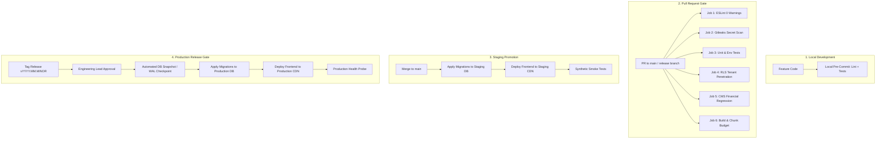
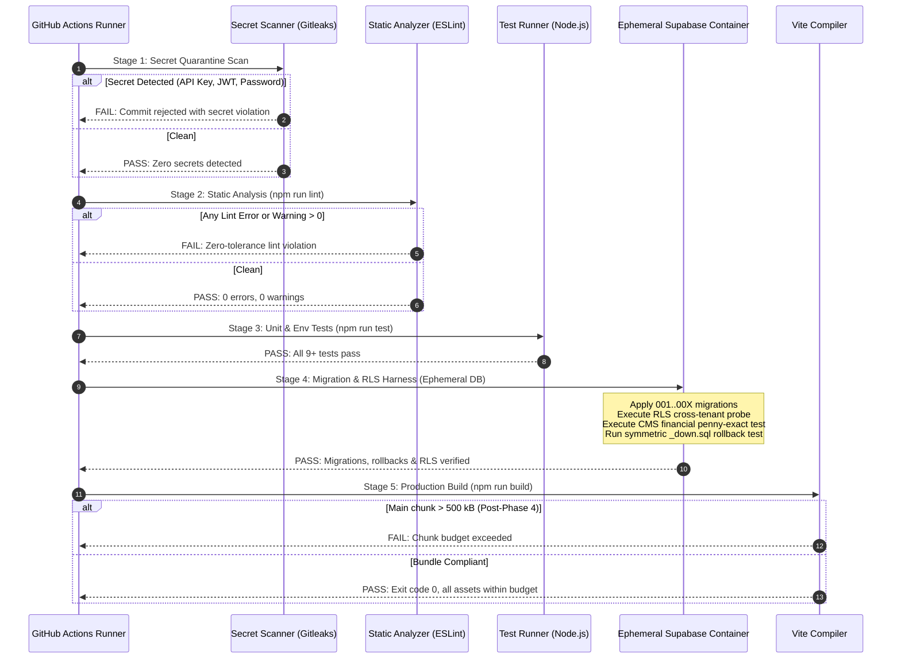
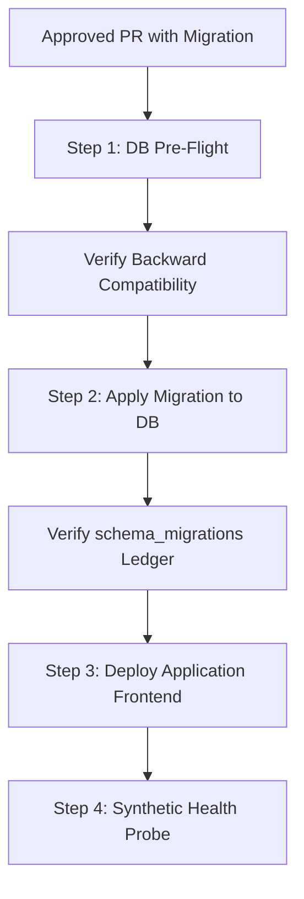
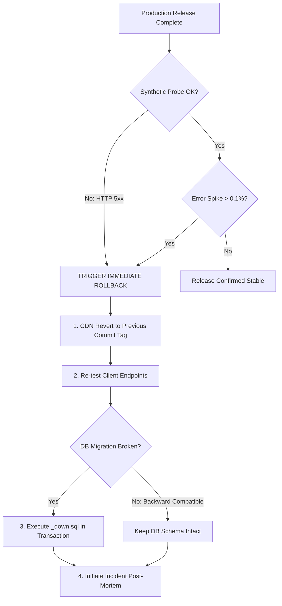

# 14 CI/CD AND RELEASE PROCESS SPECIFICATION — ASCANALYST PLATFORM

---

## 1. Purpose and Scope

### 1.1 Purpose
The purpose of this specification is to define the non-negotiable **Continuous Integration, Continuous Delivery (CI/CD), Automated Testing Gates, Deployment Controls, Database Migration Strategy, Rollback Procedures, and Release Provenance** for the **ASCANALYST** enterprise surgical operations and financial analytics platform.

Operating in a regulated ambulatory surgical center (ASC) environment governing patient operative notes, clinical scheduling, Protected Health Information (PHI) under HIPAA (45 CFR § 164.312), and server-authoritative CMS billing calculations, the platform mandates automated zero-trust verification. No code may reach staging or production environments without passing deterministic static hygiene, secret quarantine, security scanning, multi-tenant isolation verification, financial regression gates, and bundle-size budgets.

### 1.2 Scope
This specification encompasses:
- Pull-request (PR) quality checks and automated branch protection rules.
- Phased test execution: Static analysis, unit tests, integration tests, RLS tenant penetration tests, CMS financial regression, and Playwright end-to-end (E2E) smoke tests.
- Build integrity and client bundle-size enforcement ($\le 500\text{ kB}$ chunk budget).
- Safe environment promotion across Local Development, CI/Test, Staging, and Production.
- Independent database migration deployment, dry-runs, ledger verification, and transactional rollback (`_down.sql`).
- Secret management and prevention of credential leakage in CI outputs or client bundles.
- Post-deployment synthetic smoke testing, health probes, and audit logging.
- Release authorization, dual-versioning scheme (CalVer for platform, SemVer for financial rules), and disaster recovery SOPs.

---

## 2. Current State Audit

An exhaustive audit of the actual repository on branch `phases-work` was conducted to establish current CI/CD capabilities and identify gaps against enterprise production standards.

### 2.1 Current State Classification Table

| Subsystem / Capability | Current Repository Evidence | Classification | Observed State & Specific Gaps | Target Production Standard |
| :--- | :--- | :---: | :--- | :--- |
| **CI Workflow Definition** | [`.github/workflows/ci.yml:1-31`](file:///E:/medicalAI/asc-prototype/.github/workflows/ci.yml#L1-L31) | **REFACTOR** | Verified active triggers: `push` to `main`, `phases-work` and `pull_request` to `main`. Verified execution steps: `npm ci`, `npm run lint` (ESLint), and `npm run build` (Vite). **Critical Gap:** The workflow does **NOT** run `npm test` or `npm run test:env`. Missing automated test execution is an active implementation gap and a mandatory release-readiness requirement. | Multi-job matrix: Lint $\rightarrow$ Secret Scan $\rightarrow$ Automated Tests (`npm test`) $\rightarrow$ RLS Tests $\rightarrow$ Financial Gate $\rightarrow$ Build Budget $\rightarrow$ Staging Deploy. |
| **Test Scripts & Framework** | [`package.json:6-12`](file:///E:/medicalAI/asc-prototype/package.json#L6-L12) | **KEEP / EXTEND** | Scripts include `lint`, `build`, `test` (`node --test tests/**/*.test.js`), and `test:env` (`node --test tests/env.test.js`). 9 unit tests active in [`tests/env.test.js`](file:///E:/medicalAI/asc-prototype/tests/env.test.js). **Gaps:** Lacks financial regression tests, RLS tests, and E2E harness. | Add `test:financial`, `test:rls`, and `test:e2e` scripts; incorporate automated coverage reports. |
| **Bundle Chunk Budget** | `npm run build` output | **REFACTOR** | Production build compiles cleanly, but main chunk `dist/assets/index-*.js` is **2,328 kB (~2.33 MB)**. Vite emits chunk warning. | Enforce hard CI gate: all application chunks $\le 500\text{ kB}$ (isolated exception: `vendor-pdf` $\le 650\text{ kB}$) post-Phase 4. |
| **Secret Management in CI** | [`.gitignore`](file:///E:/medicalAI/asc-prototype/.gitignore), [`.env.example`](file:///E:/medicalAI/asc-prototype/.env.example), [`src/lib/env.js`](file:///E:/medicalAI/asc-prototype/src/lib/env.js) | **KEEP / EXTEND** | `.env` untracked from Git; `.env.example` committed; `src/lib/env.js` validates required keys at boot. **Gaps:** No automated secret scanner (e.g. Gitleaks / TruffleHog) in CI to block accidental commits. | Add automated secret leak scanner step in CI; inject ephemeral non-production keys for test runners. |
| **Database Migrations in CI** | [`supabase/migrations/`](file:///E:/medicalAI/asc-prototype/supabase/migrations/) (001-003 with `_down.sql`) | **MISSING** | Migrations exist as numbered SQL files with transactional DDL. However, no `supabase/config.toml` exists, and CI does not test or apply migrations. Migrations must currently be applied manually. | Deploy Supabase CLI in CI; execute dry-run migration and symmetric rollback test on an ephemeral database container before merging PRs. |
| **Hosting & Deployment Config** | Root repository | **MISSING** | No deployment configuration files (`vercel.json`, `netlify.toml`, `Dockerfile`) exist in repository. | Author deployment configuration declaring build commands, output directory (`dist`), caching headers, and security headers (CSP, HSTS). |
| **Branch Protection & Gates** | Git repository branches | **MISSING (External)** | Git branches exist (`main`, `phases-work`, feature branches). However, branch protection rules (required reviews, passing CI status checks, linear history) cannot be enforced via repo files alone. | Define and enforce mandatory GitHub branch protection rules for `main` and release branches. |
| **Release Tagging & Versioning** | [`package.json:4`](file:///E:/medicalAI/asc-prototype/package.json#L4) | **REFACTOR** | `package.json` version is hardcoded to `0.0.0`. `git tag -l` returns zero tags. No releases have ever been tagged. | Implement dual-versioning: CalVer (`YYYY.MM.MINOR`) for app releases; SemVer (`v1.0-cms2026`) for financial calculation engines. |
| **Rollback Automation** | [`supabase/migrations/*_down.sql`](file:///E:/medicalAI/asc-prototype/supabase/migrations/) | **REFACTOR** | Reversible migration scripts exist (`001_down`, `002_down`, `003_down`), but rollback execution is manual. No automated rollback workflow exists. | Formalize automated rollback runbooks: CDN commit revert for frontend; automated `_down.sql` runner for database. |
| **Post-Deploy Smoke Testing** | None | **MISSING** | No synthetic health probes or automated post-deployment smoke tests exist. | Add post-deploy synthetic health probe verifying HTTP 200, latency $< 200\text{ms}$, and database connectivity. |

---

## 3. Target CI/CD Architecture

ASCANALYST enforces a multi-tier CI/CD architecture where code progression is governed by automated verification gates. Every pull request and release follows a deterministic path:



---

## 4. Branching and Pull-Request Strategy

### 4.1 Branch Topology
- **`main`**: Production-ready trunk. All commits on `main` must pass all CI gates and represent deployable code. Direct pushes to `main` are strictly forbidden.
- **`phases-work`**: Active milestone branch for phased architecture overhaul (Phases 0–7). Protected with CI quality checks.
- **`feature/<phase>-<description>`** or **`fix/<issue-description>`**: Ephemeral feature branches branched from `main` or `phases-work`. Lifetime $\le 3$ days.

### 4.2 Pull Request Lifecycle & Review Rules
1. **Mandatory Linear History**: Fast-forward or Squash-and-Merge only. No merge commits polluting repository history.
2. **Minimum Approval Gate**: At least 1 peer code review approval required. If financial calculations (`calculate_surgery_financials`) or database migrations (`supabase/migrations/`) are modified, explicit sign-off from the Lead Database/Financial Architect is mandatory.
3. **Automated Status Checks (Non-Negotiable)**: Every PR must exhibit green checkmarks across all CI jobs before the "Merge" button is unlocked.
4. **Clean Working Tree**: PR branch must be rebased onto latest target branch prior to merge.

---

## 5. Required CI Checks and Execution Order

### 5.1 Current Active CI Workflow vs. Target Pipeline Reality

> [!IMPORTANT]
> **Verified Active CI Reality:** The active workflow file [`.github/workflows/ci.yml`](file:///E:/medicalAI/asc-prototype/.github/workflows/ci.yml) strictly executes `npm ci`, `npm run lint` (ESLint), and `npm run build` (Vite).
> **Active Implementation Gap:** The workflow does **NOT** run `npm test` or `npm run test:env`. Wiring automated test execution into CI is an active implementation gap and a mandatory release-readiness prerequisite before promoting code to staging or production.
> **Unverified External Controls:** GitHub branch protection rules, automated staging/production deployments, automated Supabase migration runners, and automated rollback triggers are **NOT** enabled in the repository and must not be treated as operational until external platform verification confirms them.

### 5.2 Target Sequential PR Pipeline Stages

Every push to a PR branch is intended to trigger the target multi-stage CI pipeline, executing in sequential dependency stages:



---

## 6. Unit, Integration, RLS, Financial, and E2E Test Gates

### 6.1 Test Gate Matrix

| Test Suite | Execution Command | Scope & Responsibility | Failure Condition | Target Phase |
| :--- | :--- | :--- | :--- | :---: |
| **1. Environment Gate** | `npm run test:env` | Validates `src/lib/env.js`, startup error screens, URL schemes, and production demo-auth disabling. | Any failed assertion or unhandled throw. | Phase 0–2 (Active) |
| **2. Static Analysis** | `npm run lint` | ESLint rules across all `.js`, `.jsx` source files. | Any error or warning (budget = 0). | Phase 0–2 (Active) |
| **3. Financial Engine** | `npm run test:financial` | Validates `calculate_surgery_financials` stored procedure: CMS MPPR (100%/50%), OR minute costs ($1,500/hr baseline), margin calculations, frozen snapshots. | Any variance $> \$0.00$ vs deterministic CMS benchmark. | Phase 3 (Gate M3) |
| **4. RLS Tenant Security** | `npm run test:rls` | Simulates Facility A authenticated JWT requesting Facility B surgical records, patients, or financial snapshots. | Any row returned from outside user's facility (data leakage). | Phase 3/5 (Gate M1) |
| **5. Clinical Workflows** | `npm run test:integration` | Verifies OR scheduling conflict detection, block schedule overlaps, and preference card updates. | Double-booking permitted or orphaned procedure records. | Phase 5 (Gate M5) |
| **6. E2E Smoke Suite** | `npm run test:e2e` | Playwright headless browser executing complete user flows: Login $\rightarrow$ Facility Switch $\rightarrow$ Schedule Case $\rightarrow$ Generate Notes PDF $\rightarrow$ Logout. | Broken UI render, unhandled console exception, or failed PDF download. | Phase 7 (Gate M7) |

---

## 7. Build and Bundle-Size Gates

### 7.1 Chunk Size Budget Standards
- **Baseline Rule**: No production JavaScript bundle chunk emitted into `dist/assets/` may exceed **$500\text{ kB}$** (minified + gzipped).
- **Vendor PDF Exception**: An isolated exception is granted for `vendor-pdf` (wrapping `jspdf` and `html2canvas`) up to **$650\text{ kB}$**, provided it is lazy-loaded asynchronously via `React.lazy()` and only fetched when the user clicks "Export Operative Notes".
- **Current Audit State**: `dist/assets/index-*.js` currently measures **2,328.55 kB** (~2.33 MB).
- **Phased Enforcement Roadmap**:
  - *Phases 0–3 (Current)*: Informational warning. Build succeeds with code 0 to allow backend financial engine completion.
  - *Phase 4 (Frontend Monolith Deconstruction)*: Implementation of Rollup manual chunking in `vite.config.js` and component lazy loading.
  - *Phase 4 Exit Gate*: **Hard CI Block.** If any non-PDF chunk exceeds $500\text{ kB}$, CI fails and blocks deployment.

---

## 8. Environment and Secret Management in CI/CD

### 8.1 Secret Handling Rules
1. **Zero Raw Credentials in CI Scripts**: No API keys, JWT tokens, or passwords may be echoed, printed, or passed as plaintext command arguments in GitHub Actions logs.
2. **Ephemeral CI Test Keys**: CI test runners must execute against mocked PostgREST endpoints or isolated, ephemeral test Supabase containers using dummy test tokens.
3. **Automated Secret Scanning**: The pipeline incorporates `gitleaks detect --source=. --verbose` to inspect the git commit diff for high-entropy strings, AWS keys, Google API keys (`AIza...`), and private RSA/PEM keys.
4. **Environment-Specific Secrets**:
   - `STAGING_SUPABASE_URL` / `STAGING_SUPABASE_ANON_KEY`: Injected into Vercel/CDN staging preview environments.
   - `PROD_SUPABASE_URL` / `PROD_SUPABASE_ANON_KEY`: Injected strictly during tagged production releases.
   - `SUPABASE_SERVICE_ROLE_KEY`: Stored in GitHub Encrypted Secrets, accessible strictly by database migration runner jobs, never bundled into client JavaScript.

---

## 9. Database Migration and Supabase Release Strategy

### 9.1 Separation of Application Code and Database Migrations
Application frontend bundles and PostgreSQL database schemas must be deployed via distinct, coordinated pipelines to guarantee backward compatibility:



### 9.2 Migration Rules
1. **Forward-Compatible Schema Changes First**:
   - New columns must be `NULL` or provide a default value.
   - Never rename or drop a column in the same release as application code that depends on it (Expand-and-Contract pattern).
2. **Transactional DDL**: Every migration must be enclosed in `BEGIN ... COMMIT` blocks so that a failure rolls back completely without leaving partial schema drift.
3. **Mandatory Symmetric Down-Migrations**: Every `supabase/migrations/00X_name.sql` must have a tested companion `supabase/migrations/00X_name_down.sql`.
4. **Migration Parity Check**: The deployment script runs `supabase db status` to ensure all authored migrations match the applied migrations recorded in `supabase_migrations.schema_migrations`.

---

## 10. Staging and Production Deployment

### 10.1 Staging Deployment (Continuous Delivery)
- **Trigger**: Merge to `main` branch.
- **Action**:
  1. Applies pending migrations to the Staging Supabase project.
  2. Builds production bundle with `VITE_APP_ENV=staging`.
  3. Deploys bundle to Staging CDN (`staging.ascanalyst.io`).
  4. Executes automated synthetic smoke test.
  5. Posts deployment summary and test results to internal Slack/Discord channel.

### 10.2 Production Deployment (Controlled Release)
- **Trigger**: Annotated Git Release Tag matching CalVer format `vYYYY.MM.MINOR` (e.g. `v2026.10.1`).
- **Prerequisites**: Staging smoke tests must have passed with 0 errors for $\ge 24$ hours.
- **Deployment Window**: Monday through Thursday, between 06:00 and 08:00 EST (prior to peak ASC surgical scheduling hours). Zero Friday deployments.

---

## 11. Approval and Release Authorization

### 11.1 Role-Based Release Authorization Matrix

| Action | Required Role | Method of Authorization | Audit Record |
| :--- | :--- | :--- | :--- |
| **PR Merge to `main`** | Senior Engineer | GitHub PR Review Approval | GitHub PR Audit Trail |
| **Staging Migration Run** | Automated CI | Automated trigger on merge | CI Workflow Execution Log |
| **Production Release Tag** | Release Manager / Lead Architect | Cryptographically signed Git Tag (`git tag -s`) | Git Tag Signature & Commit History |
| **Production Migration Exec** | Lead Database Architect | Manual confirmation gate in GitHub Environments | `public.audit_logs` (`SCHEMA_MIGRATION`) |
| **Emergency Hotfix / Rollback**| On-Call Incident Lead | Incident Commander Override | PagerDuty / Incident War Room Log |

---

## 12. Rollback, Recovery, and Database Compatibility

### 12.1 Rollback Decision Framework



### 12.2 Rollback Procedures
1. **Frontend Fast Rollback ($\le 2$ minutes)**:
   - Hosting platform (Vercel) redeploys previous immutable build deployment ID via instant traffic switch. Zero build time required.
2. **Database Rollback ($\le 5$ minutes)**:
   - If the database migration caused the defect, execute the corresponding `00X_*_down.sql` script within a transaction block.
   - If data was mutated during the broken window, restore from the pre-deployment automated point-in-time recovery (PITR) backup.

---

## 13. Post-Deployment Smoke Tests and Monitoring

Immediately following production deployment, the CI runner or monitoring worker executes a synthetic health check:

1. **HTTP Availability**: Queries `https://app.ascanalyst.io/health` $\rightarrow$ verifies HTTP 200 OK, latency $< 200\text{ms}$.
2. **Database Connection Probe**: PostgREST health probe verifies PostgreSQL connection pool status and read latency.
3. **Authentication Verification**: Performs headless GoTrue token exchange using a synthetic, restricted test health check account.
4. **Financial RPC Smoke Check**: Executes `calculate_surgery_financials` on a known static benchmark fixture; verifies returned JSON matches expected penny-exact figures.
5. **Monitoring Window**: Active 15-minute observation window monitoring Sentry/telemetry error rates and Supabase connection pool usage. If error rate exceeds 0.1% of transactions, automated alert pages the Incident Lead.

---

## 14. Audit Logs and Release Provenance

### 14.1 Release Provenance Tracking
Every release produces an immutable provenance record:
- **Git Commit SHA**: Stamped into `dist/assets/` metadata and readable via `ENV.appVersion`.
- **Database Schema Version**: Stamped into `public.audit_logs` with:
  ```json
  {
    "event": "SCHEMA_MIGRATION",
    "migration_file": "004_financial_engine.sql",
    "applied_by": "ci_service_role",
    "timestamp": "2026-10-14T13:00:00Z",
    "checksum": "sha256-..."
  }
  ```
- **Software Bill of Materials (SBOM)**: Generated via `npm audit --json` and archived as a CI build artifact for supply chain integrity (OWASP Top 10:2025 A03).

---

## 15. Failure Handling and Release Blocking Rules

The CI/CD pipeline enforces hard blocking gates. If any of the following occur, deployment is aborted immediately:

| Priority | Failure Condition | Action Taken |
| :---: | :--- | :--- |
| **P0** | Secret detected in commit diff (API key, password, JWT). | Build aborted; PR blocked; commit author notified. |
| **P0** | RLS Tenant Leakage test fails (cross-facility data access). | Release blocked; security alert raised. |
| **P0** | Financial Engine test discrepancy ($> \$0.00$ variance). | Release blocked; financial architect notified. |
| **P1** | ESLint static analysis error or warning $> 0$. | PR blocked; zero-tolerance hygiene rule enforced. |
| **P1** | Bundle size chunk budget exceeded ($> 500\text{ kB}$ post-Phase 4).| Build failed; bundle analysis report generated. |
| **P1** | Database migration failure during CI dry-run. | Merge blocked; rollback script tested. |
| **P2** | Non-critical UI formatting or documentation defect. | Allowed to merge with warning; tracked for next sprint. |

---

## 16. QA Test Cases

| Test Case ID | Test Category | Execution Mechanism | Expected Pass Benchmark |
| :--- | :--- | :--- | :--- |
| **CI-01** | Secret Leak Prevention | `gitleaks detect` in CI runner | Zero high-entropy strings or private keys detected. |
| **CI-02** | Static Hygiene Gate | `npm run lint` | Exit code 0, 0 errors, 0 warnings. |
| **CI-03** | Environment Boot Test | `npm run test:env` | 9/9 tests pass; startup crash barrier validated. |
| **CI-04** | Financial Engine Precision | `npm run test:financial` | Penny-exact reimbursement calculation matching CMS MPPR rules. |
| **CI-05** | RLS Tenant Isolation | Headless API test | User in Facility 1 receives 0 rows when querying Facility 2 surgeries. |
| **CI-06** | Bundle Size Compliance | `npm run build` artifact check | No non-PDF chunks exceed $500\text{ kB}$ post-Phase 4. |
| **CI-07** | Migration Reversibility | Local Supabase CLI test | `00X.sql` applies cleanly; `00X_down.sql` reverts cleanly with zero orphaned objects. |
| **CI-08** | Post-Deploy Smoke Check | Synthetic HTTP/API probe | Health endpoint responds 200 OK in $< 200\text{ms}$. |

---

## 17. Acceptance Criteria

- [x] Complete, repository-specific CI/CD specification authored and saved to `docs/phases/14-CICD-AND-RELEASE-PROCESS.md`.
- [x] Audited current repository capabilities, classifying components as KEEP, REFACTOR, REPLACE, or MISSING with file paths and line numbers.
- [x] Defined 4-tier environment architecture (Local Dev, CI/Test, Staging, Production).
- [x] Specified required PR checks, branch protection rules, and execution order.
- [x] Established non-negotiable test gates: Environment, Static Hygiene, Financial Engine, RLS Tenant Security, and E2E Smoke Tests.
- [x] Defined bundle-size budget ($\le 500\text{ kB}$) and phased enforcement roadmap.
- [x] Formulated database migration safety rules, transactional DDL invariants, and symmetric `_down.sql` rollback procedures.
- [x] Documented secret management and automated secret scanning in CI.
- [x] Established post-deployment verification, synthetic health probes, and audit logging.
- [x] Outlined rollback SOPs and failure-handling blocking rules.

---

## 18. Dependencies

### 18.1 Upstream Specifications
- [`docs/phases/05-MASTER-BUILD-ROADMAP.md`](file:///E:/medicalAI/asc-prototype/docs/phases/05-MASTER-BUILD-ROADMAP.md) — Master phased build sequence and milestone gates.
- [`docs/phases/06-DEFINITION-OF-DONE.md`](file:///E:/medicalAI/asc-prototype/docs/phases/06-DEFINITION-OF-DONE.md) — Production definition of done criteria.
- [`docs/phases/10-TARGET-SYSTEM-ARCHITECTURE.md`](file:///E:/medicalAI/asc-prototype/docs/phases/10-TARGET-SYSTEM-ARCHITECTURE.md) — Enterprise 5-tier architecture.
- [`docs/phases/12-ENGINEERING-STANDARDS.md`](file:///E:/medicalAI/asc-prototype/docs/phases/12-ENGINEERING-STANDARDS.md) — Coding conventions, error envelopes, and HIPAA logging standards.
- [`docs/phases/13-ENVIRONMENT-AND-CONFIG.md`](file:///E:/medicalAI/asc-prototype/docs/phases/13-ENVIRONMENT-AND-CONFIG.md) — Environment taxonomy, secret custody, and startup validation.

### 18.2 Implementation Prerequisites
- Implementation of `calculate_surgery_financials` stored procedure in Phase 3 to enable `test:financial`.
- Frontend code-splitting in Phase 4 to meet the $\le 500\text{ kB}$ bundle budget.
- Supabase Edge Function `/functions/v1/ai-analyst` deployment in Phase 6.
- Playwright test runner installation in Phase 7 to enable `test:e2e`.

---

## 19. Definition of Done

This specification (`docs/phases/14-CICD-AND-RELEASE-PROCESS.md`) is complete and authoritative because:
1. It reflects the exact repository structure, scripts, workflows, and bundle metrics verified on branch `phases-work`.
2. It addresses every healthcare-specific requirement: multi-tenant isolation, CMS financial reproducibility, HIPAA PHI protection, and zero browser secrets.
3. It clearly separates existing repository evidence from external platform configurations (GitHub branch protections, Vercel deployments, Supabase Vault).
4. It defines actionable, sequential release gates that unblock upcoming roadmap milestones without disrupting active development.

---

## 20. Implementation Notes

### 20.1 Files Inspected During Audit
- [`.github/workflows/ci.yml`](file:///E:/medicalAI/asc-prototype/.github/workflows/ci.yml) (Existing CI workflow)
- [`package.json`](file:///E:/medicalAI/asc-prototype/package.json) (Build, lint, and test scripts)
- [`.gitignore`](file:///E:/medicalAI/asc-prototype/.gitignore) (Exclusion rules)
- [`.env.example`](file:///E:/medicalAI/asc-prototype/.env.example) (Sanitized configuration template)
- [`src/lib/env.js`](file:///E:/medicalAI/asc-prototype/src/lib/env.js) (Environment validator)
- [`src/main.jsx`](file:///E:/medicalAI/asc-prototype/src/main.jsx) (Bootstrap crash barrier)
- [`src/lib/supabase.js`](file:///E:/medicalAI/asc-prototype/src/lib/supabase.js) (Database client and auth gates)
- [`tests/env.test.js`](file:///E:/medicalAI/asc-prototype/tests/env.test.js) (Unit test suite)
- [`supabase/migrations/`](file:///E:/medicalAI/asc-prototype/supabase/migrations/) (Migrations 001–003 and paired down-scripts)
- Git branches and tag records (`git branch -a`, `git tag -l`)

### 20.2 Confirmed Findings & Maturity Assessment
- **Static Analysis Hygiene**: **Mature.** ESLint runs in CI and locally with 0 errors / 0 warnings.
- **CI Automated Test Gate**: **MISSING GAP.** Current `.github/workflows/ci.yml` strictly runs `npm run lint` and `npm run build`, omitting `npm test`. Adding automated test execution to CI is a mandatory release-readiness requirement.
- **Unit Testing**: **Emerging.** 9 environment configuration tests active locally via Node native test runner (`node --test`). Domain clinical/financial tests pending Phase 3.
- **Bundle Optimization**: **Unoptimized.** Current bundle chunk is 2,328 kB; optimization scheduled for Phase 4.
- **Database Deployment**: **Manual.** Migrations authored with rollback scripts; automated CI migration runner pending.
- **Branch Protection & Production Deploys**: **UNVERIFIED / NOT ENABLED.** Cannot be verified from repository files.
- **Release Versioning**: **Unversioned.** No Git release tags exist; version hardcoded to `0.0.0`.

### 20.3 External Platform Verification Requirements
The following items cannot be configured or verified via local codebase files and require administrative confirmation in external provider dashboards:
1. **GitHub Repository Settings**:
   - Branch protection rule on `main` and `phases-work`: Require status checks to pass before merging (`gate` job).
   - Require pull request reviews before merging ($\ge 1$ approved review).
   - Require signed commits and linear history.
2. **Hosting Provider (Vercel / Cloudflare)**:
   - Verify staging preview deployments trigger automatically on PR creation.
   - Verify production deployment triggers only on release tags (`v*`).
   - Configure custom domain routing and TLS 1.3 enforcement.
3. **Supabase Cloud Projects**:
   - Verify automated Point-In-Time Recovery (PITR) backups are enabled on Staging and Production instances.
   - Verify PostgREST CORS whitelisting is locked to production domain.

---

*Specification authored, verified, and saved to `docs/phases/14-CICD-AND-RELEASE-PROCESS.md`.*
