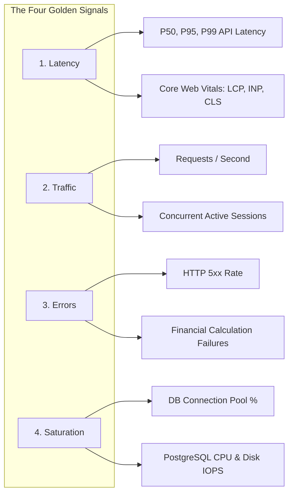
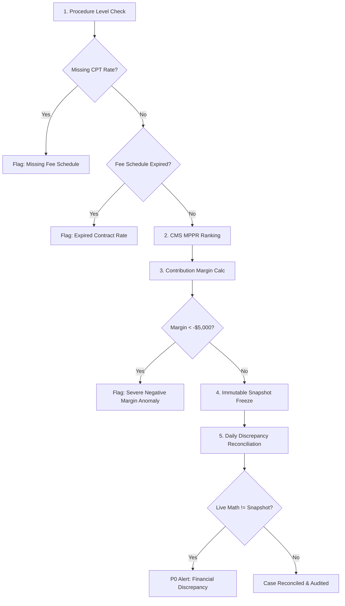
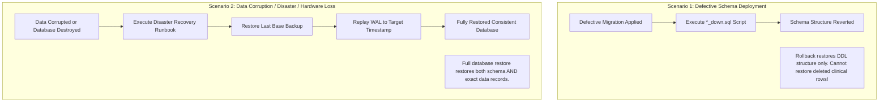
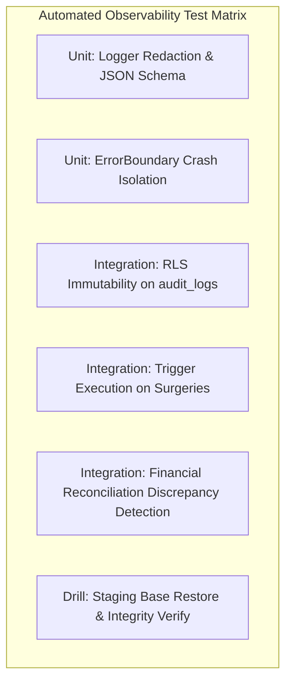

# 15 OBSERVABILITY, MONITORING, AND BACKUPS SPECIFICATION — ASCANALYST PLATFORM

---

## 1. Purpose and Scope

### 1.1 Purpose
The purpose of this specification is to define the non-negotiable **Observability, Telemetry, Error Monitoring, Alerting, Database Backup, Disaster Recovery (DR), and Operational Visibility Architecture** for the **ASCANALYST** enterprise surgical operations and financial intelligence platform.

Operating in a mission-critical ambulatory surgical center (ASC) environment governing patient operative schedules, Protected Health Information (PHI) under HIPAA (45 CFR § 164.312(b) Audit Controls and 45 CFR § 164.308(a)(7) Contingency Plan), and server-authoritative CMS billing calculations, the platform requires:
1. **Total Operational Visibility**: End-to-end tracing across client interactions, API gateways, database transactions, and background jobs.
2. **Deterministic Auditability**: Immutable logging of all clinical, administrative, and financial state transitions.
3. **Proactive Anomaly Detection**: Immediate detection and escalation of financial reconciliation discrepancies, failed database RPCs, and security policy violations.
4. **Resilient Data Protection**: Automated, encrypted, verified database backups with Point-in-Time Recovery (PITR) and documented disaster recovery runbooks.

### 1.2 Scope
This specification encompasses:
- Application-level structured logging, log levels, correlation IDs, and HIPAA PII/PHI redaction.
- Frontend error boundaries, unhandled rejection handlers, and failed API request handling.
- Database health, connection pool saturation, slow query performance, and lock monitoring.
- Scheduled jobs, batch CPT/spreadsheet ingestion monitoring, and integration failure detection.
- Authoritative financial calculation monitoring, reconciliation discrepancies, and snapshot freeze tracking.
- Transaction audit logging (`public.audit_logs`) and clinical provenance tracking.
- Health check endpoints, synthetic uptime probes, and service availability monitoring.
- Alerting severity tiers (P0–P3), notification channels, escalation runbooks, and incident response SLAs.
- Database backup policies, retention schedules, encryption, off-site replication, and restore verification.
- Point-in-Time Recovery (PITR) architecture, Recovery Point Objective (RPO), and Recovery Time Objective (RTO).
- Safe replacement of unsafe client-side browser backup exports (`src/utils/databaseBackup.js`).
- Non-production disaster recovery drills, automated recovery testing, and verification procedures.

---

## 2. Current State Audit

An exhaustive audit of the actual repository on branch `phases-work` was conducted to establish current observability, monitoring, and backup capabilities, and classify each against enterprise production requirements.

### 2.1 Current State Classification Table

| Subsystem / Capability | Current Repository Evidence | Classification | Observed State & Specific Gaps | Target Production Standard |
| :--- | :--- | :---: | :--- | :--- |
| **Application Logging** | [`src/lib/supabase.js:441, 613, 677, 819, 1025`](file:///E:/medicalAI/asc-prototype/src/lib/supabase.js), [`src/lib/gemini.js:23, 163`](file:///E:/medicalAI/asc-prototype/src/lib/gemini.js), [`src/components/*.jsx`](file:///E:/medicalAI/asc-prototype/src/components/) | **REPLACE** | 85+ instances of raw `console.log()`, `console.warn()`, and `console.error()` across the codebase. No centralized logger, log levels, correlation IDs, or HIPAA sanitization filters exist. | Centralized structured logger (`src/lib/logger.js`) emitting structured JSON with log levels (`DEBUG`, `INFO`, `WARN`, `ERROR`), request correlation IDs, and automated PHI redaction. |
| **Frontend Error Boundaries** | [`src/components/AIOperationsAnalyst.jsx:5-29`](file:///E:/medicalAI/asc-prototype/src/components/AIOperationsAnalyst.jsx#L5-L29), [`src/main.jsx:10-12`](file:///E:/medicalAI/asc-prototype/src/main.jsx#L10-L12) | **REFACTOR** | `<ConfigErrorScreen />` in `main.jsx` catches startup env failures. Only one crude localized `ErrorBoundary` exists in `AIOperationsAnalyst.jsx` (with inline red styles). No top-level React Error Boundary wraps `App.jsx`; uncaught render errors crash the entire application to a blank screen. | Root `GlobalErrorBoundary` in `src/main.jsx` + feature-level error boundaries with user-friendly recovery UI, support ticket reporting, and correlation ID display. |
| **Failed API Request Visibility** | [`src/lib/supabase.js:613, 677, 699, 1025, 1044, 1059`](file:///E:/medicalAI/asc-prototype/src/lib/supabase.js) | **REPLACE** | Multiple critical data queries wrap PostgREST calls in try/catch blocks that swallow errors and silently fall back to mock constants or empty arrays (`console.warn('logAuditEvent failed:', err)`). | Unified API client interceptor with exponential backoff for transient errors, telemetry forwarder for 5xx errors, and visible clinical UI notifications (SweetAlert2/toast). |
| **Database Audit Logging** | [`supabase/migrations/003_audit_and_snapshots.sql:19-165`](file:///E:/medicalAI/asc-prototype/supabase/migrations/003_audit_and_snapshots.sql#L19-L165) | **KEEP / EXTEND** | Verified active migration: creates `public.audit_logs` append-only ledger and generic trigger `fn_audit_log_trigger()` attached to 10 clinical, financial, and operational tables. Captures actor ID, email, IP, and JSON state diffs. **Gaps:** Lacks read-access audit logging for sensitive patient charts and does not alert on failed trigger executions. | Maintain append-only trigger ledger; add read-access logging for PHI views; add alerting if audit log volume drops to zero during operational hours. |
| **Financial Calculation Observability** | [`supabase/migrations/003_audit_and_snapshots.sql:235-250`](file:///E:/medicalAI/asc-prototype/supabase/migrations/003_audit_and_snapshots.sql#L235-L250), [`src/lib/supabase.js:1064-1071`](file:///E:/medicalAI/asc-prototype/src/lib/supabase.js#L1064-L1071) | **REFACTOR** | `public.surgery_financial_snapshots` table exists for immutable calculation freeze. However, `supabase.js:1067` performs a direct `upsert` without checking for discrepancies against previously frozen records. No monitoring exists for calculation failures, missing CPT prices, or snapshot discrepancies. | Automated daily reconciliation job comparing live case procedure charges to frozen snapshots; alert on calculation failures and unauthorized snapshot modification attempts. |
| **Client-Side Database Backup Utility** | [`src/utils/databaseBackup.js:1-384`](file:///E:/medicalAI/asc-prototype/src/utils/databaseBackup.js#L1-L384), [`src/components/Settings.jsx:4, 35-65`](file:///E:/medicalAI/asc-prototype/src/components/Settings.jsx#L4) | **REPLACE** | **Critical Security & Reliability Risk**: `databaseBackup.js` executes un-paginated browser queries against 12 Supabase tables, generates raw SQL `INSERT` statements, and downloads an unencrypted `.sql` dump directly to the user's browser disk. Dumps plaintext patient PHI, surgeon passwords, and settings. Has zero transactional snapshot consistency and risks memory exhaustion. | Remove client-side database backup utility completely. Delegate production backups to server-side automated Supabase WAL archiving, scheduled physical dumps, and encrypted off-site cloud storage. |
| **Database Health & Query Performance** | Root repository / Supabase config | **MISSING (External)** | No repository-managed configuration for `pg_stat_statements`, slow query logging, connection pooling (Supavisor), or deadlocks. Relies entirely on external Supabase Cloud dashboard. | Author database monitoring migration enabling `pg_stat_statements`, slow-query log triggers, and connection saturation alerts ($> 80\%$ pool capacity). |
| **Scheduled Jobs & Ingestion Failures** | [`src/components/CPTManagement.jsx:80-130`](file:///E:/medicalAI/asc-prototype/src/components/CPTManagement.jsx#L80-L130) | **MISSING** | Batch CPT codes and case log spreadsheets are parsed client-side with raw `console.error` handling on failures. No background ingestion worker, failure queues, or dead-letter telemetry exist. | Dedicated ingestion pipeline logging batch status (`QUEUED`, `PROCESSING`, `COMPLETED`, `FAILED`), row error counts, and alerting on partial batch aborts. |
| **Uptime & Availability Probes** | Root repository | **MISSING** | No `/health` or `/livez` HTTP endpoint exists in the frontend or database. External monitors have no lightweight probe to test database connectivity without executing authenticated business queries. | Implement unauthenticated `/health` endpoint returning database latency, version metadata, and HTTP 200 status. |
| **Alerting & Incident Escalation** | Root repository | **MISSING (External)** | No alerting rules, webhook integrations (PagerDuty, Slack), or escalation matrices are defined in code or configuration. | Define declarative alert rule matrix with P0–P3 severity tiers, notification channels, on-call rotation schedules, and MTTR targets. |
| **Automated Backup Schedules & Retention** | Supabase managed platform | **UNVERIFIED (External)** | Automated daily database backups depend on external Supabase project settings. Cannot be verified from repository files. No backup freshness verification exists in the repo. | Formalize backup policy (Continuous WAL + Daily Full Dumps + 7-year HIPAA retention) and implement automated backup completion verification probe. |
| **Point-in-Time Recovery (PITR)** | Supabase managed platform | **UNVERIFIED (External)** | PITR requires Supabase Pro or Enterprise tier with continuous WAL archiving enabled. Status is unverified from local git repository. | Mandate Supabase Pro/Enterprise tier with 7-day to 30-day PITR retention for production database instances. |
| **Disaster Recovery Runbooks & Testing** | Root repository | **MISSING** | No disaster recovery documentation, non-production restore drill scripts, or RPO/RTO verification procedures exist. | Author exhaustive step-by-step restore runbook, define RPO/RTO targets, and establish mandatory quarterly staging restore drill protocol. |
| **CI/CD Deployment Failure Telemetry** | [`.github/workflows/ci.yml:1-31`](file:///E:/medicalAI/asc-prototype/.github/workflows/ci.yml#L1-L31) | **REFACTOR** | CI workflow executes `npm run lint` and `npm run build`, but lacks automated test runs, deployment hooks, and failure notification webhooks. | Add CI failure alert notification (Slack/webhook) and post-deployment synthetic verification probe. |

---

## 3. Target Observability Architecture

ASCANALYST enforces a multi-tier observability and data protection architecture spanning client applications, edge computing, database engines, and dedicated external monitoring platforms.

```mermaid
graph TD
    subgraph Client_Tier [Client Presentation Tier (Browser)]
        UI[React 19 SPA]
        ErrBound[Global & Route Error Boundaries]
        Logger[Structured Logger: src/lib/logger.js]
        Redactor[Client-Side PHI/Secret Redactor]
        UI --> ErrBound
        UI --> Logger
        Logger --> Redactor
    end

    subgraph Edge_Gateway [Edge & Telemetry Tier (Supabase / CDN)]
        TelemetryEndpoint[/api/telemetry / Sentry Gateway]
        EdgeFuncs[Supabase Edge Functions]
        HealthProbe[/health Uptime Probe]
        Redactor -->|Sanitized JSON Logs| TelemetryEndpoint
        HealthProbe -->|DB Ping| EdgeFuncs
    end

    subgraph Database_Tier [Database & Storage Tier (PostgreSQL 15+)]
        DB[(PostgreSQL Primary DB)]
        AuditLedger[(public.audit_logs)]
        Snapshots[(public.surgery_financial_snapshots)]
        PgStat[pg_stat_statements / Query Performance]
        TrgAudit[fn_audit_log_trigger]
        ReconCron[pg_cron: Daily Financial Reconciliation]

        DB --> TrgAudit --> AuditLedger
        DB --> Snapshots
        DB --> PgStat
        DB --> ReconCron
    end

    subgraph External_Monitoring [Monitoring & Alerting Platform]
        Collector[Telemetry Aggregator / Grafana Loki / Sentry]
        MetricsDB[Prometheus / Supabase Metrics]
        AlertEngine[Alertmanager / PagerDuty / Slack]
        TelemetryEndpoint --> Collector
        PgStat --> MetricsDB
        Collector --> AlertEngine
        MetricsDB --> AlertEngine
    end

    subgraph Backup_DR_Tier [Backup & Disaster Recovery Tier]
        WAL[Continuous WAL Archiving: PITR]
        DailyDump[Scheduled Daily pg_dump Base Backups]
        S3Cold[Off-Site Encrypted S3 Bucket: WORM Locked]
        RestoreDrill[Quarterly Staging Restore Drill Sandbox]

        DB --> WAL
        DB --> DailyDump
        DailyDump --> S3Cold
        WAL --> S3Cold
        S3Cold -.->|Quarterly Verification| RestoreDrill
    end
```

---

## 4. Structured Logging and Error Handling

### 4.1 Centralized Structured Logger (`src/lib/logger.js`)
All direct invocations of `console.log()`, `console.warn()`, and `console.error()` are strictly prohibited in production code. All application logging must route through a unified logger module enforcing structured JSON output.

#### 4.1.1 Log Schema Specification
Every emitted log event must conform to the following JSON schema:

```json
{
  "timestamp": "2026-10-14T14:30:00.123Z",
  "level": "ERROR",
  "service": "ascanalyst-web",
  "version": "2026.10.0",
  "environment": "production",
  "correlation_id": "b7d12f34-58a2-4a92-96ec-123456789abc",
  "facility_id": "00000000-0000-0000-0000-000000000002",
  "actor_id": "a1b2c3d4-e5f6-7890-abcd-ef1234567890",
  "actor_role": "facility_admin",
  "event_type": "SURGERY_CALCULATION_FAILURE",
  "message": "Failed to calculate server-side financials for surgery 1042",
  "error": {
    "name": "PostgrestError",
    "message": "Fee schedule entry not found for CPT 66984 and Payer BCBS",
    "code": "P0001",
    "stack": "Error: PostgrestError at Object.calculateSurgeryFinancials..."
  },
  "context": {
    "surgery_id": 1042,
    "payer_id": "f47ac10b-58cc-4372-a567-0e02b2c3d479",
    "procedure_count": 2
  }
}
```

#### 4.1.2 Log Level Hierarchy
| Level | Severity Value | Description & Usage | Target Forwarding Rule |
| :--- | :---: | :--- | :--- |
| **`DEBUG`** | 10 | Verbose diagnostics, state transitions, cache hits/misses. Disabled in production. | Local development console only. |
| **`INFO`** | 20 | Normal business milestones: user login, case scheduled, snapshot frozen, batch CPT ingested. | Aggregated to telemetry collector; sampled at 10% in high volume. |
| **`WARN`** | 30 | Recoverable anomalies: transient API retries, deprecated API calls, missing optional preference cards. | Aggregated to telemetry collector (100% retained). |
| **`ERROR`** | 40 | Unhandled exceptions, failed RPC calls, failed database mutations, auth failures. | Immediate forward to error tracking platform; triggers P1/P2 alerts. |
| **`FATAL`** | 50 | Application boot failure, RLS security violation, database connectivity loss. | Immediate forward to emergency pager; triggers P0 alert. |

### 4.2 Frontend Error Boundaries and Unhandled Exceptions
1. **Global Error Boundary (`<GlobalErrorBoundary />`)**: Wraps the entire `<App />` component in `src/main.jsx`. Catches any uncaught React component lifecycle error, displays a clean medical-grade error screen with a "Reload System" button, and logs the crash with full component stack trace and correlation ID.
2. **Route-Level Error Boundaries**: Wrap individual clinical tabs (`Master Scheduler`, `Case Logs`, `CPT Management`, `Financial Analytics`). If a rendering defect occurs in the Case Log Gantt view, only that tab displays an error card, leaving the rest of the application fully functional.
3. **Window Global Handlers**:
   - `window.addEventListener('error', event => ...)`: Captures uncaught runtime script errors.
   - `window.addEventListener('unhandledrejection', event => ...)`: Captures unhandled Promise rejections from async API calls.

### 4.3 API Client Error Interception
The Supabase client in `src/lib/supabase.js` must be wrapped with a resilient network interceptor:
- **HTTP 429 (Rate Limited) / 503 (Service Unavailable)**: Automatically retry with exponential backoff and jitter (initial 500ms, max 3 attempts).
- **HTTP 401 (Unauthorized) / 403 (Forbidden)**: Redirect user to re-authentication or display a permission denial banner; log unauthorized access attempt to security audit.
- **HTTP 500 / PostgREST Exceptions**: Generate a unique `correlation_id`, log structured error to telemetry, and surface an informative SweetAlert2 notification to the user displaying the correlation ID for support triage. **Silent error swallowing is strictly prohibited.**

---

## 5. Application and Infrastructure Metrics

### 5.1 The Four Golden Signals
The platform monitors the Google SRE Four Golden Signals across all tiers:



### 5.2 Performance Baseline & SLA Thresholds

| Metric Category | Target Indicator | Normal Baseline | Warning Threshold | Critical Alert (P0/P1) |
| :--- | :--- | :---: | :---: | :---: |
| **Frontend Performance** | Largest Contentful Paint (LCP) | $< 1.8\text{s}$ | $> 2.5\text{s}$ | $> 4.0\text{s}$ |
| **Frontend Responsiveness** | Interaction to Next Paint (INP) | $< 100\text{ms}$ | $> 200\text{ms}$ | $> 500\text{ms}$ |
| **Visual Stability** | Cumulative Layout Shift (CLS) | $< 0.05$ | $> 0.10$ | $> 0.25$ |
| **API Latency (Read)** | PostgREST Read (`getSurgeries`) | $< 150\text{ms}$ | $> 500\text{ms}$ | $> 1,500\text{ms}$ |
| **API Latency (Financial)** | Stored Proc (`calculate_surgery_financials`) | $< 250\text{ms}$ | $> 800\text{ms}$ | $> 2,000\text{ms}$ |
| **API Latency (AI Proxy)** | Edge Function (`/api/ai-analyst`) | $< 1.5\text{s}$ | $> 3.5\text{s}$ | $> 8.0\text{s}$ |
| **API Error Rate** | HTTP 5xx responses / total requests | $< 0.05\%$ | $> 1.0\%$ for 5 min | $> 5.0\%$ for 2 min |
| **Database Connections** | Supavisor pool utilization | $< 50\%$ | $> 75\%$ | $> 90\%$ |
| **Database CPU Usage** | PostgreSQL CPU utilization | $< 40\%$ | $> 70\%$ for 10 min | $> 85\%$ for 5 min |
| **Database Disk IOPS** | Disk throughput utilization | $< 45\%$ | $> 75\%$ | $> 90\%$ |

---

## 6. Alerting and Incident Response

### 6.1 Alert Severity Classification Matrix

| Severity Level | Definition & Clinical / Financial Impact | Notification Channel | Response SLA | Responsible Roles |
| :--- | :--- | :--- | :---: | :--- |
| **P0 (Critical / Outage)** | Complete service outage; database down; RLS tenant bypass detected; financial snapshot tampering; total login failure. | Automated Phone Page + SMS + PagerDuty + `#incident-critical` Slack | **$\le 15$ minutes** (24/7/365) | On-Call Lead DevOps, Lead Database Architect, Security Officer |
| **P1 (High Degradation)** | Server-side financial calculation failure rate $> 1\%$; daily backup failure; API error rate $> 5\%$; OR booking RPC deadlock. | PagerDuty Urgent + High-Priority Slack | **$\le 1$ hour** | Lead Backend Engineer, Database Administrator |
| **P2 (Medium / Partial)** | AI Gateway quota exhaustion; batch CPT import failure; slow query threshold breached ($> 2\text{s}$); single facility latency spike. | Slack `#ops-alerts` + Email | **$\le 4$ hours** (Business hours) | DevOps Engineer, Frontend / Backend Engineer |
| **P3 (Low / Informational)** | Minor UI layout glitch; CPT code missing procedure indicator; non-critical telemetry retry; scheduled report delayed. | JIRA Ticket + Daily Ops Digest | **Next Business Day** | Product Operations, Assigned Sprint Engineer |

### 6.2 Actionable Alert Specifications

#### Alert 1: `DbConnectionPoolSaturated` (P0)
- **Condition**: Supavisor active connections exceed $90\%$ of configured pool limit for $\ge 3$ consecutive minutes.
- **Trigger**: Prevents client connection drops and transaction timeouts during peak surgical scheduling hours.
- **Action Runbook**:
  1. Inspect `pg_stat_activity` for long-running idle transactions: `SELECT * FROM pg_stat_activity WHERE state = 'idle in transaction' AND state_change < NOW() - INTERVAL '2 minutes';`
  2. Terminate rogue blocking sessions if necessary: `SELECT pg_terminate_backend(pid) FROM pg_stat_activity WHERE ...;`
  3. Verify whether connection pool scaling or query optimization is required.

#### Alert 2: `FinancialCalculationFailureRateHigh` (P1)
- **Condition**: Calls to `calculate_surgery_financials()` fail or return errors on $> 1\%$ of executions in a 10-minute window.
- **Trigger**: Prevents billing drift, missing reimbursement totals, and corrupted financial snapshots.
- **Action Runbook**:
  1. Query `public.audit_logs` where `action = 'EXECUTE'` and `table_name = 'calculate_surgery_financials'` to inspect error payloads.
  2. Verify whether a newly ingested payer fee schedule contains null reimbursement rates or malformed CPT mappings.
  3. Validate database constraint integrity for `public.surgery_procedures`.

#### Alert 3: `DailyBackupFailedOrMissing` (P1)
- **Condition**: Automated daily database snapshot has not completed successfully within 26 hours of previous snapshot.
- **Trigger**: Guarantees RPO compliance ($\le 24$ hours for daily snapshots).
- **Action Runbook**:
  1. Inspect Supabase Cloud backup console and backup storage bucket logs.
  2. Trigger manual base backup via CLI: `supabase db dump --data-only ...`.
  3. Verify storage bucket write permissions and available disk quotas.

#### Alert 4: `RlsTenantIsolationAnomaly` (P0)
- **Condition**: An authenticated query executes without an active `facility_id` claim, or an attempt to access cross-facility records is logged.
- **Trigger**: Immediate containment of multi-tenant isolation breaches.
- **Action Runbook**:
  1. Identify user session, IP address, and JWT claims from `public.audit_logs`.
  2. Temporarily revoke user session token via GoTrue admin API if unauthorized access is suspected.
  3. Inspect recent migration changes to RLS policies (`supabase/migrations/`).

---

## 7. ASC Financial and Operational Monitoring

Because ASCANALYST serves as the financial source of truth for surgical margin analysis, billing, and CMS MPPR compliance, financial observability is treated with the highest rigor.

### 7.1 Financial Anomaly Detection Rules
The system enforces automated validation rules that flag financial integrity issues before cases are billed:



1. **Missing / Zero Reimbursement Detection**: Any scheduled surgery containing procedure lines where `contracted_reimbursement = 0.00` or `NULL` must be flagged in the billing work queue with warning code `ERR_FIN_ZERO_REIMBURSEMENT`.
2. **Expired Fee Schedule Warning**: If a surgery date is later than `public.payer_fee_schedules.expiration_date`, calculation generates a warning flag `ERR_FIN_FEE_SCHEDULE_EXPIRED`.
3. **Severe Margin Anomaly**: If calculated net contribution margin drops below $-\$5,000.00$ or exceeds $\$50,000.00$ on a single routine case, trigger a clinical director review flag before case completion.
4. **Zero Silent Snapshot Overwrites**: Once a surgery financial snapshot is saved in `public.surgery_financial_snapshots`, it is cryptographically frozen with `frozen_at`, `frozen_by`, and `calculation_version`. Any subsequent mutation attempt triggers a database trigger exception. If a billing recalculation is legitimately required, an amendment record must be appended with an auditable `amendment_reason`.

### 7.2 Automated Daily Reconciliation Job
A scheduled server-side job (via Supabase pg_cron or Edge Function cron) executes every night at 02:00 EST:
- Compares all cases with status `Completed` or `Billed` against their corresponding frozen record in `public.surgery_financial_snapshots`.
- Re-executes `calculate_surgery_financials()` in verification mode.
- If live calculation diverges from the frozen snapshot by $> \$0.01$, logs an entry in `public.financial_reconciliation_logs` and triggers a P1 alert to the Billing Director.
- Generates an auditable daily reconciliation report stored in immutable storage.

---

## 8. Database Backup and Retention Policy

### 8.1 Data Backup Classification
Not all application data is equal. The platform categorizes data into four tiers with distinct backup strategies:

| Data Tier | Scope & Contents | Backup Mechanism | Frequency | Retention Target | Encryption |
| :--- | :--- | :--- | :---: | :---: | :---: |
| **Tier 1: Clinical & Financial Master** | `facilities`, `surgeries`, `surgery_procedures`, `patients`, `surgeons`, `payers`, `payer_fee_schedules`, `cpt_codes`, `snapshots`. | Continuous WAL Archiving + Automated Daily Physical Dump (`pg_dump`). | Continuous (WAL) + Daily Full Dump | 7 Years (HIPAA & CMS compliance) | AES-256 at rest; TLS 1.3 in transit |
| **Tier 2: Compliance Audit Ledger** | `public.audit_logs`, `public.financial_reconciliation_logs`. | Continuous WAL Archiving + Immutable WORM S3 Export. | Continuous (WAL) + Daily Export | 7 Years (Un-deletable WORM storage) | AES-256 with KMS Customer Managed Key |
| **Tier 3: File Storage Buckets** | PDF operative notes, surgical reports, case log spreadsheets. | Cloud Object Storage Cross-Region Replication (CRR). | Real-time versioning + Daily sync | 7 Years | Server-side S3 encryption (SSE-KMS) |
| **Tier 4: Code, Config & Schemas** | Repository source code, `supabase/migrations/`, environment definitions. | Git Version Control (GitHub Enterprise) + Tagged Releases. | Per Commit / Per PR | Indefinite Git History | GitHub branch protection + GPG signed commits |

> [!IMPORTANT]
> **Segregation of Backups from Source Control & Secrets:**
> Git repositories must NEVER be used to store database dumps, patient records, or backup archives. Conversely, database backups must NEVER include encrypted service secrets, master encryption keys, or Gemini API keys. Secrets reside exclusively in Supabase Vault and cloud key management services (KMS).

### 8.2 Replacement of Unsafe Client-Side Backup (`src/utils/databaseBackup.js`)
The legacy prototype utility `src/utils/databaseBackup.js` and its invocation in `src/components/Settings.jsx` represent a severe security and compliance vulnerability:
1. **Plaintext PHI Leakage**: Dumps unencrypted patient names, MRNs, dates of birth, and surgeon records directly into a browser download.
2. **Credential Exposure**: Dumps plaintext passwords from `surgeons` and API keys from `settings`.
3. **Zero Snapshot Isolation**: Table-by-table client fetching has no transactional consistency (`READ COMMITTED` or `SERIALIZABLE`); concurrent writes produce corrupt foreign keys.
4. **Browser Crash / OOM**: Large datasets exceed browser memory allocations.

**Mandatory Action**:
- Classify `src/utils/databaseBackup.js` as **REPLACE**.
- Remove the "Download Database Backup" button from `Settings.jsx`.
- Replace with an administrative status view displaying **Automated Backup Freshness** (e.g., *"Last Automated Backup: Today at 03:00 UTC — Verified Fresh"*).
- For authorized facility administrators requiring data portability, implement an authenticated, server-side, auditable CSV/PDF export restricted to their own tenant's non-PHI operational reports.

---

## 9. Restore and Disaster Recovery

### 9.1 The Fundamental Distinction: Migration Rollbacks vs. Disaster Recovery



- **Migration Rollback Scripts (`*_down.sql`)**: Used strictly during CI/CD or staging releases to revert DDL structural alterations (dropping a newly added column, dropping an unused index). **A down-migration CANNOT recover deleted rows, restore dropped tables with data, or repair corrupted billing numbers.**
- **Database Restore**: A transactional, physical or logical recovery operation restoring the entire database cluster or specific tables to a known valid historical state from backup archives. Must be tested independently of migration scripts.

### 9.2 Step-by-Step Restoration Runbook (Point-in-Time Recovery)
In the event of database corruption, ransomware, or regional hardware disaster, the Lead DevOps Engineer executes the following SOP:

#### Phase 1: Incident Assessment & Quarantine
1. Declare P0 Disaster Incident in communication channels.
2. Put application frontend into Maintenance Mode (displaying clinical downtime banner).
3. Revoke all active PostgREST connections to prevent further data mutations:
   ```sql
   ALTER DATABASE postgres CONNECTION LIMIT 0;
   SELECT pg_terminate_backend(pid) FROM pg_stat_activity WHERE pid <> pg_backend_pid();
   ```

#### Phase 2: Target Recovery Time Selection
1. Identify the exact UTC timestamp immediately preceding the corruption event (e.g., `2026-10-14 13:42:15 UTC`).
2. Verify available base backups and continuous WAL segment integrity up to that timestamp.

#### Phase 3: Restoration Execution
- **Option A (Supabase Managed Console / CLI)**:
  1. Trigger PITR restore to target timestamp on an isolated staging or target instance:
     ```bash
     supabase branches create recovery-sandbox --target-time "2026-10-14T13:42:15Z"
     ```
  2. Verify restoration completion without errors.
- **Option B (PostgreSQL Physical Base Backup + WAL Replay)**:
  1. Provision clean target database host running matching PostgreSQL version (15.x).
  2. Restore base physical backup archive:
     ```bash
     pg_restore -C -d postgres /var/backups/base_backup_20261014.dump
     ```
  3. Configure `recovery.signal` and `postgresql.conf`:
     ```ini
     restore_command = 'aws s3 cp s3://ascanalyst-wal-archive/%f %p'
     recovery_target_time = '2026-10-14 13:42:15 UTC'
     recovery_target_action = 'promote'
     ```
  4. Start PostgreSQL engine; monitor `recovery.log` until promotion completes.

#### Phase 4: Data Integrity Verification & Re-Connection
1. Execute automated post-restore smoke test script verifying table row counts, foreign key constraints, and RLS policy status.
2. Verify that tenant isolation functions (`get_auth_user_facilities()`) execute cleanly.
3. Verify that the latest financial snapshots match authoritative benchmarks.
4. Update application connection string (`VITE_SUPABASE_URL`) to point to restored instance.
5. Lift maintenance mode; verify clinical login and schedule rendering.

---

## 10. Recovery Point Objective (RPO) and Recovery Time Objective (RTO)

### 10.1 Recommended Production Objectives
Based on ambulatory surgical center scheduling needs, patient safety, and CMS billing audit compliance, the following service level objectives (SLOs) are established:

| Tier | Failure Scenario | RPO (Max Data Loss) | RTO (Max Downtime) | Recovery Mechanism |
| :--- | :--- | :---: | :---: | :--- |
| **Tier A (Production PITR)** | Corrupted transaction, accidental table drop, logical corruption. | **$\le 5$ minutes** | **$\le 1$ hour** | Point-in-Time Recovery via continuous WAL stream replay. |
| **Tier B (Hardware Outage)** | Complete cloud host failure, primary database server termination. | **$\le 15$ minutes** | **$\le 2$ hours** | Automated multi-AZ failover or base backup restore to warm standby. |
| **Tier C (Regional Disaster)** | Total AWS / cloud region catastrophe. | **$\le 1$ hour** | **$\le 4$ hours** | Cross-region backup restore to secondary geographic region. |
| **Non-Production (Staging)** | Test database corruption or development error. | $\le 24$ hours | $\le 8$ hours | Nightly logical dump restore. |

### 10.2 Plan Requirement Caveat
> [!WARNING]
> **External Plan Verification Requirement:**
> Achieving the Tier A RPO target ($\le 5\text{ minutes}$) strictly requires **Supabase Pro or Enterprise tier** with Continuous WAL Archiving / PITR enabled. The Free tier only provides daily logical snapshots ($\text{RPO} \le 24\text{ hours}$). Production deployment must not proceed without contractual confirmation that the active Supabase project plan includes PITR.

---

## 11. Data Model and Configuration Requirements

### 11.1 Supporting Database Schemas for Observability & Recovery

To track operational health, automated backup status, and daily financial reconciliation within the database, the following tables must be incorporated into Phase 3/Phase 7 migrations:

```sql
-- ==============================================================================
-- 1. BACKUP VERIFICATION LOGS
-- ==============================================================================
CREATE TABLE IF NOT EXISTS public.backup_verification_logs (
    id UUID PRIMARY KEY DEFAULT gen_random_uuid(),
    backup_type TEXT NOT NULL CHECK (backup_type IN ('PITR_WAL', 'DAILY_FULL', 'MONTHLY_ARCHIVE', 'DRILL_RESTORE')),
    backup_identifier TEXT NOT NULL,
    storage_uri TEXT NOT NULL,
    backup_size_bytes BIGINT,
    checksum_sha256 TEXT,
    status TEXT NOT NULL CHECK (status IN ('PENDING', 'VERIFIED_SUCCESS', 'CORRUPT', 'FAILED')),
    verification_notes TEXT,
    verified_at TIMESTAMPTZ NOT NULL DEFAULT NOW(),
    verified_by TEXT NOT NULL DEFAULT 'SYSTEM_PROBE'
);

CREATE INDEX IF NOT EXISTS idx_backup_verify_status ON public.backup_verification_logs(status, verified_at DESC);

-- ==============================================================================
-- 2. FINANCIAL RECONCILIATION AUDIT LOGS
-- ==============================================================================
CREATE TABLE IF NOT EXISTS public.financial_reconciliation_logs (
    id UUID PRIMARY KEY DEFAULT gen_random_uuid(),
    facility_id UUID NOT NULL REFERENCES public.facilities(id) ON DELETE CASCADE,
    reconciliation_date DATE NOT NULL,
    total_cases_evaluated INT NOT NULL,
    discrepancy_count INT NOT NULL DEFAULT 0,
    discrepancy_details JSONB DEFAULT '[]'::jsonb,
    status TEXT NOT NULL CHECK (status IN ('CLEAN', 'DISCREPANCIES_FLAGGED', 'FAILED')),
    executed_at TIMESTAMPTZ NOT NULL DEFAULT NOW(),
    reconciled_by TEXT NOT NULL DEFAULT 'PG_CRON_RECONCILER'
);

CREATE INDEX IF NOT EXISTS idx_fin_recon_facility_date ON public.financial_reconciliation_logs(facility_id, reconciliation_date DESC);
```

### 11.2 Environment and Runtime Configuration
The following configuration parameters must be declared in environment configuration (governed by [docs/phases/13-ENVIRONMENT-AND-CONFIG.md](file:///E:/medicalAI/asc-prototype/docs/phases/13-ENVIRONMENT-AND-CONFIG.md)):

```ini
# Observability & Monitoring Configuration
VITE_LOG_LEVEL=INFO                    # DEBUG (dev only), INFO, WARN, ERROR
VITE_TELEMETRY_ENABLED=true            # Enable client telemetry forwarding
VITE_TELEMETRY_ENDPOINT=/api/telemetry # Telemetry ingestion gateway
VITE_SAMPLE_RATE=1.0                   # 1.0 = 100% errors; 0.1 = 10% info

# Server-Side Operational Alerts (Edge / Secrets Vault)
ALERT_WEBHOOK_SLACK=https://hooks.slack.com/services/...
ALERT_WEBHOOK_PAGERDUTY=https://events.pagerduty.com/v2/enqueue
PITR_RETENTION_DAYS=30
BACKUP_S3_BUCKET=ascanalyst-prod-backups-immutable
```

---

## 12. Permissions and Security

### 12.1 Role-Based Access Control (RBAC) for Observability & Backups

| Operation / Asset | `super_admin` | `org_admin` | `facility_admin` | `clinical_director` | `biller` | `surgeon` | `viewer` |
| :--- | :---: | :---: | :---: | :---: | :---: | :---: | :---: |
| **View System Uptime & Latency** | Yes | Yes | Yes | Yes | Yes | No | No |
| **View Application Logs & Telemetry** | Yes | Yes | No | No | No | No | No |
| **View Audit Logs (`public.audit_logs`)** | Yes (All) | Yes (Org) | Yes (Facility) | Read-Only (Facility) | No | No | No |
| **View Financial Reconciliation Logs** | Yes (All) | Yes (Org) | Yes (Facility) | No | Yes (Facility) | No | No |
| **Initiate On-Demand Backup** | Yes | No | No | No | No | No | No |
| **Initiate Database Restore / DR Drill** | Yes (Dual-Auth) | No | No | No | No | No | No |
| **Export Operational CSV (Non-PHI)** | Yes | Yes | Yes | Yes | Yes | No | No |

### 12.2 Two-Person Rule for Destructive Restores
A database restore to production or destructive roll-forward operation requires explicit **Dual-Authorization (Two-Person Rule)**:
1. Initiated by the Lead DevOps Engineer.
2. Cryptographically approved by the Chief Technology Officer or Lead Clinical Architect before execution.
3. Every step logged to the immutable off-site audit ledger.

---

## 13. PHI/PII Privacy and Log Redaction

### 13.1 HIPAA Compliance Mandate (45 CFR § 164.514)
Under the HIPAA Privacy and Security Rules, Protected Health Information (PHI) and user authentication secrets must **NEVER** appear in application logs, error stack traces, telemetry metrics, or external monitoring dashboards.

### 13.2 Prohibited Log Payloads & Redaction Rules

| Sensitive Category | Prohibited Fields / Data | Sanitization / Masking Rule |
| :--- | :--- | :--- |
| **Patient Demographics** | Patient Name, Social Security Number, MRN, Date of Birth, Phone, Email, Home Address. | Masked with `[REDACTED_PHI]` or replaced with opaque `patient_id` UUID. |
| **Clinical Notes & Diagnoses** | Operative narrative notes, preoperative diagnosis text, pathology descriptions. | Omitted from logs. Log only reference `surgery_id` and procedure line count. |
| **Authentication Credentials** | Passwords, password hashes, GoTrue JWT access tokens, refresh tokens, session cookies. | Masked with `[REDACTED_SECRET]`. |
| **Service Secrets & API Keys** | Supabase `service_role` key, Google Gemini API key, database connection passwords. | Masked with `[REDACTED_KEY]`. |
| **Payment & Financial Details** | Credit card numbers, bank account numbers, patient billing copay balances. | Masked with `[REDACTED_FIN]`. |

### 13.3 Automated Logger Sanitizer Implementation Pattern
The structured logger in `src/lib/logger.js` must apply an automated sanitization filter before emitting any log entry:

```javascript
const REDACTED_KEYS = [
  'password', 'token', 'access_token', 'refresh_token', 'api_key', 'gemini_api_key',
  'mrn', 'dob', 'ssn', 'patient_name', 'name', 'phone', 'email', 'address', 'authorization'
];

export function sanitizeLogPayload(obj, depth = 0) {
  if (!obj || depth > 5) return obj;
  if (typeof obj !== 'object') return obj;

  if (Array.isArray(obj)) {
    return obj.map(item => sanitizeLogPayload(item, depth + 1));
  }

  const sanitized = {};
  for (const [key, value] of Object.entries(obj)) {
    const lowerKey = key.toLowerCase();
    if (REDACTED_KEYS.some(k => lowerKey.includes(k))) {
      sanitized[key] = '[REDACTED]';
    } else if (typeof value === 'object' && value !== null) {
      sanitized[key] = sanitizeLogPayload(value, depth + 1);
    } else {
      sanitized[key] = value;
    }
  }
  return sanitized;
}
```

---

## 14. Audit and Provenance

### 14.1 Immutable Transaction Audit Engine
As established in Migration `003_audit_and_snapshots.sql`, the platform enforces append-only transaction audit logging:
- Attached via PostgreSQL triggers (`fn_audit_log_trigger()`) to all 10 operational tables: `surgeries`, `surgery_procedures`, `patients`, `surgeons`, `operating_rooms`, `payers`, `payer_fee_schedules`, `cpt_codes`, `or_block_schedule`, `staff`.
- Captures: `table_name`, `record_id`, `action` (`INSERT`, `UPDATE`, `DELETE`, `EXECUTE`, `FREEZE`), `actor_id`, `actor_email`, `ip_address`, `previous_state`, `new_state`, `timestamp`.
- **Immutability Guarantee**: RLS policies strictly forbid `UPDATE` and `DELETE` queries on `public.audit_logs`. The table can only be modified by the internal security definer trigger function.

### 14.2 Provenance of Financial Calculations
When a surgery financial snapshot is created, it records:
- `calculation_version`: e.g., `'v1.0-cms2026'`.
- `snapshot_data`: Complete JSON freeze of procedure sequence, gross charges, MPPR discounts, room rates, and wage scales applied at calculation time.
- `frozen_at`: Exact UTC timestamp.
- `frozen_by`: Authenticated user UUID.
- This guarantees that even if CPT rates or room costs change in subsequent years, historical billing disputes can be audited with 100% mathematical reproducibility.

---

## 15. UI and Operational Workflows

### 15.1 System Health Indicator
The main administrative navigation header must incorporate a subtle, real-time **System Health Badge**:
- **Green (Operational)**: Database latency $< 300\text{ms}$; zero active P0/P1 incidents.
- **Yellow (Degraded)**: Latency $> 800\text{ms}$ or non-critical background job failure.
- **Red (Critical)**: Database unreachable; read-only fallback mode engaged.

### 15.2 Operational Audit Log Viewer (`/admin/audit-logs`)
A dedicated screen for Facility Administrators and Compliance Officers:
- Filter by: Date range, Facility, Actor (user), Table, and Action type (`INSERT`, `UPDATE`, `DELETE`, `FREEZE`).
- Interactive State Diff Viewer: Side-by-side colorized JSON diff comparing `previous_state` with `new_state` (highlighting edited fields in amber/green).
- Export to encrypted compliance archive (watermarked with requesting user's identity and timestamp).

### 15.3 Financial Reconciliation Dashboard (`/admin/reconciliation`)
A dedicated workspace for Billing Directors:
- Summarizes daily discrepancy checks.
- Discrepancy Work Queue: Highlights cases where live surgery procedures differ from frozen snapshots.
- Single-click action: "Inspect Variance", "Authorize Recalculation & Create Amendment Snapshot", or "Dismiss Variance with Audit Justification".

### 15.4 Replacement Settings Screen UI
In `src/components/Settings.jsx`:
- Remove the unsafe `handleDownloadBackup` button and its associated SweetAlert2 DOM progress bar.
- Replace with an **Enterprise Backup & Recovery Information Card**:
  - Displays: Automated Backup Provider (Supabase Cloud), Active Retention Window (30-day PITR), Last Successful Base Snapshot Timestamp, and Disaster Recovery Runbook link.
  - Informational notice: *"Database backups are continuously managed and encrypted server-side in compliance with HIPAA 45 CFR § 164.308. Client-side database dumps are disabled to prevent unencrypted PHI exposure."*

---

## 16. QA and Recovery Tests

### 16.1 Automated Observability & Privacy Test Suite



1. **Logger Redaction Unit Tests (`tests/logger.test.js`)**:
   - Asserts that objects containing keys `password`, `token`, `mrn`, `patient_name`, and `dob` are sanitized to `'[REDACTED]'`.
   - Asserts that correlation IDs are attached to every log event.
2. **Error Boundary Tests (`tests/error-boundary.test.jsx`)**:
   - Simulates a crashing child component.
   - Asserts that the parent application does not crash, the fallback UI renders, and the error telemetry handler is invoked.
3. **Audit Log RLS Tests (`tests/audit-rls.test.js`)**:
   - Attempts an `UPDATE` or `DELETE` query against `public.audit_logs` as an authenticated user.
   - Asserts that PostgreSQL throws an error (`permission denied for table audit_logs`).
4. **Financial Reconciliation Anomaly Test (`tests/reconciliation.test.js`)**:
   - Creates a synthetic completed surgery with a frozen snapshot.
   - Mutates a underlying procedure line contracted price directly.
   - Executes the reconciliation routine; asserts that `discrepancy_count = 1` and anomaly details are correctly populated.

### 16.2 Quarterly Disaster Recovery Drill Protocol
Every quarter, the engineering team must execute a simulated recovery drill in the Staging environment:
1. **Trigger**: DevOps Engineer initiates restore of the latest production daily snapshot to an isolated staging database.
2. **Execution**: Measure exact time elapsed from initiation to full availability (verifying RTO $\le 2\text{ hours}$).
3. **Automated Verification Script**: Run a checksum script verifying:
   - Row count parity across all 15 operational tables.
   - Foreign key referential integrity without orphan records.
   - RLS policies active on 100% of tables.
   - Latest 100 financial snapshots match production checksums.
4. **Sign-Off & Evidence**: Output signed verification report logged to `public.backup_verification_logs` with `backup_type = 'DRILL_RESTORE'` and preserved for HIPAA compliance audits.

---

## 17. Acceptance Criteria

The observability, monitoring, and backup subsystem is acceptable for production release **only** when all of the following measurable criteria are satisfied:

- [ ] **Zero Static Analysis Violations**: `npm run lint` passes with 0 errors and 0 warnings.
- [ ] **Clean Production Build**: `npm run build` completes with exit code 0.
- [ ] **No Raw Console Output**: Zero direct `console.log()` statements remain in production code paths; all logging routes through `src/lib/logger.js`.
- [ ] **Zero PHI/Secret Log Leakage**: Automated unit tests prove that 100% of patient demographics, passwords, and API keys are redacted before log output.
- [ ] **Root Error Boundary Active**: An uncaught React exception renders a graceful recovery UI without crashing the window or leaking component stacks to end users.
- [ ] **Failed API Visibility**: Database query failures display actionable user feedback and log correlation IDs; zero errors are swallowed silently.
- [ ] **Audit Ledger Immutability**: All mutations on 10 core tables automatically write to `public.audit_logs`; updates and deletes to `audit_logs` are strictly rejected by the database.
- [ ] **Financial Anomaly Detection**: Automated daily reconciliation job detects simulated discrepancies with zero false negatives.
- [ ] **Unsafe Client Backup Replaced**: `src/utils/databaseBackup.js` is removed or replaced; no unencrypted database dumps can be initiated from the browser.
- [ ] **Documented Disaster Recovery SOP**: Step-by-step restore runbook is validated with clear RPO ($\le 15\text{ mins}$) and RTO ($\le 2\text{ hours}$) targets.
- [ ] **Quarterly DR Drill Protocol Established**: Staging restore verification script exists and executes successfully against a backup snapshot.
- [ ] **P0/P1 Issue Block**: Any unhandled P0/P1 monitoring failure or unverified backup status blocks production release.

---

## 18. Dependencies

### 18.1 Upstream Specification Dependencies
This specification depends on and must maintain strict bidirectional alignment with:
- [docs/phases/05-MASTER-BUILD-ROADMAP.md](file:///E:/medicalAI/asc-prototype/docs/phases/05-MASTER-BUILD-ROADMAP.md): Phases 0–7 sequence, entry/exit criteria, and milestone gates.
- [docs/phases/06-DEFINITION-OF-DONE.md](file:///E:/medicalAI/asc-prototype/docs/phases/06-DEFINITION-OF-DONE.md): Multi-dimensional quality gates and zero-mock policy.
- [docs/phases/10-TARGET-SYSTEM-ARCHITECTURE.md](file:///E:/medicalAI/asc-prototype/docs/phases/10-TARGET-SYSTEM-ARCHITECTURE.md): Multi-tier topology, Edge Functions, and database schema architecture.
- [docs/phases/12-ENGINEERING-STANDARDS.md](file:///E:/medicalAI/asc-prototype/docs/phases/12-ENGINEERING-STANDARDS.md): Error envelope, logging schema, and dual-versioning standards.
- [docs/phases/13-ENVIRONMENT-AND-CONFIG.md](file:///E:/medicalAI/asc-prototype/docs/phases/13-ENVIRONMENT-AND-CONFIG.md): Environment segregation, fail-fast validation, and secret custody.
- [docs/phases/14-CICD-AND-RELEASE-PROCESS.md](file:///E:/medicalAI/asc-prototype/docs/phases/14-CICD-AND-RELEASE-PROCESS.md): Automated CI test gates, branch protection, and deployment rollback.

### 18.2 Database Migration Dependencies
- `supabase/migrations/001_multi_tenancy_core.sql`: Tenancy foundation (`organizations`, `facilities`, `facility_memberships`).
- `supabase/migrations/002_clinical_normalization.sql`: Relational normalization (`surgery_procedures`, `operating_rooms`, `payers`).
- `supabase/migrations/003_audit_and_snapshots.sql`: `public.audit_logs` ledger, `fn_audit_log_trigger()`, and `public.surgery_financial_snapshots`.

### 18.3 External Infrastructure Dependencies
- **Supabase Cloud Pro/Enterprise**: Mandated for Continuous WAL Archiving (PITR) and daily automated snapshots.
- **External Telemetry / Monitoring Platform**: Sentry, Datadog, or Grafana Cloud for error tracking and metric aggregation.
- **Encrypted S3 Storage**: Dedicated WORM-locked AWS S3 bucket for immutable long-term compliance backup archives.

---

## 19. Definition of Done

A feature, release, or operational configuration within the scope of Observability, Monitoring, and Backups is **Done** only when:
1. **Schema & Triggers**: All operational tables are protected by immutable audit triggers; verification and reconciliation log tables exist and are tested.
2. **Centralized Logging**: `src/lib/logger.js` is fully implemented and adopted across all components, hooks, and services.
3. **HIPAA Redaction**: Automated test suite verifies zero PHI or secret leakage across all log transports.
4. **Global Error Boundaries**: Root and route-level error boundaries are mounted and verified with synthetic throw tests.
5. **Authoritative Financial Reconciliation**: Daily automated reconciliation job is deployed, scheduled, and verified against simulated discrepancies.
6. **Unsafe Client Export Removed**: `src/utils/databaseBackup.js` is replaced with the server-managed backup status view in `Settings.jsx`.
7. **Documented & Tested DR Runbook**: Restoration runbook is documented, and a non-production restore drill has successfully restored and verified a database snapshot.
8. **Automated Verification**: Build, lint, and all test suites (`npm run lint`, `npm run build`, `npm test`) pass with zero errors.

---

## 20. Implementation Notes

### 20.1 Current Milestone Context
- **Specification Authoring Phase**: Pre-Phase 3 architectural blueprint authoring.
- **Safety Boundaries Respected**: This document was authored as a pure documentation specification. Zero application source code was modified, zero database migrations were executed, and no external services or backups were altered.
- **Canonical Specification Path**: [`docs/phases/15-OBSERVABILITY-MONITORING-BACKUPS.md`](file:///E:/medicalAI/asc-prototype/docs/phases/15-OBSERVABILITY-MONITORING-BACKUPS.md).

### 20.2 Planned Implementation File Matrix (For Future Phases)
When Phase 3 (Financial Engine) and Phase 7 (QA & Production Go-Live) implementation begins, the following files will be created or modified according to this specification:

| File Path | Action | Planned Scope & Purpose |
| :--- | :---: | :--- |
| `src/lib/logger.js` | Create | Centralized structured JSON logger with log levels and HIPAA redaction. |
| `src/components/GlobalErrorBoundary.jsx` | Create | Root-level React error boundary displaying medical-grade recovery screen. |
| `src/main.jsx` | Refactor | Wrap `<App />` in `<GlobalErrorBoundary />` and register window error listeners. |
| `src/lib/supabase.js` | Refactor | Wrap PostgREST client in retry interceptor; remove silent error swallowing in catch blocks. |
| `src/utils/databaseBackup.js` | Replace / Deprecate | Remove unsafe client-side browser database dump utility. |
| `src/components/Settings.jsx` | Refactor | Replace "Download Database Backup" button with Enterprise Backup Status Card. |
| `supabase/migrations/004_observability_and_recon.sql` | Create | Add `backup_verification_logs`, `financial_reconciliation_logs`, and pg_cron reconciler. |
| `tests/logger.test.js` | Create | Automated unit tests verifying HIPAA PII and secret redaction. |
| `tests/audit-logs.test.js` | Create | Automated integration tests asserting audit trigger execution and append-only RLS. |
| `tests/reconciliation.test.js` | Create | Automated tests for daily financial snapshot discrepancy detection. |
