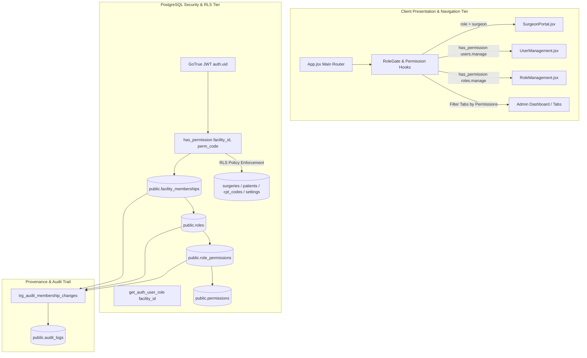

# 22 RBAC ROLES AND PERMISSIONS SPECIFICATION — ASCANALYST PLATFORM

---

## Purpose
The purpose of this specification is to define the definitive, production-grade **Role-Based Access Control (RBAC), Granular Permission Engine, User Lifecycle CRUD, Built-in and Custom Roles, Approval-Sensitive Workflows, and Multi-Tenant Security Enforcement** architecture for the **ASCANALYST** enterprise surgical intelligence platform.

Ambulatory Surgical Centers (ASCs) operate under stringent HIPAA privacy mandates (45 CFR § 164.308 / § 164.312), CMS billing integrity rules, and clinical governance protocols. The platform mandates:
1. **Principle of Least Privilege**: Access to Protected Health Information (PHI), financial contribution margins, fee schedules, and administrative configurations is strictly partitioned by role and facility context.
2. **Server-Enforced Authorization**: Frontend view hiding is purely cosmetic. Authorization is verified at the PostgreSQL engine tier (RLS) and API service gateways.
3. **Enterprise Organization vs. Facility Hierarchy**: Explicit separation between organization-level governance (`super_admin`, `org_admin`) and facility-level clinical/operational roles.
4. **Dynamic Custom Role Extensibility**: Authorized administrators can create custom roles with tailored permission subsets without modifying database DDL or application source code.
5. **Deterministic Safeguards**: Mathematical and procedural guarantees preventing privilege escalation, self-promotion, and the accidental deletion or deactivation of the last facility administrator.

---

## Scope
This specification encompasses:
- Complete User Management CRUD lifecycle (invitation, creation, directory listing, profile editing, facility assignment, deactivation, and reactivation).
- Formal definition and operational scope for 10 built-in canonical roles: Super Admin, Organization Admin, Facility Administrator, CFO/Finance, Clinical Manager, Scheduler, Billing/RCM, Coder, Surgeon, and Read Only/Viewer.
- Relational schema and migration design for dynamic custom roles and granular permissions (`public.roles`, `public.permissions`, `public.role_permissions`).
- Comprehensive 13-domain Permission Matrix distinguishing **View**, **Create**, **Edit**, **Delete**, **Approve**, **Export**, and **Execute** actions.
- Reconciliation plan between Spec 20, Spec 21 / Migration 001 role check constraints, and Spec 22 built-in/custom role architecture.
- PostgreSQL security-definer authorization functions (`has_permission()`, `get_auth_user_permissions()`, `user_has_facility_role()`) with dual-resolution backward compatibility.
- True database-tier surgeon case isolation on `public.surgeries` SELECT queries.
- Authoritative server-side permission enforcement for AI agent operations (`src/lib/gemini.js`, `MultiAgentConsole.jsx`).
- Secure GoTrue password update protocol and quarantine of legacy cleartext writes in `src/components/UserProfile.jsx`.
- Comprehensive audit provenance (`public.audit_logs`) capturing user lifecycle, role grants, and privilege modifications.
- Complete QA verification test matrix separating static inspection from true PostgreSQL/RLS integration tests.

---

## Current State Audit & Component Classification

A forensic audit of the repository, existing authentication code, database migrations, and RLS policies was conducted. Findings are classified using **KEEP**, **REFACTOR**, **REPLACE**, and **MISSING**.

### Current State Classification Table

| Subsystem / Component | Current Location | Classification | Observed State & Technical Deficiencies | Target Production Standard |
| :--- | :--- | :---: | :--- | :--- |
| **Membership Role Storage** | `public.facility_memberships.role` (Migration 001) | **KEEP / EXTEND** | `facility_memberships` stores role as a hardcoded `TEXT CHECK (role IN (...))` with 14 string aliases. **Deficiency:** Does not support dynamic custom roles or granular permissions. | Retain `role TEXT` for backward compatibility; add `role_id UUID REFERENCES public.roles(id)` to support custom roles and granular permissions. |
| **RLS Role Helper Functions** | `001_multi_tenancy_core.sql:350-382` | **KEEP / EXTEND** | `get_auth_user_role(p_facility_id)` and `user_has_facility_role(p_facility_id, p_roles)` active in live database. | Retain existing functions; introduce dual-resolution `has_permission(p_facility_id, p_perm)` to support permission-level RLS policies. |
| **Surgeon Case Isolation (DB Tier)** | `001_multi_tenancy_core.sql:581-588` | **REFACTOR** | Policy `"Tenant Scoped Surgeries Read"` permits **all** members of a facility to SELECT all cases (`USING (facility_id IN (SELECT get_auth_user_facilities()))`). Cross-surgeon filtering exists only in client React memory. | Update RLS policy to enforce `surgeon_id` matching against verified surgeon profile when `role = 'surgeon'`. |
| **Frontend Role Routing** | `src/App.jsx:2707-2731` | **REFACTOR** | Binary view branching: `if (authUser.role === 'surgeon') render SurgeonPortal; else render ASC Administrator`. All non-surgeons (viewers, billers) see the full 20-tab admin view. | Implement modular `RoleGate` and Tab Router restricting navigation, cards, and buttons according to user role permissions. |
| **Profile Role Badging** | `src/App.jsx:3314-3316` | **REFACTOR** | Header account menu hardcodes: `authUser?.role === 'admin' ? 'ASC Administrator' : 'Attending Surgeon'`. | Dynamically render normalized role label based on user's active membership in `activeFacility`. |
| **User Profile Management** | `src/components/UserProfile.jsx:77-125` | **REFACTOR** | Profile editor attempts to write cleartext passwords directly to `public.users` or `public.surgeons` via `db.updateUser`. | Refactor to invoke `supabase.auth.updateUser({ password })`; eliminate database password column updates. |
| **User Management CRUD UI** | Entire Repository | **MISSING** | No user management dashboard exists. Admins cannot list platform users, invite new staff, assign roles, or deactivate accounts. | Author dedicated User Management screen (`src/components/UserManagement.jsx`) with invitation, role assignment, and lifecycle controls. |
| **Role & Permission Management UI** | Entire Repository | **MISSING** | No interface exists to view role definitions, create custom roles, or configure permissions. | Author Role Management screen (`src/components/RoleManagement.jsx`) with permission matrix editor and admin safeguards. |
| **Dynamic Role & Permission Tables** | Remote Supabase (`isutllqthmakvwgduaos`) | **MISSING** | Tables `roles`, `permissions`, `role_permissions` do not exist. Roles are hardcoded strings in constraints. | Deploy Migration 002 creating `public.roles`, `public.permissions`, and `public.role_permissions`. |
| **AI MultiAgent Scheduling Writes**| `src/components/MultiAgentConsole.jsx:167-205` | **REFACTOR** | Simulation auto-schedules surgeries in database without checking whether active user has scheduling permissions. Migration 001 policy permits `biller` to insert surgeries. | Restrict surgery insertion policy strictly to authorized scheduling roles and verify `has_permission('surgeries.schedule')`. |
| **Staff vs. User Disconnect** | `src/components/StaffManagement.jsx` | **KEEP (CLINICAL)** | Manages clinical staff directory (`staff` table: nurses, scrub techs) with salaries/rates. Disconnected from login accounts. | Retain as clinical directory; optionally link clinical staff to `auth.users` for portal access. |
| **Audit Logging for Access Changes** | `public.audit_logs` | **REFACTOR** | Table exists, but membership/role changes in Supabase do not systematically emit structured before/after diffs. | Create PostgreSQL triggers on `facility_memberships` and `role_permissions` to record all access modifications. |

---

## Target State Architecture



### Core Architecture Invariants
1. **Dynamic Extensibility with Backward Compatibility**: Existing code querying `facility_memberships.role` (string) continues to function seamlessly while the new relational permission model evaluates granular access rights.
2. **Deterministic Role Resolution**: An individual user may hold different roles across different facilities (e.g., `surgeon` at Facility A, `clinical_manager` at Facility B). Role and permissions are evaluated dynamically against the currently active `facility_id`.
3. **Fail-Closed Default**: If an authenticated user lacks an explicit active membership for a facility, permission evaluation returns `false` and database queries yield empty sets.
4. **No Escalation Beyond Authority**: An administrator cannot grant permissions they do not possess, nor assign a role with a higher privilege tier than their own.

---

## Built-in and Custom Roles

### 1. Canonical Built-in Roles

| Role Identifier | Role Title | Hierarchy Level | Governance Scope | Core Responsibilities |
| :--- | :--- | :---: | :---: | :--- |
| **`super_admin`** | Super Admin | 1 (Highest) | Global Enterprise | Multi-organization administration, system configuration, global tenant provisioning, disaster recovery. |
| **`org_admin`** | Organization Admin | 2 | Organization | Multi-facility network oversight, executive analytics, facility provisioning, assigning facility administrators. |
| **`facility_admin`** | Facility Administrator | 3 | Facility | Full ASC operational management, user onboarding, staff management, facility settings, room configurations. |
| **`cfo`** | CFO / Finance Lead | 4 | Facility | Financial oversight, EBITDA analysis, cost per case, payer yield analysis, overtime expense reviews. |
| **`clinical_manager`** | Clinical Manager / Director | 4 | Facility | OR room scheduling, case block allocations, clinical quality reviews, physician credentialing oversight. |
| **`scheduler`** | Surgical Scheduler | 5 | Facility | Patient case bookings, OR calendar adjustments, surgeon preference card alignment, case cancellation logging. |
| **`biller`** | Billing / RCM Specialist | 5 | Facility | Revenue cycle management, claim modifiers, Medicare MPPR enforcement, fee schedule maintenance. |
| **`coder`** | Medical Coder | 6 | Facility | CPT/HCPCS code assignment, ICD-10 crosswalk verification, operative report coding audits. |
| **`surgeon`** | Attending Surgeon | 7 | Facility (Personal) | View and schedule own cases, update personal preference cards, analyze personal case contribution margins. |
| **`viewer`** | Read Only / Observer | 8 (Lowest) | Facility | Read-only observation of non-PHI dashboards, room occupancy, and anonymized volume metrics. |

### 2. Custom Role Governance
- **Provisioning**: Created by `super_admin`, `org_admin`, or `facility_admin` within their authorized scope.
- **Scoping**:
  - Organization-scoped custom roles: Apply across all facilities within the organization (created by `org_admin`).
  - Facility-scoped custom roles: Apply strictly within a single facility (created by `facility_admin`).
- **Immutability of Built-in Roles**: Built-in roles (`is_system = true`) cannot be edited, renamed, or deleted.
- **Deactivation & Deletion Safeguards**:
  - A role cannot be deleted if active user memberships are currently assigned to it. Memberships must first be reassigned.
  - **Last Administrator Safeguard**: The system strictly prevents deactivating or revoking the role of the final active `facility_admin` of a facility or the final `super_admin` of the platform.

---

## Permission Matrix

The platform organizes permissions across 13 distinct functional domains. Actions are strictly classified as **View**, **Create**, **Edit**, **Delete**, **Approve**, **Export**, and **Execute**.

### Comprehensive Domain Permission Matrix

| Domain / Resource | super_admin | org_admin | facility_admin | cfo | clinical_mgr | scheduler | biller | coder | surgeon | viewer |
| :--- | :---: | :---: | :---: | :---: | :---: | :---: | :---: | :---: | :---: | :---: |
| **1. Patients (`patients`)** | | | | | | | | | | |
| - View Patient PHI | Full | Org | Facility | Facility | Facility | Facility | Facility | Facility | 🔒 Own | ❌ None |
| - Create Patient Record | Full | Org | Facility | ❌ | Facility | Facility | ❌ | ❌ | 🔒 Own | ❌ |
| - Edit Patient Demographics | Full | Org | Facility | ❌ | Facility | Facility | Facility | ❌ | 🔒 Own | ❌ |
| - Delete Patient Record | Full | ❌ | ⚠️ Admin | ❌ | ❌ | ❌ | ❌ | ❌ | ❌ | ❌ |
| **2. Surgeons (`surgeons`)** | | | | | | | | | | |
| - View Surgeon Directory | Full | Org | Facility | Facility | Facility | Facility | Facility | Facility | Facility | Facility |
| - Create / Onboard Surgeon | Full | Org | Facility | ❌ | Facility | ❌ | ❌ | ❌ | ❌ | ❌ |
| - Edit Surgeon Profile / Rates | Full | Org | Facility | Facility | Facility | ❌ | ❌ | ❌ | 🔒 Profile | ❌ |
| - Delete / Deactivate Surgeon | Full | Org | Facility | ❌ | ❌ | ❌ | ❌ | ❌ | ❌ | ❌ |
| **3. Surgeries (`surgeries`)** | | | | | | | | | | |
| - View Surgical Cases | Full | Org | Facility | Facility | Facility | Facility | Facility | Facility | 🔒 Own | Read-only |
| - Create / Schedule Case | Full | Org | Facility | ❌ | Facility | Facility | ❌ | ❌ | 🔒 Own | ❌ |
| - Edit Clinical Case Data | Full | Org | Facility | ❌ | Facility | Facility | Facility | ❌ | 🔒 Pending | ❌ |
| - Delete / Cancel Case | Full | Org | Facility | ❌ | Facility | Facility | ❌ | ❌ | 🔒 Pending | ❌ |
| - Approve Clinical Case Log | Full | Org | Facility | ❌ | Facility | ❌ | ❌ | ❌ | ❌ | ❌ |
| **4. OR Scheduling (`or_block_schedule`)** | | | | | | | | | | |
| - View OR Calendar & Blocks | Full | Org | Facility | Facility | Facility | Facility | Facility | Facility | Facility | Facility |
| - Create / Reserve OR Blocks | Full | Org | Facility | ❌ | Facility | Facility | ❌ | ❌ | ❌ | ❌ |
| - Edit OR Room Allocations | Full | Org | Facility | ❌ | Facility | Facility | ❌ | ❌ | ❌ | ❌ |
| - Release / Cancel Blocks | Full | Org | Facility | ❌ | Facility | Facility | ❌ | ❌ | ❌ | ❌ |
| - Approve Monthly Block Schedule | Full | Org | Facility | ❌ | Facility | ❌ | ❌ | ❌ | ❌ | ❌ |
| **5. CPT Codes & Catalog (`cpt_codes`)** | | | | | | | | | | |
| - View CPT Catalog & Rates | Full | Org | Facility | Facility | Facility | Facility | Facility | Facility | Facility | Facility |
| - Create / Import CPT Codes | Full | Org | Facility | Facility | ❌ | ❌ | Facility | Facility | ❌ | ❌ |
| - Edit CPT Rates & Supplies Cost | Full | Org | Facility | Facility | ❌ | ❌ | Facility | ❌ | ❌ | ❌ |
| - Delete CPT Mapping | Full | Org | Facility | ❌ | ❌ | ❌ | Facility | ❌ | ❌ | ❌ |
| **6. Finance & Costs (`ot_extra_cost`)** | | | | | | | | | | |
| - View Cost & Profit Margin | Full | Org | Facility | Facility | Facility | ❌ | Facility | ❌ | 🔒 Own | ❌ |
| - Manage Overtime / Fixed Costs | Full | Org | Facility | Facility | ❌ | ❌ | Facility | ❌ | ❌ | ❌ |
| - Approve Facility Budget Models | Full | Org | Facility | Facility | ❌ | ❌ | ❌ | ❌ | ❌ | ❌ |
| **7. Billing / RCM** | | | | | | | | | | |
| - View Billing & Payer Yield | Full | Org | Facility | Facility | ❌ | ❌ | Facility | Facility | ❌ | ❌ |
| - Apply Medicare MPPR Modifiers | Full | Org | Facility | Facility | ❌ | ❌ | Facility | Facility | ❌ | ❌ |
| - Lock / Freeze Monthly Billing | Full | Org | Facility | Facility | ❌ | ❌ | Facility | ❌ | ❌ | ❌ |
| **8. Reports & Exports** | | | | | | | | | | |
| - Export Anonymized Volume CSV | Full | Org | Facility | Facility | Facility | Facility | Facility | Facility | 🔒 Own | ❌ |
| - Export Financial Margin Data | Full | Org | Facility | Facility | ❌ | ❌ | Facility | ❌ | ❌ | ❌ |
| - Export PHI Patient Case Logs | Full | ⚠️ Step-up | ⚠️ Step-up | ❌ | ⚠️ Step-up | ❌ | ❌ | ❌ | ❌ | ❌ |
| **9. AI Tools & Agents** | | | | | | | | | | |
| - Run AI Operational Insights | Full | Org | Facility | Facility | Facility | Facility | Facility | Facility | 🔒 Own | Read-only |
| - Run MultiAgent Scheduling Sim | Full | Org | Facility | ❌ | Facility | Facility | ❌ | ❌ | 🔒 Own | ❌ |
| - Auto-Commit Case via Agent | Full | Org | Facility | ❌ | Facility | Facility | ❌ | ❌ | 🔒 Own | ❌ |
| - Edit AI System Instructions | Full | Org | Facility | ❌ | ❌ | ❌ | ❌ | ❌ | ❌ | ❌ |
| **10. User Management** | | | | | | | | | | |
| - View User Directory | Full | Org | Facility | ❌ | Facility | ❌ | ❌ | ❌ | ❌ | ❌ |
| - Invite New Users | Full | Org | Facility | ❌ | ❌ | ❌ | ❌ | ❌ | ❌ | ❌ |
| - Assign / Edit Facility Roles | Full | Org | Facility | ❌ | ❌ | ❌ | ❌ | ❌ | ❌ | ❌ |
| - Deactivate / Reactivate User | Full | Org | Facility | ❌ | ❌ | ❌ | ❌ | ❌ | ❌ | ❌ |
| **11. Role Management** | | | | | | | | | | |
| - View Roles & Permissions | Full | Org | Facility | Facility | Facility | ❌ | ❌ | ❌ | ❌ | ❌ |
| - Create Custom Roles | Full | Org | Facility | ❌ | ❌ | ❌ | ❌ | ❌ | ❌ | ❌ |
| - Edit Custom Role Permissions | Full | Org | Facility | ❌ | ❌ | ❌ | ❌ | ❌ | ❌ | ❌ |
| - Delete Custom Role | Full | Org | Facility | ❌ | ❌ | ❌ | ❌ | ❌ | ❌ | ❌ |
| **12. Tenancy & Facility Settings** | | | | | | | | | | |
| - Edit Facility Operational Config | Full | Org | Facility | ❌ | ❌ | ❌ | ❌ | ❌ | ❌ | ❌ |
| - Toggle Medicare MPPR Rule | Full | Org | Facility | Facility | ❌ | ❌ | ❌ | ❌ | ❌ | ❌ |
| - Provision New Facility | Full | Org | ❌ | ❌ | ❌ | ❌ | ❌ | ❌ | ❌ | ❌ |
| **13. Audit Logs (`audit_logs`)** | | | | | | | | | | |
| - View Clinical Audit Trail | Full | Org | Facility | ❌ | Facility | ❌ | ❌ | ❌ | ❌ | ❌ |
| - View Financial Audit Trail | Full | Org | Facility | Facility | ❌ | ❌ | Facility | ❌ | ❌ | ❌ |
| - View Security & Access Logs | Full | Org | Facility | ❌ | ❌ | ❌ | ❌ | ❌ | ❌ | ❌ |

---

## User Management CRUD Lifecycle

### 1. User Creation & Invitation Workflow
```
[ Administrator opens User Management Screen ]
                       │
                       ▼
[ Enter Email, First Name, Last Name, Department, Title ]
                       │
                       ▼
[ Select Assigned Facility & Desired Role ]
                       │
                       ├── Privilege Ceiling Check: Is target role <= administrator's role tier?
                       │      ├── NO  ──► Block action with Error: 'Cannot grant role higher than own tier.'
                       │      └── YES ──► Proceed
                       │
                       ▼
[ Generate User Invitation via Supabase Auth Admin API ]
                       │
                       ├── 1. Create auth.users record (or invite via email)
                       ├── 2. Insert row into public.facility_memberships with role and role_id
                       ├── 3. Record audit event in public.audit_logs
                       └── 4. Send email with activation / password reset link
```

### 2. User Directory & Filtering
- Scoped strictly to administrator's authorized facility context.
- Facility Admins see all staff assigned to their facility.
- Org Admins see staff across all facilities within their healthcare network.
- Filters available: by Role, Department, Active/Inactive status, and Search by Name/Email.

### 3. Deactivation & Reactivation Protocol
- **Immediate Invalidation**: Deactivating a user (`is_active = false` on `facility_memberships`) immediately revokes access. The PostgreSQL helper function `get_auth_user_facilities()` checks `WHERE is_active = true`, causing all subsequent RLS queries to fail closed without waiting for token expiry.
- **Audit Requirement**: Every status toggle records actor, timestamp, target user ID, and justification in `public.audit_logs`.
- **Last Admin Protection**: Attempting to deactivate the final remaining `facility_admin` of a facility is aborted by database trigger `trg_protect_last_facility_admin`.

---

## Critical Dependency: Reconciliation Plan for Spec 21 & Migration 001

### 1. Documented Role Mismatch & Deterministic Mapping Table

Every existing role string in `public.facility_memberships.role` (Migration 001) maps deterministically to a canonical built-in role in `public.roles`. No roles are discarded, and no unintended privileges are escalated:

| Legacy Role String in Migration 001 | Canonical Built-in Role | Default Hierarchy Tier | Mapping Rationale |
| :--- | :--- | :---: | :--- |
| `'super_admin'` | `super_admin` | Tier 1 | Exact match. Global enterprise authority. |
| `'org_admin'` | `org_admin` | Tier 2 | Exact match. Organization-level network governance. |
| `'facility_admin'` | `facility_admin` | Tier 3 | Exact match. Facility executive director / operational admin. |
| `'cfo'` | `cfo` | Tier 4 | Exact match. Financial oversight and margins. |
| `'finance'` | `cfo` | Tier 4 | Non-breaking alias. Retains CFO-level financial analysis access. |
| `'financial_analyst'` | `cfo` | Tier 4 | Non-breaking alias from Spec 21 audit. Mapped to CFO tier. |
| `'clinical_manager'` | `clinical_manager` | Tier 4 | Exact match. OR room scheduling, blocks, clinical QA. |
| `'clinical_director'` | `clinical_manager` | Tier 4 | Non-breaking alias from Spec 20. Same clinical operational scope. |
| `'scheduler'` | `scheduler` | Tier 5 | Exact match. Surgical case bookings and calendar adjustments. |
| `'biller'` | `biller` | Tier 5 | Exact match. Billing reconciliation, MPPR, CPT rate review. |
| `'billing_rcm'` | `biller` | Tier 5 | Non-breaking alias from Spec 21. Identical revenue cycle scope. |
| `'coder'` | `coder` | Tier 6 | Exact match. Medical coding, CPT catalog imports, audits. |
| `'surgeon'` | `surgeon` | Tier 7 | Exact match. Restricted strictly to assigned facility and personal cases. |
| `'viewer'` | `viewer` | Tier 8 | Exact match. Read-only clinical observer; zero mutation/export rights. |
| `'read_only'` | `viewer` | Tier 8 | Non-breaking alias from Spec 21. Identical read-only scope. |

### 2. Backward-Compatible Relational Evolution Plan
1. **Zero Breaking Changes to Existing DDL**: Do not drop or rename the `role TEXT` column on `facility_memberships`.
2. **Phase-In Relational Tables (Migration 002)**:
   - Create `public.permissions` catalog table.
   - Create `public.roles` table seeded with the 10 canonical roles.
   - Create `public.role_permissions` mapping default permissions to each built-in role.
   - Add `role_id UUID REFERENCES public.roles(id)` to `public.facility_memberships`.
   - Execute an idempotent backfill:
     ```sql
     UPDATE public.facility_memberships fm
     SET role_id = (
         SELECT r.id FROM public.roles r 
         WHERE r.slug = CASE fm.role
             WHEN 'clinical_director' THEN 'clinical_manager'
             WHEN 'billing_rcm' THEN 'biller'
             WHEN 'finance' THEN 'cfo'
             WHEN 'financial_analyst' THEN 'cfo'
             WHEN 'read_only' THEN 'viewer'
             ELSE fm.role
         END
         AND r.is_system = true
     )
     WHERE fm.role_id IS NULL;
     ```
3. **Dual-Resolution Function**: `has_permission()` evaluates `role_id` first, and if `role_id` is null, falls back to evaluating `role` (string) against canonical built-in mappings. This guarantees zero downtime even if an unmigrated session issues a query.

---

## Data Model & Relational Schema (Refined Migration 002 Design)

```sql
-- ==============================================================================
-- 1. GRANULAR PERMISSIONS CATALOG
-- ==============================================================================
CREATE TABLE IF NOT EXISTS public.permissions (
    id UUID PRIMARY KEY DEFAULT gen_random_uuid(),
    code TEXT NOT NULL UNIQUE,          -- e.g., 'patients.view', 'surgeries.schedule'
    category TEXT NOT NULL,             -- e.g., 'patients', 'surgeries', 'billing'
    name TEXT NOT NULL,                 -- e.g., 'View Patient PHI'
    description TEXT,
    risk_level TEXT NOT NULL DEFAULT 'standard' CHECK (risk_level IN ('standard', 'sensitive', 'critical')),
    created_at TIMESTAMPTZ NOT NULL DEFAULT NOW()
);

CREATE INDEX IF NOT EXISTS idx_permissions_category ON public.permissions(category);

-- Explicit Permissions Security: Revoke anon, grant SELECT to authenticated, protect writes
ALTER TABLE public.permissions ENABLE ROW LEVEL SECURITY;
REVOKE ALL ON public.permissions FROM anon;
GRANT SELECT ON public.permissions TO authenticated;

DROP POLICY IF EXISTS "Auth Users Can View Permissions Catalog" ON public.permissions;
CREATE POLICY "Auth Users Can View Permissions Catalog"
ON public.permissions FOR SELECT TO authenticated USING (true);

DROP POLICY IF EXISTS "Super Admin Can Manage Permissions" ON public.permissions;
CREATE POLICY "Super Admin Can Manage Permissions"
ON public.permissions FOR ALL TO authenticated
USING (user_has_facility_role(NULL, ARRAY['super_admin']))
WITH CHECK (user_has_facility_role(NULL, ARRAY['super_admin']));

-- ==============================================================================
-- 2. ROLES TABLE (BUILT-IN SYSTEM ROLES & TENANT CUSTOM ROLES)
-- ==============================================================================
CREATE TABLE IF NOT EXISTS public.roles (
    id UUID PRIMARY KEY DEFAULT gen_random_uuid(),
    organization_id UUID REFERENCES public.organizations(id) ON DELETE CASCADE,
    facility_id UUID REFERENCES public.facilities(id) ON DELETE CASCADE,
    name TEXT NOT NULL,                 -- e.g., 'Lead Surgical Coordinator'
    slug TEXT NOT NULL,                 -- e.g., 'lead_surgical_coordinator'
    description TEXT,
    is_system BOOLEAN NOT NULL DEFAULT false, -- Built-in roles are immutable
    is_active BOOLEAN NOT NULL DEFAULT true,
    created_by UUID REFERENCES auth.users(id),
    created_at TIMESTAMPTZ NOT NULL DEFAULT NOW(),
    updated_at TIMESTAMPTZ NOT NULL DEFAULT NOW()
);

-- Partial Unique Indexes Handling NULL Scope Correctly
CREATE UNIQUE INDEX IF NOT EXISTS uq_roles_system_slug 
    ON public.roles(slug) WHERE facility_id IS NULL AND organization_id IS NULL;
CREATE UNIQUE INDEX IF NOT EXISTS uq_roles_org_slug 
    ON public.roles(organization_id, slug) WHERE facility_id IS NULL AND organization_id IS NOT NULL;
CREATE UNIQUE INDEX IF NOT EXISTS uq_roles_facility_slug 
    ON public.roles(facility_id, slug) WHERE facility_id IS NOT NULL;

CREATE INDEX IF NOT EXISTS idx_roles_facility ON public.roles(facility_id);
CREATE INDEX IF NOT EXISTS idx_roles_org ON public.roles(organization_id);

-- Explicit Roles Security: Revoke anon, grant SELECT/CRUD under strict RLS
ALTER TABLE public.roles ENABLE ROW LEVEL SECURITY;
REVOKE ALL ON public.roles FROM anon;
GRANT SELECT, INSERT, UPDATE, DELETE ON public.roles TO authenticated;

DROP POLICY IF EXISTS "Auth Users Can View Applicable Roles" ON public.roles;
CREATE POLICY "Auth Users Can View Applicable Roles"
ON public.roles FOR SELECT TO authenticated
USING (
    is_system = true OR
    facility_id IN (SELECT get_auth_user_facilities()) OR
    organization_id IN (
        SELECT f.organization_id FROM public.facilities f 
        WHERE f.id IN (SELECT get_auth_user_facilities())
    )
);

DROP POLICY IF EXISTS "Authorized Admins Can Create Custom Roles" ON public.roles;
CREATE POLICY "Authorized Admins Can Create Custom Roles"
ON public.roles FOR INSERT TO authenticated
WITH CHECK (
    NOT is_system AND
    (
        (facility_id IS NOT NULL AND user_has_facility_role(facility_id, ARRAY['super_admin', 'org_admin', 'facility_admin'])) OR
        (organization_id IS NOT NULL AND facility_id IS NULL AND user_has_facility_role(NULL, ARRAY['super_admin', 'org_admin']))
    )
);

DROP POLICY IF EXISTS "Authorized Admins Can Update Custom Roles" ON public.roles;
CREATE POLICY "Authorized Admins Can Update Custom Roles"
ON public.roles FOR UPDATE TO authenticated
USING (
    NOT is_system AND
    user_has_facility_role(facility_id, ARRAY['super_admin', 'org_admin', 'facility_admin'])
)
WITH CHECK (
    NOT is_system AND
    user_has_facility_role(facility_id, ARRAY['super_admin', 'org_admin', 'facility_admin'])
);

DROP POLICY IF EXISTS "Authorized Admins Can Delete Custom Roles" ON public.roles;
CREATE POLICY "Authorized Admins Can Delete Custom Roles"
ON public.roles FOR DELETE TO authenticated
USING (
    NOT is_system AND
    user_has_facility_role(facility_id, ARRAY['super_admin', 'org_admin', 'facility_admin']) AND
    NOT EXISTS (SELECT 1 FROM public.facility_memberships fm WHERE fm.role_id = roles.id)
);

-- ==============================================================================
-- 3. ROLE-PERMISSION JUNCTION TABLE
-- ==============================================================================
CREATE TABLE IF NOT EXISTS public.role_permissions (
    id UUID PRIMARY KEY DEFAULT gen_random_uuid(),
    role_id UUID NOT NULL REFERENCES public.roles(id) ON DELETE CASCADE,
    permission_id UUID NOT NULL REFERENCES public.permissions(id) ON DELETE CASCADE,
    granted_by UUID REFERENCES auth.users(id),
    granted_at TIMESTAMPTZ NOT NULL DEFAULT NOW(),
    CONSTRAINT uq_role_permission UNIQUE (role_id, permission_id)
);

CREATE INDEX IF NOT EXISTS idx_role_permissions_role ON public.role_permissions(role_id);
CREATE INDEX IF NOT EXISTS idx_role_permissions_permission ON public.role_permissions(permission_id);

-- Explicit Role-Permissions Security
ALTER TABLE public.role_permissions ENABLE ROW LEVEL SECURITY;
REVOKE ALL ON public.role_permissions FROM anon;
GRANT SELECT, INSERT, UPDATE, DELETE ON public.role_permissions TO authenticated;

DROP POLICY IF EXISTS "Auth Users Can View Role Permissions" ON public.role_permissions;
CREATE POLICY "Auth Users Can View Role Permissions"
ON public.role_permissions FOR SELECT TO authenticated
USING (
    EXISTS (
        SELECT 1 FROM public.roles r 
        WHERE r.id = role_permissions.role_id 
          AND (r.is_system = true OR r.facility_id IN (SELECT get_auth_user_facilities()))
    )
);

DROP POLICY IF EXISTS "Authorized Admins Can Manage Custom Role Permissions" ON public.role_permissions;
CREATE POLICY "Authorized Admins Can Manage Custom Role Permissions"
ON public.role_permissions FOR ALL TO authenticated
USING (
    EXISTS (
        SELECT 1 FROM public.roles r 
        WHERE r.id = role_permissions.role_id 
          AND NOT r.is_system
          AND user_has_facility_role(r.facility_id, ARRAY['super_admin', 'org_admin', 'facility_admin'])
    )
)
WITH CHECK (
    EXISTS (
        SELECT 1 FROM public.roles r 
        WHERE r.id = role_permissions.role_id 
          AND NOT r.is_system
          AND user_has_facility_role(r.facility_id, ARRAY['super_admin', 'org_admin', 'facility_admin'])
    )
);

-- ==============================================================================
-- 4. LINK FACILITY MEMBERSHIPS TO RELATIONAL ROLES
-- ==============================================================================
ALTER TABLE public.facility_memberships 
    ADD COLUMN IF NOT EXISTS role_id UUID REFERENCES public.roles(id) ON DELETE SET NULL;
CREATE INDEX IF NOT EXISTS idx_memberships_role_id ON public.facility_memberships(role_id);

-- ==============================================================================
-- 5. DUAL-RESOLUTION PERMISSION SECURITY DEFINER FUNCTION
-- ==============================================================================
CREATE OR REPLACE FUNCTION public.has_permission(p_facility_id UUID, p_permission_code TEXT)
RETURNS BOOLEAN
LANGUAGE plpgsql
SECURITY DEFINER
STABLE
SET search_path = public
AS $$
DECLARE
    v_role_id UUID;
    v_legacy_role TEXT;
BEGIN
    -- 1. Query membership for authenticated user in target facility
    SELECT fm.role_id, fm.role INTO v_role_id, v_legacy_role
    FROM public.facility_memberships fm
    WHERE fm.user_id = auth.uid()
      AND fm.facility_id = p_facility_id
      AND fm.is_active = TRUE
    LIMIT 1;

    -- If no active membership in facility, fail closed
    IF v_role_id IS NULL AND v_legacy_role IS NULL THEN
        RETURN FALSE;
    END IF;

    -- 2. Primary Evaluation: Relational role_id
    IF v_role_id IS NOT NULL THEN
        RETURN EXISTS (
            SELECT 1
            FROM public.role_permissions rp
            JOIN public.permissions p ON p.id = rp.permission_id
            WHERE rp.role_id = v_role_id
              AND p.code = p_permission_code
        );
    END IF;

    -- 3. Fallback Evaluation: Legacy string role mapped to system role
    IF v_legacy_role IS NOT NULL THEN
        RETURN EXISTS (
            SELECT 1
            FROM public.roles r
            JOIN public.role_permissions rp ON rp.role_id = r.id
            JOIN public.permissions p ON p.id = rp.permission_id
            WHERE r.slug = CASE v_legacy_role
                WHEN 'clinical_director' THEN 'clinical_manager'
                WHEN 'billing_rcm' THEN 'biller'
                WHEN 'finance' THEN 'cfo'
                WHEN 'financial_analyst' THEN 'cfo'
                WHEN 'read_only' THEN 'viewer'
                ELSE v_legacy_role
            END
              AND r.is_system = TRUE
              AND p.code = p_permission_code
        );
    END IF;

    RETURN FALSE;
END;
$$;

-- ==============================================================================
-- 6. TRUE DATABASE-TIER SURGEON CASE ISOLATION (RLS UPDATE)
-- ==============================================================================
DROP POLICY IF EXISTS "Tenant Scoped Surgeries Read" ON public.surgeries;
CREATE POLICY "Tenant Scoped Surgeries Read"
ON public.surgeries
FOR SELECT
TO authenticated
USING (
    facility_id IN (SELECT get_auth_user_facilities())
    AND (
        -- If user is NOT a surgeon (e.g. admin, clinical manager, scheduler, biller), they see all facility cases
        NOT user_has_facility_role(facility_id, ARRAY['surgeon'])
        OR
        -- If user IS a surgeon, restrict strictly to their own surgical records
        surgeon_id IN (
            SELECT s.id FROM public.surgeons s 
            WHERE LOWER(s.email) = LOWER(COALESCE(auth.jwt()->>'email', ''))
        )
    )
);

-- Refine Surgery Insert to Disallow Billers from Scheduling Cases
DROP POLICY IF EXISTS "Tenant Scoped Surgeries Insert" ON public.surgeries;
CREATE POLICY "Tenant Scoped Surgeries Insert"
ON public.surgeries
FOR INSERT
TO authenticated
WITH CHECK (
    facility_id IN (SELECT get_auth_user_facilities())
    AND (
        has_permission(facility_id, 'surgeries.schedule') OR
        user_has_facility_role(facility_id, ARRAY['super_admin', 'org_admin', 'facility_admin', 'clinical_manager', 'clinical_director', 'scheduler', 'surgeon'])
    )
);

-- ==============================================================================
-- 7. SYNCHRONIZE ONBOARDING TRIGGER (auth.users -> facility_memberships)
-- ==============================================================================
CREATE OR REPLACE FUNCTION public.handle_new_facility_user()
RETURNS TRIGGER AS $$
DECLARE
    v_surgeon_record RECORD;
    v_admin_role_id UUID;
    v_surgeon_role_id UUID;
BEGIN
    SELECT id INTO v_admin_role_id FROM public.roles WHERE slug = 'facility_admin' AND is_system = true LIMIT 1;
    SELECT id INTO v_surgeon_role_id FROM public.roles WHERE slug = 'surgeon' AND is_system = true LIMIT 1;

    -- 1. Explicit Administrator Provisioning (Primary Facility Only)
    IF NEW.email = 'admin@asc.com' THEN
        INSERT INTO public.facility_memberships (facility_id, user_id, role, role_id, is_active)
        VALUES ('00000000-0000-0000-0000-000000000002'::UUID, NEW.id, 'facility_admin', v_admin_role_id, true)
        ON CONFLICT (facility_id, user_id) DO UPDATE SET is_active = true, role = 'facility_admin', role_id = v_admin_role_id;
    END IF;

    -- 2. Verified Surgeon Provisioning: Match email to existing surgeon records
    FOR v_surgeon_record IN
        SELECT DISTINCT facility_id 
        FROM public.surgeons 
        WHERE LOWER(email) = LOWER(NEW.email)
          AND facility_id IS NOT NULL
    LOOP
        INSERT INTO public.facility_memberships (facility_id, user_id, role, role_id, is_active)
        VALUES (v_surgeon_record.facility_id, NEW.id, 'surgeon', v_surgeon_role_id, true)
        ON CONFLICT (facility_id, user_id) DO UPDATE SET is_active = true, role = 'surgeon', role_id = v_surgeon_role_id;
    END LOOP;

    RETURN NEW;
END;
$$ LANGUAGE plpgsql SECURITY DEFINER SET search_path = public;
```

---

## Business Rules & Deterministic Execution

- **BR-RBAC-01 (Explicit Least Privilege)**: Deny by default. An action is prohibited unless an explicit permission row exists in `role_permissions` for the user's assigned role in that facility context.
- **BR-RBAC-02 (Anti-Self-Escalation Trigger)**: A user cannot modify their own `facility_memberships` record or elevate their own role. Database trigger `trg_prevent_self_escalation` aborts updates where `auth.uid() = user_id` when changing `role_id`, `role`, or `is_active`.
- **BR-RBAC-03 (Privilege Ceilings)**: An administrator cannot grant a role possessing permissions that the administrator themselves does not possess.
- **BR-RBAC-04 (Last Administrator Lockdown Trigger)**:
  - Deleting or deactivating the final `facility_admin` of any facility is aborted with a PostgreSQL exception: `Cannot remove the last active Facility Administrator for facility %`.
  - Deleting or deactivating the final `super_admin` of the platform is unconditionally blocked.
- **BR-RBAC-05 (Cross-Surgeon Isolation Invariant)**: Attending surgeons (`role = surgeon`) can only query records where `surgeon_id` matches their own verified provider ID. Cross-surgeon queries over REST/GraphQL return HTTP 200 with `data: []` (RLS engine discard).
- **BR-RBAC-06 (Step-Up Authentication for Critical Operations)**: Permissions marked `risk_level = critical` (e.g., `exports.patient_phi_unredacted`, `billing.freeze_monthly`, `recovery.execute`) require an Authenticator Assurance Level claim of `aal2` (MFA TOTP verified) in the GoTrue JWT (`auth.jwt()->>'aal' = 'aal2'`).
- **BR-RBAC-07 (Immediate Deactivation Termination)**: Toggling `facility_memberships.is_active = false` terminates all active API operations immediately. PostgREST rejects subsequent requests because `get_auth_user_facilities()` checks `is_active = true`.

---

## Authoritative Enforcement for AI & Sensitive Operations

1. **AI Scheduling Pipeline Parity**:
   - [`src/components/MultiAgentConsole.jsx`](file:///e:/medicalAI/asc-prototype/src/components/MultiAgentConsole.jsx) simulation auto-scheduling must be authorized server-side.
   - The PostgreSQL policy `"Tenant Scoped Surgeries Insert"` restricts insertions strictly to authenticated users with `has_permission(facility_id, 'surgeries.schedule')`.
   - If an unauthorized user (e.g. `viewer` or `biller`) triggers the AI simulation, PostgreSQL RLS rejects the database insertion with code `42501` (`new row violates row-level security policy`).
2. **Secure Password Updates**:
   - Quarantine cleartext password modifications: [`src/components/UserProfile.jsx`](file:///e:/medicalAI/asc-prototype/src/components/UserProfile.jsx) is refactored to invoke `supabase.auth.updateUser({ password: newPassword })`.
   - Legacy update paths writing to `public.users.password` or `public.surgeons.password` are removed from `src/lib/supabase.js`.
   - The existing login flow in [`src/lib/supabase.js:666`](file:///e:/medicalAI/asc-prototype/src/lib/supabase.js#L666) (`signInWithPassword`) remains 100% untouched and operational.
3. **Sensitive Financial & Administrative Operations**:
   - Overtime and extra cost management: Governed by `has_permission(facility_id, 'finance.manage')`.
   - CPT catalog modifications: Governed by `has_permission(facility_id, 'cpt.manage')`.
   - Facility operational settings: Governed by `has_permission(facility_id, 'facility.manage')`.

---

## Rollback Specification (`002_rbac_roles_and_permissions_down.sql`)

The rollback migration must execute cleanly without restoring insecure anonymous access or wide-open authenticated policies:
1. Revert `Tenant Scoped Surgeries Read` and `Tenant Scoped Surgeries Insert` to Migration 001 definitions.
2. Revert `handle_new_facility_user` trigger function to Migration 001 definition (omitting `role_id`).
3. Drop `has_permission(UUID, TEXT)` function.
4. Drop column `role_id` from `public.facility_memberships`.
5. Drop tables `public.role_permissions`, `public.roles`, and `public.permissions` in reverse dependency order.
6. **Defense-in-Depth Guarantee**: Rollback **never** issues `GRANT ALL TO anon` or `FOR ALL TO authenticated USING (true)`.

---

## QA & Verification Test Cases

To eliminate false confidence from static tests, tests are formally partitioned into four distinct layers:

```
Layer 1: Static DDL & Syntax Verification (tests/rbac-migration-002-static.test.js)
Layer 2: Client Service Unit Tests (tests/rbac-service.test.js)
Layer 3: Database & RLS Integration Tests (tests/rbac-integration.test.js)
Layer 4: Live Supabase Penetration & Tenancy Proof (tests/rbac-live-verification.test.js)
```

### 1. Test Matrix Summary

| Test Layer | Test Suite | Target Invariant | Verification Method |
| :--- | :--- | :--- | :--- |
| **Layer 1: Static** | `tests/rbac-migration-002-static.test.js` | DDL integrity | Asserts DDL has partial unique indexes, RLS enabled on all 3 tables, and no open policies. |
| **Layer 2: Unit** | `tests/rbac-service.test.js` | Client permission checks | Unit tests `rbacService.hasPermission()` with single, multi-permission, and wildcard roles. |
| **Layer 3: RLS** | `tests/rbac-integration.test.js` | Database authorization | Executes against local/test PostgreSQL instance: scheduler can insert cases; biller is blocked; surgeon reads own cases only. |
| **Layer 3: RLS** | `tests/rbac-anti-escalation.test.js` | Anti-escalation trigger | Asserts non-admin cannot insert into `public.roles` or `public.role_permissions`. |
| **Layer 3: RLS** | `tests/rbac-last-admin.test.js` | Last Admin protection | Asserts deactivating the sole active Facility Admin throws an unhandled database exception. |
| **Layer 4: Live** | `tests/rbac-live-verification.test.js` | Live Supabase verification | Authenticates as `admin@asc.com`, verifies role resolution, reads CPTs, and checks `has_permission()`. |

---

## Acceptance Criteria

- [ ] **Build & Lint**: `npm test` passes all tests; `npm run build` succeeds with 0 errors.
- [ ] **Hardened DDL Authored**: Migration 002 includes explicit RLS on `roles`, `permissions`, and `role_permissions` with zero anonymous exposure.
- [ ] **Partial Slug Indexes Established**: Uniqueness correctly enforced for global system roles, org-level roles, and facility-level roles.
- [ ] **Dual-Resolution Fallback Validated**: `has_permission()` seamlessly evaluates legacy role strings if `role_id` is null.
- [ ] **Surgeon DB-Tier Isolation Active**: PostgreSQL policy `"Tenant Scoped Surgeries Read"` restricts surgeons strictly to their own surgical records.
- [ ] **AI Authorization Bound**: MultiAgentConsole scheduling writes restricted at PostgreSQL tier by removing biller from insertion policy.
- [ ] **Password Updates Secure**: `UserProfile.jsx` calls `supabase.auth.updateUser`; legacy cleartext password writes removed.
- [ ] **All 14 Roles Deterministically Mapped**: No legacy role strings silently dropped or escalated during migration backfill.
- [ ] **Safeguards Enforced**: Last Administrator protection trigger and anti-self-escalation trigger prevent lockouts and unauthorized privilege gains.
- [ ] **Safe Rollback**: `002_rbac_roles_and_permissions_down.sql` reverts schema safely without introducing open policies.

---

## Dependencies

- **Upstream**:
  - [`20-AUTHENTICATION-SPEC.md`](file:///e:/medicalAI/asc-prototype/docs/phases/20-AUTHENTICATION-SPEC.md) (GoTrue identity tier, session lifecycle, MFA).
  - [`21-ORGANIZATION-AND-FACILITY-TENANCY.md`](file:///e:/medicalAI/asc-prototype/docs/phases/21-ORGANIZATION-AND-FACILITY-TENANCY.md) (Multi-tenancy tables, `facility_memberships`, RLS helper functions).
  - Migration `001_multi_tenancy_core.sql` (Deployed on live Supabase project `isutllqthmakvwgduaos`).
- **Database**:
  - Proposed Migration `002_rbac_roles_and_permissions.sql` (Pending Step 2 approval).
- **Downstream**:
  - Spec 23 (Auditing & Compliance Logging), Spec 24 (Staff Credentialing), Spec 30 (Financial Analytics & MPPR Rules).

---

## Definition of Done

This specification is complete **only** when:
1. All 10 required corrections from the Phase 1.5 audit are fully incorporated into `docs/phases/22-RBAC-ROLES-AND-PERMISSIONS.md`.
2. The DDL addresses RLS on security tables, partial unique indexes, dual-resolution fallback, surgeon database-tier isolation, and onboarding trigger synchronization.
3. Rollback safety is mathematically proven to never restore anonymous or broad authenticated access.
4. The test strategy separates static checks from true database/RLS integration tests.
5. User review and explicit approval are granted prior to creating Migration 002 or modifying application source code.

**Status: STEP 1 REFINEMENT COMPLETE — AWAITING USER REVIEW & APPROVAL (2026-10-15)**

---

## Implementation Notes & Audit Trail

| Date | Engineer / Agent | Findings, Actions & Decisions |
| :--- | :--- | :--- |
| **2026-10-15** | `@security-auditor` | Completed Phase 1.5 readiness verification identifying 4 critical DDL vulnerabilities in draft migration. |
| **2026-10-15** | `@security-auditor` | **Correction 1:** Defined explicit RLS and policies on `roles`, `permissions`, and `role_permissions`, blocking unauthorized REST manipulation. |
| **2026-10-15** | `@security-auditor` | **Correction 2:** Replaced defective `UNIQUE(facility_id, slug)` with 3 partial unique indexes handling NULL scopes for system, org, and facility roles. |
| **2026-10-15** | `@security-auditor` | **Correction 3:** Authored dual-resolution `has_permission()` function falling back to legacy role strings if `role_id` is null. Synchronized `handle_new_facility_user` trigger. |
| **2026-10-15** | `@security-auditor` | **Correction 4:** Defined true database-tier surgeon case isolation on `surgeries` SELECT policy and stripped case-scheduling privilege from `biller` role. |
| **2026-10-15** | `@security-auditor` | **Correction 5:** Updated specification with deterministic 14-role mapping table, GoTrue password update protocol, and 4-layer testing matrix. |
| **2026-10-15** | `@security-auditor` | Refined `docs/phases/22-RBAC-ROLES-AND-PERMISSIONS.md`. Zero code modifications, zero SQL executions, and zero Git commits made during this step. |
