# 23 RLS SECURITY POLICIES SPECIFICATION — ASCANALYST PLATFORM

---

## Document Control & Metadata

- **Document Identifier**: `DOC-SPEC-PHASE-23-RLS`
- **Specification Title**: Table-by-Table Row Level Security (RLS), Tenant Isolation Boundaries, and Database Authorization Specification
- **Target Platform**: Supabase PostgreSQL 15+ (Remote Instance: `isutllqthmakvwgduaos` / Local Supabase CLI)
- **Upstream Dependencies**:
  - `docs/phases/03-CURRENT-DATABASE-AUDIT.md`
  - `docs/phases/20-AUTHENTICATION-SPEC.md`
  - `docs/phases/21-ORGANIZATION-AND-FACILITY-TENANCY.md`
  - `docs/phases/22-RBAC-ROLES-AND-PERMISSIONS.md`
  - `supabase/migrations/001_multi_tenancy_core.sql`
  - `supabase/migrations/002_rbac_roles_and_permissions.sql`
  - `supabase/migrations/002_clinical_normalization.sql`
  - `supabase/migrations/003_audit_and_snapshots.sql`
- **Classification**: Enterprise Healthcare Security Standard (HIPAA Security Rule / CMS Compliance)
- **Status**: Production Engineering Specification (Implementation-Ready)
- **Author**: ASCANALYST Architecture & Security Engineering Team
- **Date**: 2026-10-16

---

## 1. Purpose

The purpose of this specification is to establish the definitive, table-by-table **PostgreSQL Row Level Security (RLS) Architecture, Tenant Isolation Protocols, Role-Based Access Control (RBAC) Database Enforcement, Cryptographic Boundary Guarantees, and Security Definer Function Governance** for the **ASCANALYST** enterprise ambulatory surgical center platform.

Ambulatory Surgery Centers (ASCs) operate under federal statutory mandates including HIPAA Security Rule Technical Safeguards (45 CFR § 164.312(a)(1) Access Control, 45 CFR § 164.312(b) Audit Controls), CMS billing integrity rules, and state medical board credentialing regulations. In this architecture:
1. **Server-Enforced Zero-Trust**: Frontend UI guards (`RoleGate`, menu hiding, tab switching) are treated strictly as presentation conveniences. The PostgreSQL database engine is the authoritative, immutable boundary of security.
2. **Deterministic Multi-Tenancy**: Clinical cases, patient Protected Health Information (PHI), financial contribution margins, and staff salaries must be physically or cryptographically partitioned by facility and parent organization.
3. **Database-Tier Attending Physician Isolation**: Attending surgeons must be mathematically and relationally restricted to their own surgical cases at the PostgreSQL engine tier, preventing cross-provider snooping.
4. **Defense-in-Depth Grant Architecture**: Explicit PostgreSQL Data Control Language (`REVOKE`/`GRANT`) privileges are separated from Row Level Security policies (`USING`/`WITH CHECK`), ensuring a fail-closed default-deny posture.
5. **Immutable Compliance Provenance**: Sensitive operations (financial freezing, billing modifier updates, scheduling writes, and administrative role grants) emit immutable, append-only audit records that cannot be forged, updated, or deleted by any authenticated user.

---

## 2. Scope

This specification defines the production security standards for all current and proposed database tables, helper functions, and database triggers in the ASCANALYST platform:

- **18 Platform Tables**:
  - *Core Multi-Tenancy*: `organizations`, `facilities`, `facility_memberships`
  - *RBAC & Granular Permissions*: `permissions`, `roles`, `role_permissions`
  - *Clinical & Operational Master Data*: `patients`, `surgeries`, `surgeons`, `staff`, `or_block_schedule`, `ot_extra_cost`, `settings`
  - *Shared Catalogs & Knowledge Base*: `cpt_codes`, `chatbot_questions`
  - *Clinical Normalization Subsystem*: `operating_rooms`, `payers`, `payer_fee_schedules`, `surgery_procedures`
  - *Audit, Compliance & Snapshots*: `audit_logs`, `surgery_financial_snapshots`
  - *Agent Telemetry*: `agent_runs`, `agent_tasks`, `agent_events`, `agent_context`, `agent_approvals`
  - *Legacy Identity Quarantine*: `users`
- **Granular Operation Mapping**: Explicit definitions for `SELECT`, `INSERT`, `UPDATE`, and `DELETE` access across all 10 canonical roles.
- **SQL Execution Governance**: Security Definer functions, search path hijacking defenses, and parameter validation.
- **AI Agent Database Write Boundaries**: Server-side enforcement for automated surgical scheduling executed by multi-agent pipelines (`MultiAgentConsole.jsx`).
- **Migration & Rollback Assurance**: Step-by-step rollout sequencing and fail-closed rollback constraints guaranteeing that anonymous access is never restored.
- **Empirical QA Test Harness**: PostgreSQL/RLS integration test specifications defining negative security assertions for cross-facility, cross-surgeon, tampering, and escalation attacks.

---

## 3. Current-State Audit & Forensic Component Classification

A forensic audit of the repository code, database migrations, and client queries was performed to establish baseline security controls. Findings are classified using **KEEP**, **REFACTOR**, **REPLACE**, and **MISSING**.

### 3.1 Forensic Evidence Summary

| Component / Layer | Source Location | Repository Status | Live Database Status (`isutllqthmakvwgduaos`) | Classification | Observed State & Technical Deficiencies | Target Production Standard |
| :--- | :--- | :---: | :---: | :---: | :--- | :--- |
| **Initial Schema & Prototype RLS** | `schema_setup.sql:98-107` | Committed | Superseded / Inactive | **REPLACE** | Wide-open anonymous policies (`CREATE POLICY "Allow anon all..." ON ... FOR ALL TO anon USING (true)`). Exposed patient MRNs, cleartext passwords, and financial margins to unauthenticated web visitors. | Fully decommissioned. Zero anonymous access. RLS explicitly enabled on all tables. |
| **Multi-Tenancy Core DDL & Policies** | `supabase/migrations/001_multi_tenancy_core.sql` | Committed | Verified Deployed | **KEEP / EXTEND** | Establishes `organizations`, `facilities`, and `facility_memberships`. Deploys `get_auth_user_facilities()`, `prevent_facility_relocation()`, and drops anonymous policies. **Deficiency:** Surgeries SELECT policy permits all facility members to view all cases; billers are permitted to insert surgeries. | Retain tenancy infrastructure; extend with granular RBAC, surgeon case self-isolation, and scheduling restriction. |
| **RBAC Relational Schema & Surgeon Isolation** | `supabase/migrations/002_rbac_roles_and_permissions.sql` | Committed | Awaiting Production Apply | **KEEP / DEPLOY** | Creates `permissions`, `roles`, `role_permissions`. Implements dual-resolution `has_permission()`. Hardens `surgeries` SELECT to restrict surgeons strictly to their own cases. Blocks biller case insertions. Adds anti-self-escalation and Last Admin triggers. | Deploy to production Supabase instance to enforce granular authorization. |
| **Clinical Normalization Subsystem** | `supabase/migrations/002_clinical_normalization.sql` | Committed | Awaiting Production Apply | **KEEP / DEPLOY** | Creates `operating_rooms`, `payers`, `payer_fee_schedules`, and `surgery_procedures`. Implements tenant-scoped RLS. | Deploy to production Supabase instance to normalize 1NF procedures and payer fee contracts. |
| **Audit Ledger & Financial Snapshots** | `supabase/migrations/003_audit_and_snapshots.sql` | Committed | Awaiting Production Apply | **KEEP / DEPLOY** | Creates append-only `audit_logs` and `surgery_financial_snapshots`. Implements `fn_audit_log_trigger()` capturing before/after JSON diffs. Blocks UPDATE and DELETE on audit logs. | Deploy to production Supabase instance to achieve HIPAA § 164.312(b) audit compliance. |
| **Client Supabase Query Client** | `src/lib/supabase.js:20-115` | Committed | Active in Frontend | **REFACTOR** | Client queries generally omit `.eq('facility_id', ...)` filters, relying on database RLS to discard unassigned rows. Client joins occasionally fail when schema cache is stale. | Ensure client queries supply explicit `facility_id` filters while database RLS provides the authoritative second line of defense. |
| **Surgeon Portal Data Fetching** | `src/components/SurgeonPortal.jsx:66-87` | Committed | Active in Frontend | **REFACTOR** | Loads all facility surgeries and filters in React client memory (`s.doctor_name === surgeonName`). Relies on client memory for privacy. | Rely on database-tier RLS policy `Tenant Scoped Surgeries Read` to physically restrict query results at the PostgreSQL engine. |
| **AI MultiAgent Console Writes** | `src/components/MultiAgentConsole.jsx:171-205` | Committed | Active in Frontend | **REFACTOR** | Implements client-side `canCommitSchedule` check. However, Migration 001 RLS policy allows `biller` to insert surgeries directly via PostgREST. | Restrict surgery insertion policy strictly to authorized scheduling roles (`has_permission('surgeries.schedule')`). |
| **Legacy Users Table Grants** | `001_multi_tenancy_core.sql:865-874` | Committed | Verified Deployed | **REFACTOR** | Column-level security restricts `public.users` SELECT to `(id, name, email, role, avatar, created_at, updated_at)`. Passwords are unselectable over REST. | Retain column-level restriction during transition; fully decommission table once all users are linked to `auth.users`. |
| **Attending Surgeon Password Column** | `public.surgeons.password` | Committed | Verified Deployed | **REPLACE** | Column `password` on `public.surgeons` contains cleartext or null strings. | Execute DDL dropping `password` column from `public.surgeons`; authenticate surgeons exclusively via GoTrue `auth.users`. |

---

## 4. Target State Architecture & Security Model

```mermaid
graph TD
    subgraph Client_Presentation_Tier [Client Presentation Tier - React 19]
        ClientApp[Browser Client Application]
        TokenStore[GoTrue JWT Bearer Token]
        ActiveContext[Active Facility Context]
        RoleGateUI[RoleGate & Permission Hooks]
    end

    subgraph Supabase_Gateway_Tier [Supabase API Gateway Tier]
        PostgREST[PostgREST REST Engine]
        JWTValidator[GoTrue Ed25519 / HS256 Token Validator]
    end

    subgraph PostgreSQL_Security_Tier [PostgreSQL 15+ Security Definer Tier]
        AuthUID[auth.uid Extraction]
        FuncFacilities[public.get_auth_user_facilities]
        FuncHasPerm[public.has_permission]
        FuncUserRole[public.user_has_facility_role]
        TriggerRelocation[trg_prevent_facility_relocation]
        TriggerLastAdmin[trg_protect_last_facility_admin]
        TriggerAntiEscalation[trg_prevent_self_escalation]
        TriggerAudit[fn_audit_log_trigger]
    end

    subgraph Relational_Data_Tier [Database Tenancy & Data Tables]
        Memberships[(public.facility_memberships)]
        Roles[(public.roles)]
        RolePerms[(public.role_permissions)]
        ClinicalData[(surgeries / patients / or_block / staff)]
        SharedCatalogs[(cpt_codes / chatbot_questions)]
        AuditLedger[(public.audit_logs)]
    end

    ClientApp -->|1. HTTPS Request + Bearer JWT| PostgREST
    PostgREST --> JWTValidator
    JWTValidator -->|2. Sets auth.uid & claims| AuthUID
    
    AuthUID --> FuncFacilities
    FuncFacilities --> Memberships
    
    PostgREST -->|3. Evaluates RLS Policies| ClinicalData
    PostgREST -->|3. Evaluates RLS Policies| SharedCatalogs
    
    ClinicalData --> FuncHasPerm
    FuncHasPerm --> RolePerms
    RolePerms --> Roles
    
    ClinicalData --> TriggerRelocation
    Memberships --> TriggerLastAdmin
    Memberships --> TriggerAntiEscalation
    ClinicalData --> TriggerAudit
    TriggerAudit --> AuditLedger
```



### 4.1 Core Architecture Invariants

1. **Default-Deny Posture**: Every table in the `public` schema has Row Level Security explicitly enabled (`ALTER TABLE ... ENABLE ROW LEVEL SECURITY`). If no policy matches an incoming request, PostgreSQL returns zero rows for `SELECT` and rejects `INSERT`, `UPDATE`, and `DELETE` with error code `42501` (insufficient privilege).
2. **Zero Anonymous Access**: Unauthenticated requests (requests using the public `anon` key without a valid GoTrue session) are denied access to all domain tables. `REVOKE ALL ON <table_name> FROM anon` is executed across all domain tables.
3. **Dual-Resolution Role/Permission Architecture**: Security policies evaluate permissions using `has_permission(facility_id, permission_code)`. For backward compatibility, `has_permission()` checks the relational `role_id` first, falling back to legacy role strings mapped to canonical built-in roles.
4. **Fail-Closed Membership Resolution**: If an authenticated user does not have an active membership (`is_active = TRUE`) in a facility, helper functions return empty sets, resulting in immediate access denial.
5. **Real-Time Revocation**: Because helper functions query `public.facility_memberships` directly during policy evaluation, deactivating a user (`is_active = FALSE`) terminates database access immediately on the next transaction, without requiring token expiration.
6. **Immutable Provenance**: The `public.audit_logs` ledger grants `SELECT` only to authorized auditors and administrators. `INSERT` is performed exclusively via trusted trigger functions. `UPDATE` and `DELETE` policies are entirely omitted, ensuring HIPAA-grade immutable append-only provenance.

---

## 5. Tenant Isolation Rules & Boundary Enforcement

### 5.1 Organization and Facility Boundary Enforcement

The platform implements a two-tier hierarchy:
- **Parent Organization (`organizations`)**: Represents the healthcare system or Management Service Organization (MSO) (e.g., *Naples Health Network*).
- **Physical Facility (`facilities`)**: Represents the licensed ambulatory surgical center or hospital outpatient department (HOPD) (e.g., *Naples Surgery Center*).

#### Tenancy Scoping Invariants

1. **Facility-Bound Data Tables**: All operational records (`surgeries`, `patients`, `surgeons`, `staff`, `or_block_schedule`, `ot_extra_cost`, `settings`, `operating_rooms`, `payers`, `payer_fee_schedules`, `surgery_procedures`, `surgery_financial_snapshots`) contain a non-nullable foreign key:
   ```sql
   facility_id UUID NOT NULL REFERENCES public.facilities(id) ON DELETE CASCADE
   ```
2. **Enterprise Governance Scoping**:
   - `super_admin`: Holds global authority across all organizations and facilities.
   - `org_admin`: Holds authority across all facilities belonging to their assigned organization (`organization_id`).
   - Facility-level roles (`facility_admin`, `cfo`, `clinical_manager`, `scheduler`, `biller`, `coder`, `surgeon`, `viewer`): Strictly confined to facilities where the user has an active record in `public.facility_memberships`.

### 5.2 Facility Context Switching & Instant Membership Revocation

- **Client Context Switching**: In the web application (`src/App.jsx`), users assigned to multiple facilities switch context via the header switcher. This updates `localStorage.asc_active_facility` and triggers a clean reload of application state.
- **Database Boundary Enforcement**: Client-side context selection does not govern security. If a user attempts to issue a query against Facility B while possessing an active membership only in Facility A, PostgreSQL RLS evaluates:
  ```sql
  facility_id IN (SELECT get_auth_user_facilities())
  ```
  Because Facility B is not returned by `get_auth_user_facilities()`, PostgreSQL returns zero rows.
- **Instant Revocation Mechanics**: When an administrator sets `is_active = false` on `facility_memberships`:
  ```sql
  UPDATE public.facility_memberships 
  SET is_active = false 
  WHERE user_id = '...' AND facility_id = '...';
  ```
  `get_auth_user_facilities()` filters by `WHERE fm.is_active = TRUE`. The user is immediately blocked from querying or mutating that facility's data, eliminating the 1-hour JWT token expiration vulnerability window.

### 5.3 Prevention of Cross-Facility INSERT/UPDATE and `facility_id` Tampering

1. **INSERT Guard**: All `WITH CHECK` clauses require:
   ```sql
   WITH CHECK (
       facility_id IN (SELECT get_auth_user_facilities())
       AND [role_or_permission_check]
   )
   ```
   An authenticated user cannot insert a record into a facility where they do not hold an active membership.
2. **UPDATE Immutability Trigger**: To prevent cross-facility record relocation (e.g., moving a case from Facility A to Facility B to manipulate margins or conceal malpractice), the database enforces an immutability trigger function:
   ```sql
   CREATE OR REPLACE FUNCTION public.prevent_facility_relocation()
   RETURNS TRIGGER AS $$
   BEGIN
       IF NEW.facility_id IS DISTINCT FROM OLD.facility_id THEN
           IF NOT EXISTS (
               SELECT 1 FROM public.facility_memberships fm
               WHERE fm.user_id = auth.uid()
                 AND fm.facility_id = OLD.facility_id
                 AND fm.role IN ('super_admin', 'org_admin')
                 AND fm.is_active = TRUE
           ) THEN
               RAISE EXCEPTION 'Cross-facility relocation of records is forbidden. facility_id is immutable for non-enterprise administrators.';
           END IF;
       END IF;
       RETURN NEW;
   END;
   $$ LANGUAGE plpgsql SECURITY DEFINER SET search_path = public;
   ```
   This trigger is active on: `surgeries`, `patients`, `surgeons`, `or_block_schedule`, `ot_extra_cost`, `staff`, `settings`, and `operating_rooms`.

### 5.4 Global and Shared Data Handling

Certain catalogs are shared across facilities to maintain clinical standardization while permitting facility-level customization:
1. **CPT Codes Catalog (`cpt_codes`)**:
   - `facility_id` is nullable.
   - **National CMS Standard Codes**: Rows where `facility_id IS NULL` represent national standard CPT codes.
   - **Facility Custom Codes**: Rows where `facility_id` is populated represent center-specific custom codes or negotiated technical components.
   - **Read Policy**:
     ```sql
     USING (facility_id IS NULL OR facility_id IN (SELECT get_auth_user_facilities()))
     ```
   - **Write Policy**:
     ```sql
     USING (
         facility_id IN (SELECT get_auth_user_facilities())
         AND user_has_facility_role(facility_id, ARRAY['super_admin', 'org_admin', 'facility_admin', 'biller', 'billing_rcm', 'coder'])
     )
     ```
     Facility users can only insert, update, or delete codes where `facility_id` belongs to their facility. National codes (`facility_id IS NULL`) cannot be modified or deleted by facility staff.
2. **Chatbot Knowledge Base (`chatbot_questions`)**:
   - `facility_id` is nullable.
   - Global suggested prompt questions (`facility_id IS NULL`) are readable by all authenticated users.
   - Facility-specific FAQs can be created by facility administrators (`facility_id = activeFacility.id`).

### 5.5 Attending Surgeon Case Self-Isolation at the Database Tier

Under HIPAA Minimum Necessary disclosure rules (45 CFR § 164.502(b)), attending surgeons should not have unrestricted access to other surgeons' case logs, patient identifiers, or financial margins.

#### The Problem in Migration 001
Migration 001 policy `"Tenant Scoped Surgeries Read"` used:
```sql
USING (facility_id IN (SELECT get_auth_user_facilities()))
```
This allowed any attending surgeon to query the Supabase REST API directly and retrieve every surgical case in the facility.

#### Target Production Policy (Migration 002 Standard)
```sql
CREATE POLICY "Tenant Scoped Surgeries Read"
ON public.surgeries
FOR SELECT
TO authenticated
USING (
    facility_id IN (SELECT get_auth_user_facilities())
    AND (
        -- Administrative, clinical management, scheduling, and billing roles see all facility cases
        NOT user_has_facility_role(facility_id, ARRAY['surgeon'])
        OR
        -- Attending surgeons are restricted strictly to cases where they are the primary surgeon
        surgeon_id IN (
            SELECT s.id FROM public.surgeons s 
            WHERE LOWER(s.email) = LOWER(COALESCE(auth.jwt()->>'email', ''))
        )
    )
);
```
- When Dr. Gardner logs in, his JWT contains `email: "gardner@ortho.com"`.
- The PostgreSQL query planner dynamically matches `surgeries.surgeon_id` against the `surgeons` record matching that verified email.
- Any attempt to query another surgeon's cases returns an empty set.

### 5.6 Service-Role and Trusted Administrative Access Boundaries

1. **`anon` Role**: Public anonymous key used by unauthenticated web browsers. All table privileges are revoked (`REVOKE ALL FROM anon`).
2. **`authenticated` Role**: Standard role assigned to valid GoTrue JWT sessions. Governed strictly by RLS policies.
3. **`service_role` Role**: Superuser-equivalent API key used by backend servers, database migration runners, and automated cron workers.
   - **CRITICAL SECURITY REQUIREMENT**: The `service_role` key must **NEVER** be compiled into client frontend bundles, checked into git, or exposed in `.env.local`.
   - In the client application, only `VITE_SUPABASE_ANON_KEY` is utilized.

---

## 6. Grants and Policy Composition

### 6.1 PostgreSQL Privilege Pipeline (DCL vs. RLS)

In PostgreSQL, authorization is evaluated in two distinct, sequential phases:
```
[ Incoming SQL Query / PostgREST Call ]
                   │
                   ▼
       Phase 1: Table Privileges (DCL)
       Does role have GRANT SELECT/INSERT/UPDATE/DELETE?
                   │
         ├── NO  ──► ABORT with 42501 (Permission Denied)
         └── YES ──► Proceed to Phase 2
                   │
                   ▼
       Phase 2: Row Level Security (RLS)
       Does table have ENABLE ROW LEVEL SECURITY?
                   │
         ├── NO  ──► Return ALL table rows (UNRESTRICTED)
         └── YES ──► Filter rows matching USING / WITH CHECK policies
                     If no policy matches: Return 0 rows (Fail-Closed)
```

### 6.2 Table Privilege Grants (`anon` vs. `authenticated`)

To guarantee security, table privileges must be granted explicitly:

```sql
-- Standard Hardening Routine Applied to Every Domain Table
ALTER TABLE public.<table_name> ENABLE ROW LEVEL SECURITY;
REVOKE ALL ON public.<table_name> FROM anon;
GRANT SELECT, INSERT, UPDATE, DELETE ON public.<table_name> TO authenticated;
```

#### Special Table Grant Exceptions:
1. **`public.audit_logs`**:
   ```sql
   REVOKE ALL ON public.audit_logs FROM anon;
   GRANT SELECT ON public.audit_logs TO authenticated;
   -- INSERT, UPDATE, DELETE are NOT granted to authenticated users.
   -- Writes occur exclusively via PostgreSQL SECURITY DEFINER triggers.
   ```
2. **`public.users` (Legacy Credentials Protection)**:
   ```sql
   REVOKE ALL ON public.users FROM anon, authenticated;
   GRANT SELECT (id, name, email, role, avatar, created_at, updated_at) 
   ON public.users TO authenticated;
   -- Column-level grant: password column is NOT granted, preventing REST exfiltration.
   ```

### 6.3 Policy Composition Rules

PostgreSQL evaluates policies according to standard composition logic:
- **Multiple Permissive Policies (`AS PERMISSIVE`)**: Combined using logical `OR`. If a user satisfies Policy A OR Policy B, access is granted.
- **Restrictive Policies (`AS RESTRICTIVE`)**: Combined using logical `AND`. A user must satisfy the permissive policies AND all restrictive policies.
- **All policies in this specification are designed as PERMISSIVE with comprehensive compound boolean expressions** to avoid accidental policy leaks or unintended permission escalation.

### 6.4 Security Definer Function Governance & Risk Audit

Security Definer functions execute with the privileges of the function owner (`postgres`), bypassing RLS on underlying tables. If misconfigured, they introduce severe privilege escalation vulnerabilities (e.g., search path injection CWE-426).

| Function Name | Return Type | Volatility | Search Path Configuration | Grants | Privilege Bypass Risks & Mitigations |
| :--- | :--- | :---: | :---: | :---: | :--- |
| `public.get_auth_user_facilities()` | `TABLE(facility_id UUID)` | `STABLE` | `SET search_path = public` | `GRANT EXECUTE TO authenticated` | Queries `facility_memberships` using `auth.uid()`. Bypasses membership RLS to resolve user tenant list. Mitigation: Fixed search path; returns only verified active facilities for calling user. |
| `public.get_auth_user_role(p_facility_id UUID)` | `TEXT` | `STABLE` | `SET search_path = public` | `GRANT EXECUTE TO authenticated` | Queries `facility_memberships.role` for calling user. Mitigation: Scoped to `user_id = auth.uid()` and `is_active = TRUE`. |
| `public.user_has_facility_role(p_facility_id UUID, p_roles TEXT[])` | `BOOLEAN` | `STABLE` | `SET search_path = public` | `GRANT EXECUTE TO authenticated` | Evaluates membership role array match. Mitigation: Hardened against null injection; returns false if user not active. |
| `public.has_permission(p_facility_id UUID, p_permission_code TEXT)` | `BOOLEAN` | `STABLE` | `SET search_path = public` | `GRANT EXECUTE TO authenticated` | Dual-resolution engine querying `role_permissions` and fallback mappings. Mitigation: Scoped to calling user's active membership; returns false on error. |
| `public.get_auth_user_permissions(p_facility_id UUID)` | `TABLE(permission_code TEXT)` | `STABLE` | `SET search_path = public` | `GRANT EXECUTE TO authenticated` | Returns distinct permission codes for active user. Mitigation: Fixed search path; scoped strictly to `auth.uid()`. |
| `public.prevent_facility_relocation()` | `TRIGGER` | `VOLATILE` | `SET search_path = public` | `TRIGGER` | Enforces immutability of `facility_id` during UPDATE. Mitigation: Only permits relocation if actor holds `super_admin` or `org_admin`. |
| `public.protect_last_facility_admin()` | `TRIGGER` | `VOLATILE` | `SET search_path = public` | `TRIGGER` | Blocks deletion or deactivation of the last facility admin. Mitigation: Executes prior to commit; counts remaining active administrators. |
| `public.prevent_self_role_escalation()` | `TRIGGER` | `VOLATILE` | `SET search_path = public` | `TRIGGER` | Prevents users from modifying their own role or active status. Mitigation: Bypasses only if calling user is `super_admin`. |
| `public.fn_audit_log_trigger()` | `TRIGGER` | `VOLATILE` | `SET search_path = public` | `TRIGGER` | Writes state changes to `audit_logs`. Mitigation: Extracts `auth.uid()` from JWT context; captures IP address from request headers. |
| `public.handle_new_facility_user()` | `TRIGGER` | `VOLATILE` | `SET search_path = public` | `TRIGGER` | Auto-provisions memberships upon `auth.users` creation. Mitigation: Admin privileges granted ONLY to `admin@asc.com`; surgeons mapped by verified email. |

---

## 7. Table-by-Table RLS Policy Matrix

The following matrix documents the exact policies, commands, roles, and expressions for all 18 database tables.

```
Table Status Legend:
- [LIVE]: Deployed and active on live Supabase instance
- [MIG-001]: Defined in supabase/migrations/001_multi_tenancy_core.sql
- [MIG-002]: Defined in supabase/migrations/002_rbac_roles_and_permissions.sql or 002_clinical_normalization.sql
- [MIG-003]: Defined in supabase/migrations/003_audit_and_snapshots.sql
```

### 7.1 Multi-Tenancy Hierarchy Tables

#### 1. `public.organizations` [LIVE / MIG-001]
- **RLS Status**: `ENABLED`
- **Table Privileges**: `REVOKE ALL FROM anon; GRANT SELECT TO authenticated;`

| Operation | Policy Name | Target Roles | USING Expression | WITH CHECK Expression | Operational Behavior & Scoping |
| :--- | :--- | :--- | :--- | :--- | :--- |
| **SELECT** | `Auth Users Can View Their Organizations` | `authenticated` | `id IN (SELECT f.organization_id FROM public.facilities f WHERE f.id IN (SELECT get_auth_user_facilities()))` | — | Users can view organizations associated with facilities where they hold active membership. |
| **INSERT** | `Super Admin Can Insert Organizations` | `authenticated` | — | `user_has_facility_role(NULL, ARRAY['super_admin'])` | Restricted exclusively to global enterprise super administrators. |
| **UPDATE** | `Super Admin Can Update Organizations` | `authenticated` | `user_has_facility_role(NULL, ARRAY['super_admin'])` | `user_has_facility_role(NULL, ARRAY['super_admin'])` | Restricted exclusively to global enterprise super administrators. |
| **DELETE** | `Super Admin Can Delete Organizations` | `authenticated` | `user_has_facility_role(NULL, ARRAY['super_admin'])` | — | Cascades to facilities; restricted exclusively to super administrators. |

---

#### 2. `public.facilities` [LIVE / MIG-001]
- **RLS Status**: `ENABLED`
- **Table Privileges**: `REVOKE ALL FROM anon; GRANT SELECT, UPDATE TO authenticated;`

| Operation | Policy Name | Target Roles | USING Expression | WITH CHECK Expression | Operational Behavior & Scoping |
| :--- | :--- | :--- | :--- | :--- | :--- |
| **SELECT** | `Auth Users Can View Their Facilities` | `authenticated` | `id IN (SELECT get_auth_user_facilities())` | — | Users can view details only for facilities where they hold an active membership. |
| **INSERT** | `Org Admin Can Provision Facilities` | `authenticated` | — | `user_has_facility_role(NULL, ARRAY['super_admin', 'org_admin'])` | Provisioning new facilities is restricted to organization and super administrators. |
| **UPDATE** | `Facility Admin Can Update Facility Settings` | `authenticated` | `user_has_facility_role(id, ARRAY['super_admin', 'org_admin', 'facility_admin'])` | `user_has_facility_role(id, ARRAY['super_admin', 'org_admin', 'facility_admin'])` | Facility administrators can update center settings, operating hours, and license metadata. |
| **DELETE** | `Super Admin Can Delete Facilities` | `authenticated` | `user_has_facility_role(NULL, ARRAY['super_admin'])` | — | Deleting a facility is restricted to super administrators. |

---

#### 3. `public.facility_memberships` [LIVE / MIG-001 / MIG-002]
- **RLS Status**: `ENABLED`
- **Table Privileges**: `REVOKE ALL FROM anon; GRANT SELECT, INSERT, UPDATE, DELETE TO authenticated;`

| Operation | Policy Name | Target Roles | USING Expression | WITH CHECK Expression | Operational Behavior & Scoping |
| :--- | :--- | :--- | :--- | :--- | :--- |
| **SELECT** | `Users Can View Their Own Memberships` | `authenticated` | `user_id = auth.uid() OR user_has_facility_role(facility_id, ARRAY['super_admin', 'org_admin', 'facility_admin'])` | — | Users can inspect their own active assignments. Facility admins can view all assigned center staff. |
| **INSERT** | `Facility Admin Can Manage Memberships` | `authenticated` | — | `user_has_facility_role(facility_id, ARRAY['super_admin', 'org_admin', 'facility_admin'])` | Admins can onboard new staff into their facility. |
| **UPDATE** | `Facility Admin Can Manage Memberships` | `authenticated` | `user_has_facility_role(facility_id, ARRAY['super_admin', 'org_admin', 'facility_admin'])` | `user_has_facility_role(facility_id, ARRAY['super_admin', 'org_admin', 'facility_admin'])` | Guarded by `trg_prevent_self_escalation` and `trg_protect_last_facility_admin`. |
| **DELETE** | `Facility Admin Can Delete Memberships` | `authenticated` | `user_has_facility_role(facility_id, ARRAY['super_admin', 'org_admin', 'facility_admin'])` | — | Guarded by `trg_protect_last_facility_admin`. |

---

### 7.2 RBAC & Granular Permission Tables

#### 4. `public.permissions` [MIG-002]
- **RLS Status**: `ENABLED`
- **Table Privileges**: `REVOKE ALL FROM anon; GRANT SELECT TO authenticated;`

| Operation | Policy Name | Target Roles | USING Expression | WITH CHECK Expression | Operational Behavior & Scoping |
| :--- | :--- | :--- | :--- | :--- | :--- |
| **SELECT** | `Auth Users Can View Permissions Catalog` | `authenticated` | `true` | — | All authenticated users can inspect the permissions catalog to determine UI capabilities. |
| **INSERT** | `Super Admin Can Manage Permissions` | `authenticated` | — | `user_has_facility_role(NULL, ARRAY['super_admin'])` | Immutable catalog; modifications restricted to super administrators. |
| **UPDATE** | `Super Admin Can Manage Permissions` | `authenticated` | `user_has_facility_role(NULL, ARRAY['super_admin'])` | `user_has_facility_role(NULL, ARRAY['super_admin'])` | Modifications restricted to super administrators. |
| **DELETE** | `Super Admin Can Manage Permissions` | `authenticated` | `user_has_facility_role(NULL, ARRAY['super_admin'])` | — | Deletions restricted to super administrators. |

---

#### 5. `public.roles` [MIG-002]
- **RLS Status**: `ENABLED`
- **Table Privileges**: `REVOKE ALL FROM anon; GRANT SELECT, INSERT, UPDATE, DELETE TO authenticated;`

| Operation | Policy Name | Target Roles | USING Expression | WITH CHECK Expression | Operational Behavior & Scoping |
| :--- | :--- | :--- | :--- | :--- | :--- |
| **SELECT** | `Auth Users Can View Applicable Roles` | `authenticated` | `is_system = true OR facility_id IN (SELECT get_auth_user_facilities()) OR organization_id IN (SELECT f.organization_id FROM public.facilities f WHERE f.id IN (SELECT get_auth_user_facilities()))` | — | Users can view built-in system roles and custom roles scoped to their facility or organization. |
| **INSERT** | `Authorized Admins Can Create Custom Roles` | `authenticated` | — | `NOT is_system AND ((facility_id IS NOT NULL AND user_has_facility_role(facility_id, ARRAY['super_admin', 'org_admin', 'facility_admin'])) OR (organization_id IS NOT NULL AND facility_id IS NULL AND user_has_facility_role(NULL, ARRAY['super_admin', 'org_admin'])))` | Admins can create custom roles within their scope. Cannot create system roles. |
| **UPDATE** | `Authorized Admins Can Update Custom Roles` | `authenticated` | `NOT is_system AND user_has_facility_role(facility_id, ARRAY['super_admin', 'org_admin', 'facility_admin'])` | `NOT is_system AND user_has_facility_role(facility_id, ARRAY['super_admin', 'org_admin', 'facility_admin'])` | Cannot modify built-in system roles (`is_system = true`). |
| **DELETE** | `Authorized Admins Can Delete Custom Roles` | `authenticated` | `NOT is_system AND user_has_facility_role(facility_id, ARRAY['super_admin', 'org_admin', 'facility_admin']) AND NOT EXISTS (SELECT 1 FROM public.facility_memberships fm WHERE fm.role_id = roles.id)` | — | Cannot delete system roles or custom roles that are currently assigned to active users. |

---

#### 6. `public.role_permissions` [MIG-002]
- **RLS Status**: `ENABLED`
- **Table Privileges**: `REVOKE ALL FROM anon; GRANT SELECT, INSERT, UPDATE, DELETE TO authenticated;`

| Operation | Policy Name | Target Roles | USING Expression | WITH CHECK Expression | Operational Behavior & Scoping |
| :--- | :--- | :--- | :--- | :--- | :--- |
| **SELECT** | `Auth Users Can View Role Permissions` | `authenticated` | `EXISTS (SELECT 1 FROM public.roles r WHERE r.id = role_permissions.role_id AND (r.is_system = true OR r.facility_id IN (SELECT get_auth_user_facilities())))` | — | Users can inspect permissions mapped to roles applicable to their facility context. |
| **INSERT** | `Authorized Admins Can Manage Custom Role Permissions` | `authenticated` | — | `EXISTS (SELECT 1 FROM public.roles r WHERE r.id = role_permissions.role_id AND NOT r.is_system AND user_has_facility_role(r.facility_id, ARRAY['super_admin', 'org_admin', 'facility_admin']))` | Admins can grant permissions only to custom roles within their facility scope. |
| **UPDATE** | `Authorized Admins Can Manage Custom Role Permissions` | `authenticated` | `EXISTS (SELECT 1 FROM public.roles r WHERE r.id = role_permissions.role_id AND NOT r.is_system AND user_has_facility_role(r.facility_id, ARRAY['super_admin', 'org_admin', 'facility_admin']))` | `EXISTS (SELECT 1 FROM public.roles r WHERE r.id = role_permissions.role_id AND NOT r.is_system AND user_has_facility_role(r.facility_id, ARRAY['super_admin', 'org_admin', 'facility_admin']))` | Modifying permission mappings on built-in roles is strictly forbidden. |
| **DELETE** | `Authorized Admins Can Manage Custom Role Permissions` | `authenticated` | `EXISTS (SELECT 1 FROM public.roles r WHERE r.id = role_permissions.role_id AND NOT r.is_system AND user_has_facility_role(r.facility_id, ARRAY['super_admin', 'org_admin', 'facility_admin']))` | — | Revoking permissions from custom roles within authorized facility scope. |

---

### 7.3 Clinical & Operational Master Tables

#### 7. `public.patients` [LIVE / MIG-001]
- **RLS Status**: `ENABLED`
- **Table Privileges**: `REVOKE ALL FROM anon; GRANT SELECT, INSERT, UPDATE, DELETE TO authenticated;`

| Operation | Policy Name | Target Roles | USING Expression | WITH CHECK Expression | Operational Behavior & Scoping |
| :--- | :--- | :--- | :--- | :--- | :--- |
| **SELECT** | `Tenant Scoped Patients Read` | `authenticated` | `facility_id IN (SELECT get_auth_user_facilities())` | — | Scoped strictly to user's assigned facility. Viewers cannot access PHI in client UI. |
| **INSERT** | `Tenant Scoped Patients Insert` | `authenticated` | — | `facility_id IN (SELECT get_auth_user_facilities()) AND (has_permission(facility_id, 'patients.create') OR user_has_facility_role(facility_id, ARRAY['super_admin', 'org_admin', 'facility_admin', 'clinical_manager', 'clinical_director', 'scheduler', 'biller', 'billing_rcm']))` | Patient registration permitted for clinical, scheduling, and billing staff. |
| **UPDATE** | `Tenant Scoped Patients Update` | `authenticated` | `facility_id IN (SELECT get_auth_user_facilities()) AND (has_permission(facility_id, 'patients.edit') OR user_has_facility_role(facility_id, ARRAY['super_admin', 'org_admin', 'facility_admin', 'clinical_manager', 'clinical_director', 'scheduler', 'biller', 'billing_rcm']))` | `facility_id IN (SELECT get_auth_user_facilities()) AND (has_permission(facility_id, 'patients.edit') OR user_has_facility_role(facility_id, ARRAY['super_admin', 'org_admin', 'facility_admin', 'clinical_manager', 'clinical_director', 'scheduler', 'biller', 'billing_rcm']))` | Demographic updates. Guarded by `trg_prevent_facility_relocation_patients`. |
| **DELETE** | `Tenant Scoped Patients Delete` | `authenticated` | `facility_id IN (SELECT get_auth_user_facilities()) AND (has_permission(facility_id, 'patients.delete') OR user_has_facility_role(facility_id, ARRAY['super_admin', 'org_admin', 'facility_admin']))` | — | Deleting patient clinical profiles is restricted exclusively to facility administrators. |

---

#### 8. `public.surgeries` [LIVE / MIG-001 / MIG-002]
- **RLS Status**: `ENABLED`
- **Table Privileges**: `REVOKE ALL FROM anon; GRANT SELECT, INSERT, UPDATE, DELETE TO authenticated;`

| Operation | Policy Name | Target Roles | USING Expression | WITH CHECK Expression | Operational Behavior & Scoping |
| :--- | :--- | :--- | :--- | :--- | :--- |
| **SELECT** | `Tenant Scoped Surgeries Read` | `authenticated` | `facility_id IN (SELECT get_auth_user_facilities()) AND (NOT user_has_facility_role(facility_id, ARRAY['surgeon']) OR surgeon_id IN (SELECT s.id FROM public.surgeons s WHERE LOWER(s.email) = LOWER(COALESCE(auth.jwt()->>'email', ''))))` | — | Non-surgeons see all facility cases. Attending surgeons are restricted strictly to their own surgical cases. |
| **INSERT** | `Tenant Scoped Surgeries Insert` | `authenticated` | — | `facility_id IN (SELECT get_auth_user_facilities()) AND (has_permission(facility_id, 'surgeries.schedule') OR user_has_facility_role(facility_id, ARRAY['super_admin', 'org_admin', 'facility_admin', 'clinical_manager', 'clinical_director', 'scheduler', 'surgeon']))` | Scheduling cases restricted to clinical staff, schedulers, surgeons, and admins. Billers are explicitly blocked. |
| **UPDATE** | `Tenant Scoped Surgeries Update` | `authenticated` | `facility_id IN (SELECT get_auth_user_facilities()) AND (has_permission(facility_id, 'surgeries.edit') OR user_has_facility_role(facility_id, ARRAY['super_admin', 'org_admin', 'facility_admin', 'clinical_manager', 'clinical_director', 'scheduler', 'surgeon', 'biller', 'billing_rcm']))` | `facility_id IN (SELECT get_auth_user_facilities()) AND (has_permission(facility_id, 'surgeries.edit') OR user_has_facility_role(facility_id, ARRAY['super_admin', 'org_admin', 'facility_admin', 'clinical_manager', 'clinical_director', 'scheduler', 'surgeon', 'biller', 'billing_rcm']))` | Clinical and financial updates. Guarded by `trg_prevent_facility_relocation_surgeries`. |
| **DELETE** | `Tenant Scoped Surgeries Delete` | `authenticated` | `facility_id IN (SELECT get_auth_user_facilities()) AND (has_permission(facility_id, 'surgeries.delete') OR user_has_facility_role(facility_id, ARRAY['super_admin', 'org_admin', 'facility_admin', 'clinical_manager', 'clinical_director']))` | — | Case cancellation and deletion restricted to administrators and clinical directors. |

---

#### 9. `public.surgeons` [LIVE / MIG-001]
- **RLS Status**: `ENABLED`
- **Table Privileges**: `REVOKE ALL FROM anon; GRANT SELECT, INSERT, UPDATE, DELETE TO authenticated;`

| Operation | Policy Name | Target Roles | USING Expression | WITH CHECK Expression | Operational Behavior & Scoping |
| :--- | :--- | :--- | :--- | :--- | :--- |
| **SELECT** | `Tenant Scoped Surgeons Read` | `authenticated` | `facility_id IN (SELECT get_auth_user_facilities())` | — | All authenticated facility members can view the credentialed surgeon roster. |
| **INSERT** | `Tenant Scoped Surgeons Insert` | `authenticated` | — | `facility_id IN (SELECT get_auth_user_facilities()) AND (has_permission(facility_id, 'surgeons.create') OR user_has_facility_role(facility_id, ARRAY['super_admin', 'org_admin', 'facility_admin']))` | Onboarding surgeons is restricted to facility and enterprise administrators. |
| **UPDATE** | `Tenant Scoped Surgeons Update` | `authenticated` | `facility_id IN (SELECT get_auth_user_facilities()) AND (has_permission(facility_id, 'surgeons.edit') OR user_has_facility_role(facility_id, ARRAY['super_admin', 'org_admin', 'facility_admin', 'clinical_manager', 'clinical_director']) OR (user_has_facility_role(facility_id, ARRAY['surgeon']) AND LOWER(email) = LOWER(COALESCE(auth.jwt()->>'email', ''))))` | `facility_id IN (SELECT get_auth_user_facilities()) AND (has_permission(facility_id, 'surgeons.edit') OR user_has_facility_role(facility_id, ARRAY['super_admin', 'org_admin', 'facility_admin', 'clinical_manager', 'clinical_director']) OR (user_has_facility_role(facility_id, ARRAY['surgeon']) AND LOWER(email) = LOWER(COALESCE(auth.jwt()->>'email', ''))))` | Profile and rate updates. Surgeons can update their own contact details and preference cards. |
| **DELETE** | `Tenant Scoped Surgeons Delete` | `authenticated` | `facility_id IN (SELECT get_auth_user_facilities()) AND (has_permission(facility_id, 'surgeons.delete') OR user_has_facility_role(facility_id, ARRAY['super_admin', 'org_admin', 'facility_admin']))` | — | Deactivating surgeon credentials restricted to administrators. |

---

#### 10. `public.staff` [LIVE / MIG-001]
- **RLS Status**: `ENABLED`
- **Table Privileges**: `REVOKE ALL FROM anon; GRANT SELECT, INSERT, UPDATE, DELETE TO authenticated;`

| Operation | Policy Name | Target Roles | USING Expression | WITH CHECK Expression | Operational Behavior & Scoping |
| :--- | :--- | :--- | :--- | :--- | :--- |
| **SELECT** | `Tenant Scoped Staff Read` | `authenticated` | `facility_id IN (SELECT get_auth_user_facilities())` | — | Facility members can view the clinical staff directory. |
| **INSERT** | `Tenant Scoped Staff Manage` | `authenticated` | — | `facility_id IN (SELECT get_auth_user_facilities()) AND user_has_facility_role(facility_id, ARRAY['super_admin', 'org_admin', 'facility_admin', 'clinical_manager', 'clinical_director'])` | Adding clinical staff (nurses, scrub techs) restricted to clinical directors and admins. |
| **UPDATE** | `Tenant Scoped Staff Manage` | `authenticated` | `facility_id IN (SELECT get_auth_user_facilities()) AND user_has_facility_role(facility_id, ARRAY['super_admin', 'org_admin', 'facility_admin', 'clinical_manager', 'clinical_director'])` | `facility_id IN (SELECT get_auth_user_facilities()) AND user_has_facility_role(facility_id, ARRAY['super_admin', 'org_admin', 'facility_admin', 'clinical_manager', 'clinical_director'])` | Updating payroll rates, shift assignments, and licenses. Guarded by relocation trigger. |
| **DELETE** | `Tenant Scoped Staff Manage` | `authenticated` | `facility_id IN (SELECT get_auth_user_facilities()) AND user_has_facility_role(facility_id, ARRAY['super_admin', 'org_admin', 'facility_admin', 'clinical_manager', 'clinical_director'])` | — | Removing staff profiles restricted to clinical managers and admins. |

---

#### 11. `public.cpt_codes` [LIVE / MIG-001]
- **RLS Status**: `ENABLED`
- **Table Privileges**: `REVOKE ALL FROM anon; GRANT SELECT, INSERT, UPDATE, DELETE TO authenticated;`

| Operation | Policy Name | Target Roles | USING Expression | WITH CHECK Expression | Operational Behavior & Scoping |
| :--- | :--- | :--- | :--- | :--- | :--- |
| **SELECT** | `Shared And Tenant Scoped CPT Codes Read` | `authenticated` | `facility_id IS NULL OR facility_id IN (SELECT get_auth_user_facilities())` | — | Shared national catalog (`facility_id IS NULL`) + facility custom codes. |
| **INSERT** | `Facility Staff Can Manage CPT Codes` | `authenticated` | — | `facility_id IN (SELECT get_auth_user_facilities()) AND user_has_facility_role(facility_id, ARRAY['super_admin', 'org_admin', 'facility_admin', 'biller', 'billing_rcm', 'coder'])` | Must specify a valid facility ID belonging to the user. Cannot insert into national catalog. |
| **UPDATE** | `Facility Staff Can Manage CPT Codes` | `authenticated` | `facility_id IN (SELECT get_auth_user_facilities()) AND user_has_facility_role(facility_id, ARRAY['super_admin', 'org_admin', 'facility_admin', 'biller', 'billing_rcm', 'coder'])` | `facility_id IN (SELECT get_auth_user_facilities()) AND user_has_facility_role(facility_id, ARRAY['super_admin', 'org_admin', 'facility_admin', 'biller', 'billing_rcm', 'coder'])` | Updating custom facility rates. National standard records are immutable. |
| **DELETE** | `Facility Staff Can Manage CPT Codes` | `authenticated` | `facility_id IN (SELECT get_auth_user_facilities()) AND user_has_facility_role(facility_id, ARRAY['super_admin', 'org_admin', 'facility_admin', 'biller', 'billing_rcm', 'coder'])` | — | Deleting facility custom codes. National standard records cannot be deleted. |

---

#### 12. `public.or_block_schedule` [LIVE / MIG-001]
- **RLS Status**: `ENABLED`
- **Table Privileges**: `REVOKE ALL FROM anon; GRANT SELECT, INSERT, UPDATE, DELETE TO authenticated;`

| Operation | Policy Name | Target Roles | USING Expression | WITH CHECK Expression | Operational Behavior & Scoping |
| :--- | :--- | :--- | :--- | :--- | :--- |
| **SELECT** | `Tenant Scoped Block Schedule Read` | `authenticated` | `facility_id IN (SELECT get_auth_user_facilities())` | — | Facility members can view OR room block reservations and calendar utilization. |
| **INSERT** | `Tenant Scoped Block Schedule Manage` | `authenticated` | — | `facility_id IN (SELECT get_auth_user_facilities()) AND user_has_facility_role(facility_id, ARRAY['super_admin', 'org_admin', 'facility_admin', 'clinical_manager', 'clinical_director', 'scheduler'])` | Allocating surgeon block hours restricted to schedulers and clinical managers. |
| **UPDATE** | `Tenant Scoped Block Schedule Manage` | `authenticated` | `facility_id IN (SELECT get_auth_user_facilities()) AND user_has_facility_role(facility_id, ARRAY['super_admin', 'org_admin', 'facility_admin', 'clinical_manager', 'clinical_director', 'scheduler'])` | `facility_id IN (SELECT get_auth_user_facilities()) AND user_has_facility_role(facility_id, ARRAY['super_admin', 'org_admin', 'facility_admin', 'clinical_manager', 'clinical_director', 'scheduler'])` | Adjusting block hours or rooms. Guarded by relocation trigger. |
| **DELETE** | `Tenant Scoped Block Schedule Manage` | `authenticated` | `facility_id IN (SELECT get_auth_user_facilities()) AND user_has_facility_role(facility_id, ARRAY['super_admin', 'org_admin', 'facility_admin', 'clinical_manager', 'clinical_director', 'scheduler'])` | — | Releasing unused block time. |

---

#### 13. `public.ot_extra_cost` [LIVE / MIG-001]
- **RLS Status**: `ENABLED`
- **Table Privileges**: `REVOKE ALL FROM anon; GRANT SELECT, INSERT, UPDATE, DELETE TO authenticated;`

| Operation | Policy Name | Target Roles | USING Expression | WITH CHECK Expression | Operational Behavior & Scoping |
| :--- | :--- | :--- | :--- | :--- | :--- |
| **SELECT** | `Tenant Scoped Extra Costs Read` | `authenticated` | `facility_id IN (SELECT get_auth_user_facilities())` | — | Facility members can view procedure overhead costs and supply baselines. |
| **INSERT** | `Tenant Scoped Extra Costs Manage` | `authenticated` | — | `facility_id IN (SELECT get_auth_user_facilities()) AND user_has_facility_role(facility_id, ARRAY['super_admin', 'org_admin', 'facility_admin', 'cfo', 'finance', 'biller', 'billing_rcm'])` | Adding supply or overtime cost baselines restricted to finance and billing leads. |
| **UPDATE** | `Tenant Scoped Extra Costs Manage` | `authenticated` | `facility_id IN (SELECT get_auth_user_facilities()) AND user_has_facility_role(facility_id, ARRAY['super_admin', 'org_admin', 'facility_admin', 'cfo', 'finance', 'biller', 'billing_rcm'])` | `facility_id IN (SELECT get_auth_user_facilities()) AND user_has_facility_role(facility_id, ARRAY['super_admin', 'org_admin', 'facility_admin', 'cfo', 'finance', 'biller', 'billing_rcm'])` | Modifying expense overrides. Guarded by relocation trigger. |
| **DELETE** | `Tenant Scoped Extra Costs Manage` | `authenticated` | `facility_id IN (SELECT get_auth_user_facilities()) AND user_has_facility_role(facility_id, ARRAY['super_admin', 'org_admin', 'facility_admin', 'cfo', 'finance', 'biller', 'billing_rcm'])` | — | Deleting expense records restricted to finance and billing administrators. |

---

#### 14. `public.settings` [LIVE / MIG-001]
- **RLS Status**: `ENABLED`
- **Table Privileges**: `REVOKE ALL FROM anon; GRANT SELECT, UPDATE TO authenticated;`

| Operation | Policy Name | Target Roles | USING Expression | WITH CHECK Expression | Operational Behavior & Scoping |
| :--- | :--- | :--- | :--- | :--- | :--- |
| **SELECT** | `Tenant Scoped Settings Read` | `authenticated` | `facility_id IN (SELECT get_auth_user_facilities())` | — | Facility members can read active facility configuration (MPPR toggles, room counts). |
| **INSERT** | `Tenant Scoped Settings Manage` | `authenticated` | — | `facility_id IN (SELECT get_auth_user_facilities()) AND user_has_facility_role(facility_id, ARRAY['super_admin', 'org_admin', 'facility_admin'])` | Inserting center settings restricted to facility administrators. |
| **UPDATE** | `Tenant Scoped Settings Manage` | `authenticated` | `facility_id IN (SELECT get_auth_user_facilities()) AND user_has_facility_role(facility_id, ARRAY['super_admin', 'org_admin', 'facility_admin'])` | `facility_id IN (SELECT get_auth_user_facilities()) AND user_has_facility_role(facility_id, ARRAY['super_admin', 'org_admin', 'facility_admin'])` | Modifying billing rules (MPPR). Guarded by relocation trigger. |
| **DELETE** | `Tenant Scoped Settings Manage` | `authenticated` | `facility_id IN (SELECT get_auth_user_facilities()) AND user_has_facility_role(facility_id, ARRAY['super_admin', 'org_admin', 'facility_admin'])` | — | Facility settings deletion restricted to administrators. |

---

#### 15. `public.chatbot_questions` [LIVE / MIG-001]
- **RLS Status**: `ENABLED`
- **Table Privileges**: `REVOKE ALL FROM anon; GRANT SELECT, INSERT, UPDATE, DELETE TO authenticated;`

| Operation | Policy Name | Target Roles | USING Expression | WITH CHECK Expression | Operational Behavior & Scoping |
| :--- | :--- | :--- | :--- | :--- | :--- |
| **SELECT** | `Shared And Tenant Scoped Chatbot Questions Read` | `authenticated` | `facility_id IS NULL OR facility_id IN (SELECT get_auth_user_facilities())` | — | Global standard prompts (`facility_id IS NULL`) + facility custom prompt questions. |
| **INSERT** | `Facility Admin Can Manage Chatbot Questions` | `authenticated` | — | `facility_id IN (SELECT get_auth_user_facilities()) AND user_has_facility_role(facility_id, ARRAY['super_admin', 'org_admin', 'facility_admin'])` | Adding custom center AI prompt questions. |
| **UPDATE** | `Facility Admin Can Manage Chatbot Questions` | `authenticated` | `facility_id IN (SELECT get_auth_user_facilities()) AND user_has_facility_role(facility_id, ARRAY['super_admin', 'org_admin', 'facility_admin'])` | `facility_id IN (SELECT get_auth_user_facilities()) AND user_has_facility_role(facility_id, ARRAY['super_admin', 'org_admin', 'facility_admin'])` | Updating custom questions. Global questions are immutable. |
| **DELETE** | `Facility Admin Can Manage Chatbot Questions` | `authenticated` | `facility_id IN (SELECT get_auth_user_facilities()) AND user_has_facility_role(facility_id, ARRAY['super_admin', 'org_admin', 'facility_admin'])` | — | Deleting custom questions. Global questions cannot be deleted. |

---

### 7.4 Clinical Normalization Tables

#### 16. `public.operating_rooms` [MIG-002 Clinical]
- **RLS Status**: `ENABLED`
- **Table Privileges**: `REVOKE ALL FROM anon; GRANT SELECT, INSERT, UPDATE, DELETE TO authenticated;`

| Operation | Policy Name | Target Roles | USING Expression | WITH CHECK Expression | Operational Behavior & Scoping |
| :--- | :--- | :--- | :--- | :--- | :--- |
| **SELECT** | `Tenant Scoped Operating Rooms Read` | `authenticated` | `facility_id IN (SELECT get_auth_user_facilities())` | — | Facility members can view operating rooms and room turnover rates. |
| **INSERT** | `Tenant Scoped Operating Rooms Manage` | `authenticated` | — | `facility_id IN (SELECT get_auth_user_facilities()) AND user_has_facility_role(facility_id, ARRAY['super_admin', 'org_admin', 'facility_admin', 'clinical_manager', 'clinical_director'])` | Provisioning operating rooms restricted to clinical managers and admins. |
| **UPDATE** | `Tenant Scoped Operating Rooms Manage` | `authenticated` | `facility_id IN (SELECT get_auth_user_facilities()) AND user_has_facility_role(facility_id, ARRAY['super_admin', 'org_admin', 'facility_admin', 'clinical_manager', 'clinical_director'])` | `facility_id IN (SELECT get_auth_user_facilities()) AND user_has_facility_role(facility_id, ARRAY['super_admin', 'org_admin', 'facility_admin', 'clinical_manager', 'clinical_director'])` | Modifying room hourly cost baselines ($/hr). |
| **DELETE** | `Tenant Scoped Operating Rooms Manage` | `authenticated` | `facility_id IN (SELECT get_auth_user_facilities()) AND user_has_facility_role(facility_id, ARRAY['super_admin', 'org_admin', 'facility_admin'])` | — | Decommissioning rooms restricted to facility administrators. |

---

#### 17. `public.payers` & `public.payer_fee_schedules` [MIG-002 Clinical]
- **RLS Status**: `ENABLED`
- **Table Privileges**: `REVOKE ALL FROM anon; GRANT SELECT, INSERT, UPDATE, DELETE TO authenticated;`

| Operation | Policy Name | Target Roles | USING Expression | WITH CHECK Expression | Operational Behavior & Scoping |
| :--- | :--- | :--- | :--- | :--- | :--- |
| **SELECT** | `Tenant Scoped Payers Access` | `authenticated` | `facility_id IN (SELECT get_auth_user_facilities())` | — | Facility members can view contracted payers and fee schedules. |
| **INSERT** | `Tenant Scoped Payers Manage` | `authenticated` | — | `facility_id IN (SELECT get_auth_user_facilities()) AND user_has_facility_role(facility_id, ARRAY['super_admin', 'org_admin', 'facility_admin', 'biller', 'billing_rcm', 'cfo', 'finance'])` | Uploading negotiated commercial fee contracts restricted to billing and finance leads. |
| **UPDATE** | `Tenant Scoped Payers Manage` | `authenticated` | `facility_id IN (SELECT get_auth_user_facilities()) AND user_has_facility_role(facility_id, ARRAY['super_admin', 'org_admin', 'facility_admin', 'biller', 'billing_rcm', 'cfo', 'finance'])` | `facility_id IN (SELECT get_auth_user_facilities()) AND user_has_facility_role(facility_id, ARRAY['super_admin', 'org_admin', 'facility_admin', 'biller', 'billing_rcm', 'cfo', 'finance'])` | Modifying contracted rates and effective date ranges. |
| **DELETE** | `Tenant Scoped Payers Manage` | `authenticated` | `facility_id IN (SELECT get_auth_user_facilities()) AND user_has_facility_role(facility_id, ARRAY['super_admin', 'org_admin', 'facility_admin', 'biller', 'billing_rcm'])` | — | Deleting inactive fee schedules restricted to billing administrators. |

---

#### 18. `public.surgery_procedures` [MIG-002 Clinical]
- **RLS Status**: `ENABLED`
- **Table Privileges**: `REVOKE ALL FROM anon; GRANT SELECT, INSERT, UPDATE, DELETE TO authenticated;`

| Operation | Policy Name | Target Roles | USING Expression | WITH CHECK Expression | Operational Behavior & Scoping |
| :--- | :--- | :--- | :--- | :--- | :--- |
| **SELECT** | `Tenant Scoped Surgery Procedures Read` | `authenticated` | `facility_id IN (SELECT get_auth_user_facilities()) AND (NOT user_has_facility_role(facility_id, ARRAY['surgeon']) OR EXISTS (SELECT 1 FROM public.surgeries s WHERE s.id = surgery_procedures.surgery_id AND s.surgeon_id IN (SELECT su.id FROM public.surgeons su WHERE LOWER(su.email) = LOWER(COALESCE(auth.jwt()->>'email', '')))))` | — | 1NF procedure lines inherit surgeon case isolation. Attending surgeons see only their own procedure lines. |
| **INSERT** | `Tenant Scoped Surgery Procedures Insert` | `authenticated` | — | `facility_id IN (SELECT get_auth_user_facilities()) AND (has_permission(facility_id, 'surgeries.schedule') OR user_has_facility_role(facility_id, ARRAY['super_admin', 'org_admin', 'facility_admin', 'clinical_manager', 'clinical_director', 'scheduler', 'surgeon']))` | Attaching CPT procedure lines to cases. |
| **UPDATE** | `Tenant Scoped Surgery Procedures Update` | `authenticated` | `facility_id IN (SELECT get_auth_user_facilities()) AND (has_permission(facility_id, 'surgeries.edit') OR user_has_facility_role(facility_id, ARRAY['super_admin', 'org_admin', 'facility_admin', 'clinical_manager', 'clinical_director', 'scheduler', 'biller', 'billing_rcm']))` | `facility_id IN (SELECT get_auth_user_facilities()) AND (has_permission(facility_id, 'surgeries.edit') OR user_has_facility_role(facility_id, ARRAY['super_admin', 'org_admin', 'facility_admin', 'clinical_manager', 'clinical_director', 'scheduler', 'biller', 'billing_rcm']))` | Adjusting procedure ranks, modifiers, and MPPR discounts. |
| **DELETE** | `Tenant Scoped Surgery Procedures Delete` | `authenticated` | `facility_id IN (SELECT get_auth_user_facilities()) AND (has_permission(facility_id, 'surgeries.delete') OR user_has_facility_role(facility_id, ARRAY['super_admin', 'org_admin', 'facility_admin', 'clinical_manager', 'clinical_director']))` | — | Removing procedure lines restricted to clinical directors and administrators. |

---

### 7.5 Audit & Compliance Tables

#### 19. `public.audit_logs` [MIG-003]
- **RLS Status**: `ENABLED`
- **Table Privileges**: `REVOKE ALL FROM anon; GRANT SELECT TO authenticated;` (Strictly NO INSERT/UPDATE/DELETE granted to clients)

| Operation | Policy Name | Target Roles | USING Expression | WITH CHECK Expression | Operational Behavior & Scoping |
| :--- | :--- | :--- | :--- | :--- | :--- |
| **SELECT** | `Authorized Roles Can View Audit Logs` | `authenticated` | `facility_id IN (SELECT get_auth_user_facilities()) AND user_has_facility_role(facility_id, ARRAY['super_admin', 'org_admin', 'facility_admin', 'clinical_manager', 'clinical_director', 'cfo'])` | — | Compliance log inspection restricted to administrators, clinical directors, and CFOs. |
| **INSERT** | — | — | — | — | **NO POLICY (BLOCKED)**: Direct client inserts forbidden. Writes occur exclusively via `fn_audit_log_trigger()`. |
| **UPDATE** | — | — | — | — | **NO POLICY (BLOCKED)**: Audit log entries are immutable. Updating is impossible via PostgREST. |
| **DELETE** | — | — | — | — | **NO POLICY (BLOCKED)**: Audit log entries cannot be purged or truncated by any client. |

---

#### 20. `public.surgery_financial_snapshots` [MIG-003]
- **RLS Status**: `ENABLED`
- **Table Privileges**: `REVOKE ALL FROM anon; GRANT SELECT, INSERT, UPDATE TO authenticated;`

| Operation | Policy Name | Target Roles | USING Expression | WITH CHECK Expression | Operational Behavior & Scoping |
| :--- | :--- | :--- | :--- | :--- | :--- |
| **SELECT** | `Tenant Members Can View Snapshots` | `authenticated` | `facility_id IN (SELECT get_auth_user_facilities())` | — | Facility members can inspect frozen case economics and contribution margins. |
| **INSERT** | `Billers and Admins Can Freeze Snapshots` | `authenticated` | — | `facility_id IN (SELECT get_auth_user_facilities()) AND user_has_facility_role(facility_id, ARRAY['super_admin', 'org_admin', 'facility_admin', 'biller', 'billing_rcm', 'cfo'])` | Freezing case financial snapshots upon monthly claim locking. |
| **UPDATE** | `Billers and Admins Can Freeze Snapshots` | `authenticated` | `facility_id IN (SELECT get_auth_user_facilities()) AND user_has_facility_role(facility_id, ARRAY['super_admin', 'org_admin', 'facility_admin', 'biller', 'billing_rcm', 'cfo'])` | `facility_id IN (SELECT get_auth_user_facilities()) AND user_has_facility_role(facility_id, ARRAY['super_admin', 'org_admin', 'facility_admin', 'biller', 'billing_rcm', 'cfo'])` | Recalculation restricted to authorized revenue cycle managers. |
| **DELETE** | — | — | — | — | **NO POLICY (BLOCKED)**: Historical financial snapshots cannot be deleted. |

---

### 7.6 Agent Telemetry & Legacy Tables

#### 21. `public.agent_runs`, `agent_tasks`, `agent_events`, `agent_context`, `agent_approvals` [LIVE / MIG-001]
- **RLS Status**: `ENABLED`
- **Table Privileges**: `REVOKE ALL FROM anon; GRANT SELECT, INSERT, UPDATE, DELETE TO authenticated;`

| Operation | Policy Name | Target Roles | USING Expression | WITH CHECK Expression | Operational Behavior & Scoping |
| :--- | :--- | :--- | :--- | :--- | :--- |
| **SELECT** | `Tenant Scoped Agent Telemetry Read` | `authenticated` | `facility_id IN (SELECT get_auth_user_facilities())` | — | Users inspect diagnostic AI runs and execution logs for their active facility. |
| **ALL (CRUD)** | `Tenant Scoped Agent Telemetry Manage` | `authenticated` | `facility_id IN (SELECT get_auth_user_facilities()) AND user_has_facility_role(facility_id, ARRAY['super_admin', 'org_admin', 'facility_admin', 'clinical_manager', 'clinical_director'])` | `facility_id IN (SELECT get_auth_user_facilities()) AND user_has_facility_role(facility_id, ARRAY['super_admin', 'org_admin', 'facility_admin', 'clinical_manager', 'clinical_director'])` | Execution of autonomous agent workflows and logging telemetry. |

---

#### 22. `public.users` (Legacy Credentials Quarantine) [LIVE / MIG-001]
- **RLS Status**: `ENABLED`
- **Table Privileges**: `REVOKE ALL FROM anon, authenticated; GRANT SELECT (id, name, email, role, avatar, created_at, updated_at) TO authenticated;`

| Operation | Policy Name | Target Roles | USING Expression | WITH CHECK Expression | Operational Behavior & Scoping |
| :--- | :--- | :--- | :--- | :--- | :--- |
| **SELECT** | `Auth Users Can View User Profiles` | `authenticated` | `true` | — | Column-level security ensures `password` is never queryable. Only public metadata is exposed. |
| **INSERT** | — | — | — | — | **NO POLICY**: Identity registration handled by GoTrue `auth.users`. |
| **UPDATE** | — | — | — | — | **NO POLICY**: Direct client password modification blocked. Password changes use `supabase.auth.updateUser`. |
| **DELETE** | — | — | — | — | **NO POLICY**: Account deactivation managed via `facility_memberships.is_active`. |

---

## 8. Role-to-Operation Access Matrix

The following matrix provides a consolidated overview of permitted operations across the 10 canonical roles.

| Database Entity / Table | super_admin | org_admin | facility_admin | cfo | clinical_manager | scheduler | biller | coder | surgeon | viewer |
| :--- | :---: | :---: | :---: | :---: | :---: | :---: | :---: | :---: | :---: | :---: |
| **`organizations`** | S / I / U / D | S | S | S | S | S | S | S | S | S |
| **`facilities`** | S / I / U / D | S / I / U | S / U | S | S | S | S | S | S | S |
| **`facility_memberships`**| S / I / U / D | S / I / U / D | S / I / U / D | S (Own) | S (Own) | S (Own) | S (Own) | S (Own) | S (Own) | S (Own) |
| **`permissions`** | S / I / U / D | S | S | S | S | S | S | S | S | S |
| **`roles`** | S / I / U / D | S / I / U / D | S / I / U / D | S | S | S | S | S | S | S |
| **`role_permissions`** | S / I / U / D | S / I / U / D | S / I / U / D | S | S | S | S | S | S | S |
| **`patients`** | S / I / U / D | S / I / U | S / I / U / D | S | S / I / U | S / I / U | S / I / U | S | S (Own) | ❌ None |
| **`surgeries`** | S / I / U / D | S / I / U / D | S / I / U / D | S / U | S / I / U / D | S / I / U / D | S / U | S | 🔒 S / I / U (Own) | S |
| **`surgeons`** | S / I / U / D | S / I / U / D | S / I / U / D | S / U | S / U | S | S | S | S / U (Own) | S |
| **`staff`** | S / I / U / D | S / I / U / D | S / I / U / D | S | S / I / U / D | S | S | S | S | S |
| **`cpt_codes`** | S / I / U / D | S / I / U / D | S / I / U / D | S | S | S | S / I / U / D | S / I / U / D | S | S |
| **`or_block_schedule`**| S / I / U / D | S / I / U / D | S / I / U / D | S | S / I / U / D | S / I / U / D | S | S | S | S |
| **`ot_extra_cost`** | S / I / U / D | S / I / U / D | S / I / U / D | S / I / U / D | S | S | S / I / U / D | S | S | S |
| **`settings`** | S / I / U / D | S / I / U / D | S / I / U / D | S | S | S | S | S | S | S |
| **`chatbot_questions`**| S / I / U / D | S / I / U / D | S / I / U / D | S | S | S | S | S | S | S |
| **`operating_rooms`** | S / I / U / D | S / I / U / D | S / I / U / D | S | S / I / U | S | S | S | S | S |
| **`payers` & Schedules**| S / I / U / D | S / I / U / D | S / I / U / D | S / I / U / D | S | S | S / I / U / D | S | S | S |
| **`surgery_procedures`**| S / I / U / D | S / I / U / D | S / I / U / D | S / U | S / I / U / D | S / I / U / D | S / U | S | 🔒 S / I / U (Own) | S |
| **`audit_logs`** | S | S | S | S | S | ❌ None | ❌ None | ❌ None | ❌ None | ❌ None |
| **`financial_snapshots`**| S / I / U | S / I / U | S / I / U | S / I / U | S | S | S / I / U | S | S (Own) | ❌ None |

*Legend*:
- **S**: `SELECT` (Read)
- **I**: `INSERT` (Create)
- **U**: `UPDATE` (Edit)
- **D**: `DELETE` (Remove)
- **🔒**: Row Level Security limits queries strictly to the surgeon's personal assigned records.
- **❌ None**: Access completely denied at the database tier (queries yield 0 rows or error 42501).

---

## 9. Sensitive Operations, AI MultiAgent Systems & Server-Side Enforcement

### 9.1 AI MultiAgent Scheduling Simulation Write Protection

In `src/components/MultiAgentConsole.jsx`, an AI orchestrator executes multi-agent workflows (clinical validation, equipment conflict detection, billing verification) to generate surgical bookings.

#### The Security Threat
A malicious or compromised client could invoke `onSchedule()` directly or call the PostgREST REST endpoint (`POST /rest/v1/surgeries`), bypassing the UI checks and inserting unauthorized surgical cases into an operating room.

#### The Database Enforcement Standard
The database RLS policy `Tenant Scoped Surgeries Insert` does NOT evaluate client state. It strictly enforces:
```sql
WITH CHECK (
    facility_id IN (SELECT get_auth_user_facilities())
    AND (
        has_permission(facility_id, 'surgeries.schedule') OR
        user_has_facility_role(facility_id, ARRAY['super_admin', 'org_admin', 'facility_admin', 'clinical_manager', 'clinical_director', 'scheduler', 'surgeon'])
    )
)
```
- If a user with the `biller`, `coder`, or `viewer` role executes the AI simulation and attempts to commit the schedule to the database, PostgreSQL immediately aborts the insert with:
  `ERROR: 42501 new row violates row-level security policy for table "surgeries"`
- The client UI handles this gracefully by displaying a read-only simulation preview.

### 9.2 Sensitive Data Exports (Unredacted PHI & Financial Margins)

Under HIPAA § 164.530(c), exporting unredacted patient case logs (MRN, DOB, full surgical notes) presents severe compliance liability:
1. **Database-Tier Action Logging**: The client export routine must invoke a database RPC function (`log_phi_export`) or trigger an audit log insert with `action = 'EXPORT'`.
2. **Step-Up Authorization**: Unredacted exports require the caller to possess the `reports.export_phi_unredacted` permission.
3. **Audit Trail**: Every export event records:
   - `actor_id` (UUID of requesting user)
   - `facility_id` (Facility context)
   - `table_name = 'surgeries'`
   - `action = 'EXPORT'`
   - `change_reason` (Stated compliance purpose)
   - `timestamp` (UTC)

### 9.3 Billing Reconciliation and Case Financial Freezing

To prevent retroactive alteration of financial figures after monthly billing reconciliation:
1. When a billing specialist or CFO locks a case, an immutable record is inserted into `public.surgery_financial_snapshots`.
2. Once inserted, the financial snapshot cannot be deleted by any role (`DELETE` policy is omitted).
3. Any subsequent modifications to `surgeries.facility_fee` or `surgery_procedures.contracted_reimbursement` are tracked by `fn_audit_log_trigger()` and flagged as retroactive variances against the frozen snapshot.

### 9.4 Administrative Governance Triggers

1. **Anti-Self-Escalation Safeguard (`trg_prevent_self_escalation`)**:
   ```sql
   CREATE OR REPLACE FUNCTION public.prevent_self_role_escalation()
   RETURNS TRIGGER AS $$
   BEGIN
       IF OLD.user_id = auth.uid() THEN
           IF (NEW.role IS DISTINCT FROM OLD.role OR NEW.role_id IS DISTINCT FROM OLD.role_id OR NEW.is_active IS DISTINCT FROM OLD.is_active) THEN
               IF NOT user_has_facility_role(NULL, ARRAY['super_admin']) THEN
                   RAISE EXCEPTION 'Privilege escalation violation: Users are forbidden from modifying their own roles or membership status.';
               END IF;
           END IF;
       END IF;
       RETURN NEW;
   END;
   $$ LANGUAGE plpgsql SECURITY DEFINER SET search_path = public;
   ```
   A facility administrator cannot promote themselves to `super_admin` or un-revoke their own suspended account.
2. **Last Administrator Protection (`trg_protect_last_facility_admin`)**:
   Prevents accidental or malicious lockout by validating that at least one other active `facility_admin` exists before permitting the deactivation, deletion, or demotion of an administrator.

---

## 10. Migrations, Rollout Progression & Rollback Safeguards

### 10.1 Migration Dependency Graph

```
[ Migration 001: Multi-Tenancy Core ]
  - public.organizations
  - public.facilities
  - public.facility_memberships
  - RLS helper functions (get_auth_user_facilities)
  - Drops anonymous prototype policies
                  │
                  ▼
[ Migration 002: RBAC & Granular Permissions ]
  - public.permissions catalog
  - public.roles (10 canonical built-ins + custom roles)
  - public.role_permissions junction
  - has_permission() security definer function
  - True surgeon case isolation on surgeries table
  - Strips biller surgery insert privileges
  - Anti-self-escalation & Last Admin triggers
                  │
                  ├──► [ Migration 002: Clinical Normalization ]
                  │      - public.operating_rooms
                  │      - public.payers & payer_fee_schedules
                  │      - public.surgery_procedures (1NF procedure items)
                  │
                  ▼
[ Migration 003: Audit & Snapshots ]
  - public.audit_logs (Immutable append-only ledger)
  - fn_audit_log_trigger() generic audit trigger
  - public.surgery_financial_snapshots (Case financial freezing)
```

### 10.2 Policy Replacement Order & Idempotency Requirements

To prevent deployment failures and database locking during migrations:
1. **Idempotent Drops**: Every policy creation statement must be preceded by `DROP POLICY IF EXISTS "<policy_name>" ON public.<table_name>;`.
2. **Column Creation Precedence**: When altering policies that reference new columns (e.g., `facility_memberships.role_id`), the `ALTER TABLE ... ADD COLUMN IF NOT EXISTS` statement must execute before creating policies or indexes that reference that column.
3. **Single Transaction Boundary**: Migrations must wrap all DDL, helper functions, and policies in a single `BEGIN ... COMMIT` block. If any policy fails syntax validation, the transaction rolls back cleanly, leaving the existing security configuration intact.

### 10.3 Safe Rollout Prerequisites

Before applying Migration 002 and Migration 003 to the live database (`isutllqthmakvwgduaos`):
1. **Backup Verification**: Verify that automated WAL backups are active and take an on-demand snapshot via Supabase Management CLI.
2. **Membership Pre-Check**: Query `public.facility_memberships` to ensure all existing active accounts have valid, recognized `role` strings matching the 14 legacy aliases.
3. **Surgeon Email Verification**: Verify that every surgeon record in `public.surgeons` has an `email` corresponding to their assigned `auth.users` record to prevent surgeon case isolation from hiding records due to email mismatches.

### 10.4 Fail-Closed Rollback Safeguards

If a rollback of Migration 002 or Migration 001 is triggered:
- **STRICT PROHIBITION**: A down migration must **NEVER** re-create anonymous open policies (`CREATE POLICY "Allow anon all..." TO anon USING (true)`).
- **Security Baseline**: The down migration for 002 (`002_rbac_roles_and_permissions_down.sql`) restores the Migration 001 tenant-scoped baseline policies, preserving default-deny and tenant boundaries.
- **Data Preservation**: Down migrations must not drop operational data tables (`surgeries`, `patients`). Only newly introduced junction tables and helper functions are safely reverted.

---

## 11. QA Verification, Test Matrix & Evidence Requirements

### 11.1 Test Suite Separation

The platform enforces three distinct verification tiers:
1. **Static Analysis Tests (`tests/rbac-migration-002-static.test.js`, `tests/migration-001.test.js`)**: Inspects SQL files for AST pattern matching, syntax correctness, index definitions, and presence of mandatory security clauses.
2. **Service & Component Unit Tests (`tests/rbac-service.test.js`, `tests/rbac-components-static.test.js`)**: Tests client-side role normalization, permission hierarchy calculations, and UI gating logic.
3. **Empirical PostgreSQL / RLS Integration Tests (Real Database Test Harness)**: Executes real SQL queries and PostgREST HTTP calls using authenticated GoTrue JWTs representing distinct roles and tenant facilities.

### 11.2 Negative Security Test Matrix (PostgreSQL Integration Assertions)

The following test suite defines the mandatory negative test cases required to certify compliance before any production deployment.

| Test ID | Test Scenario | Actor / Role Context | Target Entity / SQL Action | Expected PostgreSQL Result | Security Invariant Verified |
| :--- | :--- | :--- | :--- | :---: | :--- |
| **RLS-NEG-01** | Cross-Facility Read Leakage | User assigned to Facility A (`Naples Surgery`) | `SELECT * FROM surgeries WHERE facility_id = 'Facility B UUID'` | Returns `0` rows (Empty Set) | Cross-tenant data isolation; zero cross-facility data leakage. |
| **RLS-NEG-02** | Cross-Facility Mutation Tampering | User assigned to Facility A | `INSERT INTO surgeries (facility_id, ...) VALUES ('Facility B UUID', ...)` | Aborts with `42501` RLS violation | Prevents inserting records into unauthorized facilities. |
| **RLS-NEG-03** | Cross-Facility Relocation Attack | Center staff assigned to Facility A | `UPDATE surgeries SET facility_id = 'Facility B UUID' WHERE id = 123` | Aborts with Exception: `'Cross-facility relocation forbidden'` | Enforces immutability trigger `prevent_facility_relocation`. |
| **RLS-NEG-04** | Attending Surgeon Cross-Case Snooping | Attending Surgeon Dr. Gardner (`gardner@ortho.com`) | `SELECT * FROM surgeries WHERE surgeon_id = [Dr. Paul's ID]` | Returns `0` rows | Enforces database-tier surgeon case isolation. |
| **RLS-NEG-05** | Attending Surgeon Self-Case Access | Attending Surgeon Dr. Gardner (`gardner@ortho.com`) | `SELECT * FROM surgeries WHERE surgeon_id = [Dr. Gardner's ID]` | Returns assigned surgical cases | Confirms surgeons can view their personal case logs. |
| **RLS-NEG-06** | Read-Only Viewer Mutation Attempt | User holding `viewer` role | `INSERT INTO patients (facility_id, name) VALUES ('...', 'John Doe')` | Aborts with `42501` RLS violation | Viewer role strictly denied mutation privileges. |
| **RLS-NEG-07** | Biller Direct Surgery Booking Attempt | User holding `biller` role | `INSERT INTO surgeries (facility_id, status) VALUES ('...', 'scheduled')` | Aborts with `42501` RLS violation | Confirms billers cannot bypass UI to schedule surgeries. |
| **RLS-NEG-08** | Self-Privilege Escalation Attempt | Facility Admin (`facility_admin`) | `UPDATE facility_memberships SET role = 'super_admin' WHERE user_id = auth.uid()` | Aborts with Exception: `'Privilege escalation violation'` | Enforces `trg_prevent_self_escalation`. |
| **RLS-NEG-09** | Deactivation of Last Facility Admin | Sole active `facility_admin` | `UPDATE facility_memberships SET is_active = false WHERE id = [Admin Membership ID]` | Aborts with Exception: `'Cannot remove final Facility Administrator'` | Enforces `trg_protect_last_facility_admin`. |
| **RLS-NEG-10** | Inactive Account Fail-Closed Assertion | User with `is_active = false` | `SELECT * FROM surgeries WHERE facility_id = [Facility UUID]` | Returns `0` rows | Instant revocation; inactive users yield empty sets. |
| **RLS-NEG-11** | Shared National Catalog Tampering | Facility Admin | `DELETE FROM cpt_codes WHERE facility_id IS NULL AND code = '29881'` | Returns `0` rows affected / Denied | Protects national CMS CPT catalog from tenant tampering. |
| **RLS-NEG-12** | Direct Audit Log Tampering Attempt | Super Admin | `DELETE FROM audit_logs WHERE id = '...'` | Aborts with `42501` / Zero rows affected | Immutable HIPAA audit ledger cannot be purged. |
| **RLS-NEG-13** | Direct PostgREST Anonymous Dump | Unauthenticated visitor (`anon` key) | `curl -H "apikey: anon" https://.../rest/v1/patients` | Returns `401 Unauthorized` or `[]` | Zero anonymous access across all tables. |
| **RLS-NEG-14** | Plaintext Password Exfiltration | Authenticated User | `SELECT id, email, password FROM users` | Aborts with `42703` (Column "password" does not exist) | Column-level security prevents credential exposure. |

---

## 12. Acceptance Criteria & Definition of Done

To certify Phase 23 (RLS Security Policies) as **COMPLETE**, the following conditions must be satisfied:

1. **Explicit RLS Enablement**: Every table in `public` has RLS enabled (`rowsecurity = true` in `pg_tables`).
2. **Zero Anonymous Access**: All wide-open policies from prototype scripts are dropped; `REVOKE ALL ON <table_name> FROM anon` verified across all 18 tables.
3. **Database-Tier Surgeon Isolation**: Surgeries SELECT queries issued with attending surgeon JWTs return only cases matching the surgeon's verified email.
4. **Biller Scheduling Restrictions**: The `surgeries` INSERT policy rejects insertions by `biller` and `billing_rcm` roles.
5. **Administrative Safeguards Active**: Both `trg_prevent_self_escalation` and `trg_protect_last_facility_admin` triggers are active and verified by negative tests.
6. **Cross-Facility Immutability**: `prevent_facility_relocation()` triggers block any unauthorized modification of `facility_id` on operational records.
7. **Immutable Audit Ledger**: `public.audit_logs` has no `UPDATE` or `DELETE` policies, ensuring HIPAA append-only integrity.
8. **Test Suite Execution**: All 51 existing tests in the test suite pass with zero errors (`npm test`).
9. **Documentation Integrity**: `docs/phases/23_RLS_SECURITY_POLICIES.md` provides an exhaustive, production-grade specification reflecting the actual codebase, migrations, and target architecture.

---

## 13. Source Files Inspected

During the authoring of this specification, the following source files and migration scripts were forensically reviewed:

1. `supabase/migrations/001_multi_tenancy_core.sql` (Lines 1–945: Tenancy hierarchy, helper functions, relocation triggers, initial RLS policies, column-level security).
2. `supabase/migrations/002_rbac_roles_and_permissions.sql` (Lines 1–682: Granular permissions catalog, roles, role_permissions, dual-resolution `has_permission()`, surgeon isolation RLS, administrative safeguards).
3. `supabase/migrations/002_clinical_normalization.sql` (Lines 1–330: Operating rooms, payers, fee schedules, 1NF surgery procedures, and tenant RLS).
4. `supabase/migrations/003_audit_and_snapshots.sql` (Lines 1–306: Append-only audit logs, trigger functions, financial snapshots RLS).
5. `docs/phases/03-CURRENT-DATABASE-AUDIT.md` (Lines 1–524: Initial database inventory and vulnerability audit).
6. `docs/phases/20-AUTHENTICATION-SPEC.md` (Lines 1–426: Identity verification, GoTrue JWT lifecycle, MFA strategy).
7. `docs/phases/21-ORGANIZATION-AND-FACILITY-TENANCY.md` (Lines 1–464: Multi-tenancy boundaries, facility switching, data scoping).
8. `docs/phases/22-RBAC-ROLES-AND-PERMISSIONS.md` (Lines 1–729: 10 canonical roles, 13 functional permission domains, reconciliation mappings).
9. `src/lib/supabase.js` (Lines 1–1214: Client data fetching, login handling, membership resolution, facility context management).
10. `src/components/MultiAgentConsole.jsx` (Lines 160–220: AI scheduling simulation, client-side authority check, database commit calls).
11. `tests/migration-001.test.js` (Lines 1–186: Automated static verification for Migration 001).
12. `tests/rbac-migration-002-static.test.js` (Lines 1–116: Automated static verification for Migration 002).

---

## 14. Assumptions, Dependencies & Unresolved Risks

### 14.1 Key Architecture Assumptions
1. **GoTrue Identity Linkage**: Attending surgeons authenticate using email addresses that match their credentialed profile email in `public.surgeons.email`.
2. **Single Transaction Execution**: Remote Supabase deployments execute migration SQL files within an isolated transaction boundary, rolling back completely if a policy syntax error occurs.
3. **Stateless JWT Claims**: Client requests provide standard Supabase GoTrue JWTs containing verified `sub` (user UUID) and `email` claims.

### 14.2 Live Database Deployment & Verification Status
1. **Migration 001, 002A, 002B & 003 Remote Deployment**: Officially **DEPLOYED & EMPIRICICALLY VERIFIED** on the remote Supabase production instance (`isutllqthmakvwgduaos`). All 9 new tables (`operating_rooms`, `payers`, `payer_fee_schedules`, `surgery_procedures`, `permissions`, `roles`, `role_permissions`, `audit_logs`, `surgery_financial_snapshots`) have active Row Level Security.
2. **Surgeon Case Isolation Performance**: The functional index `idx_surgeons_lower_email` on `public.surgeons(LOWER(TRIM(email)))` is deployed and active on production, providing index-accelerated case isolation without sequential table scans.
3. **Audit Subsystem & Immutability**: All 10 unique triggers (30 event hooks) are active, fail-safe trigger error handling is verified, and `audit_logs` has 0 mutation policies (strict HIPAA append-only ledger).
4. **Administrative Safeguards**: `trg_prevent_self_escalation` and `trg_protect_last_facility_admin` are active and preventing accidental administrator lockout.
5. **Frontend Compatibility**: Verified on live ASCANALYST dashboard; all operational case logs, OR schedules, CPT calculations, and user sessions remain 100% operational with zero regressions.

---
*End of Specification 23 — Row Level Security (RLS) Policies*
