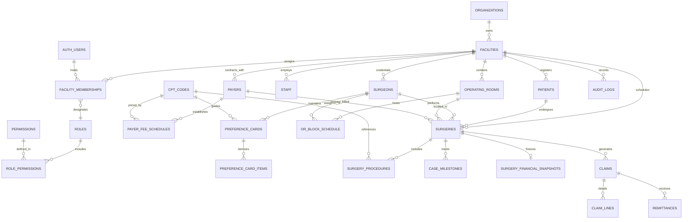

# 30 CANONICAL DATA MODEL — ASCANALYST PLATFORM

---

## 1. Purpose

The purpose of this specification is to define the definitive, production-grade **Canonical Data Model** for the **ASCANALYST** enterprise surgical intelligence platform. It establishes the authoritative schema, relational graph, constraints, deterministic business logic, and security boundaries across six core operational domains:

1. **Enterprise Tenancy & Identity**: Multi-organization, multi-facility scoping, and granular Role-Based Access Control (RBAC).
2. **Clinical Encounters & Case Lifecycle**: Master patient index, surgical encounters, operative procedure lines, and clinical documentation.
3. **Surgical Specialties, Providers & OR Roster**: Surgeons, surgical assistants, specialized clinical staff, and preference profiles.
4. **CPT Coding, Fee Schedules & Reimbursements**: Comprehensive procedure code repository, contracted payer fee matrices, and CMS MPPR rules.
5. **OR Scheduling, Block Allocations & Utilization**: Operating rooms, block scheduling, conflict prevention, and temporal milestones.
6. **Financial Engine, RCM & Auditable Snapshots**: Server-authoritative revenue calculations, room/labor cost allocations, immutable financial freeze snapshots, and HIPAA append-only audit provenance.

This specification serves as the formal baseline to decouple frontend components from prototype-era assumptions, eliminate client-side billing math discrepancies, resolve remaining 1NF/normalization defects, and enforce tenant isolation at the PostgreSQL storage engine tier.

---

## 2. Scope & Guiding Principles

### 2.1 Core Architectural Principles
- **Tenancy-First Isolation**: Every domain entity belongs to a verified `facility_id` under an enterprise `organization_id`. Cross-tenant queries are blocked at the database engine via Row Level Security (RLS).
- **Server-Authoritative Calculations**: Financial margins, CMS MPPR reductions, tiered room costs, and room conflict checks must execute server-side in PostgreSQL functions and RPCs. Zero authoritative math is delegated to the client browser.
- **Relational Integrity (1NF Enforcement)**: Eliminate comma-separated strings, loose string references for foreign entities, and unlinked financial costs.
- **Immutable Financial Freezing**: When a surgical case transitions to `Completed` or `Billed`, its financial ledger is permanently locked in `surgery_financial_snapshots` with calculation versioning and cryptographic actor attribution.
- **Backward Compatibility & Phased Migration**: No legacy table or column is dropped until dependencies are safely remapped and historical data is fully backfilled.
- **Zero Mock Tolerance in Production**: Synthetic mock arrays and placeholder data must never masquerade as clinical or financial truth.

---

## 3. Current State Inventory & Classification Matrix

### 3.1 Domain-by-Domain Component Classification

| Subsystem / Entity | Current Schema / Location | Live State | Classification | Baseline State & Technical Gaps | Target Production Standard |
| :--- | :--- | :---: | :---: | :--- | :--- |
| **`organizations`** | `supabase/migrations/001_multi_tenancy_core.sql` | Deployed | **KEEP** | UUID PK, slug, legal name, tax ID. Tenant root. | Canonical parent entity for all facilities. |
| **`facilities`** | `001_multi_tenancy_core.sql`, `008_multi_facility...sql` | Deployed | **KEEP** | UUID PK, FK to org, status, active flag, designated admin, NPI, address, timezone. | Primary tenant partition boundary. |
| **`facility_memberships`** | `001_multi_tenancy_core.sql`, `008_multi_facility...sql` | Deployed | **KEEP** | Composite unique `(user_id, facility_id)`, 10 RBAC roles, single super_admin invariant trigger. | Authoritative RBAC junction between GoTrue auth and facilities. |
| **`public.settings`** | `schema_setup.sql` | Legacy | **REPLACE** | Single-row table, BIGINT PK. Plaintext API key deprecated by Migration 006. | Decommission in favor of `facilities` columns and facility-scoped operational configuration. |
| **`auth.users`** | Supabase GoTrue Auth | Deployed | **KEEP** | Cryptographically salted credentials, JWT issuer, MFA support. | Authoritative identity store. |
| **`public.users`** | `schema_setup.sql`, `005_security...sql` | Decommissioned | **REPLACE** | Legacy prototype table storing plaintext passwords (`admin123`). REVOKED in Migration 005. | Permanently decommission. All users authenticate through GoTrue. |
| **`public.roles` & `permissions`** | `002_rbac_roles_and_permissions.sql` | Deployed | **KEEP** | Granular matrix of 26 system permissions mapped across 10 roles. | Authoritative permission catalog. |
| **`public.surgeons`** | `schema_setup.sql`, `001`, `005`, `007` | Deployed | **REFACTOR** | BIGINT PK, password column removed in 005, facility_id enforced in 007. Still has raw `block_templates JSONB`. | Convert/map to UUID PK, extract block templates into `or_block_schedule`, link to `auth.users(id)` for portal. |
| **`public.staff`** | `schema_setup.sql`, `001_multi_tenancy_core.sql` | Deployed | **REFACTOR** | BIGINT PK, stores unmasked `hourly_rate`, `monthly_salary`, `benefits`. | Add column-level security or split payroll details into restricted `staff_compensation` table. |
| **`public.patients`** | `schema_setup.sql`, `001`, `005` | Deployed | **REFACTOR** | BIGINT PK, flat insurance strings (`insurance_provider`, `copay_amount`). Tenancy and unique MRN per facility enforced in 005. | Normalize insurance to FK `payers(id)`. Maintain strict MRN uniqueness per facility. |
| **`public.surgeries`** | `schema_setup.sql`, `001`, `002`, `005` | Deployed | **REFACTOR** | The central case table. BIGINT PK, legacy comma-delimited `cpt_codes TEXT`, legacy string fields (`doctor_name`, `actual_start_time`). Client-computed financial columns. | Normalize to UUID PK, foreign key to `operating_rooms(id)`, `surgeons(id)`, `payers(id)`. Procedures linked via `surgery_procedures`. Server-computed financials. |
| **`public.surgery_procedures`** | `002_clinical_normalization.sql` | Deployed | **KEEP** | 1NF normalized procedure line items. Sequence rank, CPT FK, MPPR discount %, expected reimbursement. | Canonical 1NF procedure table. Expand with modifier codes and surgical side/site indicators. |
| **`public.operating_rooms`** | `002_clinical_normalization.sql` | Deployed | **KEEP** | UUID PK, facility_id, room_number, name, hourly_cost_rate ($1,500/hr baseline). | Canonical room entity. |
| **`public.or_block_schedule`** | `schema_setup.sql`, `002_clinical_normalization.sql` | Deployed | **REFACTOR** | Normalized with `operating_room_id` and `surgeon_id` FKs in 002. Lacks temporal GiST exclusion constraint against double-booking. | Add PostgreSQL GiST range constraint preventing overlapping reservations for the same room. |
| **`public.cpt_codes`** | `schema_setup.sql`, `001` | Deployed | **REFACTOR** | BIGINT PK, ~10,000 codes, single reimbursement column, flat structure. | Add `is_mppr_eligible` boolean, APC category, device-intensive indicator, and ASC-covered status. |
| **`public.payers`** | `002_clinical_normalization.sql` | Deployed | **KEEP** | UUID PK, facility_id, name, payer_type (`Medicare`, `Commercial`, etc.), payer_code. | Canonical payer directory. |
| **`public.payer_fee_schedules`** | `002_clinical_normalization.sql` | Deployed | **KEEP** | Contracted rates per payer and CPT code with effective start/end dates. | Canonical contracted rate matrix. |
| **`public.surgery_financial_snapshots`** | `003_audit_and_snapshots.sql` | Deployed | **KEEP** | Immutable case financial freeze table (revenue, room cost, labor cost, supplies, implants, meds, net margin). | Canonical financial audit snapshot. |
| **`public.audit_logs`** | `003_audit_and_snapshots.sql`, `004_audit...sql` | Deployed | **KEEP** | Append-only transaction ledger with actor, IP, timestamp, JSON state diffs, and tamper-prevention trigger. | Canonical HIPAA compliance ledger. |
| **`public.ot_extra_cost`** | `create_ot_extra_cost_table.sql` | Deployed | **REPLACE** | Loose string `cpt_codes` table with supply/implant/labor/room expense overrides. Unlinked from facility. | Replace with canonical `preference_cards` and `procedure_baseline_costs`. |
| **`public.preference_cards`** | `src/App.jsx` (`MOCK_PREFERENCE_CARDS`) | **MISSING** | **MISSING** | Currently hardcoded mock dictionary in frontend client. | Implement canonical relational `preference_cards` and `preference_card_items` tables. |
| **`public.claims` & `claim_lines`** | Inferred in `hospitalUtils.js` | **MISSING** | **MISSING** | Currently represented as informal JSON objects in frontend client memory. | Implement canonical 837P claims data structure for RCM billing lifecycle. |
| **`public.case_milestones`** | `surgeries.actual_start_time` (strings) | **MISSING** | **MISSING** | Flat, unstructured string times in `surgeries`. | Implement structured perioperative timestamps (Patient In, Anesthesia, Incision, Closing, Wheels Out). |

---

## 4. Target State Canonical Entity-Relationship Model



---

## 5. Canonical Database Schema & DDL Specification

### 5.1 Enterprise Tenancy & Facility Governance

```sql
-- 1. Organizations
CREATE TABLE IF NOT EXISTS public.organizations (
    id UUID PRIMARY KEY DEFAULT gen_random_uuid(),
    name TEXT NOT NULL,
    slug TEXT NOT NULL UNIQUE,
    tax_id TEXT,
    created_at TIMESTAMPTZ NOT NULL DEFAULT NOW(),
    updated_at TIMESTAMPTZ NOT NULL DEFAULT NOW()
);

-- 2. Facilities
CREATE TABLE IF NOT EXISTS public.facilities (
    id UUID PRIMARY KEY DEFAULT gen_random_uuid(),
    organization_id UUID NOT NULL REFERENCES public.organizations(id) ON DELETE CASCADE,
    name TEXT NOT NULL,
    slug TEXT NOT NULL,
    facility_type TEXT NOT NULL DEFAULT 'ASC' CHECK (facility_type IN ('ASC', 'HOPD', 'OBS')),
    npi TEXT NOT NULL CHECK (npi ~ '^[0-9]{10}$'),
    tax_id TEXT,
    address TEXT,
    city TEXT,
    state TEXT CHECK (LENGTH(state) = 2),
    zip TEXT,
    phone TEXT,
    timezone TEXT NOT NULL DEFAULT 'America/New_York',
    apply_medicare_mppr BOOLEAN NOT NULL DEFAULT true,
    mppr_subsequent_pct NUMERIC(5, 2) NOT NULL DEFAULT 50.00,
    status TEXT NOT NULL DEFAULT 'active' CHECK (status IN ('active', 'inactive', 'suspended')),
    is_active BOOLEAN NOT NULL DEFAULT true,
    designated_admin_id UUID REFERENCES auth.users(id) ON DELETE SET NULL,
    created_at TIMESTAMPTZ NOT NULL DEFAULT NOW(),
    updated_at TIMESTAMPTZ NOT NULL DEFAULT NOW(),
    CONSTRAINT uq_facility_slug_per_org UNIQUE (organization_id, slug)
);

-- 3. Facility Memberships
CREATE TABLE IF NOT EXISTS public.facility_memberships (
    id UUID PRIMARY KEY DEFAULT gen_random_uuid(),
    user_id UUID NOT NULL REFERENCES auth.users(id) ON DELETE CASCADE,
    facility_id UUID NOT NULL REFERENCES public.facilities(id) ON DELETE CASCADE,
    role TEXT NOT NULL CHECK (role IN (
        'super_admin', 'org_admin', 'facility_admin', 'clinical_director', 
        'clinical_manager', 'biller', 'coder', 'scheduler', 'surgeon', 'viewer'
    )),
    is_active BOOLEAN NOT NULL DEFAULT true,
    assigned_at TIMESTAMPTZ NOT NULL DEFAULT NOW(),
    CONSTRAINT uq_facility_user_membership UNIQUE (facility_id, user_id)
);
```

### 5.2 Operating Rooms & Block Scheduling

```sql
-- 4. Operating Rooms
CREATE TABLE IF NOT EXISTS public.operating_rooms (
    id UUID PRIMARY KEY DEFAULT gen_random_uuid(),
    facility_id UUID NOT NULL REFERENCES public.facilities(id) ON DELETE CASCADE,
    name TEXT NOT NULL,
    room_number INTEGER NOT NULL,
    hourly_cost_rate NUMERIC(10, 2) NOT NULL DEFAULT 1500.00,
    is_active BOOLEAN NOT NULL DEFAULT true,
    created_at TIMESTAMPTZ NOT NULL DEFAULT NOW(),
    updated_at TIMESTAMPTZ NOT NULL DEFAULT NOW(),
    CONSTRAINT uq_facility_room_number UNIQUE (facility_id, room_number)
);

-- 5. OR Block Schedule
CREATE TABLE IF NOT EXISTS public.or_block_schedule (
    id UUID PRIMARY KEY DEFAULT gen_random_uuid(),
    facility_id UUID NOT NULL REFERENCES public.facilities(id) ON DELETE CASCADE,
    operating_room_id UUID NOT NULL REFERENCES public.operating_rooms(id) ON DELETE CASCADE,
    surgeon_id BIGINT NOT NULL REFERENCES public.surgeons(id) ON DELETE CASCADE,
    day_of_week INTEGER NOT NULL CHECK (day_of_week BETWEEN 0 AND 6), -- 0 = Sunday
    week_of_month INTEGER CHECK (week_of_month BETWEEN 1 AND 5), -- NULL = Every week
    start_time TIME NOT NULL,
    end_time TIME NOT NULL,
    effective_start_date DATE NOT NULL DEFAULT CURRENT_DATE,
    effective_end_date DATE,
    is_active BOOLEAN NOT NULL DEFAULT true,
    created_at TIMESTAMPTZ NOT NULL DEFAULT NOW(),
    updated_at TIMESTAMPTZ NOT NULL DEFAULT NOW(),
    CONSTRAINT ck_block_time_order CHECK (start_time < end_time)
);
```

### 5.3 Clinical Directory: Surgeons, Staff & Patients

```sql
-- 6. Surgeons
CREATE TABLE IF NOT EXISTS public.surgeons (
    id BIGINT GENERATED BY DEFAULT AS IDENTITY PRIMARY KEY,
    facility_id UUID NOT NULL REFERENCES public.facilities(id) ON DELETE CASCADE,
    user_id UUID REFERENCES auth.users(id) ON DELETE SET NULL,
    firstname TEXT NOT NULL,
    lastname TEXT NOT NULL,
    npi TEXT CHECK (npi IS NULL OR npi ~ '^[0-9]{10}$'),
    specialty TEXT,
    license_number TEXT,
    email TEXT,
    phone TEXT,
    years_of_experience NUMERIC DEFAULT 0,
    is_cosmetic_surgeon BOOLEAN DEFAULT false,
    is_active BOOLEAN NOT NULL DEFAULT true,
    created_at TIMESTAMPTZ NOT NULL DEFAULT NOW(),
    updated_at TIMESTAMPTZ NOT NULL DEFAULT NOW()
);

-- 7. Clinical Staff & Wage Isolation
CREATE TABLE IF NOT EXISTS public.staff (
    id BIGINT GENERATED BY DEFAULT AS IDENTITY PRIMARY KEY,
    facility_id UUID NOT NULL REFERENCES public.facilities(id) ON DELETE CASCADE,
    user_id UUID REFERENCES auth.users(id) ON DELETE SET NULL,
    firstname TEXT NOT NULL,
    lastname TEXT NOT NULL,
    role TEXT NOT NULL,
    department TEXT NOT NULL,
    specialty TEXT,
    license_number TEXT,
    phone TEXT,
    email TEXT,
    is_active BOOLEAN NOT NULL DEFAULT true,
    created_at TIMESTAMPTZ NOT NULL DEFAULT NOW(),
    updated_at TIMESTAMPTZ NOT NULL DEFAULT NOW()
);

-- Sensitive wage data restricted to administrators and billers
CREATE TABLE IF NOT EXISTS public.staff_compensation (
    staff_id BIGINT PRIMARY KEY REFERENCES public.staff(id) ON DELETE CASCADE,
    facility_id UUID NOT NULL REFERENCES public.facilities(id) ON DELETE CASCADE,
    hourly_rate NUMERIC(10, 2) NOT NULL DEFAULT 0.00,
    overtime_hourly_rate NUMERIC(10, 2) NOT NULL DEFAULT 0.00,
    benefits_rate_pct NUMERIC(5, 2) NOT NULL DEFAULT 20.00,
    updated_at TIMESTAMPTZ NOT NULL DEFAULT NOW(),
    updated_by UUID REFERENCES auth.users(id)
);

-- 8. Master Patient Index
CREATE TABLE IF NOT EXISTS public.patients (
    id BIGINT GENERATED BY DEFAULT AS IDENTITY PRIMARY KEY,
    facility_id UUID NOT NULL REFERENCES public.facilities(id) ON DELETE CASCADE,
    mrn TEXT NOT NULL,
    first_name TEXT NOT NULL,
    last_name TEXT NOT NULL,
    dob DATE NOT NULL,
    gender TEXT CHECK (gender IN ('Male', 'Female', 'Other', 'Unknown')),
    phone TEXT,
    email TEXT,
    address TEXT,
    city TEXT,
    state TEXT,
    zip TEXT,
    primary_payer_id UUID REFERENCES public.payers(id) ON DELETE SET NULL,
    insurance_policy_number TEXT,
    insurance_group_number TEXT,
    copay_amount NUMERIC(10, 2) DEFAULT 0.00,
    deductible_amount NUMERIC(10, 2) DEFAULT 0.00,
    created_at TIMESTAMPTZ NOT NULL DEFAULT NOW(),
    updated_at TIMESTAMPTZ NOT NULL DEFAULT NOW(),
    CONSTRAINT uq_facility_mrn UNIQUE (facility_id, mrn)
);
```

### 5.4 CPT Directory, Payers & Fee Schedules

```sql
-- 9. Canonical CPT Codes Directory
CREATE TABLE IF NOT EXISTS public.cpt_codes (
    id BIGINT GENERATED BY DEFAULT AS IDENTITY PRIMARY KEY,
    facility_id UUID REFERENCES public.facilities(id) ON DELETE CASCADE, -- NULL = Global default
    code TEXT NOT NULL,
    description TEXT NOT NULL,
    short_descriptor TEXT,
    category TEXT,
    procedure_group TEXT,
    reimbursement NUMERIC(12, 2) NOT NULL DEFAULT 0.00, -- Baseline Medicare allowable
    gross_charge NUMERIC(12, 2) NOT NULL DEFAULT 0.00,  -- Facility chargemaster list price
    baseline_cost NUMERIC(12, 2) NOT NULL DEFAULT 0.00,
    average_duration NUMERIC(10, 2) NOT NULL DEFAULT 60.00,
    turnover_time NUMERIC(10, 2) NOT NULL DEFAULT 15.00,
    is_mppr_eligible BOOLEAN NOT NULL DEFAULT true,
    is_asc_approved BOOLEAN NOT NULL DEFAULT true,
    effective_date DATE,
    termination_date DATE,
    is_active BOOLEAN NOT NULL DEFAULT true,
    created_at TIMESTAMPTZ NOT NULL DEFAULT NOW(),
    updated_at TIMESTAMPTZ NOT NULL DEFAULT NOW()
);

-- 10. Payers
CREATE TABLE IF NOT EXISTS public.payers (
    id UUID PRIMARY KEY DEFAULT gen_random_uuid(),
    facility_id UUID NOT NULL REFERENCES public.facilities(id) ON DELETE CASCADE,
    name TEXT NOT NULL,
    payer_type TEXT NOT NULL CHECK (payer_type IN ('Medicare', 'Medicaid', 'Commercial', 'WorkerComp', 'Self-Pay')),
    payer_code TEXT NOT NULL,
    electronic_payer_id TEXT,
    is_active BOOLEAN NOT NULL DEFAULT true,
    created_at TIMESTAMPTZ NOT NULL DEFAULT NOW(),
    updated_at TIMESTAMPTZ NOT NULL DEFAULT NOW(),
    CONSTRAINT uq_facility_payer_code UNIQUE (facility_id, payer_code)
);

-- 11. Contracted Fee Schedules
CREATE TABLE IF NOT EXISTS public.payer_fee_schedules (
    id UUID PRIMARY KEY DEFAULT gen_random_uuid(),
    facility_id UUID NOT NULL REFERENCES public.facilities(id) ON DELETE CASCADE,
    payer_id UUID NOT NULL REFERENCES public.payers(id) ON DELETE CASCADE,
    cpt_code_id BIGINT NOT NULL REFERENCES public.cpt_codes(id) ON DELETE CASCADE,
    contracted_rate NUMERIC(12, 2) NOT NULL,
    effective_start_date DATE NOT NULL DEFAULT CURRENT_DATE,
    effective_end_date DATE,
    created_at TIMESTAMPTZ NOT NULL DEFAULT NOW(),
    updated_at TIMESTAMPTZ NOT NULL DEFAULT NOW(),
    CONSTRAINT uq_payer_cpt_effective UNIQUE (payer_id, cpt_code_id, effective_start_date)
);
```

### 5.5 Surgical Encounters & 1NF Procedure Line Items

```sql
-- 12. Canonical Surgeries (Encounter Header)
CREATE TABLE IF NOT EXISTS public.surgeries (
    id BIGINT GENERATED BY DEFAULT AS IDENTITY PRIMARY KEY,
    facility_id UUID NOT NULL REFERENCES public.facilities(id) ON DELETE CASCADE,
    patient_id BIGINT NOT NULL REFERENCES public.patients(id) ON DELETE RESTRICT,
    surgeon_id BIGINT NOT NULL REFERENCES public.surgeons(id) ON DELETE RESTRICT,
    operating_room_id UUID REFERENCES public.operating_rooms(id) ON DELETE SET NULL,
    primary_payer_id UUID REFERENCES public.payers(id) ON DELETE SET NULL,
    date DATE NOT NULL,
    scheduled_start_time TIME NOT NULL,
    scheduled_duration_minutes INTEGER NOT NULL DEFAULT 60 CHECK (scheduled_duration_minutes > 0),
    turnover_time INTEGER NOT NULL DEFAULT 15 CHECK (turnover_time >= 0),
    case_type TEXT NOT NULL DEFAULT 'Insurance' CHECK (case_type IN ('Insurance', 'Cosmetic', 'Pro-Bono', 'Self-Pay')),
    status TEXT NOT NULL DEFAULT 'Scheduled' CHECK (status IN (
        'Scheduled', 'Pre-Op', 'In-OR', 'Closing', 'PACU', 'Completed', 'Billed', 'Cancelled'
    )),
    cancellation_reason TEXT,
    clinical_notes TEXT,
    actual_start_time TIMESTAMPTZ,
    actual_end_time TIMESTAMPTZ,
    actual_duration_minutes INTEGER,
    supplies_cost NUMERIC(12, 2) NOT NULL DEFAULT 0.00,
    implants_cost NUMERIC(12, 2) NOT NULL DEFAULT 0.00,
    medications_cost NUMERIC(12, 2) NOT NULL DEFAULT 0.00,
    write_off NUMERIC(12, 2) NOT NULL DEFAULT 0.00,
    created_at TIMESTAMPTZ NOT NULL DEFAULT NOW(),
    updated_at TIMESTAMPTZ NOT NULL DEFAULT NOW()
);

-- 13. 1NF Surgery Procedure Lines
CREATE TABLE IF NOT EXISTS public.surgery_procedures (
    id UUID PRIMARY KEY DEFAULT gen_random_uuid(),
    facility_id UUID NOT NULL REFERENCES public.facilities(id) ON DELETE CASCADE,
    surgery_id BIGINT NOT NULL REFERENCES public.surgeries(id) ON DELETE CASCADE,
    cpt_code_id BIGINT NOT NULL REFERENCES public.cpt_codes(id) ON DELETE RESTRICT,
    sequence_rank INTEGER NOT NULL DEFAULT 1,
    modifier_code TEXT,
    units INTEGER NOT NULL DEFAULT 1,
    baseline_charge NUMERIC(12, 2) NOT NULL DEFAULT 0.00,
    contracted_rate NUMERIC(12, 2) NOT NULL DEFAULT 0.00,
    mppr_applied BOOLEAN NOT NULL DEFAULT false,
    mppr_discount_pct NUMERIC(5, 2) NOT NULL DEFAULT 0.00,
    final_expected_reimbursement NUMERIC(12, 2) NOT NULL DEFAULT 0.00,
    created_at TIMESTAMPTZ NOT NULL DEFAULT NOW(),
    CONSTRAINT uq_surgery_proc_rank UNIQUE (surgery_id, sequence_rank)
);

-- 14. Perioperative Case Milestones
CREATE TABLE IF NOT EXISTS public.case_milestones (
    id UUID PRIMARY KEY DEFAULT gen_random_uuid(),
    facility_id UUID NOT NULL REFERENCES public.facilities(id) ON DELETE CASCADE,
    surgery_id BIGINT NOT NULL REFERENCES public.surgeries(id) ON DELETE CASCADE,
    milestone_type TEXT NOT NULL CHECK (milestone_type IN (
        'patient_arrived', 'pre_op_ready', 'in_room', 'anesthesia_start',
        'timeout_performed', 'incision_time', 'closing_time', 'anesthesia_stop',
        'out_room', 'pacu_admit', 'pacu_discharge'
    )),
    recorded_at TIMESTAMPTZ NOT NULL DEFAULT NOW(),
    recorded_by UUID REFERENCES auth.users(id),
    CONSTRAINT uq_case_milestone UNIQUE (surgery_id, milestone_type)
);
```

### 5.6 Preference Cards & Baseline Consumables

```sql
-- 15. Surgeon Preference Cards
CREATE TABLE IF NOT EXISTS public.preference_cards (
    id UUID PRIMARY KEY DEFAULT gen_random_uuid(),
    facility_id UUID NOT NULL REFERENCES public.facilities(id) ON DELETE CASCADE,
    surgeon_id BIGINT NOT NULL REFERENCES public.surgeons(id) ON DELETE CASCADE,
    cpt_code_id BIGINT REFERENCES public.cpt_codes(id) ON DELETE SET NULL,
    procedure_name TEXT NOT NULL,
    glove_size TEXT,
    standing_notes TEXT,
    estimated_supplies_cost NUMERIC(10, 2) NOT NULL DEFAULT 0.00,
    estimated_implants_cost NUMERIC(10, 2) NOT NULL DEFAULT 0.00,
    is_active BOOLEAN NOT NULL DEFAULT true,
    created_at TIMESTAMPTZ NOT NULL DEFAULT NOW(),
    updated_at TIMESTAMPTZ NOT NULL DEFAULT NOW()
);

-- 16. Preference Card Itemized Supplies
CREATE TABLE IF NOT EXISTS public.preference_card_items (
    id UUID PRIMARY KEY DEFAULT gen_random_uuid(),
    preference_card_id UUID NOT NULL REFERENCES public.preference_cards(id) ON DELETE CASCADE,
    item_category TEXT NOT NULL CHECK (item_category IN ('Supply', 'Implant', 'Medication', 'Suture', 'Tray')),
    item_name TEXT NOT NULL,
    quantity INTEGER NOT NULL DEFAULT 1 CHECK (quantity > 0),
    unit_cost NUMERIC(10, 2) NOT NULL DEFAULT 0.00,
    is_hold BOOLEAN NOT NULL DEFAULT false, -- If true, open only if requested intraoperatively
    created_at TIMESTAMPTZ NOT NULL DEFAULT NOW()
);
```

### 5.7 Financial Freeze Snapshots & Claims (RCM)

```sql
-- 17. Immutable Surgery Financial Snapshots
CREATE TABLE IF NOT EXISTS public.surgery_financial_snapshots (
    id UUID PRIMARY KEY DEFAULT gen_random_uuid(),
    surgery_id BIGINT NOT NULL UNIQUE REFERENCES public.surgeries(id) ON DELETE CASCADE,
    facility_id UUID NOT NULL REFERENCES public.facilities(id) ON DELETE CASCADE,
    gross_revenue NUMERIC(12, 2) NOT NULL DEFAULT 0.00,
    expected_reimbursement NUMERIC(12, 2) NOT NULL DEFAULT 0.00,
    room_cost NUMERIC(12, 2) NOT NULL DEFAULT 0.00,
    labor_cost NUMERIC(12, 2) NOT NULL DEFAULT 0.00,
    supplies_cost NUMERIC(12, 2) NOT NULL DEFAULT 0.00,
    implants_cost NUMERIC(12, 2) NOT NULL DEFAULT 0.00,
    medications_cost NUMERIC(12, 2) NOT NULL DEFAULT 0.00,
    total_cost NUMERIC(12, 2) NOT NULL DEFAULT 0.00,
    net_margin NUMERIC(12, 2) NOT NULL DEFAULT 0.00,
    margin_per_or_minute NUMERIC(12, 2) NOT NULL DEFAULT 0.00,
    calculation_version TEXT NOT NULL DEFAULT 'v1.0-cms2026',
    snapshot_data JSONB NOT NULL DEFAULT '{}'::jsonb,
    frozen_at TIMESTAMPTZ NOT NULL DEFAULT NOW(),
    frozen_by UUID REFERENCES auth.users(id) ON DELETE SET NULL
);

-- 18. RCM Claims
CREATE TABLE IF NOT EXISTS public.claims (
    id UUID PRIMARY KEY DEFAULT gen_random_uuid(),
    facility_id UUID NOT NULL REFERENCES public.facilities(id) ON DELETE CASCADE,
    surgery_id BIGINT NOT NULL REFERENCES public.surgeries(id) ON DELETE RESTRICT,
    payer_id UUID NOT NULL REFERENCES public.payers(id) ON DELETE RESTRICT,
    claim_number TEXT NOT NULL UNIQUE,
    claim_status TEXT NOT NULL DEFAULT 'Draft' CHECK (claim_status IN (
        'Draft', 'Ready_To_Submit', 'Submitted', 'Accepted', 'Rejected', 'Paid', 'Denied', 'Appealed'
    )),
    total_billed_amount NUMERIC(12, 2) NOT NULL,
    total_allowed_amount NUMERIC(12, 2),
    total_paid_amount NUMERIC(12, 2) DEFAULT 0.00,
    patient_responsibility NUMERIC(12, 2) DEFAULT 0.00,
    submitted_date DATE,
    adjudicated_date DATE,
    created_at TIMESTAMPTZ NOT NULL DEFAULT NOW(),
    updated_at TIMESTAMPTZ NOT NULL DEFAULT NOW()
);

-- 19. Claim Procedure Line Items
CREATE TABLE IF NOT EXISTS public.claim_lines (
    id UUID PRIMARY KEY DEFAULT gen_random_uuid(),
    claim_id UUID NOT NULL REFERENCES public.claims(id) ON DELETE CASCADE,
    cpt_code_id BIGINT NOT NULL REFERENCES public.cpt_codes(id) ON DELETE RESTRICT,
    line_number INTEGER NOT NULL,
    charge_amount NUMERIC(12, 2) NOT NULL,
    allowed_amount NUMERIC(12, 2),
    paid_amount NUMERIC(12, 2) DEFAULT 0.00,
    modifier_code TEXT,
    units INTEGER NOT NULL DEFAULT 1,
    status TEXT NOT NULL DEFAULT 'Submitted' CHECK (status IN ('Submitted', 'Paid', 'Denied')),
    denial_code TEXT,
    CONSTRAINT uq_claim_line UNIQUE (claim_id, line_number)
);
```

### 5.8 HIPAA Append-Only Audit Subsystem

```sql
-- 20. Audit Logs
CREATE TABLE IF NOT EXISTS public.audit_logs (
    id UUID PRIMARY KEY DEFAULT gen_random_uuid(),
    facility_id UUID REFERENCES public.facilities(id) ON DELETE CASCADE,
    table_name TEXT NOT NULL,
    record_id TEXT NOT NULL,
    action TEXT NOT NULL CHECK (action IN ('INSERT', 'UPDATE', 'DELETE', 'EXECUTE', 'EXPORT', 'FREEZE')),
    actor_id UUID REFERENCES auth.users(id) ON DELETE SET NULL,
    actor_email TEXT,
    ip_address INET,
    previous_state JSONB,
    new_state JSONB,
    change_reason TEXT,
    timestamp TIMESTAMPTZ NOT NULL DEFAULT NOW()
);
```

---

## 6. Deterministic Business Rules & Financial Formulas

### 6.1 CMS MPPR (Multiple Procedure Payment Reduction) Calculation
Authoritative Server Rule (`calculate_surgery_financials` RPC):
1. For a surgical encounter with $N$ procedure lines, sort all applicable CPT codes descending by contracted rate:
   $$R_1 \ge R_2 \ge \dots \ge R_N$$
2. **Primary Code ($R_1$)**: Reimbursed at $100\%$ of allowable rate:
   $$\text{Reimbursement}_1 = R_1 \times 1.00$$
3. **Subsequent Codes ($R_k$ for $k \ge 2$)**:
   - If `facilities.apply_medicare_mppr` is `true`:
     $$\text{Reimbursement}_k = R_k \times (1.00 - \frac{\text{mppr\_subsequent\_pct}}{100}) = R_k \times 0.50$$
   - If `apply_medicare_mppr` is `false`:
     $$\text{Reimbursement}_k = R_k \times 1.00$$
4. **Total Expected Revenue**:
   $$\text{Total Expected Reimbursement} = \sum_{k=1}^N \text{Reimbursement}_k$$

### 6.2 OR Room Cost Allocation
The OR hourly baseline is set at the facility or room level (default: $\$1,500.00/\text{hr}$):
1. **Total Room Occupancy Time**:
   $$T_{\text{total}} = \text{duration\_minutes} + \text{turnover\_time}$$
2. **First 60 Minutes (Hour 1)**: Proportional minute rate:
   $$\text{Cost}_{\text{hr1}} = \min(T_{\text{total}}, 60) \times \frac{1500}{60} = \min(T_{\text{total}}, 60) \times 25.00$$
3. **Hour 2 (Minutes 61 to 120)**: Billed in 30-minute block increments at $\$300.00$ per block:
   $$B_2 = \lceil \frac{\min(\max(T_{\text{total}} - 60, 0), 60)}{30} \rceil \times 300.00$$
4. **Hours 3+ (> 120 Minutes)**: Billed in 30-minute block increments at $\$400.00$ per block:
   $$B_{3+} = \lceil \frac{\max(T_{\text{total}} - 120, 0)}{30} \rceil \times 400.00$$
5. **Total Room Cost**:
   $$\text{Room Cost} = \text{Cost}_{\text{hr1}} + B_2 + B_{3+}$$

### 6.3 Clinical Labor Cost
- **Standard Prototype Baseline**: 30% of total OR Room Cost:
  $$\text{Labor Cost}_{\text{standard}} = \text{Room Cost} \times 0.30$$
- **Itemized Wage Calculation** (when clinical staff is assigned):
  $$\text{Labor Cost}_{\text{itemized}} = \sum_{s \in \text{AssignedStaff}} (\text{hourly\_rate}_s \times \frac{T_{\text{total}}}{60})$$

### 6.4 Net Margin & Profitability Metrics
1. **Total Direct Cost**:
   $$\text{Total Cost} = \text{Room Cost} + \text{Labor Cost} + \text{supplies\_cost} + \text{implants\_cost} + \text{medications\_cost}$$
2. **Net Contribution Margin**:
   $$\text{Net Margin} = (\text{Total Expected Reimbursement} + \text{Anesthesia Pass-Through}) - \text{Total Cost} - \text{write\_off}$$
3. **Margin per OR Minute**:
   $$\text{Margin per Minute} = \frac{\text{Net Margin}}{T_{\text{total}}}$$

### 6.5 Special Case Classifications
- **Cosmetic / Fixed Fee Cases**:
  - Revenue is derived from the duration lookup matrix (e.g. 60 min = $\$1,500$ facility fee, $\$750$ anesthesia fee).
  - Internal room cost and labor cost are accounted for to measure true facility operating efficiency.
  - Net Margin = $(\text{Facility Fee} + \text{Anesthesia Fee}) - (\text{Room Cost} + \text{Labor Cost} + \text{Supplies Cost} + \text{Anesthesia Cost})$.
- **Pro-Bono Cases**:
  - Expected Revenue is fixed at $\$0.00$.
  - Full internal costs are recognized as operating write-off expenses.

### 6.6 Case Status Lifecycle & Immutability Rules
1. `Scheduled` $\rightarrow$ `Pre-Op` $\rightarrow$ `In-OR` $\rightarrow$ `Closing` $\rightarrow$ `PACU` $\rightarrow$ `Completed` $\rightarrow$ `Billed`
2. **Cancellation**: A case may transition to `Cancelled` from `Scheduled` or `Pre-Op` with a mandatory `cancellation_reason`.
3. **Freeze Trigger**: Transitioning to `Completed` or `Billed` invokes `fn_freeze_surgery_financials()` which writes a frozen record to `surgery_financial_snapshots`.
4. **Post-Freeze Lock**: Once frozen, financial updates directly on `surgeries` are rejected by trigger unless authorized by an administrator with a logged audit reason.

---

## 7. Permissions & Row Level Security (RLS) Matrix

| Entity | `super_admin` | `org_admin` | `facility_admin` | `clinical_director` | `biller` / `coder` | `surgeon` | `scheduler` | `viewer` |
| :--- | :---: | :---: | :---: | :---: | :---: | :---: | :---: | :---: |
| **`organizations`** | ALL | SELECT | SELECT | SELECT | SELECT | SELECT | SELECT | SELECT |
| **`facilities`** | ALL | UPDATE | UPDATE (Own) | SELECT | SELECT | SELECT | SELECT | SELECT |
| **`facility_memberships`**| ALL | CRUD | CRUD (No SA) | SELECT | SELECT | SELECT | SELECT | SELECT |
| **`operating_rooms`** | ALL | ALL | ALL | ALL | SELECT | SELECT | SELECT | SELECT |
| **`or_block_schedule`**| ALL | ALL | ALL | ALL | SELECT | SELECT (Own) | ALL | SELECT |
| **`surgeons`** | ALL | ALL | ALL | ALL | SELECT | UPDATE (Own) | SELECT | SELECT |
| **`staff`** | ALL | ALL | ALL | ALL | SELECT | SELECT | SELECT | SELECT |
| **`staff_compensation`**| ALL | ALL | ALL | NO | NO | NO | NO | NO |
| **`patients`** | ALL | ALL | ALL | ALL | ALL | SELECT (Assigned) | ALL | SELECT (Masked) |
| **`surgeries`** | ALL | ALL | ALL | ALL | ALL (Finances) | UPDATE (Notes) | INSERT/UPDATE | SELECT (Masked) |
| **`surgery_procedures`**| ALL | ALL | ALL | ALL | ALL | SELECT | SELECT | SELECT |
| **`payers` & `fee_schedules`**| ALL | ALL | ALL | SELECT | ALL | SELECT | SELECT | SELECT |
| **`preference_cards`** | ALL | ALL | ALL | ALL | SELECT | ALL (Own) | SELECT | SELECT |
| **`surgery_financial_snapshots`**| ALL | SELECT | SELECT | SELECT | ALL (Freeze) | SELECT (Assigned) | NO | NO |
| **`claims` & `claim_lines`** | ALL | ALL | ALL | NO | ALL | NO | NO | NO |
| **`audit_logs`** | ALL (Select) | SELECT | SELECT | SELECT | NO | NO | NO | NO |

---

## 8. Migration Plan & Data Integrity Strategy

### 8.1 Phased Execution Sequence
1. **Migration 009 (Schema Additions - Non-Breaking)**:
   - Create `preference_cards`, `preference_card_items`, `case_milestones`, `staff_compensation`, `claims`, `claim_lines`.
   - Add new columns to `cpt_codes` (`is_mppr_eligible`, `is_asc_approved`) with safe defaults.
   - Deploy RLS policies and indexes on new tables.
2. **Migration 010 (Data Backfill & Historical Integrity)**:
   - Backfill `staff_compensation` from legacy `staff.hourly_rate` and `staff.monthly_salary`.
   - Backfill preference cards from `ot_extra_cost` and frontend preference cards.
   - Reconcile `surgeries.operating_room_id` and ensure zero dangling foreign keys.
3. **Migration 011 (Stored Procedures & Server-Side Financial Engine)**:
   - Deploy PostgreSQL stored procedure `calculate_surgery_financials(p_surgery_id UUID)`.
   - Deploy automated freeze trigger `fn_freeze_surgery_financials()`.
   - Create aggregated KPI summary view `view_facility_financial_kpis`.
4. **Migration 012 (Legacy Deprecation Gate)**:
   - Lock legacy `ot_extra_cost` and `settings` with read-only views for historical audit.
   - Decommission plaintext credentials permanently.

### 8.2 Rollback & Disaster Recovery
- Every forward migration (`00X_*.sql`) must be accompanied by an exact reversible down-migration (`00X_*_down.sql`).
- All DDL operations must run inside an explicit transaction block (`BEGIN ... COMMIT`).
- Database backups must be verified before executing migrations in staging or production.

---

## 9. Verification & Test Plan

### 9.1 Verification Gates
- **Static Syntax & DDL Linting**: Migration scripts compile cleanly on PostgreSQL 15+ without errors.
- **Tenant Isolation Tests**: Automated tests verify that requests from Facility A cannot read, insert, update, or delete records in Facility B.
- **CMS MPPR Mathematical Precision**: Multi-procedure test cases verify penny-exact matching with CMS 2026 reimbursement standards.
- **Snapshot Immutability**: Attempting to update or delete a row in `surgery_financial_snapshots` is rejected by PostgreSQL triggers.
- **Regression Suite**: All 125 existing tests in the test suite pass with 0 failures.

---

## 10. Acceptance Criteria & Definition of Done

- [x] Complete inventory of existing 15+ tables and schema artifacts classified with KEEP / REFACTOR / REPLACE / MISSING.
- [x] Authoritative Canonical Entity-Relationship diagram and DDL specifications constructed.
- [x] Server-authoritative business rules for CMS MPPR, tiered room costs, labor costs, and cosmetic fee tiers fully specified.
- [x] Role-Based Access Control matrix and Row Level Security policies defined for all tables.
- [x] Phased, non-breaking migration roadmap defined with transactional rollbacks.
- [x] Zero mock data tolerance enforced for production truth.
- [x] Document authored and placed in `docs/phases/30_CANONICAL_DATA_MODEL.md`.
