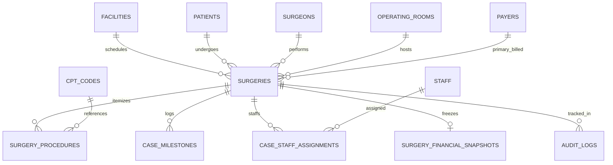
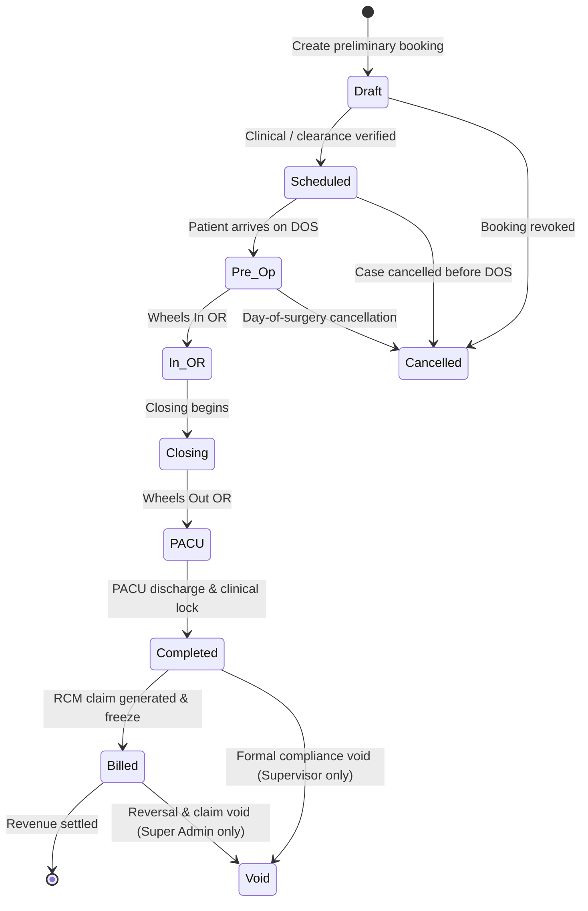

# 31 CASE MASTER SPECIFICATION — ASCANALYST PLATFORM

---

## 1. Executive Summary & Purpose

The purpose of this specification is to define the definitive, production-grade **Case Master Architecture, Lifecycle, Data Model, and Governance Rules** for surgical encounters within the **ASCANALYST** enterprise platform. 

In Ambulatory Surgical Centers (ASCs), the **Surgical Case** is the foundational commercial and operational unit. It links the master patient index, attending surgeons, multi-specialty clinical staff, physical operating rooms, scheduled block allocations, consumable preference cards, procedure CPT line items, contracted payer fee matrices, and revenue cycle management (RCM) claims.

### Scope of this Specification
- **Tenancy & Scoping**: Multi-organization and multi-facility isolation enforced at the PostgreSQL storage layer via Row Level Security (RLS).
- **Relational Integrity**: Complete elimination of prototype-era string packing (`surgery.notes` regex parsing, comma-separated CPT arrays) in favor of 1NF relational child tables.
- **Deterministic Case Lifecycle**: Formal 8-state finite state machine (FSM) governing case progression from intake through scheduling, intraoperative milestones, clinical sign-off, billing, and financial closure.
- **Data Provenance & Source IDs**: First-class tracking of source electronic health record (EHR) / practice management (PM) system identifiers, batch import hash keys, and deterministic duplicate detection.
- **Server-Authoritative Financial Freezing**: Complete deprecation of client-side profit/loss calculations in favor of PostgreSQL functions and immutable financial freeze snapshots (`surgery_financial_snapshots`).

---

## 2. Current State Audit & Classification Matrix

### 2.1 File-by-File Repository & Schema Evidence

| Area / Component | File & Line Reference | Current Behavior | Classification | Target Production Standard |
| :--- | :--- | :--- | :---: | :--- |
| **Encounter Header Table** | `supabase/migrations/001_multi_tenancy_core.sql:205-212`, `005_security_privacy_hipaa.sql:20-35` | `public.surgeries` has `BIGINT` PK. Has `facility_id UUID NOT NULL` (enforced in Mig-005). Stores redundant strings (`doctor_name`, `operating_room_name`). Legacy comma-delimited `cpt_codes TEXT`. | **REFACTOR** | Retain `public.surgeries` as encounter header table. Enforce foreign keys to `patients(id)`, `surgeons(id)`, `operating_rooms(id)`, `payers(id)`. Drop redundant string fields once foreign keys are universally populated. |
| **Case Statuses** | `src/components/SurgeryScheduler.jsx:760,833,861`, `src/App.jsx:5023-5039`, `src/components/SurgeonPortal.jsx:442` | Status is a loose string (`scheduled`, `completed`, `cancelled`, `in progress`, `rescheduled`). No check constraint or enum in PostgreSQL `public.surgeries`. No transition validation; client can overwrite status arbitrarily. | **REFACTOR** | Formal PostgreSQL `CHECK (status IN ('Scheduled', 'Pre-Op', 'In-OR', 'Closing', 'PACU', 'Completed', 'Billed', 'Cancelled'))`. State machine trigger preventing invalid jumps (e.g. `Cancelled` -> `In-OR`). |
| **Timestamps & Case Milestones** | `src/components/SurgeryScheduler.jsx:765-767`, `docs/phases/30_CANONICAL_DATA_MODEL.md:385-397` | Flat string inputs `actualStartTime`, `actualEndTime`, `actualDurationMinutes` stored directly on `surgeries`. No structured tracking of perioperative milestones (Patient Arrived, Wheels In, Incision, Wheels Out). | **MISSING** | Implement normalized `public.case_milestones` table with structured timestamps, actor attribution (`recorded_by`), and chronological sequence enforcement. |
| **Cancellation Tracking** | `src/components/SurgeryScheduler.jsx:815-846`, `src/App.jsx:5031` | Cancellation reason is packed as a string into `notes` (`Cancelled: ${reason}`). No structured cancellation reason code, timestamp, or cancelling user. | **REFACTOR** | Add structured columns: `cancellation_reason_code`, `cancellation_reason_text`, `cancelled_at TIMESTAMPTZ`, and `cancelled_by UUID REFERENCES auth.users(id)`. |
| **Clinical & Financial Notes Abuse** | `src/components/SurgeryScheduler.jsx:681-739`, `src/utils/hospitalUtils.js:270-273,314-316` | Text column `notes` is used as an untyped JSON surrogate: stores `[Tray Cost: X]`, `[Full Total: Y]`, `Fixed Facility Fee Case - Facility: $Z, Anesthesia: $W`, and `Self-Pay Anesthesia ($X)`. Parsed with fragile regexes! | **REPLACE** | Replace regex parsing with dedicated columns: `tray_cost`, `is_cosmetic`, `cosmetic_facility_fee`, `cosmetic_anesthesia_fee`, `self_pay_anesthesia_fee`. Reserve `clinical_notes` strictly for human notes. |
| **Procedure Items (1NF)** | `supabase/migrations/002_clinical_normalization.sql:138-161`, `src/components/SurgeryScheduler.jsx:759` | `public.surgery_procedures` table exists in Migration 002. However, `SurgeryScheduler.jsx` still sends `cpt_codes: [...]` array directly to `surgeries.cpt_codes`! Frontend does not insert into `surgery_procedures`. | **REFACTOR** | Align UI scheduling form to write to `surgery_procedures` table with `sequence_rank`, `modifier_code`, `units`, and contracted rate tracking. |
| **Operating Room Association** | `supabase/migrations/002_clinical_normalization.sql:64-88`, `src/components/SurgeryScheduler.jsx:773` | Migration 002 added `operating_room_id UUID REFERENCES public.operating_rooms(id)`. But `SurgeryScheduler.jsx` still sends `or_room: parseInt(formData.orRoom.replace(/\D/g, ''))` (room number integer)! | **REFACTOR** | Bind scheduler room dropdown directly to `operating_rooms.id` UUIDs. |
| **Financial Snapshots** | `supabase/migrations/003_audit_and_snapshots.sql:235-258`, `src/lib/supabase.js:1519-1540` | `public.surgery_financial_snapshots` table exists with immutable RLS. `db.saveSurgeryFinancialSnapshot` exists. However, snapshot creation is only invoked manually in billing or upserted without server validation. | **REFACTOR** | Automatic PostgreSQL trigger or RPC `fn_freeze_case_financials(p_surgery_id)` executed when case transitions to `Completed` or `Billed`. |
| **Tenancy Isolation & RLS** | `supabase/migrations/001_multi_tenancy_core.sql:560-622`, `002_rbac_roles_and_permissions.sql:559-591` | `Tenant Scoped Surgeries Read` isolates surgeons to own cases and users to own facility. `Tenant Scoped Surgeries Insert` checks `surgeries.schedule`. BUT `Tenant Scoped Surgeries Update` permits broad roles without surgeon ownership checks. | **REFACTOR** | Tighten `Tenant Scoped Surgeries Update` so attending surgeons can update only their own scheduled cases and cannot edit billed/closed cases. |
| **Source IDs & Deduplication** | `src/utils/excelParser.js:151-183` | Excel parser generates `caseId: CASE-0001` or uses Excel `pt id`. Deduplication is in-memory JavaScript (`caseId-surgeonName-cptCode`). Database has NO source system columns or unique constraints! | **MISSING** | Add `source_system TEXT`, `source_case_id TEXT`, and `CONSTRAINT uq_facility_source_case UNIQUE (facility_id, source_system, source_case_id)`. |
| **AI Tool Case Commit Contract** | `src/components/MultiAgentConsole.jsx:197-230`, `src/agents/scheduling/SchedulingAgent.js` | Multi-Agent Console commits scheduled cases directly with `doctor_name: 'AI Auto-Assigned'`, `surgeon_id: null`, hardcoded durations. Logs `AI_ANALYSIS` audit event. | **REFACTOR** | Require valid `surgeon_id` and `operating_room_id` for AI scheduling commits. Prevent null foreign keys. |
| **Server Financial Engine** | `src/services/aiOperations/FinancialEngine.js`, `src/utils/hospitalUtils.js:109-175,225-345` | Financial calculations run in client JavaScript. Discrepancy between `FinancialEngine.js` (flat rates) and `hospitalUtils.js` (piecewise tiered curves). | **REFACTOR** | Implement PostgreSQL stored procedure `calculate_surgery_financials(p_surgery_id)` providing authoritative single source of truth. |

---

## 3. Target State Data Model & Relational Schema

### 3.1 Entity-Relationship Architecture



### 3.2 Canonical DDL: Encounter Master Table (`public.surgeries`)

```sql
-- Enhanced Surgeries Encounter Header Table
ALTER TABLE public.surgeries
    -- Foreign Keys & Tenancy
    ALTER COLUMN facility_id SET NOT NULL,
    ALTER COLUMN patient_id SET NOT NULL,
    ALTER COLUMN surgeon_id SET NOT NULL,
    ADD COLUMN IF NOT EXISTS operating_room_id UUID REFERENCES public.operating_rooms(id) ON DELETE RESTRICT,
    ADD COLUMN IF NOT EXISTS primary_payer_id UUID REFERENCES public.payers(id) ON DELETE SET NULL,

    -- Source Provenance & External Synchronization
    ADD COLUMN IF NOT EXISTS source_system TEXT NOT NULL DEFAULT 'MANUAL', -- 'MANUAL', 'EPIC', 'CERNER', 'HST', 'EXCEL_IMPORT'
    ADD COLUMN IF NOT EXISTS source_case_id TEXT,
    ADD COLUMN IF NOT EXISTS import_batch_id UUID,

    -- Temporal Scheduling
    ADD COLUMN IF NOT EXISTS scheduled_start_time TIME NOT NULL DEFAULT '08:00:00',
    ADD COLUMN IF NOT EXISTS scheduled_duration_minutes INTEGER NOT NULL DEFAULT 60 CHECK (scheduled_duration_minutes > 0),
    ADD COLUMN IF NOT EXISTS scheduled_turnover_minutes INTEGER NOT NULL DEFAULT 15 CHECK (scheduled_turnover_minutes >= 0),

    -- Classification & Lifecycle
    ADD COLUMN IF NOT EXISTS case_classification TEXT NOT NULL DEFAULT 'Elective' CHECK (case_classification IN ('Elective', 'Urgent', 'Emergency', 'Add-On')),
    ADD COLUMN IF NOT EXISTS payment_model TEXT NOT NULL DEFAULT 'Insurance' CHECK (payment_model IN ('Insurance', 'Cosmetic_Fixed', 'Self_Pay', 'Pro_Bono', 'Workers_Comp')),
    
    -- Status FSM
    ADD COLUMN IF NOT EXISTS status TEXT NOT NULL DEFAULT 'Scheduled' CHECK (status IN (
        'Draft', 'Scheduled', 'Pre-Op', 'In-OR', 'Closing', 'PACU', 'Completed', 'Billed', 'Cancelled', 'Void'
    )),

    -- Structured Cancellation Details
    ADD COLUMN IF NOT EXISTS cancellation_reason_code TEXT CHECK (cancellation_reason_code IN (
        'PATIENT_ACUTE_ILLNESS', 'NPO_VIOLATION', 'TRANSPORTATION_FAILURE', 'PREOP_CLEARANCE_LACKING',
        'SURGEON_EMERGENCY', 'EQUIPMENT_UNAVAILABLE', 'PRIOR_AUTH_DENIED', 'PATIENT_REFUSAL', 'SCHEDULING_ERROR'
    )),
    ADD COLUMN IF NOT EXISTS cancellation_reason_text TEXT,
    ADD COLUMN IF NOT EXISTS cancelled_at TIMESTAMPTZ,
    ADD COLUMN IF NOT EXISTS cancelled_by UUID REFERENCES auth.users(id),

    -- Structured Fixed Cosmetic / Anesthesia Overrides (Replaces Regex Notes Parsing)
    ADD COLUMN IF NOT EXISTS cosmetic_facility_fee NUMERIC(12, 2) DEFAULT 0.00,
    ADD COLUMN IF NOT EXISTS cosmetic_anesthesia_fee NUMERIC(12, 2) DEFAULT 0.00,
    ADD COLUMN IF NOT EXISTS self_pay_anesthesia_fee NUMERIC(12, 2) DEFAULT 0.00,
    ADD COLUMN IF NOT EXISTS tray_cost NUMERIC(10, 2) DEFAULT 0.00,

    -- Clinical Documentation
    ADD COLUMN IF NOT EXISTS pre_op_diagnosis TEXT,
    ADD COLUMN IF NOT EXISTS post_op_diagnosis TEXT,
    ADD COLUMN IF NOT EXISTS operative_findings TEXT,
    ADD COLUMN IF NOT EXISTS clinical_notes TEXT,

    -- Concurrency & Audit Metadata
    ADD COLUMN IF NOT EXISTS version INTEGER NOT NULL DEFAULT 1,
    ADD COLUMN IF NOT EXISTS updated_by UUID REFERENCES auth.users(id);

-- Enforce Unique External Source Case per Facility
CREATE UNIQUE INDEX IF NOT EXISTS uq_facility_source_case 
ON public.surgeries (facility_id, source_system, source_case_id) 
WHERE source_case_id IS NOT NULL;

-- Query Optimization Indexes
CREATE INDEX IF NOT EXISTS idx_surgeries_facility_status ON public.surgeries (facility_id, status);
CREATE INDEX IF NOT EXISTS idx_surgeries_room_date ON public.surgeries (operating_room_id, date);
CREATE INDEX IF NOT EXISTS idx_surgeries_surgeon_date ON public.surgeries (surgeon_id, date);
CREATE INDEX IF NOT EXISTS idx_surgeries_patient ON public.surgeries (patient_id);
```

### 3.3 Child Table: Perioperative Milestones (`public.case_milestones`)

```sql
CREATE TABLE IF NOT EXISTS public.case_milestones (
    id UUID PRIMARY KEY DEFAULT gen_random_uuid(),
    facility_id UUID NOT NULL REFERENCES public.facilities(id) ON DELETE CASCADE,
    surgery_id BIGINT NOT NULL REFERENCES public.surgeries(id) ON DELETE CASCADE,
    milestone_code TEXT NOT NULL CHECK (milestone_code IN (
        'PATIENT_ARRIVED',       -- Patient registered at ASC reception
        'PRE_OP_INTAKE_START',   -- Nursing pre-op assessment begun
        'PRE_OP_READY',          -- Anesthesia / consent signed, ready for transfer
        'WHEELS_IN_OR',          -- Patient cart enters operating room
        'ANESTHESIA_START',      -- Induction / block administered
        'SURGICAL_TIMEOUT',      -- Universal Protocol time-out performed
        'SURGICAL_INCISION',     -- First cut / scope insertion
        'SURGICAL_CLOSING',      -- Final suture / dressing application
        'ANESTHESIA_STOP',       -- Reversal administered, extubation
        'WHEELS_OUT_OR',         -- Patient cart leaves OR for PACU
        'PACU_ADMIT',            -- Nursing handoff in PACU Phase I
        'PACU_DISCHARGE'         -- Aldrete score criteria met, patient discharged
    )),
    milestone_timestamp TIMESTAMPTZ NOT NULL,
    recorded_at TIMESTAMPTZ NOT NULL DEFAULT NOW(),
    recorded_by UUID REFERENCES auth.users(id),
    verification_notes TEXT,
    CONSTRAINT uq_surgery_milestone UNIQUE (surgery_id, milestone_code)
);

CREATE INDEX IF NOT EXISTS idx_milestones_surgery ON public.case_milestones (surgery_id);
CREATE INDEX IF NOT EXISTS idx_milestones_facility ON public.case_milestones (facility_id);
```

### 3.4 Child Table: Case Staff Assignments (`public.case_staff_assignments`)

```sql
CREATE TABLE IF NOT EXISTS public.case_staff_assignments (
    id UUID PRIMARY KEY DEFAULT gen_random_uuid(),
    facility_id UUID NOT NULL REFERENCES public.facilities(id) ON DELETE CASCADE,
    surgery_id BIGINT NOT NULL REFERENCES public.surgeries(id) ON DELETE CASCADE,
    staff_id BIGINT NOT NULL REFERENCES public.staff(id) ON DELETE RESTRICT,
    staff_role TEXT NOT NULL CHECK (staff_role IN (
        'Circulator_RN', 'Scrub_Tech', 'CRNA', 'Anesthesiologist', 'First_Assist', 'PACU_RN'
    )),
    assigned_from TIME,
    assigned_to TIME,
    is_primary_for_role BOOLEAN NOT NULL DEFAULT true,
    created_at TIMESTAMPTZ NOT NULL DEFAULT NOW(),
    CONSTRAINT uq_case_primary_staff_role UNIQUE (surgery_id, staff_role, is_primary_for_role) 
        DEFERRABLE INITIALLY IMMEDIATE
);

CREATE INDEX IF NOT EXISTS idx_case_staff_surgery ON public.case_staff_assignments (surgery_id);
CREATE INDEX IF NOT EXISTS idx_case_staff_member ON public.case_staff_assignments (staff_id);
```

---

## 4. Case Lifecycle State Machine & Transition Rules

### 4.1 Permitted State Transition Diagram



### 4.2 State Transition Matrix & Invariants

| From State | Allowed To States | Actor Role Requirement | System Invariants & Validations | Automated Side Effects |
| :--- | :--- | :--- | :--- | :--- |
| **`Draft`** | `Scheduled`, `Cancelled` | `scheduler`, `facility_admin`, `surgeon` | Patient, surgeon, date, and estimated duration must be present. | Validates OR block reservation availability. |
| **`Scheduled`** | `Pre-Op`, `Cancelled` | `clinical_manager`, `clinical_director`, `nursing` | Validates patient is active, primary CPT exists, room allocated. | Creates baseline `case_milestones` records. |
| **`Pre-Op`** | `In-OR`, `Cancelled` | `circulator_rn`, `anesthesiologist`, `clinical_manager` | Requires `PATIENT_ARRIVED` and `PRE_OP_READY` milestone timestamps. | Locks scheduled OR slot against concurrent re-booking. |
| **`In-OR`** | `Closing`, `PACU` | `circulator_rn`, `surgeon` | Requires `WHEELS_IN_OR` and `SURGICAL_TIMEOUT`. | Starts live OR minute calculation timer. |
| **`Closing`** | `PACU` | `circulator_rn`, `surgeon` | Requires `SURGICAL_CLOSING` and surgical needle/sponge count sign-off. | Prepares PACU bay notification. |
| **`PACU`** | `Completed` | `pacu_rn`, `anesthesiologist`, `clinical_director` | Requires `WHEELS_OUT_OR` and Aldrete discharge criteria score >= 9. | Triggers turnover timer for OR room cleanup. |
| **`Completed`** | `Billed`, `Void` | `biller`, `billing_rcm`, `facility_admin` | Requires attending surgeon signature on operative report and finalized CPT codes. | Executes `calculate_surgery_financials()` and saves freeze record. |
| **`Billed`** | `Void` | `super_admin`, `org_admin` | Strictly requires supervisor override and mandatory audit justification note. | Issues 837P Void claim and creates delta audit record. |
| **`*`** | `Cancelled` | `super_admin`, `facility_admin`, `clinical_director`, `scheduler` | Mandatory cancellation reason code and cancellation note. | Releases OR room allocation for open scheduling. |

---

## 5. Security, RBAC & Tenant Scoping

### 5.1 Granular Action Permissions Matrix

| Operational Action | API / RPC Contract | Minimum Required Permission | Permitted Roles | Surgeon Scope Restriction |
| :--- | :--- | :--- | :--- | :--- |
| **View Cases** | `SELECT FROM public.surgeries` | `surgeries.view` | All 10 Roles | Attending surgeons see **only their own** cases. |
| **Schedule Case** | `INSERT INTO public.surgeries` | `surgeries.schedule` | `super_admin`, `facility_admin`, `clinical_manager`, `scheduler`, `surgeon` | Surgeons can schedule only cases where `surgeon_id` = self. |
| **Update Clinical Details** | `UPDATE public.surgeries` | `surgeries.edit` | `super_admin`, `facility_admin`, `clinical_manager`, `circulator_rn` | Locked once status is `Completed` or `Billed`. |
| **Cancel Case** | `POST /rpc/cancel_surgical_case` | `surgeries.delete` | `super_admin`, `facility_admin`, `clinical_director`, `scheduler` | Cancellation reason code mandatory. |
| **Approve Case Log** | `POST /rpc/approve_case_log` | `surgeries.approve` | `clinical_director`, `facility_admin`, `attending_surgeon` | Enforces two-signature threshold where configured. |
| **Freeze Financials** | `POST /rpc/freeze_case_financials` | `finance.approve_budgets` | `biller`, `billing_rcm`, `facility_admin`, `super_admin` | Writes immutable record to `surgery_financial_snapshots`. |
| **AI Schedule Commit** | `POST /rpc/ai_commit_schedule` | `ai.run_insights` + `surgeries.schedule` | `clinical_director`, `scheduler`, `facility_admin` | Simulating agents cannot write without explicit user review. |

### 5.2 Hardened PostgreSQL RLS Policy (Surgeon Case Isolation)

```sql
-- 1. SELECT: Cross-facility blocked; surgeons restricted to personal cases
DROP POLICY IF EXISTS "Tenant Scoped Surgeries Read" ON public.surgeries;
CREATE POLICY "Tenant Scoped Surgeries Read"
ON public.surgeries FOR SELECT TO authenticated
USING (
    facility_id IN (SELECT get_auth_user_facilities())
    AND (
        NOT user_has_facility_role(facility_id, ARRAY['surgeon'])
        OR surgeon_id IN (
            SELECT s.id FROM public.surgeons s 
            WHERE LOWER(TRIM(s.email)) = LOWER(TRIM(COALESCE(auth.jwt()->>'email', '')))
        )
    )
);

-- 2. UPDATE: Prevent modification of frozen cases and prevent cross-surgeon edits
DROP POLICY IF EXISTS "Tenant Scoped Surgeries Update" ON public.surgeries;
CREATE POLICY "Tenant Scoped Surgeries Update"
ON public.surgeries FOR UPDATE TO authenticated
USING (
    facility_id IN (SELECT get_auth_user_facilities())
    AND (
        -- Completed/Billed cases cannot be updated except by Super Admin / Facility Admin
        (status NOT IN ('Completed', 'Billed', 'Void'))
        OR user_has_facility_role(facility_id, ARRAY['super_admin', 'facility_admin'])
    )
    AND (
        NOT user_has_facility_role(facility_id, ARRAY['surgeon'])
        OR surgeon_id IN (
            SELECT s.id FROM public.surgeons s 
            WHERE LOWER(TRIM(s.email)) = LOWER(TRIM(COALESCE(auth.jwt()->>'email', '')))
        )
    )
);
```

---

## 6. Server-Authoritative Financial Engine & Snapshot Locking

### 6.1 Deterministic Calculation Specification

All authoritative financial math is centralized in a PostgreSQL function:
`public.fn_calculate_case_financials(p_surgery_id BIGINT)`

1. **Reimbursement Calculation**:
   - If `payment_model = 'Cosmetic_Fixed'`: Gross revenue = `cosmetic_facility_fee + cosmetic_anesthesia_fee`.
   - If `payment_model = 'Pro_Bono'`: Gross revenue = $0.00, all internal room/labor/supply costs zeroed.
   - If `payment_model = 'Insurance'`:
     - Retrieve all `surgery_procedures` for `surgery_id`, ordered by contracted rate descending.
     - If facility `apply_medicare_mppr = true` and payer is Medicare:
       - Procedure rank 1: Paid at 100% of contracted rate.
       - Subsequent procedures:
         - If CPT code starts with `+` or `is_mppr_exempt = true`: 100% allowable.
         - If device-intensive (PI `J8`): 50% discount applies strictly to non-device service portion.
         - Other surgical procedures: Paid at 50% allowable.

2. **OR Room Cost Allocation**:
   - `duration = actual_duration_minutes || scheduled_duration_minutes`
   - `turnover = actual_turnover_minutes || scheduled_turnover_minutes`
   - `total_minutes = duration + turnover`
   - Piecewise room rate:
     - $0 - 30$ min: $300.00 flat
     - $31 - 60$ min: $300.00 + (\text{total} - 30) \times \$8.50$
     - $61 - 120$ min: $555.00 + (\text{total} - 60) \times \$7.00$
     - $> 120$ min: $975.00 + (\text{total} - 120) \times \$5.50$

3. **Labor Cost Allocation**:
   - Piecewise labor rate:
     - $0 - 30$ min: $400.00 flat
     - $31 - 60$ min: $400.00 + (\text{duration} - 30) \times \$12.00$
     - $61 - 120$ min: $760.00 + (\text{duration} - 60) \times \$10.00$
     - $> 120$ min: $1,360.00 + (\text{duration} - 120) \times \$8.00$

4. **Net Contribution Margin**:
   - $\text{Net Profit} = \text{Expected Reimbursement} - \text{Write-Off} - (\text{Room Cost} + \text{Labor Cost} + \text{Supplies Cost} + \text{Implants Cost} + \text{Medications Cost})$

---

## 7. Prioritized Implementation Plan

### Phase P0: Core Schema & Lifecycle Safety (Blocking Foundation)
- [ ] Author Migration 009: Add missing columns to `public.surgeries` (`operating_room_id`, `primary_payer_id`, `source_system`, `source_case_id`, `cancellation_reason_code`, `cosmetic_facility_fee`).
- [ ] Create `public.case_milestones` table with unique constraint `(surgery_id, milestone_code)`.
- [ ] Create PostgreSQL FSM transition trigger `trg_validate_case_status_transition` enforcing permitted state jumps.
- [ ] Update `Tenant Scoped Surgeries Update` RLS policy to enforce surgeon ownership and freeze completed cases.

### Phase P1: Service & UI Normalization (Relational Alignment)
- [ ] Author PostgreSQL stored function `public.fn_calculate_case_financials(p_surgery_id)`.
- [ ] Wire `SurgeryScheduler.jsx` to select `operating_room_id` from `operating_rooms` rather than integer room numbers.
- [ ] Convert `cpt_codes` array saves in `SurgeryScheduler.jsx` into normalized `surgery_procedures` records.
- [ ] Replace `surgery.notes` regex parsing in `hospitalUtils.js` with structured columns (`cosmetic_facility_fee`, `tray_cost`, `cancellation_reason_code`).
- [ ] Implement server-side double-booking check RPC preventing overlapping room allocations.

### Phase P2: Clinical Milestones & Audit UI (Operational Polish)
- [ ] Build perioperative milestone tracker UI in `SurgeryScheduler.jsx` and `SurgeonPortal.jsx`.
- [ ] Connect milestone timestamps to automatic duration and turnover calculation.
- [ ] Integrate automatic financial freeze snapshot trigger on transition to `Completed` / `Billed`.
- [ ] Author automated regression test suite covering all 12 case lifecycle domains.

---

## 8. Proposed Migration & Rollback Strategy

### 8.1 Forward Migration (`009_case_master_normalization.sql`)
1. Add columns to `public.surgeries` with non-blocking defaults (`source_system = 'MANUAL'`).
2. Backfill existing `operating_room_id` from room numbers if unmapped.
3. Extract legacy `notes` regex values into `cosmetic_facility_fee`, `cosmetic_anesthesia_fee`, `tray_cost`.
4. Create table `public.case_milestones`.
5. Attach FSM transition validation trigger.

### 8.2 Safe Rollback (`009_case_master_normalization_down.sql`)
1. Drop trigger `trg_validate_case_status_transition`.
2. Drop table `public.case_milestones`.
3. Drop foreign keys and indexes added in Migration 009.
4. Leave legacy `public.surgeries` columns untouched to guarantee zero downtime and continuous operation of existing views.

---

## 9. Comprehensive QA & Test Matrix

| Test Suite / Domain | Test Target | Verification Method | Expected Result |
| :--- | :--- | :--- | :--- |
| **T1: Tenant Isolation** | `public.surgeries` RLS | Query cases across Facility A and Facility B with non-super admin JWT. | Only Facility A cases returned. Zero cross-facility leakage. |
| **T2: Surgeon Isolation** | Attending Surgeon Role | Query cases with `surgeon` role credentials. | Surgeon sees only cases where `surgeon_id = self`. |
| **T3: State Machine Validation** | Status FSM Trigger | Attempt invalid update: jump from `Draft` directly to `Completed`. | PostgreSQL raises exception: `Invalid case status transition from Draft to Completed`. |
| **T4: Milestone Chronology** | `case_milestones` | Record `WHEELS_OUT_OR` timestamp that precedes `WHEELS_IN_OR`. | Trigger raises validation exception. |
| **T5: Duplicate Source Case** | Source Provenance Index | Insert two cases with identical `(facility_id, 'EPIC', 'CS-9902')`. | Unique constraint violation on `uq_facility_source_case`. |
| **T6: Cancellation Metadata** | `cancel_surgical_case` | Cancel case without providing `cancellation_reason_code`. | RPC rejects with 400 Bad Request. |
| **T7: Financial Snapshot Freeze** | Lifecycle transition to `Billed` | Transition status to `Billed` and inspect `surgery_financial_snapshots`. | Exactly 1 immutable snapshot inserted with `calculation_version = 'v1.0-cms2026'`. |
| **T8: Regex Parsing Elimination** | `hospitalUtils.js` | Compute metrics on cosmetic case without text notes string. | `getSurgeryMetrics` computes accurate margin directly from structured fee columns. |

---

## 10. Open Questions & Release Blockers

### Open Questions for Stakeholders
1. **Case Void Authority**: When a case is already `Billed`, should only `super_admin` have the authority to void it, or can a `facility_admin` execute a void with mandatory audit justification?
2. **Surgeon Schedule Self-Booking**: In Naples Surgery Center workflow, are surgeons permitted to schedule cases directly into the calendar, or must surgeon bookings always enter as `Draft` pending scheduler confirmation?
3. **Multi-Specialty Secondary Surgeons**: For complex reconstructive cases involving two attending surgeons (e.g. orthopedic + plastic), should `surgeries` support secondary surgeon relationships, or is a single primary attending sufficient?

### Release Blockers (Must be resolved before Phase 31 code implementation)
- **Blocker 1**: Legacy data backfill script must extract and verify all 234 active cases from `notes` text into structured columns before dropping regex fallback.
- **Blocker 2**: Explicit client-side agreement to deprecate `surgery.cpt_codes TEXT` in favor of reading `surgery_procedures`.
