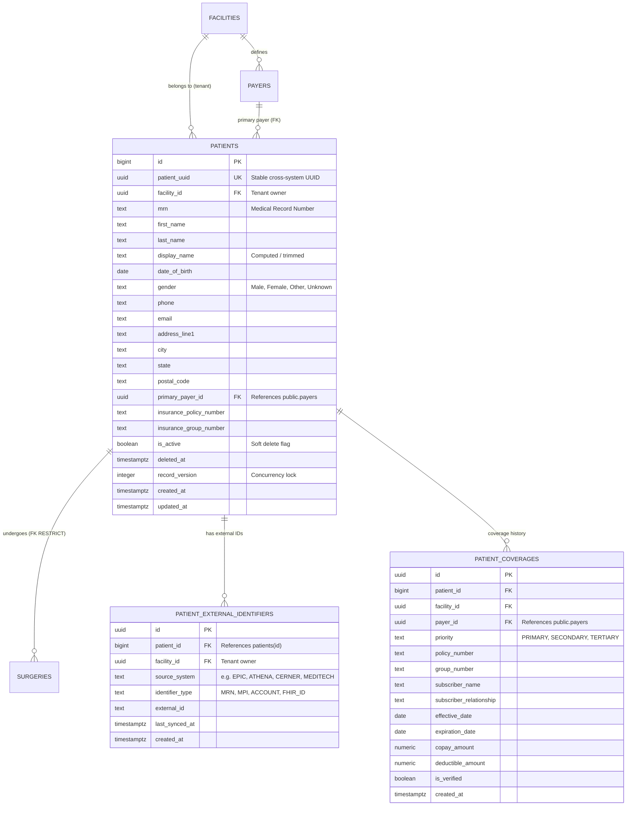

# Phase 34 — Patient Model: Read-Only Audit & Production Specification

**Document Version:** 1.0.0  
**Status:** DRAFT SPECIFICATION / READ-ONLY AUDIT COMPLETE  
**Target Architecture:** ASCANALYST Multi-Tenant Surgery Center Platform  
**Target Database:** Supabase PostgreSQL 15+ (Remote Instance: `isutllqthmakvwgduaos`)  
**Audit Executed:** 2026-10-19  

---

## 1. Executive Summary & Audit Scope

### 1.1 Purpose
This specification defines the production requirements for the **Patient Model Subsystem (Phase 34)** in ASCANALYST. It establishes:
1. Production data model for patient demographics, external system identifiers, master patient indexing (MPI), and relational payer/insurance links.
2. Server-side minimum-necessary privacy controls (HIPAA 45 CFR § 164.502(b), § 164.514) to replace insecure client-side rendering masking.
3. Multi-facility tenant isolation and role-based access control (RBAC).
4. Referential integrity between `public.patients`, `public.surgeries`, and `public.payers`.
5. Non-destructive migration and backfill strategy for all 222 existing patient records.

### 1.2 Audit Scope & Boundaries
- **Strict Compliance:** In accordance with audit protocols, this report was compiled through **READ-ONLY analysis**. No application code, database records, schema definitions, migrations, or production settings were modified.
- **Distinction of Findings:**
  - **Verified Live Database Facts:** Queried active Supabase instance (`isutllqthmakvwgduaos`) using read-only service inspection.
  - **Static Code Inferences:** Analyzed JavaScript/JSX source files, CSS rules, and SQL migrations in the repository.
  - **Proposed Architecture:** Engineering blueprints for Phase 34 target state.

---

## 2. Verified Current-State Schema & Data Flows

### 2.1 Live Database Evidence (`public.patients`)
A live inspection of the database via authenticated read-only client query verified the following active state:
- **Total Patients in Database:** `222` records.
- **Primary Key:** `id BIGINT` (Sequential integer, e.g. `3`, `34`, `35`). Not UUID.
- **Facility Scoping:** `facility_id UUID REFERENCES public.facilities(id)` (`NOT NULL` enforced in Migration 005). All 222 records belong to facility `00000000-0000-0000-0000-000000000002`.
- **MRN Uniqueness:** `uq_patients_facility_mrn` unique index on `(facility_id, LOWER(TRIM(mrn)))`. Duplicate check on all 222 rows confirmed **0 duplicate MRNs**.
- **Table Schema (26 columns):**
  ```text
  id (bigint, PK)
  facility_id (uuid, FK, NOT NULL)
  name (text)
  dob (text/date)
  mrn (text)
  gender (text)
  phone (text)
  email (text)
  address (text)
  insurance_provider (text)
  insurance_policy_number (text)
  insurance_group_number (text)
  insurance_type (text)
  subscriber_name (text)
  subscriber_relationship (text)
  insurance_effective_date (date/text)
  insurance_expiration_date (date/text)
  copay_amount (numeric)
  deductible_amount (numeric)
  secondary_insurance_provider (text)
  secondary_insurance_policy_number (text)
  secondary_insurance_group_number (text)
  emergency_contact_name (text)
  emergency_contact_phone (text)
  created_at (timestamptz)
  updated_at (timestamptz)
  ```

### 2.2 Critical Vulnerabilities & Architectural Gaps Discovered

#### Gap 1: Missing Foreign Key Between `surgeries` and `patients` (P0)
- **Live Query Evidence:** Executing PostgREST join `supabase.from('surgeries').select('id, patient_id, patients(*)')` returned:
  ```json
  {
    "code": "PGRST200",
    "details": "Searched for a foreign key relationship between 'surgeries' and 'patients' in the schema 'public', but no matches were found.",
    "message": "Could not find a relationship between 'surgeries' and 'patients' in the schema cache"
  }
  ```
- **Consequence:** `surgeries.patient_id` is an unconstrained integer column. PostgREST relational joins fail. `src/lib/supabase.js` (lines 142–157) is forced to perform an inefficient in-memory Map join on every query. Deleting a patient or updating their ID can silently orphan surgeries.

#### Gap 2: Insecure Client-Side Minimum-Necessary Masking (P0 / HIPAA)
- **Codebase Evidence:** In `src/App.jsx` (lines 1056 & 4315–4338):
  ```javascript
  const canViewPHI = ['super_admin', 'org_admin', 'facility_admin', 'clinical_manager', 'scheduler', 'surgeon', 'biller', 'coder'].includes(userRole);
  ...
  #{canViewPHI ? patient.mrn : maskMRN(patient.mrn)}
  ```
- **Consequence:** The client issues `supabase.from('patients').select('*')` over the wire. The raw, unmasked PHI (full name, unmasked MRN, DOB, phone, email, address, insurance policy numbers) is transmitted across the network in plaintext JSON to any user with facility membership. The masking occurs purely in React DOM rendering. An unauthorized viewer can inspect the DevTools Network tab to view all raw patient records.

#### Gap 3: Flat Denormalized Insurance & Disconnected `public.payers` (P1)
- **Live Query Evidence:** `public.payers` exists with 5 canonical records (`id`, `facility_id`, `name`, `payer_type`, `payer_code`, `is_active`). However, `public.patients` does not reference `public.payers`. Instead, it stores loose text strings (`insurance_provider`, `secondary_insurance_provider`).
- **Consequence:** Typos in payer names prevent automated fee schedule lookups and accurate financial modeling.

#### Gap 4: Sequence Collision Workaround via `id: Date.now()` (P1)
- **Codebase Evidence:** In `src/App.jsx` line 2327:
  ```javascript
  ...(editingPatient ? {} : { id: Date.now() }), // explicitly pass an ID for new patients to bypass sequence collision
  ```
- **Consequence:** The client generates pseudo-random timestamps as primary keys to avoid sequence desynchronization in PostgreSQL. This creates irregular 64-bit integer keys and breaks database-managed identity sequences.

#### Gap 5: Silent Fallback to Local State on DB Write Failure (P1)
- **Codebase Evidence:** In `src/App.jsx` lines 2353–2364:
  ```javascript
  catch (err) {
    console.error("Database patient write failed, updating locally:", err);
    setPatients(prev => [{ ...dbPayload, id: Date.now() }, ...prev]);
    alert('Patient added locally (Database sync failed: ' + dbErrMsg + ')');
  }
  ```
- **Consequence:** If network or RLS blocks insertion, the UI fabricates a local patient record, misleading staff into scheduling surgeries for a patient that does not exist in the database. On page refresh, the patient disappears.

---

## 3. Current State Inventory: KEEP / REFACTOR / REPLACE / MISSING

| Component | Repository / DB Path | Classification | Evidence & Rationale |
| :--- | :--- | :--- | :--- |
| **`public.patients` table** | Remote Supabase DB | **REFACTOR** | Has 222 active records with enforced `facility_id` and unique MRN. Needs canonical UUID, soft-delete, versioning, and FK to `public.payers`. |
| **`uq_patients_facility_mrn`** | Migration 005 (lines 35–37) | **KEEP** | Compound unique index `(facility_id, LOWER(TRIM(mrn)))` is working perfectly; verified 0 collisions across 222 records. |
| **`trg_prevent_facility_relocation_patients`** | Migration 001 (lines 411–414) | **KEEP** | Trigger prevents tampering with `facility_id` on existing patients, guaranteeing tenant isolation. |
| **`trg_audit_patients`** | Migration 003 (lines 184–186) | **KEEP** | Statement-level audit trigger capturing mutations to `public.audit_logs`. |
| **`src/utils/phiMasking.js`** | `src/utils/phiMasking.js` | **KEEP** | Solid de-identification utilities (`maskMRN`, `maskPatientName`, `maskDOB`, `maskPhone`, `deidentifyTextForAI`). |
| **`surgeries.patient_id` FK** | Database Schema | **MISSING** | Missing relational foreign key constraint `surgeries.patient_id REFERENCES patients(id) ON DELETE RESTRICT`. |
| **`public.payers` FK link** | `patients.payer_id` | **MISSING** | Patients store unvalidated text for insurance provider instead of FK to canonical `public.payers`. |
| **Server-Side Minimum Necessary View/RPC** | Database Schema / Supabase | **MISSING** | RLS policy returns `*` to all authenticated facility members. Server-side projected view (`v_patients_minimum_necessary`) is missing. |
| **Surgeon-Level Patient Isolation** | Database RLS | **MISSING** | Surgeons have facility-wide SELECT access on `patients` rather than scoping to patients on their scheduled surgical cases. |
| **`src/lib/supabase.js` (patient methods)** | `src/lib/supabase.js` (lines 53–68, 180–213) | **REFACTOR** | Hard deletes patients without soft-delete; performs in-memory fallback joins for surgeries due to missing DB FK. |
| **Client-Side ID Generation (`Date.now()`)** | `src/App.jsx` (line 2327) | **REPLACE** | Replace client-side timestamp hacks with PostgreSQL-managed `GENERATED BY DEFAULT AS IDENTITY` or UUID. |
| **Client-Side Local State Fallback** | `src/App.jsx` (lines 2353–2364) | **REPLACE** | Replace silent local-only fallback with proper error boundaries and transaction rollback. |
| **Hardcoded `MOCK_PATIENTS`** | `src/App.jsx` (lines 404–474) | **REPLACE** | Eliminate dead mock data fallback to prevent test data injection into production UI. |
| **Embedded Patient Management UI** | `src/App.jsx` (lines 4241–4450) | **REFACTOR** | Extract monolithic ~210 lines of JSX into dedicated `src/components/PatientManagement.jsx`. |
| **`patient_external_identifiers` table** | Database Schema | **MISSING** | Missing table for external EMR/EHR system identifiers (Epic, Cerner, Athena, Allscripts). |

---

## 4. Proposed Target Data Model & Relationships



### 4.1 Schema Normalization & Column Evolution
To preserve 100% backward compatibility with existing code and database records:
1. **Preserve `patients.id BIGINT` as Primary Key**: Existing code relies on numeric `p.id`. A new immutable `patient_uuid UUID DEFAULT gen_random_uuid() UNIQUE` is added for modern integrations, while preserving `id BIGINT` as the relational foreign key target.
2. **Add Foreign Key on `surgeries.patient_id`**:
   ```sql
   ALTER TABLE public.surgeries
     ADD CONSTRAINT fk_surgeries_patient
     FOREIGN KEY (patient_id) REFERENCES public.patients(id)
     ON DELETE RESTRICT;
   ```
   *Note: An integrity check on existing data must run first to ensure no dangling `surgeries.patient_id` values exist.*
3. **Payer Normalization**:
   - Add `primary_payer_id UUID REFERENCES public.payers(id) ON DELETE SET NULL`.
   - Maintain legacy columns `insurance_provider`, `insurance_policy_number`, etc., as computed or synchronized columns during a transition grace period.
4. **Soft Delete & Concurrency Versioning**:
   - `is_active BOOLEAN NOT NULL DEFAULT true`
   - `deleted_at TIMESTAMPTZ`
   - `record_version INTEGER NOT NULL DEFAULT 1`

---

## 5. Privacy, Minimum-Necessary Access & RBAC

### 5.1 The Two-Tier Minimum-Necessary Architecture
To resolve the critical client-side masking vulnerability, the database must enforce column-level protection:

```text
[Browser Client: Scheduler / Biller / Super Admin]
       │
       ▼ (Has 'patients.view_phi' permission)
Direct Query: public.patients (Full Columns)

[Browser Client: Auditor / Non-Clinical Staff / AI Service]
       │
       ▼ (Lacks 'patients.view_phi' permission)
Database View: public.v_patients_minimum_necessary (Masked Columns Server-Side)
```

### 5.2 Server-Side Masking View Definition
```sql
CREATE OR REPLACE VIEW public.v_patients_minimum_necessary
WITH (security_invoker = true) AS
SELECT 
    p.id,
    p.patient_uuid,
    p.facility_id,
    CASE 
        WHEN public.user_has_facility_role(p.facility_id, ARRAY['super_admin', 'org_admin', 'facility_admin', 'clinical_manager', 'scheduler', 'biller', 'billing_rcm'])
        THEN p.name
        ELSE CONCAT(LEFT(TRIM(p.name), 1), '***')
    END AS name,
    CASE 
        WHEN public.user_has_facility_role(p.facility_id, ARRAY['super_admin', 'org_admin', 'facility_admin', 'clinical_manager', 'scheduler', 'biller', 'billing_rcm'])
        THEN p.mrn
        ELSE CONCAT('***', RIGHT(TRIM(p.mrn), 3))
    END AS mrn,
    CASE 
        WHEN public.user_has_facility_role(p.facility_id, ARRAY['super_admin', 'org_admin', 'facility_admin', 'clinical_manager', 'scheduler', 'biller', 'billing_rcm'])
        THEN p.dob
        ELSE '**/**/' || COALESCE(SUBSTRING(p.dob FROM '\d{4}'), '****')
    END AS dob,
    p.gender,
    p.insurance_provider,
    p.is_active,
    p.created_at,
    p.updated_at
FROM public.patients p
WHERE p.is_active = true;
```

### 5.3 RBAC Permission Matrix for Patient Entities

| Role | View Masked Directory | View Full PHI (`name`, `DOB`, `phone`) | Create Patient | Edit Demographics / Insurance | Delete / Deactivate Patient | Bulk Export |
| :--- | :---: | :---: | :---: | :---: | :---: | :---: |
| **`super_admin`** | ✅ | ✅ | ✅ | ✅ | ✅ (Soft Delete) | ✅ (Audited) |
| **`org_admin`** | ✅ | ✅ | ✅ | ✅ | ✅ (Soft Delete) | ✅ (Audited) |
| **`facility_admin`** | ✅ | ✅ | ✅ | ✅ | ✅ (Soft Delete) | ✅ (Audited) |
| **`clinical_manager`** | ✅ | ✅ | ✅ | ✅ | ❌ | ❌ |
| **`scheduler`** | ✅ | ✅ | ✅ | ✅ | ❌ | ❌ |
| **`surgeon`** | ⚠️ (Own Cases Only) | ⚠️ (Own Cases Only) | ❌ | ❌ | ❌ | ❌ |
| **`biller` / `billing_rcm`** | ✅ | ✅ | ❌ | ✅ (Coverage only) | ❌ | ❌ |
| **`auditor` / `staff`** | ✅ (Masked Only) | ❌ | ❌ | ❌ | ❌ | ❌ |

---

## 6. Backend Services & Data Integrity Requirements

### 6.1 Safe Data Access Layer (`src/lib/supabase.js`)
1. **`getPatients(facilityId, options = {})`**:
   - Support pagination (`page`, `pageSize`) to avoid memory saturation with thousands of records.
   - Automatically query `v_patients_minimum_necessary` when user lacks `patients.view_phi`.
   - Filter `is_active = true` by default.
2. **`addPatient(patientData)`**:
   - Strip client-supplied `id` timestamps (let PostgreSQL manage identity).
   - Validate required fields: `name`, `mrn`, `facility_id`.
   - Check duplicate MRN within facility before insert and return human-readable collision error (`MRN_ALREADY_EXISTS`).
3. **`updatePatient(id, updates)`**:
   - Block modification of `facility_id` (enforced by DB trigger).
   - Increment `record_version` for optimistic locking.
4. **`deletePatient(id, reason)`**:
   - Prohibit hard `DELETE`. Perform soft-delete (`UPDATE patients SET is_active = false, deleted_at = NOW()`).
   - Check if active/scheduled surgeries exist; abort with clear alert if unfinished cases are attached.

---

## 7. UI & Workflow Requirements

### 7.1 Component Extraction
- Extract Patient Directory from monolithic `src/App.jsx` into standalone component:
  `src/components/PatientManagement.jsx`.
- Clean props contract: `activeFacility`, `userRole`, `canViewPHI`, `onPatientSelect`.

### 7.2 Patient UI States
- **Loading State:** Shimmer table rows matching active pagination count.
- **Empty State:** Distinct illustrations for "No patients in facility" vs "No patients match search filter".
- **Duplicate Warning Modal:** If staff enters an MRN or name/DOB combination matching an existing record, display a resolution dialog ("Patient with MRN #2006 already exists. View record?").
- **PHI Masking Visual Indicator:** If user is in masked view, display a subtle banner: `"Viewing in Minimum-Necessary Privacy Mode. Sensitive identifiers are masked."`

---

## 8. Audit & Provenance Design

### 8.1 Mutation Telemetry
Every patient create, update, deactivate, and export action must record:
1. `actor_id` (UUID from `auth.uid()`).
2. `actor_role` (Facility-scoped role).
3. `event_type` (`PATIENT_CREATED`, `PATIENT_UPDATED`, `PATIENT_DEACTIVATED`, `PATIENT_EXPORTED`).
4. `facility_id` (Tenant context).
5. `payload` diff: Before and after states, with SSN/full phone numbers redacted or hashed.

---

## 9. Required Test Plan

### 9.1 Unit Tests (`tests/patient-model.test.js`)
- Validation of MRN format and uniqueness within facility.
- Soft-delete status transitions (`is_active: true -> false`).
- Correct formatting of de-identified projections in `phiMasking.js`.

### 9.2 RLS & Security Tests
- Attempt cross-tenant SELECT, INSERT, UPDATE, DELETE (must fail with 0 rows or access denied).
- Attempt hard DELETE by non-admin role (must be rejected by RLS).
- Verify surgeon cannot query patients outside their assigned surgeries.

### 9.3 Regression & Backward Compatibility Tests
- Existing 222 patient records load identically in `SurgeryScheduler.jsx`.
- Surgery creation and editing continues to link patients seamlessly.
- All 204 existing automated tests continue to pass with 0 regressions.

---

## 10. Prioritized Implementation Roadmap

### Phase 34.1: Data Model & Foreign Key Hardening (P0)
- Add `patient_uuid`, `is_active`, `deleted_at`, and `record_version` to `public.patients`.
- Verify data integrity between `surgeries.patient_id` and `patients.id`, then attach foreign key constraint `fk_surgeries_patient`.
- Link `public.patients.primary_payer_id` to `public.payers(id)`.

### Phase 34.2: Server-Side Privacy & Minimum-Necessary View (P0)
- Implement `public.v_patients_minimum_necessary` view.
- Update `src/lib/supabase.js` to route read queries through the view for non-clinical/audit roles.
- Eliminate client-side raw data leakage.

### Phase 34.3: Service Layer & UI Component Extraction (P1)
- Remove `id: Date.now()` client hack and silent local-state error swallowing.
- Extract `src/components/PatientManagement.jsx` from `src/App.jsx`.
- Remove dead `MOCK_PATIENTS` fallback.

### Phase 34.4: External Identifiers & Merge Workflows (P2)
- Create `public.patient_external_identifiers` table for EMR integration.
- Implement duplicate detection and patient merge RPC.

---

## 11. Final Verdict

### **VERDICT: CONDITIONAL GO**

**Condition for Implementation:**
Before applying Migration 012 (`patient_model_hardening.sql`), a data integrity script must verify that all 234 existing `surgeries.patient_id` values reference valid, existing `patients.id` records so the foreign key constraint can attach without error.

**Explicit Confirmation of Zero Mutations:**
- Source files modified: **0**
- Database objects created or altered: **0**
- Database records written or deleted: **0**
- Configuration / deployments changed: **0**
- This audit was executed **100% READ-ONLY**.
