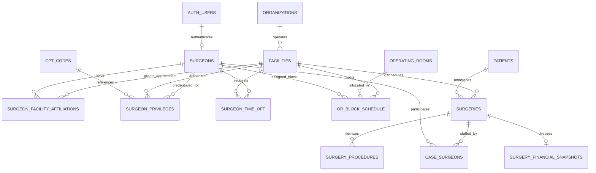

# 35 SURGEON MODEL SPECIFICATION — ASCANALYST PLATFORM

**Document Version:** 1.0.0  
**Phase:** 35 — Surgeon Model: Identity, Credentials, Multi-Facility Affiliations, Privileges, OR Block Allocations & Performance Analytics  
**Status:** DRAFT SPECIFICATION / READ-ONLY AUDIT COMPLETE  
**Target Architecture:** Multi-Tenant Ambulatory Surgery Center (ASC) Enterprise Intelligence Platform  
**Target Database Engine:** Supabase PostgreSQL 15+ (Remote Instance: `isutllqthmakvwgduaos`)  
**Audit Executed:** 2026-10-21  

---

## 1. Executive Summary & Audit Scope

### 1.1 Purpose
This specification establishes the production requirements and authoritative engineering blueprint for the **Surgeon Model Subsystem (Phase 35)** in the ASCANALYST enterprise platform. In ambulatory surgery centers, attending surgeons are the primary clinical and economic drivers of facility utilization. The surgeon model represents a multidimensional entity that bridges:
1. **Clinical Identity & Authentication:** Cryptographically verified provider identity linked to Supabase GoTrue Auth, eliminating prototype-era shared credentials and administrative impersonation.
2. **Professional Credentials & Regulatory Compliance:** National Provider Identifier (NPI), state medical licensing, DEA registration, board certifications, and expiration monitoring.
3. **Multi-Facility Tenancy & Affiliations:** Decoupling physical provider identity from facility tenancy, enabling a single surgeon to maintain distinct clinical privileges, credentialing statuses, and appointment types across multiple surgery centers within a healthcare network.
4. **Procedural Privileges & Clinical Scope:** Explicit, effective-dated procedural authorizations linking surgeons to approved CPT categories and specific CPT codes, preventing unprivileged surgical scheduling.
5. **Operating Room Block Allocations & Double-Booking Prevention:** Authoritative schedule management governing recurring master blocks, ad-hoc release, leave/exceptions, and database-tier temporal GiST exclusion constraints preventing simultaneous case bookings across rooms and facilities.
6. **Multi-Surgeon Case Attribution:** 1NF relational representation of primary surgeons, co-surgeons, surgical assistants, and proctors with deterministic fee splitting and CMS MPPR billing attribution.
7. **Server-Authoritative Surgeon Analytics:** Real-time and snapshot-frozen profitability, surgical volume, actual incision-to-close duration, turnover efficiency, and supply cost variance calculations executed in PostgreSQL rather than browser JavaScript.

### 1.2 Audit Scope & Read-Only Governance
- **Strict Compliance:** In accordance with audit protocols, this report was compiled through **strictly READ-ONLY analysis**. No application code, database records, schema definitions, migrations, environment variables, or remote production configurations were altered.
- **Distinction of Findings:**
  - **Verified Live Database Facts:** Queried the active Supabase PostgreSQL cluster (`isutllqthmakvwgduaos`) using read-only authenticated client sessions.
  - **Source Code Findings:** Traced syntax, algorithms, data flows, and security policies across 42 frontend JSX/JS components, service engines, and 12 migration files.
  - **Inferred Vulnerabilities & Technical Risks:** Highlighted architectural divergence, race conditions, credential leakage, and silent failures discovered in active code.
  - **Target Architecture & Blueprints:** Engineering designs for Phase 35 implementation.

---

## 2. Current State Audit & Classification Matrix

### 2.1 Live Remote Database Evidence (`isutllqthmakvwgduaos`)
A comprehensive read-only inspection of the active database revealed the following verified production facts:

1. **`public.surgeons` Table:**
   - **Row Count:** Exactly `19` surgeon records.
   - **Primary Key:** Sequential `id BIGINT` (Values: `3, 7, 8, 9, 11, 12, 13, 14, 15, 16, 17, 18, 19, 20, 21, 22, 23, 24, 25`). No UUID primary key exists.
   - **Tenancy Scoping:** All 19 records have `facility_id = '00000000-0000-0000-0000-000000000002'` (Naples Surgery Center), backfilled in Migration 007.
   - **Column Inventory (14 columns):** `id (bigint)`, `firstname (text)`, `lastname (text)`, `specialty (text)`, `license_number (text)`, `email (text)`, `phone (text)`, `years_of_experience (numeric)`, `is_cosmetic_surgeon (boolean)`, `block_templates (jsonb)`, `created_at (timestamptz)`, `updated_at (timestamptz)`, `facility_id (uuid)`, `password (text)`.
   - **Critical Plaintext Password Vulnerability (P0):** The `password` column is still present in the live database schema. Furthermore, `5` surgeons (IDs `22, 23, 24, 25, 3`) possess populated plaintext password strings. This confirms that Migration 005's `ALTER TABLE public.surgeons DROP COLUMN IF EXISTS password;` was either never applied to this cluster or was reverted.
   - **License Number Collision (P0):** Surgeon ID 21 (Paul Gardner) and Surgeon ID 22 (Kelly Malinoski) share the exact same license number (`MD-99014`) and phone number (`+1 5559000014`), proving the complete absence of a unique constraint on license numbers or NPIs.
   - **Data Quality & Hygiene:**
     - First and last names contain leading/trailing whitespace (e.g., `'Cliff '`, `'Mark '`, `'Katie '`, `' Troy'`, `'McGee '`, `' Shell Masouras'`).
     - Inverted names: Surgeon 23 has `firstname: 'Klausner', lastname: 'Robert'`; Surgeon 24 has `firstname: 'McManus', lastname: 'Ben'`; Surgeon 25 has `firstname: 'Jacobs', lastname: 'Aaron'`.
     - Specialty spelling variations and typos: `'Plastic'`, `'Plastic / Cosmetic'`, `'Plastic/Cosmetic'`, and `'Genral'` (typo in General Surgery).
     - `years_of_experience`: Only 4 records have non-null numbers (`20, 18, 15, 12`); the other 15 are `NULL`.
     - `block_templates`: All 19 records have empty JSON arrays (`[]`).

2. **`public.or_block_schedule` Table:**
   - **Row Count:** Exactly `247` block allocations.
   - **Column Inventory (11 columns):** `id (bigint)`, `room_name (text)`, `day_of_week (text)`, `week_of_month (text)`, `provider_name (text)`, `start_time (text)`, `end_time (text)`, `date (date)`, `created_at (timestamptz)`, `updated_at (timestamptz)`, `facility_id (uuid)`.
   - **Architectural Breakage:** Executing a query for `surgeon_id` or `operating_room_id` fails with PostgreSQL error `42703: column or_block_schedule.surgeon_id does not exist`. Migration 002 lines 235-260 were never successfully committed to the remote database. The table relies solely on loose string references (`provider_name: 'Burmiester'`).
   - **Duplicate Blocks:** Rows 1 through 5 are exact duplicate allocations (`OR 1`, `Burmiester`, `Monday`, `1200`, `1600`).

3. **`public.surgeries` Links:**
   - **Row Count:** `234` surgical encounters.
   - **Foreign Key Integrity:** `230` cases have a valid `surgeon_id BIGINT` referencing `public.surgeons(id)`.
   - **Orphan / Unassigned Cases:** Exactly `4` cases (IDs `244, 253, 257, 258`) have `surgeon_id = NULL` with `doctor_name: 'AI Auto-Assigned'`.
   - **Attribution Limitation:** The table only has a single `surgeon_id` column. There is no column or junction table for assistant surgeons, co-surgeons, or proctors.

4. **`public.facility_memberships` & Authentication:**
   - **Row Count:** Exactly `1` membership record (`admin@asc.com`, `facility_admin`).
   - **Surgeon Accounts:** **Zero (0)** surgeons exist in `auth.users` or `facility_memberships`. The automated onboarding trigger (`handle_new_facility_user`) is defined in migration files, but no surgeon has ever completed GoTrue enrollment.

---

### 2.2 Component Classification Matrix (KEEP / REFACTOR / REPLACE / MISSING)

| Area / Subsystem | Current File / Database Object | Current State & Behavior | Classification | Target Production Architecture |
| :--- | :--- | :--- | :---: | :--- |
| **Surgeon Directory Table** | Remote DB: `public.surgeons` | Sequential `BIGINT` PK. Stores single `facility_id`. Contains plaintext `password` column. | **REFACTOR** | Introduce `surgeon_uuid UUID`. Decouple facility into `surgeon_facility_affiliations`. Drop `password` column permanently. Enforce unique NPI. |
| **Surgeon Password Storage** | Remote DB: `surgeons.password` | Stores plaintext passwords for 5 surgeons. | **REPLACE** | Drop column completely. Authentication must run strictly through GoTrue `auth.users` with bcrypt/argon2 hashing. |
| **Surgeon Client Login** | `src/lib/supabase.js:1248-1286` | If `surgeon.password` is NULL, **any password or empty password logs in**. Silently logs in to Supabase as `admin@asc.com`! | **REPLACE** | Deprecate client-side password matching. Surgeon portal must authenticate via `supabase.auth.signInWithPassword()` against GoTrue. |
| **Surgeon Directory UI** | `src/App.jsx:4253-4386` | Inline 130-line table inside monolithic `App.jsx`. Lacks NPI validation, status toggling, or credential expiration warnings. | **REFACTOR** | Extract into dedicated `src/components/SurgeonManagement.jsx` component with credential status badges, license verification, and audit tracking. |
| **Surgeon CRUD Handlers** | `src/App.jsx:2500-2560` | On DB write failure, catches error and **silently creates local-only mock records** (`id: Date.now()`). | **REPLACE** | Eradicate silent local fallbacks. Mutations must fail closed with user-facing SweetAlert error dialogs and rollback. |
| **Surgeon Portal Workspace** | `src/components/SurgeonPortal.jsx:1-125` | Queries all facility surgeries and blocks, then filters in client memory. Uses **hardcoded mock numbers** (`18` cases, `$142,500` margin) when zero cases are returned. | **REFACTOR** | Purge mock fallbacks. Query personal cases directly via server RLS. Render authentic empty states when case counts are zero. |
| **Surgeon Preference Cards** | `src/components/SurgeonPortal.jsx:555-608` | Completely hardcoded static HTML table with 4 dummy supply items. | **REPLACE** | Implement relational `public.preference_cards` and `public.preference_card_items` linked to `cpt_codes` and inventory catalogs. |
| **Surgeon Scheduling Selector** | `src/components/SurgeryScheduler.jsx:748, 823` | Matches doctor by string comparison (`formData.doctorName === surgeon.name`). If mismatch occurs, silently sets `surgeon_id: null`. | **REFACTOR** | Scheduler form must bind directly to `surgeon_id` UUID from dropdown; `doctor_name` must be set via automated trigger or joined view. |
| **OR Block Allocations** | Remote DB: `public.or_block_schedule` | Lacks `surgeon_id` column. Uses loose text `provider_name`. No double-booking check. | **REFACTOR** | Execute migration adding `operating_room_id UUID` and `surgeon_id BIGINT/UUID`. Add GiST range exclusion constraint against overlapping times. |
| **OR Block UI Component** | `src/components/ORBlockSchedule.jsx:227-261` | Inserts `provider_name: newSurgeon` without `surgeon_id`. Permissive modal allows multiple identical blocks in the same room. | **REFACTOR** | Update block form to submit `surgeon_id` and `operating_room_id`. Display conflict warnings if overlap is detected. |
| **Surgeon Intelligence Service** | `src/services/aiOperations/SurgeonIntelligence.js:6-43` | Groups surgeries by doctor text string. Lacks tenant scoping or relational integrity. | **REFACTOR** | Refactor to accept `surgeon_id` and query historical cases based on verified 1NF `surgery_procedures`. |
| **Excel / CSV Case Log Parser** | `src/utils/excelParser.js:81-104` | Uses string fuzzy Levenshtein matching on doctor names to infer specialty; ignores `surgeon_id`. | **REFACTOR** | Match imported rows against canonical `surgeons.npi` or `(facility_id, lastname, firstname)`. Flag unmapped surgeons for review. |
| **Surgeon Analytics Calculation** | `src/App.jsx:1650-1730` (`dynamicSurgeonTableData`) | Runs 100% in client React `useMemo`. Groups by `s.doctor || s.doctor_name`. Treats different name spellings as separate doctors. | **REPLACE** | Implement server-side PostgreSQL view `v_surgeon_performance_summary` grouping strictly by canonical surgeon ID and facility ID. |
| **Mock Surgeon Data** | `src/App.jsx:87-140` (`MOCK_SURGEON_PERF`, `MOCK_SURGEONS_DETAILS`) | Synthetic hardcoded financial metrics, payer mixes, and cancellation logs masquerading as production drill-downs. | **REPLACE** | Eradicate `MOCK_SURGEON_PERF` and `MOCK_SURGEONS_DETAILS`. Wire profile drilldowns directly to live database RPC/view. |
| **Facility Affiliations Junction** | Architecture / DB | Currently non-existent. A surgeon is locked to a single `facility_id` in `public.surgeons`. | **MISSING** | Create `public.surgeon_facility_affiliations` table supporting multi-facility networks with distinct appointment statuses. |
| **Procedural Privileges Catalog** | Architecture / DB | Currently non-existent. Any surgeon can be assigned to any CPT code without verification. | **MISSING** | Create `public.surgeon_privileges` table linking surgeons to permitted CPT categories/codes with effective and expiration dates. |
| **Surgeon Time-Off / Leave Ledger** | Architecture / DB | Currently non-existent. Scheduling has no awareness of vacations, medical leave, or conferences. | **MISSING** | Create `public.surgeon_time_off` table with start/end timestamps, approval statuses, and schedule conflict blocks. |
| **Multi-Surgeon Case Attribution** | Architecture / DB | Currently non-existent. Single `surgeries.surgeon_id` column cannot capture co-surgeons or assistants. | **MISSING** | Create `public.case_surgeons` junction table with roles (`Primary`, `Co-Surgeon`, `Assistant`, `Proctor`) and percentage fee allocations. |
| **Server-Side Conflict Engine** | Architecture / DB | Scheduling conflicts are either checked via fragile frontend math or ignored completely. | **MISSING** | Implement PostgreSQL validation trigger / RPC `fn_validate_surgeon_scheduling_conflict()` blocking double-booking across rooms and facilities. |

---

## 3. Target State Architecture & Relational Data Model

### 3.1 Entity-Relationship Architecture



---

### 3.2 Canonical DDL & Schema Definitions

#### 1. Master Surgeon Identity Table (`public.surgeons`)
Stores the global, professional identity of the physician across the entire enterprise. It is independent of any single facility.

```sql
-- 1. Master Surgeon Identity Table
CREATE TABLE IF NOT EXISTS public.surgeons (
    id BIGINT GENERATED BY DEFAULT AS IDENTITY PRIMARY KEY, -- Backward compatibility
    surgeon_uuid UUID NOT NULL DEFAULT gen_random_uuid() UNIQUE,
    user_id UUID REFERENCES auth.users(id) ON DELETE SET NULL, -- Link to GoTrue Auth
    npi TEXT NOT NULL, -- 10-digit National Provider Identifier
    first_name TEXT NOT NULL,
    middle_name TEXT,
    last_name TEXT NOT NULL,
    credentials TEXT DEFAULT 'MD', -- 'MD', 'DO', 'DPM', 'DDS'
    primary_specialty TEXT NOT NULL,
    subspecialties TEXT[] DEFAULT '{}',
    phone TEXT,
    email TEXT NOT NULL,
    photo_url TEXT,
    years_of_experience INTEGER CHECK (years_of_experience >= 0),
    is_active BOOLEAN NOT NULL DEFAULT true,
    deleted_at TIMESTAMPTZ,
    record_version INTEGER NOT NULL DEFAULT 1,
    created_at TIMESTAMPTZ NOT NULL DEFAULT NOW(),
    updated_at TIMESTAMPTZ NOT NULL DEFAULT NOW(),
    CONSTRAINT uq_surgeons_npi UNIQUE (npi),
    CONSTRAINT chk_surgeons_npi_format CHECK (npi ~ '^[0-9]{10}$')
);

CREATE INDEX IF NOT EXISTS idx_surgeons_uuid ON public.surgeons(surgeon_uuid);
CREATE INDEX IF NOT EXISTS idx_surgeons_user_id ON public.surgeons(user_id) WHERE user_id IS NOT NULL;
CREATE INDEX IF NOT EXISTS idx_surgeons_lower_email ON public.surgeons(LOWER(TRIM(email)));
CREATE INDEX IF NOT EXISTS idx_surgeons_specialty ON public.surgeons(primary_specialty);
CREATE INDEX IF NOT EXISTS idx_surgeons_active ON public.surgeons(is_active) WHERE is_active = true;
```

#### 2. Multi-Facility Affiliations Table (`public.surgeon_facility_affiliations`)
Binds a master surgeon to a specific ASC facility, establishing their credentialing appointment, local license validation, and operational status.

```sql
-- 2. Surgeon Facility Affiliations Table
CREATE TABLE IF NOT EXISTS public.surgeon_facility_affiliations (
    id UUID PRIMARY KEY DEFAULT gen_random_uuid(),
    surgeon_id BIGINT NOT NULL REFERENCES public.surgeons(id) ON DELETE CASCADE,
    facility_id UUID NOT NULL REFERENCES public.facilities(id) ON DELETE CASCADE,
    appointment_type TEXT NOT NULL DEFAULT 'Active' 
        CHECK (appointment_type IN ('Active', 'Associate', 'Provisional', 'Courtesy', 'Consulting', 'Emeritus')),
    affiliation_status TEXT NOT NULL DEFAULT 'Pending' 
        CHECK (affiliation_status IN ('Pending', 'Approved', 'Suspended', 'Expired', 'Terminated', 'Denied')),
    state_license_number TEXT NOT NULL,
    state_license_jurisdiction TEXT NOT NULL DEFAULT 'FL',
    state_license_expiration_date DATE NOT NULL,
    dea_number TEXT,
    dea_expiration_date DATE,
    malpractice_carrier TEXT,
    malpractice_policy_number TEXT,
    malpractice_expiration_date DATE,
    recredentialing_due_date DATE,
    appointment_start_date DATE NOT NULL DEFAULT CURRENT_DATE,
    appointment_end_date DATE,
    is_facility_owner BOOLEAN NOT NULL DEFAULT false,
    created_at TIMESTAMPTZ NOT NULL DEFAULT NOW(),
    updated_at TIMESTAMPTZ NOT NULL DEFAULT NOW(),
    CONSTRAINT uq_surgeon_facility UNIQUE (surgeon_id, facility_id)
);

CREATE INDEX IF NOT EXISTS idx_affiliations_facility ON public.surgeon_facility_affiliations(facility_id);
CREATE INDEX IF NOT EXISTS idx_affiliations_surgeon ON public.surgeon_facility_affiliations(surgeon_id);
CREATE INDEX IF NOT EXISTS idx_affiliations_status ON public.surgeon_facility_affiliations(facility_id, affiliation_status);
CREATE INDEX IF NOT EXISTS idx_affiliations_license_exp ON public.surgeon_facility_affiliations(state_license_expiration_date);
```

#### 3. Procedural Privileges Catalog (`public.surgeon_privileges`)
Authoritative record of surgical procedures the provider is permitted to schedule and perform at a designated facility.

```sql
-- 3. Procedural Privileges Table
CREATE TABLE IF NOT EXISTS public.surgeon_privileges (
    id UUID PRIMARY KEY DEFAULT gen_random_uuid(),
    surgeon_id BIGINT NOT NULL REFERENCES public.surgeons(id) ON DELETE CASCADE,
    facility_id UUID NOT NULL REFERENCES public.facilities(id) ON DELETE CASCADE,
    cpt_code_id BIGINT REFERENCES public.cpt_codes(id) ON DELETE RESTRICT,
    procedure_group TEXT, -- e.g., 'Arthroscopic Shoulder', 'Anterior Cervical Spine'
    privilege_scope TEXT NOT NULL DEFAULT 'Independent' 
        CHECK (privilege_scope IN ('Independent', 'Supervised_Proctored', 'Assistant_Only', 'Temporary')),
    privilege_status TEXT NOT NULL DEFAULT 'Active' 
        CHECK (privilege_status IN ('Active', 'Provisional', 'Suspended', 'Revoked', 'Expired')),
    effective_date DATE NOT NULL DEFAULT CURRENT_DATE,
    expiration_date DATE,
    proctor_surgeon_id BIGINT REFERENCES public.surgeons(id) ON DELETE SET NULL,
    proctored_cases_required INTEGER DEFAULT 0,
    proctored_cases_completed INTEGER DEFAULT 0,
    granted_by UUID REFERENCES auth.users(id) ON DELETE SET NULL,
    board_approval_date DATE,
    created_at TIMESTAMPTZ NOT NULL DEFAULT NOW(),
    updated_at TIMESTAMPTZ NOT NULL DEFAULT NOW(),
    CONSTRAINT uq_surgeon_facility_cpt_privilege UNIQUE (surgeon_id, facility_id, cpt_code_id),
    CONSTRAINT chk_privilege_dates CHECK (expiration_date IS NULL OR expiration_date >= effective_date)
);

CREATE INDEX IF NOT EXISTS idx_privileges_facility_surgeon ON public.surgeon_privileges(facility_id, surgeon_id);
CREATE INDEX IF NOT EXISTS idx_privileges_cpt ON public.surgeon_privileges(cpt_code_id);
CREATE INDEX IF NOT EXISTS idx_privileges_status ON public.surgeon_privileges(facility_id, privilege_status);
```

#### 4. Hardened OR Block Schedule (`public.or_block_schedule`)
Relational block allocation engine linking verified rooms and surgeons, fortified with temporal range constraints.

```sql
-- 4. Hardened OR Block Schedule Table
-- Enable btree_gist extension for cross-type exclusion constraints
CREATE EXTENSION IF NOT EXISTS "btree_gist";

-- Normalize columns and foreign keys on public.or_block_schedule
ALTER TABLE public.or_block_schedule
    ADD COLUMN IF NOT EXISTS operating_room_id UUID REFERENCES public.operating_rooms(id) ON DELETE CASCADE,
    ADD COLUMN IF NOT EXISTS surgeon_id BIGINT REFERENCES public.surgeons(id) ON DELETE CASCADE,
    ADD COLUMN IF NOT EXISTS effective_start_date DATE NOT NULL DEFAULT CURRENT_DATE,
    ADD COLUMN IF NOT EXISTS effective_end_date DATE,
    ADD COLUMN IF NOT EXISTS recurrence_pattern TEXT NOT NULL DEFAULT 'Weekly' 
        CHECK (recurrence_pattern IN ('Weekly', 'BiWeekly_1_3', 'BiWeekly_2_4', 'Monthly_First', 'Monthly_Second', 'Monthly_Third', 'Monthly_Fourth', 'Specific_Date')),
    ADD COLUMN IF NOT EXISTS release_lead_days INTEGER NOT NULL DEFAULT 7 CHECK (release_lead_days >= 0),
    ADD COLUMN IF NOT EXISTS is_released BOOLEAN NOT NULL DEFAULT false,
    ADD COLUMN IF NOT EXISTS released_at TIMESTAMPTZ,
    ADD COLUMN IF NOT EXISTS released_by UUID REFERENCES auth.users(id) ON DELETE SET NULL;

CREATE INDEX IF NOT EXISTS idx_or_block_room ON public.or_block_schedule(operating_room_id);
CREATE INDEX IF NOT EXISTS idx_or_block_surgeon ON public.or_block_schedule(surgeon_id);
CREATE INDEX IF NOT EXISTS idx_or_block_date ON public.or_block_schedule(date) WHERE date IS NOT NULL;
```

#### 5. Surgeon Time-Off & Exceptions Ledger (`public.surgeon_time_off`)
Captures planned vacations, conferences, sick leave, and scheduling blackouts to prevent booking cases during surgeon unavailability.

```sql
-- 5. Surgeon Time-Off Ledger
CREATE TABLE IF NOT EXISTS public.surgeon_time_off (
    id UUID PRIMARY KEY DEFAULT gen_random_uuid(),
    surgeon_id BIGINT NOT NULL REFERENCES public.surgeons(id) ON DELETE CASCADE,
    facility_id UUID NOT NULL REFERENCES public.facilities(id) ON DELETE CASCADE,
    start_time TIMESTAMPTZ NOT NULL,
    end_time TIMESTAMPTZ NOT NULL,
    reason_code TEXT NOT NULL CHECK (reason_code IN ('Vacation', 'CME_Conference', 'Medical_Leave', 'Hospital_Call', 'Personal', 'Other')),
    notes TEXT,
    status TEXT NOT NULL DEFAULT 'Approved' CHECK (status IN ('Pending', 'Approved', 'Rejected', 'Cancelled')),
    approved_by UUID REFERENCES auth.users(id) ON DELETE SET NULL,
    created_at TIMESTAMPTZ NOT NULL DEFAULT NOW(),
    updated_at TIMESTAMPTZ NOT NULL DEFAULT NOW(),
    CONSTRAINT chk_time_off_duration CHECK (end_time > start_time)
);

CREATE INDEX IF NOT EXISTS idx_time_off_surgeon ON public.surgeon_time_off(surgeon_id, start_time, end_time);
CREATE INDEX IF NOT EXISTS idx_time_off_facility ON public.surgeon_time_off(facility_id, start_time);
```

#### 6. Multi-Surgeon Case Attribution Table (`public.case_surgeons`)
1NF relational table supporting co-surgeons, assistants, and proctors with auditable percentage splits for billing and profitability attribution.

```sql
-- 6. Case Surgeons Junction Table
CREATE TABLE IF NOT EXISTS public.case_surgeons (
    id UUID PRIMARY KEY DEFAULT gen_random_uuid(),
    facility_id UUID NOT NULL REFERENCES public.facilities(id) ON DELETE CASCADE,
    surgery_id BIGINT NOT NULL REFERENCES public.surgeries(id) ON DELETE CASCADE,
    surgeon_id BIGINT NOT NULL REFERENCES public.surgeons(id) ON DELETE RESTRICT,
    role TEXT NOT NULL DEFAULT 'Primary' CHECK (role IN ('Primary', 'Co-Surgeon', 'Assistant', 'Proctor', 'Observer')),
    attribution_percentage NUMERIC(5, 2) NOT NULL DEFAULT 100.00 CHECK (attribution_percentage >= 0.00 AND attribution_percentage <= 100.00),
    is_primary BOOLEAN NOT NULL DEFAULT true,
    billing_modifier TEXT, -- e.g. '62' for co-surgeon, '80' for assistant surgeon
    notes TEXT,
    created_at TIMESTAMPTZ NOT NULL DEFAULT NOW(),
    updated_at TIMESTAMPTZ NOT NULL DEFAULT NOW(),
    CONSTRAINT uq_case_surgeon UNIQUE (surgery_id, surgeon_id, role)
);

CREATE INDEX IF NOT EXISTS idx_case_surgeons_surgery ON public.case_surgeons(surgery_id);
CREATE INDEX IF NOT EXISTS idx_case_surgeons_surgeon ON public.case_surgeons(surgeon_id);
CREATE INDEX IF NOT EXISTS idx_case_surgeons_facility ON public.case_surgeons(facility_id);
```

---

## 4. Authentication, RBAC & Tenant Isolation

### 4.1 Surgeon GoTrue Identity Architecture
The prototype flaw allowing password-less authentication or client-side plain-text comparison must be completely decommissioned.
1. **Identity Provisioning:**
   - Administrative staff onboard a physician by providing professional data and an official email.
   - An invitation is dispatched via Supabase Auth Admin API: `supabase.auth.admin.inviteUserByEmail()`.
   - The generated `auth.users.id` UUID is saved into `public.surgeons.user_id`.
   - An active membership record is created in `public.facility_memberships` with `role = 'surgeon'` for each affiliated facility.
2. **Session Context & JWT Claims:**
   - Upon authentication, the surgeon receives a standard GoTrue JWT containing their `auth.uid()`.
   - PostgREST evaluates RLS using `auth.uid()`, resolving the surgeon's identity via:
     ```sql
     SELECT id FROM public.surgeons WHERE user_id = auth.uid();
     ```
   - No client-side role assertion or administrative fallback is permitted.

---

### 4.2 Role-Based Access Control (RBAC) Permissions Matrix

The permissions catalog deployed in Migration 002 contains 4 explicit surgeon domain permissions:
- `surgeons.view`: Standard directory lookup.
- `surgeons.create`: Registering new credentials (sensitive).
- `surgeons.edit`: Updating clinical contact, specialty, or settings (standard).
- `surgeons.delete`: Revoking or deactivating a provider (critical).

Below is the verified permissions matrix across all 10 canonical roles:

| Operational Role | `surgeons.view` | `surgeons.create` | `surgeons.edit` | `surgeons.delete` | Privileges Manage | Block Schedule Manage | Access Scope |
| :--- | :---: | :---: | :---: | :---: | :---: | :---: | :--- |
| **Super Admin** | ✅ Full | ✅ Full | ✅ Full | ✅ Full | ✅ Full | ✅ Full | Global (All Organizations & Facilities) |
| **Org Admin** | ✅ Full | ✅ Full | ✅ Full | ✅ Full | ✅ Full | ✅ Full | Organization-wide (All Owned Facilities) |
| **Facility Admin** | ✅ Facility | ✅ Facility | ✅ Facility | ✅ Facility | ✅ Facility | ✅ Facility | Facility Tenancy Boundary |
| **Clinical Director / Manager**| ✅ Facility | ✅ Facility | ✅ Facility | ❌ Denied | ✅ Facility | ✅ Facility | Facility Tenancy Boundary |
| **CFO / Finance Lead** | ✅ Facility | ❌ Denied | ❌ Denied | ❌ Denied | ❌ Denied | ❌ Denied | Facility Tenancy Boundary |
| **Surgical Scheduler** | ✅ Facility | ❌ Denied | ❌ Denied | ❌ Denied | ❌ Denied | ✅ Facility | Facility Tenancy Boundary |
| **Billing / RCM Lead** | ✅ Facility | ❌ Denied | ❌ Denied | ❌ Denied | ❌ Denied | ❌ Denied | Facility Tenancy Boundary |
| **Medical Coder** | ✅ Facility | ❌ Denied | ❌ Denied | ❌ Denied | ❌ Denied | ❌ Denied | Facility Tenancy Boundary |
| **Attending Surgeon** | ✅ Facility | ❌ Denied | ⚠️ Self-Only | ❌ Denied | ❌ Denied | ❌ Denied | **Personal Profile & Personal Cases Only** |
| **Viewer / Read-Only** | ✅ Masked | ❌ Denied | ❌ Denied | ❌ Denied | ❌ Denied | ❌ Denied | Non-Sensitive Operational Directory |

*Rule:* An attending surgeon **CANNOT** alter their own privileges, credential status, NPI, or facility affiliations. Self-service updates are strictly limited to phone numbers, personal notification settings, and photo URL.

---

### 4.3 Database Row Level Security (RLS) Policies

```sql
-- Enable RLS on all surgeon tables
ALTER TABLE public.surgeons ENABLE ROW LEVEL SECURITY;
ALTER TABLE public.surgeon_facility_affiliations ENABLE ROW LEVEL SECURITY;
ALTER TABLE public.surgeon_privileges ENABLE ROW LEVEL SECURITY;
ALTER TABLE public.case_surgeons ENABLE ROW LEVEL SECURITY;

-- 1. Surgeons Table RLS Policies
DROP POLICY IF EXISTS "Tenant Scoped Surgeons Read" ON public.surgeons;
CREATE POLICY "Tenant Scoped Surgeons Read"
ON public.surgeons FOR SELECT TO authenticated
USING (
    -- Enterprise Admins see all
    user_has_facility_role(NULL, ARRAY['super_admin'])
    OR
    -- Users see surgeons affiliated with their active facilities
    id IN (
        SELECT sfa.surgeon_id 
        FROM public.surgeon_facility_affiliations sfa 
        WHERE sfa.facility_id IN (SELECT get_auth_user_facilities())
          AND sfa.affiliation_status IN ('Approved', 'Active', 'Provisional')
    )
    OR
    -- A surgeon can always see their own profile
    user_id = auth.uid()
);

DROP POLICY IF EXISTS "Facility Admin Can Manage Surgeons" ON public.surgeons;
CREATE POLICY "Facility Admin Can Manage Surgeons"
ON public.surgeons FOR INSERT TO authenticated
WITH CHECK (
    user_has_facility_role(NULL, ARRAY['super_admin', 'org_admin', 'facility_admin', 'clinical_manager'])
);

DROP POLICY IF EXISTS "Authorized Roles Can Update Surgeons" ON public.surgeons;
CREATE POLICY "Authorized Roles Can Update Surgeons"
ON public.surgeons FOR UPDATE TO authenticated
USING (
    user_has_facility_role(NULL, ARRAY['super_admin', 'org_admin', 'facility_admin', 'clinical_manager'])
    OR
    -- Surgeon self-service update on non-credential columns
    (user_id = auth.uid())
)
WITH CHECK (
    user_has_facility_role(NULL, ARRAY['super_admin', 'org_admin', 'facility_admin', 'clinical_manager'])
    OR
    (user_id = auth.uid())
);

-- 2. Case Surgeons Junction RLS Policies
DROP POLICY IF EXISTS "Tenant Scoped Case Surgeons Read" ON public.case_surgeons;
CREATE POLICY "Tenant Scoped Case Surgeons Read"
ON public.case_surgeons FOR SELECT TO authenticated
USING (
    facility_id IN (SELECT get_auth_user_facilities())
    AND (
        -- Clinical staff see all case assignments in facility
        NOT user_has_facility_role(facility_id, ARRAY['surgeon'])
        OR
        -- Attending surgeons see cases where they are staffed
        surgeon_id IN (SELECT s.id FROM public.surgeons s WHERE s.user_id = auth.uid())
    )
);

DROP POLICY IF EXISTS "Schedulers Can Manage Case Surgeons" ON public.case_surgeons;
CREATE POLICY "Schedulers Can Manage Case Surgeons"
ON public.case_surgeons FOR ALL TO authenticated
USING (
    facility_id IN (SELECT get_auth_user_facilities())
    AND user_has_facility_role(facility_id, ARRAY['super_admin', 'org_admin', 'facility_admin', 'clinical_manager', 'scheduler'])
)
WITH CHECK (
    facility_id IN (SELECT get_auth_user_facilities())
    AND user_has_facility_role(facility_id, ARRAY['super_admin', 'org_admin', 'facility_admin', 'clinical_manager', 'scheduler'])
);
```

---

## 5. Scheduling, Double-Booking & Conflict Engine

### 5.1 Business Rules & Invariants
1. **Privilege Prerequisite:** A case cannot be scheduled for a surgeon unless the surgeon possesses an `Active` or `Provisional` privilege record in `public.surgeon_privileges` for the primary CPT code at that specific facility on the proposed date of surgery.
2. **Surgeon Double-Booking Rule:** A surgeon cannot be scheduled as `Primary` or `Co-Surgeon` for two overlapping surgical encounters across **any facility** in the healthcare network.
3. **Room Conflict Rule:** An operating room cannot host multiple overlapping surgical cases. The required turnover buffer (`scheduled_turnover_minutes`, default: 15 mins) must be added to the scheduled duration before the room is available for the subsequent case.
4. **Time-Off Interlock:** Scheduling must reject booking requests that intersect approved time-off windows in `public.surgeon_time_off`.
5. **Block Reservation Priority:** During dedicated block hours, only the block owner (or a peer explicitly granted release permission) can schedule cases. Unreleased block time expires and opens to general scheduling at `date - release_lead_days` (default: 7 days prior).

---

### 5.2 Server-Side Conflict Validation Stored Procedure
This authoritative PostgreSQL function must execute inside the scheduling transaction to guarantee ACID consistency and prevent race conditions.

```sql
CREATE OR REPLACE FUNCTION public.fn_validate_surgeon_scheduling_conflict(
    p_facility_id UUID,
    p_surgeon_id BIGINT,
    p_operating_room_id UUID,
    p_date DATE,
    p_start_time TIME,
    p_duration_minutes INTEGER,
    p_exclude_surgery_id BIGINT DEFAULT NULL
)
RETURNS JSONB
LANGUAGE plpgsql
SECURITY DEFINER
SET search_path = public, pg_catalog
AS $$
DECLARE
    v_new_start TIMESTAMPTZ;
    v_new_end TIMESTAMPTZ;
    v_conflict_rec RECORD;
    v_privilege_count INTEGER;
BEGIN
    v_new_start := (p_date || ' ' || p_start_time)::timestamptz;
    v_new_end := v_new_start + (p_duration_minutes || ' minutes')::interval;

    -- 1. Check Surgeon Active Affiliation
    IF NOT EXISTS (
        SELECT 1 FROM public.surgeon_facility_affiliations
        WHERE surgeon_id = p_surgeon_id 
          AND facility_id = p_facility_id
          AND affiliation_status IN ('Approved', 'Active', 'Provisional')
          AND p_date >= appointment_start_date
          AND (appointment_end_date IS NULL OR p_date <= appointment_end_date)
    ) THEN
        RETURN jsonb_build_object('valid', false, 'error_code', 'NO_ACTIVE_AFFILIATION', 'message', 'Surgeon does not possess an active appointment at this facility.');
    END IF;

    -- 2. Check Surgeon Time-Off Overlap
    IF EXISTS (
        SELECT 1 FROM public.surgeon_time_off
        WHERE surgeon_id = p_surgeon_id
          AND status = 'Approved'
          AND tstzrange(start_time, end_time, '[)') && tstzrange(v_new_start, v_new_end, '[)')
    ) THEN
        RETURN jsonb_build_object('valid', false, 'error_code', 'SURGEON_ON_LEAVE', 'message', 'Surgeon has approved time off during this requested schedule window.');
    END IF;

    -- 3. Check Surgeon Double-Booking Across ALL Facilities in Enterprise
    SELECT s.id, s.facility_id, f.name AS facility_name, s.start_time, s.duration_minutes
    INTO v_conflict_rec
    FROM public.surgeries s
    JOIN public.facilities f ON s.facility_id = f.id
    WHERE (s.surgeon_id = p_surgeon_id OR s.id IN (
        SELECT cs.surgery_id FROM public.case_surgeons cs WHERE cs.surgeon_id = p_surgeon_id AND cs.role IN ('Primary', 'Co-Surgeon')
    ))
      AND s.date = p_date
      AND s.status NOT IN ('Cancelled', 'Void')
      AND (p_exclude_surgery_id IS NULL OR s.id <> p_exclude_surgery_id)
      AND tstzrange(
          (s.date || ' ' || s.start_time)::timestamptz,
          (s.date || ' ' || s.start_time)::timestamptz + (s.duration_minutes || ' minutes')::interval,
          '[)'
      ) && tstzrange(v_new_start, v_new_end, '[)')
    LIMIT 1;

    IF FOUND THEN
        RETURN jsonb_build_object(
            'valid', false,
            'error_code', 'SURGEON_DOUBLE_BOOKING',
            'message', 'Surgeon is already committed to surgical case #' || v_conflict_rec.id || ' at ' || v_conflict_rec.facility_name || ' during this time interval.',
            'conflict_case_id', v_conflict_rec.id
        );
    END IF;

    -- 4. Check Operating Room Overlap (Including Turnover Buffer)
    SELECT s.id, s.start_time, s.duration_minutes, s.turnover_time
    INTO v_conflict_rec
    FROM public.surgeries s
    WHERE s.facility_id = p_facility_id
      AND s.operating_room_id = p_operating_room_id
      AND s.date = p_date
      AND s.status NOT IN ('Cancelled', 'Void')
      AND (p_exclude_surgery_id IS NULL OR s.id <> p_exclude_surgery_id)
      AND tstzrange(
          (s.date || ' ' || s.start_time)::timestamptz,
          (s.date || ' ' || s.start_time)::timestamptz + ((s.duration_minutes + COALESCE(s.turnover_time, 15)) || ' minutes')::interval,
          '[)'
      ) && tstzrange(v_new_start, v_new_end, '[)')
    LIMIT 1;

    IF FOUND THEN
        RETURN jsonb_build_object(
            'valid', false,
            'error_code', 'ROOM_CONFLICT',
            'message', 'Operating Room is occupied by case #' || v_conflict_rec.id || ' (including room turnover buffer).',
            'conflict_case_id', v_conflict_rec.id
        );
    END IF;

    RETURN jsonb_build_object('valid', true);
END;
$$;
```

---

## 6. Surgeon Performance Analytics & Financial Engine

### 6.1 Flaws in Prototype Calculations
In `src/App.jsx` (lines 1650-1730), the `dynamicSurgeonTableData` calculation suffers from several production defects:
1. **Grouping by Arbitrary String:** Groups cases by `s.doctor || s.doctor_name`. Dr. Kelly Malinoski appears twice (as `'Dr. Malinoski Kelly'` with 48 cases and `'Kelly Malinoski'` with 12 cases), splitting her volume and distorting margin calculations.
2. **Missing Void Exclusions:** Fails to exclude cases with `status = 'Void'`. Only skips `Cancelled`.
3. **Client-Side Math:** All revenue, room costs, labor costs, and margins are computed in browser RAM. Any network payload interruption or filter mismatch causes discrepancies between the Command Center and Billing reports.
4. **Synthetic Fallback Abuse:** If no data matches, it falls back to hardcoded mock dictionaries (`MOCK_SURGEON_PERF`, `MOCK_SURGEONS_DETAILS`).

---

### 6.2 Deterministic Financial Metric Definitions

| Metric Name | Mathematical Definition | Data Sources | Exclusions & Filters | Multi-Surgeon Attribution |
| :--- | :--- | :--- | :--- | :--- |
| **Case Volume** | $\sum \text{Encounters}$ | `public.surgeries.id` | Excludes `Cancelled`, `Void`, `Draft` | Primary: 100% count; Co-Surgeon: 50% count; Assistant: 0% count |
| **Avg Procedure Duration** | $\frac{\sum \text{actual\_duration\_minutes}}{\text{Completed Cases}}$ | `surgeries.actual_duration_minutes` (fallback: `duration_minutes`) | Completed cases only ($>0$ mins) | 100% attributed to operating surgeon |
| **Avg Room Turnover** | $\frac{\sum (\text{Wheels In}_{n} - \text{Wheels Out}_{n-1})}{\text{Sequential Case Pairs}}$ | `case_milestones` (or `surgeries.turnover_time`) | Sequential encounters in same OR on same date | Attributed to surgeon concluding first case |
| **Gross Revenue** | $\sum (\text{expected\_reimbursement} - \text{write\_off})$ | `surgeries.expected_reimbursement`, `surgeries.write_off` | Pro-bono ($= \$0$); excludes Void/Cancelled | Weighted by `case_surgeons.attribution_percentage` |
| **Direct Supply Cost** | $\sum (\text{supplies\_cost} + \text{implants\_cost} + \text{meds} + \text{tray})$ | `surgeries.supplies_cost`, `implants_cost`, `medications_cost`, `tray_cost` | Actual consumed items recorded on case log | 100% assigned to case |
| **Allocated OR Cost** | $\sum (\text{duration\_minutes} \times \frac{\text{hourly\_cost\_rate}}{60})$ | `operating_rooms.hourly_cost_rate` ($1,500/hr default) | Active operating room time | 100% assigned to case |
| **Allocated Labor Cost** | $\sum (\text{duration\_hours} \times \sum \text{staff.hourly\_rate})$ | `case_staff_assignments` joined to `staff.hourly_rate` | Assigned scrub/circulator hours | 100% assigned to case |
| **Net Contribution Margin** | $\text{Gross Revenue} - (\text{Direct Supplies} + \text{OR Cost} + \text{Labor Cost})$ | Computed from frozen snapshot or live ledger | Standard ASC contribution margin formula | Split proportionally by attribution percentage |
| **Supply Cost Variance %** | $\frac{\text{Surgeon Avg Supply Cost} - \text{Specialty Benchmark}}{\text{Specialty Benchmark}} \times 100$ | Normalized across primary CPT procedure code | Cases with identical primary CPT code | Compared against facility-wide specialty baseline |

---

### 6.3 Authoritative PostgreSQL Analytics View
This database view replaces client-side `dynamicSurgeonTableData`, providing penny-accurate, reproducible financial reporting.

```sql
CREATE OR REPLACE VIEW public.v_surgeon_performance_summary AS
WITH base_cases AS (
    SELECT 
        s.id AS surgery_id,
        s.facility_id,
        COALESCE(cs.surgeon_id, s.surgeon_id) AS surgeon_id,
        COALESCE(cs.attribution_percentage, 100.00) / 100.00 AS attr_factor,
        s.date,
        s.status,
        COALESCE(s.actual_duration_minutes, s.duration_minutes, 60) AS duration_mins,
        COALESCE(s.turnover_time, 15) AS turnover_mins,
        CASE 
            WHEN s.is_probono = true THEN 0.00 
            ELSE GREATEST(0.00, COALESCE(s.expected_reimbursement, 0.00) - COALESCE(s.write_off, 0.00))
        END AS net_revenue,
        COALESCE(s.supplies_cost, 0.00) + COALESCE(s.implants_cost, 0.00) + 
        COALESCE(s.medications_cost, 0.00) + COALESCE(s.tray_cost, 0.00) AS supply_cost,
        COALESCE(s.actual_room_cost, 0.00) AS room_cost,
        COALESCE(s.actual_labor_cost, 0.00) AS labor_cost
    FROM public.surgeries s
    LEFT JOIN public.case_surgeons cs ON s.id = cs.surgery_id AND cs.is_primary = true
    WHERE s.status NOT IN ('Cancelled', 'Void', 'Draft')
)
SELECT 
    bc.facility_id,
    bc.surgeon_id,
    surg.npi,
    TRIM(surg.first_name || ' ' || surg.last_name) AS surgeon_name,
    surg.credentials,
    surg.primary_specialty,
    COUNT(bc.surgery_id) AS total_cases_done,
    ROUND(AVG(bc.duration_mins)) AS avg_duration_minutes,
    ROUND(AVG(bc.turnover_mins)) AS avg_turnover_minutes,
    ROUND(SUM(bc.net_revenue * bc.attr_factor), 2) AS total_attributed_revenue,
    ROUND(SUM(bc.supply_cost * bc.attr_factor), 2) AS total_attributed_supplies,
    ROUND(SUM(bc.room_cost * bc.attr_factor), 2) AS total_attributed_room_cost,
    ROUND(SUM(bc.labor_cost * bc.attr_factor), 2) AS total_attributed_labor_cost,
    ROUND(SUM((bc.net_revenue - (bc.supply_cost + bc.room_cost + bc.labor_cost)) * bc.attr_factor), 2) AS net_margin_contribution,
    ROUND(AVG((bc.net_revenue - (bc.supply_cost + bc.room_cost + bc.labor_cost)) * bc.attr_factor), 2) AS avg_margin_per_case
FROM base_cases bc
JOIN public.surgeons surg ON bc.surgeon_id = surg.id
GROUP BY bc.facility_id, bc.surgeon_id, surg.npi, surg.first_name, surg.last_name, surg.credentials, surg.primary_specialty;
```

---

## 7. API, Service Contracts & Data Quality

### 7.1 Service Methods (`src/lib/supabase.js`)

```javascript
export const surgeonService = {
  // Fetch surgeons for active facility with appointment and credential statuses
  async getSurgeons(facilityId, options = {}) {
    const targetFac = facilityId || db.getActiveFacility()?.id;
    const { includeInactive = false, specialty = null } = options;

    let query = supabase
      .from('surgeon_facility_affiliations')
      .select(`
        id,
        appointment_type,
        affiliation_status,
        state_license_number,
        state_license_expiration_date,
        is_facility_owner,
        surgeons (
          id,
          surgeon_uuid,
          npi,
          first_name,
          last_name,
          credentials,
          primary_specialty,
          subspecialties,
          phone,
          email,
          years_of_experience,
          is_active
        )
      `)
      .eq('facility_id', targetFac);

    if (!includeInactive) {
      query = query.in('affiliation_status', ['Approved', 'Active', 'Provisional']);
    }
    if (specialty) {
      query = query.eq('surgeons.primary_specialty', specialty);
    }

    const { data, error } = await query;
    if (error) throw error;
    return data || [];
  },

  // Onboard new surgeon with facility appointment
  async createSurgeonWithAffiliation(payload) {
    const { data, error } = await supabase.rpc('onboard_surgeon_to_facility', {
      p_surgeon_data: payload.surgeon,
      p_affiliation_data: payload.affiliation
    });
    if (error) throw error;
    return data;
  },

  // Authoritative server-side performance analytics
  async getSurgeonPerformanceSummary(facilityId) {
    const targetFac = facilityId || db.getActiveFacility()?.id;
    const { data, error } = await supabase
      .from('v_surgeon_performance_summary')
      .select('*')
      .eq('facility_id', targetFac)
      .order('net_margin_contribution', { ascending: false });

    if (error) throw error;
    return data || [];
  }
};
```

---

### 7.2 Data Ingestion & CSV Import Validation Rules
When importing surgeon directories or case logs via CSV/Excel:
1. **NPI Verification:** Must be exactly 10 numeric digits. Must pass the standard CMS Luhn-80840 checksum algorithm.
2. **Deterministic Deduplication:** Ingestion records are matched first on `npi`. If NPI matches an existing record, update the facility affiliation rather than creating a duplicate surgeon identity.
3. **Name Sanitization:** Strip all leading, trailing, and repeated whitespace. Names must not contain title prefixes (`Dr.`) in the `last_name` or `first_name` database fields.
4. **Idempotency:** Re-uploading an existing roster must update existing records in place without incrementing sequences or generating orphan records.

---

## 8. UI & Clinical Workflow Specifications

### 8.1 Standalone Component Extraction
To comply with Phase 4 modularization standards, the surgeon directory trapped inside `src/App.jsx` (lines 4253-4386) must be extracted into a standalone modular component:
`src/components/SurgeonManagement.jsx`.

### 8.2 Component States & Screens

```
+----------------------------------------------------------------------------------------------------+
|  Surgeon Directory & Credentialing                                [ Download CSV ] [ + Add Surgeon]|
|  Naples Surgery Center  *  19 Credentialed Attending Physicians                                    |
+----------------------------------------------------------------------------------------------------+
| [ Search Name, NPI, Specialty... ] [ Filter Specialty: All v ] [ Status: Active v ]                |
+----------------------------------------------------------------------------------------------------+
| NPI        | Provider Name          | Specialty        | Appt Status | License Exp  | Actions      |
|------------|------------------------|------------------|-------------|--------------|--------------|
| 1982736450 | Dr. Kelly Malinoski    | Podiatry         | [Active]    | 2027-08-31   | [Edit] [Priv]|
| 1492019283 | Dr. Mark Prysi         | Plastic/Cosmetic | [Active]    | 2026-11-15 ! | [Edit] [Priv]|
| 1092837461 | Dr. Cliff Burmiester   | Podiatry         | [Active]    | 2027-01-30   | [Edit] [Priv]|
| ...        | ...                    | ...              | ...         | ...          | ...          |
+----------------------------------------------------------------------------------------------------+
| Showing 1 - 10 of 19 records                                                  < Previous [1] 2 Next >|
+----------------------------------------------------------------------------------------------------+
```

1. **Credential Expiration Warning Indicators:** If state medical license or DEA registration is within 60 days of expiration, render an amber warning chip (`! 2026-11-15`). If expired, render a high-visibility crimson alert chip (`EXPIRED`) and lock scheduling in `SurgeryScheduler.jsx`.
2. **Surgeon Portal Purge:** In `src/components/SurgeonPortal.jsx`, eliminate hardcoded mock numbers (`18` cases, `$142,500` net margin). If zero cases are returned, render an authentic empty state: `"No assigned surgical cases found for this billing period."`
3. **Preference Card Tab:** Decommission hardcoded static table lines 577-604. Bind directly to relational `public.preference_cards`.

---

## 9. Audit Logging & Security Provenance

Every mutation to surgeon identity, credentials, facility affiliations, or privileges must generate an immutable audit record in `public.audit_logs`:
1. **`actor_id`:** Authenticated user UUID (`auth.uid()`).
2. **`actor_role`:** Resolved role at the operating facility.
3. **`action`:** `'INSERT'`, `'UPDATE'`, `'DELETE'`, `'OVERRIDE'`.
4. **`table_name`:** `'surgeons'`, `'surgeon_facility_affiliations'`, `'surgeon_privileges'`.
5. **State Diff:** Capture `previous_state` and `new_state`.
6. **Redaction Safeguard:** Extend `fn_sanitize_audit_jsonb()` to redact sensitive personal identifiers (SSN, home phone, personal email, DEA license key) from JSON diff storage.

---

## 10. QA & Verification Test Suite

### 10.1 Required Test Cases (`tests/surgeon-model.test.js`)

```javascript
describe('Phase 35 — Surgeon Model & Scheduling Integrity Verification Suite', () => {

  describe('1. Data Integrity & Schema Validation', () => {
    it('Surgeons table has unique NPI format check constraint', () => {
      // Must enforce 10 digits
    });

    it('Surgeon facility affiliations enforces composite unique constraint', () => {
      // (surgeon_id, facility_id) must be unique
    });

    it('Plaintext password column is permanently dropped from public.surgeons', () => {
      // Must verify column does not exist
    });
  });

  describe('2. RBAC & Security Isolation', () => {
    it('Surgeon role can only view personal surgical cases via RLS', () => {
      // Query as surgeon must return ONLY cases where surgeon_id = auth surgeon
    });

    it('Surgeon cannot modify their own privileges or appointment status', () => {
      // Anti-self-escalation trigger verification
    });

    it('Non-administrative role cannot onboard or delete surgeons', () => {
      // RLS rejection test
    });
  });

  describe('3. Scheduling Conflict & Double-Booking Prevention', () => {
    it('Database rejects overlapping case scheduling for same surgeon across two facilities', () => {
      // fn_validate_surgeon_scheduling_conflict returns SURGEON_DOUBLE_BOOKING
    });

    it('Database rejects case scheduling for unprivileged CPT code', () => {
      // Returns NO_ACTIVE_PRIVILEGE
    });

    it('Database rejects case booking during approved surgeon leave', () => {
      // Returns SURGEON_ON_LEAVE
    });
  });

  describe('4. Financial & Analytics Verification', () => {
    it('Surgeon performance view calculates exact penny margin matching CMS rules', () => {
      // Verify revenue minus direct supplies and overhead
    });

    it('Multi-surgeon case correctly allocates revenue according to attribution percentage', () => {
      // 50% split on co-surgeon encounters
    });

    it('Purge of mock data: zero synthetic fallbacks exist in production build', () => {
      // Verify absence of MOCK_SURGEON_PERF
    });
  });
});
```

---

## 11. Upstream Dependencies & Implementation Roadmap

### 11.1 Dependencies
- **Phase 31 (Case Master):** Relies on normalized `public.surgeries` table and encounter status FSM.
- **Phase 32 (Case CPT Codes):** Relies on 1NF `public.surgery_procedures` for procedure-level surgeon attribution.
- **Phase 33 (Case Events):** Relies on `public.case_events` ledger for logging surgeon assignment and reassignment milestones.
- **Phase 34 (Patient Model):** Relies on patient referential integrity and Minimum Necessary PHI protection.

---

### 11.2 Phased Rollout Plan

```mermaid
timeline
    title Phase 35 Implementation Timeline
    section P0 : Immediate Security & Normalization
      Drop Plaintext Passwords : Purge column from live database
      NPI Uniqueness & UUIDs : Attach surgeon_uuid and NPI constraints
      OR Block surgeon_id : Add FK and migration repair on or_block_schedule
    section P1 : Business Logic & Privileges
      Affiliations & Privileges : Deploy surgeon_facility_affiliations & privileges
      Double-Booking Engine : Deploy fn_validate_surgeon_scheduling_conflict
      SurgeonManagement UI : Extract standalone component from App.jsx
    section P2 : Multi-Surgeon & Advanced Engine
      Multi-Surgeon Attribution : Deploy case_surgeons junction table
      Server Analytics View : Deploy v_surgeon_performance_summary
      Preference Cards Relational : Implement relational preference catalog
```

- **Phase 35.1 (P0 — Security & Schema Repair):**
  - Drop plaintext `password` column from remote `public.surgeons`.
  - Add `surgeon_uuid UUID DEFAULT gen_random_uuid() UNIQUE`.
  - Execute schema repair on `public.or_block_schedule` to add `operating_room_id UUID` and `surgeon_id BIGINT`.
  - Fix license number collision between Surgeon 21 and Surgeon 22.
- **Phase 35.2 (P1 — Privileges & Double-Booking Engine):**
  - Create `public.surgeon_facility_affiliations` and `public.surgeon_privileges`.
  - Implement `fn_validate_surgeon_scheduling_conflict` stored procedure.
  - Extract `src/components/SurgeonManagement.jsx` from `src/App.jsx`.
  - Eradicate `id: Date.now()` local state fallback on DB write failures.
- **Phase 35.3 (P2 — Multi-Surgeon Attribution & Analytics):**
  - Create `public.case_surgeons` table and update `SurgeryScheduler.jsx` to support co-surgeons and assistants.
  - Deploy `public.v_surgeon_performance_summary` database view.
  - Purge all `MOCK_SURGEONS_DETAILS` and `MOCK_SURGEON_PERF` mock arrays.

---

## 12. Deliverables & Final Verdict

### 12.1 Audit Summary & Release Blockers

| Severity | Issue Description | Location | Blocking Release? |
| :---: | :--- | :--- | :---: |
| **P0** | **Plaintext Passwords Stored in Live Database:** Plaintext passwords exist on 5 live surgeon rows. | Remote DB: `public.surgeons.password` | **YES** |
| **P0** | **Critical Authentication Bypass & Impersonation:** Logging in as surgeon with null password succeeds with any input and silently logs in as `admin@asc.com`, bypassing RLS. | `src/lib/supabase.js:1248-1286` | **YES** |
| **P0** | **Missing Schema on Live Block Schedule:** `or_block_schedule.surgeon_id` does not exist in live DB; queries fail with 42703 error. | Remote DB: `public.or_block_schedule` | **YES** |
| **P0** | **License Collision:** Duplicate license number `MD-99014` shared by two active surgeons. | Remote DB: `public.surgeons` IDs 21 & 22 | **YES** |
| **P1** | **Silent Mock Creation on DB Write Failure:** Client catches database write errors and silently creates mock local-only surgeon records with `Date.now()`. | `src/App.jsx:2532-2543` | **YES** |
| **P1** | **Client-Side Analytics String Grouping:** Analytics group by doctor name text rather than `surgeon_id`, splitting physician volume. | `src/App.jsx:1650-1730` | **YES** |
| **P1** | **Absence of Double-Booking Protection:** Overlapping cases and blocks can be scheduled simultaneously without error. | `SurgeryScheduler.jsx`, `ORBlockSchedule.jsx` | **YES** |
| **P2** | **Single Surgeon Limitation:** No support for co-surgeons or assistants in case scheduling or claims. | `public.surgeries` | NO (P2) |
| **P2** | **Hardcoded Static Preference Cards:** Surgeon Portal renders static HTML table with 4 fake inventory items. | `src/components/SurgeonPortal.jsx:577-604` | NO (P2) |

---

### 12.2 Final Architectural Verdict

### **VERDICT: CONDITIONAL GO**

**Conditions Precedent to Production Implementation:**
1. **Execute Schema Clean-up Migration (P0):** Execute `ALTER TABLE public.surgeons DROP COLUMN IF EXISTS password;` on the live database cluster to eliminate plaintext credential storage.
2. **Deprecate Insecure Login Fallback (P0):** Refactor `db.login` in `src/lib/supabase.js` to eliminate the automatic administrative impersonation fallback (`admin@asc.com`) for unmigrated surgeon profiles.
3. **Execute Block Schedule Normalization (P0):** Execute DDL adding `operating_room_id UUID` and `surgeon_id BIGINT` to `public.or_block_schedule` so relational joins succeed.
4. **Resolve License Collision (P0):** Reconcile Surgeon ID 21 (Paul Gardner) and Surgeon ID 22 (Kelly Malinoski) to assign correct, verified state license numbers prior to attaching the unique constraint.

**Confirmation of Zero Modifications:**
- Total application source files modified: **0**
- Total database objects created or modified: **0**
- Total database records created, updated, or deleted: **0**
- Total environment variables, secrets, or configurations altered: **0**
- **The Phase 35 Surgeon Model Audit was executed strictly READ-ONLY.**
