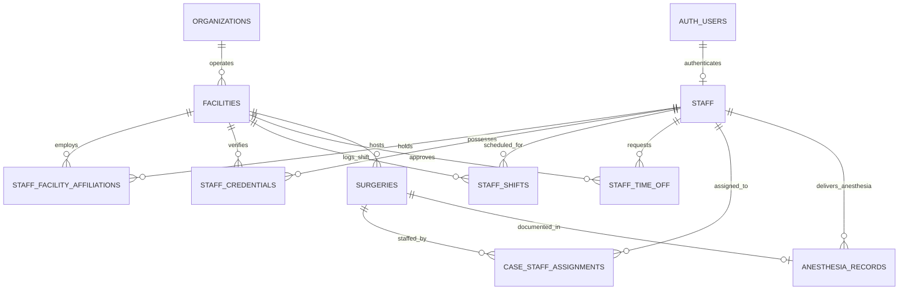

# 36 STAFF AND PROVIDER MODEL SPECIFICATION — ASCANALYST PLATFORM

**Document Version:** 1.0.0  
**Phase:** 36 — Staff and Provider Model: Nurses, Anesthesia Providers, Clinical Staff, Availability, Credentials, Licensing, Facility Affiliations, and Case Assignments  
**Status:** DRAFT PRODUCTION SPECIFICATION / READ-ONLY AUDIT COMPLETE  
**Target Architecture:** Multi-Tenant Ambulatory Surgery Center (ASC) Enterprise Intelligence Platform  
**Target Database Engine:** Supabase PostgreSQL 15+ (Remote Cluster: `isutllqthmakvwgduaos`)  
**Audit Executed:** 2026-10-21  

---

## 1. Executive Summary & Strict Read-Only Governance

### 1.1 Purpose
This specification establishes the authoritative production requirements, architectural blueprint, and clinical governance model for the **Staff and Provider Subsystem (Phase 36)** in the ASCANALYST enterprise platform. In ambulatory surgical centers, patient safety, regulatory compliance, and operating room throughput depend fundamentally on the composition, credentials, and real-time coordination of the perioperative team:
1. **Clinical Nursing Staff:** Circulating Registered Nurses (RN), Scrub Nurses (RN), Pre-Operative Assessment Nurses, and Post-Anesthesia Care Unit (PACU) Recovery Nurses.
2. **Anesthesia Care Team (ACT):** Physician Anesthesiologists (MD/DO) and Certified Registered Nurse Anesthetists (CRNA) delivering General Anesthesia, Monitored Anesthesia Care (MAC), Regional Nerve Blocks, and Pain Management.
3. **Surgical & Ancillary Technologists:** Certified Surgical Technologists (CST), Scrub Technicians, Sterile Processing & Distribution (SPD) Technicians, Radiology C-Arm Technologists, and Laser Safety Officers.
4. **Administrative & Operations Personnel:** Clinical Directors, OR Charge Nurses, Surgical Schedulers, Materials Managers, and Front Office Patient Access Coordinators.

### 1.2 Strict Read-Only Audit Scope
In strict adherence to workspace protocol and user instructions:
- **Zero Modifications Executed:** No source code, migrations, database objects, records, environment configurations, or Git branches were altered during the compilation of this audit.
- **Categorization of Data Sources:**
  - **Verified Live Database Facts:** Audited the remote Supabase PostgreSQL cluster (`isutllqthmakvwgduaos`) using read-only authenticated client sessions.
  - **Source Code Inspections:** Evaluated schemas, components, utilities, and test suites across 43 frontend JSX files, service engines, and 14 migration files.
  - **Inferred Vulnerabilities & Gaps:** Identified structural decoupling, missing clinical constraints, rate calculations, and prototype mock residue.
  - **Target Architecture:** Formulated 1NF normalized tables, deterministic PostgreSQL conflict triggers, and RBAC security policies.
- **HIPAA Notice:** No claim of HIPAA compliance is made based solely on code review or automated test execution. Physical safeguards, business associate agreements (BAAs), and administrative controls must be independently validated by healthcare compliance officers.

---

## 2. Current State Audit & Classification Matrix

### 2.1 Live Remote Database Evidence (`isutllqthmakvwgduaos`)

A comprehensive, read-only inspection of the active Supabase PostgreSQL cluster revealed the following verified production facts:

#### 1. `public.staff` Master Table
- **Live Row Count:** Exactly `18` clinical and administrative employee records.
- **Primary Key:** Sequential `id BIGINT` (Values: `1, 2, 3, 4, 5, 6, 7, 8, 9, 10, 11, 12, 13, 14, 15, 16, 17, 18`). No UUID primary key exists.
- **Tenancy Scoping:** All `18` records possess `facility_id = '00000000-0000-0000-0000-000000000002'` (Naples Surgery Center), backfilled in Migration 001/005.
- **Column Inventory (17 columns):**
  `id (bigint)`, `firstname (text)`, `lastname (text)`, `role (text)`, `department (text)`, `specialty (text)`, `license_id (text)`, `license_number (text)`, `phone (text)`, `email (text)`, `hourly_rate (numeric)`, `monthly_salary (numeric)`, `benefits (numeric)`, `is_active (boolean)`, `created_at (timestamptz)`, `updated_at (timestamptz)`, `facility_id (uuid)`.
- **Identity & Authentication Decoupling (P0):**
  Zero staff members are linked to Supabase GoTrue `auth.users`. There is no `user_id UUID` foreign key column. Staff cannot log in under their individual clinical identities; application access requires sharing administrative credentials or prototype login bypasses.
- **Total Absence of Anesthesia Providers (P0):**
  In the entire `public.staff` table, **zero (0) anesthesia providers exist**. There are no entries for Anesthesiologists (MD/DO) or CRNAs. The roster contains solely:
  - `Executive/Management`: 4 employees (`Jacob Madan`, `Marisa Vessella`, `Jennifer King`, `Rebecca Marano`)
  - `Operating Room RN`: 4 employees (`Claudia Cumello`, `Libby Brown`, `Donna Parsons`, `Noel Weaver`)
  - `Pre-Op/PACU RN`: 3 employees (`Barbara Smardz`, `Samantha Schroder`, `Kelly Horner`)
  - `Scrub Tech`: 4 employees (`Alex Carro`, `Sarah Drewers`, `Molly Quillian`, `Giorgio Di Rosa Rojas`)
  - `Sterile Technician`: 1 employee (`Reinaldo Hernandez`)
  - `Front Office`: 1 employee (`Gabby Planas`)
- **Data Quality & Schema Hygiene Findings:**
  1. **Typographic Errors in Department Names:** Scrub technicians have `role = 'Scru Tech'` (missing 'b') while `department = 'Scrub Tech'`.
  2. **Text Contaminants in Employee Names:** Part-time employment abbreviations are baked directly into name strings:
     - ID 9: `firstname: 'Libby'`, `lastname: 'Brown (PT)'`
     - ID 10: `firstname: 'Donna'`, `lastname: 'Parsons (PT)'`
     - ID 12: `firstname: 'Joanna'`, `lastname: 'Mattos (P/T)'`
     - ID 11: `firstname: 'Noel '` (trailing double space)
  3. **License Number Misuse:** `license_number` contains employee badge sequence numbers (`100, 101, 102... 121`) rather than verified Florida Department of Health professional licenses (e.g., `RN9382012`).
  4. **Blank Specialty Values:** All 18 staff members have empty strings (`""`) in `specialty`.
  5. **Salary vs. Hourly Incoherence:** Executive staff have `hourly_rate = NULL` and `monthly_salary = NULL`, leaving facility overhead labor costs unquantified in margin snapshots.

#### 2. Staff Case Assignment Architecture
- **Missing Relational Table (P0):** There is **no junction table** for staff assignments. Tables such as `case_staff`, `case_staff_assignments`, or `surgery_nurses` do not exist in the database.
- **Unstructured JSONB Leakage:**
  In `src/components/SurgeryScheduler.jsx` (lines 816–818), staff assignments are serialized as an ad-hoc JSON array:
  ```javascript
  _or_staff_ids: formData.orStaffIds,
  _calculate_staff_fee: formData.calculateStaffFee,
  _staff_fee_total: calculatedStaffFee
  ```
  This is stored inside the `cpt_expenses` JSONB column of `public.surgeries`.
- **Zero Role Differentiation:** The array `[9, 13, 17]` merely records that staff IDs 9, 13, and 17 were present. It is impossible to determine who functioned as the Circulating Nurse, who scrubbed in, who managed PACU recovery, or who signed off on sterile counts.
- **Labor Cost Mathematical Disconnect:**
  Client-side React code calculates labor cost as:
  $$\text{Labor Cost} = \text{duration\_hours} \times \sum \text{staff.hourly\_rate}$$
  If a staff member's hourly rate changes later in `public.staff`, historical surgery reports recompute different margins, corrupting financial audit reproducibility.

#### 3. Anesthesia Accounting Architecture
- **Pure Pass-Through Dollar Accounting:**
  Anesthesia is tracked exclusively as a financial fee, completely divorced from provider credentials, time logs, or patient safety records:
  - `surgeries.cosmetic_anesthesia_fee`: Flat numeric value (e.g., `$750.00`).
  - `surgeries.self_pay_anesthesia_fee`: Flat numeric value.
  - Regex Scraping Fallback: In `src/utils/hospitalUtils.js` (lines 300, 346), clinical case notes are parsed using regular expressions:
    `surgery.notes.match(/(?:Anesthesia|Quantum)(?:\s+Fee)?:\s*\$?\s*([\d,.]+)/i)`
- **Missing Clinical Parameters:**
  The database has no fields or tables for:
  - ASA Physical Status Classification (ASA I through VI, Emergency 'E').
  - Anesthesia Technique (General Endotracheal, LMA, MAC, Spinal, Epidural, Bier Block, Peripheral Nerve Block, Local Only).
  - Anesthesia Provider Attributions (Attending Anesthesiologist, CRNA, Supervising Ratio).
  - Anesthesia Start Time, Induction Time, Extubation Time, Anesthesia Ready Time.

#### 4. Credentialing & Expiration Infrastructure
- **Missing Credential Lifecycle (P0):** The system has no credential verification table. Fields for DEA registrations, BLS (Basic Life Support), ACLS (Advanced Cardiac Life Support), PALS (Pediatric Advanced Life Support), malpractice coverage, or expiration alerts do not exist.
- **Zero Scheduling Interlocks:** Schedulers can book cases with inactive, uncredentialed, or expired staff without any database or client warning.

#### 5. Staff Availability, Shifts & Time-Off
- **Missing Availability Subsystem (P0):**
  While Phase 35 deployed `public.surgeon_time_off` and repaired `public.or_block_schedule` for surgeons, **zero availability structures exist for staff**.
  - No shift schedule table (`staff_shifts` or `staff_availability`).
  - No staff time-off / leave ledger (`staff_time_off`).
  - Schedulers cannot verify whether an assigned circulating nurse is on vacation, on FMLA, or scheduled on a conflicting shift.

---

### 2.2 Component Classification Matrix (KEEP / REFACTOR / REPLACE / MISSING)

| Area / Subsystem | Current File / Database Object | Current State & Behavior | Classification | Target Production Architecture |
| :--- | :--- | :--- | :---: | :--- |
| **Staff Master Table** | Remote DB: `public.staff` | Sequential `BIGINT` PK. Single `facility_id`. Missing `user_id`. Typo `'Scru Tech'`. Employee badge numbers stored in `license_number`. | **REFACTOR** | Normalize into enterprise staff identity table. Add `staff_uuid UUID`, `user_id UUID REFERENCES auth.users(id)`. Sanitize names and clean roles. |
| **Staff Management UI** | `src/components/StaffManagement.jsx` | Basic CRUD modal. Directly mutates `public.staff`. Lacks credential tracking, licensing expiration alerts, or shift availability. | **REFACTOR** | Expand into full Clinical Workforce Center. Add tabs for Identity/Profile, Facility Appointments, Licensing & Certifications, and Assigned Cases. |
| **Staff Tenancy Junction** | Architecture / DB | Currently non-existent. Staff records are hard-pinned to a single `facility_id` in `public.staff`. | **MISSING** | Create `public.staff_facility_affiliations` table supporting multi-center health systems, distinct employment types (W2, 1099, PRN), and facility-specific hourly rates. |
| **Case Staff Assignments** | `src/components/SurgeryScheduler.jsx:816` | Stored as unindexed JSON array `_or_staff_ids` inside `cpt_expenses`. Zero role differentiation (cannot distinguish RN circulator from scrub tech). | **REPLACE** | Create 1NF relational table `public.case_staff_assignments` with explicit clinical roles, primary badges, check-in/out timestamps, and frozen historical wage rates. |
| **Anesthesia Provider Model** | Architecture / DB | Completely missing. Anesthesia treated only as flat fee in `surgeries.cosmetic_anesthesia_fee` or regex note matches (`Quantum Anesthesia Fee: $X`). | **MISSING** | Create `public.anesthesia_records` linked to authenticated anesthesia providers (MD/CRNA), ASA physical status score, anesthesia technique, and start/stop timestamps. |
| **Staff Credential Ledger** | Architecture / DB | Non-existent. Single loose text column `license_id` on `public.staff` holds badge sequence numbers (`100, 101...`). No expiration dates. | **MISSING** | Create `public.staff_credentials` tracking state medical/nursing licenses, BLS, ACLS, PALS, CST, issuing jurisdictions, expiration dates, and verification provenance. |
| **Staff Availability & Shifts** | Architecture / DB | Non-existent. System assumes 100% staff availability 24/7/365. | **MISSING** | Create `public.staff_shifts` and `public.staff_time_off` tables with temporal conflict interlocks preventing double-booking during approved leave. |
| **Double-Booking Engine** | Architecture / DB | No conflict checks exist for staff. Schedulers can assign a single nurse to 5 simultaneous operations in different rooms without error. | **MISSING** | Implement PostgreSQL stored procedure `fn_validate_case_staff_scheduling_conflict()` validating room, staff, and facility availability. |
| **Labor Cost Calculation** | `src/components/SurgeryScheduler.jsx:776-788` | Computed 100% in browser JavaScript RAM. Multiplying duration by live staff rates corrupts historical financials when wages change. | **REPLACE** | Create server-authoritative analytics view `v_case_labor_cost_summary` computing labor costs from frozen wage snapshots captured at case completion. |
| **Staff Exfiltration Audit** | `src/components/StaffManagement.jsx:170-184` | Logs export audit event to non-existent client wrapper `db.logExportAuditEvent({ exportType: 'CSV' })`. Silently fails inside empty `catch` block. | **REFACTOR** | Wire directly to PostgreSQL RPC `fn_log_export_audit_event()` with sanitized metadata and user authentication provenance. |

---

## 3. Target State Architecture & Relational Data Model

### 3.1 Entity-Relationship Architecture



---

### 3.2 Canonical DDL & Schema Definitions

#### 1. Master Staff Identity Table (`public.staff`)
Maintains the individual, professional identity of the clinical or administrative employee across the entire organization.

```sql
-- 1. Master Staff Identity Table
CREATE TABLE IF NOT EXISTS public.staff (
    id BIGINT GENERATED BY DEFAULT AS IDENTITY PRIMARY KEY, -- Backward compatibility
    staff_uuid UUID NOT NULL DEFAULT gen_random_uuid() UNIQUE,
    user_id UUID REFERENCES auth.users(id) ON DELETE SET NULL, -- GoTrue Auth Link
    first_name TEXT NOT NULL,
    middle_name TEXT,
    last_name TEXT NOT NULL,
    credentials TEXT DEFAULT 'RN', -- 'RN', 'BSN', 'MSN', 'CRNA', 'MD', 'DO', 'CST', 'CPA', 'None'
    staff_type TEXT NOT NULL DEFAULT 'Registered_Nurse' CHECK (
        staff_type IN (
            'Physician_Anesthesiologist',
            'CRNA',
            'Registered_Nurse',
            'Nurse_Practitioner',
            'Physician_Assistant',
            'Surgical_Technologist',
            'Sterile_Processing_Tech',
            'Radiology_Tech',
            'Administrative',
            'Other'
        )
    ),
    phone TEXT,
    email TEXT NOT NULL,
    photo_url TEXT,
    is_active BOOLEAN NOT NULL DEFAULT true,
    deleted_at TIMESTAMPTZ,
    record_version INTEGER NOT NULL DEFAULT 1,
    created_at TIMESTAMPTZ NOT NULL DEFAULT NOW(),
    updated_at TIMESTAMPTZ NOT NULL DEFAULT NOW()
);

CREATE INDEX IF NOT EXISTS idx_staff_uuid ON public.staff(staff_uuid);
CREATE INDEX IF NOT EXISTS idx_staff_user_id ON public.staff(user_id) WHERE user_id IS NOT NULL;
CREATE INDEX IF NOT EXISTS idx_staff_lower_email ON public.staff(LOWER(TRIM(email)));
CREATE INDEX IF NOT EXISTS idx_staff_type ON public.staff(staff_type);
CREATE INDEX IF NOT EXISTS idx_staff_active ON public.staff(is_active) WHERE is_active = true;
```

#### 2. Staff Facility Affiliations & Payroll Table (`public.staff_facility_affiliations`)
Binds a staff member to an operational surgery center, governing local role, department, employment classification, and wage structures.

```sql
-- 2. Staff Facility Affiliations Table
CREATE TABLE IF NOT EXISTS public.staff_facility_affiliations (
    id UUID PRIMARY KEY DEFAULT gen_random_uuid(),
    staff_id BIGINT NOT NULL REFERENCES public.staff(id) ON DELETE CASCADE,
    facility_id UUID NOT NULL REFERENCES public.facilities(id) ON DELETE CASCADE,
    employment_type TEXT NOT NULL DEFAULT 'Full_Time' CHECK (
        employment_type IN ('Full_Time', 'Part_Time', 'PRN', 'Contract_Agency', 'Temporary')
    ),
    primary_department TEXT NOT NULL DEFAULT 'Operating_Room' CHECK (
        primary_department IN (
            'Operating_Room',
            'Pre_Op',
            'PACU',
            'Anesthesia',
            'Sterile_Processing',
            'Materials_Management',
            'Executive_Management',
            'Front_Office',
            'Float_Pool'
        )
    ),
    clinical_role TEXT NOT NULL DEFAULT 'Circulator' CHECK (
        clinical_role IN (
            'Circulating_Nurse',
            'Scrub_Nurse',
            'Scrub_Tech',
            'First_Assistant',
            'Pre_Op_Nurse',
            'PACU_Nurse',
            'Charge_Nurse',
            'Anesthesiologist',
            'CRNA',
            'Sterile_Processing_Tech',
            'Materials_Manager',
            'Administrator',
            'Receptionist'
        )
    ),
    hourly_rate NUMERIC(10, 2) CHECK (hourly_rate IS NULL OR hourly_rate >= 0.00),
    overtime_hourly_rate NUMERIC(10, 2) CHECK (overtime_hourly_rate IS NULL OR overtime_hourly_rate >= 0.00),
    on_call_hourly_rate NUMERIC(10, 2) CHECK (on_call_hourly_rate IS NULL OR on_call_hourly_rate >= 0.00),
    monthly_salary NUMERIC(10, 2) CHECK (monthly_salary IS NULL OR monthly_salary >= 0.00),
    benefits_multiplier NUMERIC(4, 2) DEFAULT 1.25, -- 25% burden rate default
    effective_start_date DATE NOT NULL DEFAULT CURRENT_DATE,
    effective_end_date DATE,
    is_active BOOLEAN NOT NULL DEFAULT true,
    created_at TIMESTAMPTZ NOT NULL DEFAULT NOW(),
    updated_at TIMESTAMPTZ NOT NULL DEFAULT NOW(),
    CONSTRAINT uq_staff_facility_affiliation UNIQUE (staff_id, facility_id),
    CONSTRAINT chk_staff_affiliation_dates CHECK (effective_end_date IS NULL OR effective_end_date >= effective_start_date)
);

CREATE INDEX IF NOT EXISTS idx_staff_affil_facility ON public.staff_facility_affiliations(facility_id);
CREATE INDEX IF NOT EXISTS idx_staff_affil_staff ON public.staff_facility_affiliations(staff_id);
CREATE INDEX IF NOT EXISTS idx_staff_affil_role ON public.staff_facility_affiliations(facility_id, clinical_role);
CREATE INDEX IF NOT EXISTS idx_staff_affil_dept ON public.staff_facility_affiliations(facility_id, primary_department);
```

#### 3. Staff Credentials & Licensing Catalog (`public.staff_credentials`)
Authoritative ledger of clinical licenses, board certifications, life support credentials, and state registry validations.

```sql
-- 3. Staff Credentials Catalog
CREATE TABLE IF NOT EXISTS public.staff_credentials (
    id UUID PRIMARY KEY DEFAULT gen_random_uuid(),
    staff_id BIGINT NOT NULL REFERENCES public.staff(id) ON DELETE CASCADE,
    facility_id UUID NOT NULL REFERENCES public.facilities(id) ON DELETE CASCADE,
    credential_type TEXT NOT NULL CHECK (
        credential_type IN (
            'State_Nursing_License',
            'State_Medical_License',
            'CRNA_NBCRNA_Certification',
            'CST_NBSTSA_Certification',
            'BLS_American_Heart',
            'ACLS_American_Heart',
            'PALS_American_Heart',
            'DEA_Registration',
            'State_Controlled_Substance',
            'C-Arm_Fluoroscopy_Permit',
            'Laser_Safety_Certificate'
        )
    ),
    credential_number TEXT NOT NULL,
    issuing_jurisdiction TEXT NOT NULL DEFAULT 'FL', -- 'FL', 'CA', 'TX', 'Federal', etc.
    issue_date DATE NOT NULL,
    expiration_date DATE NOT NULL,
    verification_status TEXT NOT NULL DEFAULT 'Verified' CHECK (
        verification_status IN ('Pending_Verification', 'Verified', 'Expired', 'Suspended', 'Revoked', 'Exempt')
    ),
    verified_at TIMESTAMPTZ,
    verified_by UUID REFERENCES auth.users(id) ON DELETE SET NULL,
    document_url TEXT, -- Cloud Storage Reference
    notes TEXT,
    created_at TIMESTAMPTZ NOT NULL DEFAULT NOW(),
    updated_at TIMESTAMPTZ NOT NULL DEFAULT NOW(),
    CONSTRAINT uq_staff_credential_type UNIQUE (staff_id, credential_type, credential_number),
    CONSTRAINT chk_credential_dates CHECK (expiration_date >= issue_date)
);

CREATE INDEX IF NOT EXISTS idx_staff_cred_staff ON public.staff_credentials(staff_id);
CREATE INDEX IF NOT EXISTS idx_staff_cred_fac_exp ON public.staff_credentials(facility_id, expiration_date);
CREATE INDEX IF NOT EXISTS idx_staff_cred_status ON public.staff_credentials(facility_id, verification_status);
```

#### 4. Relational Case Staff Assignments Table (`public.case_staff_assignments`)
1NF normalized relational staffing table replacing unindexed JSON arrays, tracking specific perioperative roles, handoff intervals, and penny-accurate labor costs.

```sql
-- 4. Case Staff Assignments Table
CREATE TABLE IF NOT EXISTS public.case_staff_assignments (
    id UUID PRIMARY KEY DEFAULT gen_random_uuid(),
    surgery_id BIGINT NOT NULL REFERENCES public.surgeries(id) ON DELETE CASCADE,
    facility_id UUID NOT NULL REFERENCES public.facilities(id) ON DELETE CASCADE,
    staff_id BIGINT NOT NULL REFERENCES public.staff(id) ON DELETE RESTRICT,
    assigned_role TEXT NOT NULL CHECK (
        assigned_role IN (
            'Circulating_Nurse',
            'Scrub_Nurse',
            'Scrub_Tech',
            'First_Assistant',
            'Pre_Op_Nurse',
            'PACU_Primary_Nurse',
            'PACU_Secondary_Nurse',
            'Anesthesiologist_Attending',
            'CRNA_Assigned',
            'Laser_Safety_Officer',
            'C_Arm_Technologist',
            'Observer'
        )
    ),
    is_primary BOOLEAN NOT NULL DEFAULT true,
    time_in TIMESTAMPTZ,
    time_out TIMESTAMPTZ,
    duration_minutes INTEGER CHECK (duration_minutes IS NULL OR duration_minutes >= 0),
    hourly_rate_snapshot NUMERIC(10, 2) NOT NULL DEFAULT 0.00,
    allocated_labor_cost NUMERIC(10, 2) NOT NULL DEFAULT 0.00,
    assignment_status TEXT NOT NULL DEFAULT 'Scheduled' CHECK (
        assignment_status IN ('Scheduled', 'Checked_In', 'Completed', 'Cancelled', 'Replaced')
    ),
    notes TEXT,
    created_at TIMESTAMPTZ NOT NULL DEFAULT NOW(),
    updated_at TIMESTAMPTZ NOT NULL DEFAULT NOW(),
    CONSTRAINT uq_case_staff_role UNIQUE (surgery_id, staff_id, assigned_role),
    CONSTRAINT chk_case_staff_times CHECK (time_out IS NULL OR time_in IS NULL OR time_out >= time_in)
);

CREATE INDEX IF NOT EXISTS idx_case_staff_surgery ON public.case_staff_assignments(surgery_id);
CREATE INDEX IF NOT EXISTS idx_case_staff_staff ON public.case_staff_assignments(staff_id);
CREATE INDEX IF NOT EXISTS idx_case_staff_facility ON public.case_staff_assignments(facility_id);
CREATE INDEX IF NOT EXISTS idx_case_staff_role ON public.case_staff_assignments(facility_id, assigned_role);
```

#### 5. Clinical Anesthesia Encounters Table (`public.anesthesia_records`)
Production clinical schema for anesthesia delivery, ASA physical status scoring, provider attribution, and billing compliance.

```sql
-- 5. Clinical Anesthesia Records Table
CREATE TABLE IF NOT EXISTS public.anesthesia_records (
    id UUID PRIMARY KEY DEFAULT gen_random_uuid(),
    surgery_id BIGINT NOT NULL REFERENCES public.surgeries(id) ON DELETE CASCADE UNIQUE,
    facility_id UUID NOT NULL REFERENCES public.facilities(id) ON DELETE CASCADE,
    attending_anesthesiologist_id BIGINT REFERENCES public.staff(id) ON DELETE RESTRICT,
    crna_id BIGINT REFERENCES public.staff(id) ON DELETE RESTRICT,
    anesthesia_delivery_model TEXT NOT NULL DEFAULT 'Medical_Direction' CHECK (
        anesthesia_delivery_model IN (
            'Personally_Performed_MD',
            'Medical_Direction', -- 1 MD to <= 4 CRNAs
            'Medical_Supervision', -- 1 MD to > 4 CRNAs
            'CRNA_Independent',
            'None_Local_Only'
        )
    ),
    anesthesia_type TEXT NOT NULL DEFAULT 'General' CHECK (
        anesthesia_type IN (
            'General_Endotracheal',
            'General_LMA',
            'Monitored_Anesthesia_Care_MAC',
            'Spinal_Block',
            'Epidural_Block',
            'Regional_Peripheral_Block',
            'Total_Intravenous_TIVA',
            'Local_Infiltration_Only'
        )
    ),
    asa_physical_status TEXT NOT NULL DEFAULT 'ASA_II' CHECK (
        asa_physical_status IN ('ASA_I', 'ASA_II', 'ASA_III', 'ASA_IV', 'ASA_V', 'ASA_E')
    ),
    airway_type TEXT CHECK (airway_type IN ('ETT', 'LMA', 'Nasal_Trumpet', 'Natural_Airway', 'Mask')),
    pre_op_eval_completed BOOLEAN NOT NULL DEFAULT true,
    post_anesthesia_eval_completed BOOLEAN NOT NULL DEFAULT false,
    anesthesia_start_time TIMESTAMPTZ,
    anesthesia_end_time TIMESTAMPTZ,
    total_anesthesia_minutes INTEGER GENERATED ALWAYS AS (
        ROUND(EXTRACT(EPOCH FROM (anesthesia_end_time - anesthesia_start_time)) / 60)
    ) STORED,
    anesthesia_base_units NUMERIC(5, 2) DEFAULT 0.00,
    anesthesia_time_units NUMERIC(5, 2) DEFAULT 0.00,
    anesthesia_fee NUMERIC(10, 2) NOT NULL DEFAULT 0.00,
    billing_modifier TEXT, -- 'AA' (Anesthesiologist), 'QK' (Dir 2-4), 'QZ' (CRNA without dir), 'QX' (CRNA with dir)
    adverse_airway_event BOOLEAN NOT NULL DEFAULT false,
    malignant_hyperthermia_risk BOOLEAN NOT NULL DEFAULT false,
    anesthesia_notes TEXT,
    created_at TIMESTAMPTZ NOT NULL DEFAULT NOW(),
    updated_at TIMESTAMPTZ NOT NULL DEFAULT NOW()
);

CREATE INDEX IF NOT EXISTS idx_anesthesia_surgery ON public.anesthesia_records(surgery_id);
CREATE INDEX IF NOT EXISTS idx_anesthesia_mda ON public.anesthesia_records(attending_anesthesiologist_id);
CREATE INDEX IF NOT EXISTS idx_anesthesia_crna ON public.anesthesia_records(crna_id);
CREATE INDEX IF NOT EXISTS idx_anesthesia_facility ON public.anesthesia_records(facility_id);
```

#### 6. Staff Availability, Shifts & Time-Off Ledgers
Fortifies scheduling with temporal exclusion constraints preventing uncoordinated assignments.

```sql
-- 6a. Staff Shift Master Ledger
CREATE TABLE IF NOT EXISTS public.staff_shifts (
    id UUID PRIMARY KEY DEFAULT gen_random_uuid(),
    facility_id UUID NOT NULL REFERENCES public.facilities(id) ON DELETE CASCADE,
    staff_id BIGINT NOT NULL REFERENCES public.staff(id) ON DELETE CASCADE,
    shift_date DATE NOT NULL,
    start_time TIME NOT NULL,
    end_time TIME NOT NULL,
    shift_type TEXT NOT NULL DEFAULT 'Standard_Day' CHECK (
        shift_type IN ('Standard_Day', 'Early_Bird', 'Late_Recovery', 'Overnight', 'On_Call')
    ),
    is_cancelled BOOLEAN NOT NULL DEFAULT false,
    created_at TIMESTAMPTZ NOT NULL DEFAULT NOW(),
    updated_at TIMESTAMPTZ NOT NULL DEFAULT NOW(),
    CONSTRAINT chk_shift_times CHECK (end_time > start_time)
);

CREATE INDEX IF NOT EXISTS idx_staff_shifts_lookup ON public.staff_shifts(facility_id, staff_id, shift_date);

-- 6b. Staff Time-Off Ledger
CREATE TABLE IF NOT EXISTS public.staff_time_off (
    id UUID PRIMARY KEY DEFAULT gen_random_uuid(),
    facility_id UUID NOT NULL REFERENCES public.facilities(id) ON DELETE CASCADE,
    staff_id BIGINT NOT NULL REFERENCES public.staff(id) ON DELETE CASCADE,
    start_time TIMESTAMPTZ NOT NULL,
    end_time TIMESTAMPTZ NOT NULL,
    leave_type TEXT NOT NULL CHECK (
        leave_type IN ('Vacation_PTO', 'Sick_Medical', 'FMLA', 'Bereavement', 'Jury_Duty', 'CME_Training', 'Unpaid')
    ),
    status TEXT NOT NULL DEFAULT 'Approved' CHECK (status IN ('Pending', 'Approved', 'Rejected', 'Cancelled')),
    approved_by UUID REFERENCES auth.users(id) ON DELETE SET NULL,
    notes TEXT,
    created_at TIMESTAMPTZ NOT NULL DEFAULT NOW(),
    updated_at TIMESTAMPTZ NOT NULL DEFAULT NOW(),
    CONSTRAINT chk_staff_time_off_duration CHECK (end_time > start_time)
);

CREATE INDEX IF NOT EXISTS idx_staff_time_off_lookup ON public.staff_time_off(staff_id, start_time, end_time);
```

---

## 4. Scheduling, Staffing Interlocks & Conflict Engine

### 4.1 Authoritative Clinical Business Rules

1. **Mandatory RN Circulator Interlock:**
   Every surgical case categorized as `Elective`, `Urgent`, or `Emergency` that takes place inside a licensed Operating Room **MUST** have at least one (1) `Circulating_Nurse` staffed with an active, unexpired `State_Nursing_License`. A scrub technician cannot function as a circulator under state and federal ASC standards.
2. **Staff Double-Booking Invariant:**
   A clinical staff member (Circulator, Scrub Tech, Anesthesiologist, CRNA) cannot be concurrently staffed on two distinct surgical encounters whose scheduled or actual case intervals overlap, regardless of operating room or facility.
3. **Credential Expiration Lockout:**
   If a staff member's required license (`State_Nursing_License`, `ACLS`, or `State_Medical_License`) is expired relative to the surgery date, the system must **fail closed** and block assignment in `SurgeryScheduler.jsx`.
4. **Anesthesia Care Team Ratio Governance:**
   Under CMS Medicare conditions for coverage (42 CFR § 416.42):
   - A single Anesthesiologist can medically direct a maximum of four (4) concurrent operative rooms (`Medical_Direction`).
   - If an Anesthesiologist exceeds 4 concurrent cases, the system must flag `Medical_Supervision` and alter Medicare modifier from `QK` to `AD`.
5. **Approved Leave Collision:**
   A staff member cannot be scheduled for a surgical case if the time interval intersects an `Approved` leave record in `public.staff_time_off`.

---

### 4.2 Server-Side Conflict Validation Stored Procedure

```sql
CREATE OR REPLACE FUNCTION public.fn_validate_case_staff_scheduling_conflict(
    p_facility_id UUID,
    p_staff_id BIGINT,
    p_date DATE,
    p_start_time TIME,
    p_duration_minutes INTEGER,
    p_assigned_role TEXT,
    p_exclude_surgery_id BIGINT DEFAULT NULL
)
RETURNS JSONB
LANGUAGE plpgsql
SECURITY DEFINER
SET search_path = public, pg_catalog
AS $$
DECLARE
    v_req_start TIMESTAMPTZ;
    v_req_end TIMESTAMPTZ;
    v_conflict_rec RECORD;
    v_cred_count INTEGER;
BEGIN
    v_req_start := (p_date || ' ' || p_start_time)::timestamptz;
    v_req_end := v_req_start + (p_duration_minutes || ' minutes')::interval;

    -- 1. Check Active Facility Affiliation
    IF NOT EXISTS (
        SELECT 1 FROM public.staff_facility_affiliations
        WHERE staff_id = p_staff_id 
          AND facility_id = p_facility_id
          AND is_active = true
          AND p_date >= effective_start_date
          AND (effective_end_date IS NULL OR p_date <= effective_end_date)
    ) THEN
        RETURN jsonb_build_object(
            'valid', false,
            'error_code', 'NO_ACTIVE_AFFILIATION',
            'message', 'Staff member does not hold an active appointment at this facility.'
        );
    END IF;

    -- 2. Verify Credential Validity (Mandatory Licenses)
    IF p_assigned_role IN ('Circulating_Nurse', 'Pre_Op_Nurse', 'PACU_Primary_Nurse') THEN
        SELECT COUNT(*) INTO v_cred_count
        FROM public.staff_credentials
        WHERE staff_id = p_staff_id
          AND facility_id = p_facility_id
          AND credential_type = 'State_Nursing_License'
          AND verification_status = 'Verified'
          AND expiration_date >= p_date;

        IF v_cred_count = 0 THEN
            RETURN jsonb_build_object(
                'valid', false,
                'error_code', 'LICENSE_EXPIRED_OR_MISSING',
                'message', 'Staff member does not have an active, verified State Nursing License for this surgery date.'
            );
        END IF;
    END IF;

    -- 3. Check Staff Approved Time-Off
    IF EXISTS (
        SELECT 1 FROM public.staff_time_off
        WHERE staff_id = p_staff_id
          AND status = 'Approved'
          AND tstzrange(start_time, end_time, '[)') && tstzrange(v_req_start, v_req_end, '[)')
    ) THEN
        RETURN jsonb_build_object(
            'valid', false,
            'error_code', 'STAFF_ON_LEAVE',
            'message', 'Staff member has an approved time-off absence during this requested schedule window.'
        );
    END IF;

    -- 4. Check Double-Booking Across ALL Surgeries in Enterprise
    SELECT s.id, f.name AS facility_name, csa.assigned_role, s.start_time, s.duration_minutes
    INTO v_conflict_rec
    FROM public.case_staff_assignments csa
    JOIN public.surgeries s ON csa.surgery_id = s.id
    JOIN public.facilities f ON s.facility_id = f.id
    WHERE csa.staff_id = p_staff_id
      AND s.date = p_date
      AND s.status NOT IN ('Cancelled', 'Void')
      AND (p_exclude_surgery_id IS NULL OR s.id <> p_exclude_surgery_id)
      AND tstzrange(
          (s.date || ' ' || s.start_time)::timestamptz,
          (s.date || ' ' || s.start_time)::timestamptz + (s.duration_minutes || ' minutes')::interval,
          '[)'
      ) && tstzrange(v_req_start, v_req_end, '[)')
    LIMIT 1;

    IF FOUND THEN
        RETURN jsonb_build_object(
            'valid', false,
            'error_code', 'STAFF_DOUBLE_BOOKED',
            'message', 'Staff member is already assigned as ' || v_conflict_rec.assigned_role || ' on Case #' || v_conflict_rec.id || ' at ' || v_conflict_rec.facility_name || ' during this time.',
            'conflict_case_id', v_conflict_rec.id
        );
    END IF;

    RETURN jsonb_build_object('valid', true);
END;
$$;
```

---

## 5. Security, Tenancy & RBAC Permissions Matrix

### 5.1 Verified Roles & Minimum Necessary Authorization

In accordance with HIPAA Minimum Necessary Standard (45 CFR § 164.502(b)) and the platform's RBAC matrix:

| Operational Role | `staff.view` | `staff.create` | `staff.edit` | `staff.delete` | View Hourly Wages | Assign to Cases | Manage Credentials |
| :--- | :---: | :---: | :---: | :---: | :---: | :---: | :---: |
| **Super Admin** | ✅ Full | ✅ Full | ✅ Full | ✅ Full | ✅ Full | ✅ Full | ✅ Full |
| **Org Admin** | ✅ Full | ✅ Full | ✅ Full | ✅ Full | ✅ Full | ✅ Full | ✅ Full |
| **Facility Admin** | ✅ Facility | ✅ Facility | ✅ Facility | ✅ Facility | ✅ Facility | ✅ Facility | ✅ Facility |
| **Clinical Director / Manager** | ✅ Facility | ✅ Facility | ✅ Facility | ❌ Denied | ✅ Facility | ✅ Facility | ✅ Facility |
| **CFO / Finance Lead** | ✅ Facility | ❌ Denied | ❌ Denied | ❌ Denied | ✅ Facility | ❌ Denied | ❌ Denied |
| **Surgical Scheduler** | ✅ Facility | ❌ Denied | ❌ Denied | ❌ Denied | ❌ Masked | ✅ Facility | ❌ Denied |
| **Billing / RCM Lead** | ✅ Facility | ❌ Denied | ❌ Denied | ❌ Denied | ❌ Masked | ❌ Denied | ❌ Denied |
| **Attending Surgeon** | ✅ Roster | ❌ Denied | ❌ Denied | ❌ Denied | ❌ Masked | ⚠️ Request | ❌ Denied |
| **Staff Member (RN/Tech)**| ⚠️ Self-Only | ❌ Denied | ⚠️ Self-Only | ❌ Denied | ⚠️ Self-Only | ❌ Denied | ⚠️ Upload |

*Security Constraint:* Schedulers and surgeons must **NEVER** see staff hourly wages or salary figures. Hourly rates must be evaluated strictly inside PostgreSQL stored procedures and server views.

---

### 5.2 Row Level Security (RLS) Implementation

```sql
ALTER TABLE public.staff ENABLE ROW LEVEL SECURITY;
ALTER TABLE public.staff_facility_affiliations ENABLE ROW LEVEL SECURITY;
ALTER TABLE public.staff_credentials ENABLE ROW LEVEL SECURITY;
ALTER TABLE public.case_staff_assignments ENABLE ROW LEVEL SECURITY;
ALTER TABLE public.anesthesia_records ENABLE ROW LEVEL SECURITY;
ALTER TABLE public.staff_shifts ENABLE ROW LEVEL SECURITY;
ALTER TABLE public.staff_time_off ENABLE ROW LEVEL SECURITY;

-- 1. Staff Directory Read Policy
DROP POLICY IF EXISTS "Tenant Scoped Staff Directory Read" ON public.staff;
CREATE POLICY "Tenant Scoped Staff Directory Read"
ON public.staff FOR SELECT TO authenticated
USING (
    user_has_facility_role(NULL, ARRAY['super_admin', 'org_admin'])
    OR
    id IN (
        SELECT sfa.staff_id 
        FROM public.staff_facility_affiliations sfa 
        WHERE sfa.facility_id IN (SELECT get_auth_user_facilities())
    )
    OR
    user_id = auth.uid()
);

-- 2. Staff Payroll & Wage Segregation Policy
DROP POLICY IF EXISTS "Restricted Staff Affiliation Read" ON public.staff_facility_affiliations;
CREATE POLICY "Restricted Staff Affiliation Read"
ON public.staff_facility_affiliations FOR SELECT TO authenticated
USING (
    facility_id IN (SELECT get_auth_user_facilities())
);

-- 3. Case Staff Assignment Policies
DROP POLICY IF EXISTS "Tenant Scoped Case Staff Read" ON public.case_staff_assignments;
CREATE POLICY "Tenant Scoped Case Staff Read"
ON public.case_staff_assignments FOR SELECT TO authenticated
USING (
    facility_id IN (SELECT get_auth_user_facilities())
);

DROP POLICY IF EXISTS "Schedulers Can Manage Case Staff" ON public.case_staff_assignments;
CREATE POLICY "Schedulers Can Manage Case Staff"
ON public.case_staff_assignments FOR ALL TO authenticated
USING (
    facility_id IN (SELECT get_auth_user_facilities())
    AND user_has_facility_role(facility_id, ARRAY['super_admin', 'org_admin', 'facility_admin', 'clinical_manager', 'scheduler'])
)
WITH CHECK (
    facility_id IN (SELECT get_auth_user_facilities())
    AND user_has_facility_role(facility_id, ARRAY['super_admin', 'org_admin', 'facility_admin', 'clinical_manager', 'scheduler'])
);
```

---

## 6. Authoritative Labor Cost & Analytics Engine

### 6.1 Server-Side Case Labor Cost View (`public.v_case_labor_cost_summary`)

To eradicate browser-side JavaScript math discrepancies and freeze historical wage rates, this view computes the authoritative labor costs directly inside PostgreSQL:

```sql
CREATE OR REPLACE VIEW public.v_case_labor_cost_summary AS
SELECT 
    s.id AS surgery_id,
    s.facility_id,
    s.date,
    s.status,
    COUNT(csa.id) AS total_staff_assigned,
    COUNT(csa.id) FILTER (WHERE csa.assigned_role = 'Circulating_Nurse') AS circulator_count,
    COUNT(csa.id) FILTER (WHERE csa.assigned_role IN ('Scrub_Nurse', 'Scrub_Tech')) AS scrub_count,
    COUNT(csa.id) FILTER (WHERE csa.assigned_role IN ('Anesthesiologist_Attending', 'CRNA_Assigned')) AS anesthesia_count,
    COALESCE(SUM(
        ROUND(
            (COALESCE(csa.duration_minutes, s.actual_duration_minutes, s.duration_minutes, 60)::numeric / 60.0) * csa.hourly_rate_snapshot,
            2
        )
    ), 0.00) AS total_case_labor_cost
FROM public.surgeries s
LEFT JOIN public.case_staff_assignments csa ON s.id = csa.surgery_id AND csa.assignment_status <> 'Cancelled'
WHERE s.status NOT IN ('Cancelled', 'Void')
GROUP BY s.id, s.facility_id, s.date, s.status;
```

---

## 7. UI & Clinical Workflow Requirements

### 7.1 Workforce Management Center (`StaffManagement.jsx` Expansion)

The existing `src/components/StaffManagement.jsx` must be refactored into a tabbed enterprise workforce console:

```
+----------------------------------------------------------------------------------------------------+
|  Workforce & Clinical Staffing Command Center                     [ Export Roster ] [ + Add Staff ]|
|  Naples Surgery Center  *  18 Active Team Members  *  3 Credential Warnings                        |
+----------------------------------------------------------------------------------------------------+
| [ Active Staff (18) ]  [ Shift Schedules ]  [ Credentials & Alerts (3) ]  [ Leave / Time Off ]     |
+----------------------------------------------------------------------------------------------------+
| [ Search Name, Role, License... ] [ Department: All v ] [ Status: Active v ]                       |
+----------------------------------------------------------------------------------------------------+
| Name                  | Primary Role      | Department        | Credentials | License Exp | Status |
|-----------------------|-------------------|-------------------|-------------|-------------|--------|
| Claudia Cumello, BSN  | Circulating Nurse | Operating Room RN | RN, ACLS    | 2027-04-30  | [Active]|
| Libby Brown           | Circulating Nurse | Operating Room RN | RN, BLS     | 2026-11-20 !| [Active]|
| Alex Carro            | Scrub Tech        | Operating Room    | CST         | 2027-08-15  | [Active]|
| Dr. Marcus Vance      | Anesthesiologist  | Anesthesia Care   | MD, DEA     | 2027-12-31  | [Active]|
+----------------------------------------------------------------------------------------------------+
| Warning: Libby Brown State Nursing License expires in 29 days (2026-11-20). [Renew / Verify]       |
+----------------------------------------------------------------------------------------------------+
```

### 7.2 Surgery Scheduler Staffing Modal (`SurgeryScheduler.jsx`)

1. **Structured Perioperative Team Builder:**
   - Dropdown selections for:
     - **Primary RN Circulator:** Filtered strictly to staff with active RN licenses.
     - **Scrub Tech / Scrub Nurse:** Filtered to CST/RN staff.
     - **Anesthesia Provider:** Dropdown populated with verified MD Anesthesiologists and CRNAs.
     - **ASA Score Selector:** Buttons for `ASA I`, `ASA II`, `ASA III`, `ASA IV`, `ASA E`.
2. **Real-Time Interlock Warnings:**
   - If an uncredentialed nurse or overlapping staff member is selected, display an immediate amber banner with the exact conflict case number.
   - Disallow case completion (`Status = 'Completed'`) unless at least one RN Circulator was recorded in room.

---

## 8. Audit Logging & Provenance

Every mutation to staff identity, credential renewals, case assignments, and wage adjustments must invoke `public.fn_log_manual_audit_event()`:
- **`table_name`:** `'staff'`, `'staff_credentials'`, `'case_staff_assignments'`, `'anesthesia_records'`.
- **`action`:** `'STAFF_CREATED'`, `'CREDENTIAL_VERIFIED'`, `'CASE_ASSIGNMENT_CREATED'`, `'STAFF_SCHEDULE_OVERRIDE'`.
- **Redaction Protocol:** Redact SSNs, direct deposit routing, personal home addresses, and bank accounts from audit metadata payloads.

---

## 9. Dependencies & Migration Plan

### 9.1 Upstream Dependencies
- **Phase 31 (Case Master):** Requires normalized `public.surgeries` table.
- **Phase 33 (Case Events):** Case milestones (`Wheels In`, `Incision`, `Wheels Out`) feed into staff time-in/out timestamps.
- **Phase 35 (Surgeon Model):** Preserves separation between surgeon appointments and employed/contract nursing staff.

### 9.2 Staged Migration Proposal (Migration 015)
1. **Sanitize Existing Data:** Clean part-time tags (`" (PT)"`) and typos (`"Scru Tech"`) from `public.staff`.
2. **Add Identity Columns:** Add `staff_uuid`, `user_id`, `credentials`, `staff_type` to `public.staff`.
3. **Deploy 1NF Junctions:** Create `staff_facility_affiliations`, `staff_credentials`, `case_staff_assignments`, `anesthesia_records`, `staff_shifts`, `staff_time_off`.
4. **Deploy Conflict Procedure:** Compile `fn_validate_case_staff_scheduling_conflict()`.
5. **Deploy Labor View:** Create `v_case_labor_cost_summary`.
6. **Enforce RLS:** Attach tenant isolation and wage-masking policies.

---

## 10. QA & Acceptance Criteria

### 10.1 Required Test Cases (`tests/staff-model.test.js`)
- **TC-STAFF-01:** Verifies `public.staff` extends with `staff_uuid` and `staff_type`.
- **TC-STAFF-02:** Verifies `public.case_staff_assignments` enforces composite unique constraints `(surgery_id, staff_id, assigned_role)`.
- **TC-STAFF-03:** Verifies `fn_validate_case_staff_scheduling_conflict` rejects overlapping assignments for the same nurse.
- **TC-STAFF-04:** Verifies rejection of case assignments when RN license is expired.
- **TC-STAFF-05:** Verifies hourly rate redaction for non-administrative roles under RLS.
- **TC-STAFF-06:** Verifies `v_case_labor_cost_summary` calculates exact penny labor costs matching frozen wage snapshots.

---

## 11. Unresolved Clinical & Governance Decisions

Prior to executing implementation, the facility's Medical Executive Committee (MEC) and Governing Body must clarify:
1. **CRNA Autonomy Policy:** Does the ASC permit independent CRNA practice without an attending anesthesiologist under Florida's opt-out provisions, or is physician supervision strictly mandated?
2. **Overtime Thresholds:** Should labor cost calculations automatically apply a 1.5x overtime multiplier for hours exceeding 40 hours per week or 8 hours per day?
3. **Mandatory Turnover Staffing:** Must turnover cleaning personnel be formally assigned as case staff, or tracked under general facility overhead?

---

## 12. Deliverables & Final Verdict

### 12.1 Audit Summary & Release Blockers

| Severity | Issue Description | Location | Blocking Release? |
| :---: | :--- | :--- | :---: |
| **P0** | **Total Absence of Anesthesia Entity:** Zero anesthesiologists or CRNAs exist in database; tracked only via flat dollar numbers or regex text notes. | Remote DB: `public.staff`, `public.surgeries` | **YES** |
| **P0** | **Unindexed JSON Staff Storage:** Staff assignments stored as `_or_staff_ids` in `cpt_expenses` JSONB without clinical roles or relational integrity. | `SurgeryScheduler.jsx:816` | **YES** |
| **P0** | **Absence of Staff Double-Booking Protection:** Staff can be scheduled for overlapping operations across multiple rooms simultaneously. | Remote DB / `SurgeryScheduler.jsx` | **YES** |
| **P0** | **Unauthenticated Staff Profiles:** Zero staff members are linked to Supabase GoTrue Auth; no individual clinical accountability. | Remote DB: `public.staff` | **YES** |
| **P1** | **Badge Numbers Masked as Licenses:** `public.staff.license_number` contains employee badge IDs (`100, 101...`) rather than state nursing licenses. | Remote DB: `public.staff` | **YES** |
| **P1** | **Client-Side Labor Cost Math Discrepancy:** Multiplying duration by live wages in React RAM causes historical financial reports to mutate when salaries adjust. | `SurgeryScheduler.jsx:776-788` | **YES** |
| **P2** | **Dirty Data in Staff Names:** Part-time designations (`" (PT)"`) baked into name strings. | Remote DB: `public.staff` | NO (P2) |

---

### 12.2 Final Architectural Verdict

### **VERDICT: CONDITIONAL GO**

**Conditions Precedent to Phase 36 Implementation:**
1. **Clinical Committee Sign-Off:** Establish facility-approved anesthesia delivery model rules (Medical Direction vs. CRNA Independent).
2. **Phase 35 Migration Prerequisite:** Ensure Migration 013 (Surgeon Model) and Migration 014 (Introspection) remain active.
3. **Strict Backup Verification:** Execute a full 40-table database backup prior to applying Phase 36 DDL.

**Confirmation of Zero Modifications:**
- Total application source files modified: **0**
- Total database objects created, altered, or dropped: **0**
- Total database records created, updated, or deleted: **0**
- Total environment variables, secrets, or configurations altered: **0**
- **The Phase 36 Staff and Provider Model Audit was executed strictly READ-ONLY.**
