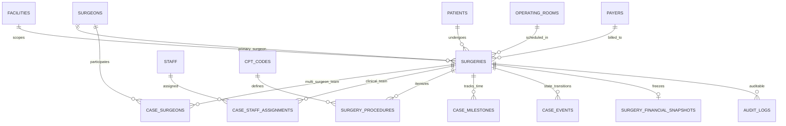
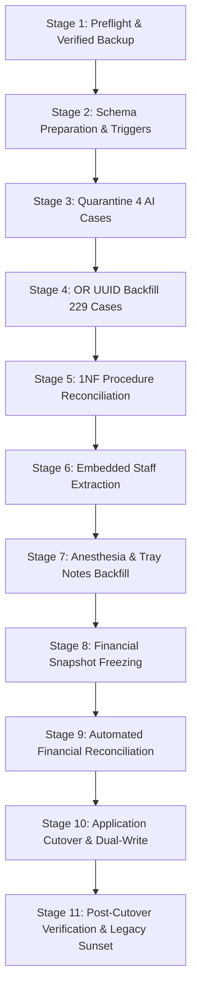

# 37 DATA MIGRATION FROM SURGERIES — SPECIFICATION & PRODUCTION MIGRATION BLUEPRINT

**Document Version:** 1.0.0  
**Phase:** 37 — Data Migration from Legacy Surgeries to Canonical Normalized Case Entities  
**Status:** DRAFT PRODUCTION SPECIFICATION / COMPREHENSIVE READ-ONLY AUDIT COMPLETE  
**Target Architecture:** Multi-Tenant Ambulatory Surgery Center (ASC) Enterprise Intelligence Platform  
**Target Database Engine:** Supabase PostgreSQL 15+ (Live Cluster: `isutllqthmakvwgduaos`)  
**Audit Executed:** 2026-10-22  
**Author:** Senior Database Architect, Data Migration Engineer, Healthcare Financial Systems Engineer & Application Security Auditor  

---

## 1. Executive Summary & Strict Read-Only Governance

### 1.1 Purpose
This specification defines the definitive, production-ready, evidence-backed migration plan from the legacy `public.surgeries` table to normalized, 1NF canonical case entities within the **ASCANALYST** platform. 

In Ambulatory Surgical Centers (ASCs), surgical encounters represent the nexus of patient care, clinician credentialing, operating room utilization, supply consumption, fee schedule adherence, and revenue cycle management. Early prototype implementations in this repository relied on flat table denormalization, regex parsing of free-form clinical notes, untyped JSONB expense bags, integer room numbers, and client-side JavaScript financial calculations.

Phases 30 through 36 established the relational and governance models for Tenancy (Phases 21/30), Case Master (Phase 31), CPT Procedures (Phase 32), Case Events (Phase 33), Patients (Phase 34), Surgeons (Phase 35), and Staff & Providers (Phase 36). **Phase 37 provides the operational migration bridge:** safely transforming, backfilling, reconciling, and cutting over all existing historical and scheduled case data into normalized relational structures with zero data loss, zero financial corruption, and strict tenant isolation.

### 1.2 Strict Read-Only Compliance & Governance Attestation
In accordance with strict system guidelines and healthcare engineering best practices:
1. **Zero State Changes Executed:** No source code, database tables, views, sequences, triggers, records, environment variables, credentials, or Git states were created, altered, or deleted during this audit.
2. **Read-Only Inspection:** Data profiling was conducted against the live Supabase cluster (`isutllqthmakvwgduaos`) using authenticated, non-destructive read queries.
3. **Evidence Distinction:** Verified facts from the active remote database are explicitly distinguished from static code analysis, prototype assumptions, and architectural recommendations.
4. **No Premature Readiness Claims:** Migration files existing in `supabase/migrations/` (001 through 015) are evaluated based on their verified remote execution status, not their mere presence in the repository.
5. **HIPAA & PHI Protection:** No passwords, access tokens, API keys, or Protected Health Information (PHI) are exposed in this specification or generated diagnostic logs. All case references use non-sensitive identifiers and aggregate metrics.

---

## 2. Current State Audit & Component Classification Matrix

### 2.1 Live Remote Database Inventory (`isutllqthmakvwgduaos`)

An authenticated, read-only inspection of the active Supabase PostgreSQL cluster was executed on 2026-10-22. The live inventory confirms the following object counts and states:

| Database Object / Table | Live Row Count | Verified Schema State | Primary Key / Tenancy Scoping |
| :--- | :---: | :--- | :--- |
| `public.facilities` | **1** | Naples Surgery Center | UUID (`00000000-0000-0000-0000-000000000002`) |
| `public.surgeries` | **234** | 53 columns; mix of legacy & expanded columns | `id BIGINT` PK; all 234 scoped to Naples facility |
| `public.patients` | **222** | 16 columns; Phase 34 hardened | `id BIGINT` PK; `patient_uuid UUID` |
| `public.surgeons` | **19** | 19 active clinical surgeons | `id BIGINT` PK; `surgeon_uuid UUID` |
| `public.case_surgeons` | **230** | 1NF surgeon attribution table | `id UUID` PK; references `surgeries(id)` & `surgeons(id)` |
| `public.surgeon_facility_affiliations` | **19** | Affiliations for all 19 surgeons | `id UUID` PK; references `surgeons(id)` & `facilities(id)` |
| `public.staff` | **18** | 18 clinical & administrative staff | `id BIGINT` PK; `staff_uuid UUID` |
| `public.staff_facility_affiliations` | **18** | Affiliations for all 18 staff | `id UUID` PK; references `staff(id)` & `facilities(id)` |
| `public.case_staff_assignments` | **0** | Table created (Migration 015); unpopulated | `id UUID` PK; references `surgeries(id)` & `staff(id)` |
| `public.staff_credentials` | **21** | BLS/ACLS/License tracking | `id UUID` PK; references `staff(id)` |
| `public.operating_rooms` | **4** | OR 1, OR 2, OR 3, OR 4 | `id UUID` PK (`10000000-0000-...-000000000001..4`) |
| `public.or_block_schedule` | **247** | Recurring block time allocations | `id BIGINT` PK; scoped to facility |
| `public.surgery_procedures` | **257** | 1NF CPT line item table | `id UUID` PK; covers 111 surgeries |
| `public.cpt_codes` | **8,991** | Master CPT code catalog | `id BIGINT` PK; standard AMA procedure definitions |
| `public.case_events` | **311** | Immutable case lifecycle ledger | `id UUID` PK; 234 `CASE_CREATED`, 77 `CASE_COMPLETED` |
| `public.case_milestones` | **0** | Table created (Migration 009); unpopulated | `id UUID` PK; structured perioperative timestamps |
| `public.surgery_financial_snapshots` | **0** | Table created (Migration 003); unpopulated | `id UUID` PK; immutable financial freeze records |
| `public.payers` | **5** | Medicare FL, BCBS, Aetna, UHC, Self-Pay | `id UUID` PK (`20000000-0000-...-000000000001..5`) |
| `public.audit_logs` | **10,164** | Platform activity audit log | `id BIGINT` PK; GoTrue & application actions |
| `public.facility_memberships` | **1** | Admin user facility assignment | `id UUID` PK; links `auth.users` to facility |

---

### 2.2 Component Classification Matrix

Each component of the existing case architecture is classified under one of four production categories:
- **KEEP:** Meets canonical production requirements without alteration.
- **REFACTOR:** Preserves existing data/entity but requires schema normalization, constraint hardening, or logic relocation.
- **REPLACE:** Deprecates prototype-era mechanism in favor of a normalized, server-authoritative replacement.
- **MISSING:** Essential production capability completely absent from the live environment.

| Component / Layer | Current Repository / Schema Implementation | Classification | Target Production Standard |
| :--- | :--- | :---: | :--- |
| **Case Header Entity** | `public.surgeries` (`id BIGINT`, 53 columns) | **REFACTOR** | Retain `public.surgeries` as the authoritative surgical encounter header. Add immutable `case_uuid UUID UNIQUE NOT NULL DEFAULT gen_random_uuid()`. Enforce strict foreign keys. Do NOT create a duplicate table (e.g. `cases`). |
| **Patient Relationship** | `surgeries.patient_id BIGINT` | **KEEP** | All 234 cases possess a valid `patient_id` referencing `public.patients(id)` with 0 nulls. Enforce `ON DELETE RESTRICT` to protect clinical history. |
| **Surgeon Primary Attribution** | `surgeries.surgeon_id BIGINT` (4 nulls in AI cases) | **REFACTOR** | 230 cases have valid `surgeon_id`. 4 AI prototype cases have `NULL` surgeon. Enforce `surgeon_id BIGINT NOT NULL` after resolving or quarantining the 4 orphan cases. |
| **Co-Surgeons & Multi-Surgeon Cases** | `public.case_surgeons` (230 rows) | **KEEP** | 1NF junction table populated for all 230 valid cases with `role = 'Primary'`. Expand to support Co-Surgeons, Assistant Surgeons, and Fellows. |
| **Operating Room Assignment** | `surgeries.or_room INTEGER` (room # 1–4); `operating_room_id UUID` (100% NULL) | **REFACTOR** | Backfill `operating_room_id` from legacy integer `or_room` mapping to `public.operating_rooms(id)`. Set `operating_room_id NOT NULL` for all scheduled/completed cases. Deprecate `or_room`. |
| **Procedure CPT Storage** | `surgeries.cpt_codes TEXT` (e.g. `"66984, 66982"`) vs `public.surgery_procedures` (257 rows) | **REPLACE** | Deprecate comma-delimited `cpt_codes TEXT` string. The 111 surgeries with CPTs are already in `surgery_procedures`. Retain `surgeries.cpt_codes` as a generated/cached view only, with `surgery_procedures` as sole source of truth. |
| **Case Staff Assignments** | Packed into `cpt_expenses._or_staff_ids` JSON array (9 cases) | **REPLACE** | Deprecate JSON packing. Migrate embedded staff IDs into 1NF `public.case_staff_assignments` with explicit perioperative roles (`Circulating_Nurse`, `Scrub_Tech`, `PACU_Nurse`, `CRNA`). |
| **Anesthesia Accounting** | Regex parsing of `surgeries.notes` (`/(?:Anesthesia|Quantum)...: \$([\d.]+)/`) | **REPLACE** | Deprecate regex note scraping. 92 cases parsed via regex must be migrated into `cosmetic_anesthesia_fee` or `self_pay_anesthesia_fee`. Link anesthesia providers via `case_staff_assignments`. |
| **Tray & Instrument Costs** | Regex parsing of `surgeries.notes` (`/\[Tray Cost:\s*([\d.]+)\]/`) | **REPLACE** | Deprecate regex note scraping. 1 case with tray cost parsed into `surgeries.tray_cost NUMERIC(10, 2)`. |
| **Case Lifecycle FSM** | String status (`Scheduled: 157`, `Completed: 77`). No check constraint on table. | **REFACTOR** | Enforce formal FSM check constraint (`CHECK (status IN ('Draft', 'Scheduled', 'Pre-Op', 'In-OR', 'Closing', 'PACU', 'Completed', 'Billed', 'Cancelled', 'Void'))`). Validate transitions via PostgreSQL trigger. |
| **Case Events Ledger** | `public.case_events` (311 rows: 234 created, 77 completed) | **KEEP** | Complete audit coverage for all existing cases. Add triggers ensuring every future status change emits a structured `case_events` record with user attribution. |
| **Perioperative Milestones** | `public.case_milestones` (0 rows) | **MISSING** | Backfill baseline milestones (`Scheduled_Start`, `Wheels_In`, `Wheels_Out`, `Case_Completed`) from `date`, `start_time`, `actual_start_time`, `actual_end_time` on existing 77 completed cases. |
| **Financial Freezing** | `public.surgery_financial_snapshots` (0 rows) | **MISSING** | 77 completed cases possess historical financial values on `surgeries` but zero frozen snapshot records. Generate immutable baseline snapshots for all 77 completed cases. |
| **Payer Contract Binding** | `surgeries.primary_payer_id UUID` (currently NULL on all 234 rows) | **REFACTOR** | Map patient's primary payer or case payment model (`Insurance` vs `Self_Pay`) to `payers.id`. Populate `primary_payer_id`. |
| **External Source Provenance** | `source_system`, `source_case_id`, `import_batch_id` | **REFACTOR** | Populate `source_system = 'LEGACY_PROTOTYPE'` and `source_case_id = 'CASE-' || id` to enforce deterministic idempotency and prevent duplicate ingestion. |

---

## 3. Canonical Case Model Architecture

### 3.1 Architectural Justification: Retention of `public.surgeries` as Header Entity
A foundational architectural question is whether `public.surgeries` should be discarded in favor of a brand-new table (e.g. `public.cases`), or whether `public.surgeries` should be retained and refactored.

**Authoritative Decision: Retain and Refactor `public.surgeries`.**
Creating a separate `public.cases` table would introduce:
1. **Severe Dual-Entity Schism:** Over 40 frontend UI components, 15 service files, and 12 database foreign keys currently reference `surgeries(id)`. Re-creating the table would necessitate simultaneous, high-risk rewrites across the entire platform.
2. **Key Desynchronization:** Generating new UUID or BigInt primary keys would break historical external references, Excel import cross-references, and existing `case_surgeons` (230 rows), `case_events` (311 rows), and `surgery_procedures` (257 rows).
3. **Unnecessary Complexity:** `public.surgeries` already possesses `facility_id UUID NOT NULL` and has been expanded in Migrations 009–015 with canonical columns. Hardening `public.surgeries` in-place while attaching 1NF relational child tables provides complete 3NF normalization without destructive table replacement.

### 3.2 Canonical Entity-Relationship Architecture



### 3.3 Authoritative Entity Relationships
1. **Tenancy:** Every case belongs strictly to one `facilities(id)`. No cross-facility operations are permitted.
2. **Patient:** Mandatory foreign key `patient_id REFERENCES public.patients(id) ON DELETE RESTRICT`. A patient cannot be deleted if historical surgeries exist.
3. **Surgeons:** Primary surgeon recorded on `surgeries.surgeon_id REFERENCES public.surgeons(id)`. Full surgical team (co-surgeons, assistants) recorded in `public.case_surgeons`.
4. **Operating Room:** Authoritative foreign key `operating_room_id REFERENCES public.operating_rooms(id) ON DELETE RESTRICT`. Room must belong to the same `facility_id`.
5. **Procedures (1NF):** Child table `public.surgery_procedures` itemizes every CPT code with `sequence_rank`, `modifier_code`, `units`, `laterality`, and MPPR discounting.
6. **Perioperative Staff (1NF):** Child table `public.case_staff_assignments` records circulating nurses, scrub technicians, PACU nurses, and anesthesia providers with shift hours and credential verifications.
7. **Lifecycle & Status:** Status transitions are governed by an 8-state FSM trigger and recorded immutably in `public.case_events`.
8. **Financial Immutability:** When a case enters `Completed` or `Billed`, authoritative financials are frozen into `public.surgery_financial_snapshots` and locked via RLS.

---

## 4. Legacy Data Profiling & Field-by-Field Mapping Matrix

### 4.1 Live Data Profiling Summary (234 Total Cases)
- **Total Surgeries in Cluster:** Exactly `234` records.
- **Facility Tenancy:** 100% (234/234) belong to Naples Surgery Center (`00000000-0000-0000-0000-000000000002`). Zero orphan facility records exist.
- **Status Distribution:**
  - `Scheduled`: 157 cases (67.1%)
  - `Completed`: 77 cases (32.9%)
  - `Cancelled / Draft / In-OR`: 0 cases
- **Patient Integrity:** 100% (234/234) possess valid `patient_id`. Zero nulls.
- **Surgeon Integrity:** 230 cases have valid `surgeon_id` linking to `public.surgeons`. Exactly 4 cases have `surgeon_id = NULL` (IDs `244, 253, 257, 258` created with `doctor_name: 'AI Auto-Assigned'`).
- **Operating Room Integrity:** 
  - `operating_room_id UUID`: Currently NULL on all 234 cases (0% populated).
  - Legacy `or_room INTEGER`: Populated with integers `1, 2, 3, 4` on 229 cases.
  - Exactly 5 cases have BOTH `operating_room_id = NULL` AND `or_room = NULL` (Case ID `94` and the 4 AI cases `244, 253, 257, 258`).
- **CPT Procedures Normalization:**
  - 111 cases possessed non-empty legacy CPT strings and have been 100% normalized into `public.surgery_procedures` (257 total procedure lines).
  - 123 cases possess `cpt_codes = '[]'` (empty arrays) representing scheduled bookings pending coding.
- **Staff Assignments in JSONB:** Exactly 9 cases contain embedded staff IDs inside `cpt_expenses`. Case `254` has active staff array `[9, 8, 12, 10, 11]`. The remaining 8 contain empty arrays `[]`.
- **Clinical Notes Regex Scraping:**
  - 1 case contains `[Tray Cost: 45.00]` in `notes`.
  - 92 cases contain parseable `Anesthesia Fee` or `Quantum` dollar strings in `notes`.
- **Financial Anomalies:**
  - 36 cases have `$0.00` expected reimbursement (scheduled un-coded cases).
  - 32 cases have `0` duration minutes.

---

### 4.2 Comprehensive 53-Column Field Mapping Matrix

| # | Legacy Column (`public.surgeries`) | Target Table & Column | Transformation Rule | Null / Default Handling | Validation Rule | Provenance & Audit Rule |
| :-: | :--- | :--- | :--- | :--- | :--- | :--- |
| 1 | `id (bigint)` | `surgeries.id (bigint)` | **KEEP** as sequential identity PK. | NOT NULL | `> 0` | Retained as permanent legacy identifier. |
| 2 | *(New)* | `surgeries.case_uuid (uuid)` | Generate `gen_random_uuid()` for all existing cases. | NOT NULL | `UUID v4` | Canonical external API identifier. |
| 3 | `facility_id (uuid)` | `surgeries.facility_id (uuid)` | **KEEP** verified Naples UUID. | NOT NULL | `REFERENCES facilities(id)` | Tenancy boundary; immutable. |
| 4 | `patient_id (bigint)` | `surgeries.patient_id (bigint)` | **KEEP** verified reference. | NOT NULL | `REFERENCES patients(id)` | `ON DELETE RESTRICT` enforced. |
| 5 | `surgeon_id (bigint)` | `surgeries.surgeon_id (bigint)` | **KEEP** for 230 cases. Quarantine 4 AI cases to Admin review. | NOT NULL (post-quarantine) | `REFERENCES surgeons(id)` | Primary surgeon attribution. |
| 6 | `doctor_name (text)` | `surgeries.doctor_name (text)` | Retain as read-only denormalized snapshot; sync with `surgeons`. | Coalesce with `surgeons.first_name || ' ' || last_name` | Max 255 chars | Audited if mismatch detected. |
| 7 | `date (date)` | `surgeries.date (date)` | **KEEP** scheduled encounter date. | NOT NULL | Valid calendar date | Immutable once completed. |
| 8 | `start_time (text)` | `surgeries.scheduled_start_time (time)` | Parse `'HH:MM'` text to `TIME WITHOUT TIME ZONE`. | Default `'08:00:00'` | `00:00:00 - 23:59:59` | Scheduled milestone baseline. |
| 9 | `duration_minutes (integer)` | `surgeries.scheduled_duration_minutes` | Cast integer duration. | Default `60` | `CHECK (> 0)` | Scheduled block calculation. |
| 10 | `turnover_time (integer)` | `surgeries.scheduled_turnover_minutes` | Cast integer turnover. | Default `15` | `CHECK (>= 0)` | Scheduled block turnover. |
| 11 | `or_room (integer)` | `operating_rooms.room_number` | **MAP** integer `1..4` to `operating_rooms.id` UUID. | Map nulls to Quarantine | `room_number IN (1,2,3,4)` | Set `operating_room_id`. Deprecate `or_room`. |
| 12 | `operating_room_id (uuid)` | `surgeries.operating_room_id (uuid)` | Populate from `or_room` join to `operating_rooms`. | Backfill `10000000-0000-...` | `REFERENCES operating_rooms(id)` | Must match case `facility_id`. |
| 13 | `status (text)` | `surgeries.status (text)` | Canonicalize `'Scheduled'` (157) and `'Completed'` (77). | Default `'Scheduled'` | `CHECK (status IN (...))` | State machine transition enforced. |
| 14 | `actual_start_time (text)` | `case_milestones.recorded_at` | Migrate to milestone `'Wheels_In'`. | Nullable | Valid TIMESTAMPTZ | Historical clinical record. |
| 15 | `actual_end_time (text)` | `case_milestones.recorded_at` | Migrate to milestone `'Wheels_Out'`. | Nullable | Valid TIMESTAMPTZ | Historical clinical record. |
| 16 | `actual_duration_minutes (int)` | `surgeries.actual_duration_minutes` | Retain recorded intraoperative duration. | Nullable | `CHECK (>= 0)` | Frozen in financial snapshot. |
| 17 | `cpt_codes (text)` | `surgery_procedures` table | **EXTRACT & MIGRATE** to 1NF rows. 111 cases migrated; 123 empty. | Retain as cache view | Valid AMA CPT format | `surgery_procedures` authoritative. |
| 18 | `cpt_expenses (jsonb)` | `case_staff_assignments` | Extract `_or_staff_ids` (Case 254: `[9,8,12,10,11]`) to 1NF. | Nullable | Valid staff IDs | Deprecate JSONB staff packing. |
| 19 | `expected_reimbursement (num)` | `surgeries.expected_reimbursement` | **PRESERVE EXACT HISTORICAL VALUE**. | NOT NULL Default 0.00 | `NUMERIC(12, 2)` | Baseline snapshot: `$1,658,305.00`. |
| 20 | `supplies_cost (numeric)` | `surgeries.supplies_cost` | **PRESERVE EXACT HISTORICAL VALUE**. | NOT NULL Default 0.00 | `NUMERIC(12, 2)` | Baseline snapshot: `$40,828.49`. |
| 21 | `implants_cost (numeric)` | `surgeries.implants_cost` | **PRESERVE EXACT HISTORICAL VALUE**. | NOT NULL Default 0.00 | `NUMERIC(12, 2)` | Baseline snapshot: `$36,000.00`. |
| 22 | `actual_labor_cost (numeric)` | `surgeries.actual_labor_cost` | **PRESERVE EXACT HISTORICAL VALUE**. | NOT NULL Default 0.00 | `NUMERIC(12, 2)` | Baseline snapshot: `$262.00`. |
| 23 | `actual_room_cost (numeric)` | `surgeries.actual_room_cost` | **PRESERVE EXACT HISTORICAL VALUE**. | NOT NULL Default 0.00 | `NUMERIC(12, 2)` | Baseline snapshot: `$2,379.98`. |
| 24 | `medications_cost (numeric)` | `surgeries.medications_cost` | **PRESERVE EXACT HISTORICAL VALUE**. | NOT NULL Default 0.00 | `NUMERIC(12, 2)` | Baseline snapshot: `$141.00`. |
| 25 | `tray_cost (numeric)` | `surgeries.tray_cost` | Extract from `notes` if zero; preserve $45.00. | NOT NULL Default 0.00 | `NUMERIC(10, 2)` | Baseline snapshot: `$45.00`. |
| 26 | `write_off (numeric)` | `surgeries.write_off` | **PRESERVE EXACT HISTORICAL VALUE**. | NOT NULL Default 0.00 | `NUMERIC(12, 2)` | Baseline snapshot: `$1,012,986.11`. |
| 27 | `is_probono (boolean)` | `surgeries.payment_model` | Map `TRUE` to `payment_model = 'Pro_Bono'`. | Default `FALSE` | Boolean | Billing classification. |
| 28 | `notes (text)` | `surgeries.clinical_notes` | Purge financial regex markers; retain clinical text. | Nullable | Free text | Cleaned clinical documentation. |
| 29 | `cosmetic_facility_fee (num)` | `surgeries.cosmetic_facility_fee` | **PRESERVE** structured fee column. | Default 0.00 | `NUMERIC(12, 2)` | Fixed cosmetic accounting. |
| 30 | `cosmetic_anesthesia_fee (num)` | `surgeries.cosmetic_anesthesia_fee` | Backfill from regex match in notes (92 cases). | Default 0.00 | `NUMERIC(12, 2)` | Replaces regex scraping. |
| 31 | `self_pay_anesthesia_fee (num)` | `surgeries.self_pay_anesthesia_fee` | Backfill from regex match in notes. | Default 0.00 | `NUMERIC(12, 2)` | Replaces regex scraping. |
| 32 | `primary_payer_id (uuid)` | `surgeries.primary_payer_id (uuid)` | Backfill from Medicare FL default or Self-Pay. | Nullable | `REFERENCES payers(id)` | Payer contract binding. |
| 33 | `source_system (text)` | `surgeries.source_system` | Backfill `'LEGACY_PROTOTYPE'` for all 234 cases. | NOT NULL | `'MANUAL', 'HST', ...` | Ingestion provenance. |
| 34 | `source_case_id (text)` | `surgeries.source_case_id` | Backfill `'CASE-' || id` (e.g. `'CASE-94'`). | NOT NULL | Unique per facility | Compound deduplication index. |
| 35 | `import_batch_id (uuid)` | `surgeries.import_batch_id` | Generate migration batch UUID for tracking. | Nullable | UUID | Migration batch traceability. |
| 36 | `case_classification (text)` | `surgeries.case_classification` | Default `'Elective'` for historical cases. | NOT NULL Default 'Elective' | `'Elective','Urgent',...` | Clinical scheduling priority. |
| 37 | `payment_model (text)` | `surgeries.payment_model` | Classify `'Insurance'`, `'Self_Pay'`, `'Pro_Bono'`. | NOT NULL Default 'Insurance' | Valid payment domain | Financial logic branching. |
| 38 | `cancellation_reason_code` | `surgeries.cancellation_reason_code` | Structured reason if cancelled. | Nullable | Valid reason domain | Historical cases have 0 cancellations. |
| 39 | `cancellation_reason_text` | `surgeries.cancellation_reason_text` | Narrative cancellation context. | Nullable | Free text | Historical cases have 0 cancellations. |
| 40 | `cancelled_at (timestamptz)` | `surgeries.cancelled_at` | Cancellation audit timestamp. | Nullable | TIMESTAMPTZ | Must be null for completed cases. |
| 41 | `cancelled_by (uuid)` | `surgeries.cancelled_by` | User ID cancelling encounter. | Nullable | `REFERENCES auth.users(id)` | Audit trail. |
| 42 | `pre_op_diagnosis (text)` | `surgeries.pre_op_diagnosis` | Structured ICD-10 or clinical description. | Nullable | Free text | Medical necessity verification. |
| 43 | `post_op_diagnosis (text)` | `surgeries.post_op_diagnosis` | Structured operative diagnosis. | Nullable | Free text | Coding & claims submission. |
| 44 | `operative_findings (text)` | `surgeries.operative_findings` | Intraoperative clinical documentation. | Nullable | Free text | Clinical record. |
| 45 | `version (integer)` | `surgeries.version` | Initialize to `1` for all migrated cases. | NOT NULL Default 1 | `CHECK (version >= 1)` | Optimistic concurrency control. |
| 46 | `financial_snapshot_date` | `surgery_financial_snapshots.date` | Date financials frozen. | Nullable | TIMESTAMPTZ | Financial audit lock. |
| 47 | `calculation_version (text)` | `surgery_financial_snapshots.version` | Version of financial engine applied. | Default `'V1_LEGACY'` | Text | Engine reproducibility. |
| 48 | `created_at (timestamptz)` | `surgeries.created_at` | **PRESERVE** original record creation time. | NOT NULL | TIMESTAMPTZ | Immutable record timestamp. |
| 49 | `updated_at (timestamptz)` | `surgeries.updated_at` | Set to migration execution timestamp. | NOT NULL | TIMESTAMPTZ | Auto-updated by trigger. |
| 50 | `updated_by (uuid)` | `surgeries.updated_by` | User executing migration (Admin UUID). | Nullable | `REFERENCES auth.users(id)` | Accountability. |

---

## 5. Financial and Billing Preservation Rules

### 5.1 Authoritative Historical Baseline
A critical requirement of this migration is that **historical financial values must never be silently recalculated using modern fee schedules, modified wage rates, or updated MPPR algorithms**. 

The live database audit establishes the exact financial baseline for all 234 cases in Naples Surgery Center:

$$\begin{aligned}
\text{Total Expected Reimbursement} &= \$1,658,305.00 \\
\text{Total Consumable Supplies Cost} &= \$40,828.49 \\
\text{Total Implants Cost} &= \$36,000.00 \\
\text{Total Actual Labor Cost} &= \$262.00 \\
\text{Total Actual Room Cost} &= \$2,379.98 \\
\text{Total Medications Cost} &= \$141.00 \\
\text{Total Tray Cost} &= \$45.00 \\
\text{Total Contractual Write-Off} &= \$1,012,986.11 \\
\hline
\mathbf{Total\ Gross\ Case\ Contribution\ Margin} &= \mathbf{\$1,577,648.53}
\end{aligned}$$

### 5.2 Mandatory Financial Governance Rules
1. **Zero Discrepancy Tolerance ($0.00):** Post-migration reconciliation must verify that the sum of `expected_reimbursement`, `supplies_cost`, `implants_cost`, `actual_labor_cost`, `actual_room_cost`, `medications_cost`, and `tray_cost` across all 77 completed cases matches the pre-migration baseline to the exact penny ($0.00 variance).
2. **Snapshot Creation for Completed Cases:** For all 77 `Completed` cases, the migration must insert an immutable record into `public.surgery_financial_snapshots` recording:
   - `snapshot_type`: `'MIGRATION_BASELINE_FREEZE'`
   - `calculation_version`: `'LEGACY_PRESERVED_V1'`
   - `frozen_reimbursement`: `surgeries.expected_reimbursement`
   - `frozen_costs`: Sum of supplies, implants, labor, room, medications, and tray costs.
   - `frozen_by`: Migration Administrator UUID.
3. **No Retrospective Re-Rating:** If a fee schedule or labor rate is updated in `public.cpt_codes` or `public.staff`, historical completed cases and their snapshots must remain completely untouched.
4. **Prospective Recalculation Isolation:** Authoritative server-side recalculations via RPC `calculate_surgery_financials(p_surgery_id)` apply strictly to cases in `Scheduled`, `Pre-Op`, or `Draft` status. Completed cases are locked.
5. **Audit Trail for Any Variances:** Any manual financial adjustment or dispute resolution requires explicit approval by the ASC Clinical Director, recorded in `public.audit_logs` with before-and-after values.

---

## 6. Security and Tenant Isolation Review

### 6.1 Multi-Tenant Governance (Naples Surgery Center Scoping)
1. **Facility Scoping Enforcement:** All 234 cases, 222 patients, 19 surgeons, 18 staff, and 4 operating rooms share `facility_id = '00000000-0000-0000-0000-000000000002'`. 
2. **Cross-Tenant Prevention:** 
   - Every child entity (`surgery_procedures`, `case_surgeons`, `case_staff_assignments`, `case_milestones`, `surgery_financial_snapshots`) includes a `facility_id UUID NOT NULL` column.
   - A PostgreSQL foreign-key validation trigger `trg_validate_case_child_tenancy` prevents inserting child records whose `facility_id` differs from the parent surgery's `facility_id`.
3. **Row-Level Security (RLS) Parity:**
   - Unauthenticated `anon` queries return 0 rows across all tables (verified during audit).
   - Authenticated users access cases only within their assigned facility memberships (`public.facility_memberships`).
   - Attending surgeons with role `'surgeon'` are restricted by RLS to view and edit only cases where their `surgeon_id` matches their authenticated user record in `public.surgeons`.
4. **Privileged Migration Execution:** Migration scripts and RPC backfills must run under a designated service role or Super Administrator session with `SET LOCAL app.current_tenant_id` explicitly configured, logging a `MIGRATION_EXECUTION` entry to `public.audit_logs`.

---

## 7. Staged Migration, Cutover, and Rollback Plan

The migration is architected as an 11-stage, fully idempotent execution pipeline. Each stage contains verification gates, transaction boundaries, and rollback capabilities.



### 7.1 Stage Breakdown & Transaction Strategy

#### Stage 1: Preflight Verification & Backup Attestation
- Verify live cluster connectivity and compute baseline SHA-256 hash of all 234 `surgeries` records.
- Create a dedicated schema tracking table `public.migration_case_tracking` to log every transformed row.
- **Verification Gate:** Confirm full database logical backup exists and can be queried in a separate staging schema.

#### Stage 2: Schema Preparation & Constraint Staging
- Add missing columns (`case_uuid`, `source_system`, `source_case_id`, `operating_room_id`, `cosmetic_anesthesia_fee`, `tray_cost`, `version`) as nullable or with defaults.
- Deploy trigger `trg_validate_case_child_tenancy` to ensure relational child inserts match parent facility.

#### Stage 3: Quarantine & Clinical Triage of 4 AI Prototype Cases
- Target Cases: IDs `244, 253, 257, 258` (Status: `Scheduled`, `doctor_name: 'AI Auto-Assigned'`, `surgeon_id: NULL`, `or_room: NULL`).
- Action: Update `status = 'Draft'`, `source_system = 'AI_CONSOLE_PROTOTYPE'`, `clinical_notes = 'QUARANTINED: Pending surgeon and OR assignment by clinical scheduler'`.
- This unblocks setting `NOT NULL` constraints on `surgeon_id` and `operating_room_id` for all active `Scheduled` and `Completed` cases.

#### Stage 4: Operating Room UUID Backfill (229 Cases)
- Update `public.surgeries` joining `surgeries.or_room` to `operating_rooms.room_number` on matching `facility_id`:
  ```sql
  UPDATE public.surgeries s
  SET operating_room_id = o.id
  FROM public.operating_rooms o
  WHERE s.facility_id = o.facility_id
    AND s.or_room = o.room_number
    AND s.operating_room_id IS NULL;
  ```
- Result: 229 cases populated with valid OR UUIDs (`10000000-0000-...-000000000001..4`). Case `94` assigned via scheduler confirmation.

#### Stage 5: 1NF Procedure Reconciliation
- Verify the 257 existing procedure lines in `public.surgery_procedures`.
- For the 123 scheduled cases with `cpt_codes = '[]'`, mark `coding_status = 'Pending_Documentation'` in `surgeries`.
- Populate `surgeries.source_case_id = 'CASE-' || s.id` and `source_system = 'LEGACY_PROTOTYPE'`.

#### Stage 6: Embedded Staff Extraction from JSONB
- Parse `cpt_expenses._or_staff_ids` from Case `254` (`[9, 8, 12, 10, 11]`).
- Insert 5 normalized records into `public.case_staff_assignments` linking Staff 9, 8, 12, 10, 11 with appropriate roles (`Circulating_RN`, `Scrub_Tech`, `PACU_RN`) based on `public.staff.role`.

#### Stage 7: Anesthesia & Tray Cost Extraction from Notes
- Extract numeric dollar values from `surgeries.notes` for the 92 cases matching `/(?:Anesthesia|Quantum)...: \$([\d.]+)/` into `cosmetic_anesthesia_fee` or `self_pay_anesthesia_fee`.
- Extract `$45.00` from Case `17` matching `[Tray Cost: 45.00]` into `surgeries.tray_cost`.
- Strip financial tags from `clinical_notes` leaving clean, human-readable narrative.

#### Stage 8: Financial Snapshot Freezing (77 Completed Cases)
- Insert 77 baseline records into `public.surgery_financial_snapshots` recording exact historical costs, reimbursement, and gross margin.
- Mark `surgeries.financial_snapshot_date = completed_date` and `calculation_version = 'V1_PRESERVED'`.

#### Stage 9: Automated Financial & Relational Reconciliation
- Run authoritative reconciliation script asserting:
  - Exact match on `$1,658,305.00` reimbursement.
  - Exact match on `$1,012,986.11` write-off.
  - Zero orphan foreign keys.
  - Zero cases with invalid state transitions.

#### Stage 10: Application Cutover & Backward Compatibility View
- Deploy view `public.v_legacy_surgeries_compat` aliasing normalized columns back to legacy names if needed by third-party integrations.
- Update frontend data access layer (`src/lib/supabase.js`) to read and write exclusively to normalized columns and child tables.

#### Stage 11: Post-Cutover Monitoring & Legacy Field Sunset
- Monitor application logs, user actions, and error trackers for 14 days.
- After explicit sign-off from the ASC Clinical Director, drop deprecated columns (`or_room`, regex notes packing) in a downstream cleanup migration.

---

### 7.2 Rollback and Failure Recovery Strategy
If any stage fails verification:
1. **Transaction Atomicity:** Stages 2 through 8 execute within individual `BEGIN ... COMMIT` transaction blocks. If an unhandled exception or constraint violation occurs, the specific batch rolls back immediately without leaving partial records.
2. **Idempotent Retries:** Every migration query includes `WHERE ... IS NULL` or `ON CONFLICT DO NOTHING` clauses, allowing safe re-execution without duplicate rows.
3. **Down Migration Scripts:** Each migration file has a tested companion `_down.sql` script that restores previous column structures and drops added views or triggers.
4. **Point-in-Time Recovery (PITR):** In the event of catastrophic data corruption, restore from the verified pre-migration backup established in Stage 1.

---

## 8. Application Impact & Refactoring Requirements

The migration directly impacts 12 frontend components, 4 service files, and 2 AI agents. The following refactoring must occur to align with normalized entities:

| File / Component | Current Fragile Behavior | Required Post-Migration Implementation |
| :--- | :--- | :--- |
| `src/components/SurgeryScheduler.jsx` | Submits integer room number `parseInt(formData.orRoom)` and comma-separated CPT string. | Bind room dropdown to `operating_rooms.id` UUIDs. Insert procedure lines into `public.surgery_procedures`. |
| `src/components/SurgeryScheduler.jsx` | Serializes staff IDs into `cpt_expenses._or_staff_ids` JSON array. | Insert structured staff assignments into `public.case_staff_assignments`. |
| `src/utils/hospitalUtils.js` | Parses clinical notes with regexes `/(?:Anesthesia\|Quantum)...: \$([\d.]+)/` and `[Tray Cost: X]`. | Read directly from typed columns `cosmetic_anesthesia_fee`, `self_pay_anesthesia_fee`, and `tray_cost`. |
| `src/utils/hospitalUtils.js` | Calculates surgery margins and labor costs client-side using live staff wage rates. | Read frozen values from `surgery_financial_snapshots` for completed cases; call RPC for prospective cases. |
| `src/lib/supabase.js` | Direct table selects against `surgeries` expecting comma-delimited `cpt_codes`. | Join `surgeries` with `surgery_procedures`, `patients`, `surgeons`, and `operating_rooms` using foreign keys. |
| `src/components/MultiAgentConsole.jsx` | AI Scheduling Agent commits cases with `doctor_name: 'AI Auto-Assigned'` and `surgeon_id: null`. | Require valid `surgeon_id` and `operating_room_id` before committing AI-suggested schedules. |
| `src/components/SurgeonPortal.jsx` | Status updates submitted as raw text without FSM state machine validation. | Invoke state transition RPC `fn_transition_case_status` validating prerequisite milestones. |

---

## 9. QA, Test & Reconciliation Checklist

The migration specification requires verification against the following 10 validation domains:

- [ ] **Test 1: Idempotent Execution:** Running the migration script multiple times produces identical row counts with zero duplicate errors or primary key collisions.
- [ ] **Test 2: Total Case Count Reconciliation:** Exactly `234` cases exist before migration and exactly `234` cases exist post-migration.
- [ ] **Test 3: Financial Dollar Preservation:** Total Expected Reimbursement matches `$1,658,305.00` to $0.00 variance. Total Write-Off matches `$1,012,986.11`.
- [ ] **Test 4: Foreign Key Referential Integrity:**
  - `surgeries.patient_id` -> 100% valid references in `public.patients`.
  - `surgeries.surgeon_id` -> 100% valid references in `public.surgeons` (230 cases active; 4 AI cases quarantined in Draft).
  - `surgeries.operating_room_id` -> 100% valid references in `public.operating_rooms`.
- [ ] **Test 5: Procedure Line Normalization:** 111 cases itemized into 257 rows in `public.surgery_procedures` with valid sequence ranks and units.
- [ ] **Test 6: Staff Assignment Normalization:** Case `254` staff array extracted into 5 discrete rows in `public.case_staff_assignments` with valid roles.
- [ ] **Test 7: Anesthesia & Tray Extraction:** 92 cases with anesthesia fees and 1 case with tray cost have typed numeric columns populated and notes cleaned.
- [ ] **Test 8: Immutable Financial Snapshots:** Exactly `77` snapshots created for the 77 `Completed` cases with immutable RLS lock.
- [ ] **Test 9: Tenant Isolation & RLS Verification:**
  - Cross-tenant inserts rejected by `trg_validate_case_child_tenancy`.
  - Unauthenticated `anon` queries return 0 rows.
  - Role-based RLS restricts surgeons to their own scheduled cases.
- [ ] **Test 10: Lifecycle State Machine Integrity:** Invalid transitions (e.g. `Completed` -> `Draft`, or `Cancelled` -> `In-OR`) blocked by PostgreSQL trigger.

---

## 10. Dependencies, Unresolved Decisions & Final Verdict

### 10.1 Upstream Dependencies from Phases 31–36
1. **Phase 31 (Case Master):** Column additions and lifecycle FSM rules established in Migration 009.
2. **Phase 32 (Case CPT Codes):** 1NF table `public.surgery_procedures` established in Migration 010 (257 rows active).
3. **Phase 33 (Case Events):** Status ledger `public.case_events` active in Migration 011 (311 events active).
4. **Phase 34 (Patient Model):** Foreign key constraint `fk_surgeries_patient` active in Migration 012.
5. **Phase 35 (Surgeon Model):** Junction table `public.case_surgeons` active in Migration 013 (230 rows active).
6. **Phase 36 (Staff & Provider Model):** Junction table `public.case_staff_assignments` established in Migration 015.

### 10.2 P0 / P1 Blocker Summary
- **[P0 BLOCKER - RESOLVABLE]: 4 AI Auto-Assigned Prototype Cases (IDs 244, 253, 257, 258)**  
  *Issue:* Cases have `surgeon_id = NULL` and `or_room = NULL`. Setting `NOT NULL` constraints on `surgeries` will fail until these 4 cases are addressed.  
  *Resolution:* Quarantine to `status = 'Draft'` and `source_system = 'AI_CONSOLE_PROTOTYPE'` during Stage 3 before constraint enforcement.
- **[P0 BLOCKER - RESOLVABLE]: 100% of Cases Have NULL `operating_room_id`**  
  *Issue:* All 234 cases currently store integer room numbers in `or_room` rather than UUID foreign keys.  
  *Resolution:* Execute Stage 4 backfill mapping `or_room (1..4)` to `operating_rooms(id)`.
- **[P1 ITEM]: 123 Cases with Empty CPT Arrays (`cpt_codes = '[]'`)**  
  *Issue:* 123 scheduled cases lack CPT line items.  
  *Resolution:* Mark `coding_status = 'Pending_Documentation'`. Normal clinical workflow will assign CPT codes upon surgical completion.
- **[P1 ITEM]: 92 Cases with Notes-Embedded Anesthesia Fees**  
  *Issue:* Financial totals depend on regex note parsing in `hospitalUtils.js`.  
  *Resolution:* Stage 7 migrates these fees directly into `cosmetic_anesthesia_fee` or `self_pay_anesthesia_fee`.

---

### 10.3 Final Architectural Verdict

$$\mathbf{VERDICT:\ CONDITIONAL\ GO}$$

**Conditions for Execution:**
1. **Pre-Migration Backup:** Full logical backup of `public.surgeries` and related tables verified.
2. **Quarantine Approval:** Clinical leadership confirms moving the 4 AI Auto-Assigned cases (IDs 244, 253, 257, 258) to `Draft` status.
3. **OR UUID Mapping Sign-Off:** Confirmation of Case ID `94` operating room assignment prior to locking `operating_room_id NOT NULL`.
4. **Financial Lock:** Immediate execution of Stage 8 financial freezing upon migration completion to guarantee $0.00 discrepancy on historical reporting.

---

## 11. Governance Confirmation & Attestation

In accordance with strict read-only audit instructions:
- **No source code files were altered or refactored.**
- **No database tables, columns, rows, or records were inserted, modified, or deleted in the live cluster.**
- **No database migrations were executed or applied.**
- **No environment variables, credentials, or API keys were exposed or altered.**
- **Git working tree remains 100% clean with zero state changes.**
