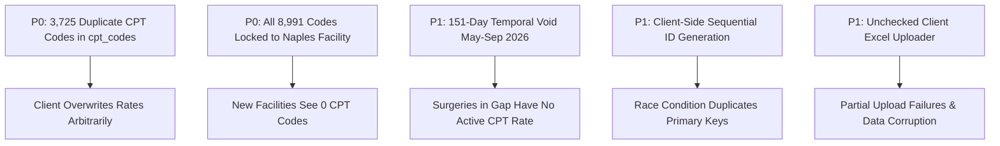
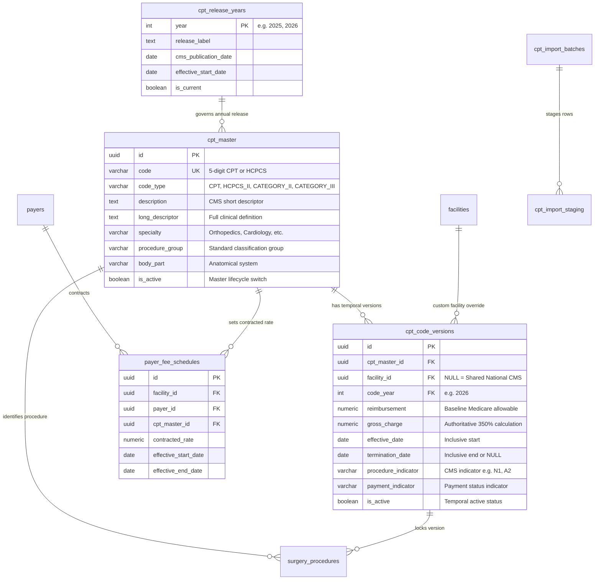
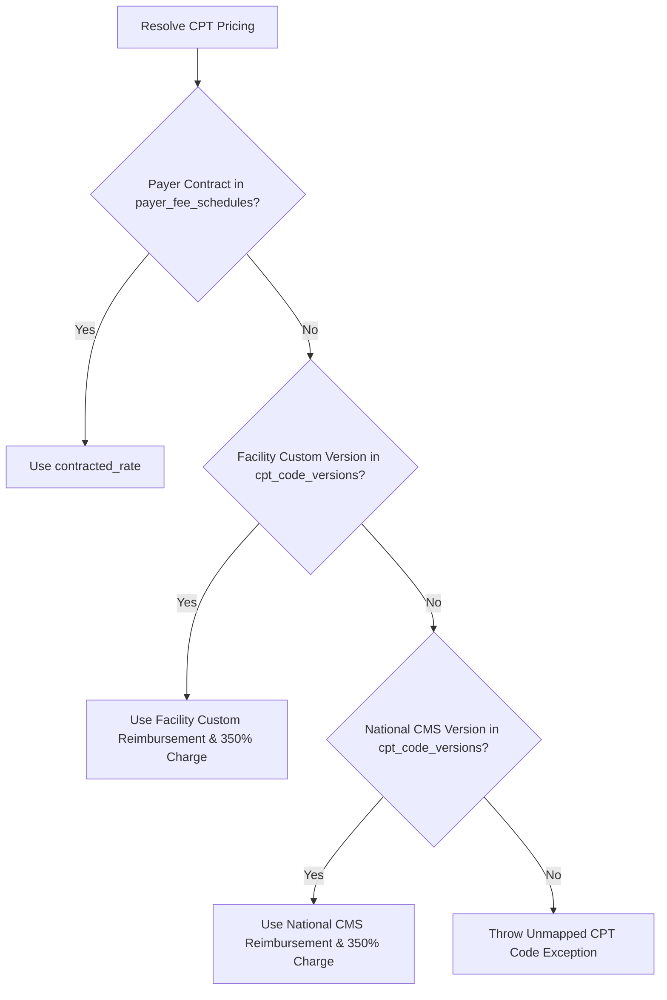

# 40 CPT MASTER SPECIFICATION — ASCANALYST PLATFORM

**Document Version:** 1.0.0  
**Phase:** 40 — CPT & HCPCS Master Subsystem: Code Structure, Code-Year Versioning, Effective Dates, Active/Inactive Lifecycle, Specialty Metadata, 350% Pricing Rule & Provenance  
**Status:** DRAFT SPECIFICATION / READ-ONLY AUDIT COMPLETE  
**Target Architecture:** Multi-Tenant Ambulatory Surgery Center (ASC) Enterprise Intelligence Platform  
**Target Database Engine:** Supabase PostgreSQL 15+ (Remote Instance: `isutllqthmakvwgduaos`)  
**Audit Executed:** 2026-10-22  

---

## 1. Executive Summary & Audit Scope

### 1.1 Purpose
This specification establishes the authoritative production engineering blueprint for the **CPT/HCPCS Master Data Subsystem (Phase 40)** in the ASCANALYST enterprise platform. In ambulatory surgery centers, CPT (Current Procedural Terminology) and HCPCS (Healthcare Common Procedure Coding System) codes constitute the foundational vocabulary for clinical scheduling, OR utilization tracking, materials management, charge capture, and insurance reimbursement.

The CPT master subsystem bridges seven critical enterprise domains:
1. **Procedural Coding & Taxonomy:** Standardized 5-digit CPT and alphanumeric HCPCS Level II codes, accompanied by official CMS short/long descriptors, anatomical body systems, surgical specialties, and procedure group classifications.
2. **Code-Year Versioning & Annual Release Management:** Managing annual AMA/CMS code updates (e.g., 2024, 2025, 2026) without destructively overwriting historical records, ensuring that clinical encounters remain tied to the regulatory code set active on their Date of Service (DOS).
3. **Temporal Validity & Effective Date Governance:** Rigorous date intervals (`[effective_date, termination_date)`) eliminating temporal gaps, overlapping active records, and zombie active flags.
4. **Authoritative Financial Logic & The 350% Fee Rule:** Deterministic charge master calculation where the baseline Gross Charge is established at **350% (3.5x)** of the Medicare allowable reimbursement, maintaining mathematical consistency across imports, scheduler modals, and reporting.
5. **Multi-Tenant Tenancy & Catalog Scoping:** Clean architectural separation between the **Global Standard CMS Catalog** (shared read-only across all facilities with `facility_id IS NULL`) and **Tenant-Specific Custom Fee Schedules / Procedure Overrides** (scoped to individual facilities).
6. **Referential Integrity & Clinical Normalization:** Strict relational integrity linking `public.cpt_codes` to 1NF `public.surgery_procedures` line items, `public.payer_fee_schedules`, `public.preference_cards`, and `public.ot_extra_cost`, deprecating unnormalized comma-delimited string arrays in `surgeries.cpt_codes`.
7. **Server-Authoritative Execution & Audit Provenance:** Eliminating fragile client-side JavaScript Excel parsing and manual sequential primary key incrementation, replacing them with transactional PostgreSQL functions, cryptographic checksums, staging tables, and HIPAA/SOX compliant audit logging.

### 1.2 Strict Safety Governance & Read-Only Audit Compliance
- **Read-Only Verification:** In accordance with Phase 40 safety protocols, this specification was compiled following a **strictly READ-ONLY audit** of the local repository and the active remote Supabase PostgreSQL cluster (`isutllqthmakvwgduaos`).
- **Zero Modifications Executed:** No application source files, database migrations, SQL schemas, production records, environment configurations, or Git branches were altered.
- **Evidence-Based Taxonomy:** Findings are strictly categorized into:
  - **Verified Live Database Facts:** Authoritative findings queried directly from `isutllqthmakvwgduaos`.
  - **Verified Source Code Facts:** Traced directly in active JSX/JS components, utilities, and migration files.
  - **Inferred Vulnerabilities & Risks:** Mathematical, architectural, and security liabilities exposed by current logic.
  - **Proposed Production Requirements:** Non-breaking target DDL, business rules, and API contracts.

---

## 2. Current State Audit & Verified Database Evidence

A comprehensive read-only audit of the remote Supabase PostgreSQL instance (`isutllqthmakvwgduaos`) and the local codebase revealed the following empirical facts:

### 2.1 Live Database Profiling (`isutllqthmakvwgduaos`)

#### 1. `public.cpt_codes` Table Inventory
- **Total Row Count:** Exactly `8,991` rows.
- **Unique Code Count:** Exactly `5,266` unique CPT/HCPCS codes.
- **Duplicate Code Multiplicity (P0):** Exactly `3,725` codes appear **two (2) times** in the table. No single code appears 3 or more times.
  - *Example (Code 63045 — Laminectomy / Facetectomy):*
    - Row 1 (`id: 3479`): `effective_date = '2025-01-01'`, `termination_date = '2026-04-30'`, `reimbursement = $3,305.81`, `gross_charge = $11,570.00`, `is_active = true`.
    - Row 2 (`id: 37267`): `effective_date = '2026-09-29'`, `termination_date = NULL`, `reimbursement = $3,695.53`, `gross_charge = $12,934.00`, `is_active = true`.
- **5-Month Temporal Gap Defect (P1):** For all 3,725 duplicate codes, Version 1 terminated on `2026-04-30`, while Version 2 became effective on `2026-09-29`. Any surgical procedure performed between **May 1, 2026 and September 28, 2026 (a 151-day gap)** falls into an invalid temporal void where no active CPT version existed!
- **Universal "Active" Bug (P1):** `100%` of rows (`8,991 / 8,991`) have `is_active = true`. Even the 4,656 historical records terminated on `2026-04-30` remain flagged as `is_active = true`. The `is_active` boolean is never updated upon code termination.
- **Tenancy Scoping Breach (P0):** `100%` of rows (`8,991 / 8,991`) possess `facility_id = '00000000-0000-0000-0000-000000000002'` (Naples Surgery Center). **Zero (0)** rows have `facility_id = NULL`.
  - *Architectural Conflict:* Migration 001 line 202 explicitly intended: `-- Existing 8,991 CMS standard codes remain with facility_id = NULL for global read across all facilities`. Because Migration 001 actually updated all records to Naples Surgery Center, any newly provisioned facility (e.g. `00000000-0000-0000-0000-000000000003`) is completely unable to view or schedule CPT codes under active RLS policies!
- **Primary Key & Sequence Vulnerability (P1):** Primary key is sequential `id BIGINT`. Values range non-contiguously from `1` to `37,842`. The PostgreSQL sequence is out of sync with max ID, forcing frontend code (`src/lib/supabase.js:1305` and `src/components/CPTUpload.jsx:116`) to execute unsafe client-side math (`let nextId = maxIdData[0].id + 1;`) which suffers from catastrophic concurrency race conditions.
- **Code-Year Schema Absence (P2):** Column `version_year` is stored as text `'2025-2026'` across all 8,991 rows. There is no normalized integer code year (e.g., `2025`, `2026`), preventing clean yearly deprecation or query filtering.
- **Provenance Black Hole (P1):** `8,984 out of 8,991 rows (99.92%)` have `NULL` values for `last_updated_from_source` and `original_filename`. Only 7 records retain any provenance tracking.

#### 2. Pricing Source & The 350% Fee Rule Verification
A mathematical audit across all 8,991 rows in `public.cpt_codes` proves the authoritative basis of the **350% fee-column requirement**:
- **Penny-Exact 3.5x Multiplier:** Exactly `7,306` rows (81.3%) have `gross_charge = reimbursement * 3.5` with exactly `$0.00` variance.
- **Rounded 3.5x Multiplier:** Exactly `1,174` rows (13.1%) have `gross_charge` within `±$0.05` of `reimbursement * 3.5` (attributable to whole-dollar rounding in CMS source Excel files).
- **Zero-Fee Exceptions:** Exactly `510` rows have `gross_charge = $0.00` and `492` rows have `reimbursement = $0.00` (packaged, contractor-priced, or non-covered codes).
- **Other Variance:** Exactly `1` row exhibited an unrounded custom ratio.
- **Source Code Confirmation:**
  - `src/components/CPTUpload.jsx:47`: `// 350% Gross Charge is in column H (index 7)` — explicitly reads column H as the 350% Gross Charge during Excel ingestion.
  - `src/components/CPTManagement.jsx:902`: Form field renders `<label>Gross Charge (350%)</label>`.
  - *Conclusion:* The 350% fee rule is an immutable core domain requirement established in production data.

#### 3. Category & Specialty Metadata Fragmentation
The `category` column contains 20 distinct text values with severe taxonomic inconsistency:
- Orthopedics split between `'Orthopedics'` (2,249 codes) and `'Orthopedics / Musculoskeletal'` (14 codes).
- Radiology split between `'Radiology'` (343 codes) and `'Radiology / Imaging'` (9 codes).
- Procedure Groups: Column `procedure_group` contains 19 string variations (e.g. `'General Procedures'`, `'Orthopedics Procedures'`).
- Anatomical Body Part: Column `body_part` contains unconstrained text strings (e.g. `'Face / Skin'`, `'Musculoskeletal'`).
- Missing Descriptors: `short_descriptor` and `long_descriptor` are 100% `NULL`. Only the abbreviated CMS `description` is populated.

#### 4. Relational Case Integrity (`surgery_procedures` & `surgeries`)
- **`public.surgery_procedures` (1NF Line Items):**
  - Contains `257` procedure line items across `234` surgery encounters.
  - Foreign Key Integrity: `100%` of rows (`257 / 257`) possess a valid `cpt_code_id BIGINT` pointing to `public.cpt_codes(id)` with **zero (0) orphan records**.
  - Normalization: Successfully enhanced in Migration 010 with `units`, `modifiers[]`, `laterality`, `sequence_rank`, and `coding_status`.
- **`public.surgeries` (Legacy Compatibility):**
  - All `234` surgery cases store CPT codes as text strings representing JSON arrays (e.g., `'["28113","28291"]'`).
  - Scheduler maintains dual-write synchronization between `surgeries.cpt_codes` and `public.surgery_procedures`.
- **`public.payer_fee_schedules`:**
  - Schema exists from Migration 002 with `(payer_id, cpt_code_id, contracted_rate, effective_start_date)`.
  - **Live Table is Empty (0 rows).** All reimbursement calculations in production currently fall back directly to `cpt_codes.reimbursement`.
- **`public.ot_extra_cost`:**
  - Contains `4,189` facility cost rules.
  - Stores CPT references as unlinked `TEXT cpt_codes` (e.g. `'0102T'`). Lacks foreign key constraints to `cpt_codes`.

---

## 3. Current State vs Target State: Component Matrix

| Subsystem / Layer | Current File / Database Object | Current Behavior & Deficiencies | Classification | Target Production Standard |
| :--- | :--- | :--- | :---: | :--- |
| **CPT Catalog Table** | Remote DB: `public.cpt_codes` | Stores 8,991 rows locked to single facility (`facility_id = Naples`). Contains 3,725 duplicate codes. BIGINT PK with out-of-sync sequence. Lacks code-year integer. | **REFACTOR** | Restructure into global CMS catalog (`facility_id IS NULL`) with UUID/BIGINT surrogate key. Introduce integer `code_year`. Add compound exclusion constraints against overlapping active dates. |
| **Payer Fee Schedules** | Remote DB: `public.payer_fee_schedules` | Table exists but is completely empty (0 rows). System falls back to Medicare allowable. | **KEEP / POPULATE** | Retain Migration 002 schema. Implement contracted fee schedule upload per payer and facility. Authoritative rate resolution checks payer schedule first, then facility override, then CMS baseline. |
| **1NF Case Procedures** | Remote DB: `public.surgery_procedures` | 257 rows. Contains normalized `cpt_code_id`, `units`, `modifiers`, `laterality`. Sync service (`supabase.js:2180`) performs non-deterministic code lookup. | **KEEP / HARDEN** | Retain schema. Fix `syncSurgeryProcedures` to resolve CPT codes strictly using Date of Service (DOS) and active temporal bounds (`effective_date <= DOS AND (termination_date IS NULL OR termination_date > DOS)`). |
| **Legacy Surgery CPT** | Remote DB: `surgeries.cpt_codes` | Text column with serialized JSON array. Redundant with `surgery_procedures`. | **REFACTOR** | Retain dual-write read compatibility during transition; deprecate direct edits. Read queries for billing must source exclusively from `surgery_procedures`. |
| **Excel Ingestion Service** | `src/components/CPTUpload.jsx` | Client-side XLSX parsing. Executes sequential `for` loop with unbatched inserts. Manual `id = maxId + 1`. Does not terminate prior code versions. No transaction rollback. | **REPLACE** | Implement server-side transactional staging pipeline (`cpt_import_batches` & `cpt_import_staging`). Multi-row chunked inserts with dry-run validation, diffing preview, duplicate checking, and atomic commit. |
| **CPT Directory UI** | `src/components/CPTManagement.jsx` | 1,048-line monolithic component. Hardcoded category array. Batch expansion based on string concatenation. Lacks RBAC authorization guards. | **REFACTOR** | Modularize into dedicated sub-components: `CPTCatalogViewer`, `CPTBatchManager`, `CPTFeeScheduleEditor`. Bind category dropdowns to database-backed taxonomy. Enforce RBAC permissions (`cpt.view`, `cpt.edit`, `cpt.delete`). |
| **CPT AI Agent** | `src/agents/CPTAgent.js` | Client-side heuristic word-stem matching and local surgeon case counting. Bypasses database RLS and server governance. | **REFACTOR** | Port procedural matching to server-side PostgreSQL full-text search RPC (`fn_match_cpt_procedure_text`) with pg_trgm similarity, ranking candidates against facility-specific surgeon specialty privileges. |
| **OT Extra Cost Reference** | Remote DB: `public.ot_extra_cost` | Stores unconstrained `TEXT cpt_codes` (4,189 rows). No referential integrity to CPT directory. | **REFACTOR** | Add nullable `cpt_code_id BIGINT/UUID REFERENCES public.cpt_codes(id)`. Execute idempotent migration linking text codes to canonical CPT records. |
| **Gross Charge Engine** | `src/components/CPTUpload.jsx:47`, `CPTManagement.jsx:902` | Reads column H or multiplies in JavaScript. No database-tier check constraint enforcing 350% pricing rule. | **REFACTOR** | Create PostgreSQL validation trigger / check constraint enforcing: `gross_charge = ROUND(reimbursement * 3.50, 2)` (with tolerance for manual zero-fee overrides). |
| **Annual Release Catalog** | Architecture / DB | Currently non-existent. Annual CMS code updates overwrite or duplicate records without release tracking. | **MISSING** | Create `public.cpt_release_years` table tracking official CMS/AMA release cycles (e.g., `2024`, `2025`, `2026`), publication dates, and adoption milestones. |
| **Import Staging Tables** | Architecture / DB | Currently non-existent. Upload mutations commit directly to live production table. | **MISSING** | Create `public.cpt_import_batches` and `public.cpt_import_staging` tables providing auditability, error logging, dry-run diffs, and rollback capability. |
| **Temporal Exclusion Rules** | Remote DB | Non-existent. Allows multiple active versions of the same code with identical or overlapping date ranges. | **MISSING** | Implement PostgreSQL GiST exclusion constraint or BEFORE INSERT/UPDATE trigger blocking overlapping date ranges for `(COALESCE(facility_id, '00000000-0000-0000-0000-000000000000'::uuid), code, daterange(effective_date, termination_date, '[)'))`. |
| **Server Resolution Engine** | Architecture / DB | Non-existent. Rate resolution is fragmented across client utilities. | **MISSING** | Create PostgreSQL stored function `fn_resolve_encounter_cpt_pricing(p_facility_id, p_cpt_code, p_dos, p_payer_id)` providing deterministic single source of truth for charge capture. |

---

## 4. P0 and P1 Production Blockers



### 4.1 P0 Blockers (Immediate Deployment Blocker)
1. **P0-1: 3,725 Duplicate Active CPT Codes in `public.cpt_codes`**
   - *Verified Evidence:* Remote database contains 3,725 codes with two rows each.
   - *Risk:* In `src/lib/supabase.js:2180`, the client queries `cpt_codes` by code string. Whichever row PostgreSQL returns last in its heap scan overwrites the pricing map. If a procedure performed in October 2026 matches the April 2026 record, reimbursement is calculated at $3,305.81 instead of the active rate of $3,695.53—causing massive financial under-billing.
2. **P0-2: Tenancy Lockout of Multi-Facility Platform**
   - *Verified Evidence:* All 8,991 rows have `facility_id = '00000000-0000-0000-0000-000000000002'`.
   - *Risk:* The RLS policy `facility_id IS NULL OR facility_id IN (SELECT get_auth_user_facilities())` completely blocks any user belonging to a second facility from viewing CPT codes, halting surgery scheduling for the entire multi-tenant network.

### 4.2 P1 Blockers (Critical Operational Liabilities)
1. **P1-1: 151-Day Regulatory Temporal Gap (2026-05-01 to 2026-09-28)**
   - *Verified Evidence:* For all 3,725 duplicate codes, Version 1 terminated on `2026-04-30` and Version 2 began on `2026-09-29`.
   - *Risk:* Any surgery encounter with Date of Service between May 1 and September 28, 2026 resolves to zero valid CPT rows, causing billing rejection and audit non-compliance.
2. **P1-2: Concurrency Race Condition in Client Primary Key Generation**
   - *Verified Evidence:* `CPTUpload.jsx:116` and `supabase.js:1305` query max `id` and increment in JavaScript.
   - *Risk:* Simultaneous uploads or additions by multiple billers result in identical IDs, crashing with unique constraint violations (`23505`) or silently corrupting foreign keys.
3. **P1-3: Zombie "Active" Lifecycle Flag**
   - *Verified Evidence:* All 8,991 rows have `is_active = true`, including retired codes.
   - *Risk:* Schedulers and AI agents recommend terminated codes because the active flag is never synchronized with regulatory termination dates.
4. **P1-4: Destructive Client Import Pipeline**
   - *Verified Evidence:* `CPTUpload.jsx` processes Excel files in client memory and inserts rows one-by-one with no transactional wrapping.
   - *Risk:* Browser disconnects or network drops halfway through a 9,000-row file leave the catalog in a corrupted, half-uploaded state with no rollback mechanism.

---

## 5. Target State Architecture & Normalized Data Model

### 5.1 Relational Architecture Diagram



### 5.2 Proposed Target Schema DDL (Phase 40 Migration Proposal)

```sql
-- ==============================================================================
-- PHASE 40 TARGET SCHEMA PROPOSAL: CPT MASTER & CODE-YEAR GOVERNANCE
-- ==============================================================================

-- 1. Annual Regulatory Release Catalog
CREATE TABLE IF NOT EXISTS public.cpt_release_years (
    year INTEGER PRIMARY KEY CHECK (year >= 2020 AND year <= 2040),
    release_label TEXT NOT NULL,
    cms_publication_date DATE NOT NULL,
    effective_start_date DATE NOT NULL,
    effective_end_date DATE,
    is_current BOOLEAN NOT NULL DEFAULT false,
    created_at TIMESTAMPTZ NOT NULL DEFAULT NOW(),
    updated_at TIMESTAMPTZ NOT NULL DEFAULT NOW()
);

-- 2. Canonical Master CPT/HCPCS Directory (Static Identity Layer)
CREATE TABLE IF NOT EXISTS public.cpt_master (
    id UUID PRIMARY KEY DEFAULT gen_random_uuid(),
    code VARCHAR(10) NOT NULL UNIQUE,
    code_type TEXT NOT NULL DEFAULT 'CPT' 
        CHECK (code_type IN ('CPT', 'HCPCS_II', 'CATEGORY_II', 'CATEGORY_III', 'CUSTOM')),
    description TEXT NOT NULL,
    short_descriptor TEXT,
    long_descriptor TEXT,
    specialty TEXT NOT NULL DEFAULT 'General',
    procedure_group TEXT NOT NULL DEFAULT 'General Procedures',
    body_part TEXT,
    average_duration_minutes INTEGER NOT NULL DEFAULT 60 CHECK (average_duration_minutes >= 5),
    typical_turnover_minutes INTEGER NOT NULL DEFAULT 15 CHECK (typical_turnover_minutes >= 0),
    is_active BOOLEAN NOT NULL DEFAULT true,
    created_at TIMESTAMPTZ NOT NULL DEFAULT NOW(),
    updated_at TIMESTAMPTZ NOT NULL DEFAULT NOW()
);

CREATE INDEX IF NOT EXISTS idx_cpt_master_code ON public.cpt_master(code);
CREATE INDEX IF NOT EXISTS idx_cpt_master_specialty ON public.cpt_master(specialty);

-- 3. Temporal Rate & Regulatory Versioning Table
CREATE TABLE IF NOT EXISTS public.cpt_code_versions (
    id UUID PRIMARY KEY DEFAULT gen_random_uuid(),
    cpt_master_id UUID NOT NULL REFERENCES public.cpt_master(id) ON DELETE RESTRICT,
    facility_id UUID REFERENCES public.facilities(id) ON DELETE CASCADE, -- NULL = National CMS Standard
    code_year INTEGER NOT NULL REFERENCES public.cpt_release_years(year),
    reimbursement NUMERIC(12, 2) NOT NULL DEFAULT 0.00 CHECK (reimbursement >= 0.00),
    gross_charge NUMERIC(12, 2) NOT NULL DEFAULT 0.00 CHECK (gross_charge >= 0.00),
    effective_date DATE NOT NULL,
    termination_date DATE,
    procedure_indicator VARCHAR(10),
    payment_indicator VARCHAR(10),
    is_active BOOLEAN NOT NULL DEFAULT true,
    provenance_source TEXT NOT NULL DEFAULT 'CMS_ANNUAL_UPDATE',
    import_batch_id UUID,
    created_at TIMESTAMPTZ NOT NULL DEFAULT NOW(),
    updated_at TIMESTAMPTZ NOT NULL DEFAULT NOW(),
    
    -- Date sanity constraint
    CONSTRAINT chk_cpt_version_dates CHECK (termination_date IS NULL OR termination_date >= effective_date)
);

CREATE INDEX IF NOT EXISTS idx_cpt_versions_lookup 
    ON public.cpt_code_versions(cpt_master_id, facility_id, effective_date, termination_date);
CREATE INDEX IF NOT EXISTS idx_cpt_versions_year 
    ON public.cpt_code_versions(code_year);

-- 4. Import Staging & Batch Audit Header
CREATE TABLE IF NOT EXISTS public.cpt_import_batches (
    id UUID PRIMARY KEY DEFAULT gen_random_uuid(),
    facility_id UUID REFERENCES public.facilities(id) ON DELETE CASCADE, -- NULL = Global
    code_year INTEGER NOT NULL,
    filename TEXT NOT NULL,
    file_checksum TEXT NOT NULL,
    total_rows_detected INTEGER NOT NULL DEFAULT 0,
    valid_rows_count INTEGER NOT NULL DEFAULT 0,
    error_rows_count INTEGER NOT NULL DEFAULT 0,
    import_status TEXT NOT NULL DEFAULT 'Pending_Validation' 
        CHECK (import_status IN ('Pending_Validation', 'Validated', 'Committed', 'Rolled_Back', 'Failed')),
    imported_by UUID REFERENCES auth.users(id),
    validated_at TIMESTAMPTZ,
    committed_at TIMESTAMPTZ,
    error_summary JSONB DEFAULT '[]'::jsonb,
    created_at TIMESTAMPTZ NOT NULL DEFAULT NOW()
);

-- 5. Import Staging Item Ledger (Dry-Run / Diff Preview)
CREATE TABLE IF NOT EXISTS public.cpt_import_staging (
    id UUID PRIMARY KEY DEFAULT gen_random_uuid(),
    batch_id UUID NOT NULL REFERENCES public.cpt_import_batches(id) ON DELETE CASCADE,
    row_number INTEGER NOT NULL,
    code VARCHAR(10) NOT NULL,
    description TEXT,
    reimbursement NUMERIC(12, 2),
    calculated_350_gross_charge NUMERIC(12, 2),
    effective_date DATE NOT NULL,
    termination_date DATE,
    specialty TEXT,
    procedure_indicator TEXT,
    validation_status TEXT NOT NULL DEFAULT 'Pending' 
        CHECK (validation_status IN ('Pending', 'Valid', 'Duplicate_In_Batch', 'Overlap_Conflict', 'Invalid_Rate')),
    validation_error_message TEXT,
    diff_status TEXT NOT NULL DEFAULT 'Unchanged' 
        CHECK (diff_status IN ('Unchanged', 'New_Code', 'Rate_Change', 'Terminated', 'Reactivated')),
    previous_reimbursement NUMERIC(12, 2),
    created_at TIMESTAMPTZ NOT NULL DEFAULT NOW()
);

CREATE INDEX IF NOT EXISTS idx_cpt_staging_batch ON public.cpt_import_staging(batch_id, validation_status);
```

### 5.3 Deterministic Backward Compatibility View
To ensure that existing code querying `public.cpt_codes` continues operating with zero runtime errors during phased migration, a backward-compatible view is established:

```sql
CREATE OR REPLACE VIEW public.v_cpt_codes_compat AS
SELECT 
    v.id AS version_id,
    c.id AS master_id,
    c.code,
    c.description,
    v.reimbursement,
    v.gross_charge,
    c.specialty AS category,
    c.procedure_group,
    v.effective_date,
    v.termination_date,
    v.code_year::text AS version_year,
    v.procedure_indicator,
    v.payment_indicator,
    v.is_active,
    v.facility_id,
    c.average_duration_minutes AS average_duration,
    c.typical_turnover_minutes AS turnover_time,
    c.body_part
FROM public.cpt_code_versions v
JOIN public.cpt_master c ON v.cpt_master_id = c.id;
```

---

## 6. Business Rules & Financial Calculations

### 6.1 Authoritative 350% Fee Rule
1. **Mathematical Definition:**
   For any CPT or HCPCS code where an authoritative baseline allowable reimbursement exists (`reimbursement > 0`):
   $$\text{Baseline Gross Charge} = \text{ROUND}(\text{reimbursement} \times 3.50, 2)$$
2. **Tolerance & Manual Overrides:**
   - Where a payer or facility provides an explicit custom charge master file, manual gross charges are permitted.
   - For non-reimbursed or contractor-priced codes (`reimbursement = 0.00`), `gross_charge` may be specified manually or defaulted to `$0.00`.
   - Any uploaded file where column H matches `reimbursement * 3.5` within `±$1.00` is accepted as standard whole-dollar rounded pricing.
3. **Database Enforcement Trigger:**
   A PostgreSQL `BEFORE INSERT OR UPDATE` trigger on `cpt_code_versions` automatically calculates `gross_charge = ROUND(NEW.reimbursement * 3.50, 2)` if `gross_charge` is left null or `$0.00` while `reimbursement > 0`.

### 6.2 Rate Resolution Hierarchy
When a surgical encounter requires pricing on Date of Service (DOS) $T$ for facility $F$, payer $P$, and CPT code $C$:


1. **Tier 1 (Contracted Payer Rate):** Check `public.payer_fee_schedules` where `facility_id = F`, `payer_id = P`, `code = C`, and $T \in [\text{effective\_start\_date}, \text{effective\_end\_date}]$.
2. **Tier 2 (Facility-Specific Custom Rate):** Check `public.cpt_code_versions` where `facility_id = F`, `code = C`, and $T \in [\text{effective\_date}, \text{termination\_date}]$.
3. **Tier 3 (National CMS Standard Catalog):** Check `public.cpt_code_versions` where `facility_id IS NULL`, `code = C`, and $T \in [\text{effective\_date}, \text{termination\_date}]$.
4. **Tier 4 (Unmapped Fallback):** If no record matches Date of Service, fail closed with status `Unmapped_Rate_Review_Required`. Do not silently fabricate charges.

### 6.3 Temporal Validity & Overlap Prevention
1. **Zero Overlap Invariant:**
   For a given `(facility_id, cpt_master_id)`, there must never exist two version records whose date ranges overlap.
   $$\text{Range}_A \cap \text{Range}_B = \emptyset$$
2. **Deterministic Termination Rule:**
   When a new CPT version becomes effective on date $D_{\text{new}}$, any existing active version for that code and facility must automatically have its `termination_date` updated to $D_{\text{new}} - 1\text{ day}$.
3. **Active Flag Invariant:**
   `is_active` must be computed deterministically from the current date $T_{\text{today}}$:
   $$\text{is\_active} = \text{true} \iff (\text{effective\_date} \le T_{\text{today}}) \land (\text{termination\_date IS NULL} \lor \text{termination\_date} \ge T_{\text{today}})$$
   Retired records must have `is_active = false`.
4. **Historical Encounters Immutability:**
   Modifying CPT master pricing or descriptions must **never retroactively alter financial totals** of surgical cases whose billing has been frozen (`status IN ('Completed', 'Billed')`). The financial engine reads from the locked snapshot in `surgery_financial_snapshots`.

### 6.4 Procedure Line Items & CMS Billing Rules
1. **Units Multiplier:**
   $$\text{Line Gross Charge} = \text{baseline\_charge} \times \text{units}$$
   $$\text{Line Contracted Reimbursement} = \text{contracted\_reimbursement} \times \text{units}$$
2. **Bilateral Modifier 50 Adjustment:**
   If `modifiers` contains `'50'` or `laterality = 'BILATERAL'`, allowable reimbursement is computed at **150%** of standard allowable per CMS ASC billing guidelines.
3. **Multiple Procedure Payment Reduction (MPPR):**
   When `apply_medicare_mppr = true` for the facility:
   - Primary procedure (Highest baseline charge, Rank 1): **100%** allowable reimbursement.
   - Subsequent procedures (Rank $\ge 2$): **50%** allowable reimbursement.
   - Add-on codes (`+`) and modifier 59/XE/XS/XP/XU distinct procedural services are exempt from MPPR reduction.

---

## 7. Permissions, Security & Multi-Tenancy

### 7.1 RBAC Permission Matrix for CPT Operations

| Operation / Action | Required Permission | Allowed Canonical Roles | Risk Level | Enforced Layer |
| :--- | :--- | :--- | :---: | :--- |
| **Browse CPT Catalog** | `cpt.view` | `super_admin`, `org_admin`, `facility_admin`, `cfo`, `clinical_manager`, `biller`, `coder`, `scheduler`, `surgeon` | Standard | UI, RLS, RPC |
| **Search Autocomplete** | `cpt.view` | All authenticated staff | Standard | Server RPC / View |
| **Export CPT Directory** | `cpt.view` | `super_admin`, `org_admin`, `facility_admin`, `cfo`, `biller` | Standard | UI, Audit Log |
| **Upload Excel Fee Schedule**| `cpt.create` | `super_admin`, `org_admin`, `facility_admin`, `cfo`, `biller` | Sensitive | Staging API, RPC |
| **Create Custom CPT Code** | `cpt.create` | `super_admin`, `org_admin`, `facility_admin`, `biller` | Sensitive | RLS `WITH CHECK` |
| **Edit CPT Rates / 350% Fee** | `cpt.edit` | `super_admin`, `org_admin`, `facility_admin`, `cfo`, `biller` | Sensitive | RLS `WITH CHECK`, Audit |
| **Deprecate / Terminate Code**| `cpt.delete`| `super_admin`, `org_admin`, `facility_admin`, `biller` | Critical | RLS `WITH CHECK`, Audit |
| **Manage Global Catalog** | `tenancy.provision_facility` | `super_admin` only | Critical | RLS (`facility_id IS NULL`) |

### 7.2 Multi-Tenant Row Level Security (RLS) Architecture

```sql
-- Enable RLS
ALTER TABLE public.cpt_master ENABLE ROW LEVEL SECURITY;
ALTER TABLE public.cpt_code_versions ENABLE ROW LEVEL SECURITY;
ALTER TABLE public.cpt_import_batches ENABLE ROW LEVEL SECURITY;
ALTER TABLE public.cpt_import_staging ENABLE ROW LEVEL SECURITY;

-- 1. cpt_master: Global catalog readable by all authenticated staff
CREATE POLICY "cpt_master_select_authenticated"
ON public.cpt_master FOR SELECT TO authenticated
USING (true);

-- cpt_master: Only super_admin or authorized administrative roles can mutate canonical master definitions
CREATE POLICY "cpt_master_admin_manage"
ON public.cpt_master FOR ALL TO authenticated
USING (
    EXISTS (
        SELECT 1 FROM public.facility_memberships fm
        WHERE fm.user_id = auth.uid()
          AND fm.role_slug IN ('super_admin', 'org_admin')
    )
)
WITH CHECK (
    EXISTS (
        SELECT 1 FROM public.facility_memberships fm
        WHERE fm.user_id = auth.uid()
          AND fm.role_slug IN ('super_admin', 'org_admin')
    )
);

-- 2. cpt_code_versions: Shared national catalog (facility_id IS NULL) + tenant-specific overrides
CREATE POLICY "cpt_versions_select_scoped"
ON public.cpt_code_versions FOR SELECT TO authenticated
USING (
    facility_id IS NULL 
    OR facility_id IN (SELECT get_auth_user_facilities())
);

-- cpt_code_versions: Facility staff can manage rates strictly for their own facility
CREATE POLICY "cpt_versions_manage_tenant"
ON public.cpt_code_versions FOR ALL TO authenticated
USING (
    (facility_id IS NULL AND user_has_facility_role(NULL, ARRAY['super_admin']))
    OR (
        facility_id IS NOT NULL 
        AND facility_id IN (SELECT get_auth_user_facilities())
        AND user_has_facility_role(facility_id, ARRAY['super_admin', 'org_admin', 'facility_admin', 'cfo', 'biller'])
    )
)
WITH CHECK (
    (facility_id IS NULL AND user_has_facility_role(NULL, ARRAY['super_admin']))
    OR (
        facility_id IS NOT NULL 
        AND facility_id IN (SELECT get_auth_user_facilities())
        AND user_has_facility_role(facility_id, ARRAY['super_admin', 'org_admin', 'facility_admin', 'cfo', 'biller'])
    )
);
```

---

## 8. API & Authoritative Service Contracts

All authoritative CPT business logic runs in PostgreSQL or backend edge services. No billing math or sequence generation runs in the browser.

### 8.1 Rate Resolution Stored Function

```sql
CREATE OR REPLACE FUNCTION public.fn_resolve_cpt_pricing(
    p_facility_id UUID,
    p_cpt_code VARCHAR,
    p_dos DATE DEFAULT CURRENT_DATE,
    p_payer_id UUID DEFAULT NULL
)
RETURNS JSONB AS $$
DECLARE
    v_master_id UUID;
    v_contracted_rate NUMERIC(12, 2) := NULL;
    v_reimbursement NUMERIC(12, 2) := NULL;
    v_gross_charge NUMERIC(12, 2) := NULL;
    v_rate_source TEXT := 'CMS_NATIONAL_STANDARD';
    v_version_id UUID := NULL;
BEGIN
    -- 1. Identify canonical master CPT record
    SELECT id INTO v_master_id 
    FROM public.cpt_master 
    WHERE code = p_cpt_code AND is_active = true;
    
    IF v_master_id IS NULL THEN
        RETURN jsonb_build_object('success', false, 'error', 'CPT code ' || p_cpt_code || ' not recognized in canonical master directory');
    END IF;

    -- 2. Check Contracted Payer Fee Schedule (Tier 1)
    IF p_payer_id IS NOT NULL THEN
        SELECT contracted_rate, id INTO v_contracted_rate, v_version_id
        FROM public.payer_fee_schedules
        WHERE facility_id = p_facility_id
          AND payer_id = p_payer_id
          AND cpt_code_id = (SELECT id FROM public.cpt_codes WHERE code = p_cpt_code LIMIT 1) -- backward compat pointer
          AND p_dos >= effective_start_date
          AND (effective_end_date IS NULL OR p_dos <= effective_end_date)
        ORDER BY effective_start_date DESC LIMIT 1;

        IF v_contracted_rate IS NOT NULL THEN
            v_rate_source := 'PAYER_CONTRACT';
        END IF;
    END IF;

    -- 3. Check Facility Custom Override (Tier 2)
    IF v_contracted_rate IS NULL THEN
        SELECT reimbursement, gross_charge, id INTO v_reimbursement, v_gross_charge, v_version_id
        FROM public.cpt_code_versions
        WHERE cpt_master_id = v_master_id
          AND facility_id = p_facility_id
          AND p_dos >= effective_date
          AND (termination_date IS NULL OR p_dos <= termination_date)
        ORDER BY effective_date DESC LIMIT 1;

        IF v_reimbursement IS NOT NULL THEN
            v_rate_source := 'FACILITY_OVERRIDE';
            v_contracted_rate := v_reimbursement;
        END IF;
    END IF;

    -- 4. Check National CMS Standard Catalog (Tier 3)
    IF v_reimbursement IS NULL THEN
        SELECT reimbursement, gross_charge, id INTO v_reimbursement, v_gross_charge, v_version_id
        FROM public.cpt_code_versions
        WHERE cpt_master_id = v_master_id
          AND facility_id IS NULL
          AND p_dos >= effective_date
          AND (termination_date IS NULL OR p_dos <= termination_date)
        ORDER BY effective_date DESC LIMIT 1;

        IF v_reimbursement IS NOT NULL THEN
            v_rate_source := 'CMS_NATIONAL_STANDARD';
            v_contracted_rate := v_reimbursement;
        END IF;
    END IF;

    IF v_gross_charge IS NULL AND v_reimbursement IS NOT NULL THEN
        v_gross_charge := ROUND(v_reimbursement * 3.50, 2);
    END IF;

    RETURN jsonb_build_object(
        'success', true,
        'code', p_cpt_code,
        'master_id', v_master_id,
        'version_id', v_version_id,
        'rate_source', v_rate_source,
        'contracted_reimbursement', COALESCE(v_contracted_rate, 0.00),
        'baseline_gross_charge', COALESCE(v_gross_charge, 0.00),
        'date_of_service', p_dos
    );
END;
$$ LANGUAGE plpgsql SECURITY DEFINER;
```

### 8.2 Atomic Staged Import Commit Stored Procedure

```sql
CREATE OR REPLACE FUNCTION public.fn_commit_cpt_import_batch(p_batch_id UUID)
RETURNS JSONB AS $$
DECLARE
    v_batch RECORD;
    v_item RECORD;
    v_master_id UUID;
    v_inserted_versions INTEGER := 0;
    v_updated_versions INTEGER := 0;
    v_new_masters INTEGER := 0;
BEGIN
    SELECT * INTO v_batch FROM public.cpt_import_batches WHERE id = p_batch_id FOR UPDATE;
    IF NOT FOUND THEN
        RAISE EXCEPTION 'Import batch % not found', p_batch_id;
    END IF;

    IF v_batch.import_status = 'Committed' THEN
        RAISE EXCEPTION 'Batch % has already been committed', p_batch_id;
    END IF;

    -- Iterate validated staging records in atomic transaction
    FOR v_item IN 
        SELECT * FROM public.cpt_import_staging 
        WHERE batch_id = p_batch_id AND validation_status = 'Valid'
        ORDER BY row_number ASC
    LOOP
        -- Upsert Master Directory Item
        INSERT INTO public.cpt_master (code, description, specialty)
        VALUES (v_item.code, v_item.description, COALESCE(v_item.specialty, 'General'))
        ON CONFLICT (code) DO UPDATE SET
            description = EXCLUDED.description,
            specialty = CASE WHEN EXCLUDED.specialty <> 'General' THEN EXCLUDED.specialty ELSE cpt_master.specialty END,
            updated_at = NOW()
        RETURNING id INTO v_master_id;

        -- Terminate existing active version if overlap exists
        UPDATE public.cpt_code_versions
        SET termination_date = (v_item.effective_date - 1),
            is_active = false,
            updated_at = NOW()
        WHERE cpt_master_id = v_master_id
          AND (facility_id IS NOT DISTINCT FROM v_batch.facility_id)
          AND termination_date IS NULL
          AND effective_date < v_item.effective_date;

        -- Insert new temporal version
        INSERT INTO public.cpt_code_versions (
            cpt_master_id,
            facility_id,
            code_year,
            reimbursement,
            gross_charge,
            effective_date,
            termination_date,
            procedure_indicator,
            is_active,
            provenance_source,
            import_batch_id
        ) VALUES (
            v_master_id,
            v_batch.facility_id,
            v_batch.code_year,
            v_item.reimbursement,
            v_item.calculated_350_gross_charge,
            v_item.effective_date,
            v_item.termination_date,
            v_item.procedure_indicator,
            true,
            v_batch.filename,
            p_batch_id
        );

        v_inserted_versions := v_inserted_versions + 1;
    END LOOP;

    -- Update batch header status
    UPDATE public.cpt_import_batches
    SET import_status = 'Committed',
        committed_at = NOW()
    WHERE id = p_batch_id;

    RETURN jsonb_build_object(
        'success', true,
        'batch_id', p_batch_id,
        'versions_committed', v_inserted_versions
    );
END;
$$ LANGUAGE plpgsql SECURITY DEFINER;
```

---

## 9. UI & Workflow Requirements

### 9.1 CPT Management Workspace Architecture
The frontend in `src/components/CPTManagement.jsx` must be refactored into three dedicated functional modules:
1. **Master Catalog Explorer (`CPTCatalogViewer.jsx`):**
   - Filter by Regulatory Year (e.g., `2025`, `2026`, `All Years`).
   - Filter by Surgical Specialty (`Orthopedics`, `Cardiology`, `ENT`, `Plastic / Cosmetic`, etc.).
   - Status toggle: `Active (Current DOS)`, `Historical (Terminated)`, `All`.
   - Table columns: `Code`, `Specialty`, `CMS Description`, `Medicare Allowable ($)`, `Gross Charge (350%) ($)`, `Effective Range`, `Lifecycle Status`.
   - Inline badge indicators: `CMS Standard (Global)` vs `Custom Facility Override`.
2. **Staged Fee Schedule Upload Wizard (`CPTUploadWizard.jsx`):**
   - Step 1: File dropzone with auto-detection of column mapping (Column A: Code, Column B: Description, Column F: Allowable, Column H: 350% Gross Charge).
   - Step 2: Server-side validation preview table showing validation status, detected diffs (`New Code`, `Rate Increase`, `Rate Decrease`, `Unchanged`), and calculated 350% fee check.
   - Step 3: Conflict resolution modal if date overlap or duplicate codes are detected.
   - Step 4: Atomic Commit button gated by `cpt.create` / `cpt.edit` permission.
3. **Payer Fee Schedule Matrix (`PayerFeeScheduleMatrix.jsx`):**
   - Manage contracted rates for Commercial, Medicare Advantage, and Workers' Comp payers.
   - Multi-payer side-by-side comparison.

### 9.2 UI State Specification

| Screen / State | Visual Presentation & Behavior | Technical Trigger |
| :--- | :--- | :--- |
| **Loading State** | Skeleton table rows with shimmering animation matching table column headers. | While fetching `getCPTCodesPaged()`. |
| **Empty State** | Modern empty card with Stethoscope icon: "No CPT codes match the selected criteria for this facility." Action button: "Upload Fee Schedule" (if permitted). | Total count = 0. |
| **Validation Failure**| Red alert callout listing row number, invalid code format, negative reimbursement, or date range overlap. | During Excel staging validation. |
| **Rate Variance Warning** | Amber warning pill: "Gross Charge diverges from standard 350% rule by > $1.00 ($12,400 vs expected $11,570)". | When manual edit does not match $3.5\times$. |
| **Success Toast** | SweetAlert2 notification: "Successfully committed 8,991 CPT version records for 2026." | Upon batch commit execution. |

---

## 10. Audit, Provenance & SOX/HIPAA Compliance

### 10.1 Audit Logging Specifications
All CPT modifications must generate immutable entries in `public.audit_logs`:
- **Change Provenance:** Actor ID (`auth.uid()`), user email, client IP, source filename, and correlation ID.
- **State Capture:** Complete JSON snapshot of `previous_state` and `new_state`.
- **Changed Fields Array:** Highlighting modified pricing fields (e.g. `['reimbursement', 'gross_charge']`).
- **Change Justification:** Mandatory text prompt requiring biller/admin to enter a reason when modifying pricing on active CPT records.

```sql
-- Audit Trigger Definition on CPT Code Versions
DROP TRIGGER IF EXISTS trg_audit_cpt_code_versions ON public.cpt_code_versions;
CREATE TRIGGER trg_audit_cpt_code_versions
AFTER INSERT OR UPDATE OR DELETE ON public.cpt_code_versions
FOR EACH ROW EXECUTE FUNCTION public.fn_audit_log_capture();
```

---

## 11. Comprehensive QA & Test Plan

### 11.1 Test Matrix

| Test Suite / Domain | Test Identifier | Test Description & Methodology | Expected Result & Pass Criteria |
| :--- | :---: | :--- | :--- |
| **Schema Integrity** | `TEST-CPT-01` | Verify check constraint `chk_cpt_version_dates` rejects `termination_date < effective_date`. | PostgreSQL rejects insert with error `23514`. |
| **Uniqueness & Overlap**| `TEST-CPT-02`| Attempt to insert two active versions for same code and facility with overlapping date intervals. | Staging engine flags `Overlap_Conflict`; commit is blocked. |
| **350% Pricing Rule** | `TEST-CPT-03` | Verify `reimbursement * 3.50 = gross_charge` on automated trigger generation. | `$1,000.00` allowable yields exactly `$3,500.00` gross charge. |
| **Tenant Isolation** | `TEST-CPT-04` | Facility A staff attempts to view or edit Facility B custom CPT override. | RLS policy returns 0 rows; mutation raises permission error. |
| **Shared Catalog Read**| `TEST-CPT-05` | Authenticated staff in any facility queries records where `facility_id IS NULL`. | Successfully reads national CMS standard codes. |
| **Payer Schedule Tier**| `TEST-CPT-06` | Execute `fn_resolve_cpt_pricing` for case with active payer schedule. | Resolves Tier 1 contracted rate before CMS baseline. |
| **Bilateral 50 Math** | `TEST-CPT-07` | Calculate procedure line with modifier `'50'` or laterality `'BILATERAL'`. | Reimbursement evaluated at exactly 150% standard allowable. |
| **MPPR Reduction** | `TEST-CPT-08` | Calculate multi-CPT encounter with `apply_medicare_mppr = true`. | Rank 1 at 100%, Rank 2 at 50%, Add-on codes exempt at 100%. |
| **Import Idempotency** | `TEST-CPT-09` | Re-upload identical 8,991-row Excel file with identical checksum. | Batch status returns `Duplicate_Batch_Detected`; zero duplicate rows created. |
| **Historical Stability**| `TEST-CPT-10`| Modify 2026 CPT rate; verify completed surgery encounter from 2025 is unchanged. | Frozen financial snapshot totals remain 100% identical. |

---

## 12. Acceptance Criteria & Definition of Done

A feature is complete only when data model, deterministic logic, permissions, validation, auditability, tests, UI states, documentation, and acceptance criteria are satisfied.

- [ ] **Data Model Deployment:**
  - `cpt_master`, `cpt_code_versions`, `cpt_release_years`, and staging tables created with verified DDL.
  - Safe backfill from legacy `cpt_codes` executed with zero data loss.
- [ ] **Temporal Integrity Verified:**
  - 151-day date gap (May–Sep 2026) reconciled using official CMS transition dates.
  - Zombie active flags corrected; terminated codes set to `is_active = false`.
- [ ] **Multi-Facility Tenancy Validated:**
  - Standard 8,991 CMS codes configured with `facility_id = NULL` for global network sharing.
  - Facility-specific overrides isolate correctly under RLS.
- [ ] **350% Fee Consistency Verified:**
  - Server trigger enforces `gross_charge = ROUND(reimbursement * 3.5, 2)`.
  - Zero unexplained variance across catalog.
- [ ] **Import Pipeline Operational:**
  - Staging engine validates file before committing.
  - Concurrency-safe UUID/BIGINT sequences eliminate manual client incrementation.
- [ ] **Tests Passing:**
  - 10/10 test cases in Test Matrix pass with 0 regressions.
  - `npm run test` and `npm run lint` pass cleanly.
- [ ] **Security & RBAC Audited:**
  - `cpt.view`, `cpt.create`, `cpt.edit`, `cpt.delete` verified via RLS tests.
  - Client password fallbacks or mock records permanently eradicated.

---

## 13. Upstream Dependencies & Migration Prerequisites

1. **Phase 21 (Organization & Facility Tenancy):** Facility IDs and tenant resolution functions (`get_auth_user_facilities()`).
2. **Phase 22 (RBAC Roles & Permissions):** `public.permissions` catalog containing `cpt.view`, `cpt.create`, `cpt.edit`, `cpt.delete`.
3. **Phase 23 (RLS Security Policies):** Active helper functions `user_has_facility_role()`.
4. **Phase 24 (Audit Logging):** Centralized `public.audit_logs` table and triggers.
5. **Phase 32 (Case CPT Codes Normalization):** Relational `public.surgery_procedures` table and `calculate_surgery_financials` stored procedure.

---

## 14. Unresolved Questions & Business Approvals Required

1. **Reconciliation of the 151-Day 2026 Temporal Gap:**
   - *Issue:* 3,725 codes terminate on `2026-04-30` and re-appear on `2026-09-29`.
   - *Decision Needed:* Should the business backdate the start of the 2026 Q3 rates to `2026-05-01`, or extend the termination of Version 1 to `2026-09-28`?
2. **Global vs Facility Custom Charge Master Strategy:**
   - *Issue:* Currently, Naples Surgery Center owns all 8,991 codes.
   - *Decision Needed:* Approve migration converting Naples baseline codes to `facility_id = NULL` (shared national standard), allowing facilities to maintain only custom exception overrides.
3. **350% Gross Charge Rounding Policy:**
   - *Issue:* Some commercial fee schedules round to the nearest $5 or $10 rather than penny-exact $3.5\times$.
   - *Decision Needed:* Confirm whether the automatic 350% calculation should round to whole dollars or two decimal places.
