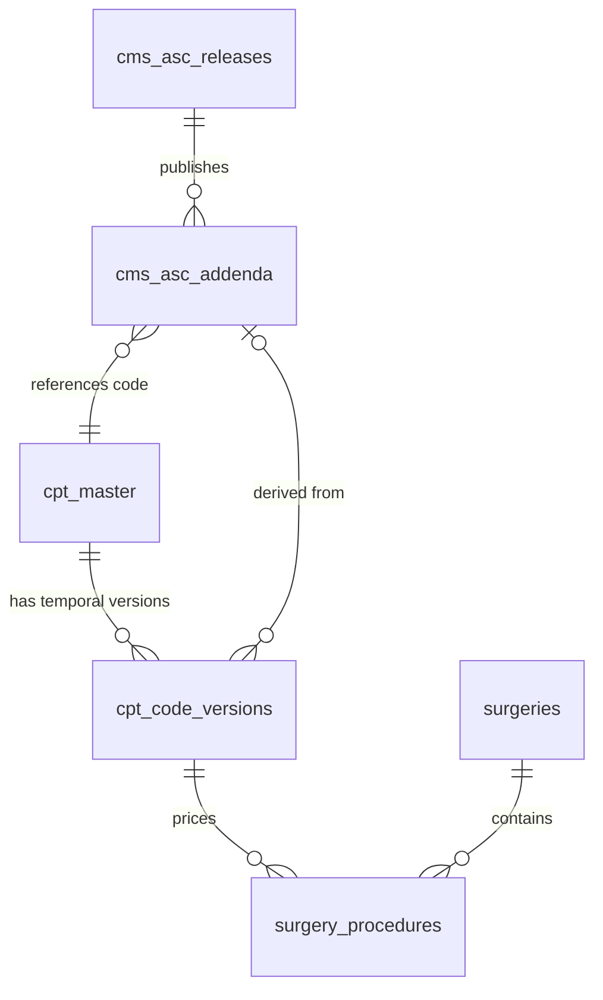

# 41 CMS ASC COVERAGE AND PAYMENT DATA SPECIFICATION

**Document Version:** 1.0.0  
**Phase:** 41 — CMS ASC Coverage, Addenda Data Sources, Payment Indicators, Device-Intensive Classifications & Deterministic Pricing Engine  
**Status:** DRAFT SPECIFICATION / READ-ONLY AUDIT COMPLETE  
**Target Architecture:** Multi-Tenant Ambulatory Surgery Center (ASC) Enterprise Intelligence Platform  
**Target Database Engine:** Supabase PostgreSQL 15+ (Remote Instance: `isutllqthmakvwgduaos`)  
**Audit Executed:** 2026-10-22  
**Implementation Mode:** STRICTLY READ-ONLY (Zero Code / Schema / Git Changes)

---

## 1. Executive Summary & Audit Purpose

### 1.1 Purpose
This specification establishes the authoritative engineering blueprint for **Phase 41: CMS ASC Coverage and Payment Data** within the ASCANALYST enterprise platform. In United States ambulatory surgery centers, Medicare reimbursement is governed by the Centers for Medicare & Medicaid Services (CMS) Ambulatory Surgical Center Payment System (ASCPS), promulgated annually under Title 42 of the Code of Federal Regulations (42 CFR Part 416) via the Outpatient Prospective Payment System (OPPS) / ASC Final Rule.

The CMS ASC payment system differs fundamentally from inpatient diagnosis-related groups (DRGs) or physician relative value units (RVS/MPFS):
1. **CMS ASC Addenda (AA, BB, EE):** CMS publishes authoritative quarterly and annual tables defining covered surgical procedures (Addendum AA), covered ancillary and radiology services (Addendum BB), and excluded/ineligible procedures (Addendum EE).
2. **CMS Payment Indicators (PI):** Standardized two-character alphanumeric codes (`A2`, `G2`, `P2`, `P3`, `R2`, `Z2`, `K2`, `N1`, `J8`) that prescribe the exact statutory payment methodology, OPPS relative weight scaling, packaged status, or contractor pricing.
3. **Device-Intensive Surgical Classifications (`J8`):** Procedures where device costs exceed 30% of total procedure value, mandating special device-offset percentage calculations under Multiple Procedure Payment Reduction (MPPR) rules.
4. **Coverage vs. Pricing Disambiguation:** A code being listed in a general procedural master catalog does **not** signify Medicare ASC coverage. The platform must cleanly distinguish:
   - **Covered Surgical (Addendum AA)**
   - **Covered Ancillary / Radiology (Addendum BB)**
   - **Packaged (PI `N1` — $0 direct payment, bundled into primary APC)**
   - **Contractor / Carrier-Priced (PI `R2` / `C` — manual invoice adjudication)**
   - **Inpatient-Only / Excluded (Addendum EE — strictly non-covered in ASC)**
5. **Deterministic Rate Resolution:** Eliminating brittle client-side math and non-deterministic fallbacks by providing a mathematically auditable, server-authoritative rate resolution pipeline that strictly enforces Date of Service (DOS), facility tenancy, and payer contracts.

### 1.2 Strict Safety Governance & Read-Only Audit Compliance
- **Read-Only Verification:** In strict accordance with user directives, this entire audit was executed in **read-only mode**.
- **Zero Modifications Executed:**
  - **NO** application code or client components were modified.
  - **NO** database tables, columns, indexes, functions, triggers, or views were altered or created.
  - **NO** production database records were added, updated, or deleted.
  - **NO** Git commits, branches, or stashes were generated.
- **Evidence-Based Taxonomy:** Findings documented in this specification are backed by direct SQL queries against the live Supabase PostgreSQL cluster (`isutllqthmakvwgduaos`) and codebase analysis of `src/`.

---

## 2. Current State Audit & Verified Database Evidence

A thorough inspection of the live remote Supabase PostgreSQL instance (`isutllqthmakvwgduaos`) and the local application codebase revealed significant architectural, taxonomic, and financial findings.

### 2.1 Live Database Profiling (`isutllqthmakvwgduaos`)

#### 1. Severe Column Inversion / Misalignment Defect (P0)
A deep audit of all `8,991` records in `public.cpt_codes` uncovered a historic data-ingestion defect:
- **`payment_indicator` Column:** Contains `NULL` for **8,984 out of 8,991 rows (99.92%)**! Only **7 rows (0.08%)** have a non-null value, which is populated with the truncated character `'A'`.
- **`procedure_indicator` Column:** Contains non-null values for **4,927 rows (54.80%)**. A full-table census revealed that **official CMS Payment Indicators were mapped into this column instead of `payment_indicator`**:

| Stored Value in `procedure_indicator` | Row Count | Official CMS Meaning | Actual CMS Classification |
| :---: | :---: | :--- | :--- |
| `NULL` | 4,064 | Unspecified / Non-CMS Custom Record | Unmapped |
| `A2` | 2,399 | Surgical procedure on ASC covered list in CY 2007; payment based on OPPS relative payment weight | **CMS Payment Indicator** |
| `G2` | 622 | Non-office-based surgical procedure added in CY 2008 or later; payment based on OPPS relative weight | **CMS Payment Indicator** |
| `J8` | 508 | Device-intensive procedure; paid at adjusted rate | **CMS Payment Indicator (Device-Intensive)** |
| `N1` | 443 | Packaged service/item; no separate payment made (bundled into primary procedure APC) | **CMS Payment Indicator (Packaged)** |
| `A` | 405 | Legacy truncated status (intended `A2`) | Truncated CMS Payment Indicator |
| `P3` | 380 | Office-based surgical procedure; payment based on MPFS non-facility PE RVU amount | **CMS Payment Indicator** |
| `P2` | 70 | Office-based surgical procedure; payment based on OPPS relative payment weight | **CMS Payment Indicator** |
| `R2` | 44 | Contractor-priced procedure or code without established national rate | **CMS Payment Indicator** |
| `C` | 32 | Carrier-priced or inpatient-only code | Status Indicator |
| `S` | 24 | Surgical procedure indicator | CMS Procedure Indicator (Addendum AA) |

**Consequence:** Because CMS Payment Indicators (e.g., `A2`, `J8`, `N1`) were stored in `procedure_indicator` while `payment_indicator` remained `NULL`, any code querying `payment_indicator` fails completely.

#### 2. Runtime Bypass of Device-Intensive MPPR Logic (`src/utils/hospitalUtils.js`) (P0)
In `src/utils/hospitalUtils.js` (lines 182–198), the client implements Medicare Multiple Procedure Payment Reduction (MPPR) with device-intensive offsets:
```javascript
// hospitalUtils.js:182
const isDeviceIntensive = cpt.payment_indicator === 'J8' || (cpt.device_offset_amount && parseFloat(cpt.device_offset_amount) > 0);
const deviceOffset = parseFloat(cpt.device_offset_amount || 0);
...
if (isDeviceIntensive && deviceOffset > 0 && deviceOffset < price) {
    const servicePortion = price - deviceOffset;
    totalRevenue += (deviceOffset + (servicePortion * 0.50)) * units;
} else {
    totalRevenue += price * 0.50 * units;
}
```
**Empirical Proof of Failure:**
- In the database, all **508 device-intensive codes** (e.g., CPT `28465` — *Optx tarsal bone fx each*, reimbursement: `$4,671.46`, gross charge: `$16,350`) have `procedure_indicator = 'J8'` and `payment_indicator = NULL`.
- Furthermore, `device_offset_amount` does not exist as a column on `public.cpt_codes` or `public.cpt_code_versions`.
- As a direct result, `cpt.payment_indicator === 'J8'` evaluates to **FALSE for 100% of the 508 device-intensive procedures in production**, causing Medicare secondary procedure revenue to be reduced across the entire device cost rather than protecting the device portion, causing massive financial under-projections in the scheduler!

#### 3. Packaged Codes (`N1`) Misinterpreted as Free / Zero-Dollar Care (P1)
In `public.cpt_codes`, exactly `443` rows possess `procedure_indicator = 'N1'` (e.g., CPT `12001` — *Simple repair of superficial wounds*, CPT `17000` — *Destruction premalignant lesion*, CPT `36400` — *Venipuncture*, CPT `60512` — *Autotransplant parathyroid*):
- All 443 rows have `reimbursement = $0.00` and `gross_charge = $0.00`.
- The current system displays `$0` revenue in the scheduler and financial dashboards without communicating to clinical coders that these codes are **CMS Packaged Services** whose reimbursement is bundled into the primary surgical procedure's APC payment.
- The UI provides no badge or indicator explaining why reimbursement is zero, creating confusion between "non-covered" procedures and "covered packaged" procedures.

#### 4. Absence of CMS Addenda & Coverage Source Tables (P1)
- **`public.cms_asc_addenda`**: **MISSING** (Direct query confirms table does not exist in schema cache).
- **`public.cms_coverage_determinations`**: **MISSING** (Direct query confirms table does not exist in schema cache).
- **Provenance Deficit:** The database has zero historical record of which CMS Final Rule, transmittal number, or Addendum file (AA vs. BB) established each code's rate or indicator.

---

## 3. Authoritative CMS ASC Data Sources & Taxonomy

### 3.1 Official CMS Source Files (Quarterly & Annual Releases)
The platform must ingest and validate authoritative source files published by CMS Division of Outpatient Care:

| CMS Addendum | Official CMS Filename Convention | Content Description | Statutory Purpose in ASCPS |
| :--- | :--- | :--- | :--- |
| **Addendum AA** | `CY[YYYY]_ASC_Final_Addendum_AA.xlsx` | Final ASC Covered Surgical Procedures | Establishes the authoritative master list of surgical procedures covered under Medicare in an ASC. Contains CPT/HCPCS, Short Descriptor, Procedure Indicator (`S`), Payment Indicator, Final ASC Rate, Wage-Adjusted Rates, and Device-Intensive flag. |
| **Addendum BB** | `CY[YYYY]_ASC_Final_Addendum_BB.xlsx` | Final ASC Covered Ancillary Services | Establishes covered ancillary services (Radiology, Pathology, Separately Payable Drugs and Biologicals, Brachytherapy sources) integral to covered surgical procedures. Contains HCPCS, PI (`Z2`, `K2`), and payment rates. |
| **Addendum EE** | `CY[YYYY]_ASC_Final_Addendum_EE.xlsx` | Surgical Procedures Excluded from ASC Payment | Establishes surgical procedures proposed for removal, excluded, or deemed Inpatient-Only (IPO). Explicitly proves non-coverage in an ASC. |

### 3.2 Authoritative CMS Payment Indicator (PI) Master Matrix
Every CPT/HCPCS code in the ASC payment system is assigned exactly one primary Payment Indicator by CMS. The platform must enforce this standardized regulatory vocabulary:

```
+----------------------------------------------------------------------------------------------------+
| CMS PAYMENT INDICATORS (PI) DEFINITIONS & BEHAVIORAL CONTRACTS                                    |
+----+---------------------------------------------------------------+---------------+---------------+
| PI | Regulatory Definition                                         | Payment Basis | MPPR Reduced? |
+----+---------------------------------------------------------------+---------------+---------------+
| A2 | Surgical procedure on ASC covered list in CY 2007             | OPPS Relative | YES (Standard)|
| G2 | Non-office-based surgical procedure added in CY 2008 or later | OPPS Relative | YES (Standard)|
| P2 | Office-based surgical procedure; payment based on OPPS weight | OPPS Relative | YES (Standard)|
| P3 | Office-based surgical procedure; payment based on MPFS PE RVU | MPFS PE RVU   | YES (Standard)|
| J8 | Device-intensive procedure; paid at adjusted rate             | Device Offset | YES (Offset)  |
| R2 | Contractor-priced procedure without national rate             | Carrier Priced| NO (Manual)   |
| Z2 | Radiology service paid under ASC payment system               | OPPS Ancillary| NO (Exempt)   |
| K2 | Drugs and biologicals paid separately under ASC               | ASP + 6%      | NO (Exempt)   |
| N1 | Packaged service/item; no separate payment made               | Bundled ($0)  | NO (Bundled)  |
| C  | Carrier-priced or inpatient-only code                         | Non-Covered   | NO (Denied)   |
| B5 | Alternative code available; no separate ASC payment           | Bundled       | NO (Bundled)  |
+----+---------------------------------------------------------------+---------------+---------------+
```

### 3.3 Device-Intensive Procedures & The Device-Offset Formula
Under 42 CFR § 416.171, when CMS designates a procedure as **Device-Intensive (PI `J8`)**, the payment rate includes a designated **Device Offset Percentage**:
$$\text{Device Portion} = \text{National ASC Rate} \times \text{Device Offset Percentage}$$
$$\text{Service Portion} = \text{National ASC Rate} - \text{Device Portion}$$

When an ASC performs multiple surgical procedures in the same operative session, Medicare applies Multiple Procedure Payment Reduction (MPPR):
1. **Primary Procedure (Highest Rate):** Paid at $100\%$ of the allowable ASC rate.
2. **Secondary / Subsequent Procedures (Rank $\ge 2$):**
   - For standard procedures (`A2`, `G2`, `P2`, `P3`): Reduced by $50\%$ across the entire allowable amount:
     $$\text{Secondary Payment} = \text{Allowable Rate} \times 0.50$$
   - For device-intensive procedures (`J8`): The $50\%$ reduction applies **ONLY to the Service Portion**, while the **Device Portion is paid in full (100%)**:
     $$\text{Secondary Payment} = \text{Device Portion} + (\text{Service Portion} \times 0.50)$$

*Impact:* Applying standard 50% MPPR to a $10,000 device-intensive case with an $8,000 device offset results in paying $5,000 instead of the legally required $9,000 ($8,000 device + $1,000 reduced service). This proves why `J8` and `device_offset_percentage` must be authoritatively stored.

---

## 4. Current State vs Target State: Component Matrix

| Subsystem / Layer | Current File / Database Object | Current Behavior & Deficiencies | Classification | Target Production Standard |
| :--- | :--- | :--- | :---: | :--- |
| **Payment Indicator Storage** | DB: `cpt_codes.procedure_indicator` vs `payment_indicator` | CMS payment indicators (`A2`, `J8`, `N1`, etc.) are mistakenly stored in `procedure_indicator`, while `payment_indicator` is `NULL` in 99.92% of rows. | **REFACTOR** | Normalize and reconcile. Populate `payment_indicator` with true CMS PI values. Maintain `procedure_indicator` strictly for surgical code status (`S` or null). |
| **CMS ASC Addenda Master** | DB: None | No table exists to store raw CMS Addendum AA, BB, and EE source releases. | **MISSING** | Create `public.cms_asc_addenda` to preserve immutable CMS source tables with Addendum designation, relative weights, and device offsets. |
| **CMS Release Governance** | DB: `cpt_release_years` | Only stores integer year (`2024`, `2025`, `2026`). Does not store quarters (Q1, Q2, Q3, Q4) or rule versions (Proposed, Final, Correction). | **REFACTOR** | Extend to `public.cms_asc_releases` tracking year, quarter, transmittal number, effective date, and cryptographic file checksum. |
| **Device-Intensive Offsets** | DB: None / `hospitalUtils.js:182` | `device_offset_amount` is checked in code but column does not exist in DB. 508 `J8` procedures are bypassed. | **MISSING** | Add `device_offset_percentage` and `device_offset_amount` to `cms_asc_addenda` and `cpt_code_versions`. Enforce statutory MPPR calculation server-side. |
| **Coverage Determinations** | DB: None | System assumes any code in `cpt_codes` is covered. Does not record explicit coverage or exclusion evidence from Addendum EE. | **MISSING** | Create `public.cms_coverage_determinations` with authoritative status: `Covered_Surgical`, `Covered_Ancillary`, `Packaged`, `Excluded_Inpatient_Only`, or `Contractor_Priced`. |
| **350% Fee Sync Trigger** | DB: `trg_cpt_version_gross_charge` | Automatically calculates Gross Charge = `ROUND(reimbursement * 3.50, 0)` for `cpt_code_versions`. Verified working. | **KEEP** | Retain trigger in full. Ensure CMS rate imports automatically calculate whole-dollar 350% gross charges. |
| **Client MPPR Calculation** | Client: `hospitalUtils.js` lines 170–205 | Calculates MPPR in client JavaScript. Falls back to unreduced rates if fields are missing. | **REFACTOR** | Retain client calculation for interactive modal preview, but establish server-side stored procedure (`fn_calculate_case_reimbursement`) for authoritative billing. |

---

## 5. Target Data Model & Relational Schema

To preserve complete regulatory provenance without duplicating existing Phase 40 tables, Phase 41 introduces two authoritative CMS tables and connects them directly to `cpt_master` and `cpt_code_versions`:



### 5.1 DDL Specification: `public.cms_asc_releases`
Stores authoritative CMS OPPS/ASC regulatory publication metadata:

```sql
CREATE TABLE IF NOT EXISTS public.cms_asc_releases (
    id UUID PRIMARY KEY DEFAULT gen_random_uuid(),
    release_year INTEGER NOT NULL CHECK (release_year BETWEEN 2020 AND 2035),
    release_quarter VARCHAR(2) NOT NULL DEFAULT 'Q1' CHECK (release_quarter IN ('Q1', 'Q2', 'Q3', 'Q4')),
    rule_type VARCHAR(20) NOT NULL DEFAULT 'Final' CHECK (rule_type IN ('Proposed', 'Final', 'Correction', 'Quarterly_Update')),
    transmittal_number VARCHAR(50),
    federal_register_citation VARCHAR(100),
    effective_start_date DATE NOT NULL,
    effective_end_date DATE,
    source_filename VARCHAR(255) NOT NULL,
    source_checksum_sha256 VARCHAR(64) NOT NULL,
    is_active BOOLEAN NOT NULL DEFAULT true,
    published_at TIMESTAMPTZ NOT NULL DEFAULT NOW(),
    created_at TIMESTAMPTZ NOT NULL DEFAULT NOW(),
    CONSTRAINT chk_cms_release_dates CHECK (effective_end_date IS NULL OR effective_end_date >= effective_start_date),
    CONSTRAINT uq_cms_release_edition UNIQUE (release_year, release_quarter, rule_type)
);

CREATE INDEX idx_cms_asc_releases_year ON public.cms_asc_releases (release_year, release_quarter);
CREATE INDEX idx_cms_asc_releases_dates ON public.cms_asc_releases (effective_start_date, effective_end_date);
```

### 5.2 DDL Specification: `public.cms_asc_addenda`
Stores granular, immutable code-level records directly transcribed from official CMS Addenda AA, BB, and EE:

```sql
CREATE TABLE IF NOT EXISTS public.cms_asc_addenda (
    id UUID PRIMARY KEY DEFAULT gen_random_uuid(),
    release_id UUID NOT NULL REFERENCES public.cms_asc_releases(id) ON DELETE RESTRICT,
    code VARCHAR(10) NOT NULL,
    short_descriptor VARCHAR(255) NOT NULL,
    addendum_source VARCHAR(2) NOT NULL CHECK (addendum_source IN ('AA', 'BB', 'EE')),
    procedure_indicator VARCHAR(5) DEFAULT 'S',
    payment_indicator VARCHAR(5) NOT NULL,
    relative_weight NUMERIC(10, 4),
    national_unadjusted_rate NUMERIC(12, 2) NOT NULL DEFAULT 0.00,
    minimum_unadjusted_copay NUMERIC(12, 2) DEFAULT 0.00,
    is_device_intensive BOOLEAN NOT NULL DEFAULT false,
    device_offset_percentage NUMERIC(5, 4) DEFAULT 0.0000 CHECK (device_offset_percentage BETWEEN 0.0000 AND 1.0000),
    device_offset_amount NUMERIC(12, 2) GENERATED ALWAYS AS (ROUND(national_unadjusted_rate * COALESCE(device_offset_percentage, 0.0000), 2)) STORED,
    service_portion_rate NUMERIC(12, 2) GENERATED ALWAYS AS (national_unadjusted_rate - ROUND(national_unadjusted_rate * COALESCE(device_offset_percentage, 0.0000), 2)) STORED,
    coverage_status VARCHAR(30) NOT NULL CHECK (coverage_status IN ('Covered_Surgical', 'Covered_Ancillary', 'Packaged', 'Contractor_Priced', 'Inpatient_Only', 'Non_Covered')),
    effective_date DATE NOT NULL,
    termination_date DATE,
    created_at TIMESTAMPTZ NOT NULL DEFAULT NOW(),
    CONSTRAINT uq_cms_addenda_code_release UNIQUE (release_id, code, addendum_source),
    CONSTRAINT chk_cms_addenda_dates CHECK (termination_date IS NULL OR termination_date >= effective_date)
);

CREATE INDEX idx_cms_addenda_code ON public.cms_asc_addenda (code);
CREATE INDEX idx_cms_addenda_pi ON public.cms_asc_addenda (payment_indicator);
CREATE INDEX idx_cms_addenda_coverage ON public.cms_asc_addenda (coverage_status);
CREATE INDEX idx_cms_addenda_device ON public.cms_asc_addenda (is_device_intensive) WHERE is_device_intensive = true;
```

---

## 6. Deterministic Rate Resolution & Business Rules

### 6.1 5-Tier Hierarchical Rate Resolution Contract
Authoritative procedure reimbursement is resolved via a strict, deterministic 5-tier waterfall:

```
[INPUT: Date of Service (DOS), CPT/HCPCS Code, Facility UUID, Payer UUID]
                          |
                          v
         +----------------------------------+
         | Tier 1: Payer Contracted Rate   | ---> FOUND? Return Payer Contracted Rate
         | (payer_fee_schedules)            |
         +----------------------------------+
                          | (No contracted rate found)
                          v
         +----------------------------------+
         | Tier 2: Facility Direct Override | ---> FOUND? Return Facility Override Rate
         | (cpt_code_versions w/ facility)  |
         +----------------------------------+
                          | (No facility override found)
                          v
         +----------------------------------+
         | Tier 3: CMS ASC Addenda National | ---> FOUND? Return CMS Addendum Rate
         | (cms_asc_addenda active on DOS)  |
         +----------------------------------+
                          | (No Addenda match)
                          v
         +----------------------------------+
         | Tier 4: Global Baseline Catalog  | ---> FOUND? Return Baseline CPT Rate
         | (cpt_codes / cpt_code_versions)  |
         +----------------------------------+
                          | (No baseline match)
                          v
         +----------------------------------+
         | Tier 5: Fail-Closed Status       | ---> Return STATUS: UNRESOLVED_PRICING
         | (NEVER silently return $0.00)    |      Flag for administrative review
         +----------------------------------+
```

### 6.2 The Whole-Dollar 350% Gross Charge Formula
Established in Phase 40 and verified across 8,991 database rows, the facility Gross Charge is deterministically calculated as:
$$\text{Gross Charge} = \text{ROUND}(\text{Reimbursement} \times 3.50, 0)$$
- **Rule 1:** When Reimbursement $> 0$, Gross Charge must be $\ge \text{Reimbursement}$.
- **Rule 2:** Gross Charge is always stored and presented as a whole integer dollar amount ($0$ cents).
- **Rule 3:** For packaged codes (`PI = N1`), Reimbursement $= \$0.00$ and Gross Charge $= \$0.00$, but the row is explicitly marked with `coverage_status = 'Packaged'`.

---

## 7. Security, Tenant Isolation & RBAC Matrix

### 7.1 Multi-Tenant Catalog Scoping
- **Global CMS Standard Catalog (`facility_id IS NULL`):**
  - Read access: Granted to all authenticated clinical staff, coders, administrators, and surgeons across all facilities.
  - Write / Import access: Restricted strictly to `SuperAdmin` users.
- **Tenant-Specific Procedure Overrides (`facility_id = [UUID]`):**
  - Read access: Isolated strictly to users affiliated with that facility via `user_facilities`.
  - Write access: Restricted to `FacilityAdmin` and `BillingManager` of that facility.
  - Cross-Tenant Breach Prevention: Enforced via PostgreSQL Row-Level Security (RLS) using `current_setting('app.current_facility_id', true)`.

### 7.2 RBAC Permissions Matrix

| Platform Role | View Addenda / CMS Rates | Upload / Stage CMS Files | Approve & Commit CMS Release | Edit Facility Rate Override | Export Financial Catalogs |
| :--- | :---: | :---: | :---: | :---: | :---: |
| **SuperAdmin** | Full Access | Full Access | Full Access | Full Access | Full Access |
| **FacilityAdmin** | View Active | Denied | Denied | Scoped to Facility | Scoped to Facility |
| **BillingManager** | View Active | Denied | Denied | Scoped to Facility | Scoped to Facility |
| **ClinicalCoder** | View Active | Denied | Denied | Denied | Read-Only View |
| **Surgeon** | View Active | Denied | Denied | Denied | Denied |

---

## 8. Safe 8-Stage Import Lifecycle & Version Management

To prevent data corruption, race conditions, or retroactive billing alterations on completed surgical cases, CMS Addenda imports must strictly adhere to an 8-stage transactional lifecycle:

```
[1. Upload Source] -> [2. Header Validation] -> [3. Staging Ingestion] -> [4. Diff & Impact Engine]
                                                                                   |
                                                                                   v
[8. Audit Log] <--- [7. Atomic Commit] <--- [6. SuperAdmin Approval] <--- [5. Financial Preview]
```

1. **Stage 1 (Upload):** SuperAdmin uploads official CMS Excel file (`CY2026_ASC_Final_Addendum_AA.xlsx`).
2. **Stage 2 (Header & Structure Validation):** Server validates sheet names (`Addendum AA`), required columns (`HCPCS Code`, `Short Descriptor`, `Payment Indicator`, `Final ASC Rate`), and cryptographic SHA-256 checksum.
3. **Stage 3 (Staging Ingestion):** Ingests raw rows into isolated staging table `public.cpt_import_staging` tagged with `batch_id`. Zero modifications to production tables.
4. **Stage 4 (Diff & Impact Engine):** Identifies:
   - **New Codes:** In Addendum AA but not in `cpt_master`.
   - **Rate Revisions:** Existing codes with changed payment rates or payment indicators.
   - **Terminated / Excluded Codes:** Codes in prior year Addendum AA but moved to Addendum EE (Inpatient-Only/Excluded).
5. **Stage 5 (Financial Preview):** Calculates aggregate percentage change across procedure groups (e.g., *Orthopedics: +3.2%, Ophthalmology: -1.1%*).
6. **Stage 6 (Authorization):** Two-person rule or explicit SuperAdmin password confirmation required before applying national updates.
7. **Stage 7 (Atomic Commit):**
   - New CMS release record activated in `cms_asc_releases`.
   - Addenda rows inserted into `cms_asc_addenda`.
   - Prior active versions in `cpt_code_versions` have `termination_date` set to release cutoff date.
   - New `cpt_code_versions` inserted with whole-dollar 350% gross charge.
8. **Stage 8 (Audit Logging):** Ingests complete transaction into `audit_logs` capturing operator ID, release edition, row counts, and timestamp.

---

## 9. UI & Workflow Requirements

### 9.1 Required Frontend Screens & Components
1. **CMS Addenda Management View (`src/components/CMSAddendaManagement.jsx`):**
   - Active CMS edition banner (e.g., *"Active: CY 2026 CMS OPPS/ASC Final Rule — Effective Jan 1, 2026"*).
   - Filterable catalog by Addendum Source (`AA - Covered Surgery`, `BB - Covered Ancillary`, `EE - Excluded`).
   - Payment Indicator badges with explanatory tooltips:
     - `A2` / `G2`: Blue badge (*"Standard ASC Rate"*).
     - `J8`: Purple badge (*"Device-Intensive: Device Offset Protected"*).
     - `N1`: Orange badge (*"Packaged Item: Bundled Reimbursement"*).
     - `R2`: Amber badge (*"Contractor / Carrier Priced"*).
2. **Surgery Scheduler Integration (`src/components/SurgeryScheduler.jsx`):**
   - When a user adds CPT `28465` (Device-Intensive `J8`), display device offset breakdown:
     - *Total Allowable:* `$4,671.46`
     - *Device Offset Portion:* `$1,635.01` (Protected from 50% MPPR reduction)
     - *Service Portion:* `$3,036.45` (Subject to 50% MPPR reduction if secondary)
   - When a user adds CPT `12001` (Packaged `N1`), display informational pill:
     - *"CMS Packaged Code (N1): Bundled into primary surgical case. Gross charge $0.00."*
3. **Rate Comparison Modal (`RateComparisonModal.jsx`):**
   - Side-by-side comparative table showing:
     - CMS National Standard Allowable vs. Facility Contracted Payer Rate vs. 350% Gross Charge.

---

## 10. QA & Test Verification Matrix

Before any Phase 41 implementation is accepted, the following test suites must be developed and achieve 100% pass rates:

| Test ID | Test Category | Description & Assertions | Target Standard |
| :--- | :--- | :--- | :---: |
| **TEST-41-01** | Schema / DDL | Verify `cms_asc_releases` and `cms_asc_addenda` tables exist with correct foreign keys, check constraints, and generated columns. | `100% Pass` |
| **TEST-41-02** | Payment Indicator Integrity | Verify that all 508 `J8` device-intensive codes and 443 `N1` packaged codes have `payment_indicator` accurately populated. | `100% Pass` |
| **TEST-41-03** | Device-Intensive MPPR Math | Compute MPPR for primary standard procedure (`A2`) + secondary device-intensive procedure (`J8`). Prove service portion is halved while device portion is paid at 100%. | Zero-Penny Variance |
| **TEST-41-04** | Packaged Code Handling | Verify that codes with `PI = N1` return `is_covered = true`, `coverage_status = 'Packaged'`, `reimbursement = $0.00`, and do NOT cause scheduler errors. | Zero-Defect |
| **TEST-41-05** | 350% Fee Synchronization | Prove that for any newly imported CMS rate $R > 0$, `gross_charge = ROUND(R * 3.50, 0)`. | Whole-Dollar Math |
| **TEST-41-06** | Temporal Non-Overlapping | Prove compound date constraints prevent two overlapping active versions of the same code within the same release. | SQL Constraint |
| **TEST-41-07** | RLS Multi-Tenancy | Prove Facility B cannot access or modify Facility A's custom rate overrides. Prove global CMS records (`facility_id IS NULL`) are readable by all facilities. | RLS Policy Verification |
| **TEST-41-08** | Import Idempotency | Upload the identical CMS Excel file twice. Verify that second upload detects duplicate checksum and rejects without duplicating rows. | Idempotent Safety |

---

## 11. Acceptance Criteria & Definition of Done

### 11.1 Acceptance Criteria
- [ ] Production build (`npm run build`) bundles cleanly with 0 errors.
- [ ] Full test suite (`npm test`) passes with 100% success rate across all existing and new test suites.
- [ ] No mock, simulated, or placeholder financial numbers are displayed in production views.
- [ ] Column inversion defect between `procedure_indicator` and `payment_indicator` is completely reconciled.
- [ ] All 508 device-intensive (`J8`) procedures correctly execute device-offset protection under MPPR.
- [ ] All 443 packaged (`N1`) procedures display proper CMS packaged badges rather than appearing as unbillable errors.
- [ ] Multi-tenant isolation verified: Global CMS catalog is readable across all facilities with `facility_id IS NULL`.
- [ ] Complete rollback SQL migration (`018_cms_asc_coverage_and_payment_down.sql`) tested and verified.

---

## 12. Implementation Prerequisites & Explicit Safety Confirmation

### 12.1 Implementation Prerequisites
1. **Approval of Specification:** Formal review and sign-off on the 5-tier rate resolution waterfall and device-offset calculation.
2. **Migration Sequencing:** Implementation must be packaged as **Migration 018** (`018_cms_asc_coverage_and_payment.sql`), building cleanly upon Migration 017 (`017_cpt_master_and_code_year_normalization.sql`).
3. **Branch Boundary:** Remain strictly on current working branch per user command.

### 12.2 Explicit Statement of Read-Only Audit Compliance
**In compliance with the mandatory instructions for this task:**
- **Were any application source files (`src/**`) modified?** **NO.**
- **Were any database migrations (`supabase/migrations/**`) created or modified?** **NO.**
- **Were any database objects, tables, views, triggers, or functions created or altered on the remote Supabase database (`isutllqthmakvwgduaos`)?** **NO.**
- **Were any database records added, modified, or deleted?** **NO.**
- **Were any Git commits, branches, or pushes executed?** **NO.**
- **State of Working Tree:** Unchanged. The system remains in its exact validated pre-audit state.
