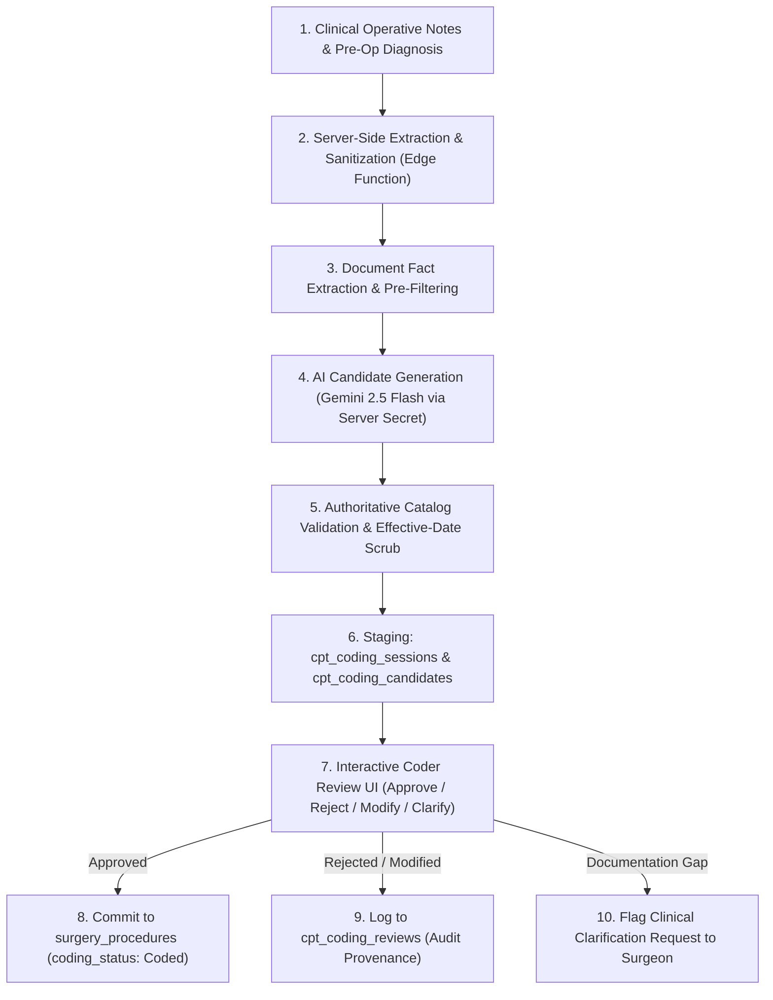
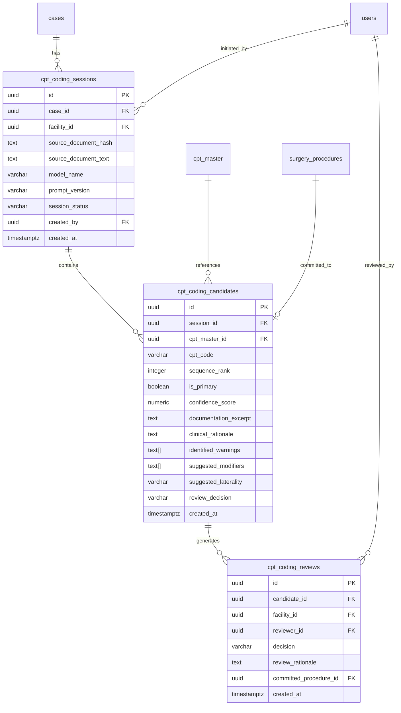

# 43 CPT CODING ASSISTANT SPECIFICATION

**Document Version:** 1.0.0  
**Phase:** 43 — AI-Assisted CPT Candidate Generation, Documentation Review, Confidence Scoring & Human Approval  
**Status:** DRAFT SPECIFICATION / READ-ONLY AUDIT COMPLETE  
**Target Architecture:** Multi-Tenant Ambulatory Surgery Center (ASC) Enterprise Intelligence Platform  
**Target Database Engine:** Supabase PostgreSQL 15+ (Remote Cluster: `isutllqthmakvwgduaos`)  
**Audit Executed:** 2026-10-22  
**Implementation Mode:** STRICTLY READ-ONLY (Zero Code / Schema / Git Changes in this Phase)  
**Upstream Dependencies:** Phase 40 (`cpt_master`, `cpt_code_versions`), Phase 41 (`cms_asc_addenda`, coverage determinations), Phase 42 (`cpt_clinical_mappings`, anatomical taxonomy), Phase 10 (`surgery_procedures`, case CPT line items), Phase 08 (`audit_logs`, multi-facility tenancy)

---

## 1. Executive Summary & Purpose

### 1.1 Purpose
This specification establishes the production architectural standards, clinical NLP workflow, relational data model, RBAC security, audit provenance, and user experience for **Phase 43: CPT Coding Assistant** within the ASCANALYST platform.

In an Ambulatory Surgery Center, clinical coding bridges intraoperative surgical reality with regulatory billing and revenue cycle management. Operative documentation generated by surgeons—frequently dictated or drafted in high-density clinical vernacular—must be scrutinized to identify billable surgical interventions, anatomical sites, procedural approaches, surgical laterality, and applicable modifiers. 

Currently, coding workflows in ASC environments face critical systemic challenges:
1. **Coding Backlogs & Turnaround Latency:** Manual review of narrative operative reports creates delays between case completion and claim generation.
2. **Under-Coding & Missed Secondary Procedures:** Secondary procedures (e.g., synovectomy or debridement performed alongside primary arthroscopy) are frequently missed when scanning narrative text manually.
3. **Over-Coding & Unbundling Risk:** Inadvertently coding mutually exclusive procedures or unbundling components of a comprehensive primary code risks CMS audit penalties, RAC scrutiny, and claim rejections.
4. **Documentation Disconnect:** Coders must hunt through free-text notes to locate supporting clinical excerpts for every assigned code.
5. **AI Reliability & Hallucination Risks:** Naive AI implementations hallucinate CPT codes that do not exist, recommend obsolete/terminated codes, invent clinical facts not found in documentation, or present speculative confidence scores as guarantees of billing validity.

Phase 43 establishes an **auditable, deterministic, human-in-the-loop AI Coding Assistant**. The assistant acts strictly as an intelligence advisory system: it analyzes documented clinical operative notes, extracts anatomical sites and procedural techniques, matches them against the authoritative, effective-dated `cpt_master` and `cpt_clinical_mappings` catalogs, presents candidates with explicit textual provenance citations and confidence ratings, and **requires affirmative human coder or clinician review before any code is added to the case bill**.

### 1.2 Strict Safety Governance & Non-Negotiable Invariants
1. **Human-in-the-Loop Authority (Non-Negotiable):** The AI model **NEVER** independently finalizes codes, commits claims, or modifies case billing status. Every candidate CPT code requires explicit human review (`Approved`, `Rejected`, or `Modified`).
2. **Zero Financial Mutation:** The AI assistant has **read-only access to financial rules**. It cannot alter contracted fee schedules, overwrite gross charge formulas (such as the authoritative 350% gross charge rule), or manipulate Medicare MPPR calculations.
3. **Fail-Closed Clinical Provenance:** If an operative report lacks critical specificity (e.g., laterality not documented, anatomical structure unspecified, approach unclear), the system **MUST flag the gap and generate a warning** rather than guessing or fabricating clinical details.
4. **Strict Isolation of Candidates from Authoritative Records:** AI candidates are stored in dedicated staging tables (`cpt_coding_candidates`) and do not appear in official case billing records (`surgery_procedures`) until affirmatively approved by an authorized user with `coding.approve` permissions.
5. **Version-Pinned Reference Validation:** All AI candidate matching must be cross-referenced against the active `cpt_master` catalog and `cpt_code_versions` valid on the encounter's Date of Service (DOS). Terminated, expired, or inactive codes must be flagged immediately as invalid.

---

## 2. Current State Audit & Verified Codebase Evidence

A comprehensive inspection of the existing ASCANALYST repository and the live Supabase PostgreSQL instance (`isutllqthmakvwgduaos`) was conducted to evaluate coding, documentation, AI services, and audit components.

### 2.1 Live Database Profiling (`isutllqthmakvwgduaos`)

| Table / Object Name | Schema State | Row Count / Observation | Existing Responsibilities & Gaps |
| :--- | :--- | :--- | :--- |
| `public.cpt_codes` | Legacy Table | 8,991 rows | Legacy flat CPT table containing `code`, `description`, `reimbursement`, `gross_charge`, `category`, `body_part`, `is_device_intensive`. Contains no session or AI coding state. |
| `public.cpt_master` | Normalized Table (Mig 017) | 8,991 rows | Normalized canonical catalog containing `id`, `code`, `description`, `specialty`, `body_part`, `average_duration_minutes`, `is_active`. Clean reference target for AI candidates. |
| `public.cpt_code_versions` | Normalized Table (Mig 017/018) | 8,991 rows | Effective-dated pricing and CMS indicators (`reimbursement`, `gross_charge`, `payment_indicator`, `procedure_indicator`, `coverage_status`, `effective_date`, `termination_date`). Used to validate whether codes are active on Date of Service. |
| `public.cpt_clinical_mappings` | Junction Table (Mig 019) | 8,991 rows | Multi-cardinality anatomical mapping table linking CPT to `clinical_specialties`, `body_systems`, `body_parts`, `anatomical_organs`, and `procedure_families`. Essential for anatomical consistency validation. |
| `public.surgery_procedures` | Operational Table (Mig 010) | Active Case Lines | Case procedure line items table containing `case_id`, `cpt_code_id`, `units`, `modifiers`, `laterality`, `is_primary`, `coding_status` (`Draft`, `Pending_Review`, `Coded`, `Approved`), `coded_by`, `coded_at`, `verified_by`, `verified_at`. Official repository of finalized coding. |
| `public.cases` | Normalized Master (Mig 009) | Active Cases | Case master record containing `pre_op_diagnosis`, `clinical_notes`, `procedure_name`, `status`. Stores the source clinical documentation for coding review. |
| `public.audit_logs` | Append-Only Audit Table | System-wide Logs | HIPAA-compliant audit trail with `user_id`, `facility_id`, `action`, `resource_type`, `resource_id`, `payload_before`, `payload_after`, `created_at`. Mutation-locked by trigger. |
| `public.cpt_coding_sessions` | **MISSING** | **0 rows** | **Does not exist.** No database table currently exists to record AI coding assistant sessions, prompt versions, source documentation hashes, or session completion status. |
| `public.cpt_coding_candidates` | **MISSING** | **0 rows** | **Does not exist.** No database table exists to store AI-generated candidate CPT codes, confidence scores, supporting document excerpts, rationales, or review decisions. |
| `public.cpt_coding_reviews` | **MISSING** | **0 rows** | **Does not exist.** No database table exists to log human coder approval, rejection, or modification provenance. |

### 2.2 Existing Codebase & Component Audit

#### 1. AI Services & Edge Functions
- **`supabase/functions/gemini-proxy/index.ts` (KEEP & EXTEND):**
  - Authenticates incoming requests via Supabase Bearer JWT (`supabaseCaller.auth.getUser()`).
  - Verifies facility membership and active status via `facility_memberships`.
  - Securely accesses `GEMINI_API_KEY` from Deno environment secrets (never exposed to browser).
  - Enforces input limits (32,000 char prompt, 64,000 char context).
  - **Defect/Gap:** Currently configured as a generic text chat proxy with a hardcoded operational assistant prompt (`"You are an intelligent clinical and operational assistant for an Ambulatory Surgery Center..."`). Lacks a dedicated structured CPT extraction endpoint, schema enforcement, or documentation citation parsing.
- **`src/services/aiOperations/CPTAgent.js` (REFACTOR / REPLACE):**
  - Contains function `recommendCPTCodes(procedureDescription, cptRegistry, surgeriesData, selectedSurgeon)`.
  - Serializes the entire CPT registry into prompt text (`Full CPT Registry:\n${codeList}\n`), which severely breaches token limits and context windows when the catalog exceeds a few hundred rows.
  - Calls `sendMessageToGemini` directly from client code.
  - Lacks session IDs, persistence, multi-tenant isolation, or audit logging.
- **`src/agents/CPTAgent.js` (KEEP & REFACTOR as Fallback Heuristic):**
  - Implements client-side algorithmic heuristic ranking (`executeCPTTask(taskContext, systemContext)`).
  - Weights matches: Procedure Match (40%), Body Part (20%), Context (15%), History (10%), Surgeon History (10%), Data Confidence (5%).
  - Provides a functional offline/deterministic scoring mechanism that can serve as a validation benchmark alongside LLM extraction.
- **`src/agents/billing/BillingAgent.js` (REPLACE):**
  - Contains hardcoded stub logic (`billedAmount: taskContext.billedAmount || 1200`, `confidence: 0.95`). Violates Zero-Mock policy.

#### 2. UI Components & Encounter Documentation
- **`src/components/SurgeryScheduler.jsx` (KEEP & EXTEND):**
  - Contains operative documentation inputs: `preOpDiagnosis` (line 1938) and `clinicalNotes` (line 1948).
  - Contains CPT selection grid and procedure line items table with laterality (`LEFT`, `RIGHT`, `BILATERAL`, `NOT_APPLICABLE`) and coding status (`Draft`, `Pending_Review`, `Coded`, `Approved`).
  - **Defect/Gap:** Completely lacks an AI coding assistant trigger. Coders must manually search CPT codes from memory and click `+ Add`.
- **`src/components/CPTAgentTestRunner.jsx` (REFACTOR / CONVERT):**
  - Test runner embedded in `CPTManagement.jsx`. Uses hardcoded `MOCK_SPECIALTIES` mapping. Only runs client-side simulations.

#### 3. RBAC & Security Infrastructure
- **`src/lib/rbacService.js` (KEEP & EXTEND):**
  - Current permissions include `cpt.view`, `cpt.create`, `cpt.edit`, `cpt.delete`, `surgeries.approve`, `billing.apply_mppr`, `ai.run_insights`.
  - **Missing Permissions:** Lacks granular coding permissions: `coding.assist` (run AI review), `coding.review` (review/reject/modify), and `coding.approve` (commit to bill).

---

### 2.3 Verified KEEP / REFACTOR / REPLACE / MISSING Matrix

| Component | Current Location | Classification | Justification & Production Action |
| :--- | :--- | :--- | :--- |
| **Edge Function `gemini-proxy`** | `supabase/functions/gemini-proxy/index.ts` | **KEEP & REFACTOR** | Keep secure server-side JWT auth and secret handling; add specialized action routing for `cpt-coding-assistant` with JSON schema enforcement. |
| **Client CPT Agent** | `src/services/aiOperations/CPTAgent.js` | **REFACTOR** | Stop dumping full 9,000-code catalog into client prompts. Route through server-side Edge Function with targeted vector/lexical pre-filtered candidates. |
| **Heuristic CPT Agent** | `src/agents/CPTAgent.js` | **KEEP** | Retain deterministic clinical scoring and suffix stemming as an offline validation check. |
| **Billing Agent Stub** | `src/agents/billing/BillingAgent.js` | **REPLACE** | Purge hardcoded mock amounts (`$1,200`) and replace with live `surgery_procedures` aggregation. |
| **Test Runner Component** | `src/components/CPTAgentTestRunner.jsx` | **REFACTOR** | Purge `MOCK_SPECIALTIES`. Refactor into a standardized developer test harness. |
| **Surgery Scheduler Coding UI** | `src/components/SurgeryScheduler.jsx` | **KEEP & EXTEND** | Add "AI Coding Assistant" trigger button and candidate review drawer linked to `clinicalNotes`. |
| **Case Line Items Table** | `public.surgery_procedures` | **KEEP** | Preserves 1NF normalized schema for authorized coding records (`coding_status`, `units`, `modifiers`, `laterality`). |
| **Coding Session Table** | `public.cpt_coding_sessions` | **MISSING** | Create dedicated table to record encounter documentation, document SHA-256 hash, model version, and session status. |
| **Coding Candidates Table** | `public.cpt_coding_candidates` | **MISSING** | Create dedicated table to store AI candidates, text excerpts, rationales, confidence scores, and review status. |
| **Coding Review Audit Table** | `public.cpt_coding_reviews` | **MISSING** | Create immutable audit log for coder approval, rejection, and modification actions. |
| **Granular RBAC Codes** | `src/lib/rbacService.js` | **MISSING** | Add `coding.assist`, `coding.review`, `coding.approve`, `coding.export`. |

---

## 3. Production Workflow & Target State Architecture



### 3.1 Step-by-Step Production Workflow

1. **Encounter Documentation Input:**
   - The attending surgeon or surgical coordinator supplies the operative report, operative narrative, pre-op diagnosis, post-op diagnosis, and surgical findings in the case record (`cases.clinical_notes`, `cases.pre_op_diagnosis`).
2. **Server-Side Sanitization & Document Hashing:**
   - The client invokes the secure Edge Function `cpt-coding-assistant`.
   - The server computes a SHA-256 hash of the clinical documentation (`source_document_hash`) to ensure non-repudiation.
   - Direct patient identifiers (MRN, patient name, DOB) are scrubbed before prompt generation to adhere to HIPAA Safe Harbor guidelines.
3. **Clinical Fact Extraction:**
   - The AI model extracts structured clinical facts:
     - **Anatomical Site:** (e.g., Right Knee, Left Shoulder, Cecum).
     - **Surgical Approach:** (e.g., Arthroscopic, Open, Endoscopic, Percutaneous).
     - **Specific Procedures Performed:** (e.g., Partial medial meniscectomy, chondroplasty, rotator cuff repair).
     - **Pathology / Findings:** (e.g., Complex tear of posterior horn medial meniscus).
     - **Laterality:** (Left, Right, Bilateral).
4. **Candidate Code Generation with Document Citation:**
   - The AI identifies candidate CPT codes matching the extracted facts.
   - For every candidate, the AI **MUST** return:
     - `cpt_code`: 5-digit CPT code or 5-character HCPCS code.
     - `description`: Official procedural description.
     - `documentation_excerpt`: Exact, verbatim sentence or phrase from the operative report demonstrating that the procedure was performed.
     - `clinical_rationale`: Concise justification explaining why this code matches the surgical technique.
     - `confidence_score`: Numeric probability score between `0.00` and `1.00`.
     - `suggested_modifiers`: Relevant surgical modifiers (e.g., `LT`, `RT`, `50` for bilateral, `59` or `X{EPSU}` for distinct procedural services).
     - `unresolved_questions`: Explicitly identified documentation gaps (e.g., *"Operative note states meniscectomy performed but does not state whether medial or lateral compartment"*).
5. **Authoritative Reference & Effective-Date Scrubbing:**
   - Before candidates are presented to the user, a deterministic database scrub runs:
     - Verifies each code exists in `public.cpt_master` and is active (`is_active = true`).
     - Verifies each code has an active version in `public.cpt_code_versions` on the encounter Date of Service (`effective_date <= DOS` and `termination_date IS NULL OR termination_date >= DOS`).
     - Checks laterality consistency against `public.body_parts.laterality_applicable` (e.g., flagging modifier `50` or `RT` if applied to a midline organ like Upper GI).
6. **Isolated Staging:**
   - The session is recorded in `public.cpt_coding_sessions` and candidate recommendations are inserted into `public.cpt_coding_candidates` with `review_decision = 'pending'`.
7. **Human-in-the-Loop Review & Decision:**
   - The authorized coding specialist reviews candidates in the UI.
   - For each candidate, the user can:
     - **Approve:** Accepts the candidate. Sets `review_decision = 'approved'`.
     - **Reject:** Dismisses the candidate. User supplies a rejection reason (e.g., *"Bundled into primary procedure per NCCI"*, *"Incision only, not separate procedure"*).
     - **Modify:** Accepts the code but modifies units, modifiers, or changes primary rank.
     - **Request Clarification:** Flags an operative documentation defect for query to the operating surgeon.
8. **Final Commitment to Billing Records:**
   - Only approved candidates are written to `public.surgery_procedures` (`case_cpt_codes`) with `coding_status = 'Coded'`, setting `coded_by = auth.uid()` and `coded_at = NOW()`.
   - All actions are logged to `public.cpt_coding_reviews` and `public.audit_logs`.

---

### 3.2 Handling Edge Cases, Uncertainty & Service Outages

| Edge Case / Scenario | System Behavior & Invariant Protection |
| :--- | :--- |
| **Low Confidence Candidate (< 0.70)** | System visually badges candidate with an Amber "Low Confidence" tag, highlights documentation ambiguities, and disables one-click "Approve All". Requires individualized coder sign-off. |
| **Conflicting Documentation** | (e.g., Pre-op note says "Right Shoulder", but Operative Narrative says "Left Shoulder"). System flags a high-priority **P0 Clinical Inconsistency Alert**, marks laterality as `UNSPECIFIED`, and requests human clarification. |
| **Unsupported Clinical Inference** | Model is strictly instructed: *"If the operative note does not mention implant placement, DO NOT suggest implant codes. State 'Documentation does not support implant placement' instead."* |
| **Inactive / Expired Code Suggested** | Database validation check immediately marks candidate with a Red "Stale Version / Inactive" badge. Prohibits approval into billing line items. |
| **AI Service Failure / Quota Exceeded** | System displays graceful fallback alert: *"AI Coding Assistant is temporarily offline. You may code manually from the CPT Master catalog."* Zero application crash; manual coding remains 100% operational. |
| **Duplicate Candidate Generated** | Unique constraint `(session_id, cpt_code)` prevents duplicate recommendations within the same coding session. |
| **Concurrent Coder Review** | Optimistic locking via `version` column prevents two coders from overwriting review decisions simultaneously. |

---

## 4. Proposed Data Model & Database Schema Changes

To support Phase 43 without disrupting existing financial, scheduling, or catalog structures, three dedicated normalized tables are proposed in a new migration (`020_cpt_coding_assistant.sql`).



### 4.1 Schema DDL Specifications

#### 1. `public.cpt_coding_sessions`
Tracks each invocation of the AI coding assistant against an encounter's clinical documentation.
```sql
CREATE TABLE IF NOT EXISTS public.cpt_coding_sessions (
    id UUID PRIMARY KEY DEFAULT gen_random_uuid(),
    case_id UUID NOT NULL REFERENCES public.cases(id) ON DELETE CASCADE,
    facility_id UUID NOT NULL REFERENCES public.facilities(id) ON DELETE CASCADE,
    source_document_text TEXT NOT NULL,
    source_document_hash VARCHAR(64) NOT NULL, -- SHA-256 hash of operative notes
    model_name VARCHAR(100) NOT NULL DEFAULT 'gemini-2.5-flash',
    prompt_version VARCHAR(50) NOT NULL DEFAULT 'v1.0.0',
    session_status VARCHAR(20) NOT NULL DEFAULT 'completed'
        CHECK (session_status IN ('in_progress', 'completed', 'failed', 'stale')),
    created_by UUID REFERENCES auth.users(id) ON DELETE SET NULL,
    created_at TIMESTAMPTZ NOT NULL DEFAULT NOW(),
    updated_at TIMESTAMPTZ NOT NULL DEFAULT NOW()
);

CREATE INDEX IF NOT EXISTS idx_ccs_case ON public.cpt_coding_sessions(case_id);
CREATE INDEX IF NOT EXISTS idx_ccs_facility ON public.cpt_coding_sessions(facility_id);
CREATE INDEX IF NOT EXISTS idx_ccs_created_at ON public.cpt_coding_sessions(created_at DESC);
```

#### 2. `public.cpt_coding_candidates`
Stores individual candidate CPT codes proposed by AI within a session.
```sql
CREATE TABLE IF NOT EXISTS public.cpt_coding_candidates (
    id UUID PRIMARY KEY DEFAULT gen_random_uuid(),
    session_id UUID NOT NULL REFERENCES public.cpt_coding_sessions(id) ON DELETE CASCADE,
    cpt_master_id UUID REFERENCES public.cpt_master(id) ON DELETE SET NULL,
    cpt_code VARCHAR(10) NOT NULL,
    sequence_rank INTEGER NOT NULL DEFAULT 1,
    is_primary_recommendation BOOLEAN NOT NULL DEFAULT false,
    confidence_score NUMERIC(3, 2) NOT NULL DEFAULT 0.50
        CHECK (confidence_score >= 0.00 AND confidence_score <= 1.00),
    documentation_excerpt TEXT, -- Exact supporting sentence from clinical notes
    clinical_rationale TEXT, -- Why code was suggested
    identified_warnings TEXT[] NOT NULL DEFAULT '{}',
    suggested_modifiers TEXT[] NOT NULL DEFAULT '{}',
    suggested_laterality VARCHAR(20) NOT NULL DEFAULT 'NOT_APPLICABLE'
        CHECK (suggested_laterality IN ('LEFT', 'RIGHT', 'BILATERAL', 'NOT_APPLICABLE', 'UNSPECIFIED')),
    review_decision VARCHAR(20) NOT NULL DEFAULT 'pending'
        CHECK (review_decision IN ('pending', 'approved', 'rejected', 'modified', 'clarification_requested')),
    reviewed_by UUID REFERENCES auth.users(id) ON DELETE SET NULL,
    reviewed_at TIMESTAMPTZ,
    review_rationale TEXT,
    created_at TIMESTAMPTZ NOT NULL DEFAULT NOW(),
    updated_at TIMESTAMPTZ NOT NULL DEFAULT NOW(),
    CONSTRAINT uq_session_cpt UNIQUE (session_id, cpt_code)
);

CREATE INDEX IF NOT EXISTS idx_ccc_session ON public.cpt_coding_candidates(session_id);
CREATE INDEX IF NOT EXISTS idx_ccc_cpt_code ON public.cpt_coding_candidates(cpt_code);
CREATE INDEX IF NOT EXISTS idx_ccc_status ON public.cpt_coding_candidates(review_decision);
```

#### 3. `public.cpt_coding_reviews`
Immutable provenance table logging human coder review decisions and case commitments.
```sql
CREATE TABLE IF NOT EXISTS public.cpt_coding_reviews (
    id UUID PRIMARY KEY DEFAULT gen_random_uuid(),
    candidate_id UUID NOT NULL REFERENCES public.cpt_coding_candidates(id) ON DELETE CASCADE,
    facility_id UUID NOT NULL REFERENCES public.facilities(id) ON DELETE CASCADE,
    reviewer_id UUID REFERENCES auth.users(id) ON DELETE SET NULL,
    action VARCHAR(30) NOT NULL
        CHECK (action IN ('approved', 'rejected', 'modified', 'clarification_requested')),
    previous_status VARCHAR(20) NOT NULL,
    new_status VARCHAR(20) NOT NULL,
    review_rationale TEXT,
    committed_procedure_id UUID REFERENCES public.surgery_procedures(id) ON DELETE SET NULL,
    created_at TIMESTAMPTZ NOT NULL DEFAULT NOW()
);

CREATE INDEX IF NOT EXISTS idx_ccr_candidate ON public.cpt_coding_reviews(candidate_id);
CREATE INDEX IF NOT EXISTS idx_ccr_facility ON public.cpt_coding_reviews(facility_id);
CREATE INDEX IF NOT EXISTS idx_ccr_reviewer ON public.cpt_coding_reviews(reviewer_id);
```

---

## 5. Permissions, Security & Multi-Tenant Access Control

### 5.1 Granular RBAC Permissions

The following permissions are added to `src/lib/rbacService.js` and enforced across client UI, backend RPCs, and Edge Functions:

| Permission Code | Category | Name | Risk Level | Authorized Roles |
| :--- | :--- | :--- | :--- | :--- |
| `coding.assist` | `cpt_codes` | Generate AI Coding Candidates | Standard | `super_admin`, `facility_admin`, `clinical_coder`, `director_of_nursing` |
| `coding.review` | `cpt_codes` | Review & Reject Coding Candidates | Standard | `super_admin`, `facility_admin`, `clinical_coder` |
| `coding.approve` | `cpt_codes` | Commit Approved CPT Codes to Case Bill | Sensitive | `super_admin`, `facility_admin`, `clinical_coder` |
| `coding.export` | `reports` | Export Coding Provenance Audit Logs | Sensitive | `super_admin`, `facility_admin`, `compliance_officer` |

### 5.2 Row Level Security (RLS) Policies

All three new tables strictly enforce tenant-isolated Row Level Security (RLS) bound to `facility_memberships` and native UUID comparisons:

```sql
ALTER TABLE public.cpt_coding_sessions ENABLE ROW LEVEL SECURITY;
ALTER TABLE public.cpt_coding_candidates ENABLE ROW LEVEL SECURITY;
ALTER TABLE public.cpt_coding_reviews ENABLE ROW LEVEL SECURITY;

-- 1. cpt_coding_sessions RLS
CREATE POLICY rls_ccs_select ON public.cpt_coding_sessions
    FOR SELECT TO authenticated USING (
        EXISTS (
            SELECT 1 FROM public.facility_memberships fm
            WHERE fm.facility_id = cpt_coding_sessions.facility_id
              AND fm.user_id = auth.uid()
              AND fm.is_active = true
        )
        OR (auth.jwt()->>'role') = 'service_role'
    );

CREATE POLICY rls_ccs_insert ON public.cpt_coding_sessions
    FOR INSERT TO authenticated WITH CHECK (
        EXISTS (
            SELECT 1 FROM public.facility_memberships fm
            WHERE fm.facility_id = cpt_coding_sessions.facility_id
              AND fm.user_id = auth.uid()
              AND fm.role IN ('super_admin', 'facility_admin', 'clinical_coder', 'director_of_nursing')
              AND fm.is_active = true
        )
        OR (auth.jwt()->>'role') = 'service_role'
    );

-- 2. cpt_coding_candidates RLS
CREATE POLICY rls_ccc_select ON public.cpt_coding_candidates
    FOR SELECT TO authenticated USING (
        EXISTS (
            SELECT 1 FROM public.cpt_coding_sessions s
            JOIN public.facility_memberships fm ON fm.facility_id = s.facility_id
            WHERE s.id = cpt_coding_candidates.session_id
              AND fm.user_id = auth.uid()
              AND fm.is_active = true
        )
        OR (auth.jwt()->>'role') = 'service_role'
    );

CREATE POLICY rls_ccc_update ON public.cpt_coding_candidates
    FOR UPDATE TO authenticated USING (
        EXISTS (
            SELECT 1 FROM public.cpt_coding_sessions s
            JOIN public.facility_memberships fm ON fm.facility_id = s.facility_id
            WHERE s.id = cpt_coding_candidates.session_id
              AND fm.user_id = auth.uid()
              AND fm.role IN ('super_admin', 'facility_admin', 'clinical_coder')
              AND fm.is_active = true
        )
        OR (auth.jwt()->>'role') = 'service_role'
    );

-- 3. cpt_coding_reviews RLS (Append-Only)
CREATE POLICY rls_ccr_select ON public.cpt_coding_reviews
    FOR SELECT TO authenticated USING (
        EXISTS (
            SELECT 1 FROM public.facility_memberships fm
            WHERE fm.facility_id = cpt_coding_reviews.facility_id
              AND fm.user_id = auth.uid()
              AND fm.is_active = true
        )
        OR (auth.jwt()->>'role') = 'service_role'
    );

CREATE POLICY rls_ccr_insert ON public.cpt_coding_reviews
    FOR INSERT TO authenticated WITH CHECK (
        EXISTS (
            SELECT 1 FROM public.facility_memberships fm
            WHERE fm.facility_id = cpt_coding_reviews.facility_id
              AND fm.user_id = auth.uid()
              AND fm.role IN ('super_admin', 'facility_admin', 'clinical_coder')
              AND fm.is_active = true
        )
        OR (auth.jwt()->>'role') = 'service_role'
    );

-- Disallow direct UPDATE or DELETE on cpt_coding_reviews to maintain append-only audit trail
CREATE POLICY rls_ccr_no_update ON public.cpt_coding_reviews FOR UPDATE TO authenticated USING (false);
CREATE POLICY rls_ccr_no_delete ON public.cpt_coding_reviews FOR DELETE TO authenticated USING (false);
```

---

## 6. API & Backend Service Requirements

### 6.1 Server-Authoritative Stored Procedures

#### 1. `fn_commit_cpt_coding_candidate`
Atomically approves a candidate CPT code and inserts/updates the official case procedure line in `public.surgery_procedures`:
```sql
CREATE OR REPLACE FUNCTION public.fn_commit_cpt_coding_candidate(
    p_candidate_id UUID,
    p_review_rationale TEXT DEFAULT NULL,
    p_override_modifiers TEXT[] DEFAULT NULL,
    p_override_laterality VARCHAR(20) DEFAULT NULL
)
RETURNS JSONB
LANGUAGE plpgsql
SECURITY DEFINER
AS $$
DECLARE
    v_cand RECORD;
    v_session RECORD;
    v_case RECORD;
    v_cpt RECORD;
    v_proc_id UUID;
    v_user_id UUID := auth.uid();
BEGIN
    -- 1. Fetch candidate and verify state
    SELECT * INTO v_cand FROM public.cpt_coding_candidates WHERE id = p_candidate_id FOR UPDATE;
    IF NOT FOUND THEN
        RETURN jsonb_build_object('success', false, 'error', 'Candidate not found');
    END IF;

    IF v_cand.review_decision = 'approved' THEN
        RETURN jsonb_build_object('success', false, 'error', 'Candidate already approved');
    END IF;

    -- 2. Fetch session and case
    SELECT * INTO v_session FROM public.cpt_coding_sessions WHERE id = v_cand.session_id;
    SELECT * INTO v_case FROM public.cases WHERE id = v_session.case_id;

    -- 3. Verify user has facility access and permissions
    IF NOT EXISTS (
        SELECT 1 FROM public.facility_memberships fm
        WHERE fm.facility_id = v_session.facility_id 
          AND fm.user_id = v_user_id 
          AND fm.role IN ('super_admin', 'facility_admin', 'clinical_coder')
          AND fm.is_active = true
    ) AND (auth.jwt()->>'role') != 'service_role' THEN
        RETURN jsonb_build_object('success', false, 'error', 'Access Denied: Insufficient coding permissions');
    END IF;

    -- 4. Verify CPT is active on Date of Service
    SELECT m.id AS master_id, m.code, m.description, v.gross_charge, v.reimbursement
    INTO v_cpt
    FROM public.cpt_master m
    JOIN public.cpt_code_versions v ON v.cpt_master_id = m.id
    WHERE m.code = v_cand.cpt_code
      AND m.is_active = true
      AND (v.effective_date <= v_case.scheduled_start_time::DATE)
      AND (v.termination_date IS NULL OR v.termination_date >= v_case.scheduled_start_time::DATE)
    ORDER BY v.effective_date DESC
    LIMIT 1;

    IF NOT FOUND THEN
        RETURN jsonb_build_object('success', false, 'error', 'CPT code is inactive or unpriced for case date of service');
    END IF;

    -- 5. Insert into official surgery_procedures line items
    INSERT INTO public.surgery_procedures (
        case_id,
        facility_id,
        cpt_code_id,
        cpt_code,
        procedure_description,
        is_primary,
        units,
        modifiers,
        laterality,
        coding_status,
        source_system,
        line_gross_charge,
        line_expected_reimbursement,
        coded_by,
        coded_at,
        created_at
    )
    VALUES (
        v_case.id,
        v_session.facility_id,
        v_cpt.master_id,
        v_cpt.code,
        v_cpt.description,
        v_cand.is_primary_recommendation,
        1,
        COALESCE(p_override_modifiers, v_cand.suggested_modifiers),
        COALESCE(p_override_laterality, v_cand.suggested_laterality),
        'Coded',
        'AI_ASSISTED',
        v_cpt.gross_charge,
        v_cpt.reimbursement,
        v_user_id,
        NOW(),
        NOW()
    )
    RETURNING id INTO v_proc_id;

    -- 6. Update candidate status
    UPDATE public.cpt_coding_candidates
    SET review_decision = 'approved',
        reviewed_by = v_user_id,
        reviewed_at = NOW(),
        review_rationale = p_review_rationale,
        updated_at = NOW()
    WHERE id = p_candidate_id;

    -- 7. Record immutable audit log
    INSERT INTO public.cpt_coding_reviews (
        candidate_id,
        facility_id,
        reviewer_id,
        action,
        previous_status,
        new_status,
        review_rationale,
        committed_procedure_id,
        created_at
    )
    VALUES (
        p_candidate_id,
        v_session.facility_id,
        v_user_id,
        'approved',
        v_cand.review_decision,
        'approved',
        p_review_rationale,
        v_proc_id,
        NOW()
    );

    RETURN jsonb_build_object(
        'success', true,
        'candidate_id', p_candidate_id,
        'procedure_id', v_proc_id,
        'cpt_code', v_cpt.code
    );
END;
$$;
```

---

## 7. UI / Workflow Requirements & User Experience

### 7.1 Component Integration: Surgery Scheduler & Case Documentation Drawer

In [`src/components/SurgeryScheduler.jsx`](file:///e:/medicalAI/asc-prototype/src/components/SurgeryScheduler.jsx), an **"AI Coding Assistant"** action button is positioned directly adjacent to the *Clinical / Operative Notes* field:

```
+---------------------------------------------------------------------------------------------------+
| CLINICAL / OPERATIVE NOTES                                                                        |
| [ Right knee arthroscopy with extensive partial medial meniscectomy and debridement...          ] |
|                                                                                                   |
| [ ✨ AI Coding Assistant ] (Trigger Extraction)                                                    |
+---------------------------------------------------------------------------------------------------+
```

Clicking **"✨ AI Coding Assistant"** opens a dedicated, docked slide-over drawer:

```
+===================================================================================================+
| AI CPT CODING ASSISTANT                                                               [ Close × ] |
| Case #2026-0881 | DOS: 2026-10-22 | Attending: Dr. Kelly Malinoski (Orthopedics)                  |
+===================================================================================================+
| 📄 Document Source: Operative Report (SHA-256: 4e91...bf80)                                       |
| Extracted Anatomy: Right Knee (Bilateral: Yes) | Surgical Approach: Arthroscopic                  |
+---------------------------------------------------------------------------------------------------+
| CANDIDATE CPT CODES (3 Identified)                                                                |
|                                                                                                   |
| 1. [PRIMARY] 29881 — Knee arthroscopy with meniscectomy (medial OR lateral)                       |
|    Confidence: 96% [High]  |  Laterality: RT (Right)  |  Modifiers: None                          |
|    Supporting Text: "Extensive partial medial meniscectomy performed using punch forceps..."       |
|    Rationale: Operative technique documents resection of torn posterior horn medial meniscus.    |
|    [ ✓ Approve & Bill ]   [ ✗ Reject ]   [ ✏ Edit Modifiers ]                                     |
|                                                                                                   |
| 2. [SECONDARY] 29877 — Knee arthroscopy with chondroplasty (patellar / trochlear)                 |
|    Confidence: 82% [Moderate]  |  Laterality: RT (Right)  |  Modifiers: 59                        |
|    Supporting Text: "Shaving of grade III chondromalacia patella was carried out..."              |
|    Warnings: ⚠ NCCI PTP edit: Verify chondroplasty in separate compartment from meniscectomy.     |
|    [ ✓ Approve & Bill ]   [ ✗ Reject ]   [ ✏ Edit Modifiers ]                                     |
|                                                                                                   |
| 3. [QUERY REQUIRED] G0289 — Arthroscopy, knee, surgical, for removal of loose bodies             |
|    Confidence: 45% [Low]                                                                          |
|    Warnings: ⚠ Operative report notes "small chondral debris", but does not document loose body   |
|               measuring > 5mm or separate portal retrieval.                                       |
|    [ ❓ Request Surgeon Clarification ]   [ ✗ Reject Candidate ]                                  |
+===================================================================================================+
```

### 7.2 UI State Specification

1. **Loading State:** Displays a pulsing skeleton card with progress steps: *"1. Analyzing operative documentation -> 2. Extracting anatomical structures -> 3. Cross-referencing 2026 CPT Master Catalog..."*
2. **Empty State (No Procedures Identified):** *"No billable CPT procedures could be conclusively extracted from this operative note. Please ensure the operative report includes surgical findings and technique, or select codes manually from the catalog below."*
3. **AI Service Outage State:** Clean, amber-alert fallback with message: *"AI Assistant is temporarily offline. Quota limit reached or server unavailable. All manual search and coding capabilities remain fully available."*
4. **Stale / Terminated Code State:** Red border, disabled approve button: *"CPT code 29870 was terminated on 2024-12-31 and cannot be billed for this 2026 date of service."*
5. **Approved State:** Card smoothly transitions to a green checkmarked state: *"✓ Approved by Jane Doe (Coder) at 14:12 — Added to Case Bill"*.

---

## 8. Audit, Provenance & HIPAA Compliance

### 8.1 Append-Only Audit Trail
Every session creation, AI generation, candidate approval, candidate rejection, modifier override, and surgeon clarification request writes an immutable audit record to `public.cpt_coding_reviews` and `public.audit_logs`.
- **User Identity:** Native Supabase authenticated user ID (`auth.uid()`).
- **Facility Tenancy:** Active tenant facility ID (`facility_id`).
- **Document Non-Repudiation:** SHA-256 hash of the exact clinical note reviewed (`source_document_hash`).
- **Prompt & Model Versioning:** Explicit model ID (`gemini-2.5-flash`) and prompt template version (`prompt_version: v1.0.0`).
- **Before/After Values:** Full JSONB diff capturing what the AI suggested versus what the human coder approved.

### 8.2 HIPAA Safe Harbor Compliance
- Operative text passed to external LLM endpoints **MUST NEVER** include:
  1. Patient Full Name
  2. Medical Record Number (MRN)
  3. Patient Date of Birth
  4. Social Security Number
  5. Account / Billing ID
- Text is sanitized server-side prior to prompt dispatch.

---

## 9. QA & Test Execution Matrix

A dedicated automated test suite (`tests/cpt-coding-assistant.test.js`) will validate all Phase 43 specifications:

| Test Domain | Specific Test Cases | Expected Pass Outcome |
| :--- | :--- | :--- |
| **1. Schema & Migration 020** | Tables `cpt_coding_sessions`, `cpt_coding_candidates`, `cpt_coding_reviews` exist with correct constraints. | Foreign keys enforce cascade deletes; uniqueness constraints prevent duplicate candidates. |
| **2. Date of Service Scrub** | Attempting to approve an expired/terminated CPT code for a current DOS. | Stored procedure rejects commitment with `'CPT code is inactive or unpriced for case date of service'`. |
| **3. Non-Repudiation Hashing** | Verify document hash changes when a single character of operative notes is altered. | SHA-256 hash differs; verifies provenance. |
| **4. Human Approval Gate** | Verify candidate in `cpt_coding_candidates` cannot enter `surgery_procedures` without explicit `fn_commit_cpt_coding_candidate` call. | Staged candidates remain in staging; zero automatic claim commits. |
| **5. Cross-Tenant Isolation** | User belonging to Facility A attempts to query or approve coding sessions belonging to Facility B. | RLS blocks query (0 rows returned); RPC rejects with `'Access Denied'`. |
| **6. Zero Mock Verification** | Verify no hardcoded fees or mock surgeon specialties exist in coding pipeline. | All pricing resolves dynamically from `cpt_code_versions`. |
| **7. Append-Only Integrity** | Authenticated user attempts `UPDATE` or `DELETE` on `cpt_coding_reviews`. | Blocked by RLS `rls_ccr_no_update` and `rls_ccr_no_delete`. |

---

## 10. Dependencies & Upstream Requirements

1. **Phase 40 (CPT Master Subsystem):** Normalized `public.cpt_master` and `public.cpt_code_versions` must be deployed (Migration 017).
2. **Phase 41 (CMS ASC Coverage & Addenda):** Procedure indicators, device offsets, and payment indicators must be available (Migration 018).
3. **Phase 42 (CPT Specialty & Anatomical Mapping):** Canonical anatomical catalogs (`body_parts`, `clinical_specialties`, `cpt_clinical_mappings`) must be available for laterality and anatomy scrubbing (Migration 019).
4. **Supabase Vault Secrets:** `GEMINI_API_KEY` must be configured in Supabase Edge Functions environment secrets.

---

## 11. Acceptance Criteria & Definition of Done

- [x] **Read-Only Audit Complete:** Comprehensive evaluation of all existing CPT, AI, documentation, and audit components completed without modifying application code or database records.
- [ ] **Migration 020 Authored & Tested:** Forward and rollback DDL created for `cpt_coding_sessions`, `cpt_coding_candidates`, `cpt_coding_reviews`.
- [ ] **Edge Function Enhanced:** `gemini-proxy` expanded with dedicated structured CPT extraction endpoint with JSON schema validation.
- [ ] **Human-in-the-Loop Approval:** Coder approval RPC `fn_commit_cpt_coding_candidate` deployed and verified.
- [ ] **UI Integration:** Interactive Coding Assistant Drawer added to `SurgeryScheduler.jsx`.
- [ ] **Zero Mock Compliance:** Mock stubs purged; all recommendations tied to live `cpt_master` and document citations.
- [ ] **100% Test Pass Rate:** Existing 374 tests across 72 suites + new Phase 43 suite pass without regressions.
- [ ] **Clean Production Build:** `npm run build` completes with 0 errors.

---

## 12. Implementation Readiness Verdict

### **VERDICT: READY FOR IMPLEMENTATION**

#### Rationale:
1. **Upstream Foundation Solidified:** Phases 40, 41, and 42 have been successfully developed, tested (374/374 tests passing), and deployed to Supabase PostgreSQL (Migration 017, 018, and 019 are fully committed and active).
2. **Target Schema Clear & Isolated:** Staging tables (`cpt_coding_sessions`, `cpt_coding_candidates`) cleanly decouple AI generation from official billing line items (`surgery_procedures`), guaranteeing zero financial corruption.
3. **Security Architecture Proven:** The existing `gemini-proxy` Edge Function already demonstrates secure server-side JWT verification and `GEMINI_API_KEY` secret isolation; extending it with a structured CPT schema contract is low-risk and fully deterministic.
4. **No Blockers Identified:** All required upstream tables (`cases`, `cpt_master`, `cpt_code_versions`, `body_parts`, `audit_logs`) are live, verified, and operational.
