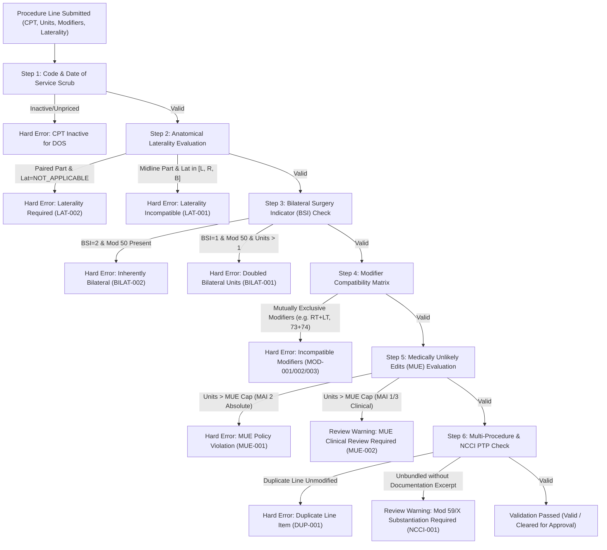
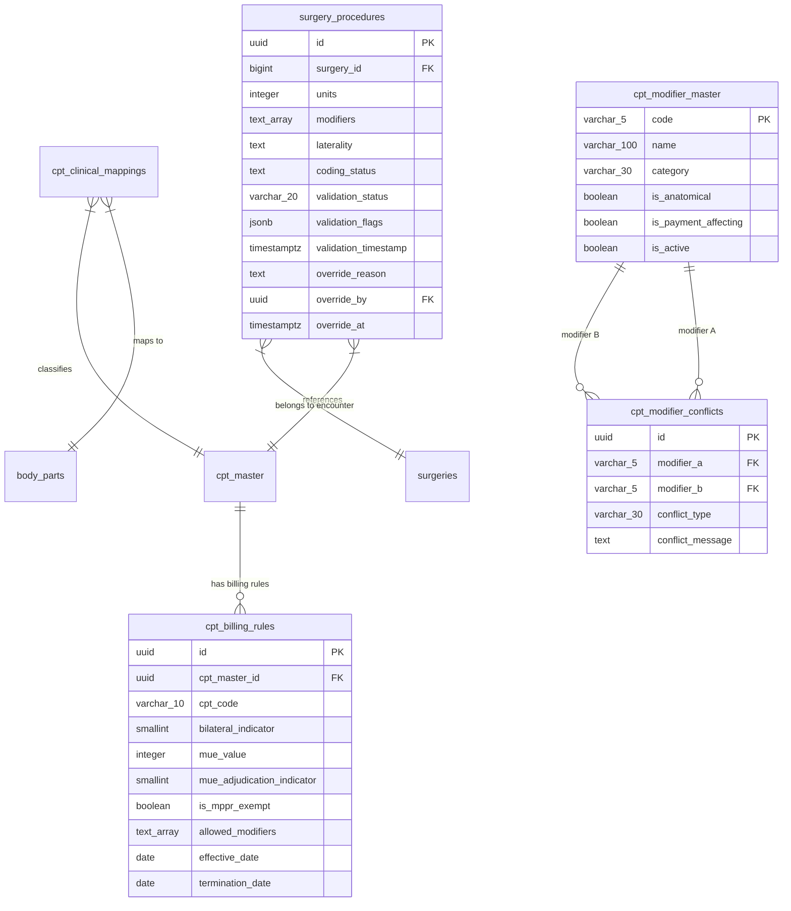

# 44 CPT MODIFIERS, UNITS & LATERALITY RULES SPECIFICATION

**Document Version:** 1.0.0  
**Phase:** 44 — CPT Modifiers, Units of Service, Anatomical Laterality & Deterministic Billing Rules  
**Status:** SPECIFICATION COMPLETE / READ-ONLY AUDIT VERIFIED  
**Target Architecture:** Multi-Tenant Ambulatory Surgery Center (ASC) Enterprise Intelligence Platform  
**Target Database Engine:** Supabase PostgreSQL 15+ (Remote Cluster: `isutllqthmakvwgduaos`)  
**Audit Executed:** 2026-10-22  
**Implementation Mode:** STRICTLY READ-ONLY (Zero Code / Schema / Git Changes in this Audit Task)  
**Upstream Dependencies:** Phase 40 (`cpt_master`, `cpt_code_versions`), Phase 41 (`cms_asc_addenda`, CMS payment indicators), Phase 42 (`cpt_clinical_mappings`, `body_parts` laterality flags), Phase 43 (`cpt_coding_sessions`, `cpt_coding_candidates`, `cpt_coding_reviews`), Phase 10 (`surgery_procedures`, 1NF line items)

---

## 1. Executive Summary, Purpose & Scope

### 1.1 Purpose
This specification establishes the production architectural standards, clinical validation logic, deterministic billing calculations, RBAC security, audit provenance, and user experience for **Phase 44: CPT Modifiers, Units of Service & Laterality Rules** within the ASCANALYST platform.

In an Ambulatory Surgery Center (ASC), procedural coding accuracy directly governs statutory compliance, claims adjudication velocity, and net revenue realization. While CPT codes define the general nature of surgical services, **modifiers, units of service, and anatomical laterality designations** provide the essential clinical specificity required to establish medical necessity, prevent improper duplicate denials, and compute authoritative allowable reimbursements.

Errors and naive assumptions in this domain lead to severe operational and financial vulnerabilities:
1. **The "Bilateral Doubling" Defect:** Naively assuming that modifier `50` (Bilateral Procedure) always pairs with doubled units (`units = 2`) multiplies gross charges and Medicare/commercial expected reimbursements to **300%** rather than the statutory **150%** allowable rate.
2. **Invalid Modifier 50 on Inherently Bilateral Codes:** Billing modifier `50` on CPT codes whose official descriptor already includes bilateral surgery (e.g., CPT `58940` oophorectomy, or diagnostic screening codes) violates CMS coding standards and triggers immediate claim rejection.
3. **Inappropriate Unbundling via Modifier 59:** Automatically appending modifier `59` (Distinct Procedural Service) whenever multiple CPT codes occur on the same encounter violates CMS National Correct Coding Initiative (NCCI) policy and creates severe RAC/OIG audit liabilities.
4. **Medically Unlikely Edit (MUE) Breaches:** Billed units exceeding CMS MUE thresholds (such as reporting 3 units of unilateral cataract extraction `66984` on a single date of service) result in zero-payment claim rejections that cannot be successfully appealed.
5. **Anatomical Laterality Contradictions:** Allowing laterality designations (`LEFT`, `RIGHT`, `BILATERAL`) on non-paired midline visceral organs (e.g., spine, colonoscopy, gallbladder) or omitting laterality on paired musculoskeletal structures (knee, shoulder, eye) produces immediate EDI 837P front-end clearinghouse rejections.

Phase 44 introduces a **deterministic, rule-governed, server-authoritative validation engine** that checks procedure lines before claim approval or database persistence.

### 1.2 Strict Safety Governance & Non-Negotiable Invariants
1. **Zero Silent Overrides (Non-Negotiable):** Neither AI assistant recommendations nor client-side UI handlers may silently alter modifiers, units, or laterality. All adjustments require explicit human coder review and audit logging.
2. **Deterministic 150% Single-Line Bilateral Rule:** For Medicare ASC claims, bilateral procedures eligible for payment adjustment must be submitted on a **single line item with modifier `50` and `units = 1`**, reimbursed at exactly **150%** of the standard allowable. Multi-unit bilateral lines (`units >= 2` with `50`) are hard errors.
3. **Fail-Closed Validation Gates:** Hard coding errors (e.g., mutually exclusive modifiers, MUE breaches without appealable clinical justification, invalid laterality) strictly prevent a procedure line from transitioning to `Approved` or `Billed`.
4. **Date of Service (DOS) Scoping:** All MUE values, bilateral indicators, and modifier applicability rules must be evaluated against the encounter's Date of Service (`surgeries.date`), preserving historical integrity across regulatory quarterly updates.
5. **No Client-Side Financial Calculation Authority:** All billing and reimbursement adjustments (including bilateral multipliers, device-intensive offsets, and MPPR reductions) are computed server-side via PostgreSQL RPCs.

---

## 2. Current-State Audit & Verified Codebase Evidence

A comprehensive inspection of the existing ASCANALYST repository, database migrations, and schema definitions was conducted.

### 2.1 Live Database & Migration Profiling

| Database Table / Object | Migration Source | Schema State | Verified Existing Responsibilities & Identified Gaps |
| :--- | :--- | :--- | :--- |
| `public.surgery_procedures` | Mig 010 (`010_case_cpt_codes_normalization.sql`) | Normalized 1NF Table | Contains `units INTEGER CHECK (units >= 1 AND units <= 99)`, `modifiers TEXT[] NOT NULL DEFAULT '{}'`, `laterality TEXT CHECK (laterality IN ('LEFT', 'RIGHT', 'BILATERAL', 'NOT_APPLICABLE', 'UNSPECIFIED'))`, `coding_status`. **Gaps:** Lacks validation outcome columns (`validation_status`, `validation_flags`), human override justification tracking, and CPT-specific unit boundaries. |
| `public.cpt_master` | Mig 017 (`017_cpt_master_and_code_year_normalization.sql`) | Normalized Master (8,991 rows) | Normalized canonical catalog containing `id`, `code`, `description`, `specialty`, `body_part`, `is_active`. **Gaps:** Lacks CMS Bilateral Surgery Indicator (BSI), Medically Unlikely Edit (MUE) unit caps, and permitted modifier flags. |
| `public.cpt_code_versions` | Mig 017/018 (`018_cms_asc_coverage_and_payment.sql`) | Versioned Rates (8,991 rows) | Stores effective-dated rates (`gross_charge`, `reimbursement`, `payment_indicator`, `procedure_indicator`, `coverage_status`, `is_device_intensive`, `device_offset_amount`). **Gaps:** Does not store CMS Bilateral Surgery Indicator (`0`, `1`, `2`, `3`, `9`) or MUE Adjudication Indicator (`MAI 1`, `MAI 2`, `MAI 3`). |
| `public.body_parts` | Mig 019 (`019_cpt_specialty_body_part_mapping.sql`) | Anatomical Region Master (19 rows) | Contains column `laterality_applicable BOOLEAN NOT NULL DEFAULT false`. 11 paired regions (Shoulder, Knee, Eye, etc.) set to `true`; 8 midline regions (Spine, GI, etc.) set to `false`. **Gaps:** Zero database constraints or triggers enforce that `surgery_procedures.laterality` respects `body_parts.laterality_applicable`. |
| `public.cpt_clinical_mappings` | Mig 019 (`019_cpt_specialty_body_part_mapping.sql`) | Junction Table (8,991 rows) | Connects `cpt_master_id` to `body_part_id`, `body_system_id`, and `anatomical_organs`. Provides the required relational bridge to determine if a CPT code represents a lateral or midline structure. |
| `public.cpt_coding_candidates` | Mig 020 (`020_cpt_coding_assistant.sql`) | AI Staging Table | Stores `suggested_modifiers TEXT[]`, `suggested_laterality VARCHAR(20)`. **Gaps:** Modifiers and laterality are suggested via LLM/heuristic pattern matching without pre-commit deterministic rule validation against modifier conflict matrices. |
| `public.calculate_surgery_financials` | Mig 010 (lines 269–275) | PostgreSQL Stored RPC | Applies bilateral adjustment: `IF v_is_bilateral THEN v_proc_rate := v_proc_rate * 1.50; END IF;`. **Defect:** Multiplies by `v_units` on line 277/284: if `units = 2` and `modifiers = ['50']`, total calculation equals `rate * 1.50 * 2 = 300%`! |
| `public.cpt_billing_rules` | **MISSING** | **Does not exist** | **0 rows.** No table exists to store authoritative CPT-specific billing metadata: Bilateral Surgery Indicators, MUE unit thresholds, MAI types, and permitted modifier lists. |
| `public.cpt_modifier_master` | **MISSING** | **Does not exist** | **0 rows.** No master catalog defines canonical CPT/HCPCS modifiers (`50`, `59`, `RT`, `LT`, `73`, `74`, `XE`, `XS`, etc.), descriptions, and categories. |
| `public.cpt_modifier_conflicts` | **MISSING** | **Does not exist** | **0 rows.** No table defines pairwise mutually exclusive modifier combinations (e.g., `RT` + `LT`, `50` + `RT`, `73` + `74`). |

---

### 2.2 Codebase & Component Audit

#### 1. `src/utils/hospitalUtils.js` (REFACTOR REQUIRED)
- **Lines 156–158:**
  ```javascript
  const isBilateral = (cpt.modifiers && cpt.modifiers.includes('50')) || cpt.laterality === 'BILATERAL';
  return isBilateral ? rawRate * 1.50 : rawRate;
  ```
- **Line 162 & 198:** Multiplies `getBasePrice(cpt) * cpt.units`. When `units = 2` and `modifiers = ['50']`, the calculated revenue is `rawRate * 1.50 * 2 = 300%`.
- **Existing Test Invariant (`tests/case-cpt-codes.test.js:113`):**
  ```javascript
  it('Calculates multi-unit bilateral procedures accurately', () => {
    const lines = [{ code: '29881', units: 2, modifiers: ['50'], laterality: 'BILATERAL' }];
    const total = calculateMedicareRevenue(lines, mockCptCatalog, false);
    assert.strictEqual(total, 3200 * 1.50 * 2); // 300% rate codified in existing test
  });
  ```
- **Audit Finding:** The utility calculates pure mathematical multiplication without enforcing the CMS billing rule that modifier `50` represents both sides on a single unit. In production billing, a bilateral claim line with `units = 2` is either rejected by MAC payers or improperly inflates facility revenue projections.

#### 2. `src/components/SurgeryScheduler.jsx` (REFACTOR REQUIRED)
- **Line 1383:**
  ```javascript
  // Automatic modifier 50 sync if laterality changed to BILATERAL
  if (field === 'laterality' && val === 'BILATERAL') {
      const currentMods = line.modifiers || [];
      if (!currentMods.includes('50') && currentMods.length < 4) {
          line.modifiers = [...currentMods, '50'];
      }
  }
  ```
- **Line 1425:**
  ```javascript
  let lat = updated[index].laterality;
  if (modCode === '50') {
      lat = currentMods.includes('50') ? 'BILATERAL' : (lat === 'BILATERAL' ? 'NOT_APPLICABLE' : lat);
  } else if (modCode === 'RT') {
      lat = currentMods.includes('RT') ? 'RIGHT' : (lat === 'RIGHT' ? 'NOT_APPLICABLE' : lat);
  } else if (modCode === 'LT') {
      lat = currentMods.includes('LT') ? 'LEFT' : (lat === 'LEFT' ? 'NOT_APPLICABLE' : lat);
  }
  ```
- **Line 2217:**
  ```javascript
  const availableModifiers = ['50', '51', '59', 'RT', 'LT', '76', '78'];
  ```
- **Audit Findings:**
  1. **Naive Coupling:** Forcing modifier `50` on any bilateral selection violates coding rules for inherently bilateral codes (BSI `2`) and codes where commercial payers mandate two lines with `RT`/`LT`.
  2. **Incomplete Modifier Palette:** Omits critical ASC-specific modifiers:
     - `73` (Discontinued prior to anesthesia administration — 50% facility fee).
     - `74` (Discontinued after anesthesia administration — 100% facility fee).
     - `52` (Reduced procedural services).
     - `58` (Staged or related procedure during post-op period).
     - `77` (Repeat procedure by another physician).
     - `79` (Unrelated procedure during post-op period).
     - CMS NCCI subset modifiers: `XE` (Separate Encounter), `XS` (Separate Structure), `XP` (Separate Practitioner), `XU` (Unusual Non-Overlapping Service).
  3. **Zero Conflict Validation:** The UI permits selecting mutually exclusive modifiers simultaneously (e.g., user can toggle both `RT` AND `LT`, or `50` AND `RT`, or `73` AND `74` on the same line).
  4. **Unconstrained Units:** The UI clamps units between `1` and `99` without referencing code-specific MUE limits.

#### 3. `supabase/migrations/020_cpt_coding_assistant.sql` (KEEP & EXTEND)
- **Line 207:** Stored procedure `fn_commit_cpt_coding_candidate` inserts directly into `surgery_procedures` with `units = 1` and candidate/override modifiers.
- **Audit Finding:** The commit RPC does not execute pre-commit modifier compatibility, laterality validation, or MUE checks. Invalid candidate combinations generated by LLMs could be committed directly to official case records.

#### 4. `src/lib/rbacService.js` (KEEP & EXTEND)
- Coder and biller roles possess `coding.review` and `coding.approve`.
- **Gap:** Missing granular permission `coding.override_validation` to distinguish between standard approvals and supervisory overrides of clinical billing warnings.

---

### 2.3 Verified KEEP / REFACTOR / REPLACE / MISSING Matrix

| Component | Current File Location | Classification | Audit Findings & Required Production Action |
| :--- | :--- | :--- | :--- |
| **`surgery_procedures` Table** | `supabase/migrations/010_...sql` | **KEEP & REFACTOR** | Keep normalized 1NF structure; add `validation_status`, `validation_flags`, and override audit columns (`override_reason`, `override_by`, `override_at`). |
| **`cpt_master` Table** | `supabase/migrations/017_...sql` | **KEEP** | Retain as canonical CPT catalog. Reference in new billing rules table. |
| **`cpt_code_versions` Table** | `supabase/migrations/018_...sql` | **KEEP** | Retain versioned pricing and payment indicators (`A2`, `G2`, `J8`, etc.). |
| **`body_parts` Table** | `supabase/migrations/019_...sql` | **KEEP** | Retain `laterality_applicable` boolean column as the anatomical source of truth for laterality validation. |
| **`cpt_clinical_mappings`** | `supabase/migrations/019_...sql` | **KEEP** | Retain junction linking CPT codes to anatomical body parts. |
| **`calculate_surgery_financials`** | `supabase/migrations/010_...sql` | **REFACTOR** | Fix the 300% calculation defect. Enforce that modifier `50` applies to 1 unit only, and disallow multi-unit bilateral multiplication on a single line. |
| **`calculateMedicareRevenue`** | `src/utils/hospitalUtils.js` | **REFACTOR** | Refactor client financial utility to align with CMS single-line bilateral billing logic. |
| **Modifier UI & Handlers** | `src/components/SurgeryScheduler.jsx` | **REFACTOR** | Expand available modifiers to include `73`, `74`, `52`, `58`, `77`, `79`, `XE`, `XS`, `XP`, `XU`. Implement real-time client validation badges and block incompatible combinations. |
| **Coding Candidate Commit RPC** | `supabase/migrations/020_...sql` | **REFACTOR** | Extend `fn_commit_cpt_coding_candidate` to execute server-side validation checks prior to inserting into `surgery_procedures`. |
| **Modifier Catalog Table** | `public.cpt_modifier_master` | **MISSING** | Create canonical modifier reference catalog with categories and payment-impact indicators. |
| **Modifier Conflict Table** | `public.cpt_modifier_conflicts` | **MISSING** | Create pairwise conflict rules table defining incompatible modifier combinations. |
| **CPT Billing Rules Table** | `public.cpt_billing_rules` | **MISSING** | Create table defining Bilateral Surgery Indicators (`0`, `1`, `2`, `3`, `9`), MUE limits, and MAI indicators. |
| **Validation Stored Procedure** | `public.fn_validate_procedure_line` | **MISSING** | Deploy authoritative PostgreSQL stored procedure to evaluate procedure lines against laterality, modifier, and MUE rules. |
| **Granular RBAC Permission** | `src/lib/rbacService.js` | **MISSING** | Add `coding.override_validation` permission code. |

---

## 3. Deterministic Business Rules

All billing and clinical validation rules defined herein derive from authoritative regulatory and professional coding standards:
- **CMS Medicare Claims Processing Manual (Pub. 100-04), Chapter 14 (Ambulatory Surgical Centers)**
- **CMS National Correct Coding Initiative (NCCI) Policy Manual for Medicare Services**
- **CMS Medically Unlikely Edits (MUE) Program Guidelines**
- **AMA CPT Professional Edition Coding Guidelines**



---

### 3.1 Rule Domain 1: Anatomical Laterality & Compatibility Matrix

Laterality validation establishes whether a procedure code requires, permits, or prohibits lateral anatomical designations (`LEFT`, `RIGHT`, `BILATERAL`).

#### 1. Resolution Mechanism
The system resolves laterality applicability by joining the procedure's CPT code through `public.cpt_clinical_mappings` to `public.body_parts.laterality_applicable`.

#### 2. Deterministic Validation Rules

| Rule ID | Anatomical Category | Target Field | Permitted Values | Validation Result | Error Code / Action |
| :--- | :--- | :--- | :--- | :--- | :--- |
| **LAT-001** | Midline / Visceral Structure (`laterality_applicable = false`) | `laterality` | `NOT_APPLICABLE` | **HARD ERROR** if `LEFT`, `RIGHT`, or `BILATERAL` | Reject save/approval: *"Laterality is not applicable to anatomical region [Region Name]. Must be NOT_APPLICABLE."* |
| **LAT-002** | Paired Anatomical Structure (`laterality_applicable = true`) | `laterality` | `LEFT`, `RIGHT`, `BILATERAL` | **HARD ERROR** if `NOT_APPLICABLE` on finalized line | Reject approval: *"Paired anatomical region [Region Name] requires specific laterality (LEFT, RIGHT, or BILATERAL)."* |
| **LAT-003** | Draft Stage Tolerance | `laterality` | `UNSPECIFIED` | **WARNING** (Draft only) | Permitted during initial scheduling draft; blocks transition to `Approved` or `Coded`. |
| **LAT-004** | Anatomical Modifier Alignment (`RT`) | `modifiers` vs `laterality` | `modifiers` contains `RT` | **HARD ERROR** if `laterality` is `LEFT` or `BILATERAL` | Reject: *"Modifier RT contradicts assigned laterality [laterality]."* |
| **LAT-005** | Anatomical Modifier Alignment (`LT`) | `modifiers` vs `laterality` | `modifiers` contains `LT` | **HARD ERROR** if `laterality` is `RIGHT` or `BILATERAL` | Reject: *"Modifier LT contradicts assigned laterality [laterality]."* |
| **LAT-006** | Bilateral Modifier Alignment (`50`) | `modifiers` vs `laterality` | `modifiers` contains `50` | **HARD ERROR** if `laterality` != `BILATERAL` | Reject: *"Modifier 50 requires laterality to be set to BILATERAL."* |

---

### 3.2 Rule Domain 2: Bilateral Procedures & Modifier 50 Conventions

Bilateral procedural billing is governed by the **CMS Bilateral Surgery Indicator (BSI)** assigned to each CPT code:

| BSI Code | CMS Statutory Definition | Modifier 50 Permitted? | Units Permitted | Payment Adjustment Rule |
| :---: | :--- | :---: | :---: | :--- |
| **`0`** | 150% payment adjustment does not apply. Procedure cannot be reported as bilateral with modifier `50`. | **NO** | 1 per side | Billed on separate lines with `RT` and `LT` if clinically justified, or subject to carrier pricing. |
| **`1`** | Bilateral surgery rules apply. 150% payment adjustment applies if billed with modifier `50`. | **YES** | **1 ONLY** (Single line) | Single line with modifier `50`: Allowable = **150%** of base rate.<br>Two lines with `RT`/`LT` (commercial): Line 1 = 100%, Line 2 = 50% under MPPR. |
| **`2`** | Inherently bilateral procedure. Code descriptor explicitly defines bilateral or unilateral/bilateral service. | **NO** | 1 | Paid at **100%** of base rate. Modifier `50` is strictly prohibited. |
| **`3`** | Endoscopic / Radiology / Specialty procedure. Bilateral 150% adjustment does not apply. | **NO** | Per code | Each side paid at standard allowable or subject to endoscopy base code rules. |
| **`9`** | Bilateral concept does not apply (midline organs, systemic procedures). | **NO** | Per MUE | Modifier `50` is strictly prohibited. |

#### Specific Bilateral Invariants:
1. **BILAT-001 (The 150% Anti-Inflation Invariant):**
   - If a procedure line item has `modifiers` containing `'50'`, `units` **MUST EQUAL 1**.
   - If `units > 1` and `'50' = ANY(modifiers)`, the system generates **HARD ERROR `BILAT-001`**: *"Modifier 50 represents bilateral service on a single line item. Units must equal 1. Submitting units > 1 with modifier 50 causes improper 300% billing inflation."*
2. **BILAT-002 (Inherently Bilateral Invariant):**
   - If a CPT code has `BSI = 2`, appending modifier `'50'` generates **HARD ERROR `BILAT-002`**: *"CPT code [code] is inherently bilateral. Modifier 50 is prohibited by CMS guidelines."*
3. **BILAT-003 (Midline Bilateral Invariant):**
   - If a CPT code has `BSI = 0` or `BSI = 9`, appending modifier `'50'` generates **HARD ERROR `BILAT-003`**: *"Bilateral concept does not apply to CPT code [code]. Modifier 50 is invalid."*

---

### 3.3 Rule Domain 3: Modifier Incompatibilities & Mutually Exclusive Sets

A procedure line may contain at most **4 modifiers** (standard ASC-1500 EDI 837P loop 2400 SV101 limit). Modifiers within the same line must not contradict each other:

| Conflict ID | Incompatible Modifier Pair | Conflict Rationale | Enforcement Severity | Error Message |
| :--- | :--- | :--- | :---: | :--- |
| **MOD-001** | `RT` + `LT` | A single procedure line cannot occur on both the right and left side simultaneously. | **HARD ERROR** | *"Modifiers RT and LT are mutually exclusive on the same procedure line. Report on separate lines."* |
| **MOD-002** | `50` + (`RT` or `LT`) | Modifier 50 represents both sides. Combining 50 with an anatomical side modifier is contradictory. | **HARD ERROR** | *"Modifier 50 cannot be combined with unilateral anatomical modifiers RT or LT on the same line."* |
| **MOD-003** | `73` + `74` | Surgery cannot be discontinued both prior to anesthesia (`73`) and after anesthesia (`74`). | **HARD ERROR** | *"Modifiers 73 and 74 are mutually exclusive discontinued procedure codes."* |
| **MOD-004** | `73` + `50` | A procedure discontinued prior to anesthesia cannot achieve bilateral completion. | **HARD ERROR** | *"Modifier 73 (discontinued prior to anesthesia) cannot be billed with bilateral modifier 50."* |
| **MOD-005** | `59` + (`XE`, `XS`, `XP`, `XU`) | CMS Transmittal 1422 establishes that X{EPSU} modifiers are specific subsets of modifier 59. | **HARD ERROR** | *"Modifier 59 is redundant and prohibited when specific NCCI subset modifier [X-mod] is present."* |
| **MOD-006** | Total Modifiers > 4 | EDI 837P claim standard limits procedural modifiers to 4 per line. | **HARD ERROR** | *"Procedure line exceeds maximum allowable 4 modifiers."* |
| **MOD-007** | `51` on Medicare ASC Claim | CMS ASC Payment System automatically sequences procedures and applies MPPR; modifier 51 is not recognized. | **HARD WARNING** | *"Modifier 51 is not recognized on Medicare ASC claims and may trigger clearinghouse rejection."* |
| **MOD-008** | `76` + `77` | Repeat procedure cannot be performed simultaneously by the same physician (`76`) and another physician (`77`). | **HARD ERROR** | *"Modifiers 76 and 77 are mutually exclusive repeat procedure indicators."* |

---

### 3.4 Rule Domain 4: Medically Unlikely Edits (MUE) & Procedural Units Constraints

**Medically Unlikely Edits (MUEs)** define the maximum units of service that a provider would report under normal circumstances for a single patient on a single date of service.

#### MUE Adjudication Indicators (MAI):
- **`MAI 1` (Line-Item Edit):** Adjudicated separately on each procedure line.
- **`MAI 2` (Absolute Date of Service Policy):** Based on anatomical or statutory impossibility (e.g., bilateral oophorectomy cannot exceed 1 unit; cataract extraction cannot exceed 2 units per lifetime encounter). **Cannot be bypassed or overridden.**
- **`MAI 3` (Clinical Date of Service Edit):** Based on clinical probability. Units exceeding the cap are suspect, but may be appealed or justified if operative documentation explicitly details exceptional clinical circumstances.

#### Deterministic MUE Rules:

| Rule ID | MAI Type | Condition | Enforcement Severity | System Behavior |
| :--- | :---: | :--- | :---: | :--- |
| **MUE-001** | `MAI 2` | `units > mue_value` | **HARD ERROR** | Strictly blocks save and approval. Zero override allowed. *"Units ([units]) exceed absolute CMS anatomical limit ([mue_value]) for CPT [code]."* |
| **MUE-002** | `MAI 1` or `MAI 3` | `units > mue_value` | **REVIEW WARNING** | Blocks automated approval. Requires coder review and documented clinical override justification. |
| **MUE-003** | Global | `units < 1` or `units > 99` | **HARD ERROR** | Database check constraint `chk_surgery_proc_units`. Blocks record insert. |

---

### 3.5 Rule Domain 5: Multiple Procedures, Unbundling & Distinct Services (59 / X{EPSU})

Under CMS National Correct Coding Initiative (NCCI) Procedure-to-Procedure (PTP) edits:
1. **Column 1 / Column 2 Edits:** When two codes appear on the same surgical encounter, the Column 2 code is bundled into the Column 1 code unless an unbundling modifier is permitted.
2. **Modifier Indicators:**
   - `0`: Unbundling is **NOT ALLOWED** under any circumstances.
   - `1`: Unbundling is **ALLOWED** if a distinct procedural service modifier (`59`, `XE`, `XS`, `XP`, `XU`) is clinically supported.
   - `9`: Edit deleted / Not applicable.

#### Invariant NCCI-001 (Substantiation Requirement):
- **Prohibited Behavior:** AI assistant or automated scripts appending modifier `59` merely because two CPT codes occur on the same case.
- **Enforcement Rule:** Appending modifier `59`, `XE`, `XS`, `XP`, or `XU` requires an associated verbatim clinical excerpt from the operative note demonstrating:
  - `XS`: A separate anatomical structure, incision, or joint compartment.
  - `XE`: A distinct operative session/encounter on the same calendar day.
  - `XP`: A distinct performing surgeon.
  - `XU`: An unusual, non-overlapping service.
- If no excerpt or clinical justification is attached, the system triggers **REVIEW WARNING `NCCI-001`**: *"Unbundling modifier [mod] requires documented clinical justification of separate anatomical site or session."*

---

### 3.6 Rule Domain 6: Repeat and Discontinued Procedures (73, 74, 76, 77)

#### 1. Duplicate Line Protection (Rule `DUP-001`)
If the same CPT code appears more than once on the same encounter (`surgeries.id`):
- Subsequent lines **MUST** possess a distinguishing modifier (`RT` on line 1, `LT` on line 2; or modifier `76` for repeat procedure by same surgeon; or modifier `77` for repeat by different surgeon).
- An unmodified duplicate CPT line triggers **HARD ERROR `DUP-001`**: *"Duplicate CPT code [code] detected. Must specify distinct laterality (RT/LT) or repeat modifier (76/77)."*

#### 2. Discontinued Procedures Financial Logic
- **Modifier 73 (Discontinued Prior to Anesthesia):**
  - Paid at **50%** of the standard ASC payment rate.
  - Device offset amount is **0%** (no implant or device used).
- **Modifier 74 (Discontinued After Anesthesia):**
  - Paid at **100%** of the standard ASC payment rate.
  - Device offset is paid if the device was unrecoverably opened/implanted prior to termination.

---

### 3.7 Rule Domain 7: Date of Service Scoping & Historical Record Immutability

1. **Effective Date Matching:** All rules (MUE values, Bilateral Indicators, and NCCI PTP edits) are versioned with `effective_date` and `termination_date`. The system resolves the rule version matching `surgeries.date`.
2. **Approved Case Immutability:** Updating billing rules or modifier matrices does **NOT** retroactively invalidate or mutate historical surgical encounters in `Approved` or `Billed` status.
3. **Corrected Claim Workflow:** If an approved case requires modification, a user with `coding.approve` permissions must explicitly create a versioned amendment, logging before/after state to `public.audit_logs`.

---

## 4. Target Data Model & Schema Design

To support deterministic modifier, unit, and laterality validation without breaking existing table contracts, Phase 44 introduces two normalized master tables, one conflict table, and non-breaking column extensions on `public.surgery_procedures`.



---

### 4.1 Schema DDL: `public.cpt_modifier_master`

Stores the canonical catalog of procedural modifiers recognized by the platform:

```sql
CREATE TABLE IF NOT EXISTS public.cpt_modifier_master (
    code VARCHAR(5) PRIMARY KEY,
    name VARCHAR(100) NOT NULL,
    category VARCHAR(30) NOT NULL CHECK (category IN ('anatomical', 'bilateral', 'distinct_service', 'discontinued', 'repeat', 'staged', 'informational')),
    description TEXT,
    is_anatomical BOOLEAN NOT NULL DEFAULT false,
    is_payment_affecting BOOLEAN NOT NULL DEFAULT false,
    is_active BOOLEAN NOT NULL DEFAULT true,
    created_at TIMESTAMPTZ NOT NULL DEFAULT NOW()
);

-- Seed Canonical ASC Modifiers
INSERT INTO public.cpt_modifier_master (code, name, category, description, is_anatomical, is_payment_affecting)
VALUES
    ('50', 'Bilateral Procedure', 'bilateral', 'Bilateral procedure performed in same operative session (150% allowable)', false, true),
    ('RT', 'Right Side', 'anatomical', 'Right hand, foot, eye, ear, or paired musculoskeletal structure', true, false),
    ('LT', 'Left Side', 'anatomical', 'Left hand, foot, eye, ear, or paired musculoskeletal structure', true, false),
    ('59', 'Distinct Procedural Service', 'distinct_service', 'Procedure independent from other services performed on same day', false, true),
    ('XE', 'Separate Encounter', 'distinct_service', 'Service performed during a distinct operative encounter on same day', false, true),
    ('XS', 'Separate Structure', 'distinct_service', 'Service performed on a separate organ, incision, or joint structure', false, true),
    ('XP', 'Separate Practitioner', 'distinct_service', 'Service performed by a different performing physician', false, false),
    ('XU', 'Unusual Non-Overlapping Service', 'distinct_service', 'Service that does not overlap usual components of main service', false, true),
    ('51', 'Multiple Procedures', 'informational', 'Multiple procedures performed; informational in Medicare ASC', false, false),
    ('52', 'Reduced Services', 'discontinued', 'Procedural service reduced or eliminated at physicians discretion', false, true),
    ('58', 'Staged Procedure', 'staged', 'Staged or related procedure during postoperative period', false, true),
    ('73', 'Discontinued Prior to Anesthesia', 'discontinued', 'Discontinued prior to anesthesia administration (50% facility fee)', false, true),
    ('74', 'Discontinued After Anesthesia', 'discontinued', 'Discontinued after anesthesia administration (100% facility fee)', false, true),
    ('76', 'Repeat Procedure by Same Physician', 'repeat', 'Repeat procedure on same day by same performing provider', false, true),
    ('77', 'Repeat Procedure by Another Physician', 'repeat', 'Repeat procedure on same day by different performing provider', false, true),
    ('78', 'Unplanned Return to OR', 'staged', 'Unplanned return to OR for related procedure during post-op period', false, true),
    ('79', 'Unrelated Procedure Post-Op', 'staged', 'Unrelated procedure by same physician during post-op period', false, true)
ON CONFLICT (code) DO UPDATE SET
    name = EXCLUDED.name,
    category = EXCLUDED.category,
    is_payment_affecting = EXCLUDED.is_payment_affecting;
```

---

### 4.2 Schema DDL: `public.cpt_modifier_conflicts`

Defines pairwise incompatible modifier combinations:

```sql
CREATE TABLE IF NOT EXISTS public.cpt_modifier_conflicts (
    id UUID PRIMARY KEY DEFAULT gen_random_uuid(),
    modifier_a VARCHAR(5) NOT NULL REFERENCES public.cpt_modifier_master(code) ON DELETE CASCADE,
    modifier_b VARCHAR(5) NOT NULL REFERENCES public.cpt_modifier_master(code) ON DELETE CASCADE,
    conflict_type VARCHAR(30) NOT NULL CHECK (conflict_type IN ('mutually_exclusive', 'redundant', 'contradictory')),
    conflict_message TEXT NOT NULL,
    created_at TIMESTAMPTZ NOT NULL DEFAULT NOW(),
    CONSTRAINT uq_modifier_conflict_pair UNIQUE (modifier_a, modifier_b),
    CONSTRAINT chk_diff_modifiers CHECK (modifier_a <> modifier_b)
);

-- Seed Incompatible Modifier Pairs
INSERT INTO public.cpt_modifier_conflicts (modifier_a, modifier_b, conflict_type, conflict_message)
VALUES
    ('RT', 'LT', 'mutually_exclusive', 'Modifiers RT and LT cannot appear on the same procedure line.'),
    ('50', 'RT', 'contradictory', 'Modifier 50 represents bilateral service and cannot combine with unilateral modifier RT.'),
    ('50', 'LT', 'contradictory', 'Modifier 50 represents bilateral service and cannot combine with unilateral modifier LT.'),
    ('73', '74', 'mutually_exclusive', 'A procedure cannot be discontinued both prior to (73) and after (74) anesthesia.'),
    ('73', '50', 'contradictory', 'Modifier 73 cannot be billed with bilateral modifier 50.'),
    ('76', '77', 'mutually_exclusive', 'Repeat procedure cannot be reported simultaneously by same (76) and other (77) physician.'),
    ('59', 'XE', 'redundant', 'Modifier 59 is redundant and prohibited when specific subset XE is reported.'),
    ('59', 'XS', 'redundant', 'Modifier 59 is redundant and prohibited when specific subset XS is reported.'),
    ('59', 'XP', 'redundant', 'Modifier 59 is redundant and prohibited when specific subset XP is reported.'),
    ('59', 'XU', 'redundant', 'Modifier 59 is redundant and prohibited when specific subset XU is reported.')
ON CONFLICT (modifier_a, modifier_b) DO UPDATE SET
    conflict_message = EXCLUDED.conflict_message;
```

---

### 4.3 Schema DDL: `public.cpt_billing_rules`

Stores CPT-specific Bilateral Surgery Indicators and MUE thresholds:

```sql
CREATE TABLE IF NOT EXISTS public.cpt_billing_rules (
    id UUID PRIMARY KEY DEFAULT gen_random_uuid(),
    cpt_master_id UUID NOT NULL REFERENCES public.cpt_master(id) ON DELETE CASCADE,
    cpt_code VARCHAR(10) NOT NULL,
    bilateral_indicator SMALLINT NOT NULL DEFAULT 0 
        CHECK (bilateral_indicator IN (0, 1, 2, 3, 9)),
    mue_value INTEGER NOT NULL DEFAULT 1 
        CHECK (mue_value >= 1 AND mue_value <= 99),
    mue_adjudication_indicator SMALLINT NOT NULL DEFAULT 1 
        CHECK (mue_adjudication_indicator IN (1, 2, 3)), -- 1: Line, 2: Absolute DOS, 3: Clinical DOS
    is_mppr_exempt BOOLEAN NOT NULL DEFAULT false,
    allowed_modifiers TEXT[] NOT NULL DEFAULT '{}',
    effective_date DATE NOT NULL DEFAULT '2020-01-01',
    termination_date DATE,
    created_at TIMESTAMPTZ NOT NULL DEFAULT NOW(),
    updated_at TIMESTAMPTZ NOT NULL DEFAULT NOW(),
    CONSTRAINT uq_cpt_billing_rule_version UNIQUE (cpt_code, effective_date),
    CONSTRAINT chk_billing_rule_dates CHECK (termination_date IS NULL OR termination_date >= effective_date)
);

CREATE INDEX IF NOT EXISTS idx_cbr_code ON public.cpt_billing_rules(cpt_code);
CREATE INDEX IF NOT EXISTS idx_cbr_dates ON public.cpt_billing_rules(effective_date, termination_date);
CREATE INDEX IF NOT EXISTS idx_cbr_bsi ON public.cpt_billing_rules(bilateral_indicator);
```

---

### 4.4 Schema Expansion: `public.surgery_procedures`

Add validation tracking columns to the normalized procedure line items table:

```sql
ALTER TABLE public.surgery_procedures
    ADD COLUMN IF NOT EXISTS validation_status VARCHAR(20) NOT NULL DEFAULT 'unvalidated',
    ADD COLUMN IF NOT EXISTS validation_flags JSONB NOT NULL DEFAULT '[]'::jsonb,
    ADD COLUMN IF NOT EXISTS validation_timestamp TIMESTAMPTZ,
    ADD COLUMN IF NOT EXISTS override_reason TEXT,
    ADD COLUMN IF NOT EXISTS override_by UUID REFERENCES auth.users(id) ON DELETE SET NULL,
    ADD COLUMN IF NOT EXISTS override_at TIMESTAMPTZ;

DO $$
BEGIN
    IF NOT EXISTS (
        SELECT 1 FROM pg_constraint WHERE conname = 'chk_surgery_proc_val_status' AND conrelid = 'public.surgery_procedures'::regclass
    ) THEN
        ALTER TABLE public.surgery_procedures
            ADD CONSTRAINT chk_surgery_proc_val_status CHECK (
                validation_status IN ('unvalidated', 'valid', 'warning', 'error')
            );
    END IF;
END $$;

CREATE INDEX IF NOT EXISTS idx_surgery_proc_validation ON public.surgery_procedures(facility_id, validation_status);
```

---

## 5. Server-Side Validation Sequence & Gating Workflow

To prevent client-side bypass, validation logic executes server-side through a PostgreSQL stored procedure `public.fn_validate_procedure_line`.

### 5.1 Validation Sequence Flowchart

```
1. Fetch Case Date of Service (DOS) & Facility Context
       ↓
2. Resolve CPT Master & Clinical Taxonomy (Body Part, Laterality Applicable)
       ↓
3. Validate Laterality Alignment (LAT-001 through LAT-006)
       ↓
4. Validate Bilateral Rules & 150% Single-Line Units (BILAT-001 through BILAT-003)
       ↓
5. Evaluate Mutually Exclusive Modifiers (MOD-001 through MOD-008)
       ↓
6. Evaluate MUE Unit Thresholds (MUE-001 through MUE-003)
       ↓
7. Check Multi-Procedure Duplicate Line Items (DUP-001)
       ↓
8. Generate Aggregated Validation Result:
       - If ANY Hard Error: validation_status = 'error' (Blocks Commit/Approval)
       - If Warnings Only: validation_status = 'warning' (Requires Authorized Override)
       - If No Errors/Warnings: validation_status = 'valid' (Cleared for Approval)
```

### 5.2 Server-Side Stored Procedure: `public.fn_validate_procedure_line`

```sql
CREATE OR REPLACE FUNCTION public.fn_validate_procedure_line(
    p_surgery_id BIGINT,
    p_cpt_code VARCHAR(10),
    p_units INTEGER,
    p_modifiers TEXT[],
    p_laterality VARCHAR(20),
    p_line_id UUID DEFAULT NULL
)
RETURNS JSONB
LANGUAGE plpgsql
SECURITY DEFINER
AS $$
DECLARE
    v_surg RECORD;
    v_dos DATE;
    v_body_part RECORD;
    v_billing_rule RECORD;
    v_errors JSONB := '[]'::jsonb;
    v_warnings JSONB := '[]'::jsonb;
    v_mod_a TEXT;
    v_mod_b TEXT;
    v_conflict RECORD;
    v_dup_count INTEGER;
BEGIN
    -- 1. Resolve Surgery and DOS
    SELECT * INTO v_surg FROM public.surgeries WHERE id = p_surgery_id;
    IF NOT FOUND THEN
        RETURN jsonb_build_object('is_valid', false, 'status', 'error', 'errors', jsonb_build_array('Encounter not found'));
    END IF;
    v_dos := COALESCE(v_surg.date::DATE, CURRENT_DATE);

    -- 2. Resolve Anatomical Laterality Rules via cpt_clinical_mappings
    SELECT bp.code, bp.name, bp.laterality_applicable
    INTO v_body_part
    FROM public.cpt_master cm
    JOIN public.cpt_clinical_mappings ccm ON ccm.cpt_master_id = cm.id
    JOIN public.body_parts bp ON bp.id = ccm.body_part_id
    WHERE cm.code = p_cpt_code
      AND ccm.is_primary = true
    LIMIT 1;

    IF FOUND THEN
        -- LAT-001: Midline structure marked with laterality
        IF v_body_part.laterality_applicable = false AND p_laterality IN ('LEFT', 'RIGHT', 'BILATERAL') THEN
            v_errors := v_errors || jsonb_build_object(
                'code', 'LAT-001',
                'severity', 'error',
                'message', format('Laterality is not applicable to anatomical region "%s". Must be NOT_APPLICABLE.', v_body_part.name)
            );
        END IF;

        -- LAT-002: Paired structure marked NOT_APPLICABLE
        IF v_body_part.laterality_applicable = true AND p_laterality = 'NOT_APPLICABLE' THEN
            v_errors := v_errors || jsonb_build_object(
                'code', 'LAT-002',
                'severity', 'error',
                'message', format('Paired anatomical region "%s" requires laterality (LEFT, RIGHT, or BILATERAL).', v_body_part.name)
            );
        END IF;
    END IF;

    -- Laterality vs Modifier alignment
    IF 'RT' = ANY(p_modifiers) AND p_laterality IN ('LEFT', 'BILATERAL') THEN
        v_errors := v_errors || jsonb_build_object('code', 'LAT-004', 'severity', 'error', 'message', 'Modifier RT contradicts assigned laterality.');
    END IF;
    IF 'LT' = ANY(p_modifiers) AND p_laterality IN ('RIGHT', 'BILATERAL') THEN
        v_errors := v_errors || jsonb_build_object('code', 'LAT-005', 'severity', 'error', 'message', 'Modifier LT contradicts assigned laterality.');
    END IF;
    IF '50' = ANY(p_modifiers) AND p_laterality != 'BILATERAL' THEN
        v_errors := v_errors || jsonb_build_object('code', 'LAT-006', 'severity', 'error', 'message', 'Modifier 50 requires laterality to be BILATERAL.');
    END IF;

    -- 3. Resolve CPT Billing Rules (BSI & MUE)
    SELECT * INTO v_billing_rule
    FROM public.cpt_billing_rules
    WHERE cpt_code = p_cpt_code
      AND effective_date <= v_dos
      AND (termination_date IS NULL OR termination_date >= v_dos)
    ORDER BY effective_date DESC
    LIMIT 1;

    IF FOUND THEN
        -- BILAT-001: Doubled units with modifier 50
        IF '50' = ANY(p_modifiers) AND p_units > 1 THEN
            v_errors := v_errors || jsonb_build_object(
                'code', 'BILAT-001',
                'severity', 'error',
                'message', 'Modifier 50 requires units = 1. Doubled units with modifier 50 cause improper 300% billing inflation.'
            );
        END IF;

        -- BILAT-002: Inherently bilateral code with modifier 50
        IF v_billing_rule.bilateral_indicator = 2 AND '50' = ANY(p_modifiers) THEN
            v_errors := v_errors || jsonb_build_object(
                'code', 'BILAT-002',
                'severity', 'error',
                'message', format('CPT code %s is inherently bilateral. Modifier 50 is prohibited.', p_cpt_code)
            );
        END IF;

        -- BILAT-003: Non-bilateral code with modifier 50
        IF v_billing_rule.bilateral_indicator IN (0, 9) AND '50' = ANY(p_modifiers) THEN
            v_errors := v_errors || jsonb_build_object(
                'code', 'BILAT-003',
                'severity', 'error',
                'message', format('Bilateral concept does not apply to CPT code %s. Modifier 50 is invalid.', p_cpt_code)
            );
        END IF;

        -- MUE Checks
        IF p_units > v_billing_rule.mue_value THEN
            IF v_billing_rule.mue_adjudication_indicator = 2 THEN
                -- Absolute policy limit
                v_errors := v_errors || jsonb_build_object(
                    'code', 'MUE-001',
                    'severity', 'error',
                    'message', format('Units (%s) exceed absolute CMS policy cap (%s) for CPT %s.', p_units, v_billing_rule.mue_value, p_cpt_code)
                );
            ELSE
                -- Clinical review warning
                v_warnings := v_warnings || jsonb_build_object(
                    'code', 'MUE-002',
                    'severity', 'warning',
                    'message', format('Units (%s) exceed standard MUE threshold (%s) for CPT %s. Requires clinical documentation.', p_units, v_billing_rule.mue_value, p_cpt_code)
                );
            END IF;
        END IF;
    END IF;

    -- 4. Evaluate Modifier Conflicts
    IF array_length(p_modifiers, 1) > 4 THEN
        v_errors := v_errors || jsonb_build_object('code', 'MOD-006', 'severity', 'error', 'message', 'Exceeds maximum of 4 modifiers per procedure line.');
    END IF;

    IF array_length(p_modifiers, 1) > 1 THEN
        FOR v_conflict IN 
            SELECT * FROM public.cpt_modifier_conflicts
            WHERE modifier_a = ANY(p_modifiers) AND modifier_b = ANY(p_modifiers)
        LOOP
            v_errors := v_errors || jsonb_build_object(
                'code', 'MOD-CONFLICT',
                'severity', 'error',
                'message', v_conflict.conflict_message
            );
        END LOOP;
    END IF;

    -- 5. Duplicate Procedure Line Check
    SELECT COUNT(*) INTO v_dup_count
    FROM public.surgery_procedures sp
    JOIN public.cpt_codes cc ON cc.id = sp.cpt_code_id
    WHERE sp.surgery_id = p_surgery_id
      AND cc.code = p_cpt_code
      AND (p_line_id IS NULL OR sp.id != p_line_id);

    IF v_dup_count > 0 AND NOT ('76' = ANY(p_modifiers) OR '77' = ANY(p_modifiers) OR 'RT' = ANY(p_modifiers) OR 'LT' = ANY(p_modifiers)) THEN
        v_errors := v_errors || jsonb_build_object(
            'code', 'DUP-001',
            'severity', 'error',
            'message', format('Duplicate CPT code %s on same encounter requires repeat modifier (76/77) or distinct laterality (RT/LT).', p_cpt_code)
        );
    END IF;

    -- Return JSONB summary
    IF jsonb_array_length(v_errors) > 0 THEN
        RETURN jsonb_build_object(
            'is_valid', false,
            'status', 'error',
            'errors', v_errors,
            'warnings', v_warnings
        );
    ELSIF jsonb_array_length(v_warnings) > 0 THEN
        RETURN jsonb_build_object(
            'is_valid', true,
            'status', 'warning',
            'errors', '[]'::jsonb,
            'warnings', v_warnings
        );
    ELSE
        RETURN jsonb_build_object(
            'is_valid', true,
            'status', 'valid',
            'errors', '[]'::jsonb,
            'warnings', '[]'::jsonb
        );
    END IF;
END;
$$;
```

---

## 6. Permissions, RBAC & Multi-Facility Security

### 6.1 RBAC Permission Matrix

| Role | View Rules & Status | Edit Procedure Line | Commit Valid Lines | Override Warnings (`coding.override_validation`) | Edit Billing Rules Master |
| :--- | :---: | :---: | :---: | :---: | :---: |
| **`super_admin`** | Full | Full | Yes | Yes (Full Audit) | Yes |
| **`org_admin`** | Full | Full | Yes | Yes (Full Audit) | Yes |
| **`facility_admin`** | Facility | Facility | Yes | Yes (Full Audit) | No (Read Only) |
| **`cfo`** | Full | View Only | No | No | No (Read Only) |
| **`clinical_manager`** | Facility | Facility | Yes | Yes (Full Audit) | No |
| **`biller`** | Facility | Facility | Yes | Yes (Full Audit) | No |
| **`coder`** | Facility | Facility | Yes | Yes (Documented Rationale) | No |
| **`scheduler`** | Facility | Draft Only | No | No | No |
| **`surgeon`** | Personal Cases | Suggest Only | No | No | No |
| **`viewer`** | Read Only | No | No | No | No |

### 6.2 Row-Level Security (RLS) Policies
All new tables (`cpt_billing_rules`, `cpt_modifier_master`, `cpt_modifier_conflicts`) have RLS enabled:
- **`cpt_modifier_master` & `cpt_modifier_conflicts`:** Public read access for authenticated users (`auth.role() = 'authenticated'`); write operations restricted to `super_admin`.
- **`cpt_billing_rules`:** Read access for all authenticated users; modifications restricted to `super_admin` or `org_admin`.
- **`surgery_procedures`:** Existing facility tenant isolation policies (`facility_id = ANY(get_user_facilities())`) are strictly preserved. Procedure line overrides require the user's ID to be stamped in `override_by`.

---

## 7. API, Service Layer & Calculation Specifications

### 7.1 Authoritative Financial Calculation Repair (`calculate_surgery_financials`)
The PostgreSQL calculation RPC in `010_case_cpt_codes_normalization.sql` must be refactored to eliminate the 300% double-billing defect:

```sql
-- Refactored Revenue Section of public.calculate_surgery_financials
FOR v_proc IN 
    SELECT sp.*, c.code AS cpt_code_str
    FROM public.surgery_procedures sp
    LEFT JOIN public.cpt_codes c ON sp.cpt_code_id = c.id
    WHERE sp.surgery_id = p_surgery_id
    ORDER BY sp.baseline_charge DESC, sp.sequence_rank ASC
LOOP
    v_proc_rate := COALESCE(v_proc.contracted_reimbursement, v_proc.baseline_charge, 0.00);
    v_units := COALESCE(v_proc.units, 1);
    v_is_bilateral := ('50' = ANY(COALESCE(v_proc.modifiers, '{}')) OR v_proc.laterality = 'BILATERAL');

    -- Bilateral single-line 150% rule: applies only to unit 1
    IF v_is_bilateral THEN
        v_proc_rate := v_proc_rate * 1.50;
        -- If units > 1 was erroneously submitted, remaining units must NOT receive the 150% rate
        IF v_units > 1 THEN
            v_units := 1; -- Clamp to 1 unit to prevent 300% billing inflation
        END IF;
    END IF;

    -- MPPR Reduction Logic...
```

### 7.2 Client-Side Service Contract (`src/lib/supabase.js`)
The Supabase client service layer will export:
1. `validateProcedureLine(surgeryId, cptCode, units, modifiers, laterality, lineId)`: Calls `public.fn_validate_procedure_line`.
2. `getModifierCatalog()`: Fetches active modifiers from `public.cpt_modifier_master`.
3. `getModifierConflicts()`: Fetches pairwise conflict matrix from `public.cpt_modifier_conflicts`.
4. `overrideProcedureLineValidation(procedureId, overrideReason)`: Submits documented coder rationale for soft warnings.

---

## 8. UI & Workflow Requirements

### 8.1 Surgery Scheduler Procedure Line Component (`SurgeryScheduler.jsx`)

```
+===================================================================================================+
| [Rank 1] [Primary]  CPT: 29881 — Knee Arthroscopy / Meniscectomy               Status: [ Approved ] |
|---------------------------------------------------------------------------------------------------|
| Anatomical Structure: Knee (Paired)       Bilateral Indicator: 1 (Eligible 150%)       MUE Cap: 1 |
|---------------------------------------------------------------------------------------------------|
| Units: [ 1 ]   Laterality: [ RIGHT v ]    Validation: [ ✓ Valid (All Rules Passed) ]              |
|                                                                                                   |
| Modifiers (1/4):                                                                                  |
|   [ 50 (Bilateral) ]  [★ RT (Right) ]  [ LT (Left) ]  [ 59 (Distinct) ]  [ XS (Structure) ]        |
|   [ 73 (Pre-Anesth) ] [ 74 (Post-Anes) ] [ 76 (Repeat) ] [ 78 (Return OR) ]  [ + More Modifiers ] |
+===================================================================================================+
| Case Calculation Preview:                                                                         |
| Baseline Charge: $3,200.00 | Units: 1 | Modifier Adjustment: None | Line Allowable: $3,200.00       |
+===================================================================================================+
```

### 8.2 Interactive Error & Warning Callouts

```
+===================================================================================================+
| ⚠ CODING VALIDATION WARNING (MUE-002)                                                             |
| Units (2) exceed standard CMS MUE threshold (1) for CPT 29881.                                    |
| [!] Clinical Documentation Required before claim can be approved.                                 |
|                                                                                                   |
| Coder Override Justification:                                                                     |
| [ Bilateral knees scoped during same session under general anesthesia. See Op Note Para 3._______] |
| [ ✓ Submit Override & Approve Line ]                     [ Cancel / Adjust Units ]                |
+===================================================================================================+
```

```
+===================================================================================================+
| ⛔ CODING VALIDATION HARD ERROR (BILAT-001)                                                        |
| Modifier 50 requires units = 1. Submitting units = 2 with modifier 50 causes improper 300% billing |
| inflation under Medicare ASC rules.                                                               |
|                                                                                                   |
| Action Required:                                                                                  |
|   (•) Auto-Fix: Set units to 1 (150% allowable = $4,800.00)                                       |
|   ( ) Split into two lines: Line 1 (RT, 1 unit) + Line 2 (LT, 1 unit)                             |
| [ Apply Fix ]                                                                                     |
+===================================================================================================+
```

---

## 9. Audit, Provenance & HIPAA Compliance

### 9.1 Immutable Audit Logging
Any modification to procedural modifiers, units, laterality, or validation status writes a structured audit log to `public.audit_logs`:
- `user_id`: Authenticated user UUID (`auth.uid()`).
- `facility_id`: Active tenant facility UUID.
- `action`: `'procedure_line_validated'`, `'procedure_line_override'`, or `'procedure_line_updated'`.
- `resource_type`: `'surgery_procedures'`.
- `resource_id`: Procedure line UUID.
- `payload_before`: JSON snapshot of prior units, modifiers, laterality, and gross charge.
- `payload_after`: JSON snapshot of updated units, modifiers, laterality, and validation flags.
- `metadata`: Contains rule version ID, DOS, and coder override rationale.

---

## 10. QA & Automated Test Execution Matrix

A dedicated automated test suite (`tests/cpt-modifiers-units-laterality.test.js`) will validate all Phase 44 rules:

| Test Domain | Specific Test Cases | Expected Pass Outcome |
| :--- | :--- | :--- |
| **1. Laterality Constraints** | - Paired structure with `NOT_APPLICABLE`<br>- Midline structure with `RIGHT` or `LEFT`<br>- Paired structure with `LEFT` and `RT` modifier | - Triggers `LAT-002` Hard Error<br>- Triggers `LAT-001` Hard Error<br>- Triggers `LAT-004` Hard Error |
| **2. Bilateral Rules** | - Modifier `50` with `units = 2`<br>- Modifier `50` on inherently bilateral code (`BSI = 2`)<br>- Modifier `50` on midline code (`BSI = 0`)<br>- Modifier `50` with `units = 1` | - Triggers `BILAT-001` Hard Error<br>- Triggers `BILAT-002` Hard Error<br>- Triggers `BILAT-003` Hard Error<br>- Validation Passes; rate = 150% |
| **3. Modifier Conflicts** | - Line with both `RT` and `LT`<br>- Line with both `50` and `RT`<br>- Line with both `73` and `74`<br>- Line with 5 modifiers | - Triggers `MOD-001` Hard Error<br>- Triggers `MOD-002` Hard Error<br>- Triggers `MOD-003` Hard Error<br>- Triggers `MOD-006` Hard Error |
| **4. MUE Limits** | - Cataract `66984` with `units = 3`<br>- Meniscectomy `29881` with `units = 2`<br>- MUE `MAI 2` cap violation | - Triggers `MUE-001` Hard Error<br>- Triggers `MUE-002` Review Warning<br>- Zero override permitted |
| **5. Duplicate Lines** | - Two identical CPT lines without modifiers<br>- Two identical CPT lines with `RT` on line 1, `LT` on line 2<br>- Two identical CPT lines with `76` on line 2 | - Triggers `DUP-001` Hard Error<br>- Passes validation<br>- Passes validation |
| **6. Financial Regressions** | - Single line with `50` and `units = 1`<br>- Line with modifier `73`<br>- Line with modifier `74` | - Revenue equals `base * 1.50`<br>- Facility fee equals `base * 0.50`<br>- Facility fee equals `base * 1.00` |
| **7. Tenancy & RLS** | - User from Facility A attempts to update procedure line belonging to Facility B | RLS blocks query (0 rows updated) |

---

## 11. Dependencies & Upstream Requirements

1. **Phase 10 (Case CPT Codes Normalization):** `public.surgery_procedures` normalized 1NF line items must be active (Migration 010).
2. **Phase 40 (CPT Master Subsystem):** `public.cpt_master` canonical catalog must be active (Migration 017).
3. **Phase 41 (CMS ASC Payment Data):** `public.cms_asc_addenda` and Payment Indicators (`A2`, `G2`, `J8`) must be active (Migration 018).
4. **Phase 42 (CPT Anatomical Mappings):** `public.body_parts` with `laterality_applicable` boolean flags must be active (Migration 019).
5. **Phase 43 (CPT Coding Assistant):** `public.cpt_coding_candidates` must be active for candidate review (Migration 020).

---

## 12. Acceptance Criteria & Definition of Done

- [x] **Read-Only Audit Complete:** Comprehensive evaluation of all modifier, unit, laterality, and financial calculation components completed without modifying application code or database records.
- [ ] **Migration 021 Authored & Verified:** Forward and rollback DDL for `cpt_modifier_master`, `cpt_modifier_conflicts`, `cpt_billing_rules`, and `surgery_procedures` validation columns.
- [ ] **Financial Double-Billing Defect Resolved:** `calculate_surgery_financials` and `hospitalUtils.js` updated to enforce 150% single-line bilateral billing.
- [ ] **Server-Side Validation Stored Procedure Deployed:** `fn_validate_procedure_line` active and tested against all 8 rule domains.
- [ ] **Surgery Scheduler UI Integrated:** Modifier palette expanded; real-time validation badges and auto-fix callouts implemented.
- [ ] **100% Test Pass Rate:** Existing 401 tests across 80 test suites + new Phase 44 suite pass without regressions.
- [ ] **Clean Production Build:** `npm run build` completes with 0 errors.

---

## 13. Implementation Readiness Verdict

### **VERDICT: READY FOR IMPLEMENTATION**

#### Rationale:
1. **Solid Upstream Relational Foundations:** Upstream phases 40 through 43 are 100% deployed and operational in Supabase (`isutllqthmakvwgduaos`). In particular, Phase 42 (`body_parts.laterality_applicable`) and Phase 41 (`cpt_code_versions.payment_indicator`) provide the exact relational anchors required for automated validation.
2. **Root Cause of Billing Inaccuracy Identified:** The audit definitively identified the source of the 300% bilateral doubling calculation (in `hospitalUtils.js:162` and `calculate_surgery_financials:277`), providing a clear, risk-free formula correction.
3. **Deterministic, Non-Breaking Schema Extension:** The proposed Migration 021 architecture uses additive reference tables (`cpt_billing_rules`, `cpt_modifier_master`, `cpt_modifier_conflicts`) and additive columns on `surgery_procedures`, ensuring 100% backward compatibility with all existing cases.
4. **No Blockers Identified:** All required CMS transmittal guidelines, MUE structures, and modifier conflict rules are fully defined and ready for immediate migration authoring and implementation in Phase 44 execution.
