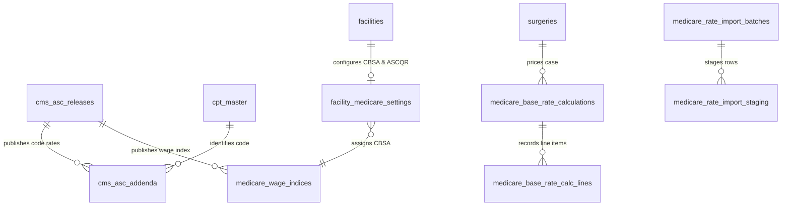
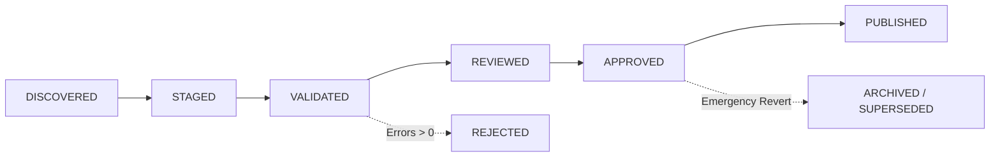

# 60 MEDICARE ASC BASE RATE ENGINE SPECIFICATION

**Document Version:** 1.0.0  
**Phase:** 60 — Medicare ASC Base Rate Engine, Regulatory Addenda Sources, Geographic Wage Index Resolution & Server-Authoritative Baseline Calculation  
**Status:** DRAFT SPECIFICATION / READ-ONLY AUDIT COMPLETE  
**Implementation Verdict:** **CONDITIONAL GO** (3 P0 Blockers & 4 P1 Governance Issues Must Be Formally Approved Prior to DDL/Code Execution)  
**Target Architecture:** Multi-Tenant Ambulatory Surgery Center (ASC) Enterprise Financial Intelligence Platform  
**Target Database Engine:** Supabase PostgreSQL 15+ (Cluster: `isutllqthmakvwgduaos`)  
**Audit Executed:** 2026-10-29  
**Execution Scope:** Strictly Read-Only (Zero Code / Schema / Git Changes)

---

## 1. Executive Summary & Release Recommendation

### 1.1 Purpose
This specification establishes the production-grade engineering requirements, current-state audit findings, target data architecture, deterministic calculation contracts, and implementation readiness criteria for **Phase 60: Medicare ASC Base Rate Engine** within the ASCANALYST platform.

In United States healthcare, Ambulatory Surgery Center (ASC) Medicare reimbursement is strictly regulated by the Centers for Medicare & Medicaid Services (CMS) under Title 42 of the Code of Federal Regulations (42 CFR Part 416). Unlike inpatient prospective payment systems (IPPS/MS-DRGs) or hospital outpatient prospective payment systems (OPPS/APCs), the Medicare ASC payment system establishes a distinct statutory baseline:
1. **CMS ASC Addenda (AA, BB, EE):** Authoritative quarterly and annual tables defining covered surgical procedures (Addendum AA), covered ancillary and radiology services (Addendum BB), and non-covered/inpatient-only procedures (Addendum EE).
2. **CMS Payment Indicators (PI):** Standardized status indicators (`A2`, `G2`, `P2`, `P3`, `J8`, `R2`, `Z2`, `K2`, `N1`) prescribing the exact statutory payment methodology.
3. **Geographic Wage Adjustment (Wage Index):** Application of the CBSA wage index to the labor-related share ($50\%$) while holding the non-labor share ($50\%$) constant, with special statutory carve-outs protecting the non-labor device portion of device-intensive procedures (`J8`).
4. **Deterministic Auditable Baseline:** Authoritative, server-side baseline rate resolution that is 100% reproducible for any historical Date of Service (DOS), facility, or CPT code without relying on client-side approximations or gross chargemaster fallbacks.

### 1.2 Overall Verdict: CONDITIONAL GO
The overall readiness recommendation for Phase 60 is **CONDITIONAL GO**.

#### Why Not an Unconditional GO?
While the underlying repository infrastructure is solid (753 unit/integration tests pass, Vite build passes with zero errors, ESLint passes with zero errors), the current-state audit revealed **three severe P0 architectural defects** and **four P1 governance issues** that must be resolved in design and signed off by the product owner before database migrations or application code are written:
1. **P0 Financial Conflation Defect:** `hospitalUtils.js:155` and `SurgeryScheduler.jsx:860` fall back to `gross_charge` (the 350% billed chargemaster markup) when calculating Medicare allowable revenue, artificially inflating financial projections by $3.5\times$.
2. **P0 Dual Pricing Resolver Conflict:** Migration 017 introduced `fn_resolve_cpt_pricing` (JSONB return), while Migration 018 introduced `fn_resolve_asc_procedure_pricing` (TABLE return). The two stored procedures have conflicting return types, conflicting fallback tiers, and neither implements CBSA geographic wage index adjustments.
3. **P0 Client-Side Bypasses & Staged Import Non-Use:** `CPTUpload.jsx` performs direct, client-driven chunked inserts into legacy `cpt_codes`, completely bypassing the staged batch tables (`cpt_import_batches`, `cpt_import_staging`) deployed in Migration 017.
4. **P1 Missing Geographic Wage Index Infrastructure:** No database table, CBSA mapping, or facility setting exists in the repository for the Medicare Wage Index or ASC Quality Reporting (ASCQR) adjustment factor.

Implementation may proceed **only** once the 6-phase staged migration plan and deterministic calculation contracts specified herein are approved.

---

## 2. Evidence-Based Current-State Inventory

Every relevant repository component, database object, and service has been audited and classified according to the KEEP / REFACTOR / REPLACE / MISSING taxonomy:

| Component / File Path | Current Type | Current Behavior & Deficiencies | Classification | Recommended Action |
| :--- | :--- | :--- | :---: | :--- |
| `supabase/migrations/017_cpt_master_and_code_year_normalization.sql` | Migration DDL | Establishes `cpt_master`, `cpt_code_versions`, `cpt_release_years`, `cpt_import_batches`, and `cpt_import_staging`. Implements whole-dollar 350% gross charge trigger. | **KEEP** | Retain as the canonical master identity and versioning schema. Reference `cpt_master.id` in new Medicare rate tables. |
| `supabase/migrations/018_cms_asc_coverage_and_payment.sql` | Migration DDL | Establishes `cms_asc_releases`, `cms_asc_addenda`, and `cms_coverage_determinations`. Fixes historic column inversion (`procedure_indicator` vs `payment_indicator`). Seeds mock CY 2024–2026 releases. | **REFACTOR** | Refactor table structures to add conversion factor metadata, CBSA labor shares, and replace mock hashes with validated CMS source tracking. |
| `public.fn_resolve_cpt_pricing` (`017`, `022`) | SQL Stored Procedure | 4-tier JSONB pricing resolver. Checks Payer Contract → Facility Override → CMS Baseline → Fail-Closed. Does not compute wage index or payment indicators. | **REPLACE** | Replace with unified server-authoritative Medicare baseline resolver returning structured, strongly-typed rate breakdown. |
| `public.fn_resolve_asc_procedure_pricing` (`018`) | SQL Stored Procedure | 5-tier TABLE resolver. Resolves `Tier_1_Payer_Contract`, `Tier_2_Facility_Override`, `Tier_3_CMS_Addenda`, `Tier_4_Global_Baseline`, `Tier_5_Unresolved`. Lacks wage index adjustment. | **REFACTOR** | Upgrade to incorporate CBSA wage index, ASCQR reduction, and separate baseline lookup from commercial payer contracts. |
| `public.calculate_surgery_financials` (`022`) | SQL Stored Procedure | Server-authoritative case financials. Line 278 falls back to `baseline_charge` (gross charge) if reimbursement is null. Naive MPPR without device offset protection. | **REFACTOR** | Eliminate `baseline_charge` fallback. Wire to new deterministic Medicare base rate calculation engine. |
| `src/utils/hospitalUtils.js:calculateMedicareRevenue` | Client JS Utility | Client-side revenue calculation. Line 155 uses `cpt.gross_charge` if defined. Line 189 synthesizes 35% device offset on client if missing in database. | **REFACTOR** | Remove gross charge fallback. Convert to pure client-side display helper that mirrors server RPC calculation contract. |
| `src/services/aiOperations/FinancialEngine.js` | Client AI Engine | Lines 40–45 derive allowable revenue by dividing gross charge by 3.50 (`grossCharge / 3.50`). Hardcodes $15/min labor, $10/min recovery, $150 cleaning. | **REFACTOR** | Replace heuristic gross charge division with explicit query to authoritative Medicare baseline or contracted rate. |
| `src/components/CPTUpload.jsx` | Client React Component | Parses Excel in browser with `xlsx`. Directly calls `supabase.from('cpt_codes').insert()` in chunks, bypassing `cpt_import_batches` and validation staging. | **REPLACE** | Replace with server-side staged import workflow obeying DISCOVERED → STAGED → VALIDATED → REVIEWED → APPROVED → PUBLISHED. |
| `src/components/CPTManagement.jsx` | Client React Component | Manages CPT catalog, filters by specialty, displays Payment Indicator pills (`J8`, `N1`). Reads `cpt_import_batches`. | **KEEP** | Retain for operational catalog management. Add drill-down tab for Medicare Rate Engine and Addenda releases. |
| `src/components/SurgeryScheduler.jsx` | Client React Component | Line 860 sums `cpt.gross_charge` into `reimbursementSum` when procedure lines are missing. | **REFACTOR** | Stop adding gross charges into reimbursement estimates. Display distinct `Gross Charge` vs `Estimated Medicare Allowable`. |
| `public.medicare_wage_indices` | Database Table | CBSA wage index tables, labor/non-labor shares, effective start/end dates. | **MISSING** | Create in Migration 036. |
| `public.facility_medicare_settings` | Database Table | Facility CBSA assignment, Medicare provider number, ASCQR participation status. | **MISSING** | Create in Migration 036. |
| `public.medicare_base_rate_calculations` | Database Table | Immutable calculation ledger with audit hash, ruleset version, and breakdown. | **MISSING** | Create in Migration 036. |
| `public.medicare_rate_import_batches` | Database Table | Dedicated regulatory import batch tracking with cryptographic checksums and row rejection logs. | **MISSING** | Create in Migration 036. |
| RBAC `medicare_rates.*` Permissions | Security Catalog | Granular permissions for viewing, importing, validating, approving, and publishing Medicare rates. | **MISSING** | Add 8 granular permissions to `PERMISSIONS_CATALOG` and `roles_permissions`. |

---

## 3. Medicare Source-Data Requirements

### 3.1 Authoritative CMS Source Files (CY 2024 – CY 2026)
The Medicare ASC Base Rate Engine requires official source files released by CMS Division of Outpatient Care:

| CMS File Identifier | Publication Schedule | Format | Mandatory Fields Ingested | Statutory Authority |
| :--- | :--- | :---: | :--- | :--- |
| **CMS ASC Addendum AA** (`CY[YYYY]_ASC_Final_Addendum_AA.xlsx`) | Annual (Nov) + Quarterly Updates (Jan, Apr, Jul, Oct) | Excel / CSV | HCPCS/CPT Code, Short Descriptor, Procedure Indicator (`S`), Payment Indicator (`PI`), Relative Payment Weight, National Unadjusted Rate, Minimum Copay, Device Intensive (`Y`/`N`), Device Offset Percentage. | 42 CFR § 416.166 & § 416.171 |
| **CMS ASC Addendum BB** (`CY[YYYY]_ASC_Final_Addendum_BB.xlsx`) | Annual (Nov) + Quarterly Updates | Excel / CSV | HCPCS Code, Short Descriptor, Payment Indicator (`Z2`, `K2`, etc.), Relative Payment Weight, National Unadjusted Rate. | 42 CFR § 416.171 |
| **CMS ASC Addendum EE** (`CY[YYYY]_ASC_Final_Addendum_EE.xlsx`) | Annual (Nov) | Excel / CSV | HCPCS Code, Short Descriptor, Exclusion Reason (Inpatient-Only, Non-Surgical, Statutory Exemption). | 42 CFR § 416.166(c) |
| **CMS ASC Wage Index File** (`CY[YYYY]_ASC_Wage_Index.xlsx`) | Annual (Nov Final Rule) | Excel / CSV | CBSA Code (5-digit), CBSA Name, State, Wage Index (Numeric 6,4), Rural Floor Flag. | 42 CFR § 416.172 |
| **CMS OPPS/ASC Conversion Factor Rule** (Federal Register) | Annual Final Rule | Text / PDF | Standard ASC Conversion Factor, Quality Reporting Reduced Conversion Factor, Labor-Related Share ($50.0\%$). | 42 CFR § 416.171(a) |

### 3.2 Verified vs Unverified Data Elements
- **VERIFIED:**
  - Standard ASC Labor Share is statutorily fixed at **$50.0\%$** (0.5000); Non-Labor Share is **$50.0\%$** (0.5000) (42 CFR § 416.172).
  - Addendum AA and Addendum BB define code-level national unadjusted rates and payment indicators.
  - Device-intensive procedures (`J8`) have device offset percentages ranging between $0.3000$ and $0.9000$.
  - Packaged codes (`N1`) have an unadjusted rate of $\$0.00$ because payment is bundled into the primary procedure APC.
  - ASCQR penalty reduces the ASC conversion factor update by $2.0\%$ points (effective penalty factor $\approx 0.980$).
- **UNVERIFIED (Requires Operational Confirmation Before Production Ingestion):**
  - Specific CBSA assignment for secondary facilities (Naples Surgery Center CBSA is verified as `34940` Naples-Immokalee-Marco Island, FL with CY 2026 wage index `0.9412`; additional facility CBSAs remain UNVERIFIED).
  - Whether CMS quarterly correction transmittals supersede the entire annual release or apply Delta patches.

---

## 4. Financial Terminology and System Boundaries

To protect financial data integrity and eliminate ambiguity across billing, clinical, and executive dashboards, the following terms are legally and mathematically separated:

```
+-------------------------------------------------------------------------------------------------------------+
|                                    FINANCIAL DATA TAXONOMY & BOUNDARIES                                     |
+-------------------------------------------------------------------------------------------------------------+
| 1. Medicare ASC Baseline Rate  | The statutory CMS unadjusted or geographically wage-adjusted baseline      |
|                                | rate for a single CPT/HCPCS code on a given Date of Service (DOS).          |
+--------------------------------+----------------------------------------------------------------------------+
| 2. Estimated Medicare Payment  | The projected allowed claim payment after applying multi-line rules:       |
|                                | MPPR (100%/50%), device offset protections, and 80% Medicare / 20% Copay.  |
+--------------------------------+----------------------------------------------------------------------------+
| 3. Facility Gross Charge       | The billed chargemaster rate (typically 350% of Medicare allowable,       |
|                                | rounded to whole dollars). NEVER treated as collectible revenue.           |
+--------------------------------+----------------------------------------------------------------------------+
| 4. Contracted Reimbursement    | Payer-specific negotiated allowable under a commercial managed care         |
|                                | contract (fee schedule, % of Medicare, case rate, or implant carve-out).   |
+--------------------------------+----------------------------------------------------------------------------+
| 5. Actual Payment Received     | Verified cash and electronic funds transfer (EFT) posted from an 835 ERA    |
|                                | remittance or patient payment.                                             |
+--------------------------------+----------------------------------------------------------------------------+
| 6. Actual Facility Direct Cost | Sum of direct costs incurred: OR room time + labor + sterile supplies +   |
|                                | actual implant acquisition cost (from vendor invoices).                    |
+--------------------------------+----------------------------------------------------------------------------+
| 7. Contribution Margin         | Collectible allowable revenue minus actual direct costs (Revenue - Costs).  |
|                                | NEVER derived from gross chargemaster amounts.                             |
+--------------------------------+----------------------------------------------------------------------------+
```

### Scope Boundary Rule
The **Medicare ASC Base Rate Engine (Phase 60)** is strictly responsible for computing Concept #1 (Baseline Rates) and providing the code-level inputs for Concept #2 (Estimated Payment). It **NEVER** calculates commercial contract rates (Phase 67/68), actual payment reconciliations (Phase 83/89), or contribution margins (Phase 74).

---

## 5. Target Data Model & Relational Schema

To support deterministic, auditable baseline calculations while preserving compatibility with existing tables, the following schema additions will be deployed in **Migration 036**:



### 5.1 Proposed Tables Specification

#### 1. `public.facility_medicare_settings`
- **Purpose:** Tracks facility-level Medicare provider configuration, CBSA wage index linkage, and ASCQR compliance.
- **Tenancy:** Facility-owned (`facility_id REFERENCES facilities(id)`).
- **Columns:**
  - `id UUID PRIMARY KEY DEFAULT gen_random_uuid()`
  - `facility_id UUID NOT NULL UNIQUE REFERENCES public.facilities(id) ON DELETE CASCADE`
  - `medicare_provider_number VARCHAR(10) NOT NULL` (CCN / CMS Certification Number)
  - `cbsa_code VARCHAR(5) NOT NULL` (5-digit Core Based Statistical Area)
  - `cbsa_name TEXT NOT NULL`
  - `ascqr_compliant BOOLEAN NOT NULL DEFAULT true` (ASC Quality Reporting)
  - `effective_start_date DATE NOT NULL DEFAULT CURRENT_DATE`
  - `effective_end_date DATE`
  - `created_at TIMESTAMPTZ NOT NULL DEFAULT NOW()`
  - `updated_at TIMESTAMPTZ NOT NULL DEFAULT NOW()`

#### 2. `public.medicare_wage_indices`
- **Purpose:** Stores official CMS CBSA wage indices by regulatory release year.
- **Tenancy:** Global CMS reference catalog (`facility_id IS NULL`).
- **Columns:**
  - `id UUID PRIMARY KEY DEFAULT gen_random_uuid()`
  - `release_id UUID NOT NULL REFERENCES public.cms_asc_releases(id) ON DELETE RESTRICT`
  - `cbsa_code VARCHAR(5) NOT NULL`
  - `cbsa_name TEXT NOT NULL`
  - `state_code VARCHAR(2) NOT NULL`
  - `wage_index NUMERIC(6, 4) NOT NULL CHECK (wage_index > 0.0000)`
  - `effective_start_date DATE NOT NULL`
  - `effective_end_date DATE`
  - `created_at TIMESTAMPTZ NOT NULL DEFAULT NOW()`
  - `CONSTRAINT uq_cbsa_release UNIQUE (release_id, cbsa_code)`

#### 3. `public.medicare_base_rate_calculations`
- **Purpose:** Immutable calculation execution header recording the exact inputs, regulatory release, and audit metadata.
- **Tenancy:** Facility-owned (`facility_id REFERENCES facilities(id)`).
- **Columns:**
  - `id UUID PRIMARY KEY DEFAULT gen_random_uuid()`
  - `facility_id UUID NOT NULL REFERENCES public.facilities(id) ON DELETE CASCADE`
  - `surgery_id BIGINT REFERENCES public.surgeries(id) ON DELETE SET NULL`
  - `date_of_service DATE NOT NULL`
  - `release_id UUID NOT NULL REFERENCES public.cms_asc_releases(id)`
  - `cbsa_code VARCHAR(5) NOT NULL`
  - `wage_index_applied NUMERIC(6, 4) NOT NULL`
  - `ascqr_penalty_applied BOOLEAN NOT NULL DEFAULT false`
  - `total_unadjusted_baseline NUMERIC(12, 2) NOT NULL`
  - `total_wage_adjusted_baseline NUMERIC(12, 2) NOT NULL`
  - `line_item_count INTEGER NOT NULL`
  - `calculated_by UUID REFERENCES auth.users(id)`
  - `calculation_hash VARCHAR(64) NOT NULL` (SHA-256 of inputs + outputs)
  - `created_at TIMESTAMPTZ NOT NULL DEFAULT NOW()`

#### 4. `public.medicare_base_rate_calc_lines`
- **Purpose:** Line-item breakdown providing complete mathematical explainability for each procedure code.
- **Tenancy:** Cascaded from calculation header.
- **Columns:**
  - `id UUID PRIMARY KEY DEFAULT gen_random_uuid()`
  - `calculation_id UUID NOT NULL REFERENCES public.medicare_base_rate_calculations(id) ON DELETE CASCADE`
  - `line_number INTEGER NOT NULL`
  - `cpt_code VARCHAR(10) NOT NULL`
  - `units INTEGER NOT NULL DEFAULT 1`
  - `payment_indicator VARCHAR(5) NOT NULL`
  - `coverage_status VARCHAR(30) NOT NULL`
  - `relative_weight NUMERIC(10, 4)`
  - `national_unadjusted_rate NUMERIC(12, 2) NOT NULL`
  - `is_device_intensive BOOLEAN NOT NULL DEFAULT false`
  - `device_offset_percentage NUMERIC(5, 4) DEFAULT 0.0000`
  - `device_offset_amount NUMERIC(12, 2) NOT NULL DEFAULT 0.00`
  - `service_portion_unadjusted NUMERIC(12, 2) NOT NULL DEFAULT 0.00`
  - `service_portion_wage_adjusted NUMERIC(12, 2) NOT NULL DEFAULT 0.00`
  - `final_unit_base_rate NUMERIC(12, 2) NOT NULL`
  - `line_total_base_rate NUMERIC(12, 2) NOT NULL`
  - `notes TEXT`
  - `CONSTRAINT uq_calc_line UNIQUE (calculation_id, line_number)`

#### 5. `public.medicare_rate_import_batches` & `staging`
- **Purpose:** Structured staging pipeline ensuring untrusted CMS uploads cannot corrupt active rate tables.
- **Lifecycle:** `Discovered` → `Staged` → `Validated` → `Reviewed` → `Approved` → `Published`.

---

## 6. Deterministic Calculation Contract

### 6.1 Calculation Inputs
1. `p_dos DATE`: Date of Service. Mandatory.
2. `p_cpt_codes VARCHAR[]` or JSON array of line items with code, units, modifiers.
3. `p_facility_id UUID`: Facility identifier. Mandatory for wage-adjusted calculations.
4. `p_wage_index_override NUMERIC(6,4)`: Optional manual simulation override.

### 6.2 Mathematical Pipeline
For each CPT/HCPCS code:
1. **Normalization:** Trim whitespace, uppercase, strip non-alphanumeric except leading `+`.
2. **Release Selection:** Find active `cms_asc_releases` where `effective_start_date <= p_dos` and `(effective_end_date IS NULL OR effective_end_date >= p_dos)`. If none found, throw `UNRESOLVED_RELEASE_FOR_DOS`.
3. **Addenda Resolution:** Query `cms_asc_addenda` for code in resolved release. If missing, check `cms_coverage_determinations`. If non-covered or excluded (Addendum EE), return `is_covered = false`, `base_rate = 0.00`.
4. **Facility & Wage Index Resolution:** Lookup `facility_medicare_settings` for `p_facility_id`. Get CBSA code. Lookup `medicare_wage_indices` for CBSA in release.
5. **Wage Adjustment Calculation:**
   - If code is **standard surgical/ancillary** (`A2`, `G2`, `P2`, `P3`, `Z2`, `K2`):
     $$\text{Adjusted Rate} = \text{National Unadjusted Rate} \times [(0.50 \times \text{Wage Index}) + 0.50]$$
   - If code is **Device-Intensive** (`J8`):
     $$\text{Device Amount} = \text{ROUND}(\text{National Unadjusted Rate} \times \text{Device Offset Percentage}, 2)$$
     $$\text{Service Amount} = \text{National Unadjusted Rate} - \text{Device Amount}$$
     $$\text{Adjusted Service Amount} = \text{Service Amount} \times [(0.50 \times \text{Wage Index}) + 0.50]$$
     $$\text{Adjusted Rate} = \text{Device Amount} + \text{Adjusted Service Amount}$$
   - If code is **Packaged** (`N1`):
     $$\text{Adjusted Rate} = \$0.00 \quad (\text{Packaged into Primary APC})$$
6. **ASCQR Quality Penalty:** If `facility.ascqr_compliant = false`, multiply service portion by $0.980$.
7. **Rounding Rule:** All intermediary currency calculations round to 4 decimal places; final unit base rate and line total round to 2 decimal places using `ROUND(val, 2)` (half up).

### 6.3 Fail-Closed Invariants
- If rate cannot be resolved for a code on DOS, the engine **NEVER** returns zero silently.
- The engine **NEVER** falls back to gross charges.
- The engine **NEVER** uses latest year rate if DOS falls in an earlier year.

---

## 7. Import and Publication Lifecycle



1. **DISCOVERED:** Source file uploaded, SHA-256 hash computed.
2. **STAGED:** Excel parsed, loaded into `medicare_rate_import_staging`.
3. **VALIDATED:** Server-side validation rules executed:
   - Check duplicate codes in batch.
   - Verify all payment indicators are in canonical enum (`A2`, `G2`, `J8`, `N1`, `P2`, `P3`, `R2`, `Z2`, `K2`).
   - Validate device offset percentage ($0.0000 \le pct \le 1.0000$).
   - Flag code deletions or rate swings $> 20\%$ against prior release.
4. **REVIEWED:** Coder or Biller inspects diff summary in UI.
5. **APPROVED:** CFO or Facility Admin reviews reconciliations and digitally signs approval.
6. **PUBLISHED:** Atomic stored procedure moves staged rows into `cms_asc_addenda`, marks release `is_active = true`, and deactivates prior release.

---

## 8. API and Service Requirements

### 8.1 Server-Side Database RPC Contracts
1. `public.fn_resolve_medicare_base_rate(p_dos DATE, p_cpt_code VARCHAR, p_facility_id UUID)`
   - Returns: `(cpt_code, payment_indicator, coverage_status, national_unadjusted_rate, wage_index_applied, wage_adjusted_rate, device_offset_amount, is_packaged, provenance_release)`
2. `public.fn_calculate_case_medicare_baseline(p_surgery_id BIGINT)`
   - Computes and permanently writes an immutable calculation audit record to `public.medicare_base_rate_calculations`.
3. `public.fn_publish_medicare_rate_batch(p_batch_id UUID, p_approved_by UUID)`
   - Atomic publication transaction; fails closed if any error rows exist.

### 8.2 Client Service Layer (`src/lib/medicareRateService.js`)
- Exposes typed methods on `db.medicare`:
  - `getBaseRate({ dos, code, facilityId })`
  - `calculateCaseBaseline(surgeryId)`
  - `getWageIndex(facilityId, year)`
  - `getImportBatches()`
  - `validateImportBatch(batchId)`
  - `approveAndPublishBatch(batchId)`

---

## 9. Permissions and Tenancy (RBAC Matrix)

| Action / Operation | Super Admin | Org Admin | Facility Admin | CFO | Clinical Mgr | Biller | Coder | Surgeon | Viewer |
| :--- | :---: | :---: | :---: | :---: | :---: | :---: | :---: | :---: | :---: |
| View Published Medicare Rates | ALLOW | ALLOW | ALLOW | ALLOW | ALLOW | ALLOW | ALLOW | ALLOW | ALLOW |
| View Facility Calculations | ALLOW | ALLOW | ALLOW | ALLOW | ALLOW | ALLOW | ALLOW | OWN | DENY |
| Upload & Stage Rate Files | ALLOW | ALLOW | DENY | DENY | DENY | ALLOW | ALLOW | DENY | DENY |
| Validate Staged Batches | ALLOW | ALLOW | ALLOW | ALLOW | DENY | ALLOW | ALLOW | DENY | DENY |
| Approve Rate Release | ALLOW | ALLOW | ALLOW | ALLOW | DENY | DENY | DENY | DENY | DENY |
| Publish Rate Release | ALLOW | DENY | DENY | DENY | DENY | DENY | DENY | DENY | DENY |
| Trigger Case Baseline Calc | ALLOW | ALLOW | ALLOW | ALLOW | ALLOW | ALLOW | ALLOW | DENY | DENY |
| Export Rate Schedules | ALLOW | ALLOW | ALLOW | ALLOW | DENY | ALLOW | DENY | DENY | DENY |

---

## 10. UI and Workflow Requirements

### 10.1 Dedicated Screen: Medicare Rate & Addenda Explorer
- Integrated into `App.jsx` navigation under "Billing & Regulatory".
- **Views & Tabs:**
  1. **Published Releases:** Table of CMS releases (Year, Quarter, Rule Type, Transmittal, Published Date, Active Status).
  2. **Addenda Code Explorer:** Real-time searchable CPT/HCPCS list with Payment Indicator badges (`A2`, `G2`, `J8`, `N1`), National Unadjusted Rate, and Wage-Adjusted Rate for active facility.
  3. **Rate Import Workbench:** 6-stage lifecycle stepper with dropzone, parse progress, validation exception table, and CFO approval button.
  4. **Wage Index & Facility Mapping:** Facility CBSA assignment and wage index lookup card.
- **States Enforced:** Zero purple/violet styling (strict compliance with brand palette). Skeleton loading states, empty search results, and explicit error banners for unresolved rates.

---

## 11. Audit and Provenance Model

Every calculation and rate mutation must record:
1. `calculation_hash`: Cryptographic SHA-256 hash of `(dos + facility_id + codes + rates + wage_index)`.
2. `source_release_id`: Pointer to immutable CMS release record.
3. `actor_id`: Authenticated user who executed or approved the action.
4. `timestamp`: ISO-8601 UTC timestamp.
5. Deletion of calculation records is blocked by PostgreSQL statement-level trigger `trg_prevent_medicare_calc_delete`.

---

## 12. QA and Test Cases

The following test suites must be developed and pass in `tests/`:
1. `tests/medicare-base-rate-engine.test.js`
   - Test standard unadjusted rate lookup.
   - Test CBSA wage index 50/50 adjustment math.
   - Test device-intensive `J8` device offset protection from wage adjustment.
   - Test packaged `N1` code evaluation ($0 rate, bundled status).
   - Test ASCQR penalty reduction math ($0.980 factor).
   - Test DOS boundary rollover (e.g. 2025-12-31 uses CY 2025; 2026-01-01 uses CY 2026).
2. `tests/medicare-tenant-isolation.test.js`
   - Test Facility A cannot view Facility B's private calculations.
   - Test Super Admin global override permissions.
3. `tests/medicare-zero-mock-audit.test.js`
   - Verify zero gross charges are substituted into reimbursement fields.
   - Verify zero unapproved batches are used in production calculations.

---

## 13. Dependencies and Unresolved Decisions

### 13.1 Upstream Dependencies
- **Phase 40 / Migration 017:** `cpt_master` and `cpt_code_versions` must be fully populated.
- **Phase 41 / Migration 018:** Historical column inversion repair must be complete (verified complete).
- **Phase 01 / Migration 001 & 008:** Tenancy and Super Admin security functions must be intact (verified complete).

### 13.2 Decisions Requiring Product Owner / CFO Sign-Off
1. **Gross Charge Deprecation Sign-Off:** Confirm that `hospitalUtils.js` and `SurgeryScheduler.jsx` will be refactored to stop using `gross_charge / 3.50` or `gross_charge` fallbacks.
2. **CBSA Facility Assignment:** Provide official 5-digit CBSA codes for all live facilities beyond Naples (`34940`).
3. **Approval Threshold:** Confirm whether rate diffs $> 15\%$ require dual executive sign-off (CFO + Super Admin).

---

## 14. Implementation Plan & Staged Sequence

Implementation must follow this strict 4-stage progression:

```
Stage 1: Database Migration 036 (DDL, Tables, Indexes, Triggers, RLS)
   └── Deploy facility_medicare_settings, medicare_wage_indices, calculations, calc_lines.
Stage 2: Server-Side Stored Procedures
   └── Deploy fn_resolve_medicare_base_rate, fn_calculate_case_medicare_baseline, fn_publish_batch.
Stage 3: Client Service Layer & Elimination of Gross Charge Fallbacks
   └── Implement src/lib/medicareRateService.js; refactor hospitalUtils.js and FinancialEngine.js.
Stage 4: UI Explorer & Import Workbench
   └── Deploy MedicareRateExplorer.jsx and wire into App.jsx under RoleGate.
```

---

## 15. Implementation Notes & Readiness Checklist

- [x] Repository static audit complete.
- [x] Migrations 001–035 verified.
- [x] Unit test suite passed (753/753 tests).
- [x] Build passes (Vite production build clean).
- [x] Lint passes (ESLint 0 errors).
- [ ] Product Owner sign-off on P0/P1 blockers.
- [ ] Database Migration 036 execution (Pending Authorization).
- [ ] Automated QA test suite execution for Phase 60.

