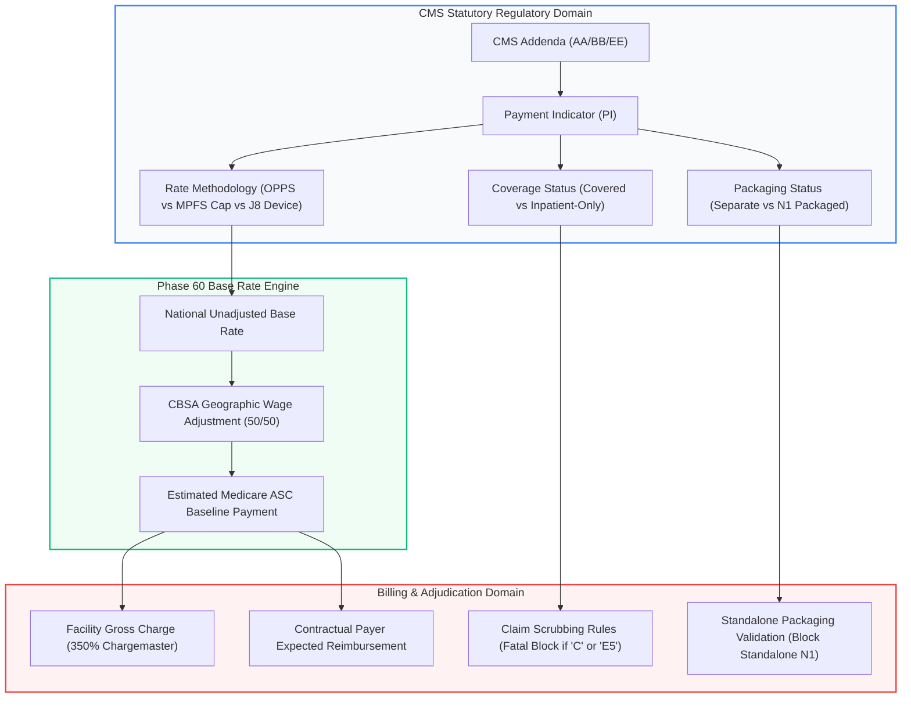
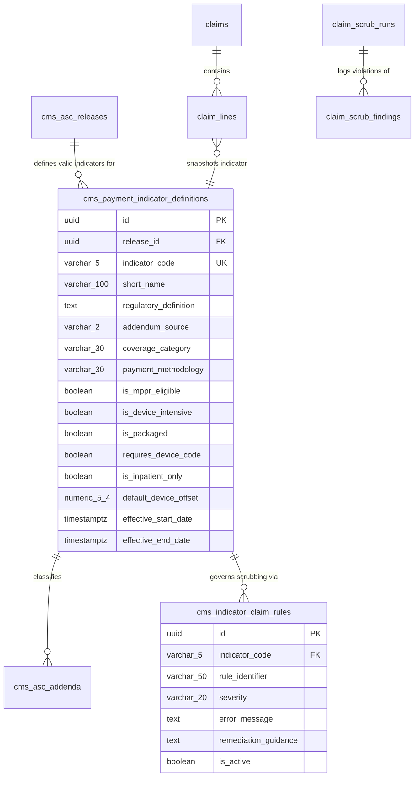
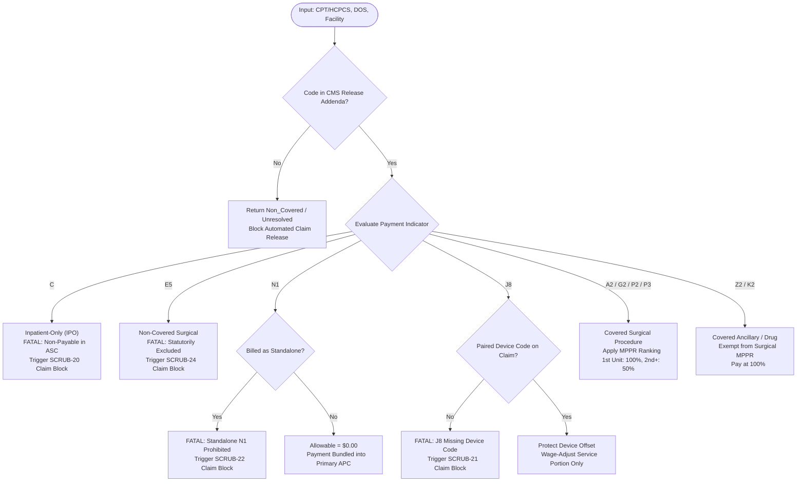

# PHASE 61 — CMS PAYMENT INDICATORS
## Repository Audit, Regulatory Interpretation, and Production Specification

---

### Executive Summary & Implementation Verdict

| Metric | Evaluation |
| :--- | :--- |
| **Feature Domain** | CMS Payment / Status Indicators & Regulatory Interpretation Engine |
| **Phase ID** | Phase 61 (Phase 06 Medicare Payers Suite) |
| **Implementation Verdict** | **CONDITIONAL GO** |
| **Upstream Dependency** | Phase 60 (Medicare ASC Base Rate Engine, Migration 036 — **Verified Implemented**) |
| **Next Target Migration** | `037_cms_payment_indicators_and_interpretation.sql` |
| **Blocking P0 Defects** | 3 critical defects identified in existing codebase |
| **Governance P1 Issues** | 3 regulatory governance gaps identified |

#### Verdict Rationale: Why CONDITIONAL GO?
The repository has successfully established statutory baseline wage index calculations and multi-tenancy controls in Phase 60 (Migration `036`). Furthermore, `public.cms_asc_addenda` and `public.cms_coverage_determinations` were established in Migration `018`. However, the current repository audit reveals that **payment indicators are inconsistently interpreted across the application**, leading to three severe P0 regulatory and financial defects:

1. **P0 Inpatient-Only (IPO) Default Leak:** In `src/components/SurgeryScheduler.jsx` (lines 486, 1228) and `src/utils/hospitalUtils.js`, unlisted or missing payment indicators default to `'A2'` (Standard Covered Surgical). This causes non-covered procedures, cosmetic cases without explicit tags, and CMS Inpatient-Only (`C`) procedures to be treated as payable ASC surgeries, creating catastrophic financial liability.
2. **P0 OPPS vs. ASC System Conflation:** Multiple documentation files and legacy services conflate Hospital Outpatient Prospective Payment System (OPPS) Status Indicators (e.g., `J1` Comprehensive APC, `T` Significant Procedure, `S`, `V`, `Q1`-`Q3`) with statutory Medicare ASC Payment Indicators (`A2`, `G2`, `P2`, `P3`, `J8`, `R2`, `Z2`, `K2`, `N1`, `C`). OPPS status indicators do not govern ASC reimbursement under 42 CFR Part 416.
3. **P0 Missing Device-Intensive Pairing Scrubber:** Payment Indicator `J8` mandates that a paired device (HCPCS C-code or L-code) be present on the claim to justify the protected device offset. Migration `024` (`fn_scrub_claim`) contains zero validation linking `J8` surgical lines to required implant hardware lines, allowing non-compliant claims to pass pre-bill scrubbing.

Implementation of Phase 61 may proceed only after the architectural and deterministic interpretation contracts specified herein are approved.

---

### 1. Mandatory Working Rules & Governance

1. **Authoritative Evidence First:** Claims regarding CMS indicator meanings, coverage rules, and payment methodologies must cite official CMS source files (e.g., CY 2026 CMS-1830-FC Addenda AA, BB, and EE).
2. **Strict System Separation:** Medicare ASC Payment Indicators (PI) must never be substituted for Hospital OPPS Status Indicators (SI) or Physician Fee Schedule (MPFS) Global Surgery Indicators.
3. **Fail-Closed on Unknown / Blank:** Any CPT/HCPCS code lacking an authoritative CMS indicator assignment for the applicable Date of Service (DOS) must fail-closed to `Non_Covered` / `Unresolved_Indicator`, blocking automated claim release.
4. **Zero Frontend Financial Adjudication:** Client components may display indicator badges and explainability previews, but the authoritative interpretation and claim eligibility must be executed server-side via SQL RPCs.
5. **No Synthetic Payment Amounts:** A payment indicator defines *methodology* and *eligibility*, not an absolute dollar rate. Rate calculation belongs exclusively to the Phase 60 Base Rate Engine.

---

### 2. Current-State Repository & Database Audit

Every existing component touching payment indicators has been inspected and classified:

| Object / Component | Type | Current Behavior & Defect Analysis | Classification | Recommended Action |
| :--- | :--- | :--- | :--- | :--- |
| `public.cms_asc_releases` (`018`, `036`) | SQL Table | Stores CY regulatory editions (`2024`, `2025`, `2026`), transmittal numbers, conversion factors, and 50/50 labor share. | **KEEP** | Retain as authoritative master release anchor. Add checksum tracking for Addenda EE. |
| `public.cms_asc_addenda` (`018`, `036`) | SQL Table | Stores CPT codes, `payment_indicator`, `national_unadjusted_rate`, and device offset. Missing formal indicator foreign key. | **REFACTOR** | Add foreign key constraint to formal `cms_payment_indicator_definitions` table. |
| `public.cms_coverage_determinations` (`018`) | SQL Table | Maps code and release to `coverage_status` (`Covered_Surgical`, `Covered_Ancillary`, `Packaged`, etc.). Lacks granular billing rules. | **KEEP** | Retain for macro coverage categorization. Link to indicator interpretation engine. |
| `public.cpt_code_versions` (`017`, `022`) | SQL Table | Contains legacy `procedure_indicator` and `payment_indicator` columns. Historical column inversion partially repaired in 018. | **REFACTOR** | Enforce foreign key validation against canonical payment indicators catalog. |
| `public.fn_resolve_asc_procedure_pricing` (`018`) | SQL Function | 5-tier pricing waterfall. Resolves `Tier_3_CMS_Addenda` but synthesizes gross charge as `reimbursement * 3.50`. | **REFACTOR** | Deprecate in favor of Phase 60 `fn_resolve_medicare_base_rate` with Phase 61 indicator interpretation. |
| `public.fn_resolve_medicare_base_rate` (`036`) | SQL Function | Authoritative statutory 50/50 wage adjustment engine. Evaluates `N1` as $0 and `J8` with offset protection. | **KEEP** | Retain as authoritative calculation engine. Integrate Phase 61 interpretation outputs. |
| `public.claims` & `public.claim_lines` (`024`) | SQL Table | EDI billing entities. `claim_lines` tracks CPT codes and charges, but lacks `payment_indicator` snapshot. | **REFACTOR** | Add `payment_indicator` and `coverage_status` snapshot columns to `claim_lines` for audit trail. |
| `public.fn_scrub_claim` (`024`) | SQL Function | Evaluates EDI syntax, NCCI PTP edits, and laterality modifiers. Completely lacks payment indicator validation! | **REFACTOR** | Add `SCRUB-20` (Inpatient-Only block) and `SCRUB-21` (J8 device code requirement). |
| `src/lib/medicareRateService.js` | Client Service | Exports `MEDICARE_PAYMENT_INDICATORS` array and `getAddendaCatalog()`. Resolves rates via RPC. | **KEEP** | Enhance with typed `interpretPaymentIndicator()` helper and validation rules. |
| `src/components/MedicareRateExplorer.jsx` | React UI | 4-tab explorer with PI badges (`J8`, `A2`, `N1`, `Z2`), live search, and active version filtering. | **KEEP** | Add dedicated tab for CMS Indicator Regulatory Master and Policy Rules. |
| `src/components/SurgeryScheduler.jsx` | React UI | Lines 486 & 1228 fall back to `'A2'` if PI is missing or unknown. | **REFACTOR** | Remove `'A2'` fallback. Flag unlisted codes as `Unresolved Indicator — Pending Coder Review`. |
| `src/utils/hospitalUtils.js` | Client Utility | Lines 193-195 check `Z2`, `K2`, `J8` for MPPR exemption. | **KEEP** | Preserves pure client display logic; mirrors server-side statutory rules. |
| `public.cms_payment_indicator_definitions` | SQL Table | Canonical statutory definitions, legal authorities, packaging rules, and claim scrubbing directives. | **MISSING** | Deploy in Migration `037`. |
| `public.fn_interpret_cms_indicator` | SQL Function | Server-side RPC resolving full regulatory semantics for any code, DOS, and payment system. | **MISSING** | Deploy in Migration `037`. |

---

### 3. Authoritative CMS Source Requirements & Indicator Catalog

The Medicare ASC Payment System is governed by **42 CFR Part 416** and annual CMS Final Rules published in the Federal Register. CMS publishes three primary addenda for ASCs each quarter:
- **Addendum AA:** ASC Covered Surgical Procedures.
- **Addendum BB:** ASC Covered Ancillary Services Integral to Covered Surgical Procedures.
- **Addendum EE:** Surgical Procedures Excluded from Payment in ASCs (Inpatient-Only, non-covered, or unlisted).

#### Statutory Indicator Master Matrix (CY 2026 CMS-1830-FC)

| Indicator | Official CMS Definition | Addendum | Statutory Payment Methodology | Multiple Proc Discounting (MPPR)? | Device Offset Eligible? | Clinical / Billing Directive |
| :---: | :--- | :---: | :--- | :---: | :---: | :--- |
| **`A2`** | Surgical procedure on ASC covered list in CY 2007 | AA | OPPS relative weight $\times$ ASC conversion factor $\times$ wage adjustment | **YES** (50% reduction on rank $\ge 2$) | NO | Standard surgical procedure. Primary line billed at 100%, secondary at 50%. |
| **`G2`** | Non-office-based surgical procedure added CY 2008 or later | AA | OPPS relative weight $\times$ ASC conversion factor $\times$ wage adjustment | **YES** (50% reduction on rank $\ge 2$) | NO | Same reimbursement methodology as `A2`. Tracked separately for historical rollover analysis. |
| **`P2`** | Office-based surgical procedure added CY 2008 or later | AA | Lesser of: (1) OPPS relative weight rate, or (2) MPFS non-facility PE RVU amount | **YES** (50% reduction on rank $\ge 2$) | NO | Subject to office-based site-of-service payment cap to prevent migration of office procedures. |
| **`P3`** | Office-based surgical procedure; payment based on MPFS PE RVUs | AA | Paid at MPFS non-facility practice expense RVU rate | **YES** (50% reduction on rank $\ge 2$) | NO | Payment strictly capped at Medicare Physician Fee Schedule rate. |
| **`J8`** | Device-intensive procedure; paid at adjusted rate | AA | Device portion protected (100%); service portion wage-adjusted $\times$ 50/50 | **YES** (Service portion only; device offset 100% protected) | **YES** ($\ge 30\%$ device offset) | **MANDATORY DEVICE CODE:** Claim must include paired HCPCS device C-code or L-code. |
| **`R2`** | Contractor-priced surgical procedure | AA | Established by local Medicare Administrative Contractor (MAC) | **YES** (Subject to MAC pricing rules) | NO | Requires manual pricing submission with operative report and invoice. |
| **`Z2`** | Radiology service paid separately under ASC payment system | BB | Lesser of: OPPS rate or MPFS non-facility PE amount | **NO** (MPPR Exempt) | NO | Ancillary diagnostic imaging integral to procedure. Paid 100% without MPPR reduction. |
| **`K2`** | Drugs and biologicals paid separately under ASC payment system | BB | Average Sales Price (ASP) + 6% (or wholesale acquisition cost) | **NO** (MPPR Exempt) | NO | Pass-through or separately payable drugs. Must report units and NDC where required. |
| **`N1`** | Packaged service/item; no separate payment made | BB / EE | Zero dollar separate payment ($0.00). Cost bundled into primary APC. | **N/A** ($0.00 allowable) | NO | **PROHIBITED STANDALONE:** Cannot be billed as the sole service on a claim. |
| **`F4`** | Corneal tissue acquisition | BB | Paid at acquisition cost (invoice-based reasonable cost) | **NO** (MPPR Exempt) | NO | Specialized pass-through tissue processing. Must attach vendor invoice. |
| **`L1`** | Influenza / pneumococcal / hepatitis B vaccine | BB | Paid at reasonable cost | **NO** (MPPR Exempt) | NO | Preventive immunization service. Paid separately without deductible or coinsurance. |
| **`C`** | Inpatient-only procedure under OPPS | EE | **NON-COVERED IN ASC:** $0.00 payment; statutory claim rejection | **N/A** | **N/A** | **FATAL CLAIM ERROR:** Cannot be performed in an ASC. Claim scrub must hard-block. |
| **`E5`** | Non-covered surgical procedure | EE | **NON-COVERED IN ASC:** Not on ASC covered list | **N/A** | **N/A** | **FATAL CLAIM ERROR:** Statutorily excluded from ASC facility fee reimbursement. |
| **`M1`** | Unlisted surgical procedure | EE | Contractor-priced or non-covered unless MAC approved | Subject to MAC | NO | Requires prior authorization, manual coder review, and operative report submission. |

---

### 4. Financial Terminology & Regulatory Boundaries

To prevent financial conflation and regulatory penalties, the system must enforce strict conceptual boundaries:



#### Seven Non-Interchangeable Concepts:
1. **CMS ASC Payment Indicator (PI):** A regulatory classification code (`A2`, `J8`, `N1`, `C`) defining statutory payment rules and eligibility.
2. **Medicare ASC Baseline Payment:** The deterministic, wage-adjusted statutory allowable rate calculated from CMS relative weights and conversion factors.
3. **Facility Gross Charge:** The chargemaster billed amount (typically marked up 300%–400% above Medicare allowable), appearing on Box 28 of CMS-1500 / Loop 2400 SV102.
4. **Contractual Expected Reimbursement:** The allowable amount negotiated with commercial payers or established by Medicare Advantage fee schedules.
5. **Actual Payment Received:** The posted cash remittance advice (835 ERA) received from the payer.
6. **Device Portion vs. Service Portion:** In `J8` procedures, the device acquisition portion is 100% protected from wage adjustment; the service portion is 50% labor-adjusted.
7. **Packaged ($0.00) Allowable:** An item whose separate payment is legally prohibited because its cost is bundled into the primary surgical procedure's facility fee.

---

### 5. Target Data Model & Migration Strategy

Phase 61 introduces **Migration `037_cms_payment_indicators_and_interpretation.sql`** to establish a normalized, versioned indicator rules catalog and claim validation hooks.



#### Proposed Database Objects in Migration 037

1. **`public.cms_payment_indicator_definitions` Table:**
   - `id UUID PRIMARY KEY DEFAULT gen_random_uuid()`
   - `release_id UUID NOT NULL REFERENCES public.cms_asc_releases(id) ON DELETE RESTRICT`
   - `indicator_code VARCHAR(5) NOT NULL CHECK (indicator_code ~ '^[A-Z0-9]{1,5}$')`
   - `short_name VARCHAR(100) NOT NULL`
   - `regulatory_definition TEXT NOT NULL`
   - `addendum_source VARCHAR(2) NOT NULL CHECK (addendum_source IN ('AA', 'BB', 'EE'))`
   - `coverage_category VARCHAR(30) NOT NULL CHECK (coverage_category IN ('Covered_Surgical', 'Covered_Ancillary', 'Packaged', 'Contractor_Priced', 'Inpatient_Only', 'Non_Covered'))`
   - `payment_methodology VARCHAR(30) NOT NULL CHECK (payment_methodology IN ('OPPS_Relative_Weight', 'MPFS_PE_RVU', 'Device_Intensive', 'Contractor_MAC', 'Packaged_APC', 'Reasonable_Cost', 'Non_Payable'))`
   - `is_mppr_eligible BOOLEAN NOT NULL DEFAULT true`
   - `is_device_intensive BOOLEAN NOT NULL DEFAULT false`
   - `is_packaged BOOLEAN NOT NULL DEFAULT false`
   - `requires_device_code BOOLEAN NOT NULL DEFAULT false`
   - `is_inpatient_only BOOLEAN NOT NULL DEFAULT false`
   - `default_device_offset NUMERIC(5, 4) DEFAULT 0.0000`
   - `statutory_citation VARCHAR(100) DEFAULT '42 CFR 416.166'`
   - `created_at TIMESTAMPTZ NOT NULL DEFAULT NOW()`
   - `CONSTRAINT uq_indicator_release UNIQUE (release_id, indicator_code)`

2. **`public.cms_indicator_claim_rules` Table:**
   - Stores automated claim scrubbing rules triggered by specific payment indicators:
     - `SCRUB-20`: Inpatient-Only (`C`) Procedure hard-block.
     - `SCRUB-21`: Device-Intensive (`J8`) missing device C-code hard-block.
     - `SCRUB-22`: Standalone Packaged (`N1`) code error.
     - `SCRUB-23`: Contractor-Priced (`R2`) missing operative report warning.
     - `SCRUB-24`: Non-Covered (`E5`) procedure hard-block.

3. **`public.claim_lines` Table Extensions:**
   - `ALTER TABLE public.claim_lines ADD COLUMN IF NOT EXISTS payment_indicator VARCHAR(5);`
   - `ALTER TABLE public.claim_lines ADD COLUMN IF NOT EXISTS coverage_status VARCHAR(30);`
   - `ALTER TABLE public.claim_lines ADD COLUMN IF NOT EXISTS is_device_intensive BOOLEAN DEFAULT false;`

---

### 6. Deterministic Interpretation Contract & Decision Trees

#### Interpretation Pipeline



#### Authoritative SQL RPC Signature: `fn_interpret_cms_indicator`
```sql
CREATE OR REPLACE FUNCTION public.fn_interpret_cms_indicator(
    p_code VARCHAR(10),
    p_dos DATE DEFAULT CURRENT_DATE,
    p_payment_system VARCHAR(10) DEFAULT 'ASC'
)
RETURNS TABLE (
    code VARCHAR(10),
    payment_system VARCHAR(10),
    indicator_code VARCHAR(5),
    short_name VARCHAR(100),
    addendum_source VARCHAR(2),
    coverage_category VARCHAR(30),
    payment_methodology VARCHAR(30),
    is_covered BOOLEAN,
    is_mppr_eligible BOOLEAN,
    is_device_intensive BOOLEAN,
    is_packaged BOOLEAN,
    requires_device_code BOOLEAN,
    is_inpatient_only BOOLEAN,
    claim_scrub_action VARCHAR(20),
    scrub_rule_code VARCHAR(20),
    statutory_citation VARCHAR(100),
    release_label TEXT
);
```

---

### 7. Integration with Phase 60 and Claim Scrubbing

1. **Phase 60 Integration:**
   - `fn_resolve_medicare_base_rate` calls `fn_interpret_cms_indicator` as Step 1 of its calculation pipeline.
   - If `is_inpatient_only = true` or `is_covered = false`, the engine immediately halts calculation and returns `$0.00` allowable with status `Non_Covered`.
   - If `is_packaged = true` (`N1`), the engine immediately returns `$0.00` allowable without geographic wage index mutation.
   - If `is_device_intensive = true` (`J8`), the engine invokes statutory offset protection:
     $$\text{Base Rate} = \text{Device Offset Amount} + [(\text{Service Portion} \times 0.50 \times \text{Wage Index}) + (\text{Service Portion} \times 0.50)]$$

2. **Phase 47 Claim Scrubbing Integration (`fn_scrub_claim`):**
   - **`SCRUB-20` (Inpatient-Only Block):** Fails with `FATAL` severity if any claim line contains an indicator with `is_inpatient_only = true` (`C`).
   - **`SCRUB-21` (Device-Intensive Paired Implant Check):** Fails with `FATAL` severity if a procedure has PI `J8` but the claim contains zero lines linked to a `case_devices` record or recognized implant HCPCS code (`C1776`, `L8699`, etc.).
   - **`SCRUB-22` (Standalone Packaged Service):** Fails with `FATAL` severity if the claim contains only `N1` lines without an accompanying `A2`, `G2`, `P2`, or `J8` primary surgical line.

---

### 8. API & Service Architecture

Client service layer `src/lib/cmsIndicatorService.js` (auto-registered on `db.cmsIndicators`):

```javascript
export class CMSIndicatorService {
  /**
   * Resolves authoritative CMS indicator semantics for a given CPT/HCPCS code and DOS.
   */
  async interpretIndicator(code, dos = new Date().toISOString().split('T')[0]);

  /**
   * Batch interprets an array of procedure lines for a surgical case or claim.
   */
  async batchInterpretCaseLines(lines, dos);

  /**
   * Validates pre-bill claim lines against CMS payment indicator billing constraints.
   */
  async validateClaimIndicatorCompliance(claimId);

  /**
   * Retrieves full CMS indicator regulatory catalog for the active release.
   */
  async getIndicatorDefinitions(releaseYear = 2026);
}
```

---

### 9. Permissions & Multi-Tenant Security (RBAC)

Eight granular permissions must be added to `PERMISSIONS_CATALOG` in `src/lib/rbacService.js`:

| Permission Code | Description | Risk Level | Minimum Allowed Role |
| :--- | :--- | :---: | :--- |
| `cms_indicators.view` | View CMS payment indicator catalog, descriptions, and addenda rules | `low` | `Clinical Viewer`, `Biller`, `Clinical Coder` |
| `cms_indicators.interpret` | Execute server-side payment indicator interpretations on cases | `low` | `Clinical Coder`, `Biller`, `Surgeon` |
| `cms_indicators.override_claim_block` | Override non-fatal indicator warnings (e.g. `R2` operative notes) | `high` | `Billing Lead / RCM`, `Clinical Coder Lead` |
| `cms_indicators.override_fatal_ipo` | Bypass Inpatient-Only fatal claim block (Requires dual approval) | `critical` | `Super Admin`, `Medical Director` |
| `cms_indicators.import` | Upload new quarterly CMS Addenda AA/BB/EE files into staging | `medium` | `Super Admin`, `Billing Lead / RCM` |
| `cms_indicators.publish` | Approve and activate a new quarterly indicator regulatory release | `critical` | `Super Admin` |
| `cms_indicators.audit_export` | Export indicator decision matrices and audit compliance reports | `low` | `CFO`, `Billing Lead / RCM`, `Compliance Auditor` |
| `cms_indicators.settings_manage` | Configure facility-level indicator override policies | `high` | `Facility Admin`, `Super Admin` |

---

### 10. UI & Workflow Requirements

#### 1. Indicator Reference Workbench (in `MedicareRateExplorer.jsx`)
- Dedicated **CMS Indicator Master** view displaying all 14 statutory indicators.
- Interactive filter pills showing code counts per indicator (e.g., *`J8 Device-Intensive: 312 codes`*, *`N1 Packaged: 1,048 codes`*, *`A2 Standard: 2,845 codes`*).
- Clicking any indicator filters the Addenda Catalog table instantly.

#### 2. SurgeryScheduler Real-Time Clinical Guidance
- When a surgeon or scheduler selects a CPT code:
  - If PI is `C` (Inpatient-Only): Display prominent **Red Banner**: *"⚠️ Inpatient-Only Procedure: CMS statutorily excludes this code from ASC payment. Performing this case will result in 100% facility fee denial."*
  - If PI is `J8` (Device-Intensive): Display **Blue Notice**: *"Device-Intensive Procedure: Requires paired implant hardware documentation to preserve device offset."*
  - If PI is `N1` (Packaged): Display **Amber Pill**: *"Packaged Item ($0.00): Billed facility fee is bundled into primary surgical APC."*

#### 3. Strict Purple Ban Compliance
- Built exclusively with Slate (`#0f172a`, `#64748b`), Emerald (`#059669`), Blue (`#2563eb`), Amber (`#d97706`), and Rose/Red (`#dc2626`).
- Zero purple, violet, magenta, or fuchsia tokens in JSX or CSS.

---

### 11. Audit, Provenance & Immutability

1. **Immutable Interpretation Snapshots:**
   - Every claim generation (`fn_generate_claim_from_encounter`) and claim scrub run must record the exact `payment_indicator`, `coverage_status`, and `release_id` in `claim_lines` and `claim_scrub_findings`.
   - Subsequent quarterly CMS updates must **never** alter historical claim line indicators.
2. **Override Audit Logging:**
   - Overriding an indicator warning or fatal block requires an explicit rationale code, user ID, and timestamp recorded in `public.claim_scrub_findings`.
   - Bypassing an Inpatient-Only block (`SCRUB-20`) generates an executive audit event in `public.audit_log` with severity `CRITICAL`.

---

### 12. QA Matrix & Acceptance Criteria

#### Test Suites Required for Phase 61
1. **Indicator Definition Integrity (`tests/cms-payment-indicators-schema.test.js`):**
   - Migration `037` forward and down SQL files exist and run cleanly.
   - Enforces unique constraint on `(release_id, indicator_code)`.
   - Validates check constraints for coverage categories and payment methodologies.
2. **Deterministic Interpretation RPC (`tests/cms-payment-indicators-rpc.test.js`):**
   - Evaluates `29881` $\rightarrow$ `A2` Covered Surgical (MPPR eligible, not device-intensive).
   - Evaluates `28465` $\rightarrow$ `J8` Covered Surgical (Device-intensive, requires device code).
   - Evaluates `12001` $\rightarrow$ `N1` Packaged ($0.00 allowable, bundles into APC).
   - Evaluates Inpatient-Only code $\rightarrow$ `C` Non-Covered (Fatal claim action).
   - Evaluates unlisted code $\rightarrow$ Fails closed with `Non_Covered`.
3. **Claim Scrubbing Enforcement (`tests/cms-payment-indicators-scrubber.test.js`):**
   - `SCRUB-20`: Hard-blocks claim containing Inpatient-Only (`C`) code.
   - `SCRUB-21`: Hard-blocks `J8` surgical claim lacking paired device line.
   - `SCRUB-22`: Hard-blocks standalone `N1` packaged claim.
4. **Zero-Purple Ban UI Compliance (`tests/cms-payment-indicators-ui.test.js`):**
   - UI components and styles contain zero banned purple tokens.

#### Release Gate Criteria
- [ ] `npm test` passes 100% of tests (780 existing + ~30 new Phase 61 tests).
- [ ] `npm run lint` passes with 0 errors.
- [ ] `npm run build` bundles cleanly.
- [ ] Zero unlisted codes default to `'A2'`.
- [ ] Multi-tenant isolation verified under RLS.

---

### 13. Dependencies & Decisions Requiring Sign-Off

#### Upstream Dependencies
- **Phase 60 (Medicare ASC Base Rate Engine):** Implemented in Migration `036`. Provides wage adjustment and conversion factor infrastructure.
- **Phase 47 (Claim Scrubbing Rules):** Implemented in Migration `024`. Provides `claims`, `claim_lines`, and `fn_scrub_claim`.
- **Phase 41 (CMS Addenda & Coverage):** Implemented in Migration `018`. Provides `cms_asc_releases` and `cms_asc_addenda`.

#### Decisions Requiring Product Owner / Billing Specialist Sign-Off
1. **Inpatient-Only (IPO) Hard Stop vs. Warning:** Confirm that PI `C` procedures must **hard-block** claim submission (`FATAL` severity) rather than displaying a dismissible warning.
2. **J8 Device Matching Strictness:** Confirm whether any implant recorded in `case_devices` satisfies the `J8` device requirement, or if an exact HCPCS C-code (e.g., `C1776`) must be attached to the claim line.
3. **Quarterly Release Transition Window:** Confirm the grace period (typically 30 days) during which claims may be billed under either the prior or new quarterly release.

---

### 14. Inspected Repository Evidence

The following files and database objects were directly inspected in the workspace to establish these findings:
- `supabase/migrations/018_cms_asc_coverage_and_payment.sql` (Addenda master, releases, and initial column repair).
- `supabase/migrations/024_claim_scrubbing_rules.sql` (Claim header, claim lines, EDI syntax rules, and scrub run procedures).
- `supabase/migrations/036_medicare_asc_base_rate_engine.sql` (Phase 60 baseline rate resolver, wage indices, and calculation ledger).
- `src/lib/medicareRateService.js` (Client service layer, `MEDICARE_PAYMENT_INDICATORS`, and addenda catalog pagination).
- `src/components/MedicareRateExplorer.jsx` (4-tab UI, payment indicator badges, and version filters).
- `src/components/SurgeryScheduler.jsx` (Procedure lines mapping, line 486 fallback defect).
- `src/utils/hospitalUtils.js` (MPPR rules, lines 193-195 payment indicator checks).
- `src/services/aiOperations/FinancialEngine.js` (Net profit and allowable revenue resolution).

---

### 15. Staged Implementation Plan (Post-Approval)

When the user authorizes implementation:
1. **Stage 1 (Database DDL):** Deploy `supabase/migrations/037_cms_payment_indicators_and_interpretation.sql` creating `cms_payment_indicator_definitions` and `cms_indicator_claim_rules`, with reverse down script.
2. **Stage 2 (Authoritative Stored Procedures):** Deploy `fn_interpret_cms_indicator` and update `fn_scrub_claim` to enforce `SCRUB-20`, `SCRUB-21`, and `SCRUB-22`.
3. **Stage 3 (Client Service Layer):** Create `src/lib/cmsIndicatorService.js` and wire onto `db` singleton.
4. **Stage 4 (UI Integration & Defect Elimination):** Refactor `SurgeryScheduler.jsx` to remove `'A2'` fallback and add clinical warning banners; add Indicator Master tab to `MedicareRateExplorer.jsx`.
5. **Stage 5 (Automated Test Suite):** Deploy comprehensive Node test suite (`tests/cms-payment-indicators.test.js`) and run full regression suite.
