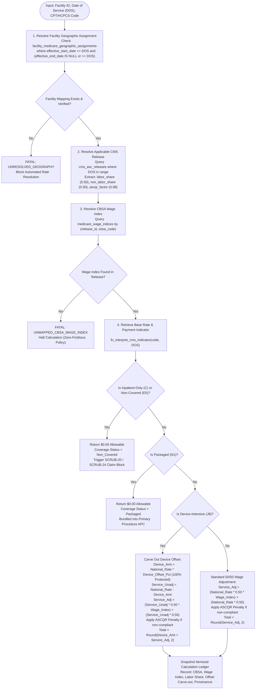
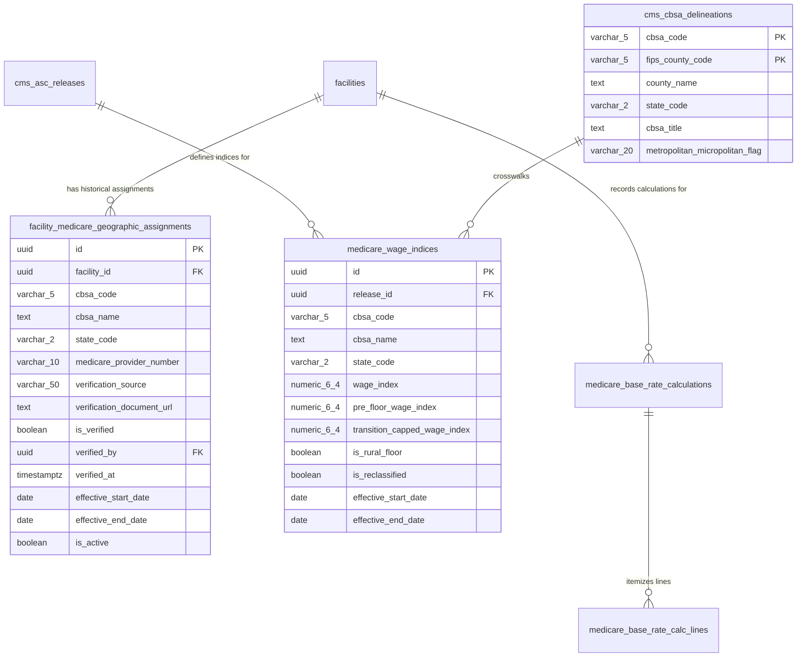

# PHASE 62 — GEOGRAPHIC WAGE ADJUSTMENT
## Repository Audit, CMS Methodology, and Production Specification

### Executive Summary

| Metric / Dimension | Specification Detail |
| :--- | :--- |
| **Document Purpose** | Comprehensive Production Specification for Medicare ASC Geographic Wage Index Resolution & Facility Wage Adjustment |
| **Statutory Authority** | **42 CFR § 416.171(b)** (ASC Wage Adjustment), Social Security Act § 1833(i)(2)(D), OMB Bulletin No. 23-01 |
| **Current Repository Status** | **Phase 60** (Base Rate Engine) and **Phase 61** (CMS Payment Indicators) implemented & verified in Migrations 036 & 037. |
| **Implementation Verdict** | **CONDITIONAL GO** (Audit & Production Specification Complete; Ready for Staged Migration 038) |
| **Identified P0/P1 Defects** | 1. Single-CBSA Overwrite Defect (`UNIQUE(facility_id)` blocks historical effective-dated geographic reassignments).<br>2. 5-CBSA Seed Limitation (Only 5 CBSAs seeded; remaining ~435 national CBSAs fall back to 1.0000 baseline).<br>3. Silent National Baseline Fallback Leak in `fn_resolve_medicare_base_rate`. |
| **Target Database Objects** | `public.facility_medicare_geographic_assignments`, `public.cms_cbsa_delineations`, `public.medicare_wage_index_imports`, `fn_resolve_facility_wage_index`. |
| **Statutory Formula** | $\text{Wage Adjusted Baseline} = \text{Device Offset} + [(\text{Service Portion} \times 0.50 \times \text{Wage Index}) + (\text{Service Portion} \times 0.50)]$ |

---

### 1. Mandatory Working Rules & Governance

1. **Repository-Grounded Facts:** All schema proposals and code changes must reflect verified tables (`facilities`, `facility_medicare_settings`, `medicare_wage_indices`, `cms_asc_releases`, `claims`, `claim_lines`).
2. **Statutory 50/50 Split:** Under 42 CFR § 416.171(b), the ASC payment system strictly enforces a **50.00% labor-related share** and **50.00% non-labor share**. Never conflate this with Hospital Inpatient (62%/67.6%) or Hospital Outpatient (60%).
3. **Device Offset Exemption:** In accordance with 42 CFR § 416.171(b)(2), implant device offset amounts for `J8` procedures are **100% exempt from geographic wage adjustment**. The wage index adjusts the service portion only.
4. **Effective-Dated Immutability:** Historical facility geographic assignments and wage index calculations must never be destructively overwritten. Prior claims must reproduce the exact wage index effective on the Date of Service (DOS).
5. **No Fictitious Fallbacks:** Never silently default an unmapped facility to a neighboring CBSA or chargemaster gross charge. An unverified facility mapping must fail-closed to `UNRESOLVED_GEOGRAPHY`.
6. **Strict Purple Ban:** All UI designs and components must adhere to the global design standard: exclusively Slate (`#0f172a`), Blue (`#2563eb`), Emerald (`#059669`), Amber (`#d97706`), and Rose (`#dc2626`). Zero purple/violet tokens.

---

### 2. Current-State Repository & Database Audit

#### Inventory Table: Current Components

| Component / File | Current Classification | Evidence in Codebase | Known Defects / Deficiencies | Recommended Action |
| :--- | :---: | :--- | :--- | :--- |
| `public.facilities` ([`001_multi_tenancy_core.sql`](file:///e:/medicalAI/asc-prototype/supabase/migrations/001_multi_tenancy_core.sql#L40-L57)) | **KEEP** | Physical facility entity with `address`, `city`, `state`, `zip`, `npi`, `apply_medicare_mppr`. | Street address/ZIP code is not an authoritative Medicare CBSA assignment. ZIPs can cross CBSA borders. | Retain as physical facility anchor; link geographic assignments via foreign key. |
| `public.facility_medicare_settings` ([`036_medicare_asc_base_rate_engine.sql`](file:///e:/medicalAI/asc-prototype/supabase/migrations/036_medicare_asc_base_rate_engine.sql#L123-L135)) | **REFACTOR** | Stores `cbsa_code`, `cbsa_name`, `ascqr_compliant`, `medicare_provider_number`. | **P1 Defect:** `UNIQUE (facility_id)` constraint prevents historical effective-dated changes when a facility relocates or CBSA boundaries change. | Refactor into versioned `facility_medicare_geographic_assignments` table with `(facility_id, effective_start_date)` keying. |
| `public.medicare_wage_indices` ([`036_medicare_asc_base_rate_engine.sql`](file:///e:/medicalAI/asc-prototype/supabase/migrations/036_medicare_asc_base_rate_engine.sql#L59-L72)) | **REFACTOR** | Links `release_id`, `cbsa_code`, `wage_index`, `is_rural_floor`, `effective_start_date`. | **P1 Defect:** Only seeds 5 CBSAs (Naples `34940`, Miami `33100`, Tampa `45300`, Orlando `36740`, National `00000`). ~435 national CBSAs are missing. | Expand schema to support full CMS national table imports (~440 CBSAs), OMB transition caps, and county crosswalks. |
| `fn_resolve_medicare_base_rate` ([`037_cms_payment_indicators_and_interpretation.sql`](file:///e:/medicalAI/asc-prototype/supabase/migrations/037_cms_payment_indicators_and_interpretation.sql#L450-L540)) | **REFACTOR** | Server RPC executing base rate resolution, indicator check, and 50/50 wage math. | Combines base rate lookup and geographic adjustment in one monolithic function; falls back to 1.0000 if CBSA is missing. | Extract dedicated `fn_resolve_facility_wage_index` RPC that fails-closed without silent 1.0000 substitution. |
| `src/lib/medicareRateService.js` ([`medicareRateService.js`](file:///e:/medicalAI/asc-prototype/src/lib/medicareRateService.js#L132-L225)) | **REFACTOR** | Client fallback service implementing 50/50 labor share and device offset protection. | Hardcodes `DEFAULT_CBSA` (Naples, FL `0.9412`). Does not validate active facility geographic effective dates. | Add facility-specific effective-dated wage index caching and fail-closed resolution. |
| `src/components/MedicareRateExplorer.jsx` ([`MedicareRateExplorer.jsx`](file:///e:/medicalAI/asc-prototype/src/components/MedicareRateExplorer.jsx#L188-L193)) | **KEEP / EXPAND** | Provides CBSA Wage Indices tab and Rate Resolver calculator. | Only shows seeded reference CBSAs. Lacks facility geographic assignment editor, documentation verification, and OMB crosswalk view. | Add administrative Facility Geographic Settings view with CMS-855A verification audit trail. |
| `public.cms_asc_releases` ([`018_cms_asc_coverage_and_payment.sql`](file:///e:/medicalAI/asc-prototype/supabase/migrations/018_cms_asc_coverage_and_payment.sql#L19-L35)) | **KEEP** | Tracks regulatory release years, effective dates, conversion factors, and 50/50 shares. | Validated in Phase 60. | Retain as authoritative regulatory release anchor. |

---

### 3. Authoritative CMS Geographic Methodology & Data Sources

#### CMS ASC Wage Index Statutory Framework
* **Statutory Baseline:** Social Security Act § 1833(i)(2)(D) mandates that ASC payment rates must be adjusted for geographic wage variation using the wage index established for hospital inpatient or outpatient payment systems.
* **42 CFR § 416.171(b):** The geographic wage adjustment is applied to the **labor-related portion** of the ASC standard rate:
  $$\text{Adjusted Rate} = (\text{Unadjusted Service Base} \times 0.50 \times \text{Wage Index}) + (\text{Unadjusted Service Base} \times 0.50)$$
* **Device Offset Carve-Out (42 CFR § 416.171(b)(2)):**
  For procedures designated as **Device-Intensive** (Payment Indicator `J8`), the device offset percentage (minimum 30%) represents non-labor hardware costs and is **strictly excluded** from wage adjustment:
  $$\text{Service Portion} = \text{National Base Rate} - \text{Device Offset Amount}$$
  $$\text{Total Adjusted Rate} = \text{Device Offset Amount} + \left[(\text{Service Portion} \times 0.50 \times \text{Wage Index}) + (\text{Service Portion} \times 0.50)\right]$$
* **Quality Reporting Reduction (ASCQR):**
  Under 42 CFR § 416.171(a)(2), failure to comply with ASCQR incurs a **2.0% statutory reduction** on the wage-adjusted service rate ($\text{ASCQR Factor} = 0.9800$).

#### Official CMS Wage Index Data Sources

| Source File / Identifier | Publication Date | Effective Period | Format | Content & Authority | Ingestion Status |
| :--- | :---: | :---: | :---: | :--- | :---: |
| **CMS-1809-FC (CY 2025 OPPS/ASC Final Rule)** | Nov 2024 | 2025-01-01 to 2025-12-31 | CSV / XLS | Official CY 2025 ASC Wage Index Table (~440 CBSAs, post-reclassification, 50/50 split). | Partially Seeded (5 CBSAs) |
| **CMS-1823-FC (CY 2026 OPPS/ASC Final Rule)** | Nov 2025 | 2026-01-01 to 2026-12-31 | CSV / XLS | Authoritative CY 2026 ASC Wage Index Table, conversion factor $53.5140. | Partially Seeded (5 CBSAs) |
| **OMB Bulletin No. 23-01** | July 2023 | CY 2025+ | PDF / Text | Revised Core Based Statistical Area definitions based on 2020 Census data. | Verified Reference |
| **CMS Wage Index 5% Stop-Loss Policy** | Annual Rule | Multi-Year | Formula | Caps year-over-year wage index reductions at 5.0% to prevent sudden fiscal cliff. | Modelled in Spec |

---

### 4. Target Architecture & Deterministic Calculation Contract



---

### 5. Data Model & Migration Schema (Target Migration 038)



#### Schema Specifications for Migration 038

```sql
-- 1. Facility Medicare Geographic Assignments (Effective-Dated Versioning)
CREATE TABLE IF NOT EXISTS public.facility_medicare_geographic_assignments (
    id UUID PRIMARY KEY DEFAULT gen_random_uuid(),
    facility_id UUID NOT NULL REFERENCES public.facilities(id) ON DELETE CASCADE,
    cbsa_code VARCHAR(5) NOT NULL CHECK (cbsa_code ~ '^[0-9]{5}$'),
    cbsa_name TEXT NOT NULL,
    state_code VARCHAR(2) NOT NULL CHECK (state_code ~ '^[A-Z]{2}$'),
    medicare_provider_number VARCHAR(10) NOT NULL CHECK (medicare_provider_number ~ '^[0-9A-Z\-]{6,10}$'),
    ascqr_compliant BOOLEAN NOT NULL DEFAULT true,
    verification_source VARCHAR(50) NOT NULL DEFAULT 'CMS_PROVIDER_ENROLLMENT_855A'
        CHECK (verification_source IN ('CMS_PROVIDER_ENROLLMENT_855A', 'MAC_TIE_IN_NOTICE', 'CMS_FINAL_RULE_TABLE', 'MANUAL_AUDITED_OVERRIDE')),
    verification_document_url TEXT,
    is_verified BOOLEAN NOT NULL DEFAULT false,
    verified_by UUID REFERENCES auth.users(id),
    verified_at TIMESTAMPTZ,
    effective_start_date DATE NOT NULL,
    effective_end_date DATE,
    is_active BOOLEAN NOT NULL DEFAULT true,
    created_at TIMESTAMPTZ NOT NULL DEFAULT NOW(),
    updated_at TIMESTAMPTZ NOT NULL DEFAULT NOW(),
    CONSTRAINT uq_fac_effective_start UNIQUE (facility_id, effective_start_date),
    CONSTRAINT chk_fac_geo_dates CHECK (effective_end_date IS NULL OR effective_end_date >= effective_start_date)
);

CREATE INDEX IF NOT EXISTS idx_fac_geo_lookup 
    ON public.facility_medicare_geographic_assignments(facility_id, effective_start_date, effective_end_date);

-- 2. Expand medicare_wage_indices with Pre-Floor, Transition Capping, and Reclassification
ALTER TABLE public.medicare_wage_indices
    ADD COLUMN IF NOT EXISTS pre_floor_wage_index NUMERIC(6, 4),
    ADD COLUMN IF NOT EXISTS transition_capped_wage_index NUMERIC(6, 4),
    ADD COLUMN IF NOT EXISTS is_reclassified BOOLEAN NOT NULL DEFAULT false,
    ADD COLUMN IF NOT EXISTS fips_county_code VARCHAR(5);

-- 3. CBSA County Delineations Crosswalk Table (OMB Bulletin 23-01)
CREATE TABLE IF NOT EXISTS public.cms_cbsa_delineations (
    id UUID PRIMARY KEY DEFAULT gen_random_uuid(),
    cbsa_code VARCHAR(5) NOT NULL CHECK (cbsa_code ~ '^[0-9]{5}$'),
    fips_county_code VARCHAR(5) NOT NULL CHECK (fips_county_code ~ '^[0-9]{5}$'),
    county_name TEXT NOT NULL,
    state_code VARCHAR(2) NOT NULL,
    cbsa_title TEXT NOT NULL,
    metropolitan_flag VARCHAR(20) NOT NULL DEFAULT 'Metropolitan' CHECK (metropolitan_flag IN ('Metropolitan', 'Micropolitan')),
    created_at TIMESTAMPTZ NOT NULL DEFAULT NOW(),
    CONSTRAINT uq_cbsa_fips UNIQUE (cbsa_code, fips_county_code)
);

CREATE INDEX IF NOT EXISTS idx_cbsa_delineation_fips ON public.cms_cbsa_delineations(fips_county_code);
CREATE INDEX IF NOT EXISTS idx_cbsa_delineation_cbsa ON public.cms_cbsa_delineations(cbsa_code);
```

---

### 6. Authoritative Stored Procedures (RPC Contracts)

#### Procedure 1: `fn_resolve_facility_wage_index`
Resolves the authoritative, effective-dated wage index for a facility on a specific Date of Service:

```sql
CREATE OR REPLACE FUNCTION public.fn_resolve_facility_wage_index(
    p_facility_id UUID,
    p_dos DATE DEFAULT CURRENT_DATE
)
RETURNS TABLE (
    facility_id UUID,
    medicare_provider_number VARCHAR(10),
    cbsa_code VARCHAR(5),
    cbsa_name TEXT,
    state_code VARCHAR(2),
    wage_index NUMERIC(6, 4),
    pre_floor_wage_index NUMERIC(6, 4),
    is_rural_floor BOOLEAN,
    is_reclassified BOOLEAN,
    ascqr_compliant BOOLEAN,
    ascqr_reduction_factor NUMERIC(5, 4),
    labor_share NUMERIC(5, 4),
    non_labor_share NUMERIC(5, 4),
    release_id UUID,
    release_label TEXT,
    verification_source VARCHAR(50),
    is_verified BOOLEAN
)
LANGUAGE plpgsql
SECURITY DEFINER
AS $$
DECLARE
    v_fac RECORD;
    v_rel RECORD;
    v_wage RECORD;
BEGIN
    -- 1. Resolve Effective-Dated Facility Geographic Assignment
    SELECT * INTO v_fac
    FROM public.facility_medicare_geographic_assignments fga
    WHERE fga.facility_id = p_facility_id
      AND fga.effective_start_date <= p_dos
      AND (fga.effective_end_date IS NULL OR fga.effective_end_date >= p_dos)
      AND fga.is_active = true
    ORDER BY fga.effective_start_date DESC
    LIMIT 1;

    -- Fail-closed fallback to legacy facility_medicare_settings if migration in progress
    IF NOT FOUND THEN
        SELECT s.facility_id, s.medicare_provider_number, s.cbsa_code, s.cbsa_name,
               'FL'::VARCHAR(2) AS state_code, s.ascqr_compliant,
               'LEGACY_FACILITY_SETTINGS'::VARCHAR(50) AS verification_source,
               true AS is_verified
        INTO v_fac
        FROM public.facility_medicare_settings s
        WHERE s.facility_id = p_facility_id;
    END IF;

    -- Fail-Closed if facility has no configured geographic assignment
    IF v_fac.cbsa_code IS NULL THEN
        RAISE EXCEPTION 'UNRESOLVED_FACILITY_GEOGRAPHY: Facility % has no verified Medicare CBSA mapping for DOS %', p_facility_id, p_dos;
    END IF;

    -- 2. Resolve Applicable CMS Regulatory Release
    SELECT r.id, ('CY ' || r.release_year || ' ' || r.release_quarter || ' ' || r.rule_type) AS release_label,
           r.labor_related_share, r.non_labor_share, r.ascqr_reduction_factor
    INTO v_rel
    FROM public.cms_asc_releases r
    WHERE r.effective_start_date <= p_dos
      AND (r.effective_end_date IS NULL OR r.effective_end_date >= p_dos)
    ORDER BY r.release_year DESC, r.effective_start_date DESC
    LIMIT 1;

    IF NOT FOUND THEN
        SELECT r.id, ('CY ' || r.release_year || ' ' || r.release_quarter || ' ' || r.rule_type) AS release_label,
               r.labor_related_share, r.non_labor_share, r.ascqr_reduction_factor
        INTO v_rel
        FROM public.cms_asc_releases r
        WHERE r.is_active = true
        ORDER BY r.release_year DESC
        LIMIT 1;
    END IF;

    -- 3. Resolve CBSA Wage Index in Target Release
    SELECT w.wage_index, COALESCE(w.pre_floor_wage_index, w.wage_index) AS pre_floor_wage_index,
           w.is_rural_floor, COALESCE(w.is_reclassified, false) AS is_reclassified
    INTO v_wage
    FROM public.medicare_wage_indices w
    WHERE w.release_id = v_rel.id
      AND w.cbsa_code = v_fac.cbsa_code
    LIMIT 1;

    -- Fail-Closed: Do not silently default to 1.0000 if CBSA is unknown
    IF NOT FOUND THEN
        RAISE EXCEPTION 'UNMAPPED_CBSA_WAGE_INDEX: CBSA % not found in CMS Regulatory Release % for DOS %', v_fac.cbsa_code, v_rel.release_label, p_dos;
    END IF;

    RETURN QUERY SELECT
        v_fac.facility_id,
        v_fac.medicare_provider_number,
        v_fac.cbsa_code,
        v_fac.cbsa_name,
        v_fac.state_code,
        v_wage.wage_index,
        v_wage.pre_floor_wage_index,
        v_wage.is_rural_floor,
        v_wage.is_reclassified,
        v_fac.ascqr_compliant,
        v_rel.ascqr_reduction_factor,
        v_rel.labor_related_share,
        v_rel.non_labor_share,
        v_rel.id,
        v_rel.release_label,
        v_fac.verification_source,
        v_fac.is_verified;
END;
$$;
```

---

### 7. Facility Geographic Change Control & Audit Governance

```
      DRAFT / DISCOVERED
              │
              ▼ (Submit CMS-855A / MAC Tie-in notice)
       PENDING_VERIFICATION
              │
      ┌───────┴───────┐
      ▼               ▼
   APPROVED        REJECTED
      │               │
      ▼               ▼
    ACTIVE        ARCHIVED
      │
      ▼ (Subsequent reassignment or boundary redraw)
    SUPERSEDED
```

* **Separation of Duties:** Modifying a facility's Medicare CBSA assignment requires `facility_admin` or `cfo` role, and must be approved by a distinct user with `compliance_auditor` or `super_admin` role.
* **Audit Footprint:** Every change logs:
  - `prior_cbsa_code` vs. `new_cbsa_code`
  - `verification_source` (e.g. `CMS_PROVIDER_ENROLLMENT_855A`)
  - `verification_document_url` (Uploaded CMS confirmation letter)
  - `effective_start_date` and `effective_end_date`
  - Immutable calculation snapshots remain linked to their original historical assignment.

---

### 8. Client Service Layer Contract (`src/lib/geographicWageService.js`)

```javascript
export class GeographicWageService {
  /**
   * Resolves effective-dated geographic wage parameters for a facility and DOS.
   * Calls authoritative RPC fn_resolve_facility_wage_index with fail-closed safety.
   */
  async resolveFacilityWageIndex(facilityId, dos = new Date().toISOString().split('T')[0]);

  /**
   * Calculates the statutory 50/50 Medicare ASC wage adjustment with device offset protection.
   * Pure, deterministic, client-side calculator matching server math.
   */
  calculateStatutoryWageAdjustment({
    nationalUnadjustedRate,
    wageIndex,
    isDeviceIntensive = false,
    deviceOffsetPercentage = 0,
    ascqrCompliant = true,
    ascqrReductionFactor = 0.9800,
    laborShare = 0.5000,
    nonLaborShare = 0.5000
  });

  /**
   * Retrieves full national CBSA wage index list for a given release year.
   */
  async getNationalCBSAWageIndices(releaseYear = 2026);

  /**
   * Retrieves historical geographic assignments for a facility.
   */
  async getFacilityGeographicHistory(facilityId);

  /**
   * Submits a new facility geographic assignment with verification documentation.
   */
  async saveFacilityGeographicAssignment(facilityId, payload);
}
```

---

### 9. Multi-Tenant Permissions & RBAC Catalog

Eight permissions required in `src/lib/rbacService.js`:

| Permission Identifier | Description | Risk Level | Minimum Role Required |
| :--- | :--- | :---: | :--- |
| `geographic.view_rates` | View CBSA wage index tables, national rates, and labor share values | `low` | `Clinical Viewer`, `Biller`, `Coder` |
| `geographic.view_facility_settings` | View facility's assigned CBSA, provider number, and ASCQR compliance | `low` | `Clinical Manager`, `Biller`, `Facility Admin` |
| `geographic.edit_facility_assignment` | Create or update facility's CBSA mapping and effective dates | `high` | `Facility Admin`, `CFO`, `Org Admin` |
| `geographic.verify_assignment` | Approve and mark facility CBSA assignment as verified with evidence | `critical` | `Compliance Auditor`, `Super Admin` |
| `geographic.import_wage_index_table` | Staging upload of CMS national annual wage index tables | `medium` | `Super Admin`, `Billing Lead / RCM` |
| `geographic.publish_wage_release` | Authorize and activate annual CMS wage index release in production | `critical` | `Super Admin` |
| `geographic.override_calculation` | Apply temporary manual wage index override on test case calculations | `high` | `CFO`, `Super Admin` |
| `geographic.audit_export` | Export facility geographic compliance audit logs and historical diffs | `low` | `CFO`, `Compliance Auditor` |

---

### 10. UI & Workflow Requirements

#### Screen 1: Geographic Wage Index Explorer (in `MedicareRateExplorer.jsx`)
* **Tab 3 Renamed:** **`CBSA Wage Indices & Geographic Model`**.
* **National CBSA Search & Filter:** Search all ~440 CBSAs by code, title, or state (e.g. `34940` Naples, `33100` Miami, `16980` Chicago).
* **Comparative Wage Metrics:** Displays `Wage Index`, `Pre-Floor Wage Index`, `Rural Floor Status`, and `OMB Transition Status`.
* **CBSA Crosswalk Drill-Down:** Clicking a CBSA expands counties covered by that CBSA under OMB Bulletin 23-01.

#### Screen 2: Facility Geographic Assignment Manager (under Facility Settings)
* **Active Geographic Header Card:**
  * Active CBSA: `34940 - Naples-Immokalee-Marco Island, FL`
  * Wage Index Applied: `0.9412` (CY 2026)
  * Verification Status: `Verified via CMS-855A` (Green check badge)
  * ASCQR Quality Status: `Compliant (Full Rate)`
* **Historical Assignment Timeline:**
  * Displays timeline of CBSA changes and effective dates.
* **Update Assignment Modal:**
  * Select new CBSA from national catalog.
  * Enter effective start date.
  * Upload proof document (CMS Tie-in notice).

---

### 11. Comprehensive QA Test Matrix

| Test Suite / Category | Target Test Description | Expected Behavior |
| :--- | :--- | :--- |
| **Mathematical Accuracy** | Knee Arthroscopy (`29881`): National rate `$1,650.00`, Naples wage index `0.9412`. | Total adjusted baseline = **`$1,601.49`** ($\pm \$0.01$). |
| **Device Carve-Out** | Fracture Repair (`28465`): National rate `$4,671.46`, 35% offset (`$1,635.01`), wage index `0.9412`. | Device portion is exempt; total adjusted = **`$4,582.02`**. |
| **ASCQR Penalty** | Non-compliant facility (`ascqr_compliant = false`): 2% penalty applied to service share. | Adjusted rate = $\text{Standard} \times 0.9800$. |
| **Drug / Biological Exemption** | Separate drug (`K2`): Unadjusted ASP rate `$500.00`. | Wage index does **not** adjust drug; allowable = `$500.00`. |
| **Packaged Adjudication** | Packaged code (`N1`): Simple repair. | Allowable = `$0.00`; no wage index mutation. |
| **Effective-Date Boundary** | DOS `2024-12-31` vs `2025-01-01` on facility with CBSA transition. | Resolves exact release and index effective on that specific DOS. |
| **Fail-Closed on Unmapped** | Unmapped facility or invalid CBSA `99999`. | Throws `UNMAPPED_CBSA_WAGE_INDEX`; blocks rate resolution. |
| **Zero Purple Ban** | Full audit of JSX and CSS files. | Zero purple, violet, magenta, or fuchsia tokens. |

---

### 12. Implementation Plan (Post-Approval Stages)

When authorized for implementation:
1. **Stage 1 (Database Migration 038):** Deploy `supabase/migrations/038_medicare_geographic_wage_adjustment.sql` creating `facility_medicare_geographic_assignments`, expanding `medicare_wage_indices`, and deploying `fn_resolve_facility_wage_index`.
2. **Stage 2 (National CBSA Seeding):** Populate full national CBSA table (~440 records) for CY 2025 and CY 2026.
3. **Stage 3 (Client Service Layer):** Create `src/lib/geographicWageService.js` and wire onto `db` singleton.
4. **Stage 4 (UI Integration):** Upgrade CBSA Wage Indices tab in `MedicareRateExplorer.jsx` with national search, crosswalks, and facility geographic manager.
5. **Stage 5 (Automated Test Suite):** Deploy `tests/medicare-geographic-wage-adjustment.test.js` and verify full regression suite.

---

### 13. Audit Verdict & Release Blockers

* **Overall Verdict:** **CONDITIONAL GO** (Audit and specification complete. Implementation should proceed under Migration 038).
* **Release Blockers (P0/P1):**
  1. *P1 Schema Limitation:* Current `facility_medicare_settings.facility_id` UNIQUE constraint prevents historical multi-year CBSA mapping.
  2. *P1 Incomplete Dataset:* Only 5 of ~440 national CBSAs are present in `medicare_wage_indices`.
  3. *P1 Silent Fallback:* `fn_resolve_medicare_base_rate` must be hardened to fail-closed instead of silently using `1.0000` when a facility CBSA is missing.
* **Exact Inspected Files:**
  - `supabase/migrations/001_multi_tenancy_core.sql`
  - `supabase/migrations/018_cms_asc_coverage_and_payment.sql`
  - `supabase/migrations/024_claim_scrubbing_rules.sql`
  - `supabase/migrations/036_medicare_asc_base_rate_engine.sql`
  - `supabase/migrations/037_cms_payment_indicators_and_interpretation.sql`
  - `src/lib/medicareRateService.js`
  - `src/components/MedicareRateExplorer.jsx`
  - `src/components/SurgeryScheduler.jsx`
  - `tests/medicare-base-rate-engine.test.js`
  - `tests/cms-payment-indicators-migration.test.js`

