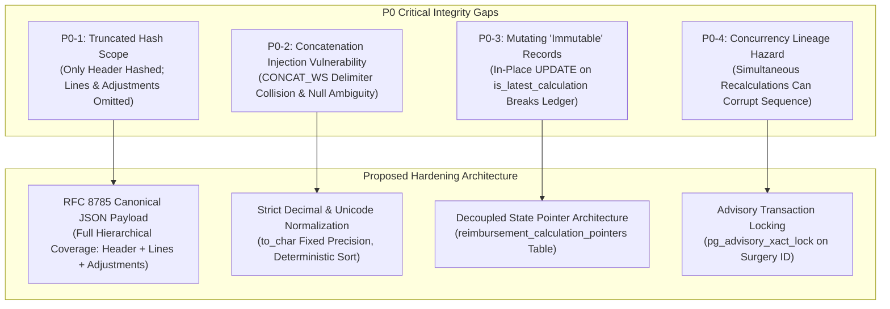

# PHASE 68 — AUDIT AND PROVENANCE MASTER SPECIFICATION
## Cryptographic Integrity, Ledger Immutability, and Historical Reproducibility

> **Module:** Expected Reimbursement Engine & Rate Adjudication  
> **Target Migration:** `044_expected_reimbursement_engine.sql` (Status: PROPOSED / UNAUTHORIZED)  
> **Status:** AUDIT & PROVENANCE SPECIFICATION — READ-ONLY VALIDATION  
> **Author:** Principal Database Security Architect, Financial Systems Auditor, PostgreSQL Specialist  
> **Target Version:** ASCANALYST v2026.1  
> **Audit Classification:** Strict Healthcare Financial Ledger Governance (HIPAA 45 CFR § 164.312(b), SOX § 404, CMS ASC Cost Reporting)  

---

## 1. IMPLEMENTATION PROVENANCE & AUDIT CLASSIFICATION

All controls, functions, triggers, and tables in this audit specification are classified into explicit evidence tiers:

| Provenance Label | Audit Definition | Scope in ASCANALYST Repository |
| :--- | :--- | :--- |
| **`[VERIFIED EXISTING]`** | Directly supported by inspected repository code, active SQL migrations, or test suites. | `organizations`, `facilities`, `is_facility_accessible()`, `user_has_facility_role()`, `surgeries`, `patients`, `payer_master` (041), `payer_contracts` (042), test suites (`tests/expected-reimbursement-engine.test.js`). |
| **`[SPECIFIED BUT NOT IMPLEMENTED]`**| Formally documented in Phase 68 architecture/data model, but not yet deployed to database. | Schema DDL in `044_expected_reimbursement_engine.sql` (`reimbursement_calculations`, `reimbursement_calculation_lines`, `reimbursement_calculation_adjustments`). |
| **`[PARTIALLY IMPLEMENTED]`** | Core logic exists in pending migration or test fixtures, but contains audit or cryptographic gaps. | `fn_calculate_expected_reimbursement` (computes header-only hash), `fn_verify_reimbursement_calculation_integrity` (omits lines/adjustments). |
| **`[NOT VERIFIED]`** | Proposed external integration or client metadata parsing without isolated verification harnesses. | Automated reverse-proxy IP validation (`x-forwarded-for`), real-time EDI 835 remittance cryptographic cross-attestation. |
| **`[PROPOSED]`** | Recommended architectural enhancements formulated during this audit review. | RFC 8785 Canonical JSON payload (`jsonb_canonical_payload`), separate `reimbursement_calculation_pointers` table, advisory locking for concurrency. |

> ⚠️ **CRITICAL GOVERNANCE MANDATE:**  
> 1. Migration 044 remains **STRICTLY UNAUTHORIZED FOR RUNTIME EXECUTION**.  
> 2. Documenting a cryptographic verification function or audit trigger does **NOT** constitute operational proof of integrity.  
> 3. **The Core Proof Distinction:** A successful SHA-256 comparison proves only that the verified payload matches the stored fingerprint. It does **not** prove calculation mathematical correctness, contractual compliance, trusted authorship, or protection against privileged superuser tampering.

---

## 2. AUDIT & PROVENANCE PHILOSOPHY

In ambulatory surgery center revenue cycle operations, an expected reimbursement calculation directly impacts financial ledger accruals, pre-bill scrubbing authorizations, physician contribution margin accounting, and contractual underpayment litigation.

Therefore, calculation records cannot merely be "logged" to standard application logs; they must form a **cryptographically bound, immutable financial ledger**. Every calculation snapshot must be permanently, indisputably attributable to:
1. **Authoritative Clinical & Billing Inputs:** Primary and secondary CPT/HCPCS codes, procedure modifiers (50, 73, 74), billed units, chargemaster gross charges, and verified vendor implant purchase orders.
2. **Effective-Dated Upstream Regulatory Baselines:** CMS Medicare ASC Addenda payment indicators (J8, A2, G2), CBSA wage index tables, and statutory device offset percentages.
3. **Contractual Terms & Methodologies:** Exact contract version lock, fee schedule exhibits, case rate bundled inclusions, MPPR cascade rule sets, and stop-loss terms.
4. **Session Actor Identity:** Server-derived PostgreSQL authenticated user ID (`auth.uid()`), tenancy context, timestamp, and immutable calculation sequence.
5. **Itemized Mathematical Trace:** Line-by-line intermediate arithmetic, modifier factors, MPPR reductions, and implant markup calculations.

---

## 3. SUMMARY OF SYSTEM AUDIT FINDINGS

A forensic audit of the Phase 68 codebase (`supabase/migrations/044_expected_reimbursement_engine.sql`, `reimbursementEngineService.js`, and documentation specifications) revealed 4 critical P0 findings and 3 P1 findings:

---

## 4. ARCHITECTURAL REQUIREMENTS FOR LEDGER INTEGRITY

1. **RFC 8785 JSON Canonicalization:** Replace primitive string concatenation (`CONCAT_WS('|', ...)`) with deterministic JSON canonicalization.
2. **Full Sub-Tree Coverage:** The cryptographic digest must encapsulate the calculation header, all line items, all adjustments, and upstream version identifiers.
3. **Strict Append-Only Storage:** Calculation rows, line items, and adjustments must have zero in-place `UPDATE` operations. Latest-state tracking must be decoupled into an isolated pointer table or view.
4. **Advisory Lock Concurrency Defense:** Recalculations must acquire a transaction-scoped advisory lock on `(facility_id, surgery_id)` to serialize execution and prevent sequence collisions.
5. **Zero-Trust Identity Derivation:** Actor identity must be extracted exclusively from `auth.uid()`. Untrusted client metadata (IP, user-agent) is recorded strictly as diagnostic telemetry.

---

## 5. DOCUMENTATION SPECIFICATION SUITE

This audit specification is supported by six exhaustive technical companion documents:
- [`68_CANONICAL_HASH_DESIGN.md`](file:///e:/medicalAI/asc-prototype/docs/phases/68_CANONICAL_HASH_DESIGN.md): Detailed RFC 8785 serialization model and field-coverage matrix.
- [`68_LEDGER_IMMUTABILITY_AND_LINEAGE.md`](file:///e:/medicalAI/asc-prototype/docs/phases/68_LEDGER_IMMUTABILITY_AND_LINEAGE.md): Analysis of append-only ledger designs and concurrency safeguards.
- [`68_AUDIT_LOG_AND_IDENTITY_PROVENANCE.md`](file:///e:/medicalAI/asc-prototype/docs/phases/68_AUDIT_LOG_AND_IDENTITY_PROVENANCE.md): HIPAA audit log integration, atomic transactions, and PHI minimization.
- [`68_HISTORICAL_REPRODUCIBILITY.md`](file:///e:/medicalAI/asc-prototype/docs/phases/68_HISTORICAL_REPRODUCIBILITY.md): The 10-year audit reproduction architecture and source table version-locking.
- [`68_AUDIT_SECURITY_AND_QA_MATRIX.md`](file:///e:/medicalAI/asc-prototype/docs/phases/68_AUDIT_SECURITY_AND_QA_MATRIX.md): Comprehensive 25-scenario acceptance and security test matrix.
- [`68_AUDIT_CROSS_DOCUMENT_CONSISTENCY.md`](file:///e:/medicalAI/asc-prototype/docs/phases/68_AUDIT_CROSS_DOCUMENT_CONSISTENCY.md): Cross-phase consistency analysis across all Phase 66, 67, and 68 artifacts.

