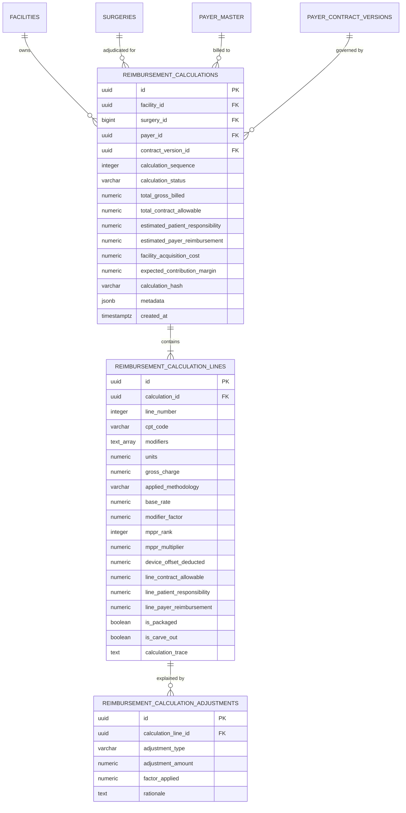

# PHASE 68 — DATA MODEL AND MIGRATION PLAN
## Database Schema Design, Entity-Relationship Architecture & Migration 044 Proposal

> **Phase:** 68 — Expected Reimbursement Engine  
> **Author:** Principal Database Architect, Senior Supabase/PostgreSQL Engineer  
> **Status:** SPECIFICATION & DESIGN ONLY (MIGRATION EXECUTION UNAUTHORIZED)  
> **Target Version:** ASCANALYST v2026.1  

---

## 1. DATA MODEL ARCHITECTURAL OVERVIEW

The Phase 68 schema establishes a **permanently immutable, auditable calculation ledger**.

It replaces the legacy mutable single-row `surgery_financial_snapshots` and builds upon Phase 67's `payer_contract_rate_calculations` by establishing a complete three-tier financial hierarchy:
1. **Calculation Header (`public.reimbursement_calculations`):** Encapsulates the complete encounter financial state, linking facility, surgery, patient, payer, contract version, gross billed charges, contract allowable, estimated patient responsibility, estimated payer reimbursement, direct operating cost, and contribution margin.
2. **Calculation Line Items (`public.reimbursement_calculation_lines`):** Itemized line-level breakdown for every submitted CPT/HCPCS code and implanted device.
3. **Calculation Trace & Adjustments (`public.reimbursement_calculation_adjustments`):** Machine-readable audit graph recording every intermediate modifier factor, MPPR reduction, and J8 device offset deduction.



---

## 2. DETAILED SCHEMA DEFINITION (PROPOSED MIGRATION 044)

### 2.1 Table 1: `public.reimbursement_calculations`
```sql
CREATE TABLE IF NOT EXISTS public.reimbursement_calculations (
    id UUID PRIMARY KEY DEFAULT gen_random_uuid(),
    facility_id UUID NOT NULL REFERENCES public.facilities(id) ON DELETE RESTRICT,
    organization_id UUID NOT NULL REFERENCES public.organizations(id) ON DELETE RESTRICT,
    surgery_id BIGINT REFERENCES public.surgeries(id) ON DELETE SET NULL,
    encounter_identifier VARCHAR(100) NOT NULL,
    patient_id BIGINT REFERENCES public.patients(id) ON DELETE SET NULL,
    payer_id UUID NOT NULL REFERENCES public.payer_master(id) ON DELETE RESTRICT,
    plan_id UUID REFERENCES public.payer_plans(id) ON DELETE SET NULL,
    contract_id UUID NOT NULL REFERENCES public.payer_contracts(id) ON DELETE RESTRICT,
    contract_version_id UUID NOT NULL REFERENCES public.payer_contract_versions(id) ON DELETE RESTRICT,
    
    -- Versioning & Recalculation Lineage
    calculation_sequence INTEGER NOT NULL DEFAULT 1 CHECK (calculation_sequence >= 1),
    is_latest_calculation BOOLEAN NOT NULL DEFAULT TRUE,
    superseded_by_calculation_id UUID REFERENCES public.reimbursement_calculations(id) ON DELETE SET NULL,
    recalculation_reason TEXT,
    
    -- Date Context
    date_of_service DATE NOT NULL,
    calculation_timestamp TIMESTAMPTZ NOT NULL DEFAULT timezone('utc', now()),
    
    -- Calculation State Machine
    calculation_status VARCHAR(50) NOT NULL CHECK (calculation_status IN (
        'CALCULATED',
        'PARTIALLY_CALCULATED',
        'CONTRACT_NOT_FOUND',
        'CONTRACT_VERSION_UNRESOLVED',
        'RATE_NOT_FOUND',
        'BASELINE_NOT_AVAILABLE',
        'REQUIRED_DATA_MISSING',
        'RULE_CONFLICT',
        'MANUAL_REVIEW_REQUIRED',
        'CALCULATION_FAILED',
        'STOP_LOSS_APPLIED'
    )),
    
    -- Financial Summary (Fixed Precision)
    total_gross_billed NUMERIC(12, 2) NOT NULL DEFAULT 0.00 CHECK (total_gross_billed >= 0),
    total_contract_allowable NUMERIC(12, 2) NOT NULL DEFAULT 0.00 CHECK (total_contract_allowable >= 0),
    estimated_patient_responsibility NUMERIC(12, 2) NOT NULL DEFAULT 0.00 CHECK (estimated_patient_responsibility >= 0),
    estimated_payer_reimbursement NUMERIC(12, 2) NOT NULL DEFAULT 0.00 CHECK (estimated_payer_reimbursement >= 0),
    facility_acquisition_cost NUMERIC(12, 2) NOT NULL DEFAULT 0.00 CHECK (facility_acquisition_cost >= 0),
    expected_contribution_margin NUMERIC(12, 2) NOT NULL DEFAULT 0.00,
    contribution_margin_pct NUMERIC(6, 4),
    
    -- Category Allocations
    primary_procedure_allowable NUMERIC(12, 2) NOT NULL DEFAULT 0.00,
    secondary_procedure_allowable NUMERIC(12, 2) NOT NULL DEFAULT 0.00,
    implant_carve_out_allowable NUMERIC(12, 2) NOT NULL DEFAULT 0.00,
    other_services_allowable NUMERIC(12, 2) NOT NULL DEFAULT 0.00,
    
    -- Upstream Rules & Integrity Fingerprint
    mppr_rule_set_code VARCHAR(50),
    stop_loss_triggered BOOLEAN NOT NULL DEFAULT FALSE,
    calculation_engine_version VARCHAR(30) NOT NULL DEFAULT 'v2026.1-ph68',
    calculation_hash VARCHAR(64) NOT NULL,
    execution_context JSONB NOT NULL DEFAULT '{}'::jsonb,
    calculated_by UUID REFERENCES auth.users(id) ON DELETE SET NULL,
    created_at TIMESTAMPTZ NOT NULL DEFAULT timezone('utc', now()),
    
    CONSTRAINT uq_surgery_calculation_seq UNIQUE (surgery_id, calculation_sequence),
    CONSTRAINT chk_reimbursement_partition CHECK (
        ROUND(estimated_payer_reimbursement + estimated_patient_responsibility, 2) = total_contract_allowable
    )
);

CREATE INDEX IF NOT EXISTS idx_reimb_calc_facility ON public.reimbursement_calculations(facility_id);
CREATE INDEX IF NOT EXISTS idx_reimb_calc_surgery ON public.reimbursement_calculations(surgery_id);
CREATE INDEX IF NOT EXISTS idx_reimb_calc_dos ON public.reimbursement_calculations(date_of_service);
CREATE INDEX IF NOT EXISTS idx_reimb_calc_contract_ver ON public.reimbursement_calculations(contract_version_id);
CREATE INDEX IF NOT EXISTS idx_reimb_calc_status ON public.reimbursement_calculations(facility_id, calculation_status);
CREATE INDEX IF NOT EXISTS idx_reimb_calc_hash ON public.reimbursement_calculations(calculation_hash);
```

---

### 2.2 Table 2: `public.reimbursement_calculation_lines`
```sql
CREATE TABLE IF NOT EXISTS public.reimbursement_calculation_lines (
    id UUID PRIMARY KEY DEFAULT gen_random_uuid(),
    calculation_id UUID NOT NULL REFERENCES public.reimbursement_calculations(id) ON DELETE CASCADE,
    line_number SMALLINT NOT NULL CHECK (line_number >= 1 AND line_number <= 100),
    surgery_procedure_id UUID REFERENCES public.surgery_procedures(id) ON DELETE SET NULL,
    case_device_id UUID REFERENCES public.case_devices(id) ON DELETE SET NULL,
    
    cpt_code VARCHAR(10) NOT NULL,
    procedure_description VARCHAR(255),
    modifiers TEXT[] NOT NULL DEFAULT '{}',
    units NUMERIC(6, 2) NOT NULL DEFAULT 1.00 CHECK (units > 0),
    line_gross_charge NUMERIC(12, 2) NOT NULL DEFAULT 0.00 CHECK (line_gross_charge >= 0),
    
    -- Resolved Pricing Methodology
    applied_methodology VARCHAR(50) NOT NULL CHECK (applied_methodology IN (
        'COMMERCIAL_FEE_SCHEDULE',
        'PERCENT_OF_MEDICARE',
        'PERCENT_OF_BILLED_CHARGES',
        'CASE_RATE',
        'IMPLANT_CARVE_OUT',
        'NOT_COVERED',
        'STOP_LOSS_EXCEPTION'
    )),
    
    -- Intermediate Mathematics
    base_benchmark_rate NUMERIC(12, 2),
    contract_multiplier NUMERIC(6, 4),
    modifier_adjustment_factor NUMERIC(6, 4) NOT NULL DEFAULT 1.0000,
    mppr_rank SMALLINT NOT NULL DEFAULT 1,
    mppr_discount_pct NUMERIC(6, 4) NOT NULL DEFAULT 1.0000,
    j8_device_offset_deducted NUMERIC(12, 2) NOT NULL DEFAULT 0.00,
    
    -- Allowables & Partitioning
    line_contract_allowable NUMERIC(12, 2) NOT NULL DEFAULT 0.00 CHECK (line_contract_allowable >= 0),
    line_patient_responsibility NUMERIC(12, 2) NOT NULL DEFAULT 0.00 CHECK (line_patient_responsibility >= 0),
    line_payer_reimbursement NUMERIC(12, 2) NOT NULL DEFAULT 0.00 CHECK (line_payer_reimbursement >= 0),
    
    -- Flags
    is_packaged BOOLEAN NOT NULL DEFAULT FALSE,
    is_carve_out BOOLEAN NOT NULL DEFAULT FALSE,
    
    -- Structured Trace
    calculation_trace TEXT,
    created_at TIMESTAMPTZ NOT NULL DEFAULT timezone('utc', now()),
    
    CONSTRAINT uq_reimb_line UNIQUE (calculation_id, line_number),
    CONSTRAINT chk_line_reimbursement_partition CHECK (
        ROUND(line_payer_reimbursement + line_patient_responsibility, 2) = line_contract_allowable
    )
);

CREATE INDEX IF NOT EXISTS idx_reimb_lines_calc ON public.reimbursement_calculation_lines(calculation_id);
CREATE INDEX IF NOT EXISTS idx_reimb_lines_cpt ON public.reimbursement_calculation_lines(cpt_code);
```

---

### 2.3 Table 3: `public.reimbursement_calculation_adjustments`
```sql
CREATE TABLE IF NOT EXISTS public.reimbursement_calculation_adjustments (
    id UUID PRIMARY KEY DEFAULT gen_random_uuid(),
    calculation_line_id UUID NOT NULL REFERENCES public.reimbursement_calculation_lines(id) ON DELETE CASCADE,
    adjustment_type VARCHAR(50) NOT NULL CHECK (adjustment_type IN (
        'MODIFIER_BILATERAL_50',
        'MODIFIER_DISCONTINUED_73',
        'MODIFIER_DISCONTINUED_74',
        'MPPR_SECONDARY_REDUCTION',
        'J8_DEVICE_OFFSET_DEDUCTION',
        'CASE_RATE_PACKAGING',
        'STOP_LOSS_SETTLEMENT',
        'PATIENT_COPAY_DEDUCTION',
        'PATIENT_COINSURANCE_DEDUCTION',
        'PATIENT_DEDUCTIBLE_DEDUCTION',
        'NON_COVERED_ELECTIVE_UPGRADE'
    )),
    adjustment_amount NUMERIC(12, 2) NOT NULL,
    factor_applied NUMERIC(6, 4),
    rationale TEXT NOT NULL,
    created_at TIMESTAMPTZ NOT NULL DEFAULT timezone('utc', now())
);

CREATE INDEX IF NOT EXISTS idx_reimb_adj_line ON public.reimbursement_calculation_adjustments(calculation_line_id);
```

---

## 3. IMMUTABILITY & AUDIT TRIGGERS

To guarantee HIPAA and financial accounting compliance, calculation tables are **strictly append-only**:

```sql
CREATE OR REPLACE FUNCTION public.trg_block_reimbursement_mutation()
RETURNS TRIGGER AS $$
BEGIN
    RAISE EXCEPTION 'Financial Ledger Violation: Calculation snapshot records (ID %) are permanently immutable and cannot be modified or deleted. To recalculate, execute a new calculation sequence.',
        OLD.id;
    RETURN NULL;
END;
$$ LANGUAGE plpgsql;

CREATE TRIGGER trg_reimb_calc_immutable
    BEFORE UPDATE OR DELETE ON public.reimbursement_calculations
    FOR EACH ROW EXECUTE FUNCTION public.trg_block_reimbursement_mutation();

CREATE TRIGGER trg_reimb_calc_lines_immutable
    BEFORE UPDATE OR DELETE ON public.reimbursement_calculation_lines
    FOR EACH ROW EXECUTE FUNCTION public.trg_block_reimbursement_mutation();
```

---

## 4. PROPOSED MIGRATION 044 SCOPE (DESIGN ONLY)

> ⚠️ **NOTICE:** This migration design is for review and planning purposes only. It is **NOT** authorized for execution in this phase.

### Migration Scope:
1. Create `public.reimbursement_calculations`, `public.reimbursement_calculation_lines`, and `public.reimbursement_calculation_adjustments`.
2. Attach immutability statement-level triggers.
3. Deploy authoritative stored procedure `public.fn_calculate_expected_reimbursement()`.
4. Deploy authoritative stored procedure `public.fn_recalculate_encounter_reimbursement()`.
5. Enable multi-tenant RLS policies using `public.is_facility_accessible(facility_id)`.
6. Deprecate `public.calculate_surgery_financials()` and point legacy views to the new calculation engine.

