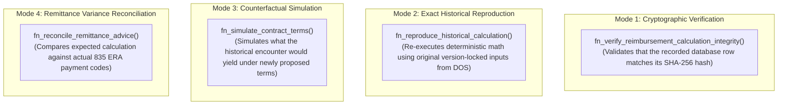

# PHASE 68 — HISTORICAL REPRODUCIBILITY & VERSION LOCKING
## Retrospective Audit Integrity, Immutable Source Versioning, and Long-Term Reproducibility

> **Module:** Expected Reimbursement Engine & Rate Adjudication  
> **Status:** AUDIT & SPECIFICATION DESIGN  
> **Target Version:** ASCANALYST v2026.1  
> **Author:** Principal Database Security Architect, Financial Systems Auditor  

---

## 1. THE 10-YEAR HEALTHCARE REPRODUCIBILITY MANDATE

Ambulatory Surgery Centers operate under strict regulatory and contractual audit lookback periods:
- **Commercial Payer Retrospective Audits:** Commercial payers (e.g. UnitedHealthcare, Aetna, BCBS) contractually enforce lookback audit windows ranging from 24 to 36 months for overpayment reclamation and unbundling audits.
- **CMS Medicare Cost Reporting & RAC Audits:** Recovery Audit Contractors (RAC) and Medicare Administrative Contractors (MAC) retain statutory audit rights for up to **ten (10) years** for facility cost reports and statutory claims.
- **Contractual Underpayment Arbitration:** When an ASC sues a commercial payer for systemic underpayment, the ASC must reproduce the exact contractual calculation that was active on the date of surgery.

### The Fundamental Audit Hazard:
If an adjudication engine depends on mutable database tables (e.g., editing a fee schedule row in place, or updating a Medicare baseline table), running a calculation three years later produces a **different financial result**. The facility loses historical legal defensibility.

---

## 2. THE FOUR DISTINCT OPERATIONAL MODES

To maintain total clarity during financial audits, the engine distinguishes four independent analytical modes:



| Operational Mode | Purpose | Mutates Database? | Historical Result Overwritten? | Output Artifact |
| :--- | :--- | :---: | :---: | :--- |
| **1. Verification** | Confirms row integrity against tampering | No | No | `is_valid: BOOLEAN` |
| **2. Reproduction** | Re-proves mathematical correctness from DOS | No | No | Exact cent match ($0.00 delta) |
| **3. Simulation** | Models contract renegotiation scenarios | No | No | Hypothetical variance report |
| **4. Reconciliation** | Detects payer underpayments via 835 ERAs | Yes (Creates variance entry)| No | Claim underpayment appeal |

> ⚠️ **MANDATORY AUDIT RULE:** A new calculation sequence, dry-run simulation, or historical reproduction must **NEVER** silently overwrite, delete, or modify an existing historical calculation snapshot.

---

## 3. IMMUTABLE VERSION-LOCK ARCHITECTURE

To guarantee that any calculation can be reproduced identically 10 years later, the engine binds to **four immutable version tiers**:

```
+----------------------------------------------------------------------------------------------------+
| 1. CONTRACT VERSION LOCK (payer_contract_versions.id)                                             |
|    - Once a contract version is marked 'ACTIVE', its rates, multipliers, and carve-outs are        |
|      PERMANENTLY LOCKED. Edits require creating a new draft version.                               |
+----------------------------------------------------------------------------------------------------+
| 2. STATUTORY CMS ASC BASELINE (medicare_asc_addenda & wage_index)                                   |
|    - Partitioned strictly by effective calendar year and quarter (e.g. '2026-Q1').                 |
|    - Historical quarterly addenda tables are permanent and read-only.                              |
+----------------------------------------------------------------------------------------------------+
| 3. INVOICE ACQUISITION SNAPSHOT (case_devices.purchase_invoice_id)                                 |
|    - Vendor implant purchase cost is frozen at the moment of surgical consumption.                 |
+----------------------------------------------------------------------------------------------------+
| 4. ENGINE ALGORITHM VERSION (calculation_engine_version)                                           |
|    - Stored directly in the calculation record (e.g. 'v2026.1-ph68').                               |
|    - Encapsulates exact rounding modes (Round Half-Up) and sorting conventions.                    |
+----------------------------------------------------------------------------------------------------+
```

---

## 4. MATHEMATICAL REPRODUCIBILITY GUARANTEES

1. **Deterministic Floating-Point Prohibition:** Floating-point arithmetic (`FLOAT`, `DOUBLE PRECISION`, or JavaScript IEEE 754 `Number`) is **strictly forbidden** in authoritative financial paths. All financial columns are evaluated in PostgreSQL `NUMERIC(12, 2)` or `NUMERIC(6, 4)`.
2. **Deterministic Rounding Policy:** Intermediate multiplication (e.g. baseline $\times$ multiplier) uses **Round Half-Up** (`ROUND(val, 2)`).
3. **Reproducibility Test Harness:** Acceptance criteria require automated unit tests (`tests/expected-reimbursement-engine.test.js`) to assert reproducibility of all 5 clinical case studies to the exact cent (`$0.01`).

