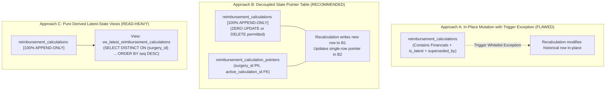

# PHASE 68 — LEDGER IMMUTABILITY AND RECALCULATION LINEAGE
## Architectural Analysis of Append-Only Ledgers, In-Place Mutation Contradictions, and Concurrency Defense

> **Module:** Expected Reimbursement Engine & Rate Adjudication  
> **Status:** AUDIT & SPECIFICATION DESIGN  
> **Target Version:** ASCANALYST v2026.1  
> **Author:** Principal Database Security Architect, PostgreSQL Specialist  

---

## 1. THE CORE ARCHITECTURAL CONTRADICTION

In financial engineering and compliance auditing (HIPAA 45 CFR § 164.312(b), SOX § 404), a system cannot simultaneously claim to be a **"permanently immutable financial ledger"** while executing in-place `UPDATE` operations on historical rows.

### 1.1 The Existing Flaw in Migration 044
In `supabase/migrations/044_expected_reimbursement_engine.sql`, the schema attempts to balance immutability with lifecycle tracking by executing:

```sql
-- Migration 044 (Line 606)
UPDATE public.reimbursement_calculations
SET is_latest_calculation = FALSE,
    superseded_by_calculation_id = v_calc_id
WHERE id = v_last_calc_id;
```

To allow this, the immutability trigger (`trg_block_reimbursement_mutation`) carves out an exception:
```sql
-- Migration 044 (Line 864)
IF (OLD.is_latest_calculation IS DISTINCT FROM NEW.is_latest_calculation OR
    OLD.superseded_by_calculation_id IS DISTINCT FROM NEW.superseded_by_calculation_id)
   AND OLD.total_contract_allowable = NEW.total_contract_allowable
   ... THEN
    RETURN NEW;
END IF;
```

### 1.2 Audit Vulnerabilities of In-Place Pointer Mutation:
1. **Loss of Cryptographic Immutability:** Updating any column alters the physical PostgreSQL tuple (`ctid`), modifies the Write-Ahead Log (WAL), changes block checksums, and requires write locks on historical records.
2. **Privilege Escalation Exposure:** If a database role has `UPDATE` permission on the table, a vulnerability in the trigger logic could permit unauthorized changes to financial figures or bypass security checks.
3. **Write Contention on Historical Records:** In high-volume environments, updating historical rows causes table bloat, dead tuples, and read-write lock contention with analytical queries inspecting past calculations.

---

## 2. EVALUATION OF LEDGER LINEAGE ARCHITECTURES

We evaluated three potential architectures to resolve the immutability contradiction:



### Comparative Evaluation:

| Criterion | Approach A: In-Place Mutation | Approach B: Decoupled Pointer Table | Approach C: Pure Derived View |
| :--- | :---: | :---: | :---: |
| **Strict Immutability** | ❌ Violates (Updates historical row) | ✅ 100% Pure Append-Only | ✅ 100% Pure Append-Only |
| **Trigger Complexity** | ❌ High (Complex whitelist check) | ✅ Simple (Unconditional RAISE) | ✅ Simple (Unconditional RAISE) |
| **Index Efficiency** | ⚠️ Moderate (`idx_is_latest`) | ✅ High (Single PK index lookup) | ❌ Poor (Requires sort/windowing) |
| **Concurrency Safety** | ⚠️ Susceptible to deadlocks | ✅ Lock on isolated pointer row | ⚠️ Sequence generation hazard |
| **Audit Traceability** | ⚠️ Historical record modified | ✅ Historical records untouched | ✅ Historical records untouched |

### Recommended Architecture: Approach B (Decoupled State Pointer)
1. **`public.reimbursement_calculations` is strictly append-only:**
   The trigger executes an **unconditional rejection** on any `UPDATE` or `DELETE`:
   ```sql
   CREATE OR REPLACE FUNCTION public.trg_block_reimbursement_mutation()
   RETURNS TRIGGER AS $$
   BEGIN
       RAISE EXCEPTION 'Financial Ledger Violation: Calculation snapshot records (ID %) are permanently immutable and cannot be updated or deleted.', OLD.id
           USING ERRCODE = 'P0001';
       RETURN NULL;
   END;
   $$ LANGUAGE plpgsql;
   ```
2. **Current State Pointer Table (`public.reimbursement_calculation_pointers`):**
   ```sql
   CREATE TABLE IF NOT EXISTS public.reimbursement_calculation_pointers (
       surgery_id BIGINT PRIMARY KEY REFERENCES public.surgeries(id) ON DELETE CASCADE,
       facility_id UUID NOT NULL REFERENCES public.facilities(id) ON DELETE RESTRICT,
       active_calculation_id UUID NOT NULL REFERENCES public.reimbursement_calculations(id) ON DELETE RESTRICT,
       total_sequences INTEGER NOT NULL DEFAULT 1,
       updated_at TIMESTAMPTZ NOT NULL DEFAULT timezone('utc', now())
   );
   ```
3. **Zero Mutation on Ledger:** Recalculations insert a new immutable calculation row (Sequence #2) and update **only** the `active_calculation_id` in `reimbursement_calculation_pointers`.

---

## 3. CONCURRENCY & RACE CONDITION DEFENSE

In multi-user surgical centers, race conditions can occur if two billers, or an automated clearinghouse webhook and a clinical coder, trigger recalculation simultaneously for the same surgical encounter.

### 3.1 Potential Concurrency Hazards:
1. **Sequence Number Duplication:** Both transactions read `MAX(calculation_sequence) = 1` simultaneously, and both attempt to insert `calculation_sequence = 2`, triggering a unique constraint violation.
2. **Conflicting Active Calculations:** Two distinct snapshots get created, resulting in non-deterministic pointer state.

### 3.2 Transaction Advisory Lock Defense
To guarantee deterministic serialization without taking broad table-level locks, the recalculation procedure must acquire a **PostgreSQL Transaction-Level Advisory Lock** bound to the encounter ID:

```sql
-- Acquire transaction-scoped advisory lock for the target surgery
-- Lock is automatically released at COMMIT or ROLLBACK
PERFORM pg_advisory_xact_lock(hashtext('reimbursement_calc:' || p_surgery_id::text));
```

### 3.3 Sequence Integrity Constraints:
- `CONSTRAINT uq_surgery_calculation_seq UNIQUE (surgery_id, calculation_sequence)`
- `CHECK (calculation_sequence >= 1)`
- Monotonic sequence assignment:
  ```sql
  SELECT COALESCE(MAX(calculation_sequence), 0) + 1 INTO v_next_seq
  FROM public.reimbursement_calculations
  WHERE surgery_id = p_surgery_id;
  ```

---

## 4. RECALCULATION REASON GOVERNANCE

Recalculating an encounter modifies the financial expectation of the facility. To comply with healthcare financial audit requirements:
1. **Mandatory Audit Reason:** `p_recalculation_reason` is strictly mandatory for any calculation where `v_next_seq > 1`.
2. **Length Validation:** Must contain $\ge 10$ characters of substantive explanation.
3. **Standard Reason Codes:**
   - `POST_OP_CPT_RECODING`: Operative note coding completed or unbundling corrected.
   - `IMPLANT_INVOICE_ADDED`: Post-surgical implant PO invoice entered by materials.
   - `CONTRACT_RETROACTIVE_AMENDMENT`: Payer renegotiation backdated.
   - `PATIENT_INSURANCE_CHANGED`: Plan eligibility or COB updated.
   - `OTHER_MANUAL_REVIEW`: Administrative or clinical dispute resolution.
4. **Audit Immutability:** The reason string is recorded in the immutable snapshot record and emitted to `public.audit_logs`. It can never be retroactively edited.

---

## 5. FAILED & REJECTED CALCULATIONS GOVERNANCE

If adjudication encounters missing data (`REQUIRED_DATA_MISSING`), missing fee schedules (`RATE_NOT_FOUND`), or rule conflicts (`RULE_CONFLICT`):
1. **State Machine Integrity:** The row is assigned status `CALCULATION_FAILED`, `REQUIRED_DATA_MISSING`, or `RATE_NOT_FOUND`.
2. **Allowable Zeroing Protection:** A failed calculation **must never** overwrite or clear the active calculation pointer of a previously valid `CALCULATED` snapshot.
3. **Audit Event Generation:** Failed calculations are logged in `public.audit_logs` with the failure code, reason, and missing data attributes for operational alerting.
