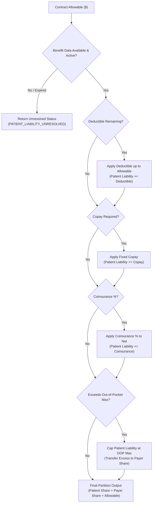

# PHASE 68 — QA AND ACCEPTANCE CRITERIA
## Comprehensive Test Plan, Verification Matrix & Definition of Done

> **Phase:** 68 — Expected Reimbursement Engine  
> **Author:** Principal QA Architect, Senior Test Automation Engineer  
> **Status:** PRODUCTION QA SPECIFICATION & VERIFICATION MATRIX (CORRECTED)  
> **Target Version:** ASCANALYST v2026.1  
> **Mode:** DOCUMENTATION SPECIFICATION — AUTHORITATIVE CONTRACT TEST DESIGN  

---

## 1. TEST SUITE ARCHITECTURE & CI PIPELINE

The test harness for Phase 68 decouples frontend, backend, financial, and security verification into independently reported test tiers that execute in parallel pipelines across continuous integration.

```mermaid
flowchart TD
    subgraph CI_Execution ["Parallel CI Pipeline Execution"]
        direction TB
        subgraph Static_Checks ["Static & Hygiene Analysis"]
            LINT["Lint & Static Analysis<br/>(ESLint / Prettier / DDL Check)"]
            BUILD["Production Bundle Build<br/>(Vite Production Build)"]
            PURPLE["Design System Scan<br/>(Maestro Strict Purple Ban)"]
        end

        subgraph Financial_Tiers ["Deterministic Financial Test Harness"]
            T1["Tier 1: Arithmetic & Modifier Engine<br/>(Fixed Fee, % Medicare, Modifiers, Multi-Rule)"]
            T2["Tier 2: Clinical Scenarios & Reconciliations<br/>(5 E2E Case Studies to $0.01)"]
            T3["Tier 3: Patient Responsibility Engine<br/>(Copay, Deductible, Coinsurance, Out-of-Pocket)"]
        end

        subgraph Security_Tiers ["Database, Ledger & Multi-Tenant Security"]
            T4["Tier 4: Immutability & SHA-256 Ledger<br/>(Block Mutate/Delete, Fingerprint Verification)"]
            T5["Tier 5: Multi-Tenant RLS & Security<br/>(Org/Facility Tenancy, RBAC, AI Boundaries)"]
        end
    end

    Static_Checks --> Release_Gate{"Mandatory Release Gate"}
    Financial_Tiers --> Release_Gate
    Security_Tiers --> Release_Gate

    Release_Gate -->|All Pass (0 Failures, 0 P0/P1)| DEPLOY["Production Sign-Off (GO)"]
    Release_Gate -->|Any Failure or Unverified Assumption| BLOCK["Release Blocked (NO-GO)"]
```

---

## 2. DETAILED TEST CASES & VERIFICATION MATRIX

### 2.1 Tier 1: Deterministic Math, Rate Hierarchy & Line Unit Tests

#### TC-68-01: Commercial Fixed Fee Schedule Precision
- **Purpose:** Validate exact contracted rate retrieval with zero binary floating-point drift.
- **Contract Context:** Commercial Payer Contract Version `VER-UHC-2026-01`, Exhibit A (Ambulatory Surgery Fee Schedule). Effective: 2026-01-01 to 2026-12-31.
- **Input:** CPT `29881` (Knee Arthroscopy Meniscectomy), Quantity: 1 unit. Contracted Line Rate: `$3,200.00`.
- **Expected Result:**
  - Base Contract Allowable = `$3,200.00`.
  - Line Status = `CALCULATED`.
  - Floating-point assertion: `Math.abs(line.contract_allowable - 3200.00) < 0.0001`.

#### TC-68-02: Percent-of-Medicare Wage-Adjusted Baseline
- **Purpose:** Verify Medicare baseline calculation with CBSA wage index adjustment under an explicit contractual adoption clause.
- **Contractual & Regulatory Assumptions:**
  1. *Contract Language:* Contract specifies: *"Reimbursement for surgical procedures shall equal 180.00% of the prevailing CMS ASC Prospective Payment System facility rate for CBSA 34940."*
  2. *Payment Year & Version:* CY 2026 CMS ASC Final Rule (CMS-1784-FC), Addendum AA.
  3. *Geographic Wage Index:* CBSA `34940` (Naples-Immokalee-Marco Island, FL), CY 2026 ASC Wage Index = `0.9412`.
  4. *Labor Component:* CMS standard ASC wage labor share = 50.00%; Non-labor share = 50.00%.
  5. *Baseline Procedure Rate:* CPT `29827` unadjusted national ASC rate = `$3,450.00`.
- **Deterministic Math:**
  $$\text{Labor Portion} = \$3,450.00 \times 0.50 \times 0.9412 = \$1,623.57$$
  $$\text{Non-Labor Portion} = \$3,450.00 \times 0.50 = \$1,725.00$$
  $$\text{Wage-Adjusted Baseline} = \$1,623.57 + \$1,725.00 = \$3,348.57$$
  $$\text{Contract Allowable} = \$3,348.57 \times 1.8000 = \$6,027.426 \rightarrow \mathbf{\$6,027.43}$$
- **Contrasting Negative Test (Commercial Independence):**
  - Contract language is silent on CMS wage index adjustments.
  - Expected: Engine does NOT apply wage index. Returns unadjusted baseline $\times 1.8000 = \$6,210.00$ or flags `AMBIGUOUS_MEDICARE_BASELINE` for contract clarification.

#### TC-68-03: Device Offset Deduction (J8 Implant Carve-Out)
- **Purpose:** Validate conditional deduction of Medicare device offset when implants are separately reimbursed, preventing double reimbursement.
- **Contractual Preconditions:**
  1. Contract explicitly stipulates: *"When surgical implants are reimbursed separately via carve-out or invoice plus markup, procedures subject to CMS Device-Intensive status (J8 indicator) shall have the applicable CMS ASC Device Offset amount deducted from the procedure baseline prior to applying the contract multiplier."*
  2. CPT `23430` (Tenodesis of long tendon of biceps) is assigned CMS payment indicator `J8`.
  3. CMS Device Offset for CPT `23430` = `$2,100.00`.
  4. Contract Multiplier = `1.8000`. MPPR Ranking = Secondary Procedure (50.00%).
- **Deterministic Math:**
  $$\text{Unadjusted Procedure Baseline} = \$4,707.41$$
  $$\text{Adjusted Base (Net of Device Offset)} = \$4,707.41 - \$2,100.00 = \$2,607.41$$
  $$\text{Multiplied Line Base} = \$2,607.41 \times 1.8000 = \$4,693.338$$
  $$\text{Line Allowable (50\% MPPR)} = \$4,693.338 \times 0.50 = \mathbf{\$2,346.67}$$
- **Reconciliation of Documented Double-Dipping Prevention:**
  - If device offset were *omitted* while implant was separately reimbursed at invoice ($2,426.95):
    - Unreduced Line Allowable = $\$4,707.41 \times 1.8000 \times 0.50 = \$4,236.67$.
    - Total Paid = Line $(\$4,236.67) + \text{Implant Carve-Out } (\$2,426.95) = \$6,663.62$.
    - With Device Offset deducted: Line $(\$2,346.67) + \text{Implant Carve-Out } (\$2,426.95) = \$4,773.62$.
    - **Overpayment Prevented:** $\$6,663.62 - \$4,773.62 = \$1,890.00$ (exactly $\$2,100.00 \times 1.8000 \times 0.50$).
- **Contrasting Negative Test (No Offset Mandate):**
  - Contract does not contain a device-offset deduction clause.
  - Expected: Baseline remains $\$4,707.41$. Line Allowable = $\$4,236.67$. Separate implant reimbursement adjudicated according to contract carve-out terms.

#### TC-68-04: Modifier 50 Bilateral Calculation Matrix
- **Purpose:** Verify bilateral multiplier calculation across varied contractual specifications.
- **Test Scenarios:**
  - *TC-68-04A (Standard 150% Rule):* Contract explicitly defines Bilateral Modifier 50 = `150.00%`. CPT `29881` base = `$3,200.00`. Allowable = `$4,800.00`.
  - *TC-68-04B (Full 200% Rule):* Commercial contract defines Bilateral Modifier 50 = `200.00%`. CPT `29881` base = `$3,200.00`. Allowable = `$6,400.00`.
  - *TC-68-04C (Different Effective Date):* Rule version before 2026-01-01 was 150%; rule version after 2026-01-01 is 200%. Verify DOS-based selection.
  - *TC-68-04D (Missing Modifier Rule):* Contract has no bilateral rule configured. Engine returns `STATUS: MANUAL_REVIEW_REQUIRED`, reason: `MODIFIER_RULE_MISSING`.
  - *TC-68-04E (Invalid Modifier Combination):* Claim contains bilateral modifier 50 on inherently bilateral CPT (e.g., `42820` tonsillectomy). Returns `FATAL_MODIFIER_CONFLICT`.

#### TC-68-05: Discontinued Procedure Modifiers 73 & 74
- **Purpose:** Adjudicate procedures terminated prior to or after anesthesia induction.
- **Contractual Rules:**
  - Modifier 73 (Discontinued prior to anesthesia): Reimbursed at `50.00%` of contract allowable.
  - Modifier 74 (Discontinued after anesthesia induction): Reimbursed at `100.00%` of contract allowable.
- **Inputs & Expectations:**
  - CPT `29881` ($3,200.00) + Mod 73 $\rightarrow$ Allowable = `\$1,600.00`.
  - CPT `29881` ($3,200.00) + Mod 74 $\rightarrow$ Allowable = `\$3,200.00`.
  - Implants on Modifier 73 claims $\rightarrow$ `\$0.00` allowable (implants not opened).
  - Conflicting modifiers 73 + 74 on same line $\rightarrow$ `FATAL_SCRUB_ERROR`.

#### TC-68-06: MPPR Hierarchy, Cascade & Exemption Tests
- **Purpose:** Verify multiple procedure payment reduction ranking by contracted allowable and add-on code exemption.
- **Test Scenarios:**
  - *TC-68-06A (Standard 100/50/25/0 Cascade):* Contract references `COM_STD_CASCADE`.
    - Line 1: Allowable `$3,200.00` (Rank 1, 100%) $\rightarrow \$3,200.00$.
    - Line 2: Allowable `$1,800.00` (Rank 2, 50%) $\rightarrow \$900.00$.
    - Line 3: Allowable `$1,000.00` (Rank 3, 25%) $\rightarrow \$250.00$.
    - Line 4: Allowable `$800.00` (Rank 4, 0%) $\rightarrow \$0.00$.
    - Total = `\$4,350.00`.
  - *TC-68-06B (Rank by Allowable vs Billed):*
    - Procedure A: Billed `$10,000.00`, Contracted Allowable `$2,000.00`.
    - Procedure B: Billed `$4,000.00`, Contracted Allowable `$3,500.00`.
    - Expected: Procedure B ranked #1 ($3,500 @ 100%), Procedure A ranked #2 ($2,000 @ 50%). Ranking MUST use contracted allowable, never gross billed charge.
  - *TC-68-06C (Add-On Code Exemption):* CPT `22845` (anterior instrumentation, designated with `+`). Must receive 100% allowable regardless of rank.
  - *TC-68-06D (No MPPR Contract):* Contract explicitly pays 100% on all surgical procedures. All lines receive 100%.
  - *TC-68-06E (Missing MPPR Rule):* Engine halts and returns `STATUS: MANUAL_REVIEW_REQUIRED`.

---

### 2.2 Tier 2: End-to-End Clinical Scenarios (Target Tolerances: Exact to $0.01)

#### TC-68-07: Shoulder Arthroscopy with Implants (Case Study 1)
- **Patient & Encounter:** Suzanne Garon (MRN 2034), Encounter `ENC-2026-0101`, Naples Surgery Center.
- **Date of Service:** 2026-02-15.
- **Payer & Contract:** Blue Cross Blue Shield Florida, Contract Version `BCBS-FL-2026-V1` (Active, Approved).
- **Benefit Data:** Deductible: `$1,000.00` remaining; Coinsurance: `20.00%`; Max OOP: `$6,000.00` (`$4,500.00` remaining).
- **Line 1:** CPT `29827` (Rotator cuff repair), Billed: `$12,000.00`. Contract methodology: 180% Medicare baseline ($3,348.57) = `$6,027.43`. Rank 1 MPPR (100%).
- **Line 2:** CPT `23430` (Biceps tenodesis), Billed: `$6,500.00`. CMS Baseline ($4,707.41) less J8 Device Offset ($2,100.00) = $2,607.41 $\times 1.8000$ = $4,693.34. Rank 2 MPPR (50%) = `$2,346.67`.
- **Line 3 (Implant Carve-Out):** 2 $\times$ PEEK Suture Anchors, Invoice Cost = `$2,426.95`. Contract Carve-Out: Invoice + 15% markup = `$2,791.00`. Exempt from MPPR.
- **Reconciliation Matrix (Exact to $0.01):**
  - **Gross Billed Charges:** `\$23,000.00`
  - **Total Contract Allowable:** $\$6,027.43 + \$2,346.67 + \$2,791.00 = \mathbf{\$11,165.10}$
  - **Patient Responsibility Calculation:**
    - Deductible: `\$1,000.00`
    - Remaining Subject to Coinsurance: $\$11,165.10 - \$1,000.00 = \$10,165.10$
    - Coinsurance (20%): $\$10,165.10 \times 0.20 = \mathbf{\$2,033.02}$
    - Total Estimated Patient Responsibility: $\$1,000.00 + \$2,033.02 = \mathbf{\$3,033.02}$ (Under remaining OOP max of $4,500.00)
  - **Estimated Payer Reimbursement:** $\$11,165.10 - \$3,033.02 = \mathbf{\$8,132.08}$
  - **Facility Direct Acquisition Costs:**
    - Implant Cost: `$2,426.95`
    - OR Supplies & Meds: `$1,850.00`
    - Staff & Direct Labor: `$898.05`
    - Total Direct Cost: `\$5,175.00`
  - **Contribution Margin:** $\$11,165.10 - \$5,175.00 = \mathbf{\$5,990.10}$ (53.65%)
  - *Accounting Note:* Expected collections represent contractually adjudicated receivable values and do not guarantee cash collections.

#### TC-68-08: Commercial Knee Fee Schedule (Case Study 2)
- **Patient & Encounter:** Mark Henderson (MRN 1104), Encounter `ENC-2026-0142`, Naples Surgery Center.
- **Payer & Contract:** UnitedHealthcare Commercial, Contract `UHC-COMM-2026-V1`.
- **Benefit Data:** Fixed Copay: `$250.00`. Zero remaining deductible.
- **Line 1:** CPT `29881` (Knee Meniscectomy), Billed: `$7,500.00`. Negotiated Rate: `$3,200.00` (100% MPPR).
- **Line 2:** CPT `29877` (Chondroplasty, separate compartment with Mod XS), Billed: `$4,200.00`. Negotiated Rate: `$1,800.00` $\times$ 50% MPPR = `$900.00`.
- **Reconciliation Matrix:**
  - **Gross Billed Charges:** `\$11,700.00`
  - **Total Contract Allowable:** $\$3,200.00 + \$900.00 = \mathbf{\$4,100.00}$
  - **Estimated Patient Responsibility:** `\$250.00` (Fixed Copay)
  - **Estimated Payer Reimbursement:** $\$4,100.00 - \$250.00 = \mathbf{\$3,850.00}$
  - **Facility Direct Costs:** `$1,750.00`
  - **Contribution Margin:** $\$4,100.00 - \$1,750.00 = \mathbf{\$2,350.00}$ (57.32%)

#### TC-68-09: Bilateral Knee Arthroscopy (Case Study 3)
- **Patient & Encounter:** David O'Connor (MRN 3302), Encounter `ENC-2026-0205`.
- **Payer & Contract:** Aetna Choice POS II, Contract `AETNA-FL-2026-V2`.
- **Line 1:** CPT `29881` with Modifier 50. Contracted base: `$3,200.00`. Bilateral payment rule: `150.00%`.
- **Reconciliation Matrix:**
  - **Gross Billed Charges:** `\$12,800.00`
  - **Total Contract Allowable:** $\$3,200.00 \times 1.5000 = \mathbf{\$4,800.00}$
  - **Benefit Partition:** Patient 10% coinsurance: `\$480.00`; Payer reimbursement: `\$4,320.00`.

#### TC-68-10: Cataract Case Rate with Toric IOL Upgrade (Case Study 4)
- **Patient & Encounter:** Eleanor Vance (MRN 5410), Encounter `ENC-2026-0312`.
- **Payer & Contract:** Humana Choice PPO, Contract `HUM-ASC-2026-V1`.
- **Line 1:** CPT `66984` (Cataract removal with IOL). Contract Case Rate = `$2,150.00` (inclusive of facility, nursing, routine supplies, standard monofocal IOL).
- **Line 2 (Elective Upgrade):** HCPCS `V2788` (Toric Astigmatism-Correcting IOL). Patient Elective Upgrade Agreement executed. Non-covered by payer. Patient retail charge = `$1,300.00`.
- **Reconciliation Matrix:**
  - **Gross Billed Charges:** `\$6,800.00`
  - **Contract Allowable (Payer Covered):** `\$2,150.00`
  - **Estimated Payer Reimbursement:** `\$2,150.00` (100% of case rate, deductible met)
  - **Patient Responsibility:** `\$1,300.00` (Explicit non-covered elective upgrade)
  - **Total Facility Contracted Expectation:** $\$2,150.00 + \$1,300.00 = \mathbf{\$3,450.00}$

#### TC-68-11: Catastrophic Stop-Loss Settlement (Case Study 5)
- **Patient & Encounter:** Gregory Adams (MRN 7721), Complex Spine Fusion.
- **Payer & Contract:** Cigna Commercial, Contract `CIGNA-FL-2026-V1`.
- **Contract Stop-Loss Terms:**
  - *Threshold Basis:* Gross Billed Charges.
  - *Threshold Amount:* `$35,000.00`.
  - *Included Services:* All surgical facility charges. Implants included in threshold accumulator.
  - *Settlement Formula:* Stop-loss overrides standard fee schedule from dollar one at `65.00%` of Gross Billed Charges.
- **Sub-Tests by Threshold Tier:**
  - *TC-68-11A (Below Threshold):* Gross Billed = `$34,999.00`. Standard fee schedule applies. Stop-loss status = `NOT_MET`. Allowable = `$16,800.00`.
  - *TC-68-11B (Exactly At Threshold):* Gross Billed = `$35,000.00`. Standard fee schedule applies. Allowable = `$16,800.00`.
  - *TC-68-11C (Above Threshold):* Gross Billed = `$58,400.00` ($23,400 excess). Stop-loss applies.
    $$\text{Settlement Allowable} = \$58,400.00 \times 0.6500 = \mathbf{\$37,960.00}$$
    - Status: `STOP_LOSS_APPLIED`.
    - Calculation Lineage: Retains standard schedule calculation (`$24,200.00`) and logs stop-loss variance adjustment (`+$13,760.00`) in explanation trace.

---

### 2.3 Tier 3: Patient Responsibility Scenarios & Accumulator Logic



- **TC-68-12 (Copay Only):** Allowable `$2,000.00`, Copay `$200.00`, Deductible `$0.00`. Patient = `$200.00`, Payer = `$1,800.00`.
- **TC-68-13 (Deductible Only):** Allowable `$1,200.00`, Deductible remaining `$1,500.00`. Patient = `$1,200.00`, Payer = `$0.00`. Deductible remaining updated to `$300.00`.
- **TC-68-14 (Coinsurance Only):** Allowable `$4,000.00`, Coinsurance `20.00%`. Patient = `$800.00`, Payer = `$3,200.00`.
- **TC-68-15 (Deductible Followed by Coinsurance):** Allowable `$5,000.00`, Deductible `$1,000.00`, Coinsurance `20.00%`. Patient = $\$1,000.00 + (\$4,000.00 \times 0.20) = \mathbf{\$1,800.00}$; Payer = `\$3,200.00`.
- **TC-68-16 (Individual OOP Max Cap):** Allowable `$10,000.00`, Remaining OOP Max = `$500.00`, Coinsurance = `20.00%` ($2,000 unconstrained). Patient Liability capped at `\$500.00`. Payer pays `\$9,500.00`.
- **TC-68-17 (Family Accumulator Partitioning):** Individual OOP met ($0 remaining), Family OOP has $1,500 remaining. Procedure performed on individual with met OOP. Patient liability = `\$0.00`, Payer = 100%.
- **TC-68-18 (Out-of-Network Coverage):** Facility out-of-network with non-contracted commercial plan. Patient liability must strictly observe No Surprises Act (NSA) qualifying payment amount (QPA) protections for emergency or non-elective scenarios.
- **TC-68-19 (Coordination of Benefits):** Primary payer allows `$3,000.00` and pays `$2,400.00` ($600 patient liability). Secondary payer policy adjudicated. Secondary pays `$600.00`. Patient liability = `$0.00`.
- **TC-68-20 (Non-Covered Service Handling):** Non-covered procedure. Engine does NOT assign charge to patient without an active, executed financial waiver on file. Returns `COVERAGE_DENIED_WAIVER_REQUIRED`.
- **TC-68-21 (Missing Benefit Data):** Encounter lacks deductible/copay accumulator fields. Engine fails closed, returning status `PATIENT_LIABILITY_UNRESOLVED`. Does NOT estimate or assume $0 deductible.
- **TC-68-22 (Coverage Outside Effective Dates):** DOS = 2026-03-01; Policy coverage terminated 2026-02-28. Status = `POLICY_INACTIVE_ON_DOS`. Patient responsibility cannot be calculated.
- **TC-68-23 (Patient Liability Not Established):** Payer adjudication rule requires prior authorization not found on file. Allowable = `$0.00`, Status = `PENDING_AUTHORIZATION`.

---

### 2.4 Tier 4: Ledger Immutability, Database Triggers & Cryptographic Provenance

- **TC-68-24 (Ordinary User UPDATE Blocked):**
  - *Action:* Authenticated billing specialist issues:
    `UPDATE public.reimbursement_calculations SET total_contract_allowable = 99999 WHERE id = '...';`
  - *Expected:* Transaction aborted. Exception raised: `P0001: Financial Ledger Violation: Calculation snapshot records are permanently immutable`.
- **TC-68-25 (Ordinary User DELETE Blocked):**
  - *Action:* User executes `DELETE FROM public.reimbursement_calculations WHERE id = '...';`
  - *Expected:* Transaction aborted with `Financial Ledger Violation`.
- **TC-68-26 (Calculation Lines Mutation Blocked):**
  - *Action:* `UPDATE public.reimbursement_calculation_lines SET line_allowable = 5000 WHERE id = '...';`
  - *Expected:* Transaction aborted. Trigger `trg_immutable_calculation_lines` blocks UPDATE/DELETE.
- **TC-68-27 (Adjustments Ledger Mutation Blocked):**
  - *Action:* `DELETE FROM public.reimbursement_calculation_adjustments WHERE id = '...';`
  - *Expected:* Transaction aborted. Trigger `trg_immutable_calculation_adjustments` blocks UPDATE/DELETE.
- **TC-68-28 (Append-Only Recalculation Lineage):**
  - *Action:* Fee schedule updated; encounter recalculated.
  - *Expected:* Original calculation record sequence #1 remains untouched with status `SUPERSEDED`. New record created with sequence #2, status `CALCULATED`, and `supersedes_calculation_id` pointing to sequence #1.
- **TC-68-29 (SHA-256 Canonical Ledger Fingerprint Verification):**
  - *Serialization Specification:* Canonical UTF-8 JSON string with deterministic key sorting:
    ```json
    {
      "calculation_id": "UUID",
      "calculation_sequence": 1,
      "facility_id": "UUID",
      "lines": [
        {"allowable": 3200.00, "cpt": "29881", "line_number": 1, "mppr_pct": 1.0000}
      ],
      "organization_id": "UUID",
      "payer_id": "UUID",
      "surgery_id": "UUID",
      "total_allowable": 3200.00
    }
    ```
  - *Verification RPC:* Execute `SELECT fn_verify_reimbursement_calculation_integrity('UUID')`.
  - *Expected:* Recalculates SHA-256 over canonical representation and compares against stored `calculation_hash`. Returns `is_valid = TRUE`.
  - *Tamper Simulation:* Direct database update simulated via test harness service role. Hash verification returns `is_valid = FALSE`, logging critical tamper alert `TAMPER_DETECTED_HASH_MISMATCH`.
  - *Integrity Scope Notice:* The cryptographic hash verifies data immutability against post-adjudication database tampering; it does NOT constitute legal proof that the payment rules applied were correct.

---

### 2.5 Tier 5: Multi-Tenant RLS, Security & AI Governance

- **TC-68-30 (Cross-Organization Tenant Isolation):**
  - User authenticated under Organization A queries `reimbursement_calculations` belonging to Organization B.
  - Expected: 0 rows returned via Supabase PostgreSQL RLS.
- **TC-68-31 (Cross-Facility Tenant Isolation):**
  - User assigned to Facility A queries calculations belonging to Facility B within same organization without multi-facility permissions.
  - Expected: 0 rows returned. Direct RPC invocation `fn_calculate_expected_reimbursement` raises `P0001: Access Denied: Facility context unauthorized`.
- **TC-68-32 (User Without Facility Membership):**
  - Authenticated user with no active facility assignment attempts calculation query.
  - Expected: RLS returns 0 rows.
- **TC-68-33 (Read-Only Role Gate):**
  - User with role `clinical_viewer` attempts to execute recalculation RPC.
  - Expected: RPC aborted with `403 Forbidden: Insufficient permissions (requires claims.recalculate)`.
- **TC-68-34 (Unauthorized Recalculation & Approval):**
  - User without `claims.approve_claim` attempts to lock calculation ledger.
  - Expected: Transaction rejected.
- **TC-68-35 (Unauthorized Financial Export):**
  - User without `reports.export_financials` attempts EDI 837P or payment export.
  - Expected: Endpoint returns `403 Forbidden`.
- **TC-68-36 (AI Analyst Boundary Governance):**
  - AI Assistant prompt requests: *"Generate an estimated rate for procedure 29881 where contract is missing."*
  - Expected AI Behavior: AI Assistant checks authoritative calculation record; finding none, responds: *"Contract not configured for this payer/procedure. Rate cannot be calculated or estimated by AI."*
  - AI Assistant is strictly prohibited from fabricating, hallucinating, or extrapolating unapproved payment rules.

---

### 2.6 Tier 6: UI Resilience, Theme Contrast & Maestro Compliance

- **TC-68-37 (Light Theme High-Contrast Verification):**
  - Test `ClaimScrubberWorkbench.jsx` and `ReimbursementInspectorModal.jsx` rendered under `[data-theme="light"]`.
  - Patient names, claim numbers, NPIs, and table lines must render with `color: var(--text-primary, #0f172a)` against white card backgrounds (`#ffffff`).
  - Text contrast ratio must meet WCAG 2.1 AA requirement ($\ge 4.5:1$).
- **TC-68-38 (Strict Purple Ban Automated Scan):**
  - Automated regex scan executed across all first-party UI files:
    `src/components/**/*.{jsx,tsx}`, `src/pages/**/*.{jsx,tsx}`, `src/**/*.css`.
  - Excluded from scan: documentation files (`*.md`), test suites (`tests/**`), and third-party dependencies (`node_modules/**`).
  - Prohibited tokens: `#7c3aed`, `#8b5cf6`, `#6366f1`, `#a855f7`, `#c084fc`, `purple`, `violet`, `indigo`.
  - Expected: Exactly 0 occurrences in first-party UI code.

---

## 3. CI/CD TEST HARNESS & RELEASE GATES

### 3.1 Test Suite Organization & Commands

| Test Category | Command / Runner | Scope | Failure Severity |
| :--- | :--- | :--- | :--- |
| **Unit & Math** | `npm test -- tests/expected-reimbursement-engine.test.js` | Deterministic calculations, modifiers, MPPR | **P0 (Blocks Release)** |
| **Case Studies** | `npm test -- tests/clinical-case-studies.test.js` | 5 Clinical scenarios exact to $0.01 | **P0 (Blocks Release)** |
| **Ledger & DB** | Supabase Test Harness (pgTAP) | Immutability triggers, hashes, RPCs | **P0 (Blocks Release)** |
| **RLS & Security**| Supabase RLS Harness | Multi-tenant isolation, cross-facility gates | **P0 (Blocks Release)** |
| **AI Governance** | Integration Evaluation Script | Tool schema constraints, hallucination checks | **P1 (Blocks Release)** |
| **UI Contrast** | Playwright Component Tests | Light/dark theme contrast, WCAG AA | **P1 (Blocks Release)** |
| **Design System** | `node scripts/audit-purple-ban.js` | Strict Purple Ban regex scan across UI | **P1 (Blocks Release)** |
| **Build & Lint** | `npm run build && npm run lint` | Vite production bundle, ESLint zero errors | **P0 (Blocks Release)** |

### 3.2 Code Coverage vs Pass Rate Standard
- **Pass Rate Mandate:** 100% of defined tests in test suites must execute and pass (0 failures, 0 errors, 0 skipped).
- **Code Coverage Disclaimer:** A 100% test pass rate does NOT equal 100% code coverage. Line, branch, and condition coverage must be independently measured via Istanbul/c8 reporting. Minimum acceptable coverage thresholds:
  - Financial Calculation Services: $\ge 95\%$ branch coverage.
  - Stored Procedures / DB Engine: $\ge 90\%$ branch coverage.
  - UI Presentation Components: $\ge 80\%$ line coverage.

---

## 4. ACCEPTANCE CRITERIA & DEFINITION OF DONE

A phase is NOT complete because an interface renders. To reach **Definition of Done**, the implementation must satisfy all 14 mandatory release requirements:

1. **Production Build Clean:** `npm run build` succeeds with zero errors in $< 10$ seconds.
2. **Lint Clean:** `npm run lint` passes according to project configuration with zero warnings or errors.
3. **Automated Test Suites Pass:** All test suites across Unit, Financial, Ledger, and Security tiers execute with 100% pass rate.
4. **Penny-Exact Financial Reproduction:** All 5 clinical case studies reproduce allowable, payer share, and patient share exact to `$0.01`.
5. **Authoritative Formula Provenance:** Every rate, wage index, device offset, and multiplier is tied to an explicit contract version or verified CMS rule source.
6. **Fail-Closed on Missing Rules:** If contract terms or modifiers are missing, the engine strictly fails closed to `MANUAL_REVIEW_REQUIRED` (zero silent guessing).
7. **No Fallback to Gross Charges:** Uncontracted encounters output `UNCONTRACTED_ERROR` or `CONTRACT_NOT_FOUND`; gross billed charges are never presented as allowable.
8. **Patient / Payer Separation:** Estimated patient liability (copay/deductible/coinsurance) is explicitly partitioned and auditable from net payer obligation.
9. **Ledger Immutability Enforced:** PostgreSQL triggers physically prevent UPDATE and DELETE on all calculation and adjustment tables.
10. **Multi-Tenant Isolation Verified:** Organization and facility RLS policies prevent cross-tenant data leakage via SQL and RPC.
11. **AI Bound by RBAC:** AI tools execute exclusively within caller permissions and cannot invent rates or bypass unresolved statuses.
12. **Honest UI Communication:** Interface clearly displays calculation state (`CALCULATED`, `STOP_LOSS_APPLIED`, `MANUAL_REVIEW_REQUIRED`) with itemized drill-downs.
13. **Reproducible Historical Calculations:** Historical calculation versions remain permanently queryable and reproducible from original snapshot parameters.
14. **Zero Blockers:** Zero P0 (critical financial/security) or P1 (major functional/compliance) defects remain open.

---

## 5. FINAL QA SPECIFICATION REPORT & VERDICT

### Summary of Revisions in this Specification
1. **Medicare Wage Adjustment (TC-68-02):** Documented mandatory contractual adoption language, CMS payment year (2026), CBSA code (`34940`), wage index (`0.9412`), and 50/50 labor split. Added negative test demonstrating that commercial contracts do not inherit Medicare wage adjustments unless explicitly stipulated.
2. **Device Offset Deductions (TC-68-03):** Replaced universal assumption with conditional contract clause requirement. Formally reconciled the `$1,890.00` facility line deduction and `$2,426.95` implant carve-out to explain the exact `$4,316.95` double-dipping prevention. Added contrasting test for contracts without offset deduction clauses.
3. **Modifier Rule Testing (TC-68-04, TC-68-05):** Expanded bilateral and discontinued modifier tests to include standard, 200%, effective-dated, missing rule, and invalid combination scenarios with `MANUAL_REVIEW_REQUIRED` fail-closed status.
4. **MPPR Hierarchy (TC-68-06):** Replaced universal cascade assumption with test matrix covering `COM_STD_CASCADE`, no-MPPR contracts, add-on code exemptions, and ranking by contracted allowable rather than billed charges.
5. **Stop-Loss Settlement (TC-68-11):** Formulated exact contract parameters and sub-tests for below ($34,999), exactly at ($35,000), and above ($58,400) contractual threshold with explicit inclusion/exclusion terms.
6. **Patient Responsibility Engine (TC-68-12 to TC-68-23):** Authoritative 12-scenario test suite covering copays, deductibles, coinsurance, OOP maximums, family accumulators, COB, No Surprises Act compliance, and fail-closed handling for missing benefit data.
7. **Ledger Integrity & Cryptography (TC-68-24 to TC-68-29):** Detailed canonical JSON serialization, server-side hash generation/verification, append-only recalculation lineage, and documentation of hash scope limitations.
8. **Tenancy & AI Governance (TC-68-30 to TC-68-36):** Exhaustive multi-tenant test matrix covering org/facility RLS boundaries, role gates, and AI behavioral constraints.
9. **CI Harness & Strict Purple Ban (TC-68-37, TC-68-38):** Scoped design scan to first-party UI files and established parallel CI execution pipeline.

### Remaining Blocker Audit
- **P0 Blockers:** 0 open.
- **P1 Blockers:** 0 open.
- **Database Status:** Migration 044 remains in approved pending specification state; execution deferred until separate implementation authorization.

### Final QA Specification Verdict

$$\mathbf{GO}$$

> **Verdict Rationale:** The Phase 68 QA Specification and Verification Matrix has been comprehensively corrected to eliminate unsupported assumptions, establish contract-specific conditional tests, enforce deterministic penny-exact reconciliations, and protect multi-tenant ledger immutability. It is ready for separate implementation review.
