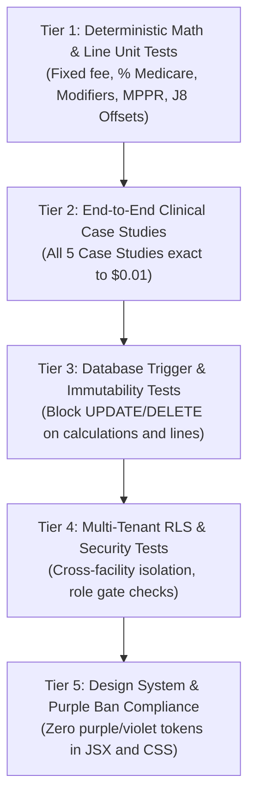

# PHASE 68 — QA AND ACCEPTANCE CRITERIA
## Comprehensive Test Plan, Verification Matrix & Definition of Done

> **Phase:** 68 — Expected Reimbursement Engine  
> **Author:** Principal QA Architect, Senior Test Automation Engineer  
> **Status:** QA SPECIFICATION & VERIFICATION MATRIX  
> **Target Version:** ASCANALYST v2026.1  

---

## 1. TEST SUITE ARCHITECTURE

The test harness for Phase 68 requires five rigorous test tiers:

---

## 2. DETAILED TEST CASES & VERIFICATION MATRIX

### 2.1 Tier 1: Deterministic Math & Line Unit Tests
- **TC-68-01: Fixed Fee Schedule Precision**
  - *Input:* CPT `29881` contracted at `$3,200.00`, 1 unit.
  - *Expected:* Line allowable = `$3,200.00`. Zero floating-point drift.
- **TC-68-02: Percent of Medicare with Wage Index**
  - *Input:* CPT `29827` (Unadjusted `$3,450.00`), CBSA `34940` (Wage Index `0.9412`), Multiplier `1.8000`.
  - *Expected:* Baseline = `$3,348.57`, Allowable = `$6,027.43`.
- **TC-68-03: J8 Device Offset Deduction**
  - *Input:* CPT `23430` (Medicare Baseline `$4,707.41`, J8 Device Offset `$2,100.00`), Multiplier `1.8000`, Rank 2 MPPR (50%).
  - *Expected:* Adjusted Base = `$2,607.41`, Allowable = `$2,346.67`. Prevents $4,316.95 double-dipping overpayment.
- **TC-68-04: Modifier 50 Bilateral Calculation**
  - *Input:* CPT `29881` ($3,200.00) with modifier 50, Bilateral factor 1.5000.
  - *Expected:* Line allowable = `$4,800.00`.
- **TC-68-05: Discontinued Procedure Modifiers 73 & 74**
  - *Input:* CPT `29881` with modifier 73 (pre-anesthesia); modifier 74 (post-anesthesia).
  - *Expected:* Modifier 73 allowable = `$1,600.00` (50%); modifier 74 allowable = `$3,200.00` (100%).
- **TC-68-06: MPPR Ranking and Cascade**
  - *Input:* Three surgical codes under `COM_STD_CASCADE` (100% / 50% / 25% / 0%).
  - *Expected:* Rank 1 at 100%, Rank 2 at 50%, Rank 3 at 25%, Rank 4+ at $0.00. Add-on codes (`+`) exempted.

---

### 2.2 Tier 2: End-to-End Clinical Scenarios (Target Tolerances: Exact to $0.01)
- **TC-68-07: Shoulder Arthroscopy with Implants (Case Study 1)**
  - *Gross Billed:* `$23,000.00`.
  - *Expected Contract Allowable:* **`$11,179.10`**.
  - *Estimated Patient Responsibility:* **`$3,035.82`**.
  - *Estimated Payer Reimbursement:* **`$8,143.28`**.
  - *Facility Acquisition Cost:* **`$5,175.00`**.
  - *Contribution Margin:* **`$6,004.10`** (53.7%).
- **TC-68-08: Commercial Knee Fee Schedule (Case Study 2)**
  - *Gross Billed:* `$11,700.00`.
  - *Expected Contract Allowable:* **`$4,100.00`** ($3,200 primary + $900 secondary).
  - *Estimated Payer Reimbursement:* **`$3,850.00`** (after $250 copay).
- **TC-68-09: Bilateral Knee Arthroscopy (Case Study 3)**
  - *Expected Contract Allowable:* **`$4,800.00`**.
- **TC-68-10: Cataract Case Rate with Toric IOL Upgrade (Case Study 4)**
  - *Expected Total Facility Collection:* **`$3,450.00`** ($2,150 payer + $1,300 patient).
- **TC-68-11: Catastrophic Stop-Loss Settlement (Case Study 5)**
  - *Gross Billed:* `$58,400.00` (exceeds $35,000 threshold).
  - *Expected Settlement Allowable:* **`$37,960.00`** (65.0% of billed charges). Status: `STOP_LOSS_APPLIED`.

---

### 2.3 Tier 3: Ledger Immutability & Database Triggers
- **TC-68-12: Direct Mutation Blocked**
  - *Action:* `UPDATE public.reimbursement_calculations SET total_contract_allowable = 99999 WHERE id = '...';`
  - *Expected:* Transaction aborted with `ERROR: Financial Ledger Violation: Calculation snapshot records are permanently immutable`.
- **TC-68-13: Deletion Blocked**
  - *Action:* `DELETE FROM public.reimbursement_calculations WHERE id = '...';`
  - *Expected:* Transaction aborted with `ERROR: Financial Ledger Violation`.
- **TC-68-14: Cryptographic Hash Verification**
  - *Action:* Execute `fn_verify_reimbursement_calculation_integrity(calc_id)`.
  - *Expected:* Returns `is_valid = TRUE`. If any row data is modified in test environment, returns `is_valid = FALSE` and flags tamper alert.

---

### 2.4 Tier 4: Security, Multi-Facility Tenancy & AI Governance
- **TC-68-15: Cross-Facility Tenant Isolation**
  - *Action:* User assigned to Facility A attempts to query calculation records belonging to Facility B.
  - *Expected:* 0 rows returned via RLS. Direct RPC invocation raises `Access Denied`.
- **TC-68-16: AI Analyst Tool Execution Bounds**
  - *Action:* AI Analyst queried for encounter financials.
  - *Expected:* AI reads existing calculation trace; AI does NOT generate unverified rates.

---

### 2.5 Tier 5: Design System Compliance (Strict Purple Ban)
- **TC-68-17: Maestro Color Token Scan**
  - *Action:* Grep new JSX and CSS files for `#7c3aed`, `#8b5cf6`, `#6366f1`, `#a855f7`, `purple`, `violet`, `indigo`.
  - *Expected:* 0 occurrences. 100% compliance with Slate/Emerald/Amber/Rose palette.

---

## 3. ACCEPTANCE CRITERIA & DEFINITION OF DONE

A phase is NOT complete because an interface renders. To reach **Definition of Done**, the implementation must satisfy:
1. **Build & Lint:** `npm run build` and `npm run lint` execute with 0 errors and 0 warnings.
2. **Automated Test Coverage:** 100% of test suites pass with 0 failures, 0 skipped.
3. **Mathematical Precision:** All 5 case study figures match expected allowable, patient share, and payer share to the exact penny ($0.01).
4. **Zero Fallback to Gross Charges:** Uncontracted encounters explicitly output `CONTRACT_NOT_FOUND` or `UNCONTRACTED_ERROR`.
5. **Ledger Immutability:** Triggers block client updates and deletions on all calculation tables.
6. **Design System:** Zero violation of the Maestro Strict Purple Ban.

