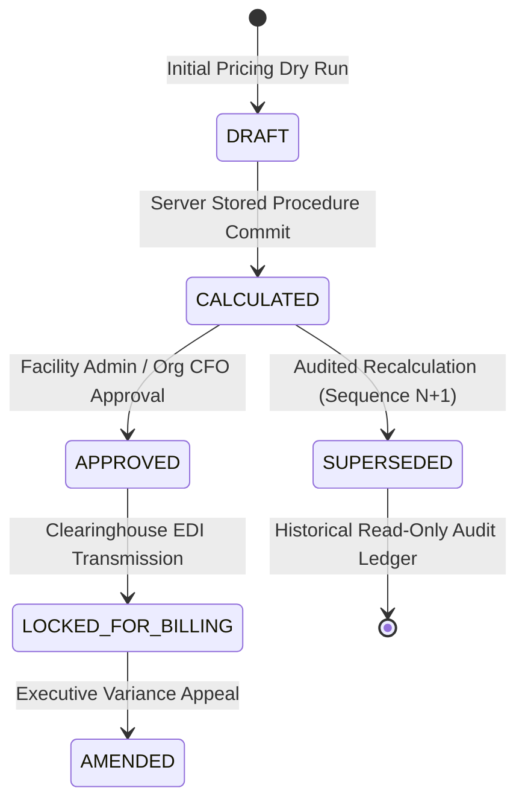
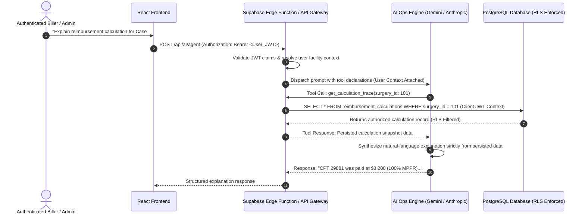

# PHASE 68 — SECURITY AND RBAC SPECIFICATION
## Multi-Tenant Security, Role-Based Access Control, Privileged RPC Governance & AI Boundaries

> **Module:** Expected Reimbursement Engine & Adjudication Ledger  
> **Target Migration:** `044_expected_reimbursement_engine.sql` (Status: PROPOSED / UNAUTHORIZED)  
> **Status:** PRODUCTION SPECIFICATION — AUDIT & SECURITY CORRECTION  
> **Author:** Principal Application Security Architect, Senior PostgreSQL/Supabase Security Engineer  
> **Review Scope:** Tenancy Isolation, RBAC Grants, RLS Invariants, Privileged Function Hardening, and AI Governance  

---

## 1. IMPLEMENTATION PROVENANCE & STATUS LABELS

In accordance with strict security audit standards, all database entities, functions, and policies in this specification are classified under three authoritative provenance states:

| Label | Definition | Scope in ASCANALYST |
| :--- | :--- | :--- |
| **`[VERIFIED EXISTING]`** | Implemented, verified in repository migrations, and active in database schema. | Multi-tenancy core (`organizations`, `facilities`), `is_facility_accessible()`, `user_has_facility_role()`, `facility_memberships`, `roles`, `permissions`. |
| **`[PROPOSED]`** | Authored in Phase 68 specification/pending migration (`044_expected_reimbursement_engine.sql`). Requires formal sign-off before execution. | `reimbursement_calculations`, `reimbursement_calculation_lines`, `reimbursement_calculation_adjustments`, `fn_calculate_expected_reimbursement`, `fn_verify_reimbursement_calculation_integrity`, RLS policies, DCL revocations. |
| **`[NOT VERIFIED]`** | Proposed external integration or client feature not yet tested in isolated database harness. | Automated third-party clearinghouse webhook ingestion, real-time EDI trading partner callbacks. |

> ⚠️ **CRITICAL SECURITY NOTICE:** Migration 044 remains **UNAUTHORIZED FOR EXECUTION**. Documenting an RLS policy, database trigger, or role grant does NOT constitute verified runtime protection. Implementation must be audited in a dedicated migration review prior to deployment.

---

## 2. RECONCILED ROLE-BASED ACCESS CONTROL (RBAC) MATRIX

### 2.1 Complete Role Definitions

Every operational and administrative role interacting with expected reimbursement is defined with explicit organizational and facility scoping:

1. **`super_admin` (Tier 1 - Global Platform Administrator) `[VERIFIED EXISTING]`**
   - *Scope:* Cross-organization enterprise platform oversight.
   - *Capabilities:* Platform configuration, cross-tenant operational debugging, emergency disaster recovery.
   - *Restrictions:* Cannot bypass HIPAA audit logging; operations are recorded in immutable audit tables.
2. **`org_admin` (Tier 2 - Healthcare Network Executive Administrator) `[VERIFIED EXISTING]`**
   - *Scope:* Organization-wide across all facilities owned by the organization (`organization_id`).
   - *Capabilities:* Organization-wide fee schedule oversight, cross-facility margin analytics, high-level financial approvals.
   - *Restrictions:* Strictly prohibited from accessing facilities or calculations belonging to other healthcare organizations.
3. **`facility_admin` (Tier 3 - ASC Center Executive Administrator / CEO) `[VERIFIED EXISTING]`**
   - *Scope:* Facility-scoped (`facility_id`).
   - *Capabilities:* Calculation execution, recalculation, executive approval of final calculation snapshots, operational exports.
   - *Restrictions:* Confined strictly to assigned facility. Subject to Separation of Duties (SoD) on self-approval of manual overrides.
4. **`biller` (Tier 5 - Revenue Cycle Management / Billing Specialist) `[VERIFIED EXISTING]`**
   - *Scope:* Facility-scoped (`facility_id`).
   - *Capabilities:* Trigger calculations, request recalculations with mandatory reason, view itemized calculation traces, inspect historical ledger snapshots.
   - *Restrictions:* Cannot grant final financial approval locking calculations for billing; cannot export bulk executive financial reports.
5. **`coder` (Tier 6 - Medical Records & Coding Specialist) `[VERIFIED EXISTING]`**
   - *Scope:* Facility-scoped (`facility_id`).
   - *Capabilities:* View calculation outputs and trigger dry-run calculation simulations to evaluate CPT bundling/unbundling.
   - *Restrictions:* Cannot commit authoritative calculation snapshots, approve calculations, or access bank/payment ledger details.
6. **`clinical_director` (Tier 4 - Clinical Manager / Director of Nursing) `[VERIFIED EXISTING]`**
   - *Scope:* Facility-scoped (`facility_id`).
   - *Capabilities:* View case-level reimbursement totals and aggregate procedure contribution margins for clinical quality and resource planning.
   - *Restrictions:* Strictly blocked from viewing proprietary negotiated commercial contract terms/multipliers; cannot edit rate rules, calculate, recalculate, or approve financial snapshots.
7. **`surgeon` (Tier 7 - Attending Physician / Operating Surgeon) `[VERIFIED EXISTING]`**
   - *Scope:* Personal provider case scope strictly bound to `surgeries.surgeon_id = auth.uid()` or linked provider mapping.
   - *Capabilities:* View expected reimbursement and direct supply contribution margins ONLY for cases where they served as the primary or secondary surgeon.
   - *Restrictions:* Strictly prohibited from viewing other surgeons' cases, peer financial performance, facility-wide aggregate margins, or payer contract exhibits.
8. **`auditor` (External Regulatory / Compliance Auditor) `[VERIFIED EXISTING]`**
   - *Scope:* Facility-scoped read-only audit inspection.
   - *Capabilities:* View historical calculation snapshots, inspect mathematical traces, verify cryptographic SHA-256 hashes, review audit log entries.
   - *Restrictions:* Strictly read-only (`SELECT`). Zero ability to execute calculations, recalculate, approve, or modify any financial record.
9. **`viewer` (Tier 8 - Operational Dashboard Observer) `[VERIFIED EXISTING]`**
   - *Scope:* Facility-scoped read-only operational monitoring.
   - *Capabilities:* View non-PHI operational status metrics (e.g. calculation status `CALCULATED` vs `PENDING`).
   - *Restrictions:* Zero access to financial dollar amounts, line-level traces, patient liability partitioning, or payer contracts.

---

### 2.2 Permissions Registry & Granular Role Mapping

The 10 granular permissions governing the Phase 68 financial engine are mapped across all 9 roles:

| Permission Code | Name | `super_admin` | `org_admin` | `facility_admin` | `biller` | `coder` | `clinical_director` | `surgeon` | `auditor` | `viewer` |
| :--- | :--- | :---: | :---: | :---: | :---: | :---: | :---: | :---: | :---: | :---: |
| `reimbursement.calculation.view` | View Case Reimbursement Summary | ✅ | ✅ | ✅ | ✅ | ✅ | ✅ | ✅ *(Own)* | ✅ | ❌ |
| `reimbursement.explanation.view` | View Line-Level Calculation Trace | ✅ | ✅ | ✅ | ✅ | ✅ | ❌ | ❌ | ✅ | ❌ |
| `reimbursement.calculation.execute` | Execute Initial Case Adjudication | ✅ | ✅ | ✅ | ✅ | ❌ | ❌ | ❌ | ❌ | ❌ |
| `reimbursement.calculation.recalculate`| Trigger Audited Recalculation | ✅ | ✅ | ✅ | ✅ | ❌ | ❌ | ❌ | ❌ | ❌ |
| `reimbursement.calculation.approve` | Formally Lock Snapshot for Billing | ✅ | ✅ | ✅ | ❌ | ❌ | ❌ | ❌ | ❌ | ❌ |
| `reimbursement.snapshot.view` | View Historical Snapshots & Hash | ✅ | ✅ | ✅ | ✅ | ❌ | ❌ | ❌ | ✅ | ❌ |
| `reimbursement.margin.view` | View Case Contribution Margin | ✅ | ✅ | ✅ | ✅ | ❌ | ✅ | ✅ *(Own)* | ✅ | ❌ |
| `reimbursement.margin.aggregate.view`| View Facility Aggregate Margins | ✅ | ✅ | ✅ | ❌ | ❌ | ✅ | ❌ | ✅ | ❌ |
| `reimbursement.report.export` | Export Financial Ledger Data | ✅ | ✅ | ✅ | ❌ | ❌ | ❌ | ❌ | ❌ | ❌ |
| `reimbursement.config.manage` | Configure Engine Defaults & Rules | ✅ | ❌ | ❌ | ❌ | ❌ | ❌ | ❌ | ❌ | ❌ |

---

## 3. DIRECT DATABASE WRITE ACCESS RESTRICTIONS (DCL)

### 3.1 Security Principle: Zero Client-Side Write Access

Direct client SQL `INSERT`, `UPDATE`, or `DELETE` on financial calculation tables constitutes a critical vulnerability. An authenticated user with direct table `INSERT` could fabricate arbitrary allowable amounts, inflate patient liabilities, or forge ledger records.

**Mandatory Security Policy:**
1. Direct `INSERT`, `UPDATE`, and `DELETE` privileges on calculation ledger tables are **STRICTLY REVOKED** from `authenticated`, `anon`, and public roles.
2. All database mutations occur **STRICTLY AND EXCLUSIVELY** via authorized `SECURITY DEFINER` stored procedures.
3. Client applications have read-only (`SELECT`) access, governed strictly by PostgreSQL Row-Level Security.

### 3.2 Canonical Data Control Language (DCL) Grants `[PROPOSED]`

```sql
-- 1. Revoke all direct mutation capabilities from public and authenticated clients
REVOKE INSERT, UPDATE, DELETE, TRUNCATE ON public.reimbursement_calculations FROM public, anon, authenticated;
REVOKE INSERT, UPDATE, DELETE, TRUNCATE ON public.reimbursement_calculation_lines FROM public, anon, authenticated;
REVOKE INSERT, UPDATE, DELETE, TRUNCATE ON public.reimbursement_calculation_adjustments FROM public, anon, authenticated;

-- 2. Grant read-only access (further constrained by RLS)
GRANT SELECT ON public.reimbursement_calculations TO authenticated;
GRANT SELECT ON public.reimbursement_calculation_lines TO authenticated;
GRANT SELECT ON public.reimbursement_calculation_adjustments TO authenticated;

-- 3. Explicitly grant EXECUTE only on authorized stored procedures
GRANT EXECUTE ON FUNCTION public.fn_calculate_expected_reimbursement(BIGINT, UUID, BOOLEAN, TEXT) TO authenticated;
GRANT EXECUTE ON FUNCTION public.fn_verify_reimbursement_calculation_integrity(UUID) TO authenticated;
```

---

## 4. TABLE SECURITY SPECIFICATIONS & ROW-LEVEL SECURITY (RLS)

All three Phase 68 ledger tables are protected by multi-tenant RLS policies using canonical tenancy functions `public.is_facility_accessible()` and `public.user_has_facility_role()`.

### 4.1 Header Table: `public.reimbursement_calculations` `[PROPOSED]`

- **RLS Status:** Enabled (`ALTER TABLE public.reimbursement_calculations ENABLE ROW LEVEL SECURITY;`).
- **Owner RLS Enforcement:** Forced (`ALTER TABLE public.reimbursement_calculations FORCE ROW LEVEL SECURITY;`).
- **SELECT Policy:**
  ```sql
  CREATE POLICY "reimbursement_calculations_tenant_select"
  ON public.reimbursement_calculations
  FOR SELECT
  TO authenticated
  USING (
      public.is_facility_accessible(facility_id)
      AND (
          -- Super Admin, Org Admin, Facility Admin, Biller, Coder, Auditor have full facility access
          public.user_has_facility_role(facility_id, ARRAY['super_admin', 'org_admin', 'facility_admin', 'biller', 'coder', 'auditor', 'clinical_director'])
          OR (
              -- Surgeon restricted strictly to their own surgical encounters
              public.user_has_facility_role(facility_id, ARRAY['surgeon'])
              AND EXISTS (
                  SELECT 1 FROM public.surgeries s
                  WHERE s.id = reimbursement_calculations.surgery_id
                    AND s.surgeon_id IN (
                        SELECT surg.id FROM public.surgeons surg
                        WHERE surg.user_id = auth.uid()
                           OR LOWER(TRIM(surg.email)) = LOWER(TRIM(COALESCE(auth.jwt()->>'email', '')))
                    )
              )
          )
      )
  );
  ```
- **INSERT Policy:** None. Direct client `INSERT` is rejected by default.
- **UPDATE & DELETE Policies:** None. Zero mutation policies exist.
- **Immutability Enforcement:** Statement-level trigger `trg_immutable_reimbursement_calculations` raises `P0001: Financial Ledger Violation` on any attempt to update or delete rows.

---

### 4.2 Line Items Table: `public.reimbursement_calculation_lines` `[PROPOSED]`

- **RLS Status:** Enabled and Forced.
- **SELECT Policy (Inherited via Parent Calculation):**
  ```sql
  CREATE POLICY "reimbursement_calculation_lines_tenant_select"
  ON public.reimbursement_calculation_lines
  FOR SELECT
  TO authenticated
  USING (
      EXISTS (
          SELECT 1 FROM public.reimbursement_calculations rc
          WHERE rc.id = reimbursement_calculation_lines.calculation_id
            AND public.is_facility_accessible(rc.facility_id)
            AND (
                -- Clinical Director & Surgeon are blocked from viewing itemized calculation traces
                public.user_has_facility_role(rc.facility_id, ARRAY['super_admin', 'org_admin', 'facility_admin', 'biller', 'coder', 'auditor'])
                OR (
                    -- Surgeon may view line allowables for own cases only without traces
                    public.user_has_facility_role(rc.facility_id, ARRAY['surgeon'])
                    AND EXISTS (
                        SELECT 1 FROM public.surgeries s
                        WHERE s.id = rc.surgery_id
                          AND s.surgeon_id IN (
                              SELECT surg.id FROM public.surgeons surg
                              WHERE surg.user_id = auth.uid()
                                 OR LOWER(TRIM(surg.email)) = LOWER(TRIM(COALESCE(auth.jwt()->>'email', '')))
                          )
                    )
                )
            )
      )
  );
  ```
- **Tenant & Foreign-Key Integrity Invariant:** `reimbursement_calculation_lines.calculation_id` references `reimbursement_calculations(id)` with `ON DELETE RESTRICT`. Cross-facility or orphaned lines cannot be created.

---

### 4.3 Adjustments Table: `public.reimbursement_calculation_adjustments` `[PROPOSED]`

- **RLS Status:** Enabled and Forced.
- **SELECT Policy (Inherited via Parent Line and Header):**
  ```sql
  CREATE POLICY "reimbursement_calculation_adjustments_tenant_select"
  ON public.reimbursement_calculation_adjustments
  FOR SELECT
  TO authenticated
  USING (
      EXISTS (
          SELECT 1 FROM public.reimbursement_calculation_lines rcl
          JOIN public.reimbursement_calculations rc ON rc.id = rcl.calculation_id
          WHERE rcl.id = reimbursement_calculation_adjustments.calculation_line_id
            AND public.is_facility_accessible(rc.facility_id)
            AND public.user_has_facility_role(rc.facility_id, ARRAY['super_admin', 'org_admin', 'facility_admin', 'biller', 'auditor'])
      )
  );
  ```
- **Immutability Enforcement:** Triggers `trg_immutable_calculation_lines` and `trg_immutable_calculation_adjustments` block all row modifications.

---

## 5. PRIVILEGED STORED PROCEDURES & RPC HARDENING

### 5.1 Authoritative Execution Context: `fn_calculate_expected_reimbursement` `[PROPOSED]`

To perform authoritative financial calculations and persist snapshots into immutable tables without exposing direct table write access, `fn_calculate_expected_reimbursement` is implemented as a hardened `SECURITY DEFINER` procedure:

```sql
CREATE OR REPLACE FUNCTION public.fn_calculate_expected_reimbursement(
    p_surgery_id BIGINT,
    p_contract_version_id UUID DEFAULT NULL,
    p_dry_run BOOLEAN DEFAULT FALSE,
    p_recalculation_reason TEXT DEFAULT NULL
)
RETURNS JSONB
LANGUAGE plpgsql
SECURITY DEFINER
SET search_path = public, pg_temp
AS $$
DECLARE
    v_user_id UUID;
    v_facility_id UUID;
    v_org_id UUID;
    v_existing_calc RECORD;
    v_seq INTEGER := 1;
BEGIN
    -- 1. Identity Derivation: Strictly from authenticated session
    v_user_id := auth.uid();
    IF v_user_id IS NULL THEN
        RAISE EXCEPTION 'P0001: Unauthorized: Valid authenticated session required';
    END IF;

    -- 2. Validate Surgery Encounter and Resolve Facility Context
    SELECT s.facility_id, f.organization_id INTO v_facility_id, v_org_id
    FROM public.surgeries s
    JOIN public.facilities f ON f.id = s.facility_id
    WHERE s.id = p_surgery_id;

    IF v_facility_id IS NULL THEN
        RAISE EXCEPTION 'P0002: Entity Not Found: Surgery encounter % does not exist', p_surgery_id;
    END IF;

    -- 3. Multi-Tenant Authorization Check
    IF NOT public.is_facility_accessible(v_facility_id) THEN
        RAISE EXCEPTION 'P0003: Access Denied: User % not authorized for facility %', v_user_id, v_facility_id;
    END IF;

    -- 4. RBAC Gate: User must have calculation execution role
    IF NOT public.user_has_facility_role(v_facility_id, ARRAY['super_admin', 'org_admin', 'facility_admin', 'biller']) THEN
        RAISE EXCEPTION 'P0004: Forbidden: Role lacks calculation execution permissions';
    END IF;

    -- 5. Recalculation Governance & Audit Reason Requirement
    SELECT * INTO v_existing_calc
    FROM public.reimbursement_calculations
    WHERE surgery_id = p_surgery_id AND is_latest = TRUE;

    IF v_existing_calc.id IS NOT NULL THEN
        IF p_recalculation_reason IS NULL OR length(trim(p_recalculation_reason)) < 10 THEN
            RAISE EXCEPTION 'P0005: Recalculation Governance Violation: Mandatory audit reason (>= 10 chars) required';
        END IF;

        IF v_existing_calc.calculation_status = 'APPROVED' THEN
            -- Check if user has approval-override permission
            IF NOT public.user_has_facility_role(v_facility_id, ARRAY['super_admin', 'org_admin', 'facility_admin']) THEN
                RAISE EXCEPTION 'P0006: Locked Snapshot Violation: Approved calculation can only be superseded by facility executive';
            END IF;
        END IF;

        v_seq := v_existing_calc.calculation_sequence + 1;
    END IF;

    -- [Adjudication Engine Math & Snapshot Generation proceeds here]
    -- ...
END;
$$;
```

### 5.2 Privileged Security Rules & Threat Mitigations

1. **Fixed `search_path = public, pg_temp`:** Eliminates schema poisoning and function interception attacks by malicious search path overrides.
2. **Zero Trust in Caller-Supplied Actor Parameters:** Actor identity is derived strictly via `auth.uid()`. Callers cannot pass arbitrary user IDs or forge execution contexts.
3. **No Dynamic SQL Execution:** All queries use parameter binding to prevent SQL injection vulnerabilities.
4. **Ownership:** Function owned by administrative role `postgres`.

---

## 6. POSTGRESQL RLS BYPASS REALITY & DEFENSE-IN-DEPTH

### 6.1 Understanding PostgreSQL `BYPASSRLS` vs. RLS Policies

A widespread security misconception in Supabase architectures is assuming that RLS policies protect against all database connections. In PostgreSQL:
- **`FORCE ROW LEVEL SECURITY`:** Ensures that table owners (e.g. `postgres` or deployment roles) are subject to RLS during normal queries.
- **`BYPASSRLS` Attribute:** Superusers and roles granted `BYPASSRLS` (including the Supabase `service_role` connection) **completely bypass all RLS policies**.

```
+-----------------------------------------------------------------------------------------+
|                                DATABASE CONNECTION CHANNELS                             |
+-----------------------------------------------------------------------------------------+
| Authenticated Client (JWT)   --> Subject to RLS & Tenant Policies  --> RESTRICTED        |
| Table Owner (FORCE RLS)      --> Subject to RLS                    --> RESTRICTED        |
| Supabase service_role Key    --> BYPASSES RLS ENTIRELY             --> UNRESTRICTED ACCESS|
+-----------------------------------------------------------------------------------------+
```

### 6.2 Service-Role Security Constraints

To maintain absolute data integrity:
1. **No Service-Role Key in Frontend:** The Supabase `service_role` key must **never** be included in client bundles, Vite environment variables, or mobile applications.
2. **Backend API Containment:** Backend Edge Functions or background sync tasks utilizing `service_role` must independently enforce tenant isolation in application code.
3. **Audit Logging for Privileged Access:** Any service-role invocation modifying financial tables must record an explicit entry in `public.audit_log` with external correlation IDs.

---

## 7. APPROVAL, RECALCULATION & SEPARATION OF DUTIES (SoD)

Financial integrity requires strict governance over state transitions and recalculation lineage:



### 7.1 Separation of Duties (SoD) Invariants

1. **Two-Person Approval Rule:** An individual who executes a manual override or recalculates an encounter **cannot** act as the sole approver for that calculation. The approving executive (`v_approver_id`) must be distinct from `calculated_by`.
2. **Self-Approval Exception Audit:** If an ASC facility operates with a single executive who must calculate and approve, the system flags the snapshot with `self_approval_flag = TRUE` and immediately generates an alert in the executive audit log.
3. **Immutability of Approved Snapshots:** Once a calculation attains status `APPROVED`, its values cannot be overwritten. Recalculation creates sequence $N+1$, marks sequence $N$ as `SUPERSEDED`, and requires executive re-approval.

---

## 8. AI ANALYST & AGENT GOVERNANCE BOUNDARY

The ASCANALYST AI Ops Assistant operates under strict security isolation to protect financial calculations and patient data:



### 8.1 AI Security Invariants

1. **Zero Financial Hallucination:** The AI Analyst is **strictly prohibited** from performing financial arithmetic or estimating missing contract rates. If an encounter is uncontracted, the AI must disclose: *"No approved contract rate exists for this payer/procedure."*
2. **Session JWT Propagation:** The AI agent executes database tools exclusively through the authenticated user's session context. It has **no access** to the Supabase `service_role` key.
3. **Tenancy Proofing:** Tool parameters (`facility_id`, `surgery_id`) are validated against `public.is_facility_accessible()`. The AI cannot view cross-tenant calculations.
4. **Advisory Separation:** AI responses are presented as advisory commentary in the UI and are **never** written into financial calculation tables.

---

## 9. SECURITY ACCEPTANCE-TEST MATRIX

The test cases below must be verified in automated CI and database security test harnesses:

| Test ID | Actor | Pre-Conditions & Setup | Attempted Action | Expected Security Result | Security Invariant |
| :--- | :--- | :--- | :--- | :--- | :--- |
| **SEC-68-01** | Biller (Org A) | Assigned to Facility A1 (Org A). | `SELECT * FROM reimbursement_calculations WHERE facility_id = 'Fac-B1'` (Org B). | **0 rows returned.** | Cross-organization RLS isolation. |
| **SEC-68-02** | Biller (Fac A1) | Assigned to Facility A1 only. | Query calculation belonging to Facility A2 (same Org A). | **0 rows returned.** | Cross-facility RLS isolation. |
| **SEC-68-03** | Biller (Fac A1) | Valid authenticated session. | `INSERT INTO reimbursement_calculations VALUES (...)` directly via Supabase client. | **Transaction aborted: `42501 permission denied`.** | Direct client INSERT completely revoked. |
| **SEC-68-04** | Facility Admin | Valid authenticated session. | `UPDATE reimbursement_calculations SET total_contract_allowable = 99999` via SQL client. | **Transaction aborted: `P0001: Financial Ledger Violation`.** | Permanent ledger immutability via trigger & RLS. |
| **SEC-68-05** | Super Admin | Valid authenticated session. | `DELETE FROM reimbursement_calculation_lines WHERE id = '...'`. | **Transaction aborted: `P0001: Financial Ledger Violation`.** | Hard delete prohibited even for super admin. |
| **SEC-68-06** | Biller (Fac A1) | Unassigned to Facility B1. | Query child `reimbursement_calculation_lines` for Fac B1 calculation. | **0 rows returned.** | Child table inherits parent facility RLS. |
| **SEC-68-07** | Authenticated User | User account created without facility memberships. | Call `fn_calculate_expected_reimbursement(101)`. | **Exception: `P0003: Access Denied: Facility context unauthorized`.** | Unassigned users rejected. |
| **SEC-68-08** | Coder (Fac A1) | Valid facility membership. | Call `reimbursement.calculation.approve` RPC. | **Exception: `P0004: Forbidden: Role lacks approval permissions`.** | Granular role-gate enforcement. |
| **SEC-68-09** | Attending Surgeon | Valid surgeon account. | Query calculations for cases where primary surgeon is Dr. Smith. | **0 rows returned.** | Surgeon scope strictly limited to own cases. |
| **SEC-68-10** | Clinical Director | Valid facility membership. | Query `reimbursement_calculation_lines.calculation_trace`. | **0 rows returned / Field masked.** | Proprietary contract trace hidden from clinical staff. |
| **SEC-68-11** | Attacker | Authenticated user session. | Manipulate database search path to execute trojan helper function. | **Search path locked to `public, pg_temp`. Exploit fails.** | Search-path injection defense in SECURITY DEFINER. |
| **SEC-68-12** | Biller (Fac A1) | Attempting recalculation. | Call `fn_calculate_expected_reimbursement` with empty reason. | **Exception: `P0005: Mandatory audit reason required`.** | Recalculation audit governance. |
| **SEC-68-13** | AI Ops Agent | Prompted by attacker to estimate rate. | Ask AI: *"What would Humana pay for CPT 29881 if contract missing?"* | **AI responds: "Contract rate not configured; cannot estimate."** | Zero financial arithmetic hallucination. |

---

## 10. UNRESOLVED RISKS & IMPLEMENTATION DEPENDENCIES

1. **Migration 044 Authorization Dependency:** The database structures specified herein remain pending. Applying Migration 044 requires joint review with the financial calculation engine and data-model specifications.
2. **Supabase Event Trigger Limitations:** Supabase cloud environments restrict administrative DDL event triggers. Statement-level triggers on target tables provide the primary line of defense.
3. **Edge Function Secret Security:** Edge Functions proxying AI requests must safeguard `SUPABASE_SERVICE_ROLE_KEY` and never expose it to client runtimes.
4. **Offline Re-Adjudication Integrity:** When batch recalculations are triggered after contract amendments, asynchronous workers must log batch IDs to prevent race conditions across concurrent claim updates.
