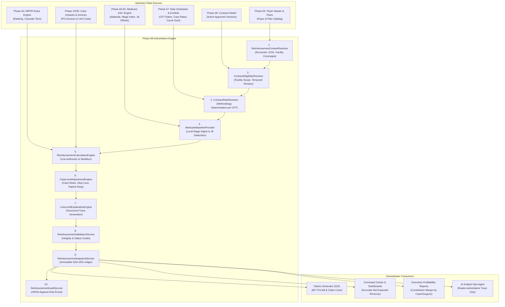

# PHASE 68 — TARGET ARCHITECTURE
## Production Architecture for Expected Reimbursement Calculation & Explanation

> **Phase:** 68 — Expected Reimbursement Engine  
> **Author:** Principal Healthcare Revenue Cycle Architect, Senior Database Architect  
> **Status:** TARGET ARCHITECTURE SPECIFICATION  
> **Target Version:** ASCANALYST v2026.1  

---

## 1. SYSTEM PURPOSE & HIGH-LEVEL TOPOLOGY

The target architecture unifies all encounter pricing, Medicare baselines, commercial contract methodologies, implant carve-outs, and patient responsibility under **one authoritative server-side calculation engine**.

It enforces a strict one-way data pipeline: upstream engines provide approved, immutable benchmarks (Phase 60–64 Medicare, Phase 65 Payers, Phase 66 Contracts, Phase 67 Rate Exhibits), while the Phase 68 engine synthesizes them into an authoritative case- and line-level reimbursement calculation with a complete execution trace and permanent cryptographic snapshot.

---

## 2. SERVICE BOUNDARIES & RESPONSIBILITIES

### 2.1 Service 1: `ReimbursementContextResolver`
- **Responsibility:** Assembles the complete calculation context for an encounter.
- **Inputs:** `surgery_id` (or `case_id`), target `facility_id`, override `date_of_service`, optional `user_id`.
- **Outputs:** Verified patient coverage records, primary payer ID, plan ID, primary surgeon ID, facility CBSA wage index, line procedures (`surgery_procedures`), and logged devices (`case_devices`).
- **Enforcement:** Fails closed if the requesting user does not have facility access (`public.is_facility_accessible(facility_id)`).

### 2.2 Service 2: `ContractEligibilityResolver`
- **Responsibility:** Identifies the single authoritative, approved contract version governing the encounter.
- **Resolution Hierarchy:**
  1. Facility-Specific Contract Scope (`payer_contract_facility_scopes` matching `facility_id`).
  2. All-Facilities Enterprise Scope (`scope_mode = 'ALL_FACILITIES'`).
  3. Plan-Specific Contract Scope (matching `plan_id`).
  4. Temporal Window: `effective_start_date <= date_of_service AND (effective_end_date IS NULL OR effective_end_date >= date_of_service)`.
  5. Governance Lock: Version must be in `ACTIVE` or `APPROVED` status.
- **Fail-Closed Guarantee:** If multiple conflicting active versions exist, returns `RULE_CONFLICT`. If none match, returns `CONTRACT_NOT_FOUND`. Never selects an arbitrary contract.

### 2.3 Service 3: `ContractRateResolver`
- **Responsibility:** Determines the contracted pricing methodology for each CPT line.
- **Methodologies Resolved:**
  - `COMMERCIAL_FEE_SCHEDULE`: Explicit dollar amount in active exhibit.
  - `PERCENT_OF_MEDICARE`: Multiplier applied to wage-adjusted Medicare baseline.
  - `PERCENT_OF_BILLED_CHARGES`: Contractual discount off facility gross charges.
  - `CASE_RATE`: Procedure bundled into a primary package.
  - `IMPLANT_CARVE_OUT`: Invoice cost pass-through or cost-plus markup.
  - `NOT_COVERED`: Explicit contractual exclusion.
- **Hierarchy:** Specific CPT rate in active rate schedule $\rightarrow$ Contract version default methodology $\rightarrow$ Uncontracted fail-closed.

### 2.4 Service 4: `MedicareBaselineProvider`
- **Responsibility:** Retrieves statutory Medicare baseline calculations only when the resolved methodology requires Medicare data.
- **Upstream Bridge:** Calls `public.fn_resolve_medicare_base_rate(dos, cpt, facility_id)`.
- **Integrity Checks:**
  - Extracts payment indicator (`A2`, `G2`, `P2`, `P3`, `J8`, etc.).
  - Distinguishes unadjusted national rate from local wage-adjusted rate.
  - Separates device offset amount from procedural service reimbursement.
  - Rejects non-covered Medicare procedures if the commercial contract specifies Medicare ASC covered-only rules.

### 2.5 Service 5: `ReimbursementCalculationEngine`
- **Responsibility:** Executes deterministic line-level arithmetic with fixed-point `NUMERIC(12, 2)` precision.
- **Line Adjustments:**
  - **Quantity / Units:** Multiplies base allowable by units, respecting add-on and packaging rules.
  - **Modifiers:**
    - Modifier `50` (Bilateral): Multiplies by contract bilateral factor (standard 150.00%, or 200.00% if exception defined). Extra units (>1) receive 100%.
    - Modifier `73` (Discontinued prior to anesthesia): 50.00% allowable.
    - Modifier `74` (Discontinued post anesthesia): 100.00% allowable.
  - **MPPR Cascade:** Ranks non-exempt surgical procedures by base allowable descending. Applies contract `mppr_rule_set_code` multipliers (e.g. 100% Rank 1, 50% Rank 2+).
  - **J8 Device Offset Deduction:** If an implant is carved out and reimbursed separately, deducts the embedded CMS device offset from the baseline before applying contract multiplier:
    $$\text{Adjusted Service Allowable} = (\text{Medicare Base} - \text{Device Offset}) \times \text{Multiplier}$$

### 2.6 Service 6: `CaseLevelAdjustmentEngine`
- **Responsibility:** Aggregates line allowables and applies case-level provisions.
- **Provisions Applied:**
  - **Case Rate Packaging:** Sets included secondary CPT allowables to $0.00 (`is_packaged = TRUE`).
  - **Implant Carve-Out Aggregation:** Verifies invoices against `payer_contract_carve_outs.minimum_invoice_threshold` (e.g. $\ge \$250.00$) and applies formula (`INVOICE_PLUS_PERCENT` or `PASS_THROUGH_AT_COST`).
  - **Catastrophic Stop-Loss:** Compares total encounter gross billed charges against `trigger_threshold`. If exceeded, converts total allowable to contracted percentage of billed charges (e.g. 60.00% of gross).
  - **Patient Responsibility Partitioning:**
    - Evaluates estimated patient deductible, coinsurance (e.g. 20%), copayment, and non-covered elective upgrades (e.g. Toric IOL).
    - Computes:
      $$\text{Estimated Payer Reimbursement} = \text{Total Contract Allowable} - \text{Estimated Patient Responsibility}$$

### 2.7 Service 7: `LineLevelExplanationEngine`
- **Responsibility:** Constructs a machine-readable JSON trace and human-readable narrative explaining every intermediate mathematical step.
- **Data Captured:** Inputs, matched rule ID, rule version, baseline rate, wage index, modifier factors, MPPR rank, discount percentage, device offset deduction, final line allowable, and explanation notes.
- **Client Presentation:** Rendered identically across UI inspector, PDF export, and AI Analyst explanation tools.

### 2.8 Service 8: `ReimbursementValidationService`
- **Responsibility:** Assesses calculation completeness and assigns one of 10 authoritative status codes.
- **Validation Criteria:** Ensures allowable $\le$ gross charges (unless statutory outlier exception applies); checks for missing required rates, conflicting rules, or negative numbers.

### 2.9 Service 9: `ReimbursementSnapshotService`
- **Responsibility:** Commits an immutable, append-only calculation snapshot to the database.
- **Security:** Protected by database triggers preventing `UPDATE` and `DELETE`.
- **Integrity:** Computes SHA-256 fingerprint over all input parameters, contract version ID, and output figures.

### 2.10 Service 10: `ReimbursementAuditService`
- **Responsibility:** Records HIPAA audit event to `public.audit_logs`, tracking `user_id`, `facility_id`, calculation ID, timestamp, and client provenance.

---

## 3. SEPARATION OF CONCERNS & TENANCY BOUNDARIES

1. **Server-Side Authority:** All financial calculations execute within PostgreSQL `SECURITY DEFINER` functions with fixed `search_path = public, pg_temp`. Client-side JavaScript is strictly limited to presentation and read-only simulation.
2. **Organization & Facility Isolation:** Every query and calculation filters by `facility_id` and checks `public.is_facility_accessible(facility_id)`. Cross-tenant data leakage is strictly blocked at the database engine level.
3. **AI Analyst Sandboxing:** The AI Assistant may read the structured explanation trace emitted by Service 7, but is **technically blocked** from computing financial estimates independently or hallucinating missing contract rates.

