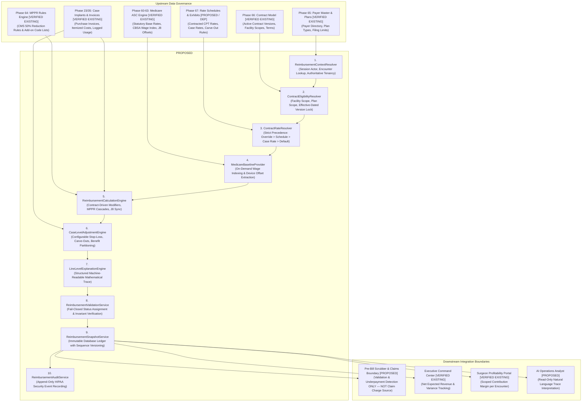
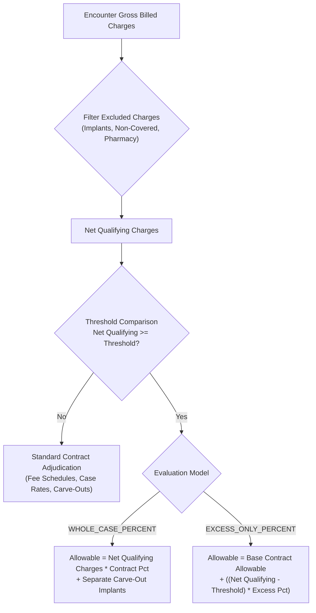
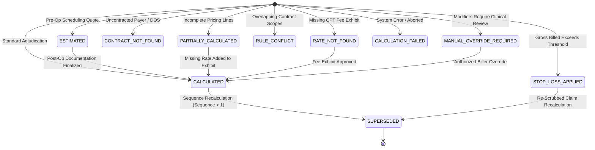

# PHASE 68 — TARGET ARCHITECTURE SPECIFICATION
## Authoritative Architecture for Commercial Rate Adjudication, Contract Rules, and Financial Ledger Integrity

> **Module:** Expected Reimbursement Engine & Rate Adjudication  
> **Target Migration:** `044_expected_reimbursement_engine.sql` (Status: PROPOSED / UNAUTHORIZED)  
> **Status:** ARCHITECTURE SPECIFICATION ONLY — UNAUTHORIZED MIGRATION / DESIGN STAGE  
> **Author:** Principal Healthcare Revenue Cycle Architect, PostgreSQL Architect, Application Security Architect  
> **Review Scope:** System Topology, Contract-Specific Rules, Stop-Loss Architecture, Patient/Payer Responsibility Separation, Tenancy Security, Claims-Generation Boundary, and Immutability Governance  

---

## 1. IMPLEMENTATION PROVENANCE & STRICT GOVERNANCE NOTICE

In accordance with strict healthcare financial engineering and application security standards, all components, tables, services, and policies in this architecture specification are labeled with one of three explicit provenance states:

| Provenance Label | Architectural Definition | Current System Scope |
| :--- | :--- | :--- |
| **`[VERIFIED EXISTING]`** | Implemented, verified in repository migrations, and active in schema. | Core tenancy (`organizations`, `facilities`), `is_facility_accessible()`, `user_has_facility_role()`, `surgeries`, `patients`, `surgeons`, `payer_master` (Phase 65), `payer_contracts` (Phase 66). |
| **`[PROPOSED]`** | Authored in Phase 68 specification or pending migrations (`043_payer_contract_rate_rules.sql`, `044_expected_reimbursement_engine.sql`). Requires explicit approval prior to deployment. | `reimbursement_calculations`, `reimbursement_calculation_lines`, `reimbursement_calculation_adjustments`, `fn_calculate_expected_reimbursement`, 10-service pipeline, RLS policies, DCL write revocations. |
| **`[NOT VERIFIED]`** | External integration, mock client interface, or workflow not yet verified in isolated database test harnesses. | Real-time clearinghouse EDI 270/271 eligibility callbacks, automated 835 ERA remittance reconciliation. |

> ⚠️ **CRITICAL ARCHITECTURAL DIRECTIVE:**  
> 1. **Migration 044 remains UNAUTHORIZED FOR DEPLOYMENT.**  
> 2. Documenting an architecture, schema, or stored procedure does **NOT** constitute production readiness or runtime deployment.  
> 3. Phase 67 (`043_payer_contract_rate_rules.sql`) is a mandatory upstream **approval and deployment dependency**.  
> 4. Financial calculations must never rely on client-side code, unverified defaults, or client-supplied actor identities.

---

## 2. HIGH-LEVEL TOPOLOGY & DATA FLOW PIPELINE

The Phase 68 Target Architecture unifies encounter procedural data, fee schedules, commercial contract multipliers, implant carve-outs, and patient benefit structures into an **authoritative, server-side, fail-closed financial adjudication engine**.



---

## 3. SERVICE RESPONSIBILITY & INPUT/OUTPUT MATRIX

Each service in the Phase 68 pipeline operates with strict input validation, fail-closed boundaries, and explicit separation of duties:

| Service | Architectural Responsibility | Authoritative Inputs | Authoritative Outputs | Failure / Error Modes | Provenance |
| :--- | :--- | :--- | :--- | :--- | :--- |
| **1. ReimbursementContextResolver** | Resolves encounter, validates tenant access, and derives actor identity from session. | `p_surgery_id` (BIGINT), session context `auth.uid()`. | Validated `facility_id`, `organization_id`, `date_of_service`, `patient_id`, `payer_id`, procedures, implants. | `ENCOUNTER_NOT_FOUND`, `42501: Access Denied` (tenant violation). | `[PROPOSED]` |
| **2. ContractEligibilityResolver** | Resolves the single governing commercial contract version for facility and DOS. | `facility_id`, `payer_id`, `date_of_service`, optional `plan_id`. | `contract_id`, `contract_version_id`, `contract_title`, `default_methodology`, `mppr_rule_set_code`. | `CONTRACT_NOT_FOUND` (no active scope), `RULE_CONFLICT` (overlapping active scopes). | `[PROPOSED]` |
| **3. ContractRateResolver** | Evaluates contracted pricing methodology per procedure line using strict hierarchy. | `contract_version_id`, `cpt_code`, `modifiers`, line gross charge. | Line pricing methodology (`COMMERCIAL_FEE_SCHEDULE`, `%_MEDICARE`, etc.), negotiated base rate, multiplier. | `RATE_NOT_FOUND` (unpriced code), `UNSUPPORTED_METHODOLOGY`. | `[PROPOSED]` |
| **4. MedicareBaselineProvider** | Bridges to Phase 60–63 statutory engines only when methodology requires Medicare data. | `cpt_code`, `date_of_service`, `facility_id`. | Unadjusted base rate, CBSA wage index, wage-adjusted rate, payment indicator, CMS device offset. | `MEDICARE_BASELINE_NOT_FOUND`, `CBSA_NOT_CONFIGURED`. | `[PROPOSED]` |
| **5. ReimbursementCalculationEngine** | Applies contract-specific modifier rules, MPPR reductions, and J8 device offset deductions. | Procedures, base rates, contract modifier rules, contract MPPR rules. | Line allowable before case-level packaging/stop-loss, line trace. | `ARITHMETIC_OVERFLOW`, `INVALID_MODIFIER_CONFIG`. | `[PROPOSED]` |
| **6. CaseLevelAdjustmentEngine** | Evaluates case rates, implant carve-outs, stop-loss triggers, and patient liability. | Line allowables, verified implant invoices, verified patient benefits, stop-loss terms. | Net case allowable, carve-out allowable, estimated patient responsibility, estimated payer due. | `STOP_LOSS_CALCULATION_FAILED`, `BENEFIT_DATA_INVALID`. | `[PROPOSED]` |
| **7. LineLevelExplanationEngine** | Synthesizes step-by-step mathematical rationale into machine-readable JSON & narrative. | Intermediate calculation state from Services 3–6. | Formatted JSON calculation trace, human-readable audit narrative. | `TRACE_GENERATION_FAILED`. | `[PROPOSED]` |
| **8. ReimbursementValidationService** | Validates financial invariants and assigns definitive status codes. | Output from Services 5–7, encounter gross charges. | Validated snapshot payload, calculation status code (`CALCULATED`, `STOP_LOSS_APPLIED`, etc.). | Assigns error statuses (`RATE_NOT_FOUND`, `RULE_CONFLICT`, etc.). | `[PROPOSED]` |
| **9. ReimbursementSnapshotService** | Commits immutable calculation record, line items, and adjustments with sequence versioning. | Validated calculation payload, actor `auth.uid()`, mandatory audit reason. | Persisted `reimbursement_calculations(id)`, cryptographic SHA-256 fingerprint, sequence number. | `P0001: Financial Ledger Violation`, `P0005: Audit Reason Missing`. | `[PROPOSED]` |
| **10. ReimbursementAuditService** | Writes permanent HIPAA compliance event to security audit log. | `calculation_id`, `facility_id`, `actor_id`, client IP/UA, execution timestamp. | Immutable audit log record in `public.audit_logs`. | `AUDIT_PERSISTENCE_FAILED`. | `[PROPOSED]` |

---

## 4. CONTRACT-SPECIFIC PAYMENT RULES & PRECEDENCE MODEL

### 4.1 Strict Contractual Relativity (Elimination of Universal Assumptions)
A primary architectural vulnerability in legacy billing systems is the assumption that Medicare billing conventions apply universally to all payers. In commercial payer contracting, **every payment rule is creature of contract**:

1. **Bilateral Modifier 50:**
   - *Universal Assumption (Forbidden):* Automatically pricing Modifier 50 at 150.00% of line allowable.
   - *Architectural Standard:* Modifier 50 pricing is determined strictly by the active contract's modifier rule set:
     - Standard ASC Commercial Terms: 150.00% of single line allowable.
     - Specific Payer Exceptions (e.g. Worker's Comp, certain commercial PPOs): 200.00% (pricing both sides at 100%).
     - Medicare Baseline Rule: Price based on Medicare ASC Bilateral Indicator (Indicator `1` = 150%, Indicator `0` = 100%, Indicator `2` = 100% already bilateral).
     - Missing Rule Behavior: Fails closed with `MANUAL_OVERRIDE_REQUIRED`.

2. **Discontinued Procedures (Modifiers 73 & 74):**
   - *Modifier 73 (Discontinued prior to anesthesia administration):* Contract-specified percentage (standard 50.00%, but must be verified against contract clause). Requires zero implant reimbursement.
   - *Modifier 74 (Discontinued after anesthesia administration / procedure begun):* Contract-specified percentage (standard 100.00%, or 50.00% under select commercial fee schedules).

3. **Multiple Procedure Payment Reduction (MPPR):**
   - *Contract Scope:* MPPR cascades must be explicitly attached via `payer_contract_versions.mppr_rule_set_code`.
   - *Cascade Variations:*
     - `COM_STD_CASCADE`: 100% / 50% / 25% / 0%
     - `MEDICARE_STANDARD`: 100% for highest allowable code, 50% for all subsequent surgical procedures.
     - `NO_REDUCTION`: 100% for all surgical lines (negotiated carve-out).
   - *Exemptions:* Statutory add-on codes (`+`) and codes flagged `is_mppr_exempt = TRUE` in contract schedules must be bypassed by the ranking engine.

4. **J8 Device Offset Deductions (Anti-Double-Dipping):**
   - *Condition Precedent:* The CMS Device Offset deduction from procedural reimbursement must apply **only when**:
     1. The contract prices the procedural line under `PERCENT_OF_MEDICARE`, **AND**
     2. The procedure carries CMS Payment Indicator `J8` (Device-Intensive), **AND**
     3. The contractual agreement permits separate reimbursement for implanted devices via carve-out.
   - *Formula:*
     $$\text{Adjusted Service Allowable} = \left(\text{Wage-Adjusted Baseline} - \text{CMS Device Offset}\right) \times \text{Contract Multiplier}$$
   - *Contractual Protection:* If the contract specifies that device costs are bundled into the case rate or fee schedule without separate reimbursement, the device offset deduction **must not** be executed.

### 4.2 Rate Methodology Resolution Hierarchy
For every service line on an encounter, the engine resolves the contracted allowable using a strict, deterministic 5-tier precedence hierarchy:

```
[Tier 1: Procedure-Specific Carve-Out or Exception Exhibit]
                      │ (Matched?)
              Yes ────┴──── No
              │             │
              ▼             ▼
   [Apply Specific Rate]   [Tier 2: Contracted CPT Fee Schedule Rate]
                                  │ (Matched?)
                          Yes ────┴──── No
                          │             │
                          ▼             ▼
               [Apply Negotiated Rate] [Tier 3: Case Rate Bundle Package]
                                              │ (Matched?)
                                      Yes ────┴──── No
                                      │             │
                                      ▼             ▼
                           [Apply Case Rate]  [Tier 4: Contract Version Default Methodology]
                                                            │ (Matched?)
                                                    Yes ────┴──── No
                                                    │             │
                                                    ▼             ▼
                                         [Apply Default]     [Tier 5: Fail-Closed (RATE_NOT_FOUND)]
```

---

## 5. CONFIGURABLE COMMERCIAL STOP-LOSS ARCHITECTURE

### 5.1 Deficiencies of Legacy Stop-Loss Logic
Legacy systems implement stop-loss by simply checking `IF total_gross >= threshold THEN allowable = total_gross * pct`. In actual ASC managed care agreements, this simplistic formulation causes massive revenue distortions, double payments on implants, and payer dispute rejections.

### 5.2 Multi-Parameter Stop-Loss Specification
The Target Architecture models stop-loss as a multi-factor contractual engine (`payer_contract_rate_exceptions`):



#### Configurable Stop-Loss Parameters:
1. **Threshold Basis:**
   - `TOTAL_BILLED_CHARGES`: All billed service lines.
   - `COVERED_CHARGES_ONLY`: Excludes unlisted, elective, or non-covered codes.
   - `FACILITY_TECHNICAL_ONLY`: Excludes professional fees, anesthesia, and pharmacy charges.
2. **Charge Exclusions:**
   - *Implant Carve-Outs:* If implants are separately reimbursed at invoice cost plus markup, billed implant charges must be deducted from gross charges before stop-loss threshold evaluation to prevent double recovery.
3. **Application Formula:**
   - `WHOLE_CASE_PERCENT`: Contract reimburses an agreed percentage of billed charges from dollar one (e.g. 65.00% of gross charges).
   - `EXCESS_ONLY_PERCENT`: Contract pays the standard fee schedule allowable up to the threshold, plus an agreed percentage (e.g. 50.00%) on charges in excess of the threshold.
4. **Scope:**
   - `PER_ENCOUNTER`: Evaluated solely within the surgical session.
   - `STAGED_PROCEDURE_EPISODE`: Aggregates multi-stage encounters occurring within contractually defined global periods (e.g. 10-day window).

---

## 6. PATIENT RESPONSIBILITY, PAYER REIMBURSEMENT & FINANCIAL RISK SEPARATION

### 6.1 Architectural Separation of Concerns
To eliminate confusion across billing, coding, and executive reporting, the Target Architecture enforces strict separation between five distinct financial layers:

```
[Layer 1: Total Contract Allowable] (Authoritative Contract Ceiling)
   ├── [Layer 2: Estimated Patient Responsibility] (Benefit-Derived Patient Due)
   │      ├── Deductible Remaining
   │      ├── Copayment Fixed
   │      ├── Coinsurance Percentage
   │      └── Non-Covered Elective Upgrades
   ├── [Layer 3: Estimated Payer Reimbursement] (Layer 1 minus Layer 2)
   ├── [Layer 4: Authorization & Coverage Adjudication Risk] (Payer Denial Probability)
   └── [Layer 5: Actual Remittance & Adjudicated Allowable] (Post-Claim 835 ERA Settlement)
```

### 6.2 Benefit Ordering & Calculation Invariants
Patient liability must be calculated using verified benefit records (`patient_insurance_coverages`) following plan-specific benefit ordering:

1. **Benefit Calculation Sequence:**
   - Step 1: **Copayment:** Deducted first where applicable by plan rules (`LEAST(Line_Allowable, Copay)`).
   - Step 2: **Deductible:** Applied against the remaining contract allowable up to the verified remaining deductible balance (`LEAST(Remaining_Allowable, Deductible_Remaining)`).
   - Step 3: **Coinsurance:** Applied to the remaining balance after deductible (`ROUND(Remaining_Balance * Coinsurance_Pct, 2)`).
   - Step 4: **Out-of-Pocket (OOP) Maximum Cap:** The sum of deductible and coinsurance cannot exceed the patient's remaining annual OOP maximum.
   - Step 5: **Non-Covered Elective Upgrades:** Elective patient-elected upgrades (e.g., Toric/Multifocal IOL upgrades, custom cosmetic supplies) are added **100% to patient responsibility** outside the contract allowable.

2. **Authorization Risk Isolation (Mandatory Architectural Boundary):**
   - *Defect in Legacy Systems:* Treating missing prior authorization as a $0.00 contract allowable.
   - *Architectural Standard:* **Prior authorization does not alter the contracted fee schedule.**
     - The contract allowable remains the negotiated contractual amount (e.g., $4,100.00).
     - Missing authorization is classified as **`AUTHORIZATION_PENDING`** or **`HIGH_DENIAL_RISK`** in financial clearance workflows.
     - Expected net yield may carry a provision for doubtful accounts, but the calculation snapshot accurately reflects contracted rates.

---

## 7. TENANCY, AUTHENTICATED IDENTITY & RPC SECURITY HARDENING

### 7.1 Elimination of Client-Supplied Actor Context
Under no circumstances may a client RPC call supply or select the `user_id` or `facility_id` for an authoritative calculation snapshot:

- ❌ **Forbidden Legacy Pattern:** `SELECT fn_calculate(surgery_id, facility_id, client_user_id);`
- ✅ **Architectural Invariant:**
  - `actor_id` is derived strictly from the cryptographically validated session: `v_actor_id := auth.uid();`.
  - `facility_id` and `organization_id` are derived strictly from the authoritative database record of the surgical encounter:
    ```sql
    SELECT s.facility_id, f.organization_id, s.date, s.patient_id, s.primary_payer_id
    INTO v_facility_id, v_org_id, v_dos, v_patient_id, v_payer_id
    FROM public.surgeries s
    JOIN public.facilities f ON f.id = s.facility_id
    WHERE s.id = p_surgery_id;
    ```
  - The caller-supplied context is rejected if `NOT public.is_facility_accessible(v_facility_id)`.

### 7.2 Hardened `SECURITY DEFINER` Implementation Standards
To execute calculations across protected rate schedules without granting direct table read/write permissions to client roles, `fn_calculate_expected_reimbursement` must adhere to complete security hardening:

1. **Explicit Search Path:** `SET search_path = pg_catalog, public, pg_temp;` (prevents malicious object shadowing).
2. **Schema-Qualified References:** Every internal query must explicitly reference `public.<table_name>`.
3. **Execution Gate:**
   ```sql
   IF auth.role() = 'authenticated' THEN
       IF NOT public.is_facility_accessible(v_facility_id) THEN
           RAISE EXCEPTION 'Access Denied: Facility % is not accessible to user %', v_facility_id, auth.uid()
               USING ERRCODE = '42501';
       END IF;

       IF NOT public.user_has_facility_role(v_facility_id, ARRAY['super_admin', 'org_admin', 'facility_admin', 'biller']) THEN
           RAISE EXCEPTION 'RBAC Authorization Violation: Role does not have permission reimbursement.calculation.execute'
               USING ERRCODE = '42501';
       END IF;
   END IF;
   ```
4. **Mandatory Recalculation Governance:** Recalculating an existing encounter (Sequence > 1) mandates a valid audit reason $\ge 10$ characters (`ERRCODE 'P0005'`).

---

## 8. CLAIMS-GENERATION BOUNDARY & CHARGEMASTER ISOLATION

### 8.1 The Core Boundary Principle
The Expected Reimbursement Engine is **NOT the source of truth for billed claim charges**.

```
[Surgical Encounter & OR Clinical Documentation]
                      │
                      ▼
[Medical Coding & Chargemaster Service Master]
   ├── Authoritative CPT/HCPCS Codes
   ├── Clinical Modifiers (Laterality, Staged, Compartment)
   ├── Billed Units
   └── Facility Chargemaster Gross Rates (chargemaster.fee)
                      │
                      ├──────────────────────────┐
                      ▼                          ▼
          [EDI 837P Claims Generator]   [Phase 68 Expected Reimbursement]
          ├── Billed Gross Charges      ├── Contract Allowable
          ├── Loop 2300 / SV1 Charges   ├── Expected Payer Due
          └── HIPAA 5010 837P Output    └── Expected Patient Due
                      │                          │
                      └──────────┬───────────────┘
                                 ▼
              [Pre-Bill Claim Scrubbing & Underpayment Audit]
              ├── Validates Claim Completeness
              ├── Flags Billed < Allowable Anomaly
              └── Detects Post-Remittance Underpayments
```

### 8.2 Operational Rules:
1. **Submitted Charges:** Claims sent to payers (EDI 837P, CMS-1500) must reflect the facility's official chargemaster gross charges (`surgeries.total_gross_charge` and `surgery_procedures.line_gross_charge`).
2. **No Silent Overwrites:** The Expected Reimbursement Engine must **never** modify, overwrite, or default billed charges on claims.
3. **Underpayment & Variance Detection:** The reimbursement snapshot serves as the baseline against which 835 ERA remittances are audited to flag contract variances and underpayments.

---

## 9. SURGICAL CASE PACKAGING & ADD-ON PROCEDURE RULES

### 9.1 Package Hierarchy & Secondary Procedure Bundling
1. **Primary Procedure Selection:**
   - The primary procedure in a package is identified by the highest contracted unreduced allowable in the active fee schedule, unless an explicit contractual package specifies a mandatory primary clinical code.
2. **Explicit Package Inclusions:**
   - When a surgical encounter includes a procedure defined as an all-inclusive case rate (`payer_contract_case_rates`):
     - Bundled secondary services (e.g. fluoroscopy, routine supplies, post-op pain blocks) receive line allowable `$0.00` and are flagged `is_packaged = TRUE`.
3. **Statutory Add-On Code (`+`) Exemption:**
   - Add-on procedures (e.g. CPT `29883` for medial and lateral meniscectomy, or `22558` spinal add-on levels) are statutorily designed to be billed only with primary base codes.
   - In accordance with CMS and commercial standards, add-on codes are **exempt from MPPR ranking and case rate packaging**, unless the commercial contract explicitly includes a written exhibit bundling add-on lines into the base code.
4. **Duplicate Payment Prevention:**
   - The engine validates line items to ensure no CPT code is adjudicated more than once per anatomical site without appropriate NCCI PTP modifiers (e.g. `XS`, `59`).

---

## 10. IMPLANT CARVE-OUT GOVERNANCE & SUPPLY CHAIN PROVENANCE

### 10.1 Invoice Provenance & Billable Thresholds
Commercial payer agreements govern implant reimbursement under strict evidentiary rules:

1. **Invoice Provenance:**
   - Implants must originate from verified case purchase orders (`case_devices` linked to `implant_catalog`).
   - Every carved-out line requires a verified vendor acquisition cost (actual invoice unit cost).
2. **Minimum Invoice Thresholds:**
   - Contracts typically set thresholds (e.g. invoice cost $\ge \$250.00$ or $\$500.00$).
   - Devices below the threshold are contractually deemed "routine minor supplies" and receive `$0.00` separate reimbursement, remaining bundled into the facility surgical fee.
3. **Contractual Markup Formulas:**
   - `PASS_THROUGH_AT_COST`: $\text{Reimbursement} = \text{Invoice Cost} \times \text{Quantity}$
   - `INVOICE_PLUS_PERCENT`: $\text{Reimbursement} = \text{Invoice Cost} \times \text{Quantity} \times (1.0000 + \text{Contract Markup Pct})$
   - `FEE_SCHEDULE_PER_CATEGORY`: Fixed allowance per statutory HCPCS device category.
4. **Waste, Returns & Nonreturnables:**
   - Unopened implants returned to vendor consignment are excluded (`units_used = 0`).
   - Dropped/contaminated nonreturnable implants require documented waste justification and director authorization before carve-out billing.
5. **Anti-Double-Dipping Synchronization:**
   - When an implant is carved out for separate payment, the engine checks whether the accompanying procedure was reimbursed under Medicare ASC rules. If so, it deducts the CMS J8 device offset to ensure the facility is not reimbursed twice for the same implant.

---

## 11. AUTHORITATIVE CALCULATION STATUS LIFECYCLE

The Expected Reimbursement Engine enforces an authoritative 10-status finite state machine:



### Complete Status Catalog:

| Status Code | Architectural Definition | Calculation Eligibility | Review Requirements | Approval Eligibility | Permitted Next States |
| :--- | :--- | :---: | :--- | :---: | :--- |
| **`ESTIMATED`** | Preliminary pre-op financial estimate based on scheduled procedures. | ✅ | Requires insurance verification sign-off. | ❌ | `CALCULATED`, `SUPERSEDED` |
| **`CALCULATED`** | Authoritative calculation completed; all lines priced against approved terms. | ✅ | None for clean claims; ready for billing. | ✅ | `SUPERSEDED` |
| **`PARTIALLY_CALCULATED`** | Some lines priced successfully, but secondary non-covered or uncontracted lines remain. | ✅ | Mandatory RCM review of unpriced lines. | ❌ | `CALCULATED`, `SUPERSEDED` |
| **`CONTRACT_NOT_FOUND`** | No active commercial contract scope covers facility, payer, and DOS. | ❌ | Contracting analyst review; check payer participation. | ❌ | `CALCULATED` (after contract add) |
| **`RATE_NOT_FOUND`** | Active contract exists, but specific submitted CPT is unlisted in fee schedule. | ❌ | Managed care review to add rate amendment or default. | ❌ | `CALCULATED` |
| **`RULE_CONFLICT`** | Multiple overlapping active contract versions or contradictory fee exhibits found. | ❌ | Contracting Director audit required to resolve scope. | ❌ | `CALCULATED` |
| **`STOP_LOSS_APPLIED`** | Gross billed charges exceeded threshold; stop-loss settlement formula applied. | ✅ | CFO or Director review of catastrophic claim. | ✅ | `SUPERSEDED` |
| **`MANUAL_OVERRIDE_REQUIRED`** | Complex clinical modifiers or unlisted surgical codes mandate human adjudication. | ❌ | Billing Specialist clinical review and override entry. | ❌ | `CALCULATED` |
| **`SUPERSEDED`** | Historical calculation snapshot retired by subsequent recalculation sequence. | ❌ | Read-only ledger audit record; immutable. | ❌ | Terminal state |
| **`CALCULATION_FAILED`** | System exception, arithmetic fault, or unrecoverable execution failure. | ❌ | Technical engineering audit of execution logs. | ❌ | `CALCULATED` |

---

## 12. FINANCIAL MATHEMATICAL PRECISION & ROUNDING SPECIFICATION

### 12.1 Precision and Storage Invariants
To prevent accumulated penny drift across multi-line surgical encounters:

1. **Storage Formats:**
   - Currency Amounts: Stored as `NUMERIC(12, 2)` (supports values up to $\$9,999,999,999.99$).
   - Multipliers, Wage Indices & Percentages: Stored as `NUMERIC(6, 4)` (e.g. `1.8000`, `0.9412`).
   - Intermediate High-Precision Accumulators: Internal PL/pgSQL calculations evaluate multipliers using `NUMERIC(18, 6)`.
2. **Prohibition of Floating-Point Formats:**
   - PostgreSQL `FLOAT`, `REAL`, `DOUBLE PRECISION`, and JavaScript `Number` (IEEE 754) are **strictly prohibited** in authoritative calculations.
3. **Rounding Mode:**
   - All intermediate and final line roundings use **Round Half-Up** (`ROUND(val, 2)`).
4. **Line-Level vs. Case-Level Rounding Invariant:**
   - Individual line allowables and patient liabilities are rounded to two decimal places at the line level.
   - Case-level total allowable is the exact arithmetic sum of rounded line allowables:
     $$\text{Total Case Allowable} = \sum_{i=1}^{n} \text{Line Allowable}_i$$
   - Partitioning constraint enforced on every line and header:
     $$\text{Line Payer Reimbursement} + \text{Line Patient Responsibility} = \text{Line Contract Allowable}$$

---

## 13. SNAPSHOT LEDGER & AUDIT PROVENANCE

### 13.1 Captured Audit Metadata
Every persisted calculation record in `public.reimbursement_calculations` encapsulates complete historical provenance:
- Governing `contract_version_id`, `contract_title`, and `effective_date`.
- Billed chargemaster amounts and unit quantities.
- Authoritative actor `calculated_by` derived from `auth.uid()`.
- Sequence counter (`calculation_sequence`) and mandatory supersession reason.
- Cryptographic SHA-256 integrity hash over all input and output terms.

### 13.2 Architectural Scope & Limits of Cryptographic Hashes
- **What SHA-256 Proves:** A cryptographic hash proves **tamper-evidence and ledger immutability**. If any financial figure, sequence number, or contract pointer is altered via direct SQL mutation, `fn_verify_reimbursement_calculation_integrity` flags a cryptographic mismatch.
- **What SHA-256 Does NOT Prove:** A hash does **NOT** prove that the underlying commercial contract rate was clinically appropriate, that the coder selected the correct CPT, or that the contract interpretation was legally sound. High cryptographic integrity confirms the ledger is unaltered, while clinical and managed care audits confirm contractual correctness.

---

## 14. CONFIGURABLE VALIDATION BOUNDARIES & EXCEPTIONS

### 14.1 The Billed Charges Upper Bound Rule
- *Standard Policy:* In standard commercial contracting, a provider cannot be reimbursed more than the billed chargemaster fee: $\text{Contract Allowable} \le \text{Gross Billed Charge}$.
- *Configurable Exceptions (Documented & Justified):*
  1. **Statutory Outlier Payments:** Medicare outlier addenda where extreme surgical complications warrant supplementary payments exceeding nominal baseline charges.
  2. **High-Cost Implant Pass-Through:** Where sudden manufacturer price surges cause actual wholesale acquisition cost plus contracted markup to exceed legacy chargemaster list prices.
  3. **Implementation Standard:** The validation service enforces `allowable <= gross` by default, but allows an explicit contract setting `allow_charge_excess = TRUE` when backed by authorized contractual terms.

---

## 15. ARCHITECTURAL ACCEPTANCE-TEST MATRIX

The Target Architecture requires verification across 10 critical operational dimensions before any deployment authorization:

| Test ID | Architectural Capability Tested | Target Verification Criteria | Primary Guard / Mechanism |
| :--- | :--- | :--- | :--- |
| **ARCH-01** | Multi-Tenant Session Isolation | Cross-facility calculation queries return 0 rows. | `is_facility_accessible()`, FORCE RLS. |
| **ARCH-02** | Zero Client-Side Writes | Direct `INSERT/UPDATE/DELETE` by authenticated client fails. | DCL Revocation, `42501 permission denied`. |
| **ARCH-03** | Server-Derived Actor Identity | Calculation snapshot records `auth.uid()`, ignores client parameters. | Session derivation in `SECURITY DEFINER` RPC. |
| **ARCH-04** | Contract Precedence Hierarchy | Specific CPT fee overrides default % Medicare methodology. | Strict 5-tier resolution in Service 3. |
| **ARCH-05** | J8 Device Offset Sync | Procedural Medicare base reduced by offset when device carved out. | Service 5 J8 anti-double-dipping formula. |
| **ARCH-06** | MPPR Add-on Exemption | Add-on codes (`+`) receive 100% allowable without ranking penalty. | MPPR ranking filter in Service 5. |
| **ARCH-07** | Configurable Stop-Loss | Whole-case vs excess-only stop-loss calculates to exact cent. | Service 6 multi-parameter exception engine. |
| **ARCH-08** | Benefit Partitioning Invariant | `Payer Due + Patient Due = Contract Allowable` exact to $\$0.01$. | Decimal constraint `chk_line_partition`. |
| **ARCH-09** | Ledger Immutability | SQL `UPDATE` on financial columns aborts with `ERRCODE 'P0001'`. | Database trigger `trg_block_mutation`. |
| **ARCH-10** | Recalculation Audit Reason | Recalculation (Seq > 1) without $\ge 10$ char reason aborts (`P0005`). | Sequence check in `SECURITY DEFINER` RPC. |

---

## 16. UNRESOLVED ARCHITECTURAL RISKS & DEPENDENCIES

1. **Phase 67 Deployment Gate:** Phase 68 cannot achieve full production execution until Phase 67 (`043_payer_contract_rate_rules.sql`) is formally signed off and deployed.
2. **Consignment Implant Invoice Latency:** ASC vendor invoices for consigned orthopedic implants often arrive 5–15 days post-op. The engine must support staging calculations under `PARTIALLY_CALCULATED` until vendor invoices are matched.
3. **Payer Electronic COB Parsing:** Secondary payer coordination of benefits requires parsing 835 CAS (Claim Adjustment Segment) reason codes. Automated COB adjudication remains `[NOT VERIFIED]` pending 835 ingestion pipeline verification.
