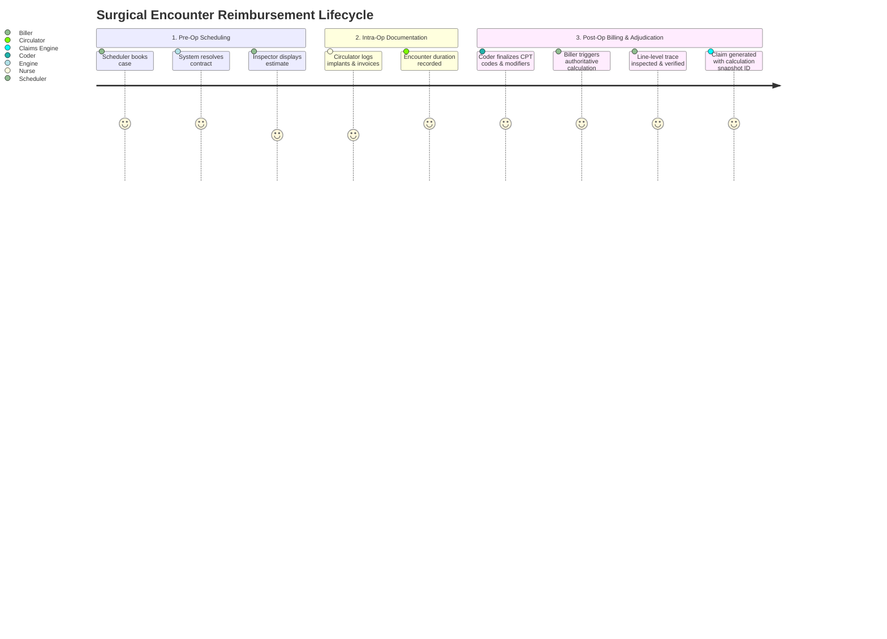

# PHASE 68 — UI WORKFLOW SPECIFICATION
## Expected Reimbursement Inspector, Trace Modal & Calculation Lineage Workflows

> **Phase:** 68 — Expected Reimbursement Engine  
> **Author:** Principal Frontend Architect, Senior Healthcare UX Specialist  
> **Status:** UI DESIGN & WORKFLOW SPECIFICATION  
> **Target Version:** ASCANALYST v2026.1  

---

## 1. USER INTERACTION MAP

The Expected Reimbursement Engine integrates into four core user touchpoints:
1. **Case Schedule & Encounter Drawer:** Live calculation badge on surgical encounters.
2. **Claim Scrubber Workbench (`ClaimScrubberWorkbench.jsx`):** Pre-bill validation showing authoritative expected reimbursement alongside scrub rules.
3. **Dedicated Reimbursement Inspector Modal (`ReimbursementInspectorModal.jsx`):** Detailed drill-down showing line-level explanations and mathematical traces.
4. **Historical Comparison & Recalculation Drawer:** Audit comparison between sequential calculation runs (e.g. initial scheduling vs post-op coding amendment).



---

## 2. REIMBURSEMENT INSPECTOR MODAL SPECIFICATION

### 2.1 Header Section & Status Badges
- **Encounter Title:** `Surgery #1042 — Shoulder Arthroscopy with Rotator Cuff Repair`
- **Patient & Coverage:** `John Doe | BCBS Commercial Choice PPO 2026 (Group: #90421)`
- **Calculation State Pill:**
  - `CALCULATED`: Crisp Emerald badge (`bg-emerald-950/40 text-emerald-300 border-emerald-800`).
  - `PARTIALLY_CALCULATED`: Amber warning badge (`bg-amber-950/40 text-amber-300 border-amber-800`).
  - `CONTRACT_NOT_FOUND`: Rose error badge (`bg-rose-950/40 text-rose-300 border-rose-800`).
  - `STOP_LOSS_APPLIED`: Sky blue alert badge (`bg-sky-950/40 text-sky-300 border-sky-800`).
  - `REQUIRED_DATA_MISSING`: Orange alert badge (`bg-orange-950/40 text-orange-300 border-orange-800`).

### 2.2 Summary Metric KPI Cards
Display six distinct financial metrics with explicit color tokens:
1. **Gross Billed Charges:** `$23,000.00` (Neutral Slate)
2. **Contract Total Allowable:** `$11,179.10` (Emerald Accent)
3. **Estimated Patient Responsibility:** `$3,035.82` (Amber Accent)
4. **Estimated Net Payer Reimbursement:** `$8,143.28` (Sky Blue Accent)
5. **Facility Acquisition Cost:** `$5,175.00` (Neutral Slate)
6. **Expected Contribution Margin:** `$6,004.10` (53.7% Net Margin) (Emerald Accent)

> **Maestro Ban Notice:** No purple (`#7c3aed`, `#8b5cf6`, `violet`, `indigo`) may be used for any metric, card border, or icon.

---

### 2.3 Line-Item Adjudication Table
Columns:
- `#` (Line Index)
- `CPT / HCPCS` (e.g. `29827`, `23430`)
- `Description`
- `Units`
- `Gross Billed`
- `Pricing Methodology` (Badge: `% of Medicare`, `Fee Schedule`, `Carve-Out`)
- `Base Benchmark` (e.g. Medicare Baseline or Negotiated Fee)
- `Adjustments` (Pills: `Rank 1 100%`, `Rank 2 50% MPPR`, `J8 -$2,100 Offset`)
- `Contract Allowable`
- `Patient Share`
- `Net Payer Allowable`
- `Explanation Drill-down` (Expandable accordion arrow)

#### Expanded Trace Drawer Content:
When expanding a line item, displays the step-by-step mathematical reasoning:
```markdown
[Step 1] Resolved CMS Addenda: National Unadjusted Rate = $4,850.00 (Payment Indicator: J8)
[Step 2] Wage Adjustment: ($4,850.00 * 0.50 * 0.9412) + ($4,850.00 * 0.50) = $4,707.41
[Step 3] Device Offset Protection: Hardware carved out separately. Deducted CMS Offset: -$2,100.00
         Adjusted Procedural Baseline: $4,707.41 - $2,100.00 = $2,607.41
[Step 4] Contract Multiplier: $2,607.41 * 180.00% = $4,693.34
[Step 5] MPPR Cascade: Rank 2 procedure applied 50.00% reduction: $4,693.34 * 0.50 = $2,346.67
[Step 6] Final Line Allowable: $2,346.67 (Patient: $637.53 | Payer: $1,709.14)
```

---

## 3. RECALCULATION & HISTORICAL COMPARISON WORKFLOW

### 3.1 Recalculation Modal
1. Triggered via the **"Recalculate Reimbursement"** button.
2. Form Fields:
   - **Encounter DOS:** Defaults to current DOS, editable for back-billing.
   - **Contract Version Override:** Dropdown of active/superseded versions (for historical audits).
   - **Recalculation Reason (Mandatory):** Dropdown + Text:
     - `POST_OP_CODING_UPDATE`
     - `IMPLANT_INVOICE_ADDED`
     - `CONTRACT_RETROACTIVE_AMENDMENT`
     - `PATIENT_INSURANCE_CHANGED`
     - `OTHER_MANUAL_REVIEW`
3. Executing creates **Sequence #2**, marks Sequence #1 as `superseded_by_calculation_id`, and retains both records in the database.

### 3.2 Historical Diff Viewer
Allows the user to select two versions (e.g. Version 1 vs Version 2) and presents a side-by-side diff:
- **Changed Inputs:** Highlighted in Amber (e.g. added CPT 23430, updated invoice cost).
- **Variance Summary:** `+$4,235.80 (+61.2%)` in net expected reimbursement.
- **Audit Stamp:** User, timestamp, and stated reason for recalculation.

---

## 4. UI STATE MATRIX

| State | Visual Behavior | Primary Call to Action |
| :--- | :--- | :--- |
| **Loading** | Shimmer skeleton cards across KPI summary & table rows | Disabled buttons |
| **Empty** | "No procedures coded for this encounter" | "Add CPT Procedures" |
| **Contract Not Found** | Rose alert banner: "No active commercial contract found for DOS" | "View Payer Directory" |
| **Rate Not Found** | Amber alert banner: "CPT 29881 is missing from contracted schedule" | "Upload Fee Schedule" |
| **Data Missing** | Orange alert banner: "Implant invoice missing for carve-out eligibility" | "Upload Implant Invoice" |
| **Permission Denied** | Locked padlock with message: "Financial calculation restricted" | "Request Biller Access" |

