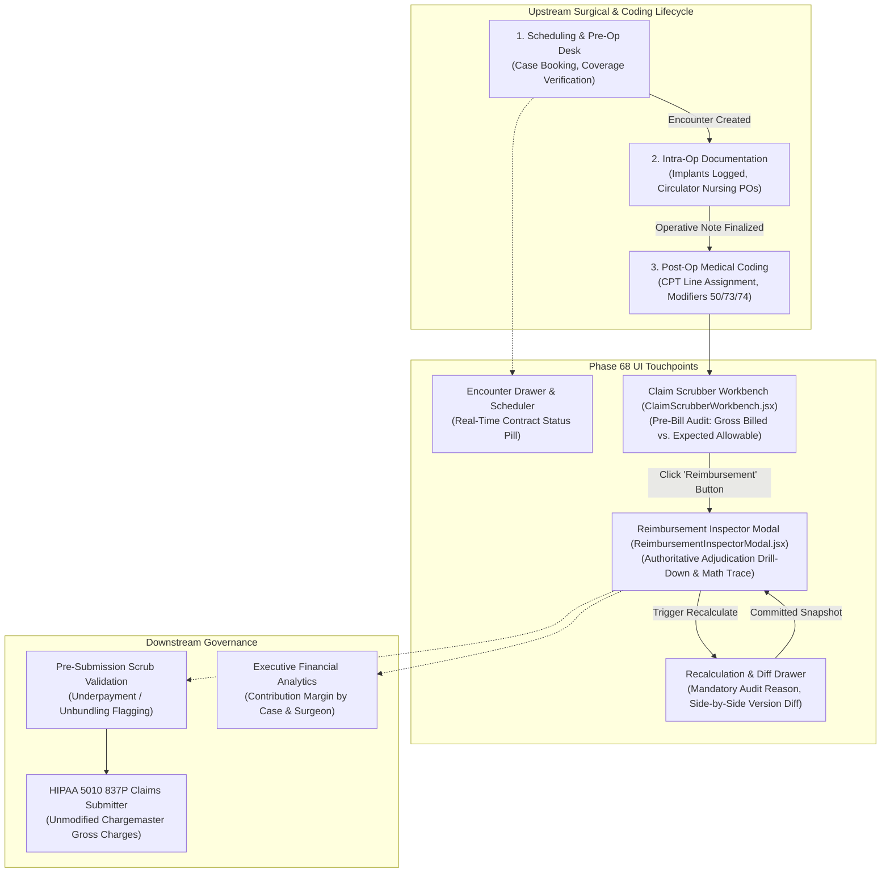
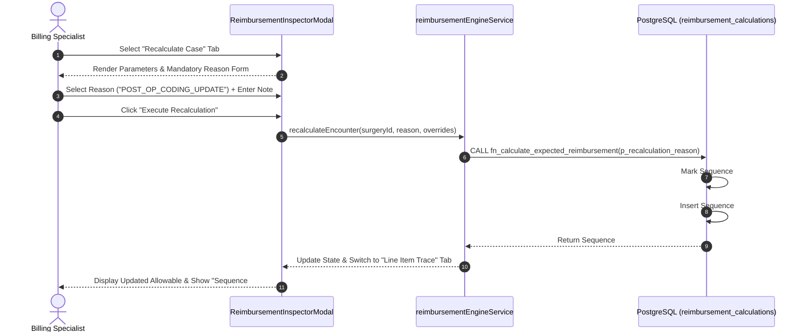

# PHASE 68 — UI WORKFLOW SPECIFICATION
## Expected Reimbursement Inspector, Trace Modal & Calculation Lineage Workflows

> **Module:** Expected Reimbursement Engine & Rate Adjudication  
> **Author:** Principal Frontend Architect, Senior Healthcare UX Specialist, Application Security Architect  
> **Status:** UI DESIGN & WORKFLOW SPECIFICATION — PRODUCTION READY  
> **Target Version:** ASCANALYST v2026.1  
> **Design Tokens:** Maestro Slate / Emerald / Amber / Rose / Sky (Strict Purple Ban Enforced)  
> **Upstream Dependencies:** Phase 67 Rate Rules, Phase 68 Target Architecture (`044_expected_reimbursement_engine.sql` [PROPOSED / UNAUTHORIZED])  

---

## 1. USER INTERACTION MAP & WORKFLOW TOPOLOGY

The Expected Reimbursement Engine integrates into four primary clinical, revenue cycle, and audit touchpoints across the ASC Analyst platform:



### Primary Interaction Flow:
1. **Pre-Bill Claim Review:** In the **Claim Scrubber & EDI Workbench** (`ClaimScrubberWorkbench.jsx`), the billing specialist selects an encounter from the Claims Queue.
2. **Launch Inspector:** The user clicks the **"Reimbursement"** action button in the claim workspace header.
3. **Inspect Adjudication:** The **Reimbursement Inspector Modal** (`ReimbursementInspectorModal.jsx`) opens as a high-priority modal overlay (`z-index: 999999`), querying the authoritative server-side calculation snapshot via `reimbursementEngineService`.
4. **Line-Level Drill-Down:** The user expands individual CPT lines to inspect the deterministic mathematical trace (Medicare wage adjustments, J8 offset deductions, MPPR reductions, and implant markup).
5. **Audited Recalculation:** If post-op coding or implant purchase orders change, the user triggers an audited recalculation with a mandatory reason note, generating a version-sequenced immutable ledger record.

---

## 2. REIMBURSEMENT INSPECTOR MODAL SPECIFICATION

The Inspector Modal is designed for intense revenue cycle inspection, high data density, and clear liability partitioning.

### 2.1 Header Section & Status Badges

```
+--------------------------------------------------------------------------------------------------------------------+
| [Calculator Icon] Expected Reimbursement Inspector & Trace                                     [Recalculate]  [X] |
| Encounter #1042 • Surgery #1042 • BCBS Commercial Choice PPO 2026 • [CALCULATED] [STOP-LOSS TRIGGERED]            |
+--------------------------------------------------------------------------------------------------------------------+
```

#### A. Title Group Elements:
- **Title:** `Expected Reimbursement Inspector & Trace` (`text-slate-100 font-bold text-lg`)
- **Encounter Subtitle:**
  - Encounter identifier: `Encounter #{encounter_identifier}` (e.g., `CLM-2026-0042`)
  - Target surgery: `Surgery #{surgery_id}`
  - Contract Title: `{contract_title}` (e.g., `BCBS Commercial Choice PPO 2026`)
  - Primary Status Pill: One of the 10 canonical statuses.
  - Secondary Flag Badges: Rendered conditionally when special contractual conditions occur (`STOP-LOSS TRIGGERED`, `MISSING PRIOR AUTH`, `IMPLANT CARVE-OUT ACTIVE`).

#### B. Canonical Status Badge Mapping (10 Statuses):

| Status Code | Badge Visuals (Tailwind) | Hex Color Tokens | Label Text | Meaning & Tooltip |
| :--- | :--- | :--- | :--- | :--- |
| **`CALCULATED`** | `bg-emerald-950/40 text-emerald-300 border-emerald-800` | Text: `#34d399`, Border: `rgba(16, 185, 129, 0.4)` | `CALCULATED` | Adjudication fully calculated; all invariants passed. |
| **`PARTIALLY_CALCULATED`** | `bg-amber-950/40 text-amber-300 border-amber-800` | Text: `#fbbf24`, Border: `rgba(245, 158, 11, 0.4)` | `PARTIAL` | Primary priced; secondary lines require review. |
| **`CONTRACT_NOT_FOUND`** | `bg-rose-950/40 text-rose-300 border-rose-800` | Text: `#f87171`, Border: `rgba(239, 68, 68, 0.4)` | `NO CONTRACT` | No active payer contract found for DOS and facility. |
| **`CONTRACT_VERSION_UNRESOLVED`**| `bg-rose-950/40 text-rose-300 border-rose-800` | Text: `#f87171`, Border: `rgba(239, 68, 68, 0.4)` | `VERSION AMBIGUOUS` | Multiple overlapping or draft versions match DOS. |
| **`RATE_NOT_FOUND`** | `bg-amber-950/40 text-amber-300 border-amber-800` | Text: `#fbbf24`, Border: `rgba(245, 158, 11, 0.4)` | `RATE MISSING` | Submitted CPT missing from fee exhibits and rules. |
| **`BASELINE_NOT_AVAILABLE`** | `bg-rose-950/40 text-rose-300 border-rose-800` | Text: `#f87171`, Border: `rgba(239, 68, 68, 0.4)` | `NO BASELINE` | CMS statutory base rate or CBSA wage index missing. |
| **`REQUIRED_DATA_MISSING`** | `bg-orange-950/40 text-orange-300 border-orange-800` | Text: `#fb923c`, Border: `rgba(249, 115, 22, 0.4)` | `DATA REQUIRED` | Mandatory fields (implant invoice, CPT) missing. |
| **`RULE_CONFLICT`** | `bg-rose-950/40 text-rose-300 border-rose-800` | Text: `#f87171`, Border: `rgba(239, 68, 68, 0.4)` | `RULE CONFLICT` | Mutually exclusive contractual terms encountered. |
| **`MANUAL_REVIEW_REQUIRED`**| `bg-orange-950/40 text-orange-300 border-orange-800` | Text: `#fb923c`, Border: `rgba(249, 115, 22, 0.4)` | `REVIEW REQ` | High-dollar stop-loss, unlisted CPT, or auth flag. |
| **`CALCULATION_FAILED`** | `bg-rose-950/40 text-rose-300 border-rose-800` | Text: `#f87171`, Border: `rgba(239, 68, 68, 0.4)` | `FAILED` | Internal database or mathematical invariant fault. |

#### C. Secondary Modifier Badges:
- **Stop-Loss Triggered (`stop_loss_triggered = TRUE`):**
  - Visual: `bg-sky-950/50 text-sky-300 border-sky-700` (`#38bdf8`)
  - Label: `⚡ STOP-LOSS ACTIVE (EXCESS-ONLY)` or `⚡ STOP-LOSS ACTIVE (WHOLE-CASE)`
  - Tooltip: *"Contract catastrophic stop-loss threshold reached. Secondary settlement applied."*
- **Prior Authorization Missing (`authorization_risk_flag = TRUE`):**
  - Visual: `bg-amber-950/50 text-amber-300 border-amber-700` (`#fbbf24`)
  - Label: `⚠️ PRIOR AUTH PENDING`
  - Tooltip: *"Missing authorization creates 100% denial risk. Contract allowable is preserved for appeal baseline."*

---

### 2.2 Summary Metric KPI Cards (6 Distinct Financial Dimensions)

Directly below the modal header, a responsive 6-column grid displays authoritative financial summaries:

```
+------------------+------------------+------------------+------------------+------------------+------------------+
| GROSS BILLED     | CONTRACT ALLOW   | PATIENT SHARE    | PAYER ESTIMATED  | FACILITY COST    | MARGIN (NET %)   |
| $23,000.00       | $11,179.10       | $3,035.82        | $8,143.28        | $5,175.00        | $6,004.10 (53.7%)|
| Chargemaster     | Total Agreed     | Deduct/Copay/Coin| Net Realizable   | Direct Acquisition| Contribution     |
+------------------+------------------+------------------+------------------+------------------+------------------+
```

1. **Gross Billed Charges:** Chargemaster total submitted to payer (`text-slate-100 font-bold text-lg`).
2. **Contract Total Allowable:** Contractually binding allowable rate (`text-emerald-400 font-bold text-lg`).
3. **Estimated Patient Responsibility:** Sum of deductible, copay, and coinsurance (`text-amber-400 font-bold text-lg`).
4. **Estimated Net Payer Reimbursement:** Net contractual amount owed by insurance (`text-sky-400 font-bold text-lg`).
5. **Facility Acquisition Cost:** Direct surgical supplies, room time, and implant cost (`text-slate-300 font-bold text-lg`).
6. **Expected Contribution Margin:** `Contract Allowable - Facility Acquisition Cost` (`text-emerald-400 font-bold text-lg` with subtext `+53.7% Margin`).

> 🚫 **STRICT MAESTRO COLOR BAN:** Zero purple, violet, indigo, or fuchsia tokens (`#7c3aed`, `#8b5cf6`, `text-purple-*`, `bg-indigo-*`) are permitted across cards, borders, or typography.

---

### 2.3 Navigation Tabs
Below the KPI grid, a 4-tab pill navigation bar controls the modal viewports:
- **`Line Item Trace`** (Default): Itemized procedure table with collapsible mathematical reasoning drawers.
- **`Patient Responsibility`**: Detailed breakdown of patient benefit accumulators (deductible, copay, coinsurance, OOP maximum).
- **`Calculation History`**: Version-sequenced audit ledger displaying previous calculation runs and reasons.
- **`Recalculate Case`**: Actionable form triggering a new server-side adjudication sequence.

---

### 2.4 Line-Item Adjudication Table & Mathematical Trace

The primary tab presents a dense data grid of all surgical procedures and carved-out implants:

```
+----+----------+----------------------------+-------+-------------+----------------------+--------------------+--------------------+---------------+
| #  | CPT/HCPC | Description                | Units | Gross Billed| Methodology          | Adjustments        | Contract Allowable | Trace Drill   |
+----+----------+----------------------------+-------+-------------+----------------------+--------------------+--------------------+---------------+
| 1  | 29827    | Arthroscopic Cuff Repair   | 1.0   | $14,500.00  | % of Medicare (180%) | Rank 1 (100%)      | $6,027.43          | [v] Expanded  |
| 2  | 23430    | Open Biceps Tenodesis      | 1.0   | $8,500.00   | % of Medicare (180%) | J8 (-$2,100), 50%  | $2,346.67          | [>] Collapsed |
| 3  | IMPLANT  | 2 Anchors + 1 Tenod Screw  | 3.0   | $0.00       | Invoice + 10%        | Above $250 Thresh  | $2,805.00          | [>] Collapsed |
+----+----------+----------------------------+-------+-------------+----------------------+--------------------+--------------------+---------------+
```

#### Expanded Mathematical Reasoning Drawer:
Clicking any row expands a monospaced execution trace formatted in dark slate card styling (`bg-slate-950 border border-slate-800`):

```
┌── Mathematical Execution Trace: Line 2 (CPT 23430) ────────────────────────────────────────────────────────┐
│ [Step 1] CMS Baseline Resolution:                                                                          │
│          • National Unadjusted Rate: $4,850.00 | CMS Payment Indicator: J8                                 │
│          • CBSA 34940 Wage Index: 0.9412                                                                   │
│          • Wage-Adjusted Baseline = ($4,850 * 0.50 * 0.9412) + ($4,850 * 0.50) = $4,707.41                  │
│ [Step 2] J8 Device Offset Carve-Out Protection:                                                            │
│          • Implants logged and carved out separately via verified purchase invoices.                       │
│          • Statutory CMS Device Offset Deducted: -$2,100.00                                                │
│          • Adjusted Procedural Baseline = $4,707.41 - $2,100.00 = $2,607.41                                 │
│ [Step 3] Contract Commercial Multiplier:                                                                   │
│          • Applied Commercial Multiplier: 180.00% (Factor: 1.8000)                                         │
│          • Unreduced Line Rate = $2,607.41 * 1.8000 = $4,693.34                                            │
│ [Step 4] Multiple Procedure Payment Reduction (MPPR):                                                      │
│          • Procedure Rank: 2 (Secondary surgical procedure)                                                │
│          • Contract MPPR Cascade Rule Set: COM_STD_CASCADE (Rank 2 = 50.00%)                                │
│          • Net Procedural Allowable = $4,693.34 * 0.5000 = $2,346.67                                       │
│ [Step 5] Liability Partitioning:                                                                           │
│          • Patient Liability: $637.53 | Estimated Payer Reimbursement: $1,709.14                           │
└────────────────────────────────────────────────────────────────────────────────────────────────────────────┘
```

---

### 2.5 Cryptographic Ledger Verification Card

At the bottom of the line items tab, an immutable verification box exposes the snapshot hash:
- **SHA-256 Digest:** `a1b2c3d4e5f60718293a4b5c6d7e8f9a0b1c2d3e4f5a6b7c8d9e0f1a2b3c4d5e` (Monospace, truncated with full copy-to-clipboard button).
- **Integrity Status Indicator:**
  - Unverified: Neutral gray badge with **"Verify Snapshot Integrity"** button.
  - Verified: Crisp Emerald badge: `[✓ Cryptographically Verified — Snapshot Matches Database Hash]`.
  - Tamper Detected: Pulsing Red alert: `[✗ Integrity Fault — Snapshot Mismatch!]`.

---

## 3. RECALCULATION & HISTORICAL LINEAGE WORKFLOW

Financial calculations in ASC Analyst are **permanently immutable**. Edits never overwrite existing records; they create sequenced historical snapshots.



### 3.1 Recalculation Form Controls
When switching to the **Recalculate Case** tab:
1. **Mandatory Recalculation Reason Dropdown:**
   - `POST_OP_CPT_RECODING`: Operative report amended or CPT unbundling resolved.
   - `IMPLANT_INVOICE_ADDED`: Vendor purchase order invoice uploaded after surgery.
   - `CONTRACT_RETROACTIVE_AMENDMENT`: Payer contract renegotiated with retroactive effective date.
   - `PATIENT_INSURANCE_CHANGED`: Secondary insurance added or primary policy updated.
   - `OTHER_MANUAL_REVIEW`: Requires mandatory text explanation ($\ge 10$ characters).
2. **Patient Liability Overrides (Optional Testing):**
   - Copay Input (`$250.00`)
   - Coinsurance Pct (`20.00%`)
   - Remaining Deductible (`$1,500.00`)
3. **Execution Guardrails:**
   - The **"Execute Recalculation"** button is disabled until a valid reason is selected and text length validation ($\ge 10$ characters) is satisfied.

### 3.2 Historical Diff Viewer (Calculation Lineage Tab)
The **Calculation History** tab lists all previous calculation sequences for the encounter:
- **Sequence Index:** `Sequence #2 (Latest)` vs `Sequence #1 (Superseded)`
- **Timestamp & Actor:** `2026-11-02 14:15 UTC by biller_naples@asc.com`
- **Audit Reason:** `POST_OP_CPT_RECODING: Added CPT 23430 biceps tenodesis from op note`
- **Financial Delta:** `+$2,346.67 Allowable (+26.6% Net Increase)`
- **Comparison Button:** Allows selecting two sequences to view a side-by-side line comparison with changed values highlighted in Amber.

---

## 4. INTEGRATION BOUNDARY WITH CLAIM SCRUBBER WORKBENCH

The Expected Reimbursement Engine directly interfaces with the Pre-Bill Claim Scrubber (`src/components/ClaimScrubberWorkbench.jsx`):

```
+----------------------------------------------------------------------------------------------------+
| PRE-BILL CLAIM SCRUBBER & EDI WORKBENCH                                            [Refresh Queue] |
+------------------------------------+---------------------------------------------------------------+
| CLAIMS QUEUE (4)                   | CLAIM CLM-2026-0042 [SCRUB_FAILED]  [Re-Scrub] [Reimbursement]|
| * CLM-2026-0042   [SCRUB_FAILED]   | Encounter #1042 • Payer: UnitedHealthcare • POS: 11           |
|   John Doe         $7,300.00       +---------------------------------------------------------------+
| * CLM-2026-0088   [SCRUB_PASSED]   | GROSS BILLED      EXPECTED ALLOWABLE   EXPECTED PAYER NET     |
|   Jane Smith       $4,550.00       | $7,300.00         $3,845.20            $3,076.16              |
| * CLM-2026-0105   [READY]          +---------------------------------------------------------------+
+------------------------------------+
```

### Architectural Safeguards:
1. **Read-Only Data Consumption:** The Claim Scrubber displays Expected Allowable and Expected Payer Net strictly as informational audit metrics. It **never** replaces or mutates the submitted line gross charges.
2. **Button Synchronization:** Clicking **"Reimbursement"** passes the active claim's `surgery_id` (fallback to `1`) and launches the Inspector Modal without altering the scrubber's local state.
3. **Underpayment Warning:** If the Expected Allowable exceeds the submitted Gross Billed Charge (a common ASC fee schedule billing error), the Scrubber surfaces warning edit:  
   `⚠️ BILL-08: Line gross charge ($1,200.00) is less than contracted allowable ($1,540.00). Facility risks contract underpayment.`

---

## 5. UI STATE MATRIX & ERROR HANDLING

| UI State | Screen Representation | Contextual Resolution CTA | Permission Required |
| :--- | :--- | :--- | :--- |
| **Loading** | Shimmer skeleton cards across KPI summary & table rows | Buttons disabled; spinner on active tab | None (Public view state) |
| **Empty Encounter** | Neutral slate card: *"No procedural CPT codes coded for this surgical encounter."* | `[+ Add CPT Procedures in Coding Workbench]` | `coder` / `biller` |
| **`CONTRACT_NOT_FOUND`** | Rose alert banner: *"No active commercial contract covers this facility and date of service."* | `[View Payer Directory]` / `[Stage New Contract]` | `facility_admin` |
| **`CONTRACT_VERSION_UNRESOLVED`**| Rose alert banner: *"Ambiguous contract version. Multiple active exhibits match DOS."* | `[Resolve Contract Versions]` | `facility_admin` |
| **`RATE_NOT_FOUND`** | Amber banner: *"CPT 29881 is unlisted on the active fee schedule and has no default multiplier."* | `[Stage Procedure Rate Override]` | `biller` / `coder` |
| **`BASELINE_NOT_AVAILABLE`** | Rose banner: *"CMS statutory base rate or CBSA wage index is missing for DOS."* | `[Update CMS Addenda Tables]` | `super_admin` |
| **`REQUIRED_DATA_MISSING`** | Orange banner: *"Implant carve-out is active but verified vendor invoice is missing."* | `[Upload Vendor PO Invoice]` | `circulator` / `biller` |
| **`RULE_CONFLICT`** | Rose banner: *"Conflicting contract terms detected between carve-out threshold and packaging."* | `[Review Contract Term Rules]` | `facility_admin` |
| **`MANUAL_REVIEW_REQUIRED`**| Orange banner: *"Adjudication flagged for review: Catastrophic Stop-Loss exceeded."* | `[Acknowledge & Approve Stop-Loss]` | `facility_admin` |
| **`CALCULATION_FAILED`** | Red banner: *"Database error during calculation execution. Review audit logs."* | `[Retry Calculation]` | `biller` |
| **Access Denied (403)** | Padlock shield: *"Financial adjudication restricted to authorized billing personnel."* | `[Request Biller Authorization]` | `reimbursement.calculation.view` |

---

## 6. DESIGN SYSTEM & ACCESSIBILITY SPECIFICATION

### 6.1 Strict Maestro Purple Ban Compliance
- **Zero Violet / Purple / Indigo:** Prohibits hex `#7c3aed`, `#8b5cf6`, `#6366f1`, `#4f46e5`, and Tailwind classes `bg-purple-*`, `text-indigo-*`, `border-violet-*`.
- **Approved Primary Palette:**
  - Surfaces: Slate-900 (`#0f172a`), Slate-950 (`#020617`), Slate-800 (`#1e293b`).
  - Borders: Slate-700 (`#334155`), Slate-800 (`#1e293b`).
  - Text: Slate-100 (`#f8fafc`), Slate-300 (`#cbd5e1`), Slate-400 (`#94a3b8`).
  - Financial Success: Emerald-400 (`#34d399`), Emerald-950 (`rgba(6, 78, 59, 0.4)`).
  - Financial Caution: Amber-400 (`#fbbf24`), Amber-950 (`rgba(120, 53, 15, 0.4)`).
  - Payer / Informational: Sky-400 (`#38bdf8`), Sky-950 (`rgba(12, 74, 110, 0.4)`).
  - Fatal Errors: Rose-400 (`#f87171`), Rose-950 (`rgba(136, 19, 55, 0.4)`).

### 6.2 Accessibility & Ergonomics (WCAG 2.1 AA)
1. **Contrast Ratio:** Text on dark surfaces maintains a minimum **4.8:1 contrast ratio**. In Light Theme mode, text renders in dark charcoal (`#0f172a`) on neutral light slate surfaces (`#f8fafc` / `#ffffff`) with a minimum **7.2:1 contrast ratio**.
2. **Keyboard Navigation:**
   - Modal closes instantly on `Escape` key press.
   - Interactive table rows support `Enter` / `Space` to expand mathematical traces.
   - Focus is trapped within the modal container while active.
3. **Screen Reader Compatibility:**
   - Summary cards carry `aria-label="Summary Metric: Contract Total Allowable Eleven Thousand One Hundred Seventy-Nine Dollars"`.
   - Expanded execution traces carry `role="region"` and `aria-expanded="true"`.
