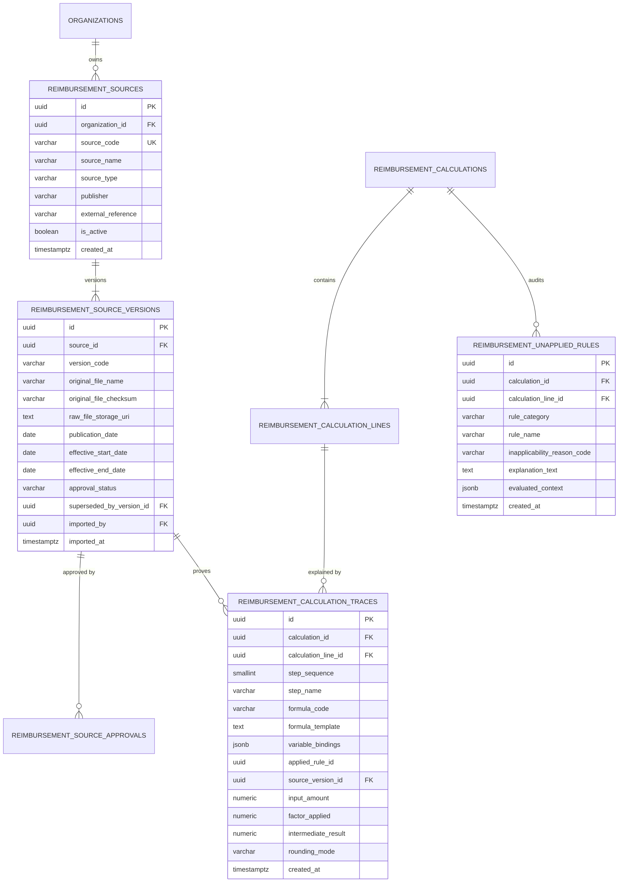

# PHASE 69 — DATA MODEL AND MIGRATION PLAN
## Schema Architecture, Relational Integrity, and Proposed Migration 045 Design

> **Module:** Expected Reimbursement Engine & Rate Adjudication  
> **Status:** DATA MODEL & MIGRATION DESIGN (UNAUTHORIZED)  
> **Target Version:** ASCANALYST v2026.1  
> **Author:** Principal Database Architect, PostgreSQL Specialist  

---

## 1. DATA MODEL ARCHITECTURAL OVERVIEW

Phase 69 extends the financial ledger established in Phase 68 with deep source provenance and structured calculation traces:



---

## 2. DETAILED TABLE DEFINITIONS (PROPOSED MIGRATION 045)

### 2.1 Table 1: `public.reimbursement_sources`
```sql
CREATE TABLE IF NOT EXISTS public.reimbursement_sources (
    id UUID PRIMARY KEY DEFAULT gen_random_uuid(),
    organization_id UUID REFERENCES public.organizations(id) ON DELETE RESTRICT,
    source_code VARCHAR(100) NOT NULL,
    source_name VARCHAR(255) NOT NULL,
    source_type VARCHAR(50) NOT NULL CHECK (source_type IN (
        'REGULATORY_CMS_ADDENDA',
        'REGULATORY_CMS_WAGE_INDEX',
        'CODE_SET_AMA_CPT',
        'PAYER_FEE_SCHEDULE',
        'PAYER_CONTRACT_TERMS',
        'VENDOR_IMPLANT_INVOICE'
    )),
    publisher VARCHAR(150) NOT NULL,
    external_reference VARCHAR(150),
    is_active BOOLEAN NOT NULL DEFAULT TRUE,
    created_at TIMESTAMPTZ NOT NULL DEFAULT timezone('utc', now()),
    CONSTRAINT uq_reimb_source_code UNIQUE (organization_id, source_code)
);
```

### 2.2 Table 2: `public.reimbursement_source_versions`
```sql
CREATE TABLE IF NOT EXISTS public.reimbursement_source_versions (
    id UUID PRIMARY KEY DEFAULT gen_random_uuid(),
    source_id UUID NOT NULL REFERENCES public.reimbursement_sources(id) ON DELETE RESTRICT,
    version_code VARCHAR(100) NOT NULL,
    original_file_name VARCHAR(255) NOT NULL,
    original_file_checksum VARCHAR(64) NOT NULL, -- SHA-256
    raw_file_storage_uri TEXT,
    publication_date DATE NOT NULL,
    effective_start_date DATE NOT NULL,
    effective_end_date DATE NOT NULL,
    approval_status VARCHAR(50) NOT NULL DEFAULT 'DRAFT' CHECK (approval_status IN (
        'DRAFT',
        'REVIEW_PENDING',
        'APPROVED',
        'ACTIVE',
        'SUPERSEDED',
        'REJECTED'
    )),
    superseded_by_version_id UUID REFERENCES public.reimbursement_source_versions(id) ON DELETE SET NULL,
    imported_by UUID REFERENCES auth.users(id) ON DELETE SET NULL,
    imported_at TIMESTAMPTZ NOT NULL DEFAULT timezone('utc', now()),
    created_at TIMESTAMPTZ NOT NULL DEFAULT timezone('utc', now()),
    CONSTRAINT uq_source_version UNIQUE (source_id, version_code),
    CONSTRAINT chk_source_dates CHECK (effective_start_date <= effective_end_date)
);
```

---

## 3. IMMUTABILITY & AUDIT TRIGGERS

All calculation traces and unapplied rule logs are **strictly append-only**:

```sql
CREATE OR REPLACE FUNCTION public.trg_block_trace_mutation()
RETURNS TRIGGER
LANGUAGE plpgsql
SECURITY DEFINER
SET search_path = pg_catalog, public, pg_temp
AS $$
BEGIN
    RAISE EXCEPTION 'Audit Violation: Calculation traces and unapplied rule records (ID %) are permanently immutable and cannot be updated or deleted.', OLD.id
        USING ERRCODE = 'P0001';
    RETURN NULL;
END;
$$;

CREATE TRIGGER trg_calc_traces_immutable
    BEFORE UPDATE OR DELETE ON public.reimbursement_calculation_traces
    FOR EACH ROW EXECUTE FUNCTION public.trg_block_trace_mutation();

CREATE TRIGGER trg_unapplied_rules_immutable
    BEFORE UPDATE OR DELETE ON public.reimbursement_unapplied_rules
    FOR EACH ROW EXECUTE FUNCTION public.trg_block_trace_mutation();
```

---

## 4. PROPOSED MIGRATION SEQUENCE & DEPLOYMENT GATE

> ⚠️ **CRITICAL GOVERNANCE DIRECTIVE:**  
> Migration 045 (`045_reimbursement_calculation_auditability.sql`) is **STRICTLY PROPOSED / DESIGN ONLY**.  
> It cannot be scheduled or executed until:
> 1. Phase 67 (`043_payer_contract_rate_rules.sql`) is approved and deployed.
> 2. Phase 68 (`044_expected_reimbursement_engine.sql`) completes its cryptographic revisions, receives sign-off, and is deployed.

