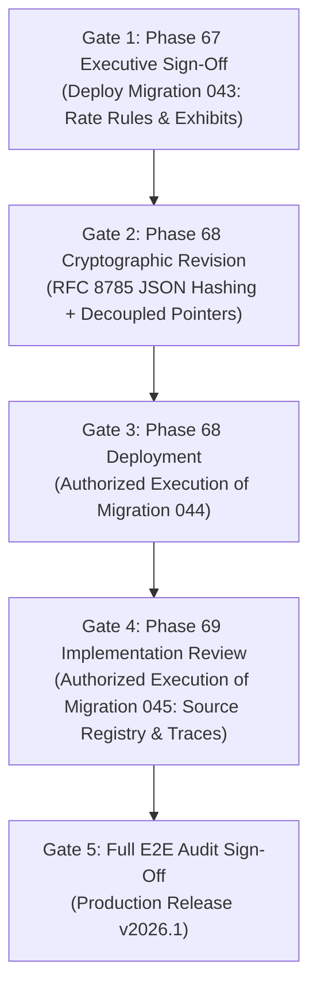

# PHASE 69 — DEPENDENCY & CROSS-PHASE AUDIT REPORT
## Upstream Phase Governance, Release Gates, and Blocking Impacts

> **Module:** Expected Reimbursement Engine & Rate Adjudication  
> **Status:** DEPENDENCY AUDIT & GOVERNANCE SPECIFICATION  
> **Target Version:** ASCANALYST v2026.1  
> **Author:** Principal Systems Architect, Enterprise Release Manager  

---

## 1. COMPREHENSIVE CROSS-PHASE DEPENDENCY MATRIX

The matrix below evaluates the implementation status, evidence, and release gate readiness across Phases 60 through 69:

| Phase Number & Title | Implementation Status | Repository Evidence | Blocking Impact on Phase 69 | Release Gate Status |
| :--- | :---: | :--- | :--- | :---: |
| **Phase 60: Medicare Base Rates** | **`[VERIFIED EXISTING]`** | `036_medicare_asc_base_rate_engine.sql` | Provides baseline unadjusted ASC rates | ✅ Fully Available |
| **Phase 61: Payment Indicators** | **`[VERIFIED EXISTING]`** | `036` (`cpt_payment_indicators`) | Provides J8, A2, G2 indicator mapping | ✅ Fully Available |
| **Phase 62: CBSA Wage Index** | **`[VERIFIED EXISTING]`** | `036`, `038` (`medicare_wage_indices`)| Provides geographic labor multipliers | ✅ Fully Available |
| **Phase 63: Device-Intensive Rules**| **`[VERIFIED EXISTING]`** | `039_device_intensive_payment_rules.sql` | Provides statutory J8 device offset amounts | ✅ Fully Available |
| **Phase 64: MPPR Rules Engine** | **`[VERIFIED EXISTING]`** | `021`, `036` (`mppr_rule_sets`) | Provides procedure ranking & reduction cascades| ✅ Fully Available |
| **Phase 65: Payer Master** | **`[VERIFIED EXISTING]`** | `041_payer_master.sql` | Provides payer directory and health plans | ✅ Fully Available |
| **Phase 66: Contract Versioning**| **`[VERIFIED EXISTING]`** | `042_payer_contract_model.sql` | Provides active contract versions and terms | ✅ Fully Available |
| **Phase 67: Contract Rate Rules** | **`[SPECIFIED BUT PENDING]`** | `043_payer_contract_rate_rules.sql` | **CRITICAL BLOCKER:** Supplies contracted CPT rates, case rates, and carve-outs | 🔴 **UNAPPROVED GATE** |
| **Phase 68: Reimbursement Engine**| **`[PROPOSED / UNAUTHORIZED]`**| `044_expected_reimbursement_engine.sql`| **CRITICAL BLOCKER:** Supplies calculation header, lines, adjustments, and ledger | 🔴 **UNAUTHORIZED GATE** |
| **Phase 69: Calculation Audit** | **`[SPECIFICATION COMPLETE]`** | `045_reimbursement_calculation_auditability.sql` (Proposed) | Connects all calculations to source versions & structured traces | 🟡 **AUDIT STAGE ONLY** |

---

## 2. BLOCKING IMPACT ANALYSIS

### 2.1 The Phase 67 Approval Gate
- **Condition:** Phase 69 requires calculation traces to reference specific contract rate exhibits (`payer_contract_cpt_rates`, `payer_contract_case_rates`, `payer_contract_carve_outs`).
- **Blocking Impact:** These tables are defined in Migration 043 (`043_payer_contract_rate_rules.sql`), which is currently in read-only audit review. **Phase 69 cannot execute database migrations until Phase 67 is formally approved and deployed.**

### 2.2 The Phase 68 Authorization Gate
- **Condition:** Phase 69 trace tables (`reimbursement_calculation_traces`, `reimbursement_unapplied_rules`) declare foreign keys referencing `reimbursement_calculations(id)` and `reimbursement_calculation_lines(id)`.
- **Blocking Impact:** These parent tables belong to Migration 044, which is **STRICTLY UNAUTHORIZED**. Until Migration 044 completes its P0 cryptographic revisions and is deployed, Migration 045 cannot be created.

---

## 3. RELEASE ROADMAP & SEQUENCING GATES

