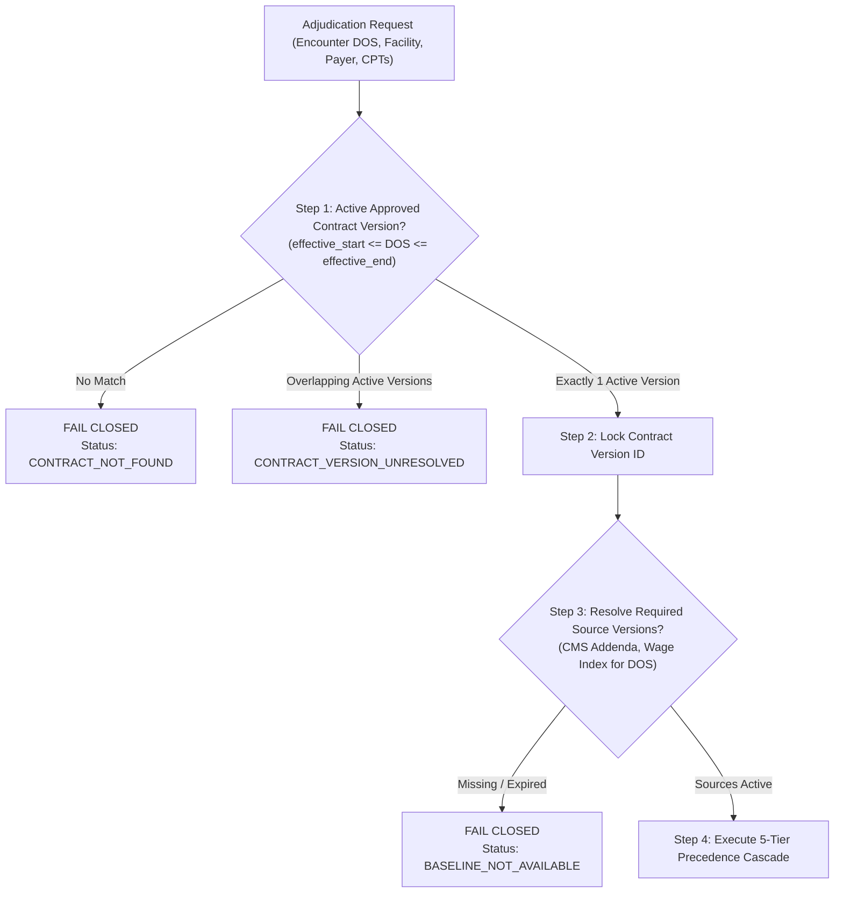

# PHASE 69 — EFFECTIVE-DATE & RULE RESOLUTION SPECIFICATION
## Deterministic Version Locking, Date of Service Matching, and Fail-Closed Precedence

> **Module:** Expected Reimbursement Engine & Rate Adjudication  
> **Status:** ALGORITHM & RULES SPECIFICATION  
> **Target Version:** ASCANALYST v2026.1  
> **Author:** Principal Healthcare Revenue Cycle Architect, PostgreSQL Specialist  

---

## 1. DETERMINISTIC VERSION RESOLUTION ALGORITHM

To eliminate ambiguity, financial calculations must resolve effective-dated regulatory sources, payer contracts, and fee schedules through a **deterministic, fail-closed resolution algorithm**:



### Invariant SQL Resolution Functions:
```sql
-- Canonical version resolution query
SELECT id INTO v_source_version_id
FROM public.reimbursement_source_versions
WHERE source_id = v_source_id
  AND approval_status = 'ACTIVE'
  AND effective_start_date <= p_date_of_service
  AND effective_end_date >= p_date_of_service;

IF v_source_version_id IS NULL THEN
    RAISE EXCEPTION 'Version Resolution Failure: No active approved version of source % covers Date of Service %',
        v_source_id, p_date_of_service
        USING ERRCODE = 'P0002';
END IF;
```

---

## 2. PREVENTING AMBIGUOUS & OVERLAPPING VERSIONS

A critical flaw in fee schedule management is allowing two active versions of the same contract or fee schedule to cover the same calendar date.

### Database-Level Defense:
1. **Exclusion Constraints / Functional Indexes:**
   For any source or contract version where exclusivity is mandatory, the schema enforces non-overlapping date ranges using PostgreSQL `btree_gist`:
   ```sql
   ALTER TABLE public.reimbursement_source_versions
   ADD CONSTRAINT ex_source_version_dates
   EXCLUDE USING gist (
       source_id WITH =,
       daterange(effective_start_date, effective_end_date, '[]') WITH &&
   ) WHERE (approval_status = 'ACTIVE');
   ```
2. **Behavior on Version Gaps:** If a surgery occurs on `2026-04-01`, but the Q1 version expired on `2026-03-31` and Q2 is pending approval, the engine **fails closed** with status `BASELINE_NOT_AVAILABLE`. It **never** silently extends expired rates or uses unapproved drafts.

---

## 3. THE 5-TIER CONTRACT METHODOLOGY PRECEDENCE CASCADE

For every submitted CPT/HCPCS code, rates resolve through a strictly ordered 5-tier precedence cascade:

```
+----------------------------------------------------------------------------------------------------+
| TIER 1: PROCEDURE CARVE-OUT / CONTRACT EXCEPTION (Absolute Highest Precedence)                     |
|         - Example: CPT 29827 with negotiated fixed carve-out ($6,500.00) or specific unlisted rate |
|         - Evaluation: IF matched -> APPLY TIER 1 -> HALT CASCADE                                   |
+----------------------------------------------------------------------------------------------------+
| TIER 2: SPECIFIC CPT FEE SCHEDULE EXHIBIT                                                          |
|         - Example: Contracted commercial dollar rate on Exhibit B ($3,200.00)                      |
|         - Evaluation: IF matched -> APPLY TIER 2 -> HALT CASCADE                                   |
+----------------------------------------------------------------------------------------------------+
| TIER 3: CASE RATE / SURGICAL PACKAGE EXHIBIT                                                       |
|         - Example: Cataract Package (CPT 66984 + Secondary lines bundled at $2,250.00)             |
|         - Evaluation: IF primary -> PRICE PACKAGE; IF secondary -> MARK PACKAGED ($0.00) -> HALT  |
+----------------------------------------------------------------------------------------------------+
| TIER 4: CONTRACT DEFAULT PAYMENT METHODOLOGY                                                       |
|         - Example: PERCENT_OF_MEDICARE @ 180.00% or PERCENT_OF_BILLED_CHARGES @ 65.00%             |
|         - Evaluation: IF contract has default methodology -> APPLY TIER 4 -> HALT CASCADE          |
+----------------------------------------------------------------------------------------------------+
| TIER 5: FAIL CLOSED (Mandatory Security & Financial Stop)                                          |
|         - Evaluation: No rule covers CPT -> SET STATUS 'RATE_NOT_FOUND' -> PROHIBIT SILENT DEFAULT |
+----------------------------------------------------------------------------------------------------+
```

---

## 4. CONTRACTUAL APPLICABILITY OF PAYMENT ADJUSTMENTS

Universal billing assumptions are strictly prohibited. Payment modifiers and reductions execute **only** when authorized by the active contract version:

| Payment Adjustment Rule | Contract Applicability Condition | Behavior if Unconfigured |
| :--- | :--- | :--- |
| **Modifier 50 (Bilateral)** | Contract explicitly defines `bilateral_multiplier` (e.g. 150.0% or 200.0%). | **Fail Closed (`RULE_CONFLICT`)**. Do not assume 150%. |
| **Modifier 73 (Discontinued Pre-Anesthesia)**| Contract specifies payment percentage (e.g. 50.0%). | **Fail Closed (`RULE_CONFLICT`)**. Do not assume 50%. |
| **Modifier 74 (Discontinued Post-Anesthesia)**| Contract specifies payment percentage (e.g. 100.0%). | **Fail Closed (`RULE_CONFLICT`)**. Do not assume 100%. |
| **Multiple Procedure Reduction (MPPR)**| Contract binds to defined `mppr_rule_set_code` (e.g. `COM_STD_CASCADE`). | **Fail Closed (`RULE_CONFLICT`)**. Do not apply default cascade. |
| **J8 Device Offset Deduction**| Contract specifies `device_offset_policy = 'DEDUCT_OFFSET'` AND implants carved out.| Deduct offset; if implants not carved out, pay base rate intact. |
| **Catastrophic Stop-Loss**| Encounter gross charges or allowable exceed contract threshold. | Apply contract formula (Excess-only vs Whole-case); do not auto-convert. |

