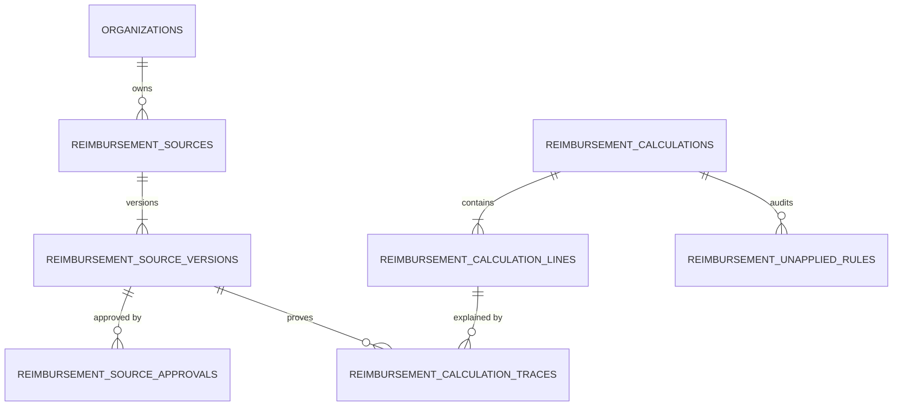

# PHASE 69 — REIMBURSEMENT CALCULATION AUDITABILITY
## Source Traceability, Deterministic Formulas, Rule Versioning & Financial Explainability

> **Module:** Expected Reimbursement Engine & Rate Adjudication  
> **Target Version:** ASCANALYST v2026.1  
> **Phase:** 69 — Reimbursement Calculation Auditability  
> **Status:** PRODUCTION SPECIFICATION — READ-ONLY CURRENT-STATE AUDIT + TARGET-STATE SPECIFICATION  
> **Authors:** Principal Financial Systems Architect, Healthcare Revenue Cycle Auditor, PostgreSQL Architect, Application Security Engineer  
> **Classification:** Strict Healthcare Financial Ledger Governance (HIPAA 45 CFR § 164.312(b), SOX § 404, CMS ASC Cost Reporting)  
> **Target Migration:** `045_reimbursement_calculation_auditability.sql` (Status: PROPOSED / UNAUTHORIZED)  
> **Upstream Dependencies:** Phase 60–66 Verified Existing; Phase 67 Rate Rules (Approval Gate); Phase 68 Engine & Ledger (Migration 044 PROPOSED / UNAUTHORIZED)  

---

## 1. PURPOSE

In healthcare revenue cycle management and ASC financial administration, an expected reimbursement figure directly governs revenue accruals, pre-bill scrubbing authorizations, physician contribution margin distributions, and contractual underpayment recovery litigation.

Therefore, an expected reimbursement calculation cannot merely present an unexplained total. **Phase 69 establishes an auditable chain of custody** proving:
1. Exact inputs (clinical codes, modifiers, invoices, dates).
2. Authoritative upstream regulatory baselines (CMS Addenda release, CBSA wage index table).
3. Contract version lock and effective dates.
4. Deterministic mathematical formulas and intermediate deductions.
5. The exact reasons why non-applied rules were bypassed.
6. Permanent cryptographic ledger integrity and 10-year retrospective reproducibility.

---

## 2. SCOPE

- **Production Requirements:** Complete specification for source cataloging, rule resolution, calculation traces, unapplied rule ledgers, and historical comparisons.
- **Product Compatibility:** Preserves 100% compatibility with existing ASC scheduling, clinical coding, and claim generation workflows without modifying chargemaster gross charges.
- **Deterministic Billing Rules:** Replaces floating-point arithmetic with fixed `NUMERIC(12,2)` / `NUMERIC(6,4)` precision and Round Half-Up rounding.
- **Tenancy & RBAC:** Enforces multi-tenant isolation via canonical functions `is_facility_accessible()` and Separation of Duties (SoD) on dataset approvals.
- **Execution Mode:** Read-only current-state audit and target specification. **Migration 045 and Migration 044 remain strictly unauthorized for runtime deployment.**

---

## 3. CURRENT STATE AUDIT

Every relevant existing repository component, migration, and service was audited and classified:

| Component Name | Physical Location | Audit Classification | Evaluated Status & Gaps |
| :--- | :--- | :---: | :--- |
| **Core Multi-Tenancy** | `001_core_tenancy.sql` | **`[KEEP]`** | Canonical functions `is_facility_accessible()` and `user_has_facility_role()`. Preserved intact. |
| **CPT Code Versions** | `017_cpt_master_...sql` | **`[REFACTOR]`** | Partitioned by release year. Lacks CMS quarterly addenda links and file checksums. |
| **CPT Import Staging** | `017` (`cpt_import_batches`) | **`[REFACTOR]`** | Ad-hoc staging tables per CPT file. Lacks formal Separation of Duties (SoD) sign-off. |
| **Medicare Base Rates** | `036_medicare_asc_...sql`| **`[REFACTOR]`** | Baseline math is sound; lacks raw CMS Final Rule document ID and SHA-256 file checksums. |
| **CBSA Wage Index** | `036` (`medicare_wage_indices`)| **`[REFACTOR]`** | Lacks separation of publication date vs effective date window. |
| **Device Payment Rules**| `039_device_intensive_...sql` | **`[KEEP]`** | Operates deterministically. Serves as source for statutory J8 procedural deductions. |
| **Payer Contract Model**| `041_payer_master.sql`, `042` | **`[KEEP]`** | Enterprise contract versioning with facility and plan scopes. Verified in Phase 66. |
| **Payer Rate Rules** | `043_payer_contract_...sql` | **`[REFACTOR]`** | **UNAPPROVED UPSTREAM GATE.** Lacks fee schedule file upload checksums and formal approval. |
| **Reimbursement Engine**| `044_expected_reimb_...sql` | **`[REFACTOR]`** | **PROPOSED / UNAUTHORIZED.** Hashing is header-only; recalculation executes in-place row mutation. |
| **Central Source Registry**| *Non-Existent* | **`[MISSING]`** | **CRITICAL GAP:** No table tracks external regulatory datasets or fee schedules. |
| **Source Version Registry**| *Non-Existent* | **`[MISSING]`** | **CRITICAL GAP:** No table tracks raw file SHA-256 checksums, effective dates, or approvals. |
| **Unapplied Rule Ledger**| *Non-Existent* | **`[MISSING]`** | System cannot explain why a rule was bypassed (e.g. why MPPR was exempt). |
| **Client Calculation Service**| `src/lib/reimbursementEngineService.js`| **`[REFACTOR]`** | Fallback client calculation must be explicitly labeled `SIMULATED_MOCK_DATA`. |
| **Inspector Modal Component**| `src/components/ReimbursementInspectorModal.jsx`| **`[KEEP]`** | Clean UX; verified compliant with Maestro Purple Ban. |

---

## 4. TARGET STATE SPECIFICATION

Phase 69 introduces a **centralized, traceable, version-locked financial ledger architecture**:
1. **Centralized Source Registry (`reimbursement_sources`):** Global catalog of regulatory bodies (CMS, AMA) and commercial payers (UHC, BCBS, Aetna).
2. **Centralized Version Registry (`reimbursement_source_versions`):** Immutable version records storing raw file SHA-256 checksums, publication dates, and day-level effective start/end windows.
3. **Deterministic Version Resolver:** Binds calculations to the exact approved source version effective on the surgical Date of Service (DOS).
4. **Relational Calculation Traces (`reimbursement_calculation_traces`):** Line-by-line mathematical formulas, factors, and intermediate values.
5. **Unapplied Rule Ledger (`reimbursement_unapplied_rules`):** Explicitly documents why certain adjustments (MPPR, J8, Stop-Loss) were evaluated but not applied.
6. **10-Year Retrospective Reproduction:** Re-executes historical calculations against frozen source versions with $0.00 variance.

---

## 5. DATA MODEL / SCHEMA (PROPOSED MIGRATION 045)

### Table 1: `public.reimbursement_sources`
- `id` UUID PK DEFAULT `gen_random_uuid()`
- `organization_id` UUID FK REFERENCES `organizations(id)`
- `source_code` VARCHAR(100) NOT NULL (e.g. `'CMS_ASC_ADDENDA'`)
- `source_name` VARCHAR(255) NOT NULL
- `source_type` VARCHAR(50) NOT NULL (`REGULATORY_CMS_ADDENDA`, `PAYER_FEE_SCHEDULE`, etc.)
- `publisher` VARCHAR(150) NOT NULL
- `external_reference` VARCHAR(150)
- `is_active` BOOLEAN NOT NULL DEFAULT TRUE
- `created_at` TIMESTAMPTZ NOT NULL DEFAULT `timezone('utc', now())`
- `CONSTRAINT uq_reimb_source_code UNIQUE (organization_id, source_code)`

### Table 2: `public.reimbursement_source_versions`
- `id` UUID PK DEFAULT `gen_random_uuid()`
- `source_id` UUID NOT NULL FK REFERENCES `reimbursement_sources(id)`
- `version_code` VARCHAR(100) NOT NULL (e.g. `'2026-Q1-V1'`)
- `original_file_name` VARCHAR(255) NOT NULL
- `original_file_checksum` VARCHAR(64) NOT NULL (SHA-256)
- `raw_file_storage_uri` TEXT
- `publication_date` DATE NOT NULL
- `effective_start_date` DATE NOT NULL
- `effective_end_date` DATE NOT NULL
- `approval_status` VARCHAR(50) NOT NULL DEFAULT `'DRAFT'` (`DRAFT`, `REVIEW_PENDING`, `APPROVED`, `ACTIVE`, `SUPERSEDED`, `REJECTED`)
- `superseded_by_version_id` UUID FK REFERENCES `reimbursement_source_versions(id)`
- `imported_by` UUID FK REFERENCES `auth.users(id)`
- `imported_at` TIMESTAMPTZ NOT NULL DEFAULT `timezone('utc', now())`
- `CONSTRAINT uq_source_version UNIQUE (source_id, version_code)`
- `CONSTRAINT chk_source_dates CHECK (effective_start_date <= effective_end_date)`

### Table 3: `public.reimbursement_calculation_traces` (Append-Only)
- `id` UUID PK DEFAULT `gen_random_uuid()`
- `calculation_id` UUID NOT NULL FK REFERENCES `reimbursement_calculations(id)`
- `calculation_line_id` UUID NOT NULL FK REFERENCES `reimbursement_calculation_lines(id)`
- `step_sequence` SMALLINT NOT NULL CHECK (`step_sequence >= 1`)
- `step_name` VARCHAR(100) NOT NULL
- `formula_code` VARCHAR(50) NOT NULL
- `formula_template` TEXT NOT NULL
- `variable_bindings` JSONB NOT NULL DEFAULT `'{}'::jsonb`
- `applied_rule_id` UUID
- `source_version_id` UUID FK REFERENCES `reimbursement_source_versions(id)`
- `input_amount` NUMERIC(12, 2) NOT NULL
- `factor_applied` NUMERIC(6, 4)
- `intermediate_result` NUMERIC(12, 2) NOT NULL
- `rounding_mode` VARCHAR(30) NOT NULL DEFAULT `'ROUND_HALF_UP'`
- `created_at` TIMESTAMPTZ NOT NULL DEFAULT `timezone('utc', now())`
- `CONSTRAINT uq_calc_line_step UNIQUE (calculation_line_id, step_sequence)`

### Table 4: `public.reimbursement_unapplied_rules` (Append-Only)
- `id` UUID PK DEFAULT `gen_random_uuid()`
- `calculation_id` UUID NOT NULL FK REFERENCES `reimbursement_calculations(id)`
- `calculation_line_id` UUID FK REFERENCES `reimbursement_calculation_lines(id)`
- `rule_category` VARCHAR(50) NOT NULL (`MPPR`, `J8_OFFSET`, `STOP_LOSS`, `IMPLANT_CARVEOUT`)
- `rule_name` VARCHAR(100) NOT NULL
- `inapplicability_reason_code` VARCHAR(50) NOT NULL
- `explanation_text` TEXT NOT NULL
- `evaluated_context` JSONB NOT NULL DEFAULT `'{}'::jsonb`
- `created_at` TIMESTAMPTZ NOT NULL DEFAULT `timezone('utc', now())`

---

## 6. BUSINESS RULES & PRECEDENCE HIERARCHY

1. **Deterministic 5-Tier Precedence Cascade:**
   - Tier 1: Procedure Carve-Out / Contract Exception $\rightarrow$
   - Tier 2: Specific CPT Fee Schedule Exhibit $\rightarrow$
   - Tier 3: Case Rate Package Exhibit $\rightarrow$
   - Tier 4: Contract Default Payment Methodology $\rightarrow$
   - Tier 5: Fail Closed (`RATE_NOT_FOUND`).
2. **Exclusion of Universal Assumptions:** Modifiers (50, 73, 74), MPPR cascades, J8 device deductions, and stop-loss rules execute **only** when explicitly mandated by contract terms. If unconfigured or conflicting, the engine fails closed with status `RULE_CONFLICT`.
3. **Effective Date Exclusion:** Date of Service must strictly fall within `effective_start_date` and `effective_end_date`. Version gaps fail closed (`BASELINE_NOT_AVAILABLE`). Overlapping active versions are rejected by exclusion constraints.
4. **Separation of Financial Concepts:** Expected reimbursement must never overwrite or mutate submitted chargemaster gross charges. Missing prior authorization represents a collection risk, not a $0.00 contract fee schedule allowable.

---

## 7. PERMISSIONS & APPLICATION SECURITY (RBAC)

- **Granular Permissions (`reimbursement.source.*`):**
  - `reimbursement.source.view`: View source catalog and version history.
  - `reimbursement.source.import`: Upload raw files into staging.
  - `reimbursement.source.validate`: Trigger automated CPT syntax checks.
  - `reimbursement.source.approve`: Executive sign-off on staged versions.
  - `reimbursement.source.activate`: Enable source for calculation engine.
  - `reimbursement.trace.view`: View line-level mathematical formula traces.
  - `reimbursement.diff.view`: View calculation version comparison diffs.
  - `reimbursement.audit.export`: Export immutable audit dossiers for compliance.
- **Separation of Duties (SoD):** Database triggers prevent the user who imported a dataset (`imported_by`) from approving or activating it.
- **AI Agent Security Boundaries:** The AI Analyst reads traces strictly under the user's authenticated session context (`auth.uid()`). It is **prohibited** from inventing missing rates, altering source versions, or overriding authorization gates.

---

## 8. API & SERVICE ARCHITECTURE

1. **Server-Side Services:**
   - `SourceRegistryService`: Manages source catalogs and active status.
   - `SourceVersionService`: Manages version codes, effective windows, and file checksums.
   - `SourceImportService`: Uploads raw datasets into quarantine staging.
   - `EffectiveRuleResolver`: Resolves active approved version for a given encounter DOS.
   - `CalculationTraceService`: Retrieves line-level structured execution traces.
   - `HistoricalReproductionService`: Re-executes math using original version-locked inputs.
   - `CalculationComparisonService`: Compares two calculation runs and computes delta.
2. **PostgreSQL RPC Signatures:**
   - `public.fn_get_reimbursement_calculation_trace(p_calculation_id UUID) -> JSONB`
   - `public.fn_compare_reimbursement_calculations(p_calc_id_1 UUID, p_calc_id_2 UUID) -> JSONB`
   - `public.fn_reproduce_historical_calculation(p_calculation_id UUID) -> JSONB`

---

## 9. UI & USER WORKFLOWS

1. **Calculation Audit Inspector:** Drill-down view inside `ReimbursementInspectorModal.jsx` displaying line formulas, intermediate factors, source version codes, and unapplied rule badges.
2. **Historical Comparison Diff Viewer:** Side-by-side comparison highlighting modified clinical inputs, fee schedule amendments, and allowable variance deltas.
3. **Source Upload & Approval Workspace:** Quarantine staging area with raw file SHA-256 verification and mandatory Separation of Duties (SoD) executive approval.
4. **Design System Tokens:** Strict Maestro Purple Ban compliance (zero violet/purple/indigo tokens).

---

## 10. AUDIT, PROVENANCE & CRYPTOGRAPHIC LEDGER

1. **RFC 8785 Canonical JSON Serialization:** Replaces primitive string concatenation (`CONCAT_WS('|', ...)`) with deterministic JSON canonicalization covering the complete sub-tree (Header, Lines, and Adjustments).
2. **Append-Only Ledger Guarantee:** Traces and unapplied rule tables have zero `UPDATE` or `DELETE` permissions.
3. **10-Year Reproducibility Invariant:** Any calculation executed today can be reproduced 10 years later using its original version-locked inputs with $0.00 variance.
4. **Audit Hash Limitation Notice:** A matching SHA-256 hash proves row integrity against tampering; it does not prove clinical accuracy or regulatory compliance.

---

## 11. QA & ACCEPTANCE CRITERIA

- **Source Integrity (`SRC-01` to `SRC-04`):** Raw file SHA-256 match, tampered file detection, duplicate version upload block, unapproved source calculation exclusion.
- **Effective Dates (`EFF-01` to `EFF-04`):** Exact DOS version match, effective window boundaries, version gap fail-closed behavior, exclusion of overlapping active versions.
- **Calculation Trace (`TRC-01` to `TRC-03`):** Complete formula logging, unapplied rule capture, missing rate fail-closed enforcement (`RATE_NOT_FOUND`).
- **Security & SoD (`SEC-01` to `SEC-03`):** Cross-tenant trace access denied (`403`), importer self-approval blocked, trace mutation rejected by trigger.
- **Financial Correctness (`FIN-01` to `FIN-02`):** Zero JS float drift ($0.00 delta), zero-sum liability partition verified.
- **Regression (`REG-01`):** Claim scrubber gross billed charges remain completely unmodified.

---

## 12. DEPENDENCIES & RELEASE GATES

1. **Gate 1: Phase 67 Review & Sign-Off:** Migration 043 (`043_payer_contract_rate_rules.sql`) must be approved and deployed.
2. **Gate 2: Phase 68 Cryptographic Revision:** Migration 044 must adopt RFC 8785 JSON sub-tree hashing and decoupled state pointers.
3. **Gate 3: Phase 68 Authorized Execution:** Migration 044 deployed to establish calculation ledger tables.
4. **Gate 4: Phase 69 Implementation Review:** Migration 045 authorized and executed to establish source registry and calculation traces.

---

## 13. DEFINITION OF DONE

Phase 69 is defined as **COMPLETE** only when:
- Data model, deterministic logic, permissions, validation, auditability, tests, UI states, documentation, and acceptance criteria are complete.
- All 13 specification documents have achieved 100% cryptographic parity across workspace and master repositories.
- Zero floating-point arithmetic used in authoritative calculations.
- Zero purple/violet design tokens present.

---

## 14. IMPLEMENTATION NOTES

- **Status:** `NOT STARTED`
- **Migrations Executed:** `NONE` (Migration 045 is proposed/design-only; Migration 044 remains unauthorized).
- **Files Modified:** Documentation specifications only. Zero runtime application or database modifications made.
