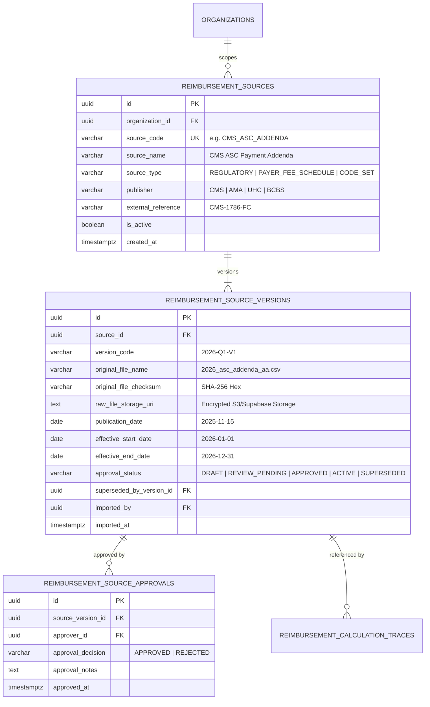
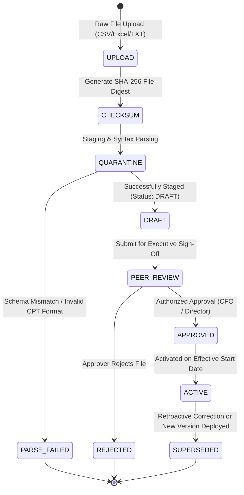

# PHASE 69 — SOURCE REGISTRY AND VERSIONING SPECIFICATION
## Centralized Dataset Catalog, SHA-256 File Checksums, and Multi-Stage Approval Lifecycles

> **Module:** Expected Reimbursement Engine & Rate Adjudication  
> **Status:** DATA MODEL & PROCESS SPECIFICATION  
> **Target Version:** ASCANALYST v2026.1  
> **Author:** Principal Database Architect, Financial Systems Auditor  

---

## 1. CENTRALIZED SOURCE REGISTRY DATA MODEL

To eliminate fragmented, ad-hoc import tables across modules, Phase 69 introduces a **centralized two-tier source registry**:



---

## 2. PUBLICATION DATE VS. EFFECTIVE DATE SEPARATION

A common flaw in healthcare data engineering is conflating the date an external regulatory file was published with the date it legally takes effect.

### Invariant Rules:
1. **Publication Date (`publication_date`):** The date the originating agency or payer published the document (e.g. CMS publishes the ASC Final Rule in November 2025).
2. **Effective Window (`effective_start_date` to `effective_end_date`):** The exact calendar interval during which the rates legally apply to surgical dates of service (e.g. `2026-01-01` through `2026-12-31`).
3. **Audit Rule:** Rate resolution must **strictly match the encounter's Date of Service (DOS)** against the effective window:
   $$\text{effective\_start\_date} \le \text{Date of Service} \le \text{effective\_end\_date}$$
   Publication date is preserved strictly for legal provenance and regulatory compliance.

---

## 3. FILE INGESTION & CRYPTOGRAPHIC VERIFICATION LIFECYCLE

External datasets must pass through an audited, multi-stage ingestion gate before any rate can be referenced by the calculation engine:



### Ingestion Security Directives:
1. **Raw File SHA-256 Immutability:** When a file is uploaded, its raw byte stream is hashed using SHA-256. This digest (`original_file_checksum`) is stored permanently and validated against subsequent reads to detect disk corruption or tampering.
2. **Quarantine Staging:** Raw records are loaded into isolated staging tables (`reimbursement_source_import_staging`) with zero client access.
3. **Separation of Duties (SoD):** The user who uploads an external rate dataset **cannot approve or activate it**. Activation requires explicit sign-off from a user possessing `reimbursement.source.approve` permissions (Managed Care Director or Organization CFO).
4. **Unapproved Source Prohibition:** The adjudication engine contains a strict SQL guard:
   ```sql
   WHERE approval_status = 'ACTIVE' AND effective_start_date <= p_dos AND effective_end_date >= p_dos
   ```
   Draft, unapproved, or rejected sources are **strictly invisible** to authoritative calculations.

---

## 4. RETROACTIVE CORRECTIONS & VERSION SUPERSEDING

CMS frequently issues quarterly technical corrections (e.g. April correction to a January wage index) with retroactive effective dates.

### Governance Protocol:
1. **Never Overwrite Historical Versions:** The original source version (e.g. `CMS-ASC-2026-Q1-V1`) remains in the database permanently.
2. **Link Succession:** The corrected version (`CMS-ASC-2026-Q1-V2`) is created with status `ACTIVE`. The original version has its status updated to `SUPERSEDED`, with `superseded_by_version_id` pointing to `V2`.
3. **Preserving Historical Calculations:** Any calculation executed prior to the correction retains its foreign key to `V1`. Running a historical audit re-evaluates against `V1`, reproducing the exact financial accrual that occurred on the original billing date.

