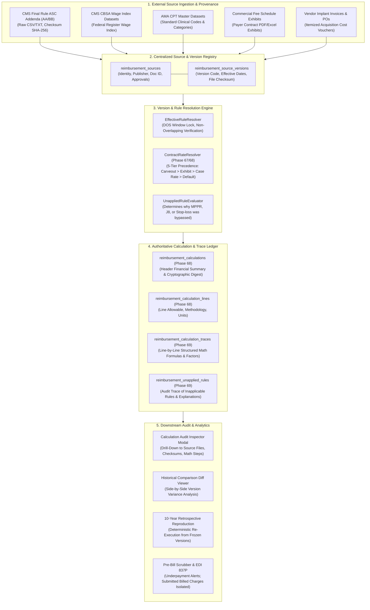

# PHASE 69 — TARGET ARCHITECTURE SPECIFICATION
## Centralized Source Registry, Rule Versioning, and Financial Calculation Traceability

> **Module:** Expected Reimbursement Engine & Rate Adjudication  
> **Status:** TARGET ARCHITECTURE SPECIFICATION  
> **Target Version:** ASCANALYST v2026.1  
> **Authors:** Principal Financial Systems Architect, Healthcare Revenue Cycle Auditor  

---

## 1. TARGET SYSTEM TOPOLOGY & ARCHITECTURAL OVERVIEW

Phase 69 transforms the expected reimbursement system from an opaque pricing black-box into a **fully traceable, version-locked, independently reproducible healthcare financial ledger**.

Every dollar calculated is bound to an unbroken chain of custody: originating regulatory dataset, publication date, effective date window, contract clause, exact mathematical formula, intermediate deductions, and unapplied rule explanations.



---

## 2. THE 12-STEP AUDIT EXPLAINABILITY CHAIN

To ensure every number is legally defensible during commercial payer audits or Medicare MAC reviews, the engine enforces a mandatory 12-step lineage chain:

```
[Step 1] Clinical Encounter Ingestion:
         - Surgery ID: 1042 | Facility: Naples Surgery Center | DOS: 2026-11-15
[Step 2] Line Itemization:
         - Line 1: CPT 29827 (1 unit) | Line 2: CPT 23430 (1 unit)
[Step 3] Supply Provenance:
         - Case Devices: 2 Suture Anchors ($1,900.00) + 1 Tenodesis Screw ($650.00)
         - Vendor PO Invoice: #PO-88219 (Acquisition Cost: $2,550.00, Verified)
[Step 4] Payer Resolution:
         - Primary Payer: Blue Cross Blue Shield of Florida (Payer ID: BCBS-FL-01)
[Step 5] Contract Version Lock:
         - Contract: "BCBS Commercial Choice PPO 2026"
         - Version ID: 40000000-0000-0000-0000-000000000001 (Active, Locked)
[Step 6] Source Version Binding:
         - Source 1: "CMS-ASC-ADDENDA-2026-Q1" (Effective: 2026-01-01 to 2026-12-31, Checksum: a1b2c3...)
         - Source 2: "CMS-WAGE-INDEX-2026-FINAL" (CBSA 34940, Factor: 0.9412)
[Step 7] Methodology Resolution:
         - Line 1: PERCENT_OF_MEDICARE (Multiplier: 180.00%)
         - Line 2: PERCENT_OF_MEDICARE (Multiplier: 180.00%, J8 Offset Active)
         - Line 3: IMPLANT_CARVE_OUT (Invoice + 10.0%)
[Step 8] Intermediate Formula Execution:
         - Line 1 Baseline: ($3,450 * 0.50 * 0.9412) + ($3,450 * 0.50) = $3,348.57
         - Line 2 Baseline: ($4,850 * 0.50 * 0.9412) + ($4,850 * 0.50) = $4,707.41
         - Line 2 J8 Offset Deducted: -$2,100.00 -> Adjusted Baseline = $2,607.41
         - MPPR Sorting: Line 1 Rank 1 (100%), Line 2 Rank 2 (50%)
[Step 9] Contract Allowable Determination:
         - Line 1: $3,348.57 * 1.8000 * 1.00 = $6,027.43
         - Line 2: $2,607.41 * 1.8000 * 0.50 = $2,346.67
         - Line 3: $2,550.00 * 1.1000 = $2,805.00
         - Total Contract Allowable = $11,179.10
[Step 10] Patient Benefit Partitioning:
         - Deductible: $1,500.00 | Copay: $250.00 | Coinsurance (20%): $1,285.82
         - Estimated Patient Responsibility: $3,035.82
[Step 11] Net Realizable Payer Reimbursement:
         - Estimated Payer Due: $11,179.10 - $3,035.82 = $8,143.28
[Step 12] Cryptographic Ledger Binding:
         - RFC 8785 Canonical JSON Digest generated (SHA-256)
         - Immutable record committed to calculation ledger
```

---

## 3. STRICT FINANCIAL CONCEPT SEPARATION

The architecture strictly decouples 10 discrete financial metrics to prevent revenue inflation, false underpayment claims, and improper ledger write-offs:

| Financial Metric | Architectural Source of Truth | Operational Purpose | May Alter Billed Charges? |
| :--- | :--- | :--- | :---: |
| **1. Gross Billed Charges** | Facility Chargemaster (`claim_lines.line_charge`) | Official legal claim submission to payer (837P) | **N/A (Anchor)** |
| **2. Medicare ASC Baseline**| CMS Statutory Addenda & CBSA Index | Federal benchmark comparison | ❌ No |
| **3. Contract Allowable** | Contract fee schedule / multiplier formula | Total legally enforceable reimbursement | ❌ No |
| **4. Estimated Patient Share**| Verified 271 Benefit Structure (Deductible/Copay)| Patient financial counseling and collections | ❌ No |
| **5. Estimated Payer Share** | `Contract Allowable - Patient Responsibility` | Net expected accounts receivable accrual | ❌ No |
| **6. Actual Adjudicated Rate**| Payer 835 Remittance Advice (CAS codes) | Post-payment settlement reconciliation | ❌ No |
| **7. Actual Patient Payment** | Facility Cashier / Merchant Payment Ledger | Direct patient collection | ❌ No |
| **8. Implant Acquisition Cost**| Verified Vendor Purchase Invoice (PO) | Direct surgical device expense | ❌ No |
| **9. Total Direct Case Cost** | Time-Driven Activity-Based Costing (Supplies+OR)| Procedural expense allocation | ❌ No |
| **10. Contribution Margin** | `Contract Allowable - Total Direct Cost` | Surgeon and facility operational profitability| ❌ No |

> 🔴 **CRITICAL ARCHITECTURAL DIRECTIVE:**  
> Expected reimbursement is an internal estimate and audit metric. It must **never** be treated as guaranteed revenue, and it must **never** overwrite or modify the submitted chargemaster claim line charges.

