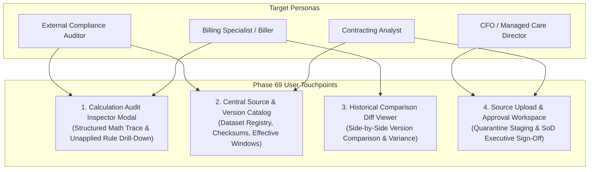

# PHASE 69 — UI WORKFLOW SPECIFICATION
## Calculation Audit Inspector, Formula Traces, Source Catalog, and Historical Diff Workflows

> **Module:** Expected Reimbursement Engine & Rate Adjudication  
> **Status:** UI DESIGN & WORKFLOW SPECIFICATION  
> **Target Version:** ASCANALYST v2026.1  
> **Design Tokens:** Maestro Slate / Emerald / Amber / Rose / Sky (Strict Purple Ban Enforced)  

---

## 1. USER INTERACTION MAP & SCREEN ARCHITECTURE

Phase 69 introduces four specialized user interface touchpoints across clinical billing and revenue cycle audit workflows:



---

## 2. CALCULATION AUDIT INSPECTOR MODAL

Extends `ReimbursementInspectorModal.jsx` with deep source traceability and unapplied rule auditing:

```
+----------------------------------------------------------------------------------------------------+
| [Calculator] Expected Reimbursement Inspector & Trace                                          [X] |
| Encounter #1042 • BCBS Commercial Choice PPO 2026 • [CALCULATED] [STOP-LOSS ACTIVE]                |
+----------------------------------------------------------------------------------------------------+
| [Line Traces]  [Patient Responsibility]  [Source Provenance]  [Audit Diff]  [Recalculate]          |
+----------------------------------------------------------------------------------------------------+
| Line 2: CPT 23430 (Open Biceps Tenodesis)                                    Allowable: $2,346.67  |
| Source: CMS Addenda 2026-Q1 (v1.0) • CBSA 34940 (v2026.1) • Contract: BCBS-FL-2026-V1            |
+----------------------------------------------------------------------------------------------------+
| [v] Step-by-Step Mathematical Formula Trace:                                                       |
|   1. National Unadjusted Rate: $4,850.00 (CMS Payment Indicator: J8)                               |
|   2. Wage Adjustment: ($4,850.00 * 0.50 * 0.9412) + ($4,850.00 * 0.50) = $4,707.41              |
|   3. J8 Device Offset Carve-Out: Deducted CMS statutory offset -$2,100.00 -> Base = $2,607.41     |
|   4. Contract Multiplier: $2,607.41 * 180.00% = $4,693.34                                          |
|   5. MPPR Cascade: Secondary surgical procedure -> Applied 50.00% reduction = $2,346.67           |
+----------------------------------------------------------------------------------------------------+
| [i] Evaluated & Unapplied Rules:                                                                   |
|   • Stop-Loss Trigger: Unmet (Encounter total $23,000.00 < Contract threshold $35,000.00)          |
|   • Bilateral Modifier 50: Inapplicable (No bilateral modifier appended to CPT 23430)             |
+----------------------------------------------------------------------------------------------------+
```

---

## 3. HISTORICAL COMPARISON DIFF VIEWER

Enables billing specialists and auditors to inspect financial variance between two calculation runs:

```
+----------------------------------------------------------------------------------------------------+
| HISTORICAL CALCULATION COMPARISON & VARIANCE AUDIT                                                 |
| Encounter #1042 • Sequence #1 (Initial) vs. Sequence #2 (Amended Post-Op Coding)                   |
+------------------------------------+-----------------------------------+---------------------------+
| METRIC                             | SEQUENCE #1 (2026-11-02 09:15)    | SEQUENCE #2 (ACTIVE)      |
+------------------------------------+-----------------------------------+---------------------------+
| Total Contract Allowable           | $8,832.43                         | $11,179.10 (+$2,346.67)   |
| Patient Responsibility             | $3,035.82                         | $3,035.82 ($0.00)         |
| Net Payer Realizable               | $5,796.61                         | $8,143.28 (+$2,346.67)    |
| Procedural Lines Included          | 1 Line (CPT 29827 only)           | 2 Lines (+CPT 23430 Added)|
| Recalculation Audit Reason         | —                                 | POST_OP_CPT_RECODING      |
| Executing Actor                    | biller_scheduling@asc.com         | biller_coding@asc.com     |
+------------------------------------+-----------------------------------+---------------------------+
```

---

## 4. SOURCE UPLOAD & APPROVAL WORKSPACE

Enforces strict Separation of Duties (SoD) for external rate exhibits:
1. **Quarantine Ingestion:** Contracting Analyst uploads raw fee schedule CSV. System generates SHA-256 digest (`original_file_checksum`) and runs schema syntax checks.
2. **Review State:** File enters status `REVIEW_PENDING`. An alert banner appears in the Managed Care Executive Dashboard.
3. **Approval Modal:** An executive with `reimbursement.source.approve` permissions verifies effective dates, validates CPT coverage, and clicks **"Approve & Activate Version"**.
4. **Audit Trail:** An approval record is created in `reimbursement_source_approvals`, recording approver ID, timestamp, and formal review notes.

---

## 5. DESIGN SYSTEM & PURPLE BAN COMPLIANCE

- **Zero Purple / Violet:** Prohibits hex `#7c3aed`, `#8b5cf6`, `text-purple-*`, `bg-indigo-*`.
- **Approved Primary Colors:**
  - Background: Slate-950 (`#020617`), Slate-900 (`#0f172a`), Slate-800 (`#1e293b`).
  - Contract Allowables & Positive Deltas: Emerald-400 (`#34d399`).
  - Patient Share & Recalculation Warnings: Amber-400 (`#fbbf24`).
  - Payer Reimbursement & Informational: Sky-400 (`#38bdf8`).
  - Fatal Errors & Discrepancies: Rose-400 (`#f87171`).
