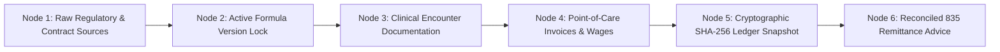

# PHASE 70 — AUDIT AND PROVENANCE
## Financial Provenance Chain, Immutable Ledger Integration, Historical Reproducibility & 10-Year CMS Compliance

> **Phase:** 70 — Financial Data Dictionary  
> **Status:** AUDIT & PROVENANCE SPECIFICATION  
> **Target Version:** ASCANALYST v2026.1 Enterprise  
> **Classification:** Compliance, Auditability & Financial Integrity (SOX § 404, CMS 10-Year Retention)  

---

## 1. FINANCIAL PROVENANCE PHILOSOPHY

In healthcare revenue cycle management, an audit defense is only as strong as its weakest mathematical link. When Medicare Administrative Contractors (MACs), commercial payers, or external accounting auditors examine an ASC's financials, every presented number must be **completely reproducible from immutable historical source records**.

Phase 70 establishes a **6-node provenance chain** binding every presented metric to its origin:

---

## 2. THE 6-NODE PROVENANCE SCHEMA

Every calculated financial dollar in ASCANALYST carries immutable metadata attributes:

| Provenance Node | Required Metadata Attributes | Physical Source of Truth |
| :--- | :--- | :--- |
| **1. Upstream Source Lock** | Source ID, CMS Release Year, CBSA Wage Code, Payer Contract Version ID | `reimbursement_sources`, `payer_contract_versions` |
| **2. Formula Version** | Formula Code, Formula Version Number, Approval Actor UID, Approval Timestamp | `financial_formula_registry` |
| **3. Clinical Encounter** | Surgery ID, Case Number, Date of Service, Attending Surgeon NPI, Facility ID | `surgeries`, `cases`, `surgery_procedures` |
| **4. Cost Attribution** | Scanned SKU UDI, Vendor Invoice Line ID, Staff Assignee UIDs, OR Duration Mins | `case_devices`, `case_staff_assignments` |
| **5. Ledger Snapshot** | Calculation Snapshot UUID, Canonical Payload String, SHA-256 Digest | `reimbursement_calculations` |
| **6. Remittance Matching** | ANSI 835 Trace Number, EOB Check/EFT ID, CARC/RARC Codes, Remittance Date | `case_financial_reconciliations` |

---

## 3. HISTORICAL REPRODUCIBILITY (10-YEAR CMS COST REPORTING)

Under CMS regulations (42 CFR § 413.20), Ambulatory Surgery Centers must retain complete clinical and financial cost reporting records for a **minimum of 10 years**.

### Historical Recalculation Safeguards:
1. **No In-Place Overwrites:** Recalculations never overwrite historical snapshots. They append a new snapshot with an incremented `version_number` and record the prior snapshot ID as `superseded_by`.
2. **Version-Locked Historical Reruns:** When an auditor requests a rerun of a 2026 case in the year 2031, the calculation engine does not query 2031 rates; it binds exclusively to the exact contract version, wage index, and CPT code rules that were active on the original Date of Service.
3. **Canonical Digest Verification:** Stored procedure `fn_verify_reimbursement_calculation_integrity` recomputes the SHA-256 hash across stored row values:
   $$\text{Computed Digest} \stackrel{?}{=} \text{Stored Digest}$$
   Any manual row tampering or silent data corruption immediately trips an audit warning.

---

## 4. DEFECT CLASSIFICATION TAXONOMY

When an audit review flags a discrepancy, it must be categorized into one of three distinct failure classes:

| Failure Class | Root Cause | Impact | Automated Remediation Path |
| :--- | :--- | :--- | :--- |
| **Data Quality Defect** | Missing implant invoice or unlogged staff hours | Case marked `MISSING_SOURCE_DATA` | Route to Incomplete Queue for staff document upload |
| **Calculation Drift Defect** | Discrepancy between client estimate and DB stored proc | Variance flagged $> \$0.01$ | Re-invoke authoritative stored procedure `fn_calculate_expected_reimbursement` |
| **Ledger Tampering Defect** | Stored row columns modified directly via DB console | SHA-256 Hash Mismatch | Lock record, log P0 Security Violation, alert Compliance Officer |

