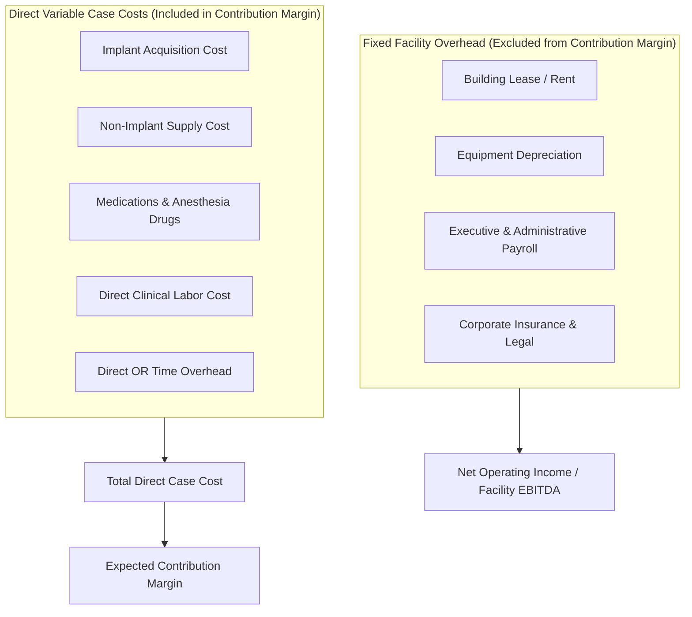

# PHASE 70 — COST AND EXPENSE DEFINITIONS
## Direct Variable Case Costs, Implant Invoices, Clinical Labor, OR Room Rates & Fixed Overhead Allocation

> **Phase:** 70 — Financial Data Dictionary  
> **Status:** CANONICAL COST & EXPENSE SPECIFICATION  
> **Target Version:** ASCANALYST v2026.1 Enterprise  
> **Classification:** Healthcare Managerial Cost Accounting & CMS ASC Cost Reporting  

---

## 1. COST ACCOUNTING PHILOSOPHY

Managerial cost accounting in an ASC serves two critical purposes:
1. **Case-Level Contribution Margin Analysis:** Determining the marginal cash generated by an individual surgical procedure after covering its direct, variable clinical expenses.
2. **Facility-Wide Operating Profitability:** Allocating fixed facility overhead, depreciation, and general administration to measure true net operating income.

To avoid distorted decision-making, ASCANALYST enforces strict separation between **Direct Variable Case Costs** (which vary case-by-case) and **Fixed Allocated Overhead** (which exists regardless of case volume).

---

## 2. CANONICAL COST TAXONOMY

### 2.1 Implant Acquisition Cost
- **Canonical Code:** `implant_acquisition_cost`
- **Cost Classification:** Direct Variable (Item-level actual)
- **Datatype:** `NUMERIC(12,2)`
- **Source of Truth:** `public.case_devices.cost` reconciled against `public.facility_implant_sku_prices`.
- **Business Definition:** The actual net invoice cost incurred by the ASC to purchase surgical implants consumed and implanted during the procedure (plates, screws, anchors, artificial joints, Toric/multifocal IOL lenses).
- **Inclusion:** **Included in Contribution Margin.**
- **Missing Data Rule:** If an implant was scanned or required by CPT construct rules but lacks an invoice price, the cost must be set to `NULL` with status `MISSING_SOURCE_DATA`. It must never silently default to `$0.00`.

### 2.2 Direct Supply Cost
- **Canonical Code:** `direct_supply_cost`
- **Cost Classification:** Direct Variable (Case-level actual / standard BOM)
- **Datatype:** `NUMERIC(12,2)`
- **Source of Truth:** `public.surgeries.supplies_cost` / Preference card consumable picklist.
- **Business Definition:** The acquisition cost of disposable, non-implant clinical supplies consumed during the case (custom surgical packs, gowns, drapes, suction canisters, irrigation solutions, sutures).
- **Inclusion:** **Included in Contribution Margin.**
- **Anti-Duplication Rule:** Implants must never be bundled into `direct_supply_cost`.

### 2.3 Medication & Anesthesia Drug Cost
- **Canonical Code:** `medication_cost`
- **Cost Classification:** Direct Variable (Case-level actual)
- **Datatype:** `NUMERIC(12,2)`
- **Source of Truth:** `public.surgeries.medications_cost` / Pyxis / Omnicell dispensing log.
- **Business Definition:** Direct expense of specialized pharmaceuticals administered intra-operatively (reversal agents, local anesthetics, narcotics, antibiotics, prophylactic antiemetics).
- **Inclusion:** **Included in Contribution Margin.**

### 2.4 Direct Clinical Labor Cost
- **Canonical Code:** `direct_clinical_labor_cost`
- **Cost Classification:** Direct Variable (Staff-hours actual)
- **Datatype:** `NUMERIC(12,2)`
- **Source of Truth:** `public.case_staff_assignments` linked to `public.staff_credentials.hourly_rate`.
- **Formula:**
  $$\text{Labor Cost} = \sum_{i=1}^{n} \left(\text{Staff Elapsed Hours}_i \times \text{Hourly Wage Rate}_i \times (1.00 + \text{Fringe Benefit Multiplier})\right)$$
- **Business Definition:** The true loaded payroll cost (wages plus payroll taxes and fringe benefits) of clinical personnel directly dedicated to the surgical encounter (circulating RN, scrub tech, CRNA, first assistant).
- **Prohibited Rule:** The legacy heuristic `calculateLaborCost = orCost * 0.30` is **DEPRECATED & PROHIBITED**.

### 2.5 Direct OR Time Cost
- **Canonical Code:** `direct_or_time_cost`
- **Cost Classification:** Direct Variable (Duration-based allocation)
- **Datatype:** `NUMERIC(12,2)`
- **Source of Truth:** `public.operating_rooms.hourly_rate` / `facility_financial_settings`.
- **Formula:**
  $$\text{OR Time Cost} = \text{Surgical Case Duration (Minutes)} \times \left(\frac{\text{Room Hourly Rate}}{60}\right)$$
- **Business Definition:** The variable operational utility and room expense of running an active operating suite during surgery (room sanitization, sterile field airflow, specialized surgical lighting, medical gases).
- **Inclusion:** **Included in Contribution Margin.**

### 2.6 Total Direct Case Cost
- **Canonical Code:** `total_direct_case_cost`
- **Cost Classification:** Total Variable Cost
- **Datatype:** `NUMERIC(12,2)`
- **Formula:**
  $$\text{Total Direct Cost} = \text{implant\_cost} + \text{supply\_cost} + \text{medication\_cost} + \text{labor\_cost} + \text{or\_time\_cost}$$
- **Business Definition:** The complete sum of all variable, out-of-pocket expenses directly attributable to performing the surgical encounter.

---

## 3. FIXED FACILITY OVERHEAD & CAPITAL ALLOCATION

Fixed expenses exist independently of case volume and are reported only at the facility or enterprise level:

| Expense Category | Accounting Nature | Allocation Basis for Cost Reporting | Contribution Margin Impact | Operating Profit Impact |
| :--- | :--- | :--- | :---: | :---: |
| **Building Lease / Mortgage** | Fixed Facility Cost | Square Footage / OR Room Count | **EXCLUDED** | **INCLUDED** |
| **Capital Equipment Depreciation**| Depreciation (GAAP) | Straight-Line Useful Life | **EXCLUDED** | **INCLUDED** |
| **Administrative & C-Suite Payroll**| General & Administrative | Equal Facility Allocation | **EXCLUDED** | **INCLUDED** |
| **Corporate Malpractice Insurance**| Operational Overhead | Surgeon Specialty Risk Pool | **EXCLUDED** | **INCLUDED** |
| **Software Licenses (ASCANALYST)** | Fixed IT Expense | Monthly SaaS Allocation | **EXCLUDED** | **INCLUDED** |

### Anti-Distortion Policy:
Fixed overhead must **never be allocated on a per-minute basis to case contribution margins**. Allocating fixed building rent to individual cases artificially distorts clinical specialty profitability (e.g. penalizing long orthopedic cases with fixed building rent, making profitable surgeons appear unprofitable).

