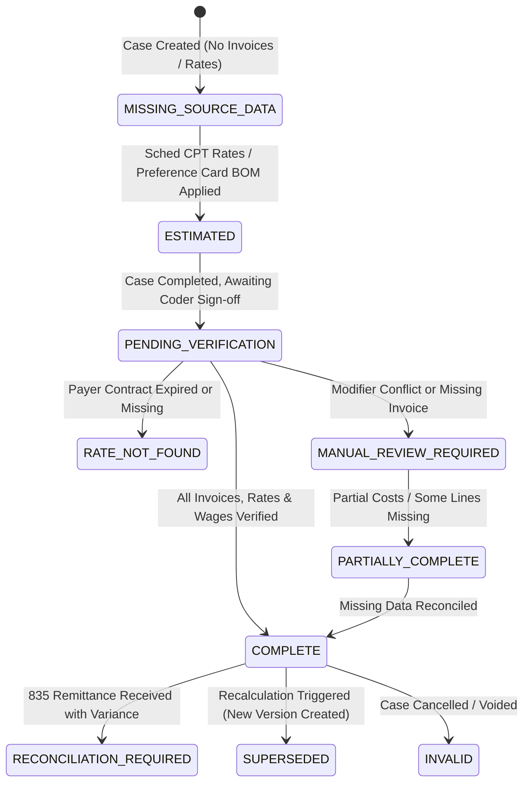

# PHASE 70 — DATA COMPLETENESS AND QUALITY
## Financial Data Integrity, Completeness Lifecycle, Missing-Data Handling & Aggregate Safeguards

> **Phase:** 70 — Financial Data Dictionary  
> **Status:** DATA QUALITY & COMPLETENESS SPECIFICATION  
> **Target Version:** ASCANALYST v2026.1 Enterprise  
> **Classification:** Healthcare Data Governance & Statistical Reliability Standards  

---

## 1. DATA QUALITY PHILOSOPHY

A financial figure without a data quality indicator is dangerous in surgical administration. 

In past prototype versions, if an implant invoice was not yet received or a commercial rate was missing, systems often silently defaulted the cost to `$0.00` or the revenue to list gross charges. This resulted in cases appearing to have 99% profit margins when in reality thousands of dollars in implant costs had simply not been recorded.

Phase 70 mandates that **every financial figure carries an explicit completeness state**. Incomplete cases must never silently contaminate executive totals or physician scorecards.

---

## 2. CANONICAL FINANCIAL COMPLETENESS STATUS MODEL

ASCANALYST establishes a 10-tier standardized data completeness enumeration:

### Status Descriptions & Rules:

| Completeness Status Code | Display Label | Badge Token | Required Source Conditions | Aggregation Allowed? | Export Permitted? |
| :--- | :--- | :--- | :--- | :---: | :---: |
| `COMPLETE` | Fully Verified | Crisp Emerald (`#10b981`) | Contract version locked, all implant invoices verified, staff wages logged | **YES** (100% Truth) | **YES** |
| `PARTIALLY_COMPLETE` | Partial Data | Amber (`#f59e0b`) | Some CPT lines adjudicated; ancillary supply invoice pending | **CONDITIONAL** (Flagged) | **YES** (With Warning) |
| `ESTIMATED` | Pre-Op Estimate | Sky Blue (`#38bdf8`) | Pre-op scheduling calculation based on active fee schedules | **EXCLUDED** from Actuals | **YES** (Labeled Estimate) |
| `PENDING_VERIFICATION` | Awaiting Review | Neutral Slate (`#64748b`) | Intra-op finished; coder has not signed off on final modifiers | **EXCLUDED** from Final | **NO** |
| `MISSING_SOURCE_DATA` | Missing Invoices | Rose (`#f43f5e`) | Implant consumed without invoice; staff hours unlogged | **EXCLUDED** from Margin | **NO** |
| `RATE_NOT_FOUND` | Contract Missing | Orange (`#f97316`) | Payer contract not found for encounter DOS | **EXCLUDED** from Allowable | **NO** |
| `MANUAL_REVIEW_REQUIRED` | Biller Review | Amber Alert (`#d97706`) | Stop-loss threshold exceeded or NCCI PTP edit conflict | **EXCLUDED** from Auto-Bill | **NO** |
| `RECONCILIATION_REQUIRED`| Remittance Diff | Sky Alert (`#0284c7`) | 835 ERA payment differs from contract allowable by $> \$50.00$ | **YES** (Flagged Variance) | **YES** |
| `SUPERSEDED` | Historical Record | Dim Slate (`#475569`) | Prior calculation run replaced by post-op recalculation | **EXCLUDED** from Active | **AUDIT ONLY** |
| `INVALID` | Voided / Cancelled | Rose Alert (`#be123c`) | Case cancelled or billing claim voided | **EXCLUDED** | **AUDIT ONLY** |

---

## 3. STRICT MISSING-DATA RULES

### Rule 1: The Zero-Substitution Ban
**Missing financial values must NEVER be replaced with `$0.00`.**
- If an implant invoice is missing, `implant_cost` must remain `NULL`.
- The case contribution margin must evaluate to `NULL` (or render as `"Incomplete"`) rather than subtracting zero.
- The UI must display an Amber warning pill: `"Implant Cost Pending Invoice"`.

### Rule 2: The Gross Charge Fallback Ban
If a commercial payer contract or Medicare fee schedule rate is missing for a CPT code, the system is **STRICTLY PROHIBITED** from substituting gross billed charges. It must set `allowable = NULL` and status = `RATE_NOT_FOUND`.

### Rule 3: Contamination Prevention in Aggregates
When computing facility-wide or surgeon-level average margins:
- Incomplete cases (`PARTIALLY_COMPLETE`, `MISSING_SOURCE_DATA`, `ESTIMATED`) must be **excluded from the numerator and denominator of completed financial averages**.
- Dashboards must disclose the exclusion:
  $$\text{"Surgeon Average Margin based on 42 verified cases (6 cases excluded due to pending vendor invoices)."}$$

### Rule 4: Cash Collections vs. Estimates
Pending insurance claims and expected contractual allowables must **never be counted as collected cash**. Cash collection reports must query only cleared `posted` and `reconciled` payment ledgers.

