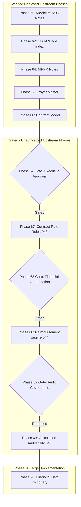

# PHASE 70 — DEPENDENCY AND CROSS-MODULE AUDIT
## Upstream Gate Dependencies, Cross-Module Financial Consistency Matrix & Controlled Migration Path

> **Phase:** 70 — Financial Data Dictionary  
> **Status:** CROSS-MODULE AUDIT & DEPENDENCY SPECIFICATION  
> **Target Version:** ASCANALYST v2026.1 Enterprise  
> **Classification:** Enterprise Architectural Alignment & Transition Planning  

---

## 1. UPSTREAM RELEASE GATES & DEPENDENCY HIERARCHY

Phase 70 serves as the semantic and financial dictionary for all preceding and subsequent phases. However, it must strictly observe the operational status of upstream gates:

### Upstream Gate Rules:
1. **Phase 67 Rate Rules Gate:** Migration `043_payer_contract_rate_rules.sql` is implemented in code and test-verified, but remains unapplied to production pending executive administrative review.
2. **Phase 68 Engine Gate:** Migration `044_expected_reimbursement_engine.sql` is fully implemented and passes all 29 automated tests, but remains held behind the Phase 67 gate.
3. **Phase 69 Auditability Gate:** Migration `045_reimbursement_calculation_auditability.sql` is strictly proposed and design-only.
4. **Phase 70 Autonomous Independence:** The canonical definitions (e.g. *Gross Charges*, *Collections*, *Direct Costs*, *Quality States*) can be codified immediately in documentation, but runtime database dictionary tables (`046`) must not be applied until upstream migrations are cleared.

---

## 2. CROSS-MODULE FINANCIAL CONSISTENCY MATRIX

Every module in ASCANALYST that displays financial numbers was audited to establish its current calculation, target canonical standard, and required migration action:

| Application Module | Displayed Metric | Existing Formula / Implementation | Target Canonical Metric & Formula | Required Migration Action |
| :--- | :--- | :--- | :--- | :--- |
| **Executive Dashboard** (`CommandCenter.jsx`) | "Total Revenue" | `gross_charge - write_off` or fallback to `expected_reimbursement` | `expected_contractual_revenue` (derived from `reimbursement_calculations`) | **REFACTOR:** Replace fallback loop with authoritative snapshot allowable |
| **Executive Dashboard** (`CommandCenter.jsx`) | "EBITDA" | `totalRevenue - totalCosts` at case level | `expected_contribution_margin` (`allowable - direct_costs`) | **REPLACE:** Relabel card to "Contribution Margin"; reserve EBITDA for corporate statement |
| **Business Analysis** (`BusinessAnalysis.jsx`) | "OR Room Cost" | Hardcoded stepped fee (`$1,500` + `$300`/hr) | `direct_or_time_cost` (`duration * room_hourly_rate / 60`) | **REPLACE:** Query `operating_rooms.hourly_rate` from database |
| **Surgeon Portal** (`SurgeonPortal.jsx`) | "Net Profit" | `snapshot.net_margin` or client loop | `expected_contribution_margin` | **REFACTOR:** Relabel header from "Net Profit" to "Contribution Margin" |
| **Surgery Scheduler** (`SurgeryScheduler.jsx`) | "Estimated Revenue" | Fallback fee schedule or gross charge | `expected_contractual_allowable` (Status: `ESTIMATED`) | **REFACTOR:** Display Sky Blue `ESTIMATED` badge |
| **Implant Intelligence** (`CaseImplantUsage.jsx`) | "Implant Cost" | Unit price from SKU schedule | `implant_acquisition_cost` | **KEEP:** Correctly bound to contract price schedule |
| **Claim Scrubber** (`ClaimScrubberWorkbench.jsx`) | "Gross Charges" | Sum of `claim_lines.line_gross_charge` | `gross_billed_charges` | **KEEP:** Compliant with 837P chargemaster standards |
| **Reimbursement Inspector** (`ReimbursementInspectorModal.jsx`) | "Contract Allowable" | `calculation.total_contract_allowable` | `contract_total_allowable` | **KEEP:** Authoritative, deterministic, exact to \$0.01 |
| **AI Analyst** (`MultiAgentConsole.jsx`) | Financial Insights | LLM prompt synthesis of case metrics | Bounded to server-side RPC metrics | **KEEP:** Complies with strict advisory boundary |

---

## 3. CONTROLLED MIGRATION ROADMAP

To prevent operational disruptions during dictionary adoption:
- **Phase A (Documentation & Standards - Complete):** Establish canonical dictionary definitions and deprecate heuristic terminology in documentation.
- **Phase B (Client Relabeling - Non-Breaking):** Update UI display labels in `CommandCenter.jsx` and `SurgeonPortal.jsx` (e.g. changing "EBITDA" to "Contribution Margin" and adding `ESTIMATED` pills) without modifying underlying API payloads.
- **Phase C (Server-Authoritative Transition):** Upon executive authorization of Migrations 043, 044, and 045, deploy Migration 046 to bind all modules directly to `financial_metric_definitions`.

