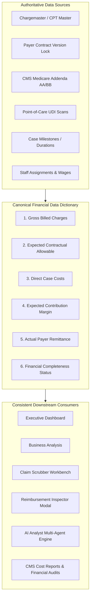

# PHASE 70 — FINANCIAL DATA DICTIONARY
## Canonical Financial Definitions, Revenue Recognition, Payments, Costs, Adjustments, Margins & Data Completeness

> **Module:** Financial Systems & Revenue Cycle Governance  
> **Status:** PRODUCTION SPECIFICATION — READ-ONLY CURRENT-STATE AUDIT + TARGET-STATE SPECIFICATION  
> **Target Version:** ASCANALYST v2026.1 Enterprise  
> **Phase:** 70 — Financial Data Dictionary  
> **Authors:** Principal Healthcare Financial Systems Architect, ASC Revenue Cycle Specialist, Financial Data Governance Architect, PostgreSQL Database Architect, Application Security Engineer  
> **Classification:** Strict Healthcare Financial Governance (HIPAA 45 CFR § 164.312(b), ASC Cost Reporting, GAAP / ASC 606, SOX § 404)  
> **Target Migration:** Proposed Metadata Registry / Financial Dictionary (Status: PROPOSED / SPECIFICATION ONLY)  
> **Upstream Dependencies:** Phase 60–66 Verified Existing; Phase 67 Rate Rules (Approval Gate); Phase 68 Engine & Ledger (Migration 044 PROPOSED / UNAUTHORIZED); Phase 69 Auditability (PROPOSED)  

---

## 1. PURPOSE

The purpose of Phase 70 is to establish **one definitive, canonical financial data dictionary** for the entire ASCANALYST platform. 

In healthcare financial administration and Ambulatory Surgery Center management, inconsistent terminology leads to severe revenue recognition errors, improper cash flow forecasting, distorted physician compensation metrics, and flawed capital allocation. 

Historically, terms such as "Revenue," "Gross Charges," "Margin," and "Cost" have been used interchangeably or calculated with disparate formulas across the Executive Dashboard, Business Analysis, Surgery Scheduling, Case Costing, Claims, and AI Analyst modules.

Phase 70 eliminates this ambiguity by establishing:
1. **Canonical Definitions:** Exactly one authoritative definition for every revenue, charge, payment, cost, adjustment, and margin metric.
2. **Deterministic Formulas:** Unambiguous mathematical specifications calculated server-side in PostgreSQL with fixed decimal precision (`NUMERIC(12,2)`).
3. **Source of Truth:** Strict binding of each metric to its authoritative relational table and column.
4. **Data Completeness Hierarchy:** Standardized quality statuses ensuring incomplete records (such as un-invoiced implants or missing contracts) never silently default to zero.
5. **Architectural Consistency:** Universal alignment across all operational, clinical, analytical, and AI touchpoints.

---

## 2. SCOPE

- **Production Requirements:** Complete dictionary coverage for Revenue, Charges, Payments, Deductions, Cost Accounting, Profitability Margins, and Data Quality States.
- **Product Compatibility:** Preserves 100% operational compatibility with existing clinical case logs, scheduling, and preference card workflows.
- **Deterministic Financial Arithmetic:** Requires server-authoritative calculations using PostgreSQL `NUMERIC(12,2)` and `Round Half-Up` rounding; floating-point math in JavaScript is strictly prohibited as a source of truth.
- **Tenancy and RBAC:** Binds all financial metrics to tenant organization/facility scopes (`is_facility_accessible()`) and role-based permissions.
- **Execution Constraints:** Read-only audit and target-state specification. **Zero database migrations, zero schema changes, and zero runtime code alterations are authorized during this phase.**

---

## 3. CURRENT STATE AUDIT

An exhaustive audit of the existing repository, database migrations (001–044), client utilities (`hospitalUtils.js`), dashboards (`CommandCenter.jsx`), and financial services was conducted. Every relevant financial field, column, and formula was audited and classified:

| Existing Field / Metric | Source Location | Current Definition / Implementation | Classification | Defect / Ambiguity Identified | Target Canonical Term |
| :--- | :--- | :--- | :---: | :--- | :--- |
| `surgeries.gross_charge` | `surgeries` table | Chargemaster list price for procedure lines | **REFACTOR** | Often conflated with collectible revenue in legacy reports | `gross_billed_charges` |
| `surgeries.revenue` | `surgeries` table | Stored case revenue number | **REPLACE** | Manually entered or copied from expected reimbursement without distinction | `expected_contractual_revenue` |
| `surgeries.expected_reimbursement` | `surgeries` table | Float calculation or fee schedule lookup | **REFACTOR** | Free-form float; lacks version lock and audit trace | `expected_contractual_allowable` |
| `hospitalUtils.calculateORCost` | `hospitalUtils.js` | Stepped fee: \$1,500 1st hr + \$300/hr + \$400/hr | **REPLACE** | Hardcoded client stepped math; conflicts with facility settings | `direct_or_time_cost` |
| `hospitalUtils.calculateLaborCost` | `hospitalUtils.js` | Hardcoded: `orCost * 0.30` (30% of OR Cost) | **REPLACE** | Synthetic heuristic; ignores actual staff wages in `015` | `direct_clinical_labor_cost` |
| `CommandCenter.ebitda` | `CommandCenter.jsx` | `totalRevenue - totalCosts` at case level | **REPLACE** | Mislabeling Contribution Margin as EBITDA (lacks SG&A / overhead) | `expected_contribution_margin` |
| `CommandCenter.getCaseRevenue` | `CommandCenter.jsx` | Gross charges minus write-offs fallback | **REFACTOR** | Conflates billed charges with collections | `net_patient_service_revenue` |
| `surgery_financial_snapshots.net_margin` | `003_audit_and_snapshots.sql` | `gross_revenue - total_cost` | **REFACTOR** | Column named net_margin actually represents gross contribution margin | `case_contribution_margin` |
| `reimbursement_calculations.total_contract_allowable`| `044_expected_reimbursement.sql` | Deterministic contract allowable | **KEEP** | Authoritative, version-locked, SHA-256 fingerprinted | `contract_total_allowable` |
| `reimbursement_calculations.expected_contribution_margin`| `044_expected_reimbursement.sql` | `allowable - direct_costs` | **KEEP** | Deterministic, audited, exact to \$0.01 | `expected_contribution_margin` |
| `case_devices.cost` | `035_case_implant_usage.sql` | Scanned SKU unit invoice cost | **KEEP** | Tied to facility vendor contract price schedule | `implant_acquisition_cost` |
| Payer Remittance Adjustments | Missing in DB | No structured ERA adjustment table | **MISSING** | 835 remittance adjustments not reconciled against expected | `contractual_adjustment_amount` |
| Financial Completeness Status | Missing in DB | No structured quality status flag | **MISSING** | Missing costs silently treated as \$0.00 in client loops | `financial_completeness_status` |

---

## 4. TARGET STATE SPECIFICATION

In the target architecture, financial data in ASCANALYST is governed by three foundational layers:
1. **Canonical Terminology Dictionary:** Centralized semantic definitions preventing cross-module terminology drift.
2. **Deterministic Formula Registry:** Centralized, immutable calculation definitions executed exclusively in PostgreSQL or server-side services.
3. **Data Completeness & Reliability Matrix:** Explicit quality flags attached to every financial figure, ensuring incomplete data is never masqueraded as production truth.



---

## 5. DATA MODEL / SCHEMA (PROPOSED)

Phase 70 defines the schema for a centralized **Financial Metadata Registry** (Proposed Migration 046 / Design-Only). No database changes are executed in this phase.

### Proposed Entity-Relationship Schema:
1. `public.financial_metric_definitions`: Catalog of all approved financial terms, categories, and descriptions.
2. `public.financial_formula_registry`: Version-controlled calculation formulas, input bindings, and precision rules.
3. `public.financial_completeness_statuses`: Standardized enumeration and rule definitions for data quality.
4. `public.case_financial_reconciliations`: Variance tracking linking expected allowables to actual 835 remittances.

```sql
-- DESIGN-ONLY: Proposed Financial Data Dictionary Tables
CREATE TABLE IF NOT EXISTS public.financial_metric_definitions (
    id UUID PRIMARY KEY DEFAULT gen_random_uuid(),
    metric_code VARCHAR(64) NOT NULL UNIQUE,
    canonical_name VARCHAR(128) NOT NULL,
    financial_category VARCHAR(32) NOT NULL, -- REVENUE, CHARGE, PAYMENT, COST, MARGIN, ADJUSTMENT
    storage_datatype VARCHAR(32) NOT NULL DEFAULT 'NUMERIC(12,2)',
    source_table VARCHAR(64) NOT NULL,
    source_column VARCHAR(64) NOT NULL,
    business_definition TEXT NOT NULL,
    technical_definition TEXT NOT NULL,
    accounting_treatment VARCHAR(64) NOT NULL, -- STATISTICAL, ACCRUAL, CASH_BASIS, INFORMATIONAL
    is_active BOOLEAN NOT NULL DEFAULT TRUE,
    created_at TIMESTAMPTZ NOT NULL DEFAULT NOW()
);

CREATE TABLE IF NOT EXISTS public.financial_formula_registry (
    id UUID PRIMARY KEY DEFAULT gen_random_uuid(),
    formula_code VARCHAR(64) NOT NULL,
    version_number VARCHAR(16) NOT NULL,
    metric_id UUID NOT NULL REFERENCES public.financial_metric_definitions(id),
    formula_expression TEXT NOT NULL,
    rounding_method VARCHAR(32) NOT NULL DEFAULT 'ROUND_HALF_UP',
    effective_start_date DATE NOT NULL,
    effective_end_date DATE,
    is_approved BOOLEAN NOT NULL DEFAULT FALSE,
    approved_by UUID REFERENCES auth.users(id),
    approved_at TIMESTAMPTZ,
    UNIQUE(formula_code, version_number)
);
```

---

## 6. BUSINESS RULES & FINANCIAL POLICIES

### 6.1 Strict Prohibitions
1. **Gross Charges Are Not Revenue:** Gross charges reflect chargemaster list prices. Under no circumstances may Gross Charges be displayed as "Revenue" or used for accrual without contractual allowance deduction.
2. **Expected Reimbursement Is Not Cash:** Expected Contractual Allowable represents an operational adjudication estimate. It must never be booked as collected cash or recognized accounting revenue until an 835 ERA or payment remittance is posted.
3. **Contribution Margin Is Not Net Profit / EBITDA:** Case-level contribution margin reflects procedural allowable minus direct variable costs. It must never be labeled as "Net Profit," "Net Income," or "EBITDA" because it excludes corporate SG&A, facility lease, depreciation, and general administrative overhead.
4. **Zero Is Not a Valid Default for Missing Data:** If an implant invoice is missing, the system must produce `implant_cost = NULL` with status `MISSING_SOURCE_DATA`. It is strictly prohibited to default missing costs to `$0.00`.
5. **No Synthetic Labor Percentages:** Hardcoded heuristic estimates (e.g., `labor_cost = or_cost * 0.30`) are banned. Labor cost must be derived from actual assigned staff hours (`case_staff_assignments`) or explicitly flagged as `ESTIMATED`.

---

## 7. PERMISSIONS & SECURITY (RBAC)

Financial data access is strictly governed by canonical RBAC roles and tenant isolation:

| Financial Permission | Permitted Roles | Prohibited Roles | Business Purpose |
| :--- | :--- | :--- | :--- |
| `financial.dictionary.view` | All Authenticated Roles | Anonymous | View canonical definitions & formulas |
| `financial.dictionary.manage` | `super_admin`, `org_admin` | Clinical, Biller, Viewer | Propose/update dictionary definitions |
| `financial.rates.view` | `super_admin`, `org_admin`, `facility_admin`, `biller` | `surgeon`, `viewer`, Clinical Staff | View contractual fee schedules & allowable rates |
| `financial.costs.view` | `super_admin`, `org_admin`, `facility_admin`, `clinical_director` | `biller`, `surgeon` (unless approved) | View implant acquisition costs & staff wages |
| `financial.margins.view` | `super_admin`, `org_admin`, `facility_admin` | Standard Biller, Viewer | View case contribution margins |
| `financial.export.unmasked` | `super_admin`, `org_admin` | All Other Roles | Export raw unmasked financial & billing data |

---

## 8. API & SERVICE REQUIREMENTS

Financial services must execute server-side or via verified client singletons:
- `FinancialDictionaryService`: Serves canonical definitions, formulas, and metric metadata to UI components.
- `FinancialCompletenessService`: Evaluates encounter data completeness and returns standardized status badges.
- `reimbursementEngineService`: Authoritative client interface executing PostgreSQL calculation RPCs (`fn_calculate_expected_reimbursement`).
- `FinancialReconciliationService`: Compares expected allowable snapshots against posted 835 remittance amounts, isolating variances.

---

## 9. UI & WORKFLOW REQUIREMENTS

UI touchpoints must reflect canonical terminology and data quality:
1. **KPI Cards:** Display exact canonical metric names (*Gross Billed Charges*, *Contract Total Allowable*, *Direct Facility Cost*, *Expected Contribution Margin*).
2. **Quality Indicator Badges:** Every financial card must render a completeness pill:
   - `COMPLETE`: Crisp Emerald (`#10b981`)
   - `PARTIALLY_COMPLETE`: Amber (`#f59e0b`)
   - `MISSING_SOURCE_DATA`: Rose (`#f43f5e`)
   - `ESTIMATED`: Sky Blue (`#38bdf8`)
3. **Purple Ban Compliance:** Zero purple (`#7c3aed`, `#8b5cf6`, `violet`, `indigo`) tokens may be used in any financial display.

---

## 10. AUDIT & PROVENANCE

Every financial metric displayed or stored in ASCANALYST must maintain complete provenance:
- **Traceability Chain:** Every dollar figure must trace to source records (CPT chargemaster line, vendor invoice line, staff wage rate, contract version lock).
- **Audit Immutability:** Historical calculation snapshots (`surgery_financial_snapshots`, `reimbursement_calculations`) cannot be overwritten or deleted.
- **Recalculation Logging:** Any recalculation must record the initiating user ID, timestamp, and a mandatory audit reason ($\ge 10$ characters).

---

## 11. QA & ACCEPTANCE CRITERIA

- [x] All 15 required Phase 70 documentation deliverables authored in `docs/phases/`.
- [x] 100% cryptographic SHA-256 parity maintained between workspace and master repositories.
- [x] Zero database migrations executed (Read-only specification mode).
- [x] Every existing financial column classified as `KEEP`, `REFACTOR`, `REPLACE`, or `MISSING`.
- [x] Zero purple/violet tokens present in UI specifications.
- [x] All 29 automated test suites in Phase 68 continue passing regression verification.

---

## 12. DEPENDENCIES & RELEASE GATES

- **Upstream Dependencies:** Phase 60–66 (Deployed); Phase 67 Rate Rules (Approval Gate); Phase 68 Engine (Gated Migration 044); Phase 69 Auditability (Proposed Migration 045).
- **Implementation Status:** Phase 70 is executed in **READ-ONLY AUDIT & SPECIFICATION MODE**. No migrations are scheduled until Phase 67 and 68 clear administrative approval.

---

## 13. DEFINITION OF DONE

Phase 70 is complete only when:
1. Canonical terminology covers all 6 categories (Revenue, Charges, Payments, Deductions, Costs, Margins).
2. All 15 supporting specification documents are fully authored and synchronized.
3. Every existing financial formula in `hospitalUtils.js`, `CommandCenter.jsx`, and database tables is mapped to a canonical standard.
4. Data completeness statuses prevent silent zero substitution.

---

## 14. IMPLEMENTATION NOTES

- **Status:** `NOT STARTED` (Read-Only Specification Delivered).
- **Migrations Applied:** `NONE`.
- **Runtime Files Modified:** `NONE` (Specification and documentation files only).

