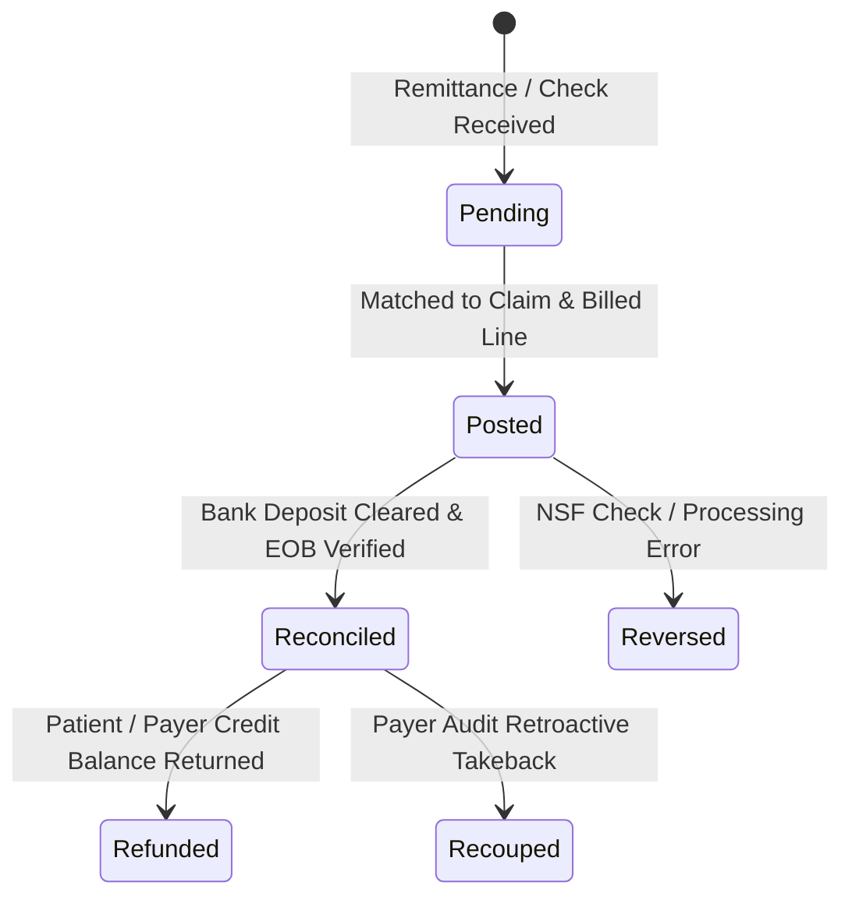

# PHASE 70 — PAYMENT AND COLLECTION DEFINITIONS
## Cash Receipts, Payer Remittances (835 ERA), Patient Collections, Adjustments, Recoupments & AR Aging

> **Phase:** 70 — Financial Data Dictionary  
> **Status:** CANONICAL PAYMENT & COLLECTION SPECIFICATION  
> **Target Version:** ASCANALYST v2026.1 Enterprise  
> **Classification:** Healthcare Revenue Cycle Accounting & Cash Flow Management  

---

## 1. PAYMENT & REMITTANCE PHILOSOPHY

Cash collections in an Ambulatory Surgery Center derive from two distinct sources:
1. **Third-Party Payers:** Commercial insurers, Medicare Administrative Contractors (MACs), and Medicaid plans paying via Electronic Remittance Advice (ANSI ASC X12 835) or paper Explanation of Benefits (EOB).
2. **Patients:** Individual consumer liabilities paid via pre-op credit card point-of-sale (POS), post-op statement billing, or payment plans.

Because payer remittances frequently contain contractual adjustments, partial payments, secondary cross-overs, interest penalties, and retroactive takebacks (recoupments), cash receipts must never be tracked as simple unadjudicated figures.

---

## 2. CANONICAL PAYMENT TAXONOMY

### 2.1 Gross Payer Payment
- **Canonical Code:** `gross_payer_payment`
- **Category:** Cash Inflow
- **Datatype:** `NUMERIC(12,2)`
- **Source of Truth:** Sum of ANSI 835 ERA `CLP04` (Total Claim Payment Amount) or cleared check/EFT deposit.
- **Business Definition:** The unadjusted gross dollar amount remitted by an insurance payer for an encounter before deducting subsequent audit takebacks or recoupments.

### 2.2 Net Payer Payment
- **Canonical Code:** `net_payer_payment`
- **Category:** Net Cash
- **Datatype:** `NUMERIC(12,2)`
- **Formula:** `gross_payer_payment - payer_refund_recoupment`
- **Business Definition:** The actual net cash retained from insurance carriers after accounting for payer takebacks and audit chargebacks.

### 2.3 Patient Payment
- **Canonical Code:** `patient_payment`
- **Category:** Cash Inflow
- **Datatype:** `NUMERIC(12,2)`
- **Source of Truth:** POS merchant receipt, patient portal payment gateway, or check ledger.
- **Business Definition:** Direct cash, check, or card payments collected from the patient or guarantor toward deductible, copayment, or coinsurance obligations.

### 2.4 Secondary Payer Payment
- **Canonical Code:** `secondary_payer_payment`
- **Category:** Cash Inflow
- **Datatype:** `NUMERIC(12,2)`
- **Source of Truth:** Secondary 835 ERA remittance.
- **Business Definition:** Payment received from a secondary or supplemental insurance carrier (e.g. Medigap) covering balances remaining after primary payer adjudication.

### 2.5 Contractual Adjustment (Write-Off)
- **Canonical Code:** `contractual_adjustment`
- **Category:** Accounting Adjustment
- **Datatype:** `NUMERIC(12,2)`
- **Source of Truth:** ANSI 835 CAS Group Code `CO` (Contractual Obligation), specifically `CO-45` (Charge exceeds fee schedule / maximum allowable).
- **Business Definition:** The legally mandated reduction from gross billed charges down to the contracted allowable rate. **This is not bad debt; it is an uncollectible list-price discount.**

### 2.6 Administrative Write-Off
- **Canonical Code:** `administrative_write_off`
- **Category:** Bad Debt / Disputed
- **Datatype:** `NUMERIC(12,2)`
- **Source of Truth:** Supervisor-approved adjustment ledger.
- **Business Definition:** Non-contractual write-offs resulting from operational errors (e.g., untimely claim filing, failure to obtain pre-authorization, or billing dispute settlements). Requires managerial SoD sign-off.

### 2.7 Payer Refund & Recoupment (Takeback)
- **Canonical Code:** `payer_refund_recoupment`
- **Category:** Cash Outflow / Offset
- **Datatype:** `NUMERIC(12,2)`
- **Source of Truth:** ANSI 835 CAS Adjustment code `WO` / Provider-level adjustment `PLB` segment.
- **Business Definition:** An amount retroactively deducted from current payer remittances by the insurer to recover past perceived overpayments or post-payment audit findings.

### 2.8 Total Net Collections
- **Canonical Code:** `total_net_collections`
- **Category:** True Cash Realization
- **Datatype:** `NUMERIC(12,2)`
- **Formula:**
  $$\text{Total Net Collections} = \text{Net Payer Payment} + \text{Secondary Payer Payment} + \text{Patient Payment} - \text{Patient Refunds}$$
- **Business Definition:** The definitive net dollar amount of collected cash realized from all clinical and guarantor sources for the encounter.

---

## 3. COLLECTION EFFICIENCY & AR METRICS

### 3.1 Net Collection Rate
- **Canonical Code:** `net_collection_rate`
- **Category:** RCM Performance KPI
- **Datatype:** `NUMERIC(6,4)` (Rendered as Percentage)
- **Formula:**
  $$\text{Net Collection Rate} = \frac{\text{Total Net Collections}}{\text{Contract Total Allowable}} \times 100$$
- **Business Rule:** The denominator must always be **Contract Total Allowable**, never Gross Billed Charges. A clean collection rate approaches 95%–98% in high-performing ASCs.

### 3.2 Days in Accounts Receivable (DAR / DSO)
- **Canonical Code:** `days_in_ar`
- **Category:** RCM Aging KPI
- **Datatype:** `NUMERIC(6,2)`
- **Formula:**
  $$\text{Average Daily Gross Charges} = \frac{\text{Total Gross Charges (Last 90 Days)}}{90}$$
  $$\text{Days in AR} = \frac{\text{Total Outstanding Gross AR}}{\text{Average Daily Gross Charges}}$$
- **Aging Buckets:** Standardized into:
  - `0–30 Days`: Normal submission & payer processing window.
  - `31–60 Days`: Follow-up required; pending documentation.
  - `61–90 Days`: Elevated risk; appeal submission required.
  - `91–120 Days`: High delinquency; managerial escalation.
  - `120+ Days`: Critical write-off risk; collection agency / legal dispute.

---

## 4. LIFECYCLE & TRANSACTION STATUSES

Every payment record in ASCANALYST must exist in one of six mutually exclusive lifecycle states:

1. **`PENDING`:** Electronic remittance or check received but unapplied to encounter claim lines.
2. **`POSTED`:** Payment mapped to specific procedural line items and patient balance ledger.
3. **`RECONCILED`:** Cleared by banking institution and verified against clearinghouse 835 report.
4. **`REVERSED`:** Transaction annulled due to non-sufficient funds (NSF) or administrative reversal.
5. **`REFUNDED`:** Credit balance returned to patient or payer due to overpayment.
6. **`RECOUPED`:** Retroactively deducted by insurance carrier in a subsequent remittance batch.

### Anti-Duplication Rule:
To prevent double-counting across payer and patient totals:
- If an insurance carrier pays the patient directly and the patient signs over the check, it must be recorded as a `patient_payment` with provenance note `THIRD_PARTY_DIRECT_REMITTANCE`, never as a direct payer deposit.
